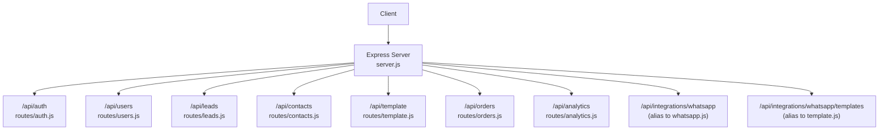
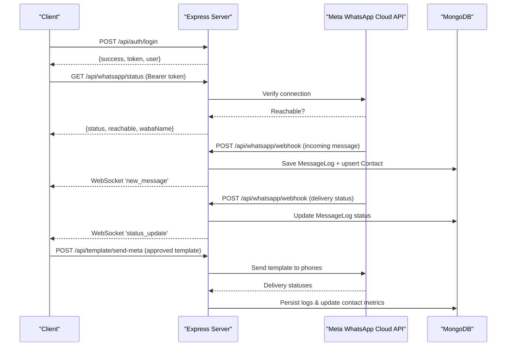
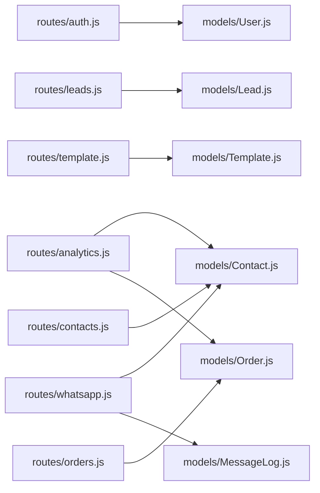
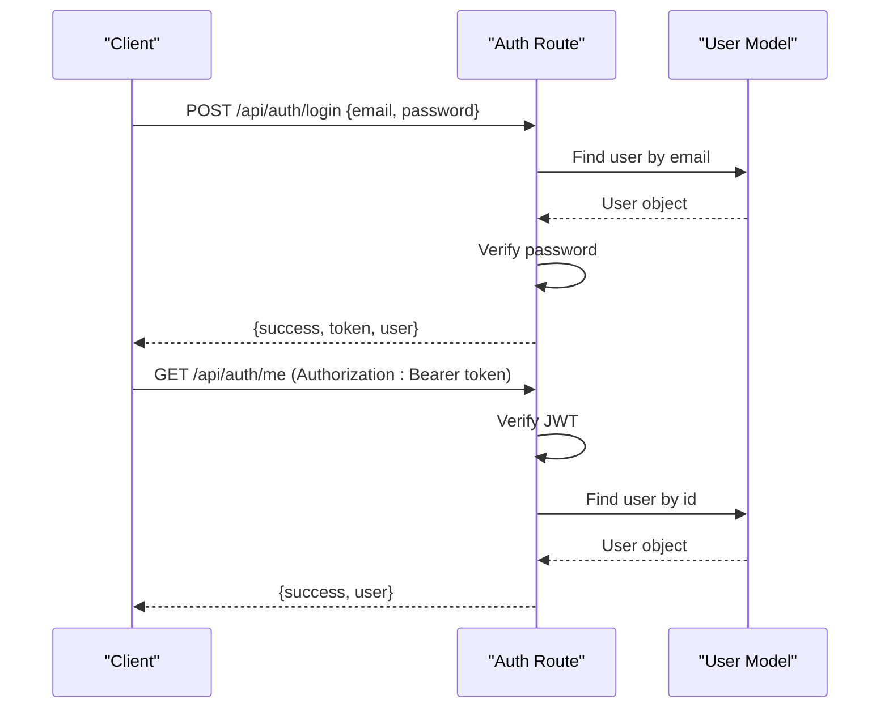

# API Reference

<cite>
**Referenced Files in This Document**
- [server.js](file://backend/server.js)
- [auth.js](file://backend/routes/auth.js)
- [whatsapp.js](file://backend/routes/whatsapp.js)
- [leads.js](file://backend/routes/leads.js)
- [contacts.js](file://backend/routes/contacts.js)
- [template.js](file://backend/routes/template.js)
- [orders.js](file://backend/routes/orders.js)
- [analytics.js](file://backend/routes/analytics.js)
- [users.js](file://backend/routes/users.js)
- [User.js](file://backend/models/User.js)
- [Contact.js](file://backend/models/Contact.js)
- [Lead.js](file://backend/models/Lead.js)
- [Template.js](file://backend/models/Template.js)
- [Order.js](file://backend/models/Order.js)
</cite>

## Table of Contents
1. [Introduction](#introduction)
2. [Project Structure](#project-structure)
3. [Core Components](#core-components)
4. [Architecture Overview](#architecture-overview)
5. [Detailed Component Analysis](#detailed-component-analysis)
6. [Dependency Analysis](#dependency-analysis)
7. [Performance Considerations](#performance-considerations)
8. [Troubleshooting Guide](#troubleshooting-guide)
9. [Conclusion](#conclusion)
10. [Appendices](#appendices)

## Introduction
This document provides comprehensive API documentation for the Whatsapp_Automachine backend REST endpoints. It covers authentication, WhatsApp integration, leads, contacts, templates, orders, and analytics. For each endpoint group, you will find HTTP methods, URL patterns, request/response schemas, authentication requirements, parameter specifications, error codes, status codes, and examples.

The backend is an Express application with:
- JWT-based authentication for protected endpoints
- Meta WhatsApp Cloud API integration via webhooks and template management
- MongoDB data models for users, contacts, leads, templates, orders
- Real-time updates via WebSockets (Socket.io) for incoming messages and delivery statuses

## Project Structure
The backend exposes REST routes under /api prefixes. The server mounts route modules and configures global middleware such as CORS, JSON parsing limits, static file serving, and a global error handler.

**Diagram sources**
- [server.js:44-56](file://backend/server.js#L44-L56)

**Section sources**
- [server.js:1-82](file://backend/server.js#L1-L82)

## Core Components
- Authentication: JWT tokens issued on sign-in/sign-up; token verification required for protected endpoints.
- WhatsApp Integration: Status checks, configuration, webhook handling for incoming messages and delivery statuses, message logs retrieval.
- Leads: CRUD operations, deduplication, single/batch WhatsApp messaging.
- Contacts: CRUD, bulk upload from Excel, opt-in/opt-out, segmentation, manual messaging.
- Templates: Create/import/sync Meta templates, scheduling, sending approved templates, stats.
- Orders: CRUD, status updates, stock restoration, summary statistics.
- Analytics: Revenue by period, top items, dashboard summary, per-customer history.

**Section sources**
- [auth.js:1-142](file://backend/routes/auth.js#L1-L142)
- [whatsapp.js:1-335](file://backend/routes/whatsapp.js#L1-L335)
- [leads.js:1-344](file://backend/routes/leads.js#L1-L344)
- [contacts.js:1-232](file://backend/routes/contacts.js#L1-L232)
- [template.js:1-644](file://backend/routes/template.js#L1-L644)
- [orders.js:1-135](file://backend/routes/orders.js#L1-L135)
- [analytics.js:1-85](file://backend/routes/analytics.js#L1-L85)

## Architecture Overview
The system integrates with Meta’s WhatsApp Cloud API through:
- Configuration endpoints to set WABA ID, phone number ID, access token, and verify token
- Webhook endpoints to receive incoming messages and delivery statuses
- Template management endpoints to create, import, sync, and send approved templates

Real-time updates are broadcast via Socket.io when new messages arrive or delivery statuses change.

**Diagram sources**
- [auth.js:60-113](file://backend/routes/auth.js#L60-L113)
- [whatsapp.js:8-36](file://backend/routes/whatsapp.js#L8-L36)
- [whatsapp.js:114-311](file://backend/routes/whatsapp.js#L114-L311)
- [template.js:108-152](file://backend/routes/template.js#L108-L152)

## Detailed Component Analysis

### Authentication API (/api/auth)
Authentication uses JWT tokens with a 7-day expiration. Tokens are included in the Authorization header as Bearer tokens.

Endpoints:
- POST /api/auth/sign-up or /api/auth/signup
  - Request body: name, email, password, companyName (optional), phone (optional), role (optional)
  - Response: success, token, user object
  - Validation: name/email/password required; duplicate email check; role defaults to employee if invalid
  - Errors: 400 validation errors, 201 created

- POST /api/auth/sign-in or /api/auth/login or /api/auth/signin
  - Request body: email, password
  - Response: success, token, user object
  - Special case: initial admin fallback credentials supported
  - Errors: 400 missing fields, 401 invalid credentials

- GET /api/auth/me
  - Requires Bearer token
  - Response: success, user object (password excluded)
  - Errors: 401 missing/invalid token, 404 user not found

Authentication flow:
- Sign-in returns a JWT containing id, email, role, name
- Protected endpoints should include Authorization: Bearer <token>

Example responses:
- Success login: { success: true, token: "...", user: { id, name, email, companyName, phone, role }, message }
- Error: { success: false, message: "..." }

Security notes:
- Passwords are hashed using PBKDF2 with a salt derived from JWT_SECRET
- Token secret is configurable via environment variable

**Section sources**
- [auth.js:1-142](file://backend/routes/auth.js#L1-L142)
- [User.js:1-64](file://backend/models/User.js#L1-L64)

### WhatsApp Integration API (/api/whatsapp)
Manages Meta WhatsApp Cloud API connectivity, configuration, webhooks, and message logs.

Endpoints:
- GET /api/whatsapp/status
  - Returns connection status, reachable flag, WABA name, error details
  - No auth required

- POST /api/whatsapp/connect
  - Placeholder response indicating static token usage

- POST /api/whatsapp/disconnect
  - Placeholder response indicating disconnection

- GET /api/whatsapp/host-info
  - Returns host info including phoneId and app name

- GET /api/whatsapp/config
  - Returns masked WABA ID, phoneId, masked token, version, verifyToken

- POST /api/whatsapp/sync-env
  - Clears MetaConfig in MongoDB and re-syncs with .env

- POST /api/whatsapp/config
  - Request body: wabaId, phoneId, accessToken, verifyToken (optional), graphVersion (optional)
  - Validates required fields and verifies credentials
  - Response: success message and saved config

Webhooks:
- GET /api/whatsapp/webhook
  - Meta verification endpoint; responds with challenge if verify token matches

- POST /api/whatsapp/webhook
  - Processes incoming messages and delivery statuses
  - Saves MessageLog entries, upserts Contact records, emits WebSocket events
  - Integrates automation bot engine for interactive flows

Message Logs:
- GET /api/whatsapp/messages
  - Optional query param phone filters logs by normalized phone formats
  - Returns recent logs sorted chronologically

Error handling:
- Webhook returns 200 on successful processing, 404 for unknown payloads, 500 on internal errors

Rate limiting:
- Not implemented at the API level; consider adding middleware for production

**Section sources**
- [whatsapp.js:1-335](file://backend/routes/whatsapp.js#L1-L335)

### Leads API (/api/leads)
CRUD operations for leads, plus WhatsApp messaging utilities.

Endpoints:
- GET /api/leads
  - Query params: status (filter), search (regex across name, phone, email, address)
  - Response: success, leads array, count

- POST /api/leads
  - Request body: name, phone, email (optional), address (optional), identity (optional), employeeName (optional), leadStatusUpdate (optional), secondUpdate (optional), finalUpdate (optional), status (optional), notes (optional), source (optional)
  - Validation: name and phone required; phone must be valid 10-digit Indian mobile; duplicate phone check
  - Response: success, lead object, message

- PUT /api/leads/:id
  - Partial updates allowed; phone validation applied if provided
  - Response: success, updated lead

- DELETE /api/leads/:id
  - Deletes lead; 404 if not found

- POST /api/leads/deduplicate
  - Removes duplicate leads by phone; keeps first occurrence
  - Response: success, removedCount, message

- POST /api/leads/send-single-whatsapp
  - Request body: phone (required), template_name (optional)
  - Sends a test WhatsApp message using a selected or default template
  - Response: success, message, details

- POST /api/leads/whatsapp-blast
  - Request body: template_name (required), lead_ids (optional), phones (optional), sample_values (optional)
  - Resolves target phones from lead_ids or direct phones; sends batch messages
  - Response: success, successful, failed, total, message

Phone normalization:
- Accepts various formats; normalizes to 10-digit Indian numbers

**Section sources**
- [leads.js:1-344](file://backend/routes/leads.js#L1-L344)
- [Lead.js:1-70](file://backend/models/Lead.js#L1-L70)

### Contacts API (/api/contacts)
Comprehensive contact management with bulk operations and WhatsApp messaging.

Endpoints:
- POST /api/contacts/upload-excel
  - Uploads an Excel file; parses headers to map phone/name/email
  - Normalizes phone numbers; deduplicates within file
  - Response: success, contacts array, count

- POST /api/contacts
  - Request body: name (optional), phone (required), email (optional), address (optional), source (optional), segment (optional), identity (optional)
  - Upserts contact by phone; validates phone format
  - Response: success, contact, message

- POST /api/contacts/save
  - Bulk save contacts or phones; supports both objects and plain phone strings
  - Response: success, added, skipped

- POST /api/contacts/migrate-identity
  - Migrates existing General or empty identities to SAP FICO
  - Response: success, modifiedCount, message

- GET /api/contacts
  - Query params: segment (filter), optedOut (boolean filter)
  - Response: success, contacts array

- PUT /api/contacts/:id
  - Partial updates; phone normalization applied
  - Response: success, updated contact

- DELETE /api/contacts/:id
  - Deletes contact; returns success

- POST /api/contacts/send-message
  - Request body: phone (required), message (required)
  - Sends a direct text message via Meta API; logs to MessageLog
  - Response: success, message, metaRes

- POST /api/contacts/refresh-segments
  - Recomputes segments based on ordersPlaced
  - Response: success, updated count

- PUT /api/contacts/:id/opt-out
  - Marks contact as opted out with timestamp
  - Response: success, updated contact

- PUT /api/contacts/:id/opt-in
  - Removes opted out status
  - Response: success, updated contact

Segmentation logic:
- New: ordersPlaced < 2
- Regular: 2 <= ordersPlaced < 5
- VIP: ordersPlaced >= 5

**Section sources**
- [contacts.js:1-232](file://backend/routes/contacts.js#L1-L232)
- [Contact.js:1-26](file://backend/models/Contact.js#L1-L26)

### Template API (/api/template)
Manage Meta templates, schedule broadcasts, and send approved templates.

Endpoints:
- POST /api/template/send-meta
  - Request body: templateId (required), phones (string or JSON array; optional)
  - Validates template exists and has Meta Template ID; checks approval status on Meta before sending
  - If phones omitted, sends to all non-opted-out contacts
  - Response: success, total, message; background job runs broadcast

- POST /api/template/schedule
  - Multipart form with image (optional); body includes title, message, footer, phones, scheduleTime, repeatDaily, scheduleDays
  - Schedules a broadcast; computes next run time; stores media URL
  - Response: success, template, message

- GET /api/template/schedules
  - Lists scheduled templates

- PUT /api/template/schedule/:id/toggle
  - Toggles isActive flag for a scheduled template

- DELETE /api/template/schedule/:id
  - Removes a scheduled template

- DELETE /api/template/:id
  - Deletes a template

- PUT /api/template/:id
  - Updates template fields; supports media upload or header_image_url
  - Response: success, template, message

- GET /api/template
  - Lists templates filtered by current WABA; excludes scheduled templates

- POST /api/template/meta
  - Creates a new Meta template; handles media upload and component sanitization
  - Response: success, template, message

- POST /api/template/import-meta
  - Imports a Meta template by ID; checks existence
  - Response: success, template, message

- POST /api/template/sync-meta or /api/template/sync
  - Syncs all Meta templates into database; cleans outdated entries
  - Response: success, count, templates, currentWabaId, message

- GET /api/template/meta/:id/status
  - Checks approval status of a Meta template; updates local status
  - Response: success, status

- GET /api/template/stats/summary
  - Aggregates sent, delivered, read, failed counts; active templates; total contacts; campaigns
  - Response: success, stats, chartData

Broadcast behavior:
- Background jobs handle sending; delays and jitter applied to avoid rate limits
- Message logs persisted for tracking and real-time updates

**Section sources**
- [template.js:1-644](file://backend/routes/template.js#L1-L644)
- [Template.js:1-42](file://backend/models/Template.js#L1-L42)

### Orders API (/api/orders)
Manage orders, status updates, and summary statistics.

Endpoints:
- GET /api/orders
  - Query params: status (filter), date (filter by day)
  - Response: success, orders array

- GET /api/orders/stats/summary
  - Returns total orders, today orders, total revenue (delivered only), pending orders
  - Response: success, stats

- GET /api/orders/:id
  - Lookup by orderId
  - Response: success, order

- PUT /api/orders/:id/status
  - Request body: status
  - Updates order status; restores stock on cancellation; increments customer orders on delivery
  - Response: success, updated order

- DELETE /api/orders/:id
  - Deletes order; prevents deletion of delivered orders; restores stock if not cancelled
  - Attempts to send cancellation notification via WhatsApp
  - Response: success, message

Stock restoration:
- On cancellation or deletion, stock quantities are restored for ordered menu items

**Section sources**
- [orders.js:1-135](file://backend/routes/orders.js#L1-L135)
- [Order.js:1-27](file://backend/models/Order.js#L1-L27)

### Analytics API (/api/analytics)
Business analytics endpoints focused on delivered orders and customer insights.

Endpoints:
- GET /api/analytics/revenue
  - Query param: period (daily|weekly|monthly)
  - Aggregates revenue and order counts by period; considers only delivered orders
  - Response: success, period, data

- GET /api/analytics/top-items
  - Top 10 items by revenue among delivered orders
  - Response: success, data

- GET /api/analytics/summary
  - Dashboard summary: orders (total, today, week, month, pending), revenue (total, today, week, month), contacts (total, vip, regular, new)
  - Response: success, summary

- GET /api/analytics/customer/:phone
  - Customer profile and recent orders (limit 50)
  - Response: success, contact, orders

Revenue calculation:
- Only delivered orders contribute to revenue metrics

**Section sources**
- [analytics.js:1-85](file://backend/routes/analytics.js#L1-L85)

### Users API (/api/users)
Internal user management endpoints.

Endpoints:
- GET /api/users
  - Lists users excluding passwords
  - Response: success, users array, count

- POST /api/users
  - Request body: name, email, password, companyName (optional), phone (optional), role (optional), designation (optional), department (optional)
  - Validates required fields; checks duplicate email; hashes password
  - Response: success, user object, message

- PUT /api/users/:id
  - Partial updates; excludes password field from response
  - Response: success, updated user

- DELETE /api/users/:id
  - Deletes user; 404 if not found

**Section sources**
- [users.js:1-76](file://backend/routes/users.js#L1-L76)
- [User.js:1-64](file://backend/models/User.js#L1-L64)

## Dependency Analysis
Key dependencies between components:
- Routes depend on models for data persistence
- WhatsApp routes integrate with external Meta API and internal services for automation
- Template routes coordinate with Meta template service and cloud storage
- Order routes interact with Menu model for stock management
- Analytics routes aggregate data from Order and Contact models

**Diagram sources**
- [auth.js:1-142](file://backend/routes/auth.js#L1-L142)
- [leads.js:1-344](file://backend/routes/leads.js#L1-L344)
- [contacts.js:1-232](file://backend/routes/contacts.js#L1-L232)
- [template.js:1-644](file://backend/routes/template.js#L1-L644)
- [orders.js:1-135](file://backend/routes/orders.js#L1-L135)
- [analytics.js:1-85](file://backend/routes/analytics.js#L1-L85)

**Section sources**
- [server.js:44-56](file://backend/server.js#L44-L56)

## Performance Considerations
- Large payload support: JSON and URL-encoded bodies limited to 50MB
- Webhook processing: Asynchronous saving and broadcasting; consider queueing for high volume
- Template broadcasts: Delays and jitter applied to avoid rate limits; background jobs used
- Database queries: Use indexes on frequently queried fields (e.g., phone, createdAt, status)
- Caching: Consider caching Meta credentials and template lists where appropriate

[No sources needed since this section provides general guidance]

## Troubleshooting Guide
Common issues and resolutions:
- Authentication failures: Ensure Bearer token is present and valid; check token expiration
- WhatsApp webhook errors: Verify verify token configuration; ensure endpoint is publicly accessible
- Template sending failures: Confirm template is APPROVED on Meta; check Meta credentials and WABA configuration
- Order deletion errors: Cannot delete delivered orders; restore stock manually if needed
- Contact segmentation: Run refresh-segments to recalculate segments based on ordersPlaced

Error handling patterns:
- Global error handler returns 500 with message
- Route-level validations return 400 with descriptive messages
- Missing resources return 404

**Section sources**
- [server.js:58-62](file://backend/server.js#L58-L62)
- [auth.js:115-133](file://backend/routes/auth.js#L115-L133)
- [whatsapp.js:114-311](file://backend/routes/whatsapp.js#L114-L311)
- [orders.js:88-133](file://backend/routes/orders.js#L88-L133)

## Conclusion
The Whatsapp_Automachine backend provides a robust set of APIs for managing WhatsApp communications, leads, contacts, templates, orders, and analytics. Authentication is handled via JWT tokens, and the system integrates with Meta’s WhatsApp Cloud API for messaging and template management. Real-time updates are facilitated through WebSockets. Proper input validation, error handling, and security practices are implemented throughout the codebase.

[No sources needed since this section summarizes without analyzing specific files]

## Appendices

### Authentication Flow Diagram

**Diagram sources**
- [auth.js:60-113](file://backend/routes/auth.js#L60-L113)
- [auth.js:115-133](file://backend/routes/auth.js#L115-L133)
- [User.js:52-61](file://backend/models/User.js#L52-L61)

### Rate Limiting and API Versioning
- Rate limiting: Not implemented; recommend adding middleware like express-rate-limit
- API versioning: Not explicitly versioned; base paths remain stable; consider prefixing routes with /v1 for future compatibility
- Deprecation policy: Not defined; plan to deprecate endpoints with clear migration guides and version headers

[No sources needed since this section provides general guidance]

### Security Best Practices
- Enforce HTTPS for all endpoints
- Validate and sanitize all inputs
- Implement role-based authorization for sensitive endpoints
- Rotate JWT secrets regularly
- Restrict CORS origins in production
- Log and monitor API usage for anomalies

[No sources needed since this section provides general guidance]