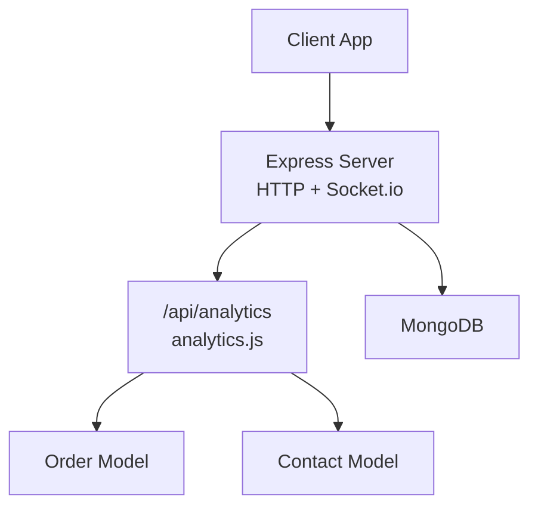
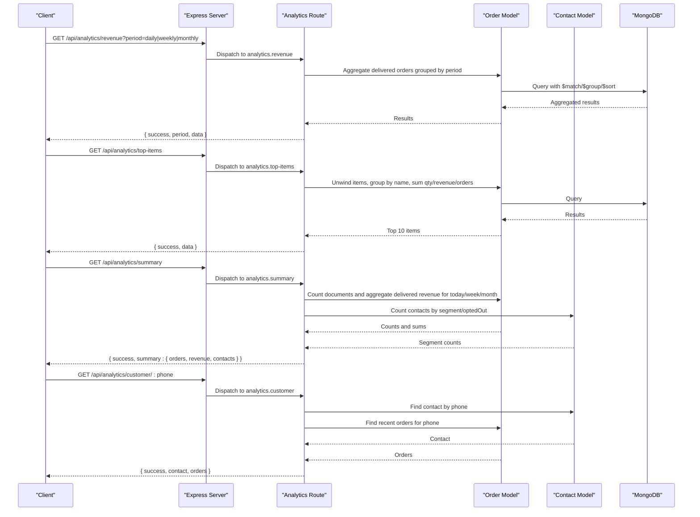
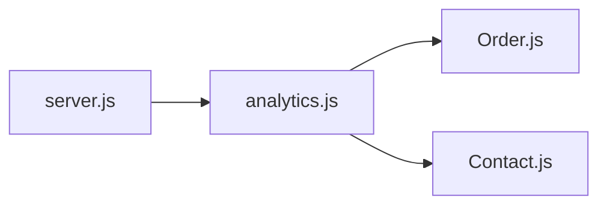

# Analytics & Reporting API

<cite>
**Referenced Files in This Document**
- [server.js](file://backend/server.js)
- [analytics.js](file://backend/routes/analytics.js)
- [Order.js](file://backend/models/Order.js)
- [Contact.js](file://backend/models/Contact.js)
</cite>

## Table of Contents
1. [Introduction](#introduction)
2. [Project Structure](#project-structure)
3. [Core Components](#core-components)
4. [Architecture Overview](#architecture-overview)
5. [Detailed Component Analysis](#detailed-component-analysis)
6. [Dependency Analysis](#dependency-analysis)
7. [Performance Considerations](#performance-considerations)
8. [Troubleshooting Guide](#troubleshooting-guide)
9. [Conclusion](#conclusion)
10. [Appendices](#appendices)

## Introduction
This document provides detailed API documentation for the analytics and reporting endpoints exposed by the backend. It covers metrics collection, dashboard data aggregation, performance reporting, and business intelligence endpoints. It also explains KPI calculations, campaign performance metrics, user activity tracking, system usage statistics, time-series analysis, custom report generation patterns, data export capabilities, and real-time analytics streaming where applicable.

The analytics module focuses on:
- Revenue and order metrics with time-based grouping
- Top-performing items
- Dashboard summary aggregations (orders, revenue, contacts)
- Customer-level analytics
- Real-time infrastructure via WebSockets

## Project Structure
The analytics functionality is implemented as an Express route mounted under /api/analytics. The server initializes HTTP, CORS, Socket.io, and registers all routes including analytics. Data models used by analytics are Order and Contact.

**Diagram sources**
- [server.js:11-56](file://backend/server.js#L11-L56)
- [analytics.js:1-85](file://backend/routes/analytics.js#L1-L85)
- [Order.js:1-27](file://backend/models/Order.js#L1-L27)
- [Contact.js:1-26](file://backend/models/Contact.js#L1-L26)

**Section sources**
- [server.js:11-56](file://backend/server.js#L11-L56)
- [analytics.js:1-85](file://backend/routes/analytics.js#L1-L85)

## Core Components
- Analytics Route: Defines REST endpoints for revenue time series, top items, summary, and customer details.
- Order Model: Represents orders with fields such as orderId, customerPhone, items, totalAmount, status, timestamps.
- Contact Model: Represents contacts with segmentation and engagement metrics.

Key responsibilities:
- Aggregation pipelines for time-series revenue and item performance
- Summary KPIs across orders, revenue, and contacts
- Customer-centric analytics retrieval

**Section sources**
- [analytics.js:1-85](file://backend/routes/analytics.js#L1-L85)
- [Order.js:1-27](file://backend/models/Order.js#L1-L27)
- [Contact.js:1-26](file://backend/models/Contact.js#L1-L26)

## Architecture Overview
The analytics API follows a standard Express route pattern backed by Mongoose aggregation against MongoDB. The server exposes both HTTP endpoints and WebSocket support. While the analytics routes currently do not emit events over WebSockets, the server’s Socket.io setup enables future real-time analytics streaming.

**Diagram sources**
- [analytics.js:6-83](file://backend/routes/analytics.js#L6-L83)
- [Order.js:12-25](file://backend/models/Order.js#L12-L25)
- [Contact.js:3-17](file://backend/models/Contact.js#L3-L17)

## Detailed Component Analysis

### Endpoint: GET /api/analytics/revenue
Purpose:
- Returns time-series revenue based on delivered orders only.
- Supports daily, weekly, and monthly grouping via query parameter period.

Request:
- Method: GET
- Path: /api/analytics/revenue
- Query parameters:
  - period: daily | weekly | monthly (default: daily)

Response:
- success: boolean
- period: string
- data: array of aggregated buckets with fields like year, month, day or week, plus revenue and orders count

KPI Calculation:
- Revenue is computed only from orders with status 'delivered'.
- Grouping keys vary by period:
  - daily: year, month, dayOfMonth
  - weekly: year, week
  - monthly: year, month

Time-Series Behavior:
- A lookback window is applied per period:
  - daily: last 30 days
  - weekly: last 90 days
  - monthly: last 365 days

Example Request:
- GET /api/analytics/revenue?period=weekly

Example Response Shape:
- { success: true, period: "weekly", data: [...] }

**Section sources**
- [analytics.js:6-26](file://backend/routes/analytics.js#L6-L26)
- [Order.js:12-25](file://backend/models/Order.js#L12-L25)

### Endpoint: GET /api/analytics/top-items
Purpose:
- Identifies top-performing menu items by revenue among delivered orders.

Request:
- Method: GET
- Path: /api/analytics/top-items

Response:
- success: boolean
- data: array of top items with fields:
  - _id: item name
  - qty: total quantity sold
  - revenue: total revenue
  - orders: number of orders containing the item

Aggregation Logic:
- Filters to delivered orders
- Unwinds nested items array
- Groups by item name and aggregates quantity, revenue, and order count
- Sorts by revenue descending and limits to top 10

Example Request:
- GET /api/analytics/top-items

Example Response Shape:
- { success: true, data: [...] }

**Section sources**
- [analytics.js:28-38](file://backend/routes/analytics.js#L28-L38)
- [Order.js:3-10](file://backend/models/Order.js#L3-L10)

### Endpoint: GET /api/analytics/summary
Purpose:
- Provides dashboard-ready KPIs for orders, revenue, and contacts.

Request:
- Method: GET
- Path: /api/analytics/summary

Response:
- success: boolean
- summary: object containing:
  - orders: { total, today, week, month, pending }
  - revenue: { total, today, week, month }
  - contacts: { total, vip, regular, new }

KPI Calculations:
- Orders:
  - total: all orders
  - today/week/month: orders created within respective windows
  - pending: orders with status 'confirmed' or 'preparing'
- Revenue:
  - Only delivered orders contribute to revenue totals
  - Aggregates totalAmount for total/today/week/month windows
- Contacts:
  - total: contacts opted out = false
  - segments: vip, regular, new counts

Example Request:
- GET /api/analytics/summary

Example Response Shape:
- { success: true, summary: { orders: {...}, revenue: {...}, contacts: {...} } }

**Section sources**
- [analytics.js:40-76](file://backend/routes/analytics.js#L40-L76)
- [Order.js:12-25](file://backend/models/Order.js#L12-L25)
- [Contact.js:3-17](file://backend/models/Contact.js#L3-L17)

### Endpoint: GET /api/analytics/customer/:phone
Purpose:
- Retrieves a specific customer’s profile and recent orders.

Request:
- Method: GET
- Path: /api/analytics/customer/:phone
- Path parameter:
  - phone: contact phone number

Response:
- success: boolean
- contact: contact object
- orders: array of up to 50 most recent orders for the phone

Behavior:
- Finds contact by phone
- Fetches recent orders sorted by createdAt descending, limited to 50

Example Request:
- GET /api/analytics/customer/1234567890

Example Response Shape:
- { success: true, contact: {...}, orders: [...] }

**Section sources**
- [analytics.js:78-83](file://backend/routes/analytics.js#L78-L83)
- [Contact.js:3-17](file://backend/models/Contact.js#L3-L17)
- [Order.js:12-25](file://backend/models/Order.js#L12-L25)

### Real-Time Analytics Streaming (Socket.io)
Current State:
- The server initializes Socket.io and supports client connection, room joining, and disconnection events.
- No analytics-specific events are emitted at present.

Future Integration:
- Analytics endpoints can be extended to emit real-time updates (e.g., new delivered orders, updated KPIs) via socket.emit to rooms.
- Clients can join rooms (e.g., "dashboard") to receive live metric updates.

WebSocket Events:
- Client events:
  - join_room(room): joins a named room
- Server events:
  - connection: logs client connection
  - disconnect: logs client disconnection

Example Client Flow:
- Connect to WebSocket
- Emit join_room("dashboard")
- Listen for analytics events (to be implemented)

**Section sources**
- [server.js:14-35](file://backend/server.js#L14-L35)

## Dependency Analysis
The analytics route depends on:
- Order model for order counts, aggregations, and filtering
- Contact model for contact counts and segmentation
- Express router for endpoint registration
- Server mounts the analytics route under /api/analytics

**Diagram sources**
- [analytics.js:1-85](file://backend/routes/analytics.js#L1-L85)
- [Order.js:1-27](file://backend/models/Order.js#L1-L27)
- [Contact.js:1-26](file://backend/models/Contact.js#L1-L26)
- [server.js:43-56](file://backend/server.js#L43-L56)

**Section sources**
- [analytics.js:1-85](file://backend/routes/analytics.js#L1-L85)
- [server.js:43-56](file://backend/server.js#L43-L56)

## Performance Considerations
- Use MongoDB indexes on frequently filtered fields:
  - Order.createdAt, Order.status, Order.customerPhone
  - Contact.phone, Contact.segment, Contact.optedOut
- Prefer aggregation pipelines for large datasets to reduce memory overhead.
- Limit result sets (e.g., top 10 items, last 50 orders).
- Cache frequent dashboard summaries if needed using application-level caching.
- For real-time analytics, consider batching events and emitting periodic snapshots.

[No sources needed since this section provides general guidance]

## Troubleshooting Guide
Common Issues:
- Missing or incorrect period parameter: Ensure period is one of daily, weekly, monthly.
- Empty revenue data: Verify that orders have status 'delivered'; revenue excludes non-delivered orders.
- Unexpected zero counts: Check date ranges and timezone handling; ensure createdAt values exist.
- WebSocket connectivity: Confirm CORS settings and client-side connection URL.

Error Handling:
- Global error handler returns a JSON response with success: false and message.

**Section sources**
- [server.js:58-62](file://backend/server.js#L58-L62)

## Conclusion
The analytics and reporting API provides robust endpoints for dashboard KPIs, time-series revenue analysis, top item performance, and customer insights. While real-time streaming is available via Socket.io, it is not yet wired to analytics events. Extending the analytics routes to emit real-time updates will enable live dashboards and enhanced operational visibility.

[No sources needed since this section summarizes without analyzing specific files]

## Appendices

### Data Models Reference

#### Order Model Fields
- orderId: unique identifier
- customerPhone: customer phone number
- customerName: optional name
- items: array of order items with menuItem, name, quantity, unit, price, total
- totalAmount: order total
- status: enum ['confirmed', 'preparing', 'out_for_delivery', 'delivered', 'cancelled']
- notes: optional notes
- deliveredAt: delivery timestamp
- timestamps: createdAt, updatedAt

**Section sources**
- [Order.js:3-25](file://backend/models/Order.js#L3-L25)

#### Contact Model Fields
- phone: unique phone number
- name: optional name
- email: optional email
- source: enum ['excel', 'manual', 'whatsapp']
- lastStatus: default 'pending'
- templatesSent: count
- ordersPlaced: count
- totalSpend: amount
- lastOrderAt: date
- optedOut: boolean
- optedOutAt: date
- segment: enum ['new', 'regular', 'vip']
- identity: default 'SAP FICO'
- timestamps: createdAt, updatedAt

**Section sources**
- [Contact.js:3-17](file://backend/models/Contact.js#L3-L17)

### Example Queries and Filtering Options

Dashboard Data Queries:
- Revenue time series: GET /api/analytics/revenue?period=monthly
- Top items: GET /api/analytics/top-items
- Summary KPIs: GET /api/analytics/summary
- Customer details: GET /api/analytics/customer/{phone}

Metric Filtering Options:
- Period selection for revenue: daily, weekly, monthly
- Status filter for revenue: delivered only
- Date range filters: applied internally per period

Data Export Capabilities:
- Not implemented in current endpoints. Consider adding CSV/JSON export endpoints for reports.

Real-Time Analytics Streaming:
- Socket.io is available; extend analytics routes to emit events for live dashboards.

[No sources needed since this section provides general guidance]