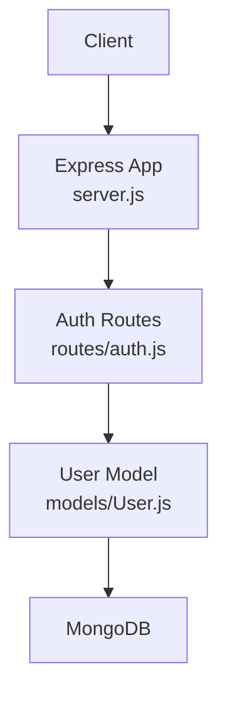
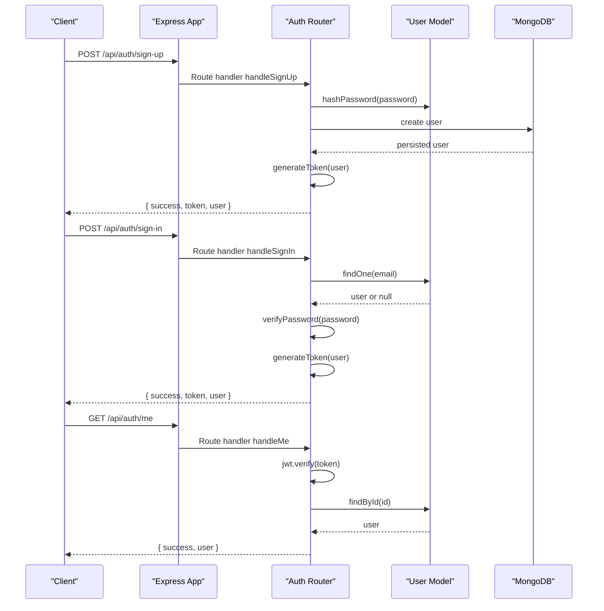
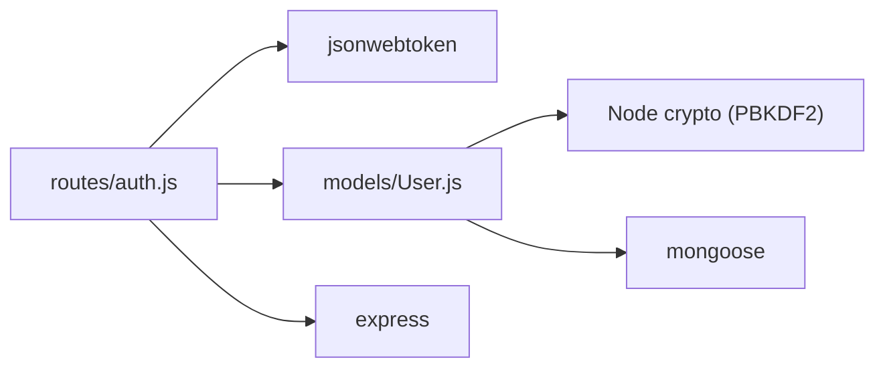

# Authentication API

<cite>
**Referenced Files in This Document**
- [auth.js](file://backend/routes/auth.js)
- [User.js](file://backend/models/User.js)
- [server.js](file://backend/server.js)
</cite>

## Table of Contents
1. [Introduction](#introduction)
2. [Project Structure](#project-structure)
3. [Core Components](#core-components)
4. [Architecture Overview](#architecture-overview)
5. [Detailed Component Analysis](#detailed-component-analysis)
6. [Dependency Analysis](#dependency-analysis)
7. [Performance Considerations](#performance-considerations)
8. [Troubleshooting Guide](#troubleshooting-guide)
9. [Conclusion](#conclusion)

## Introduction
This document provides comprehensive API documentation for the authentication endpoints, including user registration, login, and profile retrieval. It explains request/response schemas, parameter validation rules, error handling patterns, JWT token generation with 7-day expiration, password hashing implementation, role-based access control (admin, manager, employee), and how to use tokens in subsequent requests.

## Project Structure
The authentication functionality is implemented in a dedicated route file and a user model:
- Routes: backend/routes/auth.js
- User Model: backend/models/User.js
- Application bootstrap and route mounting: backend/server.js

**Diagram sources**
- [server.js:44-44](file://backend/server.js#L44-L44)
- [auth.js:1-142](file://backend/routes/auth.js#L1-L142)
- [User.js:1-64](file://backend/models/User.js#L1-L64)

**Section sources**
- [server.js:44-44](file://backend/server.js#L44-L44)
- [auth.js:1-142](file://backend/routes/auth.js#L1-L142)
- [User.js:1-64](file://backend/models/User.js#L1-L64)

## Core Components
- Authentication routes: sign-up/signup, sign-in/signin/login, and me endpoints.
- JWT token generation with 7-day expiration.
- Password hashing via PBKDF2 (not bcrypt).
- Role-based access control using user.role field.

Key responsibilities:
- Validate inputs and enforce required fields.
- Hash passwords before persisting.
- Issue JWTs containing id, email, role, name.
- Verify tokens on protected endpoints.

**Section sources**
- [auth.js:8-15](file://backend/routes/auth.js#L8-L15)
- [auth.js:17-58](file://backend/routes/auth.js#L17-L58)
- [auth.js:60-113](file://backend/routes/auth.js#L60-L113)
- [auth.js:115-133](file://backend/routes/auth.js#L115-L133)
- [User.js:52-61](file://backend/models/User.js#L52-L61)

## Architecture Overview
The authentication flow uses Express routes that interact with Mongoose models and JSON Web Tokens.

**Diagram sources**
- [auth.js:17-58](file://backend/routes/auth.js#L17-L58)
- [auth.js:60-113](file://backend/routes/auth.js#L60-L113)
- [auth.js:115-133](file://backend/routes/auth.js#L115-L133)
- [User.js:52-61](file://backend/models/User.js#L52-L61)

## Detailed Component Analysis

### Endpoints

#### Register User
- Methods: POST
- Paths:
  - /api/auth/sign-up
  - /api/auth/signup

Request body schema:
- name: string, required
- email: string, required, normalized to lowercase and trimmed
- password: string, required
- companyName: string, optional
- phone: string, optional
- role: string, optional; allowed values: admin, manager, employee; defaults to employee if invalid

Validation rules:
- All three of name, email, password must be present.
- Email uniqueness enforced by database constraint and pre-check.
- Role normalization to lowercase; invalid roles default to employee.

Success response (201):
- success: boolean
- token: string (JWT, 7-day expiration)
- user: object with id, name, email, companyName, phone, role
- message: string

Error responses:
- 400 Bad Request: missing required fields or email already exists
- 500 Internal Server Error: unexpected server errors

Example successful registration:
- Request:
  - POST /api/auth/sign-up
  - Body: { name: "Alice", email: "alice@example.com", password: "SecurePass123", companyName: "Acme", phone: "+1234567890", role: "manager" }
- Response:
  - 201 OK
  - { success: true, token: "<jwt>", user: { id: "...", name: "Alice", email: "alice@example.com", companyName: "Acme", phone: "+1234567890", role: "manager" }, message: "User registered successfully!" }

Security notes:
- Passwords are hashed before storage.
- The endpoint does not expose sensitive fields beyond what is defined in the response.

**Section sources**
- [auth.js:17-58](file://backend/routes/auth.js#L17-L58)
- [User.js:4-35](file://backend/models/User.js#L4-L35)

#### Login User
- Methods: POST
- Paths:
  - /api/auth/sign-in
  - /api/auth/signin
  - /api/auth/login

Request body schema:
- email: string, required, normalized to lowercase and trimmed
- password: string, required

Validation rules:
- Both email and password must be present.
- Special fallback credentials can auto-create an admin account if none exists.

Success response (200):
- success: boolean
- token: string (JWT, 7-day expiration)
- user: object with id, name, email, companyName, phone, role
- message: string

Error responses:
- 400 Bad Request: missing required fields
- 401 Unauthorized: invalid email or password
- 500 Internal Server Error: unexpected server errors

Example successful login:
- Request:
  - POST /api/auth/sign-in
  - Body: { email: "alice@example.com", password: "SecurePass123" }
- Response:
  - 200 OK
  - { success: true, token: "<jwt>", user: { id: "...", name: "Alice", email: "alice@example.com", companyName: "Acme", phone: "+1234567890", role: "manager" }, message: "Logged in successfully!" }

Usage of token in subsequent requests:
- Include Authorization header: Authorization: Bearer <token>
- Example: GET /api/auth/me

**Section sources**
- [auth.js:60-113](file://backend/routes/auth.js#L60-L113)

#### Get Current Profile
- Method: GET
- Path: /api/auth/me

Authentication:
- Requires Authorization header with Bearer token.

Success response (200):
- success: boolean
- user: object with id, name, email, companyName, phone, role (password excluded)

Error responses:
- 401 Unauthorized: missing token, invalid token, or expired token
- 404 Not Found: user not found after token verification
- 500 Internal Server Error: unexpected server errors

Example usage:
- Request:
  - GET /api/auth/me
  - Headers: Authorization: Bearer <token>
- Response:
  - 200 OK
  - { success: true, user: { id: "...", name: "Alice", email: "alice@example.com", companyName: "Acme", phone: "+1234567890", role: "manager" } }

**Section sources**
- [auth.js:115-133](file://backend/routes/auth.js#L115-L133)

### Token Generation and Expiration
- Tokens are generated using jsonwebtoken with a secret from environment variable or a fallback.
- Payload includes id, email, role, name.
- Expiration is set to 7 days.

Security considerations:
- Use a strong, unique JWT_SECRET in production.
- Rotate secrets periodically and avoid hardcoding secrets.

**Section sources**
- [auth.js:6-15](file://backend/routes/auth.js#L6-L15)

### Password Hashing Implementation
- Passwords are hashed using PBKDF2 via Node’s crypto module, not bcrypt.
- A static method hashes passwords; an instance method verifies them against stored hashes.

Important note:
- The documentation objective mentions bcrypt; however, the current implementation uses PBKDF2. Ensure clients treat these as opaque hashed values and do not assume bcrypt-specific behavior.

**Section sources**
- [User.js:52-61](file://backend/models/User.js#L52-L61)

### Role-Based Access Control
- Roles supported: admin, manager, employee.
- Default role when registering is employee if an invalid role is provided.
- The role is included in the JWT payload and can be used by downstream middleware to enforce permissions.

Best practices:
- Implement authorization middleware to check req.user.role for protected resources.
- Enforce least privilege: restrict admin-only actions to admin users.

**Section sources**
- [auth.js:30-30](file://backend/routes/auth.js#L30-L30)
- [User.js:31-35](file://backend/models/User.js#L31-L35)

### Authentication Middleware Integration
- The application mounts auth routes under /api/auth.
- Protected endpoints should validate the Authorization header and verify the JWT before processing.
- The /api/auth/me endpoint demonstrates token verification and user lookup.

Recommendation:
- Create a reusable auth middleware that decodes and attaches the user to the request context for all protected routes.

**Section sources**
- [server.js:44-44](file://backend/server.js#L44-L44)
- [auth.js:115-133](file://backend/routes/auth.js#L115-L133)

## Dependency Analysis
The authentication system depends on:
- Express for routing and request handling.
- jsonwebtoken for signing and verifying tokens.
- Mongoose for data persistence.
- Node’s crypto module for PBKDF2 hashing.

**Diagram sources**
- [auth.js:1-5](file://backend/routes/auth.js#L1-L5)
- [User.js:1-3](file://backend/models/User.js#L1-L3)

**Section sources**
- [auth.js:1-5](file://backend/routes/auth.js#L1-L5)
- [User.js:1-3](file://backend/models/User.js#L1-L3)

## Performance Considerations
- PBKDF2 hashing parameters are fixed; consider tuning iterations/salt length for performance vs security trade-offs.
- Avoid logging sensitive payloads (passwords, tokens).
- Cache user profiles where appropriate to reduce repeated DB queries.
- Use connection pooling and indexes on frequently queried fields like email.

[No sources needed since this section provides general guidance]

## Troubleshooting Guide
Common issues and resolutions:
- Missing Authorization header: ensure clients send Authorization: Bearer <token>.
- Invalid or expired token: regenerate token via login; rotate JWT_SECRET if necessary.
- Duplicate email during registration: normalize emails and check existence before creating.
- Incorrect role: validate role input; default to employee if invalid.
- Unexpected server errors: review global error handler and logs.

Operational tips:
- Validate environment variables (JWT_SECRET, MONGODB_URI).
- Monitor MongoDB connectivity and query performance.
- Add rate limiting to prevent brute-force attempts on login.

**Section sources**
- [auth.js:115-133](file://backend/routes/auth.js#L115-L133)
- [server.js:58-62](file://backend/server.js#L58-L62)

## Conclusion
The authentication API provides secure registration, login, and profile retrieval with JWT-based sessions and role-based access control. While the documentation objective references bcrypt, the current implementation uses PBKDF2 for password hashing. Clients should integrate token handling according to the documented schemas and best practices, and implement authorization middleware to enforce role-based access across protected endpoints.