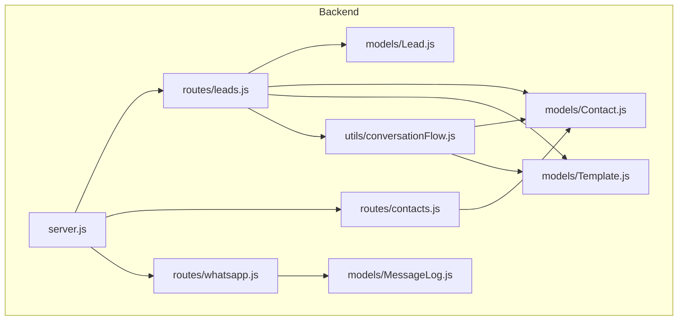
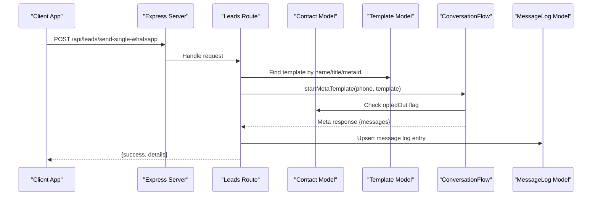
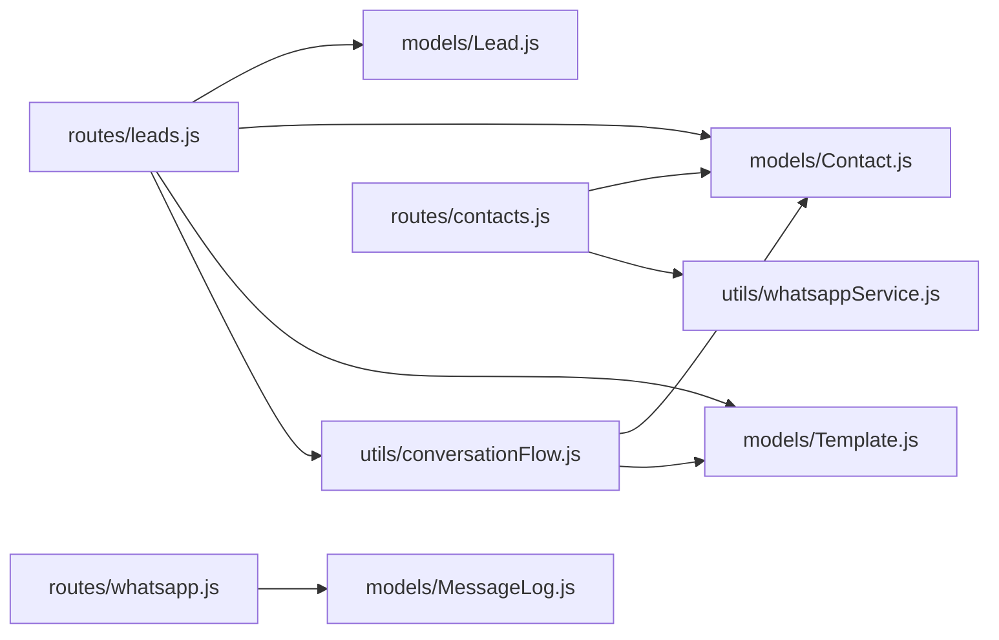

# CRM API

<cite>
**Referenced Files in This Document**
- [server.js](file://backend/server.js)
- [leads.js](file://backend/routes/leads.js)
- [contacts.js](file://backend/routes/contacts.js)
- [whatsapp.js](file://backend/routes/whatsapp.js)
- [Lead.js](file://backend/models/Lead.js)
- [Contact.js](file://backend/models/Contact.js)
- [MessageLog.js](file://backend/models/MessageLog.js)
- [Template.js](file://backend/models/Template.js)
- [conversationFlow.js](file://backend/utils/conversationFlow.js)
</cite>

## Table of Contents
1. [Introduction](#introduction)
2. [Project Structure](#project-structure)
3. [Core Components](#core-components)
4. [Architecture Overview](#architecture-overview)
5. [Detailed Component Analysis](#detailed-component-analysis)
6. [Dependency Analysis](#dependency-analysis)
7. [Performance Considerations](#performance-considerations)
8. [Troubleshooting Guide](#troubleshooting-guide)
9. [Conclusion](#conclusion)

## Introduction
This document provides comprehensive API documentation for CRM-related endpoints covering lead management and contact database operations. It includes:
- Lead CRUD operations, pipeline status updates, and deduplication
- Contact creation, bulk import via Excel, segmentation, opt-in/opt-out
- Interaction tracking through WhatsApp message logs
- Query parameters for filtering, searching, and basic pagination patterns
- Data models, validation rules, and relationship mappings between Leads, Contacts, Templates, and Message Logs

The backend is an Express application with MongoDB (Mongoose), Socket.io for real-time updates, and utilities for WhatsApp template messaging.

## Project Structure
The CRM module is implemented under the backend directory with routes for leads and contacts, Mongoose models for data persistence, and utility functions for WhatsApp interactions. The server wires up all route modules and exposes WebSocket channels for live updates.

**Diagram sources**
- [server.js:43-56](file://backend/server.js#L43-L56)
- [leads.js:1-6](file://backend/routes/leads.js#L1-L6)
- [contacts.js:1-8](file://backend/routes/contacts.js#L1-L8)
- [whatsapp.js:313-333](file://backend/routes/whatsapp.js#L313-L333)
- [conversationFlow.js:1-5](file://backend/utils/conversationFlow.js#L1-L5)

**Section sources**
- [server.js:1-82](file://backend/server.js#L1-L82)

## Core Components
- Lead Management: Create, read, update, delete leads; filter by status and search across fields; deduplicate by phone; send single or batch WhatsApp messages to leads.
- Contact Management: Create or upsert contacts; bulk save from Excel or arrays; segment computation; opt-in/opt-out; manual message sending.
- Interaction Tracking: MessageLog stores outbound/inbound WhatsApp events; endpoints retrieve logs for a specific phone or globally; WebSockets push real-time updates.

Key responsibilities:
- Routes handle HTTP requests, input validation, and orchestrate model operations.
- Models define schemas, constraints, and helper methods (e.g., segment refresh).
- Utilities encapsulate WhatsApp template sending logic and media handling.

**Section sources**
- [leads.js:16-344](file://backend/routes/leads.js#L16-L344)
- [contacts.js:12-232](file://backend/routes/contacts.js#L12-L232)
- [whatsapp.js:313-333](file://backend/routes/whatsapp.js#L313-L333)
- [conversationFlow.js:20-118](file://backend/utils/conversationFlow.js#L20-L118)

## Architecture Overview
The CRM API follows a layered architecture:
- HTTP Layer: Express routes expose REST endpoints for leads, contacts, and WhatsApp integrations.
- Service Layer: Business logic such as phone normalization, deduplication, and WhatsApp dispatching.
- Data Layer: Mongoose models persist Leads, Contacts, Templates, and MessageLogs.
- Real-time Layer: Socket.io emits events for new messages, auto-replies, and status updates.

**Diagram sources**
- [leads.js:159-227](file://backend/routes/leads.js#L159-L227)
- [conversationFlow.js:20-118](file://backend/utils/conversationFlow.js#L20-L118)
- [MessageLog.js:1-22](file://backend/models/MessageLog.js#L1-L22)

## Detailed Component Analysis

### Lead Management API
Endpoints:
- GET /api/leads
  - Purpose: Fetch leads with optional filters.
  - Query Parameters:
    - status: Filter by lead status (exclude 'ALL' to apply filter).
    - search: Case-insensitive regex across name, phone, email, address.
  - Response: { success: true, leads: [], count: number }
- POST /api/leads
  - Purpose: Create a new lead.
  - Body Fields:
    - name: required string
    - phone: required string; normalized to 10-digit Indian mobile starting with 6-9
    - email: optional string; lowercased
    - address: optional string
    - identity: optional string; default 'SAP FICO'
    - employeeName: optional string; default 'Jayaveer'
    - leadStatusUpdate: optional string
    - secondUpdate: optional string
    - finalUpdate: optional string
    - status: optional string; default 'Intrest'
    - notes: optional string
    - source: optional string; default 'crm'
  - Validation:
    - Name and phone are required.
    - Phone must be exactly 10 digits and start with 6-9 after cleaning.
    - Duplicate phone check prevents creating duplicate leads.
  - Response: { success: true, lead, message }
- PUT /api/leads/:id
  - Purpose: Update lead details or stage.
  - Body Fields: Same as create but partial updates allowed.
  - Validation: Phone cleaned and validated if provided.
  - Response: { success: true, lead, message }
- DELETE /api/leads/:id
  - Purpose: Delete a lead.
  - Response: { success: true, message }
- POST /api/leads/deduplicate
  - Purpose: Remove duplicate leads by phone, keeping the earliest created.
  - Response: { success: true, removedCount, message }
- POST /api/leads/send-single-whatsapp
  - Purpose: Send a test WhatsApp message to a single lead using a template.
  - Body Fields:
    - phone: required; normalized to 10-digit
    - template_name: optional; resolves to a Template record or fallback
  - Behavior:
    - Resolves template by name/title/metaTemplateId.
    - Uses ConversationFlow.startMetaTemplate to send.
    - Logs outbound message to MessageLog.
  - Response: { success: true, message, details }
- POST /api/leads/whatsapp-blast
  - Purpose: Dispatch batch WhatsApp broadcast to multiple recipients.
  - Body Fields:
    - template_name: required
    - lead_ids: optional array of ObjectId strings or raw 10-digit phones
    - phones: optional array of raw phone numbers
    - sample_values: optional array of values for template variables
  - Behavior:
    - Normalizes and deduplicates target phones.
    - Resolves template; constructs body/header metadata.
    - Sends messages via ConversationFlow and logs each attempt.
  - Response: { success: true, successful, failed, total, message }

Validation Rules:
- Phone normalization removes non-digits and strips leading '91' when length is 12.
- Strict 10-digit Indian mobile validation ensures first digit is 6-9.
- Email lowercasing and trimming applied on create/update.

Pipeline Status Updates:
- Use PUT /api/leads/:id with status field to progress through sales stages.
- Frontend UI supports selecting status options per lead.

Examples:
- Lead assignment: Update employeeName via PUT /api/leads/:id.
- Status progression: Update status via PUT /api/leads/:id to move through pipeline stages.

**Section sources**
- [leads.js:16-344](file://backend/routes/leads.js#L16-L344)

#### Lead Data Model
Schema fields:
- name: String, required, trimmed
- phone: String, required, trimmed
- email: String, default '', trimmed, lowercased
- address: String, default '', trimmed
- identity: String, default 'SAP FICO', trimmed
- employeeName: String, default 'Jayaveer', trimmed
- leadStatusUpdate: String, default '', trimmed
- secondUpdate: String, default '', trimmed
- finalUpdate: String, default '', trimmed
- status: String, default 'Intrest', trimmed
- notes: String, default ''
- source: String, default 'crm'
- createdAt: Date, default now

Complexity:
- Indexes: None explicitly defined; phone uniqueness not enforced at schema level (handled in route logic).
- Time complexity for queries: O(n) without indexes; consider adding indexes on phone and status for performance.

Relationships:
- No direct foreign keys to other models; linked indirectly via phone numbers and templates used in messaging.

**Section sources**
- [Lead.js:1-70](file://backend/models/Lead.js#L1-L70)

### Contact Management API
Endpoints:
- POST /api/contacts/upload-excel
  - Purpose: Upload an Excel file to parse and extract contacts.
  - File Handling: Multer uploads to ./uploads; XLSX parses sheet to JSON.
  - Header Detection: Looks for columns containing keywords like phone/mobile/number/contact, name/customer/person, email/mail.
  - Validation: Extracts 10-digit Indian mobile numbers; skips duplicates within the file.
  - Response: { success: true, contacts: [{ phone, name, email }], count }
- POST /api/contacts
  - Purpose: Create or upsert a single contact by phone.
  - Body Fields:
    - name: optional string
    - phone: required string; normalized to 10-digit
    - email: optional string
    - address: optional string
    - source: optional enum ['excel','manual','whatsapp']; default 'manual'
    - segment: optional enum ['new','regular','vip']; default 'new'
    - identity: optional string; default 'SAP FICO'
  - Response: { success: true, contact, message }
- POST /api/contacts/save
  - Purpose: Bulk save contacts from array of objects or array of phone strings.
  - Body Fields:
    - contacts: optional array of { phone, name, email, identity }
    - phones: optional array of phone strings
    - source: optional string; default 'manual'
  - Behavior: Upserts by phone; counts added/skipped.
  - Response: { success: true, added, skipped }
- POST /api/contacts/migrate-identity
  - Purpose: Update existing General or empty/null identity fields to 'SAP FICO'.
  - Response: { success: true, modifiedCount, message }
- GET /api/contacts
  - Purpose: Retrieve contacts with optional filters.
  - Query Parameters:
    - segment: Filter by segment ('new', 'regular', 'vip')
    - optedOut: Boolean filter ('true'/'false')
  - Response: { success: true, contacts: [] }
- PUT /api/contacts/:id
  - Purpose: Update contact fields.
  - Body Fields: name, phone, email, address, segment, identity
  - Response: { success: true, contact, message }
- DELETE /api/contacts/:id
  - Purpose: Delete a contact.
  - Response: { success: true }
- POST /api/contacts/send-message
  - Purpose: Send a manual text message to a contact.
  - Body Fields:
    - phone: required
    - message: required
  - Behavior: Calls whatsappService.sendTextMessage and logs to MessageLog.
  - Response: { success: true, message, metaRes }
- POST /api/contacts/refresh-segments
  - Purpose: Recompute segments based on ordersPlaced.
  - Response: { success: true, updated }
- PUT /api/contacts/:id/opt-out
  - Purpose: Mark contact as opted out and set timestamp.
  - Response: { success: true, contact }
- PUT /api/contacts/:id/opt-in
  - Purpose: Re-enable contact and clear opt-out timestamp.
  - Response: { success: true, contact }

Validation Rules:
- Phone normalization and strict 10-digit Indian mobile validation applied consistently.
- Segment computed automatically via method refreshSegment based on ordersPlaced thresholds.

Examples:
- Contact search and filtering: GET /api/contacts?segment=new&optedOut=false
- Bulk operations: POST /api/contacts/save with contacts or phones array

**Section sources**
- [contacts.js:12-232](file://backend/routes/contacts.js#L12-L232)

#### Contact Data Model
Schema fields:
- phone: String, required, unique
- name: String, default ''
- email: String, default ''
- source: Enum ['excel','manual','whatsapp'], default 'manual'
- lastStatus: String, default 'pending'
- templatesSent: Number, default 0
- ordersPlaced: Number, default 0
- totalSpend: Number, default 0
- lastOrderAt: Date
- optedOut: Boolean, default false
- optedOutAt: Date
- segment: Enum ['new','regular','vip'], default 'new'
- identity: String, default 'SAP FICO'
- timestamps: createdAt, updatedAt

Methods:
- refreshSegment(): Computes segment based on ordersPlaced thresholds:
  - >= 5 => 'vip'
  - >= 2 => 'regular'
  - else => 'new'

Complexity:
- Unique index on phone ensures no duplicates at DB level.
- Segment recomputation is O(n) over all contacts when invoked.

Relationships:
- Linked to MessageLog via phone numbers for interaction history.
- Used by conversationFlow to personalize messages and respect opt-out state.

**Section sources**
- [Contact.js:1-26](file://backend/models/Contact.js#L1-L26)

### Interaction Tracking and Activity Logging
Endpoints:
- GET /api/whatsapp/messages
  - Purpose: Retrieve chat logs for real-time live chat polling.
  - Query Parameters:
    - phone: Optional; returns logs for a specific phone with flexible matching (10-digit, +91 prefix, etc.)
  - Behavior:
    - If phone provided: returns up to 500 logs sorted chronologically.
    - Otherwise: returns most recent 1000 logs reversed to chronological order.
  - Response: { success: true, count, logs: [] }

Data Model:
- MessageLog fields include wamid (unique), phone, direction ('OUTGOING' | 'INCOMING'), status ('sent','delivered','read','failed','received'), text, senderName, templateName, headerImageUrl, buttons, timestamp, errorCode, errorMessage, pricing, phoneId, wabaId.

Real-time Updates:
- Socket.io events:
  - new_message: Pushes incoming messages to clients.
  - auto_reply: Pushes automated replies.
  - status_update: Pushes delivery/read status changes.

Integration Points:
- Outbound messages from leads and contacts routes log to MessageLog.
- ConversationFlow checks Contact.optedOut before sending.

**Section sources**
- [whatsapp.js:313-333](file://backend/routes/whatsapp.js#L313-L333)
- [MessageLog.js:1-22](file://backend/models/MessageLog.js#L1-L22)
- [conversationFlow.js:20-118](file://backend/utils/conversationFlow.js#L20-L118)

### Template Management
Templates are used for WhatsApp messaging. While template CRUD is handled by separate routes, the CRM endpoints reference templates by name/title/metaTemplateId.

Template Schema Highlights:
- name, category, language, components, metaTemplateId, metaStatus, wabaId
- Legacy fields: title, message, footer, imageUrl, mediaId
- Friendly mirrors: header_type, header_text, header_image_url, body_text, footer_text, sample_values, buttons
- Stats & scheduling: contacts, totalSent, totalFailed, interested, notInterested, ordersGenerated, status, sentAt, isScheduled, scheduleTime, repeatDaily, scheduleDays, lastRunAt, nextRunAt, isActive

Usage in CRM:
- Single and blast WhatsApp endpoints resolve templates and construct headers/body components.
- Media handling supports local files and public URLs; uploads to Meta when needed.

**Section sources**
- [Template.js:1-70](file://backend/models/Template.js#L1-L70)
- [leads.js:159-341](file://backend/routes/leads.js#L159-L341)
- [conversationFlow.js:20-118](file://backend/utils/conversationFlow.js#L20-L118)

## Dependency Analysis
Component relationships:
- Leads route depends on Lead, Contact, Template models and ConversationFlow utility.
- Contacts route depends on Contact model and whatsappService for sending messages.
- WhatsApp route depends on MessageLog model for retrieving logs.
- ConversationFlow depends on Contact and Template models and whatsappService for sending.

Potential circular dependencies:
- None detected; imports are linear and well-scoped.

External dependencies:
- WhatsApp Business API integration via whatsappService and metaTemplateService.
- Multer for file uploads; XLSX for parsing spreadsheets.
- Socket.io for real-time event broadcasting.

**Diagram sources**
- [leads.js:1-6](file://backend/routes/leads.js#L1-L6)
- [contacts.js:1-8](file://backend/routes/contacts.js#L1-L8)
- [whatsapp.js:313-333](file://backend/routes/whatsapp.js#L313-L333)
- [conversationFlow.js:1-5](file://backend/utils/conversationFlow.js#L1-L5)

**Section sources**
- [leads.js:1-344](file://backend/routes/leads.js#L1-L344)
- [contacts.js:1-232](file://backend/routes/contacts.js#L1-L232)
- [whatsapp.js:313-333](file://backend/routes/whatsapp.js#L313-L333)
- [conversationFlow.js:1-122](file://backend/utils/conversationFlow.js#L1-L122)

## Performance Considerations
- Indexing: Add indexes on frequently filtered fields such as Lead.status, Lead.phone, Contact.segment, Contact.optedOut, and MessageLog.timestamp to improve query performance.
- Pagination: Current endpoints return full result sets; implement cursor-based or offset-based pagination for large datasets (e.g., limit and skip parameters).
- Bulk Operations: Batch processing for WhatsApp blasts should consider rate limiting and concurrency controls to avoid overwhelming external APIs.
- Deduplication: Running deduplicate endpoints can be expensive on large datasets; schedule during off-peak hours.
- File Uploads: Excel parsing and deletion of temporary files should handle errors gracefully and ensure cleanup.

[No sources needed since this section provides general guidance]

## Troubleshooting Guide
Common issues and resolutions:
- Invalid phone numbers: Ensure inputs are normalized to 10-digit Indian mobiles; verify first digit is 6-9.
- Duplicate leads: Use POST /api/leads/deduplicate to remove duplicates; enforce uniqueness at schema level for robustness.
- Opted-out contacts: ConversationFlow skips opted-out contacts; use opt-in endpoint to re-enable.
- Template resolution failures: Verify template exists by name/title/metaTemplateId; provide fallback template content.
- Message logging: Confirm MessageLog entries are upserted correctly; check webhook and outbound flows for missing logs.
- WebSocket connectivity: Ensure Socket.io client connects and joins rooms; verify CORS settings allow connections.

**Section sources**
- [leads.js:53-66](file://backend/routes/leads.js#L53-L66)
- [leads.js:134-157](file://backend/routes/leads.js#L134-L157)
- [conversationFlow.js:20-25](file://backend/utils/conversationFlow.js#L20-L25)
- [whatsapp.js:313-333](file://backend/routes/whatsapp.js#L313-L333)

## Conclusion
The CRM API provides robust lead and contact management capabilities with integrated WhatsApp messaging and interaction tracking. It supports essential CRUD operations, pipeline status updates, bulk operations, and real-time updates via WebSockets. To enhance scalability and reliability, consider implementing indexing, pagination, and stricter schema validations. The modular design allows easy extension for additional CRM features and integrations.

[No sources needed since this section summarizes without analyzing specific files]