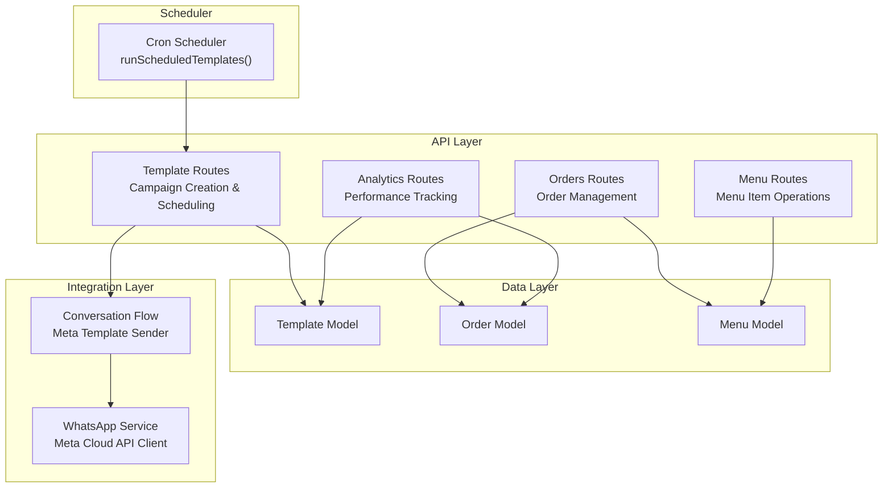
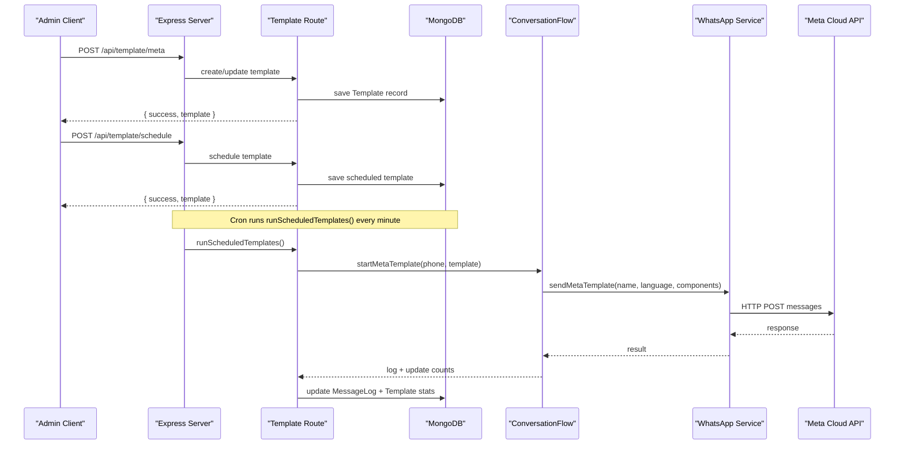
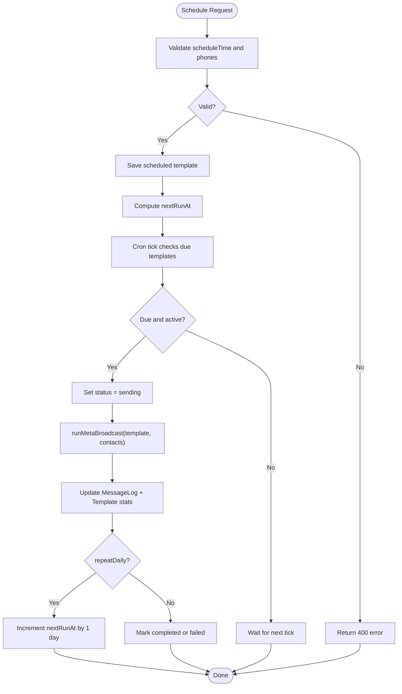
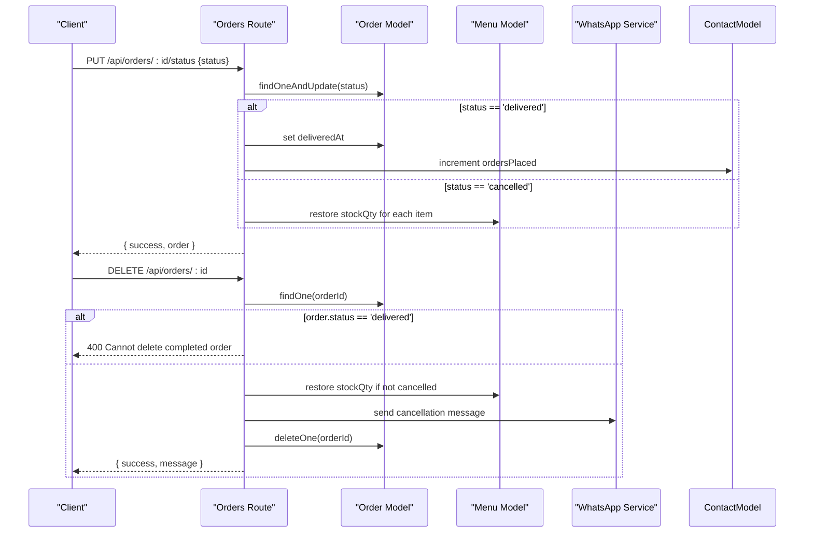
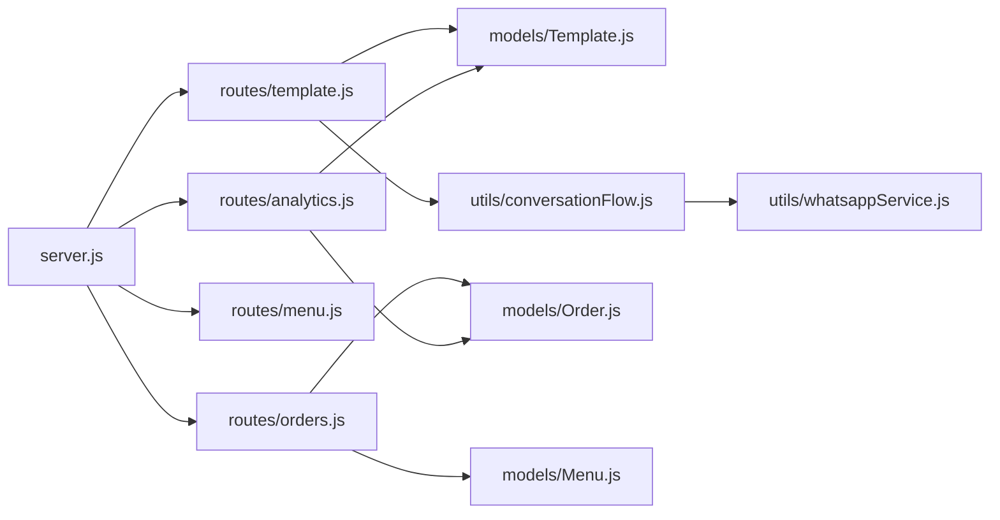

# Campaign Management API

<cite>
**Referenced Files in This Document**
- [server.js](file://backend/server.js)
- [template.js](file://backend/routes/template.js)
- [Template.js](file://backend/models/Template.js)
- [conversationFlow.js](file://backend/utils/conversationFlow.js)
- [whatsappService.js](file://backend/utils/whatsappService.js)
- [orders.js](file://backend/routes/orders.js)
- [Order.js](file://backend/models/Order.js)
- [menu.js](file://backend/routes/menu.js)
- [Menu.js](file://backend/models/Menu.js)
- [analytics.js](file://backend/routes/analytics.js)
</cite>

## Table of Contents
1. [Introduction](#introduction)
2. [Project Structure](#project-structure)
3. [Core Components](#core-components)
4. [Architecture Overview](#architecture-overview)
5. [Detailed Component Analysis](#detailed-component-analysis)
6. [Dependency Analysis](#dependency-analysis)
7. [Performance Considerations](#performance-considerations)
8. [Troubleshooting Guide](#troubleshooting-guide)
9. [Conclusion](#conclusion)

## Introduction
This document provides comprehensive API documentation for campaign management and order processing endpoints. It covers:
- Campaign creation, scheduling, execution, and monitoring through the template and broadcast system.
- Order management workflows including listing, status updates, deletion, and stock restoration.
- Menu item operations such as CRUD, availability toggling, stock management, and low-stock reporting.
- Campaign analytics collection and performance tracking via aggregated metrics.
- Batch processing capabilities, scheduled task execution, and error handling strategies.
- System health and integration points with WhatsApp Cloud API.

The backend is an Express application that exposes REST endpoints under `/api/*`, integrates with MongoDB, uses a cron scheduler for scheduled broadcasts, and communicates with WhatsApp via Meta’s Cloud API.

## Project Structure
The relevant backend structure for this documentation includes:
- Routes: `routes/template.js`, `routes/orders.js`, `routes/menu.js`, `routes/analytics.js`
- Models: `models/Template.js`, `models/Order.js`, `models/Menu.js`
- Utilities: `utils/conversationFlow.js`, `utils/whatsappService.js`
- Application bootstrap: `server.js`

**Diagram sources**
- [server.js:44-56](file://backend/server.js#L44-L56)
- [template.js:395-486](file://backend/routes/template.js#L395-L486)
- [orders.js:1-135](file://backend/routes/orders.js#L1-L135)
- [menu.js:1-73](file://backend/routes/menu.js#L1-L73)
- [analytics.js:1-85](file://backend/routes/analytics.js#L1-L85)
- [conversationFlow.js:20-118](file://backend/utils/conversationFlow.js#L20-L118)
- [whatsappService.js:1-228](file://backend/utils/whatsappService.js#L1-L228)

**Section sources**
- [server.js:44-56](file://backend/server.js#L44-L56)

## Core Components
- Template/Campaign Management: Create, update, recreate, import, sync, schedule, send, and monitor campaigns (templates).
- Order Processing: List orders, get stats summary, update status, delete orders, restore stock on cancellation/deletion.
- Menu Operations: CRUD menu items, toggle availability, update stock and thresholds, list low-stock items, seed defaults.
- Analytics: Revenue by period, top-selling items, dashboard summary, per-customer history.
- Integration: WhatsApp Cloud API client for sending templates, images, buttons, lists, polls; phone formatting and connection status.
- Scheduler: Cron job runs every minute to execute scheduled templates.

**Section sources**
- [template.js:395-486](file://backend/routes/template.js#L395-L486)
- [orders.js:1-135](file://backend/routes/orders.js#L1-L135)
- [menu.js:1-73](file://backend/routes/menu.js#L1-L73)
- [analytics.js:1-85](file://backend/routes/analytics.js#L1-L85)
- [whatsappService.js:1-228](file://backend/utils/whatsappService.js#L1-L228)
- [server.js:69-75](file://backend/server.js#L69-L75)

## Architecture Overview
The campaign management system centers around templates acting as reusable message definitions. Campaigns are created or imported from Meta, optionally scheduled, and executed in batch against contact phone numbers. Execution logs are persisted, and analytics aggregate results. Orders and menus are independent domains but integrate with analytics and stock logic.

**Diagram sources**
- [template.js:747-786](file://backend/routes/template.js#L747-L786)
- [template.js:444-486](file://backend/routes/template.js#L444-L486)
- [template.js:1046-1062](file://backend/routes/template.js#L1046-L1062)
- [conversationFlow.js:20-118](file://backend/utils/conversationFlow.js#L20-L118)
- [whatsappService.js:194-215](file://backend/utils/whatsappService.js#L194-L215)
- [server.js:69-75](file://backend/server.js#L69-L75)

## Detailed Component Analysis

### Campaign Creation and Management
Endpoints:
- POST /api/template/meta: Create or submit a Meta template with optional media upload.
- PUT /api/template/:id: Update local draft or request recreation if already on Meta.
- POST /api/template/:id/recreate: Recreate template on Meta after editing content.
- POST /api/template/import-meta: Import existing Meta template into database.
- POST /api/template/sync-meta: Sync all Meta templates into database.
- GET /api/template/presets: Retrieve category presets and rules.
- GET /api/template: List templates filtered by WABA.
- GET /api/template/meta/:id/status: Check approval status on Meta.

Key behaviors:
- Media header resolution supports remote URLs, local uploads, and legacy handles.
- Validation ensures required body component exists.
- Recreate flow deletes previous Meta version and submits new one; local fallback preserves drafts.
- Status-only updates allowed without recreating.

Example usage:
- Create a marketing template with image header and button components, then check status until approved.

Error handling:
- Validation errors return structured responses with validationErrors and warnings.
- Meta API errors are formatted and mapped to appropriate HTTP statuses.

**Section sources**
- [template.js:146-170](file://backend/routes/template.js#L146-L170)
- [template.js:547-692](file://backend/routes/template.js#L547-L692)
- [template.js:694-723](file://backend/routes/template.js#L694-L723)
- [template.js:747-786](file://backend/routes/template.js#L747-L786)
- [template.js:789-830](file://backend/routes/template.js#L789-L830)
- [template.js:832-950](file://backend/routes/template.js#L832-L950)
- [template.js:952-979](file://backend/routes/template.js#L952-L979)
- [template.js:725-729](file://backend/routes/template.js#L725-L729)
- [template.js:732-741](file://backend/routes/template.js#L732-L741)

### Campaign Scheduling and Execution
Endpoints:
- POST /api/template/schedule: Schedule a broadcast with optional image, repeat daily, and schedule days.
- GET /api/template/schedules: List scheduled templates.
- PUT /api/template/schedule/:id/toggle: Toggle active/inactive.
- DELETE /api/template/schedule/:id: Remove a scheduled template.
- POST /api/template/send-meta: Send approved Meta template to specified phones or all opted-in contacts.

Execution model:
- runMetaBroadcast iterates phone list, sends via ConversationFlow.startMetaTemplate, logs outcomes, updates Template totals and status.
- runScheduledTemplates runs every minute via cron, processes due templates, sets status to sending, schedules next run if repeating.

Example usage:
- Schedule a daily promotion at 10:00 AM, repeat daily, targeting opted-in contacts.

Error handling:
- Missing scheduleTime returns validation error.
- No contacts to send returns error.
- Broadcast failures increment failed count and mark template status accordingly.

**Diagram sources**
- [template.js:444-486](file://backend/routes/template.js#L444-L486)
- [template.js:488-504](file://backend/routes/template.js#L488-L504)
- [template.js:395-441](file://backend/routes/template.js#L395-L441)
- [template.js:318-391](file://backend/routes/template.js#L318-L391)
- [template.js:1046-1062](file://backend/routes/template.js#L1046-L1062)
- [server.js:69-75](file://backend/server.js#L69-L75)

**Section sources**
- [template.js:444-486](file://backend/routes/template.js#L444-L486)
- [template.js:488-504](file://backend/routes/template.js#L488-L504)
- [template.js:395-441](file://backend/routes/template.js#L395-L441)
- [template.js:318-391](file://backend/routes/template.js#L318-L391)
- [template.js:1046-1062](file://backend/routes/template.js#L1046-L1062)
- [server.js:69-75](file://backend/server.js#L69-L75)

### Campaign Monitoring and Analytics
Endpoints:
- GET /api/template/stats/summary: High-level metrics based on MessageLog and Template records.
- GET /api/analytics/revenue?period=daily|weekly|monthly: Aggregated delivered revenue and order counts.
- GET /api/analytics/top-items: Top 10 items by revenue among delivered orders.
- GET /api/analytics/summary: Dashboard summary across orders, revenue, contacts, pending orders.
- GET /api/analytics/customer/:phone: Customer profile and recent orders.

Key behaviors:
- Revenue calculations consider only delivered orders.
- Stats summary aggregates sent/delivered/read/failed counts from MessageLog.
- Contact segmentation counts include opted-out filtering.

Example usage:
- Fetch monthly revenue trends and top-selling items to evaluate campaign effectiveness.

**Section sources**
- [template.js:981-1044](file://backend/routes/template.js#L981-L1044)
- [analytics.js:6-26](file://backend/routes/analytics.js#L6-L26)
- [analytics.js:28-38](file://backend/routes/analytics.js#L28-L38)
- [analytics.js:40-76](file://backend/routes/analytics.js#L40-L76)
- [analytics.js:78-83](file://backend/routes/analytics.js#L78-L83)

### Order Management Workflows
Endpoints:
- GET /api/orders: List orders with optional status and date filters.
- GET /api/orders/stats/summary: Summary statistics including total orders, today’s orders, total revenue, pending orders.
- GET /api/orders/:id: Get single order by orderId.
- PUT /api/orders/:id/status: Update order status; set deliveredAt when delivered; increment customer order count on delivery.
- DELETE /api/orders/:id: Delete order; block deletion of delivered orders; restore stock if not cancelled; send WhatsApp cancellation notification.

Stock restoration:
- On cancellation or deletion, stockQty is incremented back for each ordered menu item where stock tracking is enabled.

Example usage:
- Place an order, confirm it, prepare it, deliver it; track revenue and pending orders.

Error handling:
- Not found returns 404.
- Deleting delivered orders returns 400.
- Stock restoration failures are logged and do not abort the operation.

**Diagram sources**
- [orders.js:50-86](file://backend/routes/orders.js#L50-L86)
- [orders.js:88-133](file://backend/routes/orders.js#L88-L133)
- [Order.js:12-25](file://backend/models/Order.js#L12-L25)
- [Menu.js:3-13](file://backend/models/Menu.js#L3-L13)
- [whatsappService.js:61-78](file://backend/utils/whatsappService.js#L61-L78)

**Section sources**
- [orders.js:1-135](file://backend/routes/orders.js#L1-L135)
- [Order.js:1-27](file://backend/models/Order.js#L1-L27)

### Menu Item Operations
Endpoints:
- GET /api/menu: List all menu items sorted by category and name.
- POST /api/menu: Create a new menu item.
- PUT /api/menu/:id: Update a menu item.
- DELETE /api/menu/:id: Delete a menu item.
- PUT /api/menu/:id/toggle: Toggle availability boolean.
- PUT /api/menu/:id/stock: Update stockQty and stockThreshold.
- GET /api/menu/low-stock: List items where stockQty <= stockThreshold.
- POST /api/menu/seed: Seed default menu items.

Key behaviors:
- Stock tracking is optional; null stockQty means not tracked.
- Low-stock endpoint filters items with valid stock values.

Example usage:
- Seed default menu, toggle availability for seasonal items, adjust stock thresholds.

**Section sources**
- [menu.js:1-73](file://backend/routes/menu.js#L1-L73)
- [Menu.js:1-22](file://backend/models/Menu.js#L1-L22)

### WhatsApp Integration and Health
Capabilities:
- Phone number formatting to ensure correct country code.
- Connection status check returning CONNECTED/DISCONNECTED.
- Sending text, images, buttons, polls, lists, and Meta templates.
- Error propagation from Meta API with detailed messages.

Health endpoints:
- There is no dedicated health endpoint; however, connectivity can be inferred by calling WhatsApp status methods or checking server startup logs.

Example usage:
- Use getStatus to verify Meta connection before launching large broadcasts.

**Section sources**
- [whatsappService.js:25-32](file://backend/utils/whatsappService.js#L25-L32)
- [whatsappService.js:34-40](file://backend/utils/whatsappService.js#L34-L40)
- [whatsappService.js:61-78](file://backend/utils/whatsappService.js#L61-L78)
- [whatsappService.js:80-123](file://backend/utils/whatsappService.js#L80-L123)
- [whatsappService.js:125-152](file://backend/utils/whatsappService.js#L125-L152)
- [whatsappService.js:154-160](file://backend/utils/whatsappService.js#L154-L160)
- [whatsappService.js:162-192](file://backend/utils/whatsappService.js#L162-L192)
- [whatsappService.js:194-215](file://backend/utils/whatsappService.js#L194-L215)

## Dependency Analysis
Component relationships:
- Template routes depend on Template model, ConversationFlow utility, and WhatsApp service.
- Orders route depends on Order model, Contact model, and WhatsApp service for notifications.
- Menu route depends on Menu model.
- Analytics route depends on Order and Contact models.
- Server bootstraps routes and starts cron scheduler for scheduled templates.

**Diagram sources**
- [server.js:44-56](file://backend/server.js#L44-L56)
- [template.js:1-30](file://backend/routes/template.js#L1-L30)
- [orders.js:1-6](file://backend/routes/orders.js#L1-L6)
- [menu.js:1-4](file://backend/routes/menu.js#L1-L4)
- [analytics.js:1-5](file://backend/routes/analytics.js#L1-L5)

**Section sources**
- [server.js:44-56](file://backend/server.js#L44-L56)
- [template.js:1-30](file://backend/routes/template.js#L1-L30)
- [orders.js:1-6](file://backend/routes/orders.js#L1-L6)
- [menu.js:1-4](file://backend/routes/menu.js#L1-L4)
- [analytics.js:1-5](file://backend/routes/analytics.js#L1-L5)

## Performance Considerations
- Batch broadcasting uses small delays between sends to respect Meta API limits while maintaining throughput.
- Aggregation queries filter by status and time windows to reduce dataset size.
- Stock restoration loops iterate over order items; consider indexing frequently queried fields like orderId and status.
- Cron scheduler runs every minute; ensure scheduled templates are efficiently filtered using indexes on isScheduled, isActive, and nextRunAt.

[No sources needed since this section provides general guidance]

## Troubleshooting Guide
Common issues and resolutions:
- Template submission fails due to missing body component: Ensure payload includes a body component; validation errors will indicate missing fields.
- Meta template not found or inaccessible: Verify metaTemplateId and network connectivity; use import-meta or sync-meta to refresh records.
- Scheduled broadcasts not running: Confirm cron is active and templates have correct nextRunAt and isActive flags.
- Order deletion blocked: Delivered orders cannot be deleted; cancel first or handle via refund workflow outside this API.
- Stock restoration errors: Check Menu schema constraints and ensure stockQty is not null when restoring; errors are logged but do not abort deletion.
- WhatsApp connection disconnected: Use getStatus to verify credentials and WABA configuration; reconfigure environment variables if needed.

**Section sources**
- [template.js:146-170](file://backend/routes/template.js#L146-L170)
- [template.js:789-830](file://backend/routes/template.js#L789-L830)
- [template.js:1046-1062](file://backend/routes/template.js#L1046-L1062)
- [orders.js:88-133](file://backend/routes/orders.js#L88-L133)
- [whatsappService.js:25-32](file://backend/utils/whatsappService.js#L25-L32)

## Conclusion
The Campaign Management API provides robust tools for creating, scheduling, executing, and monitoring WhatsApp campaigns via Meta templates. Order and menu management endpoints support operational workflows with stock integrity and customer notifications. Analytics endpoints offer actionable insights into revenue and performance. The system leverages batch processing, scheduled tasks, and clear error handling to maintain reliability and scalability.

[No sources needed since this section summarizes without analyzing specific files]