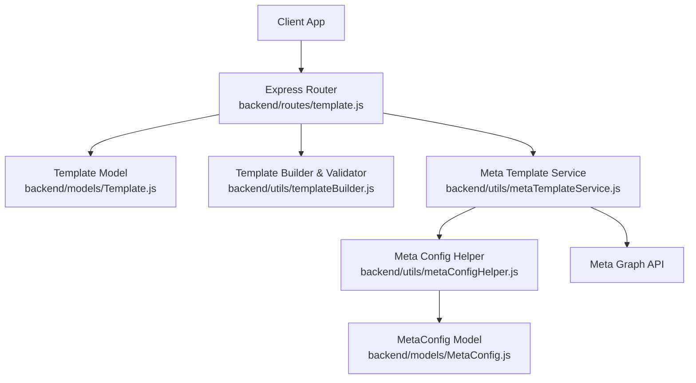
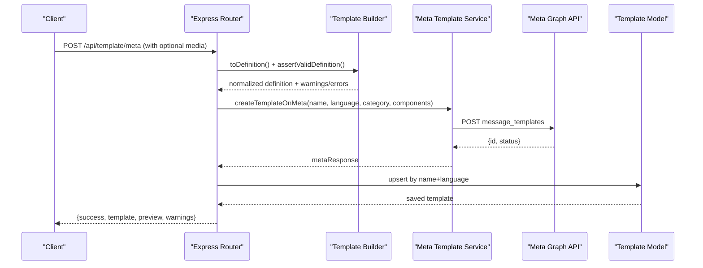
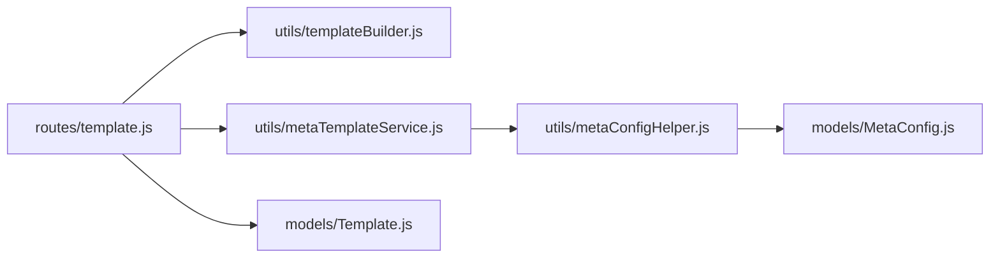
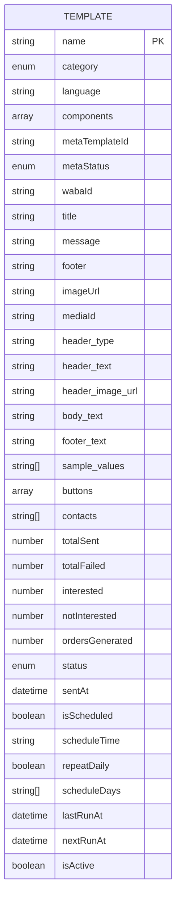

# Template Management API

<cite>
**Referenced Files in This Document**
- [template.js](file://backend/routes/template.js)
- [Template.js](file://backend/models/Template.js)
- [metaTemplateService.js](file://backend/utils/metaTemplateService.js)
- [metaConfigHelper.js](file://backend/utils/metaConfigHelper.js)
- [MetaConfig.js](file://backend/models/MetaConfig.js)
- [templateBuilder.js](file://backend/utils/templateBuilder.js)
</cite>

## Table of Contents
1. [Introduction](#introduction)
2. [Project Structure](#project-structure)
3. [Core Components](#core-components)
4. [Architecture Overview](#architecture-overview)
5. [Detailed Component Analysis](#detailed-component-analysis)
6. [Dependency Analysis](#dependency-analysis)
7. [Performance Considerations](#performance-considerations)
8. [Troubleshooting Guide](#troubleshooting-guide)
9. [Conclusion](#conclusion)
10. [Appendices](#appendices)

## Introduction
This document describes the Template Management API for WhatsApp Cloud API templates. It covers template creation, updates, deletion, Meta synchronization, versioning via recreation, media handling, variable substitution, preview generation, approval workflow integration, testing and broadcasting, scheduling, and error handling. The system stores local drafts, mirrors Meta’s state, and enforces Meta’s rules around immutable submitted templates.

## Project Structure
The template management feature is implemented primarily in:
- Express routes under backend/routes/template.js
- Mongoose model under backend/models/Template.js
- Meta Graph API client under backend/utils/metaTemplateService.js
- Meta credentials helper under backend/utils/metaConfigHelper.js
- Meta configuration model under backend/models/MetaConfig.js
- Template builder and validator under backend/utils/templateBuilder.js

**Diagram sources**
- [template.js:1-30](file://backend/routes/template.js#L1-L30)
- [Template.js:1-70](file://backend/models/Template.js#L1-L70)
- [metaTemplateService.js:1-25](file://backend/utils/metaTemplateService.js#L1-L25)
- [metaConfigHelper.js:1-35](file://backend/utils/metaConfigHelper.js#L1-L35)
- [MetaConfig.js:1-13](file://backend/models/MetaConfig.js#L1-L13)
- [templateBuilder.js:1-25](file://backend/utils/templateBuilder.js#L1-L25)

**Section sources**
- [template.js:1-40](file://backend/routes/template.js#L1-L40)
- [Template.js:1-70](file://backend/models/Template.js#L1-L70)
- [metaTemplateService.js:1-25](file://backend/utils/metaTemplateService.js#L1-L25)
- [metaConfigHelper.js:1-35](file://backend/utils/metaConfigHelper.js#L1-L35)
- [MetaConfig.js:1-13](file://backend/models/MetaConfig.js#L1-L13)
- [templateBuilder.js:1-25](file://backend/utils/templateBuilder.js#L1-L25)

## Core Components
- Template CRUD endpoints: create on Meta, update local drafts or recreate on Meta, delete with optional Meta removal, list templates, import from Meta, sync all templates from Meta.
- Approval workflow: status polling and pre-send validation against Meta.
- Versioning: editing a submitted template requires recreation; old version is deleted and a new one is submitted for review.
- Media handling: resumable upload to Meta for headers, media id for sending, and public URL for dashboard preview.
- Variable substitution: canonicalization of variables to positional indices and sample arrays.
- Preview: components and samples returned after successful submission.
- Broadcasting and scheduling: send approved templates to contacts and schedule recurring broadcasts.

**Section sources**
- [template.js:146-199](file://backend/routes/template.js#L146-L199)
- [template.js:255-316](file://backend/routes/template.js#L255-L316)
- [template.js:319-391](file://backend/routes/template.js#L319-L391)
- [template.js:397-441](file://backend/routes/template.js#L397-L441)
- [template.js:444-504](file://backend/routes/template.js#L444-L504)
- [template.js:547-723](file://backend/routes/template.js#L547-L723)
- [template.js:747-786](file://backend/routes/template.js#L747-L786)
- [template.js:789-830](file://backend/routes/template.js#L789-L830)
- [template.js:832-950](file://backend/routes/template.js#L832-L950)
- [template.js:952-979](file://backend/routes/template.js#L952-L979)
- [template.js:981-1044](file://backend/routes/template.js#L981-L1044)
- [template.js:1046-1065](file://backend/routes/template.js#L1046-L1065)

## Architecture Overview
The API follows a layered design:
- Routes handle HTTP requests, parsing, file uploads, and orchestration.
- Template builder normalizes UI-friendly payloads into Meta components and validates them.
- Meta service calls Graph API for template lifecycle and media operations.
- Config helper loads and caches Meta credentials from database or environment.
- Models persist templates and Meta configuration.

**Diagram sources**
- [template.js:747-786](file://backend/routes/template.js#L747-L786)
- [templateBuilder.js:178-240](file://backend/utils/templateBuilder.js#L178-L240)
- [templateBuilder.js:408-418](file://backend/utils/templateBuilder.js#L408-L418)
- [metaTemplateService.js:114-137](file://backend/utils/metaTemplateService.js#L114-L137)

## Detailed Component Analysis

### Template Creation (POST /api/template/meta)
- Accepts friendly payload fields plus optional raw components array and an optional media file for header images/videos/documents.
- Normalizes input, validates, resolves header media (resumable upload), builds components, submits to Meta, and persists the result.
- Returns preview data including components and sample values.

Key behaviors:
- Header media resolution supports uploaded files, remote URLs, legacy handles, and site-relative paths.
- Resumable upload returns a handle required by Meta for template creation.
- A separate media id is obtained for later sending.
- Public URL is generated for dashboard preview.

**Section sources**
- [template.js:78-140](file://backend/routes/template.js#L78-L140)
- [template.js:146-199](file://backend/routes/template.js#L146-L199)
- [template.js:747-786](file://backend/routes/template.js#L747-L786)
- [metaTemplateService.js:192-245](file://backend/utils/metaTemplateService.js#L192-L245)

### Update Local Drafts (PUT /api/template/:id)
- For local drafts, content changes are applied directly.
- If the template exists on Meta, content edits are blocked unless explicit recreate is requested; otherwise returns a conflict response indicating recreation is required.
- Status-only updates are allowed without recreation.

Behavior highlights:
- Detects changed fields and distinguishes between status-only and content changes.
- On local draft updates, rebuilds components and saves locally even if header media preparation fails, returning warnings.

**Section sources**
- [template.js:547-692](file://backend/routes/template.js#L547-L692)

### Recreate Submitted Templates (POST /api/template/:id/recreate)
- Deletes the current Meta version and submits a new one with updated content.
- If deletion succeeds but recreation fails, the record is downgraded to a local draft with a local ID.

Workflow:
- Delete on Meta (optional).
- Submit new version via shared submit path.
- Persist updated template with new Meta metadata.

**Section sources**
- [template.js:255-287](file://backend/routes/template.js#L255-L287)
- [template.js:694-723](file://backend/routes/template.js#L694-L723)

### Delete Templates (DELETE /api/template/:id)
- Removes the local record and optionally deletes the Meta template if present.
- Handles cases where Meta reports the template missing.

**Section sources**
- [template.js:506-541](file://backend/routes/template.js#L506-L541)

### List Templates (GET /api/template/)
- Returns templates filtered by scheduled flag and WABA scope.
- Includes current WABA identifier.

**Section sources**
- [template.js:732-741](file://backend/routes/template.js#L732-L741)

### Import Meta Template (POST /api/template/import-meta)
- Imports a single Meta template by its ID into the local database.
- Prevents duplicate imports.

**Section sources**
- [template.js:789-830](file://backend/routes/template.js#L789-L830)

### Sync All Meta Templates (POST /api/template/sync-meta OR /api/template/sync)
- Fetches all templates from Meta and synchronizes them into the database.
- Deduplicates records by Meta ID or name.
- Auto-hosts header images to Cloudinary when available.
- Cleans up outdated templates not present on Meta.

**Section sources**
- [template.js:832-950](file://backend/routes/template.js#L832-L950)
- [metaTemplateService.js:163-179](file://backend/utils/metaTemplateService.js#L163-L179)

### Check Meta Approval Status (GET /api/template/meta/:id/status)
- Validates that the template has a valid Meta ID.
- Polls Meta for current status and updates local metaStatus.

**Section sources**
- [template.js:952-979](file://backend/routes/template.js#L952-L979)
- [metaTemplateService.js:181-190](file://backend/utils/metaTemplateService.js#L181-L190)

### Send Approved Templates (POST /api/template/send-meta)
- Requires a valid Meta Template ID and ensures the template is APPROVED before sending.
- Accepts phone numbers or defaults to opted-in contacts.
- Starts asynchronous broadcast and returns immediate acknowledgment.

Broadcast behavior:
- Iterates recipients with small delays.
- Logs messages and updates contact stats.
- Updates template totals and last run time.

**Section sources**
- [template.js:319-391](file://backend/routes/template.js#L319-L391)
- [template.js:397-441](file://backend/routes/template.js#L397-L441)

### Schedule Broadcasts (POST /api/template/schedule)
- Creates a scheduled template entry with optional image upload.
- Supports daily repeats and day-of-week selection.

**Section sources**
- [template.js:444-486](file://backend/routes/template.js#L444-L486)

### Manage Schedules (GET /api/template/schedules, PUT /api/template/schedule/:id/toggle, DELETE /api/template/schedule/:id)
- Lists scheduled templates.
- Toggles active/inactive.
- Deletes scheduled entries.

**Section sources**
- [template.js:488-504](file://backend/routes/template.js#L488-L504)

### Get Presets (GET /api/template/presets)
- Returns categories, presets, and rules shared with the frontend.

**Section sources**
- [template.js:725-729](file://backend/routes/template.js#L725-L729)
- [templateBuilder.js:502-550](file://backend/utils/templateBuilder.js#L502-L550)

### Stats Summary (GET /api/template/stats/summary)
- Aggregates sent/delivered/read/failed counts from message logs.
- Counts active templates, total contacts, and campaigns.

**Section sources**
- [template.js:981-1044](file://backend/routes/template.js#L981-L1044)

### Scheduled Runner
- Background routine that runs due scheduled templates and updates repeat schedules.

**Section sources**
- [template.js:1046-1065](file://backend/routes/template.js#L1046-L1065)

## Dependency Analysis

**Diagram sources**
- [template.js:1-30](file://backend/routes/template.js#L1-L30)
- [metaTemplateService.js:1-5](file://backend/utils/metaTemplateService.js#L1-L5)
- [metaConfigHelper.js:1-5](file://backend/utils/metaConfigHelper.js#L1-L5)
- [MetaConfig.js:1-13](file://backend/models/MetaConfig.js#L1-L13)
- [Template.js:1-10](file://backend/models/Template.js#L1-L10)

**Section sources**
- [template.js:1-30](file://backend/routes/template.js#L1-L30)
- [metaTemplateService.js:1-5](file://backend/utils/metaTemplateService.js#L1-L5)
- [metaConfigHelper.js:1-5](file://backend/utils/metaConfigHelper.js#L1-L5)
- [MetaConfig.js:1-13](file://backend/models/MetaConfig.js#L1-L13)
- [Template.js:1-10](file://backend/models/Template.js#L1-L10)

## Performance Considerations
- Media uploads use resumable sessions for large header assets; ensure proper timeouts and size limits.
- Broadcasting uses small per-recipient delays to avoid rate limiting.
- Credentials are cached to reduce repeated database reads.
- Sync endpoint performs bulk operations and cleanup; consider running during off-peak hours.

[No sources needed since this section provides general guidance]

## Troubleshooting Guide

Common errors and handling:
- Meta rejections: Errors from Meta are formatted with hints for common codes such as invalid token, mismatched example count, paused/disabled templates, policy violations, and outside 24-hour window.
- Version conflicts: Editing a submitted template returns a conflict requiring recreation; recreation deletes the old version and submits a new one.
- Media upload failures: Header media resolution may fail for remote downloads or Cloudinary uploads; drafts can still be saved with warnings.
- Missing Meta credentials: Sync and creation endpoints require configured WABA ID and access token.

Error response patterns:
- Validation errors include field-level details and warnings.
- Meta errors include structured code, hint, and trace identifiers.

**Section sources**
- [template.js:222-247](file://backend/routes/template.js#L222-L247)
- [template.js:547-692](file://backend/routes/template.js#L547-L692)
- [template.js:747-786](file://backend/routes/template.js#L747-L786)
- [templateBuilder.js:424-496](file://backend/utils/templateBuilder.js#L424-L496)

## Conclusion
The Template Management API provides a robust workflow for creating, validating, syncing, and deploying WhatsApp Cloud API templates. It enforces Meta’s constraints, supports versioning through recreation, integrates media handling for headers and sending, and offers preview and broadcasting capabilities. Proper credential configuration and adherence to validation rules are essential for smooth operation.

[No sources needed since this section summarizes without analyzing specific files]

## Appendices

### Template Data Model

**Diagram sources**
- [Template.js:3-68](file://backend/models/Template.js#L3-L68)

**Section sources**
- [Template.js:1-70](file://backend/models/Template.js#L1-L70)

### Variable Substitution Patterns
- Variables in body text are normalized to positional indices like {{1}}, {{2}}.
- Sample arrays must match the number of variables; defaults are provided based on variable names.
- Body cannot start or end with a variable; the builder adds safe prefixes/suffixes when necessary.

**Section sources**
- [templateBuilder.js:123-168](file://backend/utils/templateBuilder.js#L123-L168)
- [metaTemplateService.js:23-70](file://backend/utils/metaTemplateService.js#L23-L70)

### Example Workflows

#### Create a Marketing Template
- Steps:
  - Prepare payload with name, category, language, header type/image, body text with variables, footer, and buttons.
  - Optionally attach a media file for header image.
  - Call POST /api/template/meta.
  - Review preview and warnings.
  - Monitor approval status via GET /api/template/meta/:id/status.

**Section sources**
- [template.js:747-786](file://backend/routes/template.js#L747-L786)
- [template.js:952-979](file://backend/routes/template.js#L952-L979)

#### Update an Approved Template
- Steps:
  - Attempt PUT /api/template/:id with content changes.
  - If conflict occurs, call POST /api/template/:id/recreate with updated content and optional media.
  - Wait for Meta approval and verify status.

**Section sources**
- [template.js:547-692](file://backend/routes/template.js#L547-L692)
- [template.js:694-723](file://backend/routes/template.js#L694-L723)

#### Insert Dynamic Content at Send Time
- Use sample values defined in the template body to map variables to dynamic values when sending.
- The broadcast runner logs the template text and associated metadata.

**Section sources**
- [template.js:319-391](file://backend/routes/template.js#L319-L391)

### Error Handling Reference
- Validation errors: field-level messages and warnings returned by the builder.
- Meta errors: structured objects with code, hint, and trace info.
- Media failures: warnings included when header media cannot be prepared; drafts remain saveable.

**Section sources**
- [templateBuilder.js:408-418](file://backend/utils/templateBuilder.js#L408-L418)
- [templateBuilder.js:424-496](file://backend/utils/templateBuilder.js#L424-L496)
- [template.js:222-247](file://backend/routes/template.js#L222-L247)