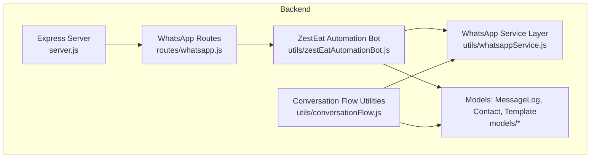
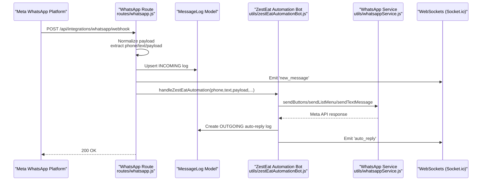
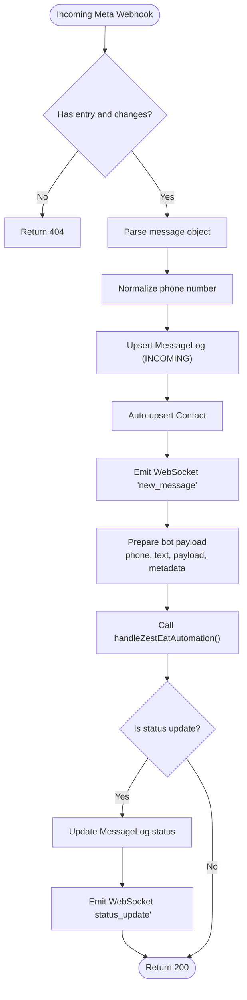
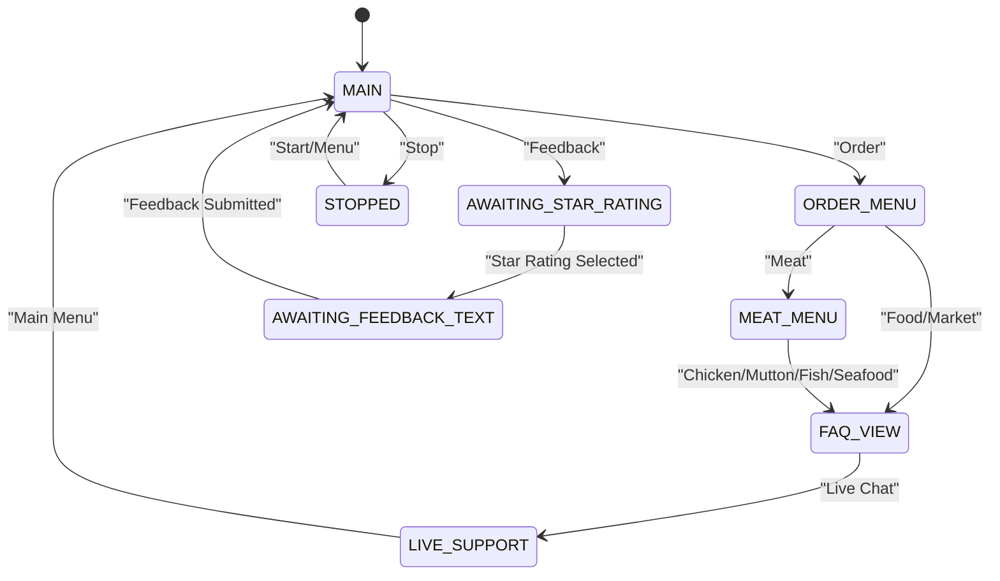
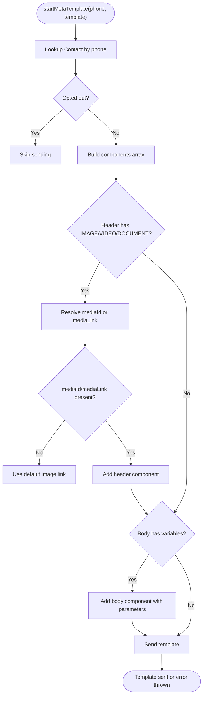
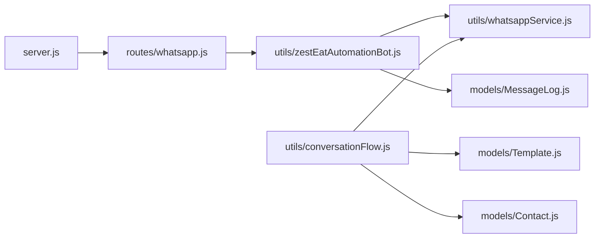

# Automation Bot Integration

<cite>
**Referenced Files in This Document**
- [server.js](file://backend/server.js)
- [whatsapp.js](file://backend/routes/whatsapp.js)
- [zestEatAutomationBot.js](file://backend/utils/zestEatAutomationBot.js)
- [whatsappService.js](file://backend/utils/whatsappService.js)
- [conversationFlow.js](file://backend/utils/conversationFlow.js)
- [MessageLog.js](file://backend/models/MessageLog.js)
- [Template.js](file://backend/models/Template.js)
- [Contact.js](file://backend/models/Contact.js)
</cite>

## Table of Contents
1. [Introduction](#introduction)
2. [Project Structure](#project-structure)
3. [Core Components](#core-components)
4. [Architecture Overview](#architecture-overview)
5. [Detailed Component Analysis](#detailed-component-analysis)
6. [Dependency Analysis](#dependency-analysis)
7. [Performance Considerations](#performance-considerations)
8. [Troubleshooting Guide](#troubleshooting-guide)
9. [Conclusion](#conclusion)

## Introduction
This document explains the automation bot integration for WhatsApp within the ZestEat application. It covers how incoming WhatsApp messages are received via Meta webhooks, transformed into a normalized payload, and processed by the ZestEat automation engine to drive multi-turn conversations. The documentation includes conversation flow processing, template-based responses, context management, integration points between webhook handling and the automation bot, error handling, and fallback mechanisms.

## Project Structure
The automation logic is implemented in the backend:
- Webhook routes receive and normalize Meta events.
- The automation bot processes user input and drives stateful conversations.
- WhatsApp service utilities send text, buttons, lists, and templates.
- Models persist message logs, contacts, and templates.

**Diagram sources**
- [server.js:43-56](file://backend/server.js#L43-L56)
- [whatsapp.js:134-229](file://backend/routes/whatsapp.js#L134-L229)
- [zestEatAutomationBot.js:12-394](file://backend/utils/zestEatAutomationBot.js#L12-L394)
- [whatsappService.js:61-215](file://backend/utils/whatsappService.js#L61-L215)
- [conversationFlow.js:21-118](file://backend/utils/conversationFlow.js#L21-L118)
- [MessageLog.js:1-22](file://backend/models/MessageLog.js#L1-L22)
- [Contact.js:1-26](file://backend/models/Contact.js#L1-L26)
- [Template.js:1-70](file://backend/models/Template.js#L1-L70)

**Section sources**
- [server.js:43-56](file://backend/server.js#L43-L56)

## Core Components
- Webhook handler: Normalizes incoming Meta events, persists logs, broadcasts real-time updates, and invokes the automation bot.
- Automation bot: Maintains per-phone session state, interprets inputs, and sends interactive or text responses.
- WhatsApp service: Encapsulates Meta API calls for text, buttons, lists, and templates.
- Conversation flow: Handles template-based messaging with media headers and body parameters.
- Data models: Persist message logs, contacts, and templates.

Key responsibilities:
- Incoming message normalization and contact auto-upsert.
- Session-based conversation routing and decision trees.
- Interactive UI elements (buttons and lists).
- Template sending with optional media headers and variables.
- Real-time broadcasting via WebSockets.

**Section sources**
- [whatsapp.js:134-229](file://backend/routes/whatsapp.js#L134-L229)
- [zestEatAutomationBot.js:12-394](file://backend/utils/zestEatAutomationBot.js#L12-L394)
- [whatsappService.js:61-215](file://backend/utils/whatsappService.js#L61-L215)
- [conversationFlow.js:21-118](file://backend/utils/conversationFlow.js#L21-L118)
- [MessageLog.js:1-22](file://backend/models/MessageLog.js#L1-L22)
- [Contact.js:1-26](file://backend/models/Contact.js#L1-L26)
- [Template.js:1-70](file://backend/models/Template.js#L1-L70)

## Architecture Overview
The end-to-end flow from WhatsApp to automated response:

**Diagram sources**
- [whatsapp.js:134-229](file://backend/routes/whatsapp.js#L134-L229)
- [zestEatAutomationBot.js:12-394](file://backend/utils/zestEatAutomationBot.js#L12-L394)
- [whatsappService.js:61-215](file://backend/utils/whatsappService.js#L61-L215)
- [MessageLog.js:1-22](file://backend/models/MessageLog.js#L1-L22)
- [server.js:14-35](file://backend/server.js#L14-L35)

## Detailed Component Analysis

### Webhook Processing and Payload Transformation
Responsibilities:
- Verify webhook subscription token.
- Parse incoming messages and status updates.
- Normalize phone numbers and extract message content.
- Persist incoming messages and auto-create contacts.
- Broadcast real-time events via WebSockets.
- Invoke the automation bot with a normalized payload.

Payload transformation highlights:
- Extracts phone number, sender name, message type, and text.
- For button/list interactions, extracts payload identifiers or titles.
- Cleans phone numbers to a consistent numeric format.
- Passes incoming WABA and phone IDs to downstream components.

Error handling:
- Logs database errors when saving logs or contacts.
- Wraps automation bot execution in try/catch to avoid breaking webhook processing.

**Diagram sources**
- [whatsapp.js:114-132](file://backend/routes/whatsapp.js#L114-L132)
- [whatsapp.js:134-229](file://backend/routes/whatsapp.js#L134-L229)
- [whatsapp.js:236-303](file://backend/routes/whatsapp.js#L236-L303)

**Section sources**
- [whatsapp.js:114-132](file://backend/routes/whatsapp.js#L114-L132)
- [whatsapp.js:134-229](file://backend/routes/whatsapp.js#L134-L229)
- [whatsapp.js:236-303](file://backend/routes/whatsapp.js#L236-L303)

### ZestEat Automation Engine: Conversation Flow and Context Management
Responsibilities:
- Maintain per-phone session state using an in-memory map.
- Interpret user input including text, button payloads, and list selections.
- Drive multi-turn flows: main menu, order categories, meat selection, FAQ assistance, star rating, written feedback, live support.
- Send interactive messages (buttons/lists) with graceful fallback to plain text.
- Record outgoing auto-replies and emit real-time updates.

Context management:
- Session states include MAIN, ORDER_MENU, MEAT_MENU, FAQ_VIEW, AWAITING_STAR_RATING, AWAITING_FEEDBACK_TEXT, LIVE_SUPPORT, STOPPED.
- Stores last selected item and star rating to personalize follow-ups.
- Stop suppression ensures no automated replies unless explicitly restarted.

Decision tree overview:
- Stop triggers set STOPPED state and suppress further automation.
- Main menu resets state and presents Order/Feedback/Stop options.
- Order path branches into Food/Meat/Market; Meat path branches into Chicken/Mutton/Fish/Seafood.
- Feedback path collects star rating then free-text feedback.
- Live support connects users to support channels.

**Diagram sources**
- [zestEatAutomationBot.js:23-51](file://backend/utils/zestEatAutomationBot.js#L23-L51)
- [zestEatAutomationBot.js:53-78](file://backend/utils/zestEatAutomationBot.js#L53-L78)
- [zestEatAutomationBot.js:80-111](file://backend/utils/zestEatAutomationBot.js#L80-L111)
- [zestEatAutomationBot.js:113-145](file://backend/utils/zestEatAutomationBot.js#L113-L145)
- [zestEatAutomationBot.js:147-196](file://backend/utils/zestEatAutomationBot.js#L147-L196)
- [zestEatAutomationBot.js:198-233](file://backend/utils/zestEatAutomationBot.js#L198-L233)
- [zestEatAutomationBot.js:235-275](file://backend/utils/zestEatAutomationBot.js#L235-L275)
- [zestEatAutomationBot.js:277-310](file://backend/utils/zestEatAutomationBot.js#L277-L310)
- [zestEatAutomationBot.js:312-337](file://backend/utils/zestEatAutomationBot.js#L312-L337)
- [zestEatAutomationBot.js:339-366](file://backend/utils/zestEatAutomationBot.js#L339-L366)

Response handling:
- Attempts to send interactive messages first; on failure, falls back to plain text.
- Records outgoing auto-reply logs and emits WebSocket events for real-time UI updates.

**Section sources**
- [zestEatAutomationBot.js:12-394](file://backend/utils/zestEatAutomationBot.js#L12-L394)

### Template-Based Responses and Media Handling
Responsibilities:
- Build Meta template payloads with header media (image/video/document) and body parameters.
- Resolve local media files to Meta media IDs or public links.
- Inject dynamic values such as customer names into template bodies.
- Send approved templates through the Meta API.

Media resolution strategy:
- Prefer direct public URLs if provided.
- Upload local files to Meta to obtain media IDs.
- Fallback to a default image link if neither ID nor link is available.

Template body variables:
- Detect placeholders like {{1}} and inject corresponding parameters.

**Diagram sources**
- [conversationFlow.js:21-118](file://backend/utils/conversationFlow.js#L21-L118)
- [whatsappService.js:194-215](file://backend/utils/whatsappService.js#L194-L215)
- [Template.js:1-70](file://backend/models/Template.js#L1-L70)

**Section sources**
- [conversationFlow.js:21-118](file://backend/utils/conversationFlow.js#L21-L118)
- [whatsappService.js:194-215](file://backend/utils/whatsappService.js#L194-L215)
- [Template.js:1-70](file://backend/models/Template.js#L1-L70)

### Data Models and Persistence
- MessageLog: Persists both incoming and outgoing messages, statuses, errors, pricing, and contextual identifiers (WABA, phone ID).
- Contact: Tracks customer profiles, opt-out status, segments, and activity metrics.
- Template: Stores Meta template definitions, approval status, and scheduling fields.

Usage in automation:
- Incoming messages upsert logs and auto-create contacts.
- Automation bot creates outgoing auto-reply logs.
- Status updates update existing logs and broadcast events.

**Section sources**
- [MessageLog.js:1-22](file://backend/models/MessageLog.js#L1-L22)
- [Contact.js:1-26](file://backend/models/Contact.js#L1-L26)
- [Template.js:1-70](file://backend/models/Template.js#L1-L70)

## Dependency Analysis
High-level dependencies:
- Express server mounts WhatsApp routes under multiple paths.
- WhatsApp routes depend on meta configuration helpers, MessageLog model, and automation bot utility.
- Automation bot depends on WhatsApp service utilities and MessageLog model.
- Conversation flow depends on WhatsApp service and Template/Contact models.

**Diagram sources**
- [server.js:43-56](file://backend/server.js#L43-L56)
- [whatsapp.js:1-6](file://backend/routes/whatsapp.js#L1-L6)
- [zestEatAutomationBot.js:1-2](file://backend/utils/zestEatAutomationBot.js#L1-L2)
- [whatsappService.js:1-4](file://backend/utils/whatsappService.js#L1-L4)
- [conversationFlow.js:1-7](file://backend/utils/conversationFlow.js#L1-L7)

**Section sources**
- [server.js:43-56](file://backend/server.js#L43-L56)
- [whatsapp.js:1-6](file://backend/routes/whatsapp.js#L1-L6)
- [zestEatAutomationBot.js:1-2](file://backend/utils/zestEatAutomationBot.js#L1-L2)
- [whatsappService.js:1-4](file://backend/utils/whatsappService.js#L1-L4)
- [conversationFlow.js:1-7](file://backend/utils/conversationFlow.js#L1-L7)

## Performance Considerations
- In-memory session storage: Fast lookup but not durable across process restarts. Consider migrating to Redis or persistent storage for production reliability.
- Batch operations: Current implementation performs per-message DB writes; consider batching where appropriate.
- Media uploads: Uploading local files to Meta incurs network overhead; caching media IDs reduces repeated uploads.
- WebSocket emissions: Frequent emits can increase client load; consider debouncing for high-volume scenarios.

[No sources needed since this section provides general guidance]

## Troubleshooting Guide
Common issues and resolutions:
- Missing Meta credentials: Ensure WABA ID, phone ID, access token, and verify token are configured. The route returns connection status and masked config for diagnostics.
- Webhook verification failures: Confirm verify token matches the one configured in Meta dashboard.
- Automation bot errors: Errors during bot execution are caught and logged; webhook still returns success to prevent Meta retries.
- Database write failures: Logs and contact upserts are wrapped in try/catch; check MongoDB connectivity and permissions.
- Template sending failures: Review Meta template approval status and ensure header/body components are correctly built.

Operational checks:
- Use GET /api/whatsapp/status to verify connectivity.
- Inspect MessageLog entries for direction, status, error codes, and timestamps.
- Monitor WebSocket events for new_message, auto_reply, and status_update.

**Section sources**
- [whatsapp.js:8-22](file://backend/routes/whatsapp.js#L8-L22)
- [whatsapp.js:114-132](file://backend/routes/whatsapp.js#L114-L132)
- [whatsapp.js:134-229](file://backend/routes/whatsapp.js#L134-L229)
- [whatsapp.js:236-303](file://backend/routes/whatsapp.js#L236-L303)
- [zestEatAutomationBot.js:368-394](file://backend/utils/zestEatAutomationBot.js#L368-L394)
- [whatsappService.js:45-59](file://backend/utils/whatsappService.js#L45-L59)

## Conclusion
The ZestEat automation bot integrates tightly with the WhatsApp API through a robust webhook pipeline. It normalizes incoming events, maintains stateful conversations, and delivers interactive responses with reliable fallbacks. Template-based messaging supports rich media and dynamic content. With clear persistence, real-time broadcasting, and comprehensive error handling, the system provides a scalable foundation for automated WhatsApp engagement.

[No sources needed since this section summarizes without analyzing specific files]