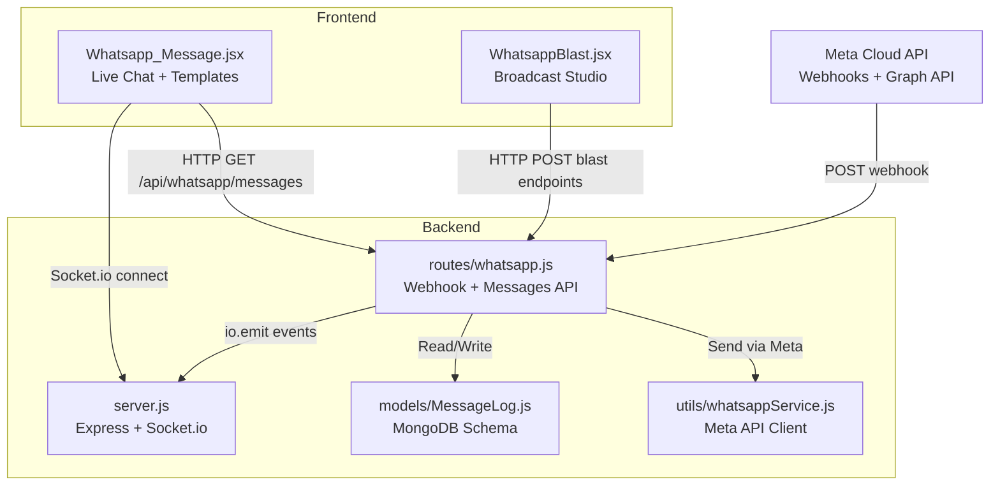
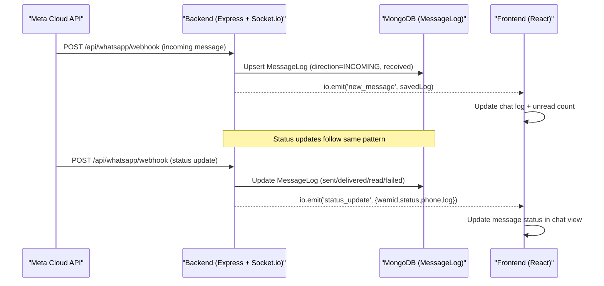
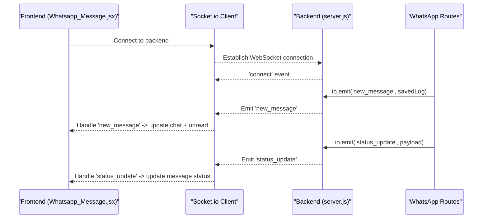
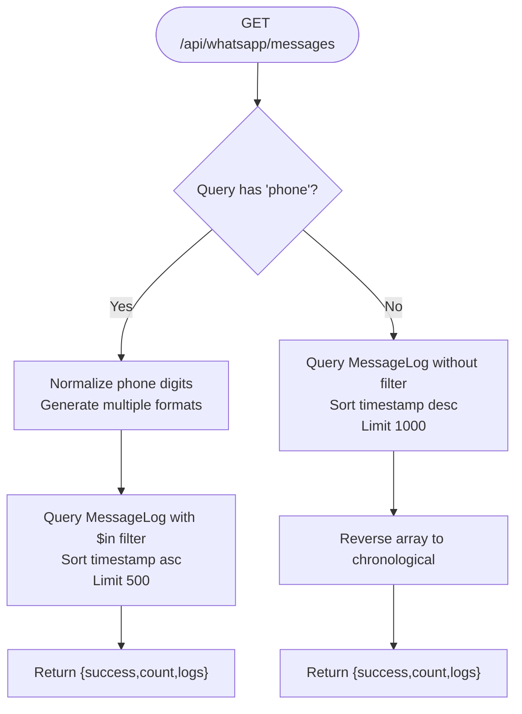
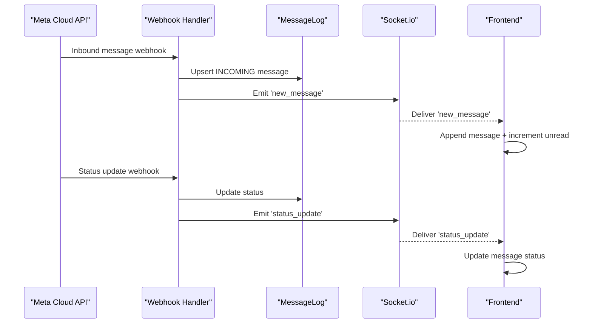
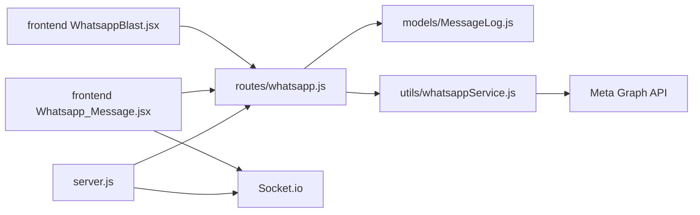

# Message Broadcasting & Real-time Communication

<cite>
**Referenced Files in This Document**   
- [server.js](file://backend/server.js)
- [whatsapp.js](file://backend/routes/whatsapp.js)
- [MessageLog.js](file://backend/models/MessageLog.js)
- [whatsappService.js](file://backend/utils/whatsappService.js)
- [Whatsapp_Message.jsx](file://frontend/src/Dashboard/Whatsapp_Message.jsx)
- [WhatsappBlast.jsx](file://frontend/src/Dashboard/WhatsappBlast.jsx)
</cite>

## Table of Contents
1. [Introduction](#introduction)
2. [Project Structure](#project-structure)
3. [Core Components](#core-components)
4. [Architecture Overview](#architecture-overview)
5. [Detailed Component Analysis](#detailed-component-analysis)
6. [Dependency Analysis](#dependency-analysis)
7. [Performance Considerations](#performance-considerations)
8. [Troubleshooting Guide](#troubleshooting-guide)
9. [Conclusion](#conclusion)

## Introduction
This document explains the WhatsApp message broadcasting and real-time communication features in the project. It focuses on:
- The message retrieval endpoint `/api/whatsapp/messages` for fetching chat logs and conversation history.
- The WebSocket integration using Socket.io for real-time incoming messages, auto-replies, and delivery/read status broadcasts.
- Message filtering by phone number, chronological sorting, and pagination limits.
- End-to-end flow from Meta API webhooks through backend processing to frontend display.
- Live chat functionality powered by Socket.io and periodic polling fallbacks.

## Project Structure
The relevant parts of the codebase are split between a Node/Express backend and a React frontend:
- Backend:
  - Express server with Socket.io setup.
  - WhatsApp routes handling configuration, webhooks, and message retrieval.
  - Message model for MongoDB persistence.
  - Utility service for Meta API calls.
- Frontend:
  - Live chat interface with template studio and broadcast UI.
  - Socket.io client for real-time updates.
  - Polling-based refresh for unread counts and chat logs.

**Diagram sources**
- [server.js:11-35](file://backend/server.js#L11-L35)
- [whatsapp.js:111-333](file://backend/routes/whatsapp.js#L111-L333)
- [MessageLog.js:1-22](file://backend/models/MessageLog.js#L1-L22)
- [whatsappService.js:1-228](file://backend/utils/whatsappService.js#L1-L228)
- [Whatsapp_Message.jsx:470-537](file://frontend/src/Dashboard/Whatsapp_Message.jsx#L470-L537)
- [WhatsappBlast.jsx:276-327](file://frontend/src/Dashboard/WhatsappBlast.jsx#L276-L327)

**Section sources**
- [server.js:1-82](file://backend/server.js#L1-L82)
- [whatsapp.js:1-335](file://backend/routes/whatsapp.js#L1-L335)
- [MessageLog.js:1-22](file://backend/models/MessageLog.js#L1-L22)
- [whatsappService.js:1-228](file://backend/utils/whatsappService.js#L1-L228)
- [Whatsapp_Message.jsx:1-800](file://frontend/src/Dashboard/Whatsapp_Message.jsx#L1-L800)
- [WhatsappBlast.jsx:1-713](file://frontend/src/Dashboard/WhatsappBlast.jsx#L1-L713)

## Core Components
- Server and WebSockets:
  - Express app with HTTP server and Socket.io server.
  - Global `io` instance stored on the Express app for route handlers to emit events.
  - Basic connection lifecycle logging and room join support.
- WhatsApp Routes:
  - Configuration endpoints for Meta credentials.
  - Webhook verification and inbound message/status processing.
  - Message retrieval endpoint for chat logs and activity summary.
- Message Model:
  - MongoDB schema storing message metadata, direction, status, text, timestamps, error info, pricing, and identifiers.
- Meta API Service:
  - Helper functions to call Meta Graph API for sending messages and checking connectivity.
- Frontend Live Chat:
  - Socket.io client connecting to the backend.
  - Listens for `new_message`, `auto_reply`, and `status_update`.
  - Periodically polls `/api/whatsapp/messages` for unread counts and chat history.
- Frontend Broadcast Studio:
  - Template selection, recipient selection (contacts or leads), and batch dispatch.

**Section sources**
- [server.js:11-35](file://backend/server.js#L11-L35)
- [whatsapp.js:111-333](file://backend/routes/whatsapp.js#L111-L333)
- [MessageLog.js:1-22](file://backend/models/MessageLog.js#L1-L22)
- [whatsappService.js:1-228](file://backend/utils/whatsappService.js#L1-L228)
- [Whatsapp_Message.jsx:470-537](file://frontend/src/Dashboard/Whatsapp_Message.jsx#L470-L537)
- [WhatsappBlast.jsx:276-327](file://frontend/src/Dashboard/WhatsappBlast.jsx#L276-L327)

## Architecture Overview
The system integrates three main flows:
1. Incoming customer messages from Meta arrive at the backend webhook, get persisted, and trigger real-time broadcasts.
2. Outgoing messages (templates, buttons, lists, images) are sent via the Meta API service; statuses come back as webhooks and update the log.
3. The frontend displays live chats, templates, and broadcast results, updating instantly via WebSockets and refreshing periodically via HTTP polling.

**Diagram sources**
- [whatsapp.js:134-311](file://backend/routes/whatsapp.js#L134-L311)
- [server.js:14-35](file://backend/server.js#L14-L35)
- [Whatsapp_Message.jsx:470-537](file://frontend/src/Dashboard/Whatsapp_Message.jsx#L470-L537)

## Detailed Component Analysis

### Message Retrieval Endpoint: `/api/whatsapp/messages`
Purpose:
- Fetch chat logs for a specific phone number.
- Fetch recent activity across all contacts for unread counts and top activity sorting.

Behavior:
- If `phone` query parameter is provided:
  - Normalize phone digits and match multiple formats (10-digit, 12-digit with country code, plus-prefixed).
  - Query `MessageLog` with filter matching normalized phones.
  - Sort chronologically ascending (`timestamp: 1`).
  - Limit to 500 records.
  - Return `{ success, count, logs }`.
- If no `phone` parameter:
  - Fetch up to 1000 most recent messages across all contacts.
  - Sort descending by timestamp then reverse to chronological order.
  - Return `{ success, count, logs }`.

Filtering capabilities:
- Phone number filtering supports multiple normalized formats to handle local vs international representations.
- Chronological sorting ensures consistent ordering for chat rendering.
- Pagination is implemented via fixed limits (500 per chat, 1000 global), not cursor-based pagination.

Example request/response shape:
- Request: `GET /api/whatsapp/messages?phone=7995232673`
- Response: `{ success: true, count: N, logs: [...] }`

Frontend usage:
- Loads chat logs for selected contact.
- Polls global endpoint every few seconds to compute unread counts and latest activity timestamps.

**Section sources**
- [whatsapp.js:313-333](file://backend/routes/whatsapp.js#L313-L333)
- [MessageLog.js:1-22](file://backend/models/MessageLog.js#L1-L22)
- [Whatsapp_Message.jsx:659-715](file://frontend/src/Dashboard/Whatsapp_Message.jsx#L659-L715)
- [Whatsapp_Message.jsx:717-752](file://frontend/src/Dashboard/Whatsapp_Message.jsx#L717-L752)

### WebSocket Integration: Real-time Updates and Connection Management
Server-side:
- Socket.io server initialized with CORS allowing all origins and common methods.
- Global `io` instance attached to Express app for route handlers to emit events.
- Basic event handlers for connection, room joining, and disconnection.

Client-side:
- Socket.io client connects to the backend base URL.
- Emits `join_room` when needed (room-based targeting available).
- Listens for:
  - `new_message`: Adds incoming messages to chat log and increments unread count.
  - `auto_reply`: Inserts automated replies into chat log.
  - `status_update`: Updates message status (sent/delivered/read/failed) in chat log.

Connection management strategies:
- Frontend maintains connection state (`wsConnected`) and logs connection/disconnection events.
- Cleanup disconnects socket on component unmount.
- Fallback polling continues even if WebSocket is unavailable.

**Diagram sources**
- [server.js:14-35](file://backend/server.js#L14-L35)
- [whatsapp.js:206-211](file://backend/routes/whatsapp.js#L206-L211)
- [whatsapp.js:293-297](file://backend/routes/whatsapp.js#L293-L297)
- [Whatsapp_Message.jsx:470-537](file://frontend/src/Dashboard/Whatsapp_Message.jsx#L470-L537)

**Section sources**
- [server.js:14-35](file://backend/server.js#L14-L35)
- [whatsapp.js:206-211](file://backend/routes/whatsapp.js#L206-L211)
- [whatsapp.js:293-297](file://backend/routes/whatsapp.js#L293-L297)
- [Whatsapp_Message.jsx:470-537](file://frontend/src/Dashboard/Whatsapp_Message.jsx#L470-L537)

### Message Filtering, Sorting, and Limits
Phone number filtering:
- Normalizes input by stripping non-digits and trying multiple formats:
  - Last 10 digits.
  - 12-digit format with country code prefix.
  - Raw digits.
  - Plus-prefixed variants.
- Uses MongoDB `$in` filter to match any of these normalized forms.

Chronological sorting:
- Per-chat logs sorted ascending by timestamp.
- Global activity logs sorted descending then reversed to achieve chronological order.

Pagination limits:
- Per-chat limit: 500 messages.
- Global limit: 1000 messages.
- No cursor-based pagination; clients should rely on WebSocket updates and periodic polling.

**Diagram sources**
- [whatsapp.js:313-333](file://backend/routes/whatsapp.js#L313-L333)

**Section sources**
- [whatsapp.js:313-333](file://backend/routes/whatsapp.js#L313-L333)

### Real-time Message Flow: Meta API → Webhook → Frontend
End-to-end flow:
1. Meta sends an incoming message webhook to `/api/whatsapp/webhook`.
2. Backend parses the payload, extracts sender phone, WAMID, message type, and text.
3. Backend persists the message to `MessageLog` with direction `INCOMING` and status `received`.
4. Backend emits `new_message` via Socket.io to connected clients.
5. Frontend receives the event, updates the chat log, and increments unread count.
6. For outgoing messages, Meta sends status updates (sent/delivered/read/failed).
7. Backend updates `MessageLog` and emits `status_update` via Socket.io.
8. Frontend updates the corresponding message status in the chat view.

**Diagram sources**
- [whatsapp.js:134-311](file://backend/routes/whatsapp.js#L134-L311)
- [Whatsapp_Message.jsx:470-537](file://frontend/src/Dashboard/Whatsapp_Message.jsx#L470-L537)

**Section sources**
- [whatsapp.js:134-311](file://backend/routes/whatsapp.js#L134-L311)
- [Whatsapp_Message.jsx:470-537](file://frontend/src/Dashboard/Whatsapp_Message.jsx#L470-L537)

### Socket.io Integration for Live Chat and Connection Strategies
Server:
- Initializes Socket.io with CORS settings.
- Stores `io` on Express app for route handlers.
- Logs connections, room joins, and disconnections.

Client:
- Connects using `socket.io-client` with transport options including WebSocket and polling.
- Maintains connection state and handles reconnection implicitly via Socket.io.
- Subscribes to `new_message`, `auto_reply`, and `status_update`.
- Cleans up socket on unmount.

Best practices observed:
- Use both WebSocket and polling fallbacks for reliability.
- Keep WebSocket events lightweight; heavy data loads use HTTP endpoints.
- Maintain local chat state maps keyed by normalized phone numbers.

**Section sources**
- [server.js:14-35](file://backend/server.js#L14-L35)
- [Whatsapp_Message.jsx:470-537](file://frontend/src/Dashboard/Whatsapp_Message.jsx#L470-L537)

### Message Broadcasting: Templates, Recipients, and Dispatch
Broadcast workflow:
- Frontend selects a Meta-approved template and recipients (contacts or leads).
- User triggers blast; frontend calls backend blast endpoint.
- Backend processes recipients and sends messages via Meta API service.
- Results (success/failure counts) are returned to the frontend for display.

Key behaviors:
- Template preview and variable substitution in the UI.
- Recipient filtering by identity or pipeline stage.
- Confirmation modal before dispatch.

**Section sources**
- [WhatsappBlast.jsx:276-327](file://frontend/src/Dashboard/WhatsappBlast.jsx#L276-L327)
- [whatsappService.js:194-215](file://backend/utils/whatsappService.js#L194-L215)

## Dependency Analysis
Component relationships:
- `server.js` depends on `express`, `socket.io`, `mongoose`, `cors`, `node-cron`.
- `routes/whatsapp.js` depends on `express`, `whatsappService`, `metaConfigHelper`, `MessageLog`, and optional automation bot utilities.
- `utils/whatsappService.js` depends on `axios`, `fs`, `form-data`, and `metaConfigHelper`.
- Frontend components depend on `socket.io-client` and fetch APIs.

**Diagram sources**
- [server.js:1-82](file://backend/server.js#L1-L82)
- [whatsapp.js:1-335](file://backend/routes/whatsapp.js#L1-L335)
- [MessageLog.js:1-22](file://backend/models/MessageLog.js#L1-L22)
- [whatsappService.js:1-228](file://backend/utils/whatsappService.js#L1-L228)
- [Whatsapp_Message.jsx:1-800](file://frontend/src/Dashboard/Whatsapp_Message.jsx#L1-L800)
- [WhatsappBlast.jsx:1-713](file://frontend/src/Dashboard/WhatsappBlast.jsx#L1-L713)

**Section sources**
- [server.js:1-82](file://backend/server.js#L1-L82)
- [whatsapp.js:1-335](file://backend/routes/whatsapp.js#L1-L335)
- [MessageLog.js:1-22](file://backend/models/MessageLog.js#L1-L22)
- [whatsappService.js:1-228](file://backend/utils/whatsappService.js#L1-L228)
- [Whatsapp_Message.jsx:1-800](file://frontend/src/Dashboard/Whatsapp_Message.jsx#L1-L800)
- [WhatsappBlast.jsx:1-713](file://frontend/src/Dashboard/WhatsappBlast.jsx#L1-L713)

## Performance Considerations
- Database queries:
  - Per-chat limit of 500 prevents large payloads; consider adding offset/pagination if historical depth grows.
  - Global limit of 1000 balances unread calculation performance with completeness.
- Indexing:
  - Ensure indexes on `phone` and `timestamp` fields in `MessageLog` for efficient filtering and sorting.
- WebSocket scaling:
  - Current implementation uses in-memory Socket.io; for multi-instance deployments, consider Redis adapter.
- Polling frequency:
  - Frontend polls every 3 seconds; tune based on expected message volume and network conditions.
- Media handling:
  - Image uploads to Meta require separate media upload step; ensure retries and error handling for large files.

[No sources needed since this section provides general guidance]

## Troubleshooting Guide
Common issues and resolutions:
- Webhook not verified:
  - Ensure verify token matches backend configuration.
  - Confirm Meta webhook URL points to `/api/whatsapp/webhook`.
- Missing credentials:
  - Validate WABA ID, phone ID, access token, and graph version in configuration endpoints.
- WebSocket connection failures:
  - Check CORS settings and origin configuration.
  - Verify Socket.io client transport options include WebSocket and polling.
- Message not appearing in chat:
  - Confirm `new_message` event is emitted and frontend listener is active.
  - Check normalization of phone numbers to ensure correct chat key mapping.
- Status not updating:
  - Ensure status webhook is processed and `status_update` event is emitted.
  - Verify frontend handler updates message status by WAMID.

**Section sources**
- [whatsapp.js:114-132](file://backend/routes/whatsapp.js#L114-L132)
- [whatsapp.js:134-311](file://backend/routes/whatsapp.js#L134-L311)
- [server.js:14-35](file://backend/server.js#L14-L35)
- [Whatsapp_Message.jsx:470-537](file://frontend/src/Dashboard/Whatsapp_Message.jsx#L470-L537)

## Conclusion
The system provides robust WhatsApp message broadcasting and real-time communication:
- A reliable webhook pipeline captures incoming messages and status updates.
- A clear REST endpoint retrieves chat logs with flexible phone filtering and chronological sorting.
- Socket.io enables instant updates for messages, auto-replies, and statuses.
- The frontend combines WebSocket events with periodic polling for resilient live chat experiences.
- Broadcast workflows allow selecting templates and recipients, dispatching messages at scale.

For further improvements, consider implementing cursor-based pagination, database indexing optimizations, and scalable WebSocket infrastructure for multi-node deployments.

[No sources needed since this section summarizes without analyzing specific files]