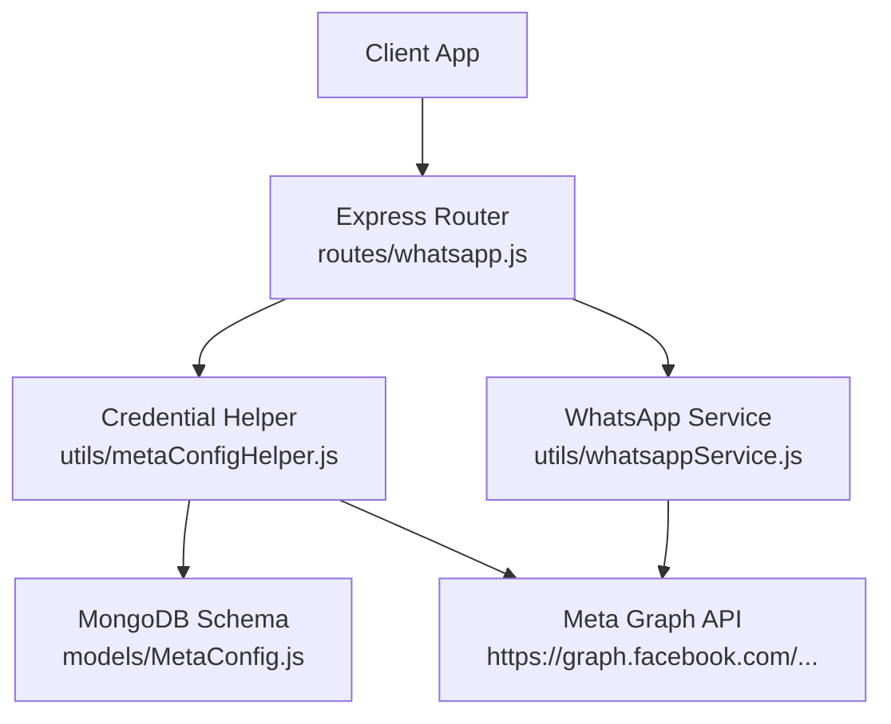
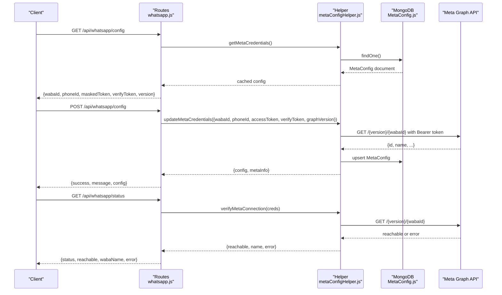
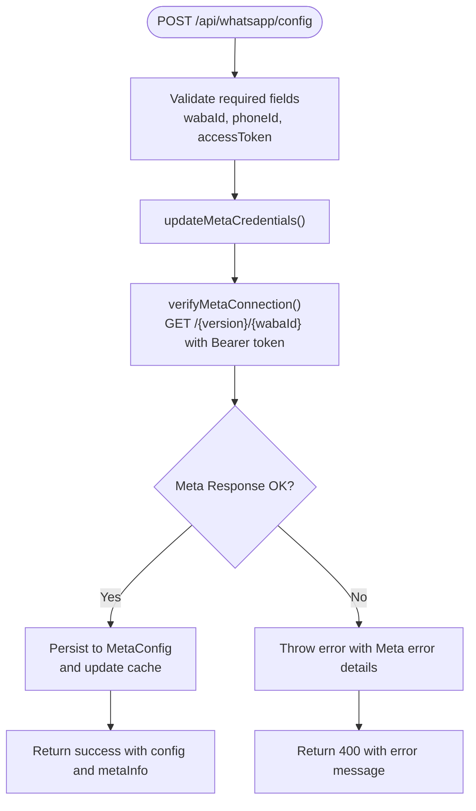
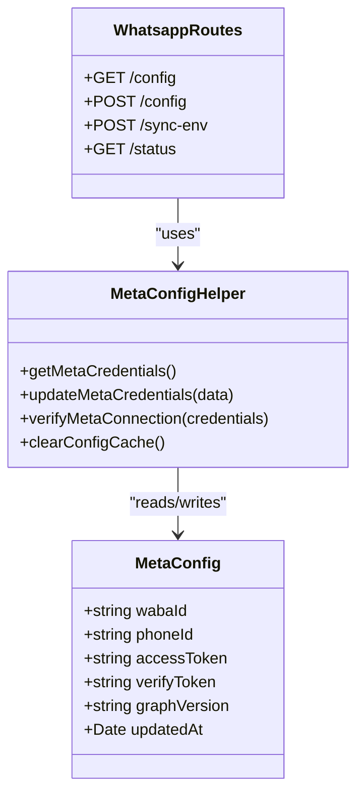
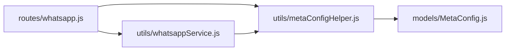

# Meta API Connection Management

<cite>
**Referenced Files in This Document**   
- [whatsapp.js](file://backend/routes/whatsapp.js)
- [metaConfigHelper.js](file://backend/utils/metaConfigHelper.js)
- [MetaConfig.js](file://backend/models/MetaConfig.js)
- [whatsappService.js](file://backend/utils/whatsappService.js)
</cite>

## Table of Contents
1. [Introduction](#introduction)
2. [Project Structure](#project-structure)
3. [Core Components](#core-components)
4. [Architecture Overview](#architecture-overview)
5. [Detailed Component Analysis](#detailed-component-analysis)
6. [Dependency Analysis](#dependency-analysis)
7. [Performance Considerations](#performance-considerations)
8. [Troubleshooting Guide](#troubleshooting-guide)
9. [Conclusion](#conclusion)

## Introduction
This document explains the Meta Business API connection management endpoints for WhatsApp, focusing on configuration, credential validation, environment synchronization, and connection status monitoring. It covers:
- Configuration endpoints: GET /api/whatsapp/config and POST /api/whatsapp/config
- Environment synchronization endpoint: POST /api/whatsapp/sync-env
- Status monitoring endpoint: GET /api/whatsapp/status
- Credential validation flow against Meta Graph API using static access tokens
- Security considerations for token handling and verification token usage
- The relationship between Meta’s static token authentication and the application’s credential storage system (MongoDB MetaConfig and process.env fallback)

## Project Structure
The relevant backend components are organized as follows:
- Routes: Express router exposing REST endpoints for WhatsApp configuration and status
- Utilities: Helpers for fetching/updating credentials and validating connections to Meta
- Models: MongoDB schema for storing Meta configuration
- Service layer: WhatsApp messaging utilities that depend on configured credentials

**Diagram sources**
- [whatsapp.js:1-109](file://backend/routes/whatsapp.js#L1-L109)
- [metaConfigHelper.js:1-112](file://backend/utils/metaConfigHelper.js#L1-L112)
- [MetaConfig.js:1-13](file://backend/models/MetaConfig.js#L1-L13)
- [whatsappService.js:1-32](file://backend/utils/whatsappService.js#L1-L32)

**Section sources**
- [whatsapp.js:1-109](file://backend/routes/whatsapp.js#L1-L109)
- [metaConfigHelper.js:1-112](file://backend/utils/metaConfigHelper.js#L1-L112)
- [MetaConfig.js:1-13](file://backend/models/MetaConfig.js#L1-L13)
- [whatsappService.js:1-32](file://backend/utils/whatsappService.js#L1-L32)

## Core Components
- Configuration retrieval and masking: GET /api/whatsapp/config returns current WABA ID, phone number ID, masked token, graph version, and verification token hint.
- Configuration update and validation: POST /api/whatsapp/config validates provided credentials by calling Meta Graph API before persisting them.
- Environment synchronization: POST /api/whatsapp/sync-env clears stored MetaConfig and reloads credentials from process.env.
- Status monitoring: GET /api/whatsapp/status performs a live connectivity check against Meta Graph API and reports CONNECTED or DISCONNECTED.

Key responsibilities:
- Route handlers orchestrate requests and responses.
- Credential helper manages persistence, caching, and validation.
- WhatsApp service provides higher-level operations depending on valid credentials.

**Section sources**
- [whatsapp.js:8-109](file://backend/routes/whatsapp.js#L8-L109)
- [metaConfigHelper.js:6-71](file://backend/utils/metaConfigHelper.js#L6-L71)
- [whatsappService.js:25-32](file://backend/utils/whatsappService.js#L25-L32)

## Architecture Overview
The connection management architecture uses static access tokens with Meta Graph API. Credentials can be sourced from MongoDB (MetaConfig) or environment variables, with an in-memory cache for performance.

**Diagram sources**
- [whatsapp.js:8-109](file://backend/routes/whatsapp.js#L8-L109)
- [metaConfigHelper.js:37-100](file://backend/utils/metaConfigHelper.js#L37-L100)
- [MetaConfig.js:1-13](file://backend/models/MetaConfig.js#L1-L13)

## Detailed Component Analysis

### Configuration Endpoints

#### GET /api/whatsapp/config
Purpose:
- Retrieve current configuration values for display in the UI.
- Mask sensitive fields like phoneId and token to prevent accidental exposure.

Behavior:
- Loads credentials via getMetaCredentials(), which prioritizes MongoDB MetaConfig and falls back to process.env.
- Returns masked versions of phoneId and token along with unmasked identifiers where safe (wabaId, phoneId).
- Includes hasToken flag, graph version, and verification token value.

Response shape:
- success: boolean
- wabaId: string
- phoneId: string
- maskedPhone: string
- maskedToken: string
- hasToken: boolean
- version: string
- verifyToken: string

Error handling:
- On internal errors, returns 500 with success: false and message.

Security notes:
- Sensitive values are masked in responses.
- Verification token is returned; ensure it is not logged or exposed beyond necessary contexts.

**Section sources**
- [whatsapp.js:38-59](file://backend/routes/whatsapp.js#L38-L59)
- [metaConfigHelper.js:6-35](file://backend/utils/metaConfigHelper.js#L6-L35)

#### POST /api/whatsapp/config
Purpose:
- Validate and persist new Meta Business API credentials.

Input fields:
- wabaId: required
- phoneId: required
- accessToken: required
- verifyToken: optional
- graphVersion: optional

Validation and processing:
- Validates presence of required fields.
- Calls updateMetaCredentials(), which:
  - Verifies credentials by calling Meta Graph API with the provided token and WABA ID.
  - If validation fails, throws an error with details from Meta.
  - Persists updated credentials into MetaConfig (upsert).
  - Updates in-memory cache.

Response shape:
- success: boolean
- message: descriptive confirmation including retrieved WABA name
- config: persisted configuration object

Error handling:
- Missing required fields: 400 with message.
- Invalid credentials or network errors: 400 with error message from validation.

Example outcomes:
- Success:
  - HTTP 200
  - { success: true, message: "...", config: {...} }
- Failure:
  - HTTP 400
  - { success: false, message: "Meta validation failed: ..." }

**Section sources**
- [whatsapp.js:78-109](file://backend/routes/whatsapp.js#L78-L109)
- [metaConfigHelper.js:37-71](file://backend/utils/metaConfigHelper.js#L37-L71)

#### POST /api/whatsapp/sync-env
Purpose:
- Force flush MongoDB MetaConfig and re-sync credentials directly from process.env.

Behavior:
- Deletes all MetaConfig documents.
- Clears in-memory config cache.
- Reloads credentials via getMetaCredentials() to populate cache from environment variables.

Response shape:
- success: boolean
- message: confirmation that MongoDB was cleared and re-synced
- config: current configuration loaded from environment

Use cases:
- When environment variables change without updating MongoDB.
- During deployment or CI/CD when env-based credentials should take precedence.

Error handling:
- On failure, returns 500 with error message.

**Section sources**
- [whatsapp.js:62-76](file://backend/routes/whatsapp.js#L62-L76)
- [metaConfigHelper.js:102-104](file://backend/utils/metaConfigHelper.js#L102-L104)

### Connection Status Monitoring

#### GET /api/whatsapp/status
Purpose:
- Provide real-time connection status by pinging Meta Graph API.

Behavior:
- Retrieves credentials via getMetaCredentials().
- Calls verifyMetaConnection() to perform a live request to Meta Graph API.
- Returns CONNECTED if reachable, otherwise DISCONNECTED.
- Includes additional metadata such as WABA name and error details when available.

Response shape:
- status: "CONNECTED" | "DISCONNECTED"
- reachable: boolean
- wabaName: string or null
- error: string or null
- qr: null (placeholder)

Error handling:
- Catches exceptions and returns DISCONNECTED with error message.

Example outcomes:
- Success:
  - { status: "CONNECTED", reachable: true, wabaName: "Business Name", error: null }
- Failure:
  - { status: "DISCONNECTED", reachable: false, error: "Unable to connect to Meta Graph API" }

**Section sources**
- [whatsapp.js:8-22](file://backend/routes/whatsapp.js#L8-L22)
- [metaConfigHelper.js:73-100](file://backend/utils/metaConfigHelper.js#L73-L100)

### Credential Validation Process

The credential validation flow ensures that only valid Meta Business API credentials are saved:

**Diagram sources**
- [whatsapp.js:78-109](file://backend/routes/whatsapp.js#L78-L109)
- [metaConfigHelper.js:37-100](file://backend/utils/metaConfigHelper.js#L37-L100)

**Section sources**
- [whatsapp.js:78-109](file://backend/routes/whatsapp.js#L78-L109)
- [metaConfigHelper.js:37-100](file://backend/utils/metaConfigHelper.js#L37-L100)

### Relationship Between Meta Static Token Authentication and Application Credential Storage

- Meta uses static access tokens for API calls. The application does not implement OAuth flows; instead, it stores and uses these tokens directly.
- Credential sourcing priority:
  1. MongoDB MetaConfig (preferred when present and complete).
  2. Fallback to process.env variables if MongoDB lacks credentials.
- In-memory caching reduces database reads and improves response times.
- Verification token is used for webhook verification and is stored alongside other configuration.

**Diagram sources**
- [MetaConfig.js:1-13](file://backend/models/MetaConfig.js#L1-L13)
- [metaConfigHelper.js:1-112](file://backend/utils/metaConfigHelper.js#L1-L112)
- [whatsapp.js:1-109](file://backend/routes/whatsapp.js#L1-L109)

**Section sources**
- [metaConfigHelper.js:6-35](file://backend/utils/metaConfigHelper.js#L6-L35)
- [MetaConfig.js:1-13](file://backend/models/MetaConfig.js#L1-L13)

## Dependency Analysis
- whatsapp.js depends on:
  - utils/metaConfigHelper.js for credential management and validation.
  - utils/whatsappService.js for status checks and messaging operations.
  - models/MetaConfig.js indirectly through metaConfigHelper.js.
- metaConfigHelper.js depends on:
  - axios for HTTP requests to Meta Graph API.
  - models/MetaConfig.js for persistence.
- whatsappService.js depends on:
  - utils/metaConfigHelper.js for dynamic credential resolution.

**Diagram sources**
- [whatsapp.js:1-109](file://backend/routes/whatsapp.js#L1-L109)
- [metaConfigHelper.js:1-112](file://backend/utils/metaConfigHelper.js#L1-L112)
- [whatsappService.js:1-32](file://backend/utils/whatsappService.js#L1-L32)

**Section sources**
- [whatsapp.js:1-109](file://backend/routes/whatsapp.js#L1-L109)
- [metaConfigHelper.js:1-112](file://backend/utils/metaConfigHelper.js#L1-L112)
- [whatsappService.js:1-32](file://backend/utils/whatsappService.js#L1-L32)

## Performance Considerations
- In-memory caching of credentials avoids frequent MongoDB reads.
- Network timeouts are set for Meta Graph API calls to prevent hanging requests.
- Masking sensitive data in responses reduces risk of accidental exposure.
- Using upsert operations for credential updates minimizes redundant writes.

[No sources needed since this section provides general guidance]

## Troubleshooting Guide
Common issues and resolutions:
- Missing required fields in POST /api/whatsapp/config:
  - Ensure wabaId, phoneId, and accessToken are provided.
- Invalid access token or WABA ID:
  - verifyMetaConnection will return an error; check token permissions and WABA ownership.
- Connectivity issues with Meta Graph API:
  - Check network access and firewall rules; verify timeout settings.
- Environment sync not reflecting changes:
  - Use POST /api/whatsapp/sync-env after updating .env to force reload.
- Webhook verification failures:
  - Ensure verifyToken matches the one configured in Meta dashboard and application.

Operational tips:
- Monitor GET /api/whatsapp/status for real-time connection health.
- Inspect logs for detailed error messages from Meta API responses.
- Avoid logging full tokens; rely on masked representations in UI.

**Section sources**
- [whatsapp.js:78-109](file://backend/routes/whatsapp.js#L78-L109)
- [metaConfigHelper.js:73-100](file://backend/utils/metaConfigHelper.js#L73-L100)

## Conclusion
The Meta Business API connection management endpoints provide a secure and efficient way to configure, validate, and monitor WhatsApp integration using static access tokens. The system prioritizes MongoDB-stored credentials with environment variable fallbacks, includes robust validation against Meta Graph API, and offers clear status reporting. Proper security practices around token handling and verification tokens are essential to maintain safe operations.

[No sources needed since this section summarizes without analyzing specific files]