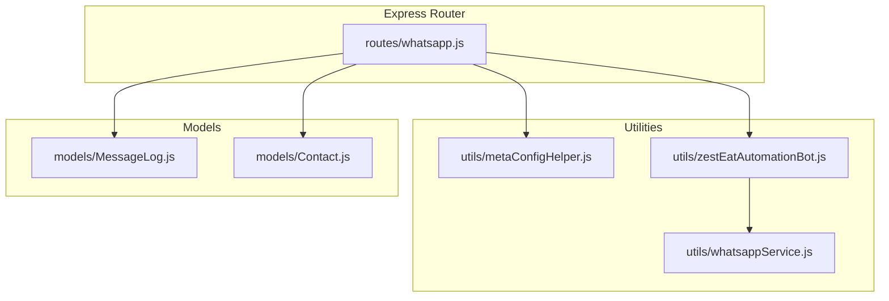
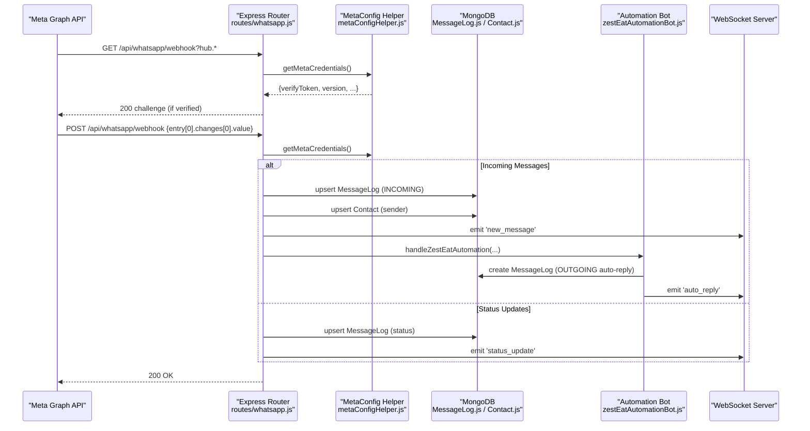
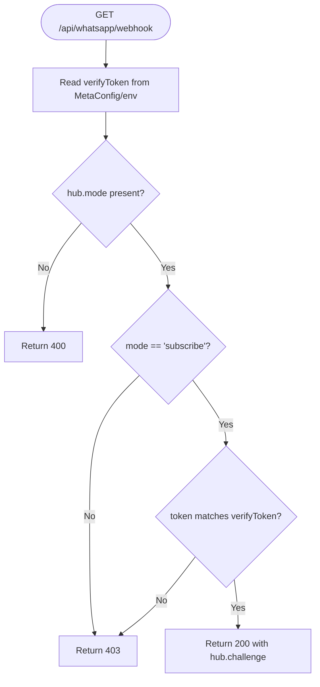
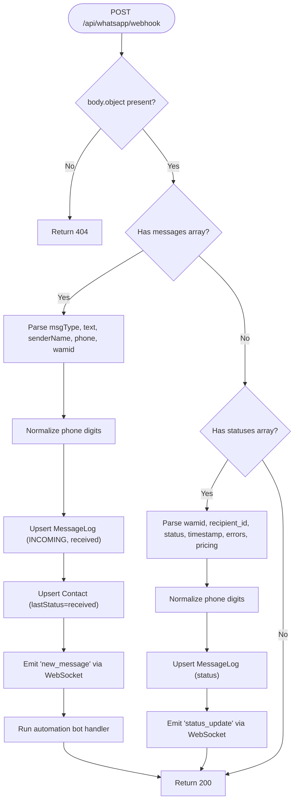
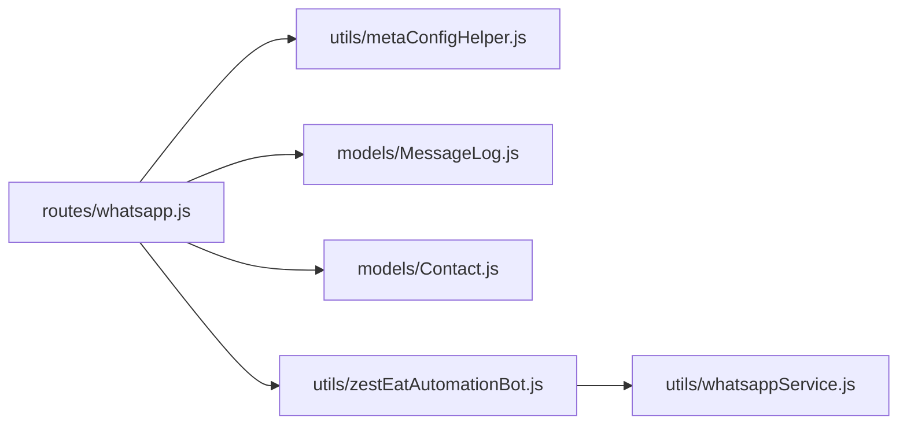

# Webhook Processing & Event Handling

<cite>
**Referenced Files in This Document**
- [whatsapp.js](file://backend/routes/whatsapp.js)
- [MessageLog.js](file://backend/models/MessageLog.js)
- [Contact.js](file://backend/models/Contact.js)
- [metaConfigHelper.js](file://backend/utils/metaConfigHelper.js)
- [whatsappService.js](file://backend/utils/whatsappService.js)
- [zestEatAutomationBot.js](file://backend/utils/zestEatAutomationBot.js)
</cite>

## Table of Contents
1. [Introduction](#introduction)
2. [Project Structure](#project-structure)
3. [Core Components](#core-components)
4. [Architecture Overview](#architecture-overview)
5. [Detailed Component Analysis](#detailed-component-analysis)
6. [Dependency Analysis](#dependency-analysis)
7. [Performance Considerations](#performance-considerations)
8. [Troubleshooting Guide](#troubleshooting-guide)
9. [Conclusion](#conclusion)

## Introduction
This document explains how the backend processes WhatsApp webhooks and events for incoming messages, interactive replies, and delivery/read/failure status updates. It covers:
- Webhook verification endpoint (GET /api/whatsapp/webhook)
- Message processing endpoint (POST /api/whatsapp/webhook)
- Incoming message handling for text, button, and interactive types
- Status update processing for sent, delivered, read, and failed states
- Webhook payload structures and event type definitions
- Data transformation logic and persistence via MessageLog and Contact models
- Real-time WebSocket broadcasting to the frontend

## Project Structure
The webhook-related functionality is implemented primarily in the Express router under routes/whatsapp.js, with supporting utilities and data models:
- Route handlers for webhook verification and message/status processing
- Meta configuration helper for credentials and connection checks
- WhatsApp service for outbound messaging and phone formatting
- Models for persistent storage of message logs and contacts
- Automation bot utility for conversational flows triggered by incoming messages

**Diagram sources**
- [whatsapp.js:1-6](file://backend/routes/whatsapp.js#L1-L6)
- [whatsapp.js:111-311](file://backend/routes/whatsapp.js#L111-L311)
- [metaConfigHelper.js:6-35](file://backend/utils/metaConfigHelper.js#L6-L35)
- [whatsappService.js:1-228](file://backend/utils/whatsappService.js#L1-L228)
- [MessageLog.js:1-22](file://backend/models/MessageLog.js#L1-L22)
- [Contact.js:1-26](file://backend/models/Contact.js#L1-L26)
- [zestEatAutomationBot.js:28-398](file://backend/utils/zestEatAutomationBot.js#L28-L398)

**Section sources**
- [whatsapp.js:1-335](file://backend/routes/whatsapp.js#L1-L335)
- [metaConfigHelper.js:1-112](file://backend/utils/metaConfigHelper.js#L1-L112)
- [whatsappService.js:1-228](file://backend/utils/whatsappService.js#L1-L228)
- [MessageLog.js:1-22](file://backend/models/MessageLog.js#L1-L22)
- [Contact.js:1-26](file://backend/models/Contact.js#L1-L26)
- [zestEatAutomationBot.js:28-398](file://backend/utils/zestEatAutomationBot.js#L28-L398)

## Core Components
- Webhook Verification (GET): Validates hub.mode, hub.verify_token, and returns hub.challenge when valid. Uses configured verifyToken from MetaConfig or environment variables.
- Webhook Processing (POST): Handles two primary event categories:
  - Incoming customer messages (text, button, interactive)
  - Message status updates (sent, delivered, read, failed)
- Persistence Layer:
  - MessageLog stores inbound/outbound messages, statuses, timestamps, error details, pricing, and WABA/phone identifiers.
  - Contact auto-upserts on inbound messages to ensure senders appear in the contact list.
- Real-Time Broadcasting: Emits WebSocket events for new messages and status updates.
- Automation Bot: Processes incoming messages through a stateful conversation flow and emits auto-reply events.

**Section sources**
- [whatsapp.js:114-132](file://backend/routes/whatsapp.js#L114-L132)
- [whatsapp.js:135-311](file://backend/routes/whatsapp.js#L135-L311)
- [MessageLog.js:3-19](file://backend/models/MessageLog.js#L3-L19)
- [Contact.js:3-17](file://backend/models/Contact.js#L3-L17)
- [zestEatAutomationBot.js:28-398](file://backend/utils/zestEatAutomationBot.js#L28-L398)

## Architecture Overview
The webhook pipeline integrates Meta’s Graph API callbacks with internal services and real-time UI updates.

**Diagram sources**
- [whatsapp.js:114-132](file://backend/routes/whatsapp.js#L114-L132)
- [whatsapp.js:135-311](file://backend/routes/whatsapp.js#L135-L311)
- [metaConfigHelper.js:6-35](file://backend/utils/metaConfigHelper.js#L6-L35)
- [MessageLog.js:3-19](file://backend/models/MessageLog.js#L3-L19)
- [Contact.js:3-17](file://backend/models/Contact.js#L3-L17)
- [zestEatAutomationBot.js:368-393](file://backend/utils/zestEatAutomationBot.js#L368-L393)

## Detailed Component Analysis

### Webhook Verification Endpoint (GET /api/whatsapp/webhook)
Purpose:
- Validate Meta’s verification request using hub.mode and hub.verify_token.
- Return hub.challenge when mode equals subscribe and tokens match.

Key behaviors:
- Retrieves verifyToken from MetaConfig or environment fallback.
- Responds with HTTP 200 and the challenge string on success.
- Returns 403 if token mismatch; 400 if required query parameters are missing.

**Diagram sources**
- [whatsapp.js:114-132](file://backend/routes/whatsapp.js#L114-L132)
- [metaConfigHelper.js:6-35](file://backend/utils/metaConfigHelper.js#L6-L35)

**Section sources**
- [whatsapp.js:114-132](file://backend/routes/whatsapp.js#L114-L132)
- [metaConfigHelper.js:6-35](file://backend/utils/metaConfigHelper.js#L6-L35)

### Webhook Processing Endpoint (POST /api/whatsapp/webhook)
Purpose:
- Process incoming customer messages and message status updates from Meta.
- Persist data to MessageLog and Contact.
- Broadcast real-time events via WebSocket.
- Trigger automation bot for conversational flows.

Incoming Message Handling:
- Supported types: text, button, interactive.
- Extracts sender phone, name, message text, and metadata (phoneId, wabaId).
- Normalizes phone numbers (removes non-digits, handles country code prefixes).
- Upserts MessageLog with direction INCOMING and status received.
- Upserts Contact with lastStatus updated and source set to inbound_whatsapp.
- Emits WebSocket event 'new_message' with saved log.
- Invokes automation bot handler with normalized inputs.

Status Update Processing:
- Reads statuses array from changes.value.statuses.
- Extracts wamid, recipient_id, status, timestamp, and optional errors/pricing.
- On failure, captures errorCode and errorMessage from first error entry.
- Upserts MessageLog with updated status and optional fields.
- Emits WebSocket event 'status_update' with wamid, status, phone, and log.

**Diagram sources**
- [whatsapp.js:135-311](file://backend/routes/whatsapp.js#L135-L311)

**Section sources**
- [whatsapp.js:135-311](file://backend/routes/whatsapp.js#L135-L311)

### Incoming Message Types and Payload Structures
Supported message types:
- text: body field contains the user’s text.
- button: text or payload from button interaction.
- interactive: reply from button_reply or list_reply interactions.

Typical payload structure (incoming messages):
- entry[0].changes[0].value.messages[0]
  - from: sender phone number
  - id: message ID (wamid)
  - type: message type (text/button/interactive)
  - text.body: text content (for text type)
  - button.text or button.payload: button response
  - interactive.button_reply.title/id or interactive.list_reply.title/id
  - timestamp: Unix seconds
- entry[0].changes[0].value.contacts[0]
  - profile.name: sender display name
- entry[0].changes[0].value.metadata.phone_number_id: originating phone ID
- entry[0].id: WABA ID

Data transformation:
- Phone normalization: remove non-digits; strip leading country code if needed.
- Timestamp conversion: Unix seconds to Date object.
- Text extraction: map different message types to a unified text representation.

**Section sources**
- [whatsapp.js:141-159](file://backend/routes/whatsapp.js#L141-L159)
- [whatsapp.js:167-169](file://backend/routes/whatsapp.js#L167-L169)
- [whatsapp.js:171-187](file://backend/routes/whatsapp.js#L171-L187)

### Status Update Processing
Status values handled:
- sent, delivered, read, failed
- Additional fields: errorCode, errorMessage, pricing

Typical payload structure (status updates):
- entry[0].changes[0].value.statuses[0]
  - id: message ID (wamid)
  - recipient_id: destination phone number
  - status: delivery/read/failure state
  - timestamp: Unix seconds
  - errors[].code, .title/.message: error details (when status is failed)
  - pricing: cost information object

Processing steps:
- Extract and normalize recipient phone.
- Convert timestamp to Date.
- Capture error details if present.
- Upsert MessageLog with status and additional fields.
- Emit WebSocket event 'status_update'.

**Section sources**
- [whatsapp.js:237-301](file://backend/routes/whatsapp.js#L237-L301)

### Data Models and Persistence

#### MessageLog Model
Fields used during webhook processing:
- wamid: unique message identifier
- phone: normalized phone number
- direction: OUTGOING or INCOMING
- status: sent, delivered, read, failed, received
- text: message content
- senderName: display name of sender
- templateName: template identifier (for outgoing templates)
- headerImageUrl: media header URL
- buttons: array of button definitions
- timestamp: message time
- errorCode: numeric error code
- errorMessage: human-readable error
- pricing: pricing object
- phoneId: originating phone ID
- wabaId: business account ID

Complexity considerations:
- Upsert operations ensure idempotent updates per wamid.
- Indexing on wamid ensures fast lookups.

**Section sources**
- [MessageLog.js:3-19](file://backend/models/MessageLog.js#L3-L19)
- [whatsapp.js:171-187](file://backend/routes/whatsapp.js#L171-L187)
- [whatsapp.js:270-291](file://backend/routes/whatsapp.js#L270-L291)

#### Contact Model
Auto-upsert behavior:
- Ensures every inbound sender appears in the contact list.
- Sets lastStatus to received and updatedAt to current time.
- Sets identity/source for tracking origin.

Usage:
- Used to maintain a consistent contact directory for outbound campaigns and live chat.

**Section sources**
- [Contact.js:3-17](file://backend/models/Contact.js#L3-L17)
- [whatsapp.js:190-204](file://backend/routes/whatsapp.js#L190-L204)

### Real-Time WebSocket Broadcasting
Events emitted:
- new_message: includes saved inbound MessageLog object.
- status_update: includes wamid, status, phone, and updated log.
- auto_reply: includes outbound auto-reply MessageLog created by automation bot.

Integration points:
- The Express app exposes an io instance via req.app.get('io').
- Frontend listens for these events to update live chat UI and unread counts.

**Section sources**
- [whatsapp.js:206-211](file://backend/routes/whatsapp.js#L206-L211)
- [whatsapp.js:293-297](file://backend/routes/whatsapp.js#L293-L297)
- [zestEatAutomationBot.js:368-393](file://backend/utils/zestEatAutomationBot.js#L368-L393)

### Automation Bot Integration
The automation bot processes incoming messages to drive a stateful conversation flow:
- Maintains per-phone session state (e.g., MAIN, ORDER_MENU, FEEDBACK, STOPPED).
- Sends interactive buttons or lists based on menu selections.
- Records auto-replies into MessageLog and emits 'auto_reply' via WebSocket.

Key behaviors:
- Recognizes triggers like main_menu, order, feedback, stop_bot.
- Falls back to main menu for unhandled input.
- Gracefully handles failures by sending plain text responses.

**Section sources**
- [zestEatAutomationBot.js:28-398](file://backend/utils/zestEatAutomationBot.js#L28-L398)
- [whatsapp.js:213-229](file://backend/routes/whatsapp.js#L213-L229)

## Dependency Analysis
The webhook route depends on:
- metaConfigHelper.js for credential retrieval and connection verification
- MessageLog model for persistent storage
- Contact model for contact management
- zestEatAutomationBot.js for conversational automation
- whatsappService.js indirectly via automation bot for outbound messaging

**Diagram sources**
- [whatsapp.js:1-6](file://backend/routes/whatsapp.js#L1-L6)
- [whatsapp.js:111-311](file://backend/routes/whatsapp.js#L111-L311)
- [metaConfigHelper.js:1-112](file://backend/utils/metaConfigHelper.js#L1-L112)
- [MessageLog.js:1-22](file://backend/models/MessageLog.js#L1-L22)
- [Contact.js:1-26](file://backend/models/Contact.js#L1-L26)
- [zestEatAutomationBot.js:28-398](file://backend/utils/zestEatAutomationBot.js#L28-L398)
- [whatsappService.js:1-228](file://backend/utils/whatsappService.js#L1-L228)

**Section sources**
- [whatsapp.js:1-335](file://backend/routes/whatsapp.js#L1-L335)
- [metaConfigHelper.js:1-112](file://backend/utils/metaConfigHelper.js#L1-L112)
- [MessageLog.js:1-22](file://backend/models/MessageLog.js#L1-L22)
- [Contact.js:1-26](file://backend/models/Contact.js#L1-L26)
- [zestEatAutomationBot.js:28-398](file://backend/utils/zestEatAutomationBot.js#L28-L398)
- [whatsappService.js:1-228](file://backend/utils/whatsappService.js#L1-L228)

## Performance Considerations
- Idempotent upserts on MessageLog by wamid reduce duplicate writes and ensure consistency.
- Phone normalization avoids mismatches across formats (+91, 91, 10-digit).
- Caching of Meta credentials reduces repeated database reads for each webhook call.
- WebSocket broadcasts are lightweight and avoid blocking the webhook response.
- Automation bot errors are caught and logged without failing the webhook processing.

[No sources needed since this section provides general guidance]

## Troubleshooting Guide
Common issues and resolutions:
- Webhook verification fails:
  - Ensure hub.verify_token matches the configured verifyToken.
  - Confirm hub.mode is 'subscribe' and hub.challenge is returned.
- No incoming messages processed:
  - Verify that entry[0].changes[0].value.messages exists and is non-empty.
  - Check phone normalization logic and ensure correct country code handling.
- Status updates not reflected:
  - Confirm statuses array presence and valid wamid.
  - Inspect errorCode and errorMessage for failed deliveries.
- Database write failures:
  - Review MongoDB connectivity and schema constraints.
  - Validate that wamid uniqueness is maintained.
- WebSocket events not received:
  - Ensure the server has an io instance attached to req.app.
  - Verify frontend listeners for 'new_message', 'status_update', and 'auto_reply'.

Operational tips:
- Use the GET /api/whatsapp/messages endpoint to retrieve recent logs for debugging.
- Monitor console logs for webhook events and automation bot execution traces.

**Section sources**
- [whatsapp.js:114-132](file://backend/routes/whatsapp.js#L114-L132)
- [whatsapp.js:135-311](file://backend/routes/whatsapp.js#L135-L311)
- [whatsapp.js:313-333](file://backend/routes/whatsapp.js#L313-L333)

## Conclusion
The webhook processing pipeline reliably ingests Meta’s incoming messages and status updates, persists them via MessageLog and Contact, and broadcasts real-time events to the frontend. It supports multiple message types, robust error handling, and integrates seamlessly with an automation bot for conversational flows. Proper configuration of verifyToken and Meta credentials is essential for successful verification and ongoing operation.

[No sources needed since this section summarizes without analyzing specific files]