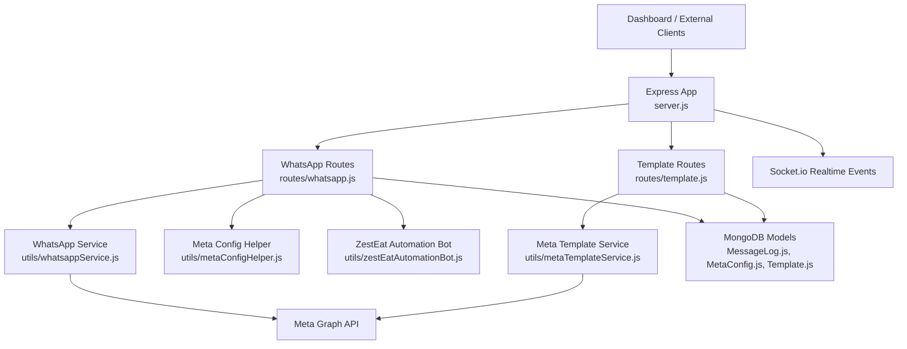
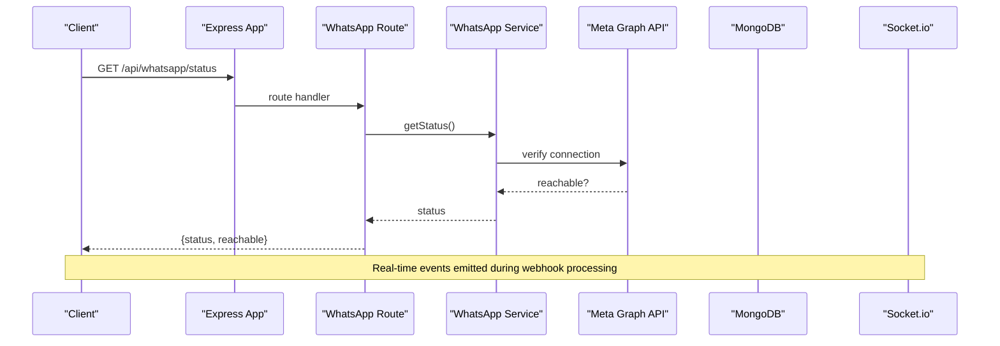
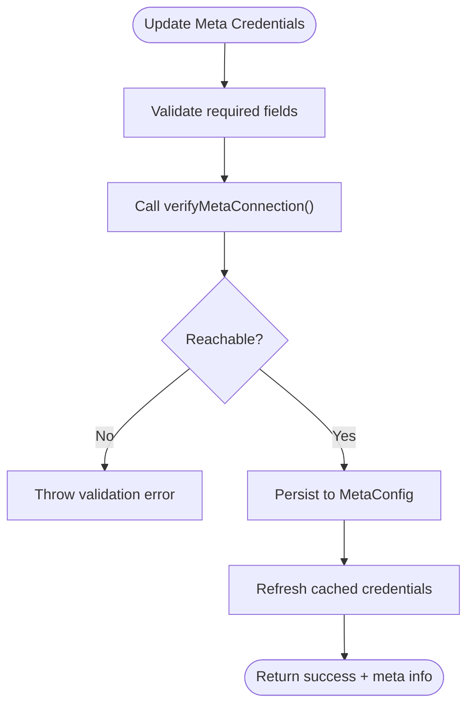
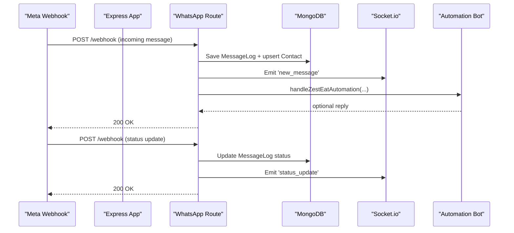
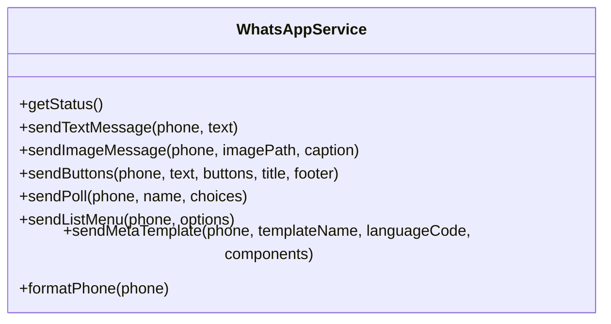
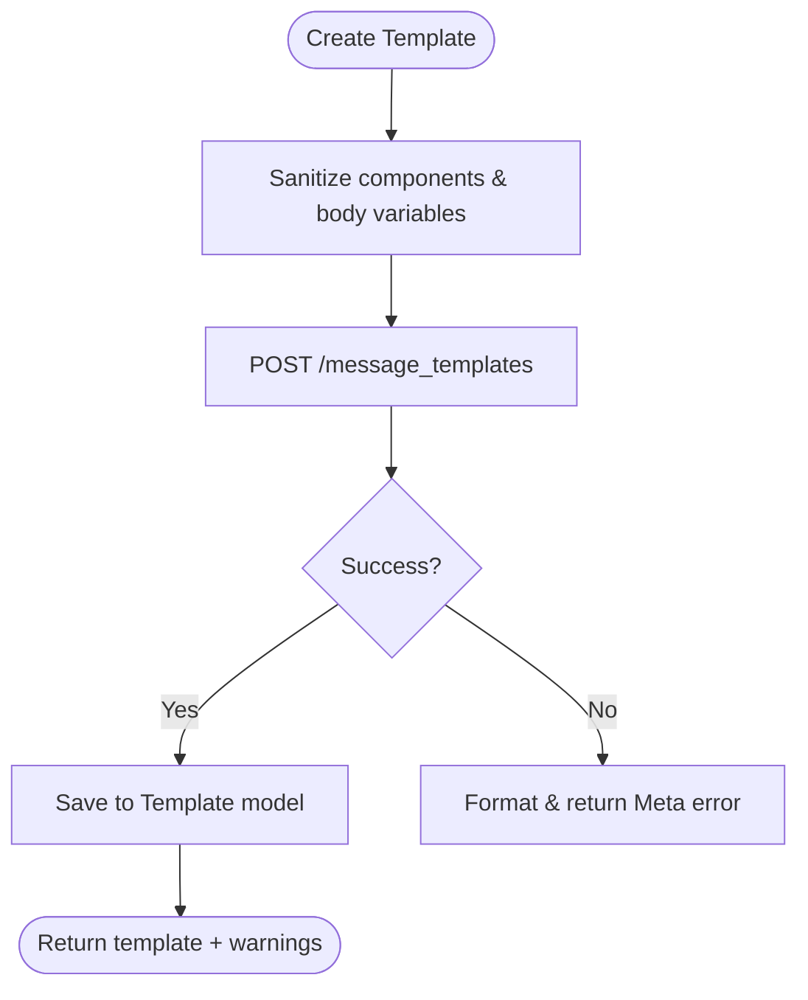
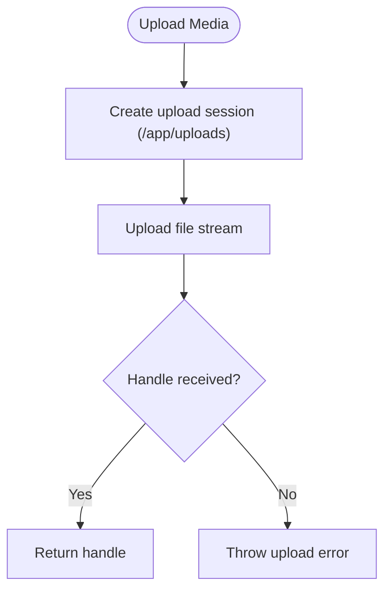
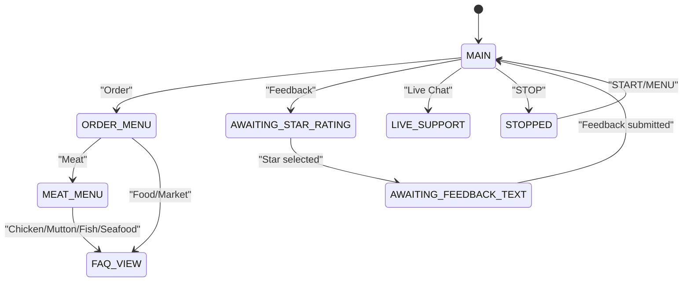
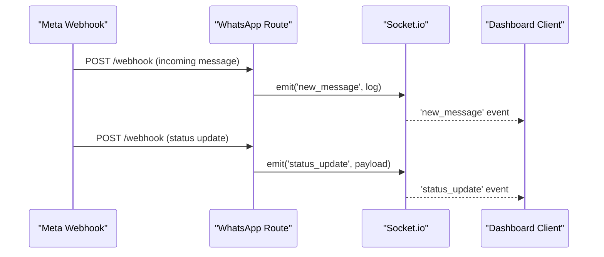
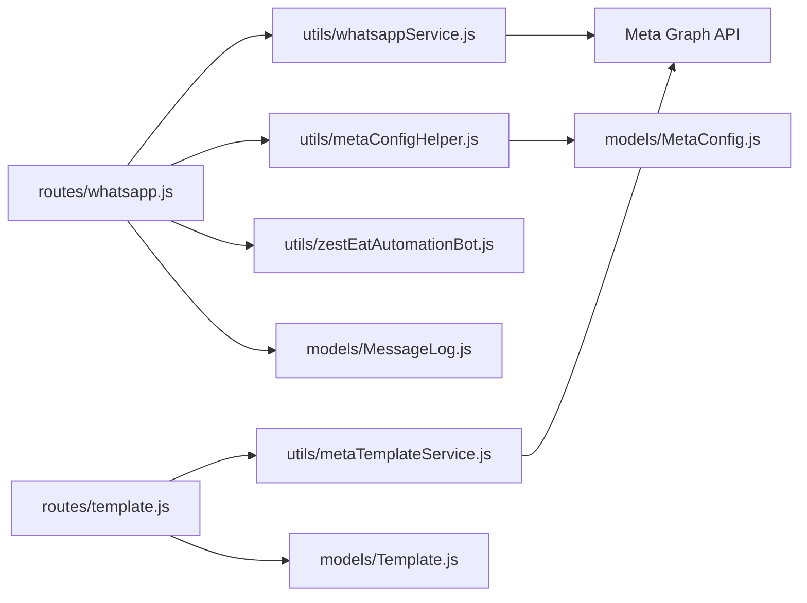

# WhatsApp Integration API

<cite>
**Referenced Files in This Document**
- [server.js](file://backend/server.js)
- [whatsapp.js](file://backend/routes/whatsapp.js)
- [whatsappService.js](file://backend/utils/whatsappService.js)
- [metaConfigHelper.js](file://backend/utils/metaConfigHelper.js)
- [MetaConfig.js](file://backend/models/MetaConfig.js)
- [template.js](file://backend/routes/template.js)
- [metaTemplateService.js](file://backend/utils/metaTemplateService.js)
- [Template.js](file://backend/models/Template.js)
- [MessageLog.js](file://backend/models/MessageLog.js)
- [conversationFlow.js](file://backend/utils/conversationFlow.js)
- [zestEatAutomationBot.js](file://backend/utils/zestEatAutomationBot.js)
</cite>

## Table of Contents
1. [Introduction](#introduction)
2. [Project Structure](#project-structure)
3. [Core Components](#core-components)
4. [Architecture Overview](#architecture-overview)
5. [Detailed Component Analysis](#detailed-component-analysis)
6. [Dependency Analysis](#dependency-analysis)
7. [Performance Considerations](#performance-considerations)
8. [Troubleshooting Guide](#troubleshooting-guide)
9. [Conclusion](#conclusion)
10. [Appendices](#appendices)

## Introduction
This document provides detailed API documentation for the WhatsApp Business integration implemented in this repository. It covers:
- Meta Business API connection management and configuration
- Webhook verification, incoming message handling, and status updates
- Message sending endpoints for text, media, buttons, lists, polls, and templates
- Template synchronization with Meta’s template system
- Media upload capabilities
- Conversation flow automation and real-time communication via WebSockets
- Error handling patterns for rate limits, connection issues, and delivery failures

The backend is an Express server with Socket.io for real-time events, MongoDB for persistence, and direct calls to Meta Graph API for messaging and template operations.

## Project Structure
The WhatsApp-related functionality lives primarily under `backend`:
- Routes: `/api/whatsapp` and `/api/template`
- Utilities: WhatsApp service, Meta configuration helper, Meta template service, conversation flow, and automation bot
- Models: Meta configuration, templates, and message logs
- Server entry point configures WebSockets, routes, error handling, and a cron scheduler for scheduled broadcasts

**Diagram sources**
- [server.js:11-56](file://backend/server.js#L11-L56)
- [whatsapp.js:1-58](file://backend/routes/whatsapp.js#L1-L58)
- [template.js:1-30](file://backend/routes/template.js#L1-L30)
- [whatsappService.js:1-23](file://backend/utils/whatsappService.js#L1-L23)
- [metaTemplateService.js:1-21](file://backend/utils/metaTemplateService.js#L1-L21)
- [MessageLog.js:1-22](file://backend/models/MessageLog.js#L1-L22)
- [MetaConfig.js:1-13](file://backend/models/MetaConfig.js#L1-L13)
- [Template.js:1-70](file://backend/models/Template.js#L1-L70)

**Section sources**
- [server.js:11-80](file://backend/server.js#L11-L80)
- [whatsapp.js:1-58](file://backend/routes/whatsapp.js#L1-L58)
- [template.js:1-42](file://backend/routes/template.js#L1-L42)

## Core Components
- Connection Management
  - Meta credentials are stored in MongoDB (`MetaConfig`) or environment variables. A helper verifies connectivity by pinging Meta Graph API.
- Webhooks
  - Verification endpoint validates the challenge token.
  - Incoming messages and status updates are processed, persisted, and broadcasted via WebSockets.
- Messaging
  - Text, image, buttons, list menus, polls, and Meta templates can be sent through the WhatsApp service.
- Templates
  - Create, delete, import, update, and recreate templates on Meta; sync statuses; upload media; send approved templates.
- Automation
  - In-memory session-based automation bot handles menu flows, feedback collection, and stop logic.
- Real-Time
  - Socket.io emits new messages, status updates, and auto-replies for live dashboards.

**Section sources**
- [metaConfigHelper.js:6-35](file://backend/utils/metaConfigHelper.js#L6-L35)
- [metaConfigHelper.js:73-100](file://backend/utils/metaConfigHelper.js#L73-L100)
- [whatsapp.js:113-132](file://backend/routes/whatsapp.js#L113-L132)
- [whatsapp.js:135-311](file://backend/routes/whatsapp.js#L135-L311)
- [whatsappService.js:61-215](file://backend/utils/whatsappService.js#L61-L215)
- [template.js:146-170](file://backend/routes/template.js#L146-L170)
- [template.js:319-391](file://backend/routes/template.js#L319-L391)
- [zestEatAutomationBot.js:12-394](file://backend/utils/zestEatAutomationBot.js#L12-L394)
- [server.js:14-35](file://backend/server.js#L14-L35)

## Architecture Overview
The system integrates three primary layers:
- HTTP API Layer (Express): Exposes endpoints for configuration, webhook handling, messaging, and template management.
- Business Logic Layer (Utilities): Encapsulates Meta API interactions, template lifecycle, conversation flows, and automation rules.
- Persistence Layer (MongoDB): Stores Meta configuration, templates, and message logs.

**Diagram sources**
- [whatsapp.js:8-22](file://backend/routes/whatsapp.js#L8-L22)
- [whatsappService.js:25-32](file://backend/utils/whatsappService.js#L25-L32)
- [metaConfigHelper.js:73-100](file://backend/utils/metaConfigHelper.js#L73-L100)
- [server.js:14-35](file://backend/server.js#L14-L35)

## Detailed Component Analysis

### Meta Business API Connection Management
- Configuration storage
  - `MetaConfig` model stores WABA ID, phone number ID, access token, verify token, and graph version.
  - Credentials are resolved from MongoDB first, then fallback to environment variables.
- Connection verification
  - `verifyMetaConnection` pings Meta Graph API using WABA ID and access token to confirm reachability and fetch business account metadata.
- Credential update
  - `updateMetaCredentials` validates credentials against Meta before persisting them and refreshing the in-memory cache.

**Diagram sources**
- [metaConfigHelper.js:37-71](file://backend/utils/metaConfigHelper.js#L37-L71)
- [metaConfigHelper.js:73-100](file://backend/utils/metaConfigHelper.js#L73-L100)
- [MetaConfig.js:1-13](file://backend/models/MetaConfig.js#L1-L13)

**Section sources**
- [MetaConfig.js:1-13](file://backend/models/MetaConfig.js#L1-L13)
- [metaConfigHelper.js:6-35](file://backend/utils/metaConfigHelper.js#L6-L35)
- [metaConfigHelper.js:37-71](file://backend/utils/metaConfigHelper.js#L37-L71)
- [metaConfigHelper.js:73-100](file://backend/utils/metaConfigHelper.js#L73-L100)

### Webhook Configuration and Processing
- Verification endpoint
  - GET `/api/whatsapp/webhook` validates `hub.verify_token` against configured verify token and returns the challenge.
- Incoming message processing
  - POST `/api/whatsapp/webhook` parses incoming messages, normalizes phone numbers, persists to `MessageLog`, upserts contacts, and emits WebSocket events.
  - Triggers automation bot based on button/list payloads or text input.
- Status updates processing
  - Parses delivery/read/failed statuses, records errors and pricing, persists updates, and emits WebSocket events.

**Diagram sources**
- [whatsapp.js:113-132](file://backend/routes/whatsapp.js#L113-L132)
- [whatsapp.js:135-311](file://backend/routes/whatsapp.js#L135-L311)
- [zestEatAutomationBot.js:12-394](file://backend/utils/zestEatAutomationBot.js#L12-L394)
- [MessageLog.js:1-22](file://backend/models/MessageLog.js#L1-L22)
- [server.js:14-35](file://backend/server.js#L14-L35)

**Section sources**
- [whatsapp.js:113-132](file://backend/routes/whatsapp.js#L113-L132)
- [whatsapp.js:135-311](file://backend/routes/whatsapp.js#L135-L311)
- [zestEatAutomationBot.js:12-394](file://backend/utils/zestEatAutomationBot.js#L12-L394)

### Message Sending Endpoints and Patterns
- Text messages
  - `sendTextMessage` formats phone, appends opt-out hint, and posts to Meta Cloud API.
- Images
  - `sendImageMessage` supports remote URLs or local file uploads to Meta’s media endpoint, then sends image payload.
- Interactive messages
  - Buttons and list menus are constructed and sent via interactive payloads.
- Polls
  - Polls are sent as formatted text messages.
- Meta templates
  - `sendMetaTemplate` sends approved templates with optional components.

**Diagram sources**
- [whatsappService.js:25-32](file://backend/utils/whatsappService.js#L25-L32)
- [whatsappService.js:61-215](file://backend/utils/whatsappService.js#L61-L215)

**Section sources**
- [whatsappService.js:61-215](file://backend/utils/whatsappService.js#L61-L215)

### Template Synchronization with Meta
- Template creation
  - `createTemplateOnMeta` sanitizes body variables and buttons, then submits to Meta.
- Template deletion
  - `deleteTemplateOnMeta` removes all language variants for a given name or specific HSM ID.
- Fetching templates
  - `fetchAllTemplatesFromMeta` retrieves templates with fields like id, name, status, category, language, components.
- Status checks
  - `getTemplateStatusFromMeta` queries a specific template’s current status.
- Media upload
  - Resumable upload via `/app/uploads` for template headers; direct media upload via `/phoneId/media` for sending.

**Diagram sources**
- [metaTemplateService.js:23-70](file://backend/utils/metaTemplateService.js#L23-L70)
- [metaTemplateService.js:114-137](file://backend/utils/metaTemplateService.js#L114-L137)
- [template.js:146-170](file://backend/routes/template.js#L146-L170)

**Section sources**
- [metaTemplateService.js:114-137](file://backend/utils/metaTemplateService.js#L114-L137)
- [metaTemplateService.js:163-190](file://backend/utils/metaTemplateService.js#L163-L190)
- [metaTemplateService.js:192-245](file://backend/utils/metaTemplateService.js#L192-L245)
- [template.js:146-170](file://backend/routes/template.js#L146-L170)

### Media Upload Capabilities
- For template headers
  - Uses resumable upload session to obtain a handle required by Meta when creating templates.
- For sending media
  - Directly uploads files to `/phoneId/media` to get a media ID for later use in template headers.

**Diagram sources**
- [metaTemplateService.js:192-219](file://backend/utils/metaTemplateService.js#L192-L219)
- [metaTemplateService.js:222-245](file://backend/utils/metaTemplateService.js#L222-L245)

**Section sources**
- [metaTemplateService.js:192-219](file://backend/utils/metaTemplateService.js#L192-L219)
- [metaTemplateService.js:222-245](file://backend/utils/metaTemplateService.js#L222-L245)

### Conversation Flow Automation
- State machine
  - In-memory sessions track user state: MAIN, ORDER_MENU, MEAT_MENU, FAQ_VIEW, AWAITING_STAR_RATING, AWAITING_FEEDBACK_TEXT, LIVE_SUPPORT, STOPPED.
- Menu flows
  - Order categories and meat subcategories presented via list menus.
- Feedback flow
  - Star rating selection followed by free-text feedback capture.
- Stop logic
  - STOP triggers suppression of automated responses until explicit restart.

**Diagram sources**
- [zestEatAutomationBot.js:12-394](file://backend/utils/zestEatAutomationBot.js#L12-L394)

**Section sources**
- [zestEatAutomationBot.js:12-394](file://backend/utils/zestEatAutomationBot.js#L12-L394)

### Real-Time Communication Patterns (WebSockets)
- Server setup
  - Socket.io server initialized with CORS enabled; clients join rooms and emit disconnect events.
- Event emissions
  - Incoming messages: `new_message`
  - Status updates: `status_update`
  - Auto-replies: `auto_reply`

**Diagram sources**
- [server.js:14-35](file://backend/server.js#L14-L35)
- [whatsapp.js:206-211](file://backend/routes/whatsapp.js#L206-L211)
- [whatsapp.js:293-297](file://backend/routes/whatsapp.js#L293-L297)
- [zestEatAutomationBot.js:368-393](file://backend/utils/zestEatAutomationBot.js#L368-L393)

**Section sources**
- [server.js:14-35](file://backend/server.js#L14-L35)
- [whatsapp.js:206-211](file://backend/routes/whatsapp.js#L206-L211)
- [whatsapp.js:293-297](file://backend/routes/whatsapp.js#L293-L297)
- [zestEatAutomationBot.js:368-393](file://backend/utils/zestEatAutomationBot.js#L368-L393)

## Dependency Analysis
Key dependencies and relationships:
- Routes depend on utilities for Meta API calls and data models for persistence.
- Utilities encapsulate external API interactions and internal business logic.
- Models define schema structures for configuration, templates, and message logs.

**Diagram sources**
- [whatsapp.js:1-58](file://backend/routes/whatsapp.js#L1-L58)
- [template.js:1-30](file://backend/routes/template.js#L1-L30)
- [whatsappService.js:1-23](file://backend/utils/whatsappService.js#L1-L23)
- [metaTemplateService.js:1-21](file://backend/utils/metaTemplateService.js#L1-L21)
- [MessageLog.js:1-22](file://backend/models/MessageLog.js#L1-L22)
- [Template.js:1-70](file://backend/models/Template.js#L1-L70)
- [MetaConfig.js:1-13](file://backend/models/MetaConfig.js#L1-L13)

**Section sources**
- [whatsapp.js:1-58](file://backend/routes/whatsapp.js#L1-L58)
- [template.js:1-30](file://backend/routes/template.js#L1-L30)
- [whatsappService.js:1-23](file://backend/utils/whatsappService.js#L1-L23)
- [metaTemplateService.js:1-21](file://backend/utils/metaTemplateService.js#L1-L21)
- [MessageLog.js:1-22](file://backend/models/MessageLog.js#L1-L22)
- [Template.js:1-70](file://backend/models/Template.js#L1-L70)
- [MetaConfig.js:1-13](file://backend/models/MetaConfig.js#L1-L13)

## Performance Considerations
- Rate limiting and throttling
  - Broadcast runner uses a small delay between sends to avoid overwhelming Meta APIs.
- Media handling
  - Remote media downloads are capped at 16 MB to prevent memory spikes.
- Caching
  - Meta credentials are cached in memory to reduce database reads.
- Database operations
  - Upserts for message logs and contacts minimize redundant writes.

[No sources needed since this section provides general guidance]

## Troubleshooting Guide
Common issues and handling strategies:
- Missing or invalid Meta credentials
  - Errors thrown when tokens or IDs are missing; ensure environment variables or MongoDB config are set correctly.
- Webhook verification failures
  - Ensure `hub.verify_token` matches the configured verify token.
- Template submission errors
  - Body variables must be sanitized; buttons limited to three; header media requires resumable upload handle.
- Delivery failures
  - Status webhooks capture error codes and messages; inspect `errorCode` and `errorMessage` in message logs.
- WebSocket connectivity
  - Verify CORS settings and client connection events; check server logs for connection/disconnection messages.

**Section sources**
- [whatsappService.js:45-59](file://backend/utils/whatsappService.js#L45-L59)
- [metaTemplateService.js:125-137](file://backend/utils/metaTemplateService.js#L125-L137)
- [whatsapp.js:113-132](file://backend/routes/whatsapp.js#L113-L132)
- [whatsapp.js:254-260](file://backend/routes/whatsapp.js#L254-L260)
- [server.js:58-62](file://backend/server.js#L58-L62)

## Conclusion
This integration provides a robust foundation for WhatsApp Business API usage, including secure credential management, comprehensive webhook processing, rich messaging capabilities, template lifecycle management, and real-time communication. The automation bot demonstrates practical conversational flows, while structured error handling and performance considerations ensure reliability at scale.

[No sources needed since this section summarizes without analyzing specific files]

## Appendices

### API Endpoints Summary
- Connection and Configuration
  - GET `/api/whatsapp/status`
  - POST `/api/whatsapp/connect`
  - POST `/api/whatsapp/disconnect`
  - GET `/api/whatsapp/host-info`
  - GET `/api/whatsapp/config`
  - POST `/api/whatsapp/sync-env`
  - POST `/api/whatsapp/config`
- Webhooks
  - GET `/api/whatsapp/webhook` (verification)
  - POST `/api/whatsapp/webhook` (incoming messages and status updates)
- Messages
  - GET `/api/whatsapp/messages`
- Templates
  - POST `/api/template/meta`
  - POST `/api/template/import-meta`
  - PUT `/api/template/:id`
  - POST `/api/template/:id/recreate`
  - DELETE `/api/template/:id`
  - GET `/api/template/presets`
  - GET `/api/template/`
  - POST `/api/template/send-meta`
  - POST `/api/template/schedule`
  - GET `/api/template/schedules`
  - PUT `/api/template/schedule/:id/toggle`
  - DELETE `/api/template/schedule/:id`

**Section sources**
- [whatsapp.js:8-109](file://backend/routes/whatsapp.js#L8-L109)
- [whatsapp.js:113-333](file://backend/routes/whatsapp.js#L113-L333)
- [template.js:397-800](file://backend/routes/template.js#L397-L800)