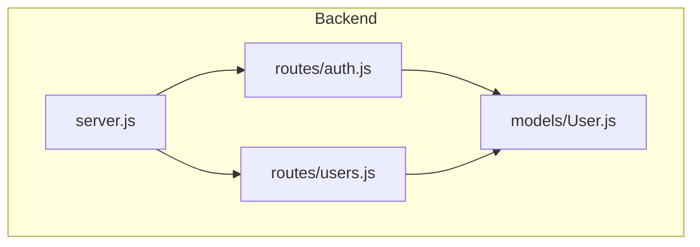
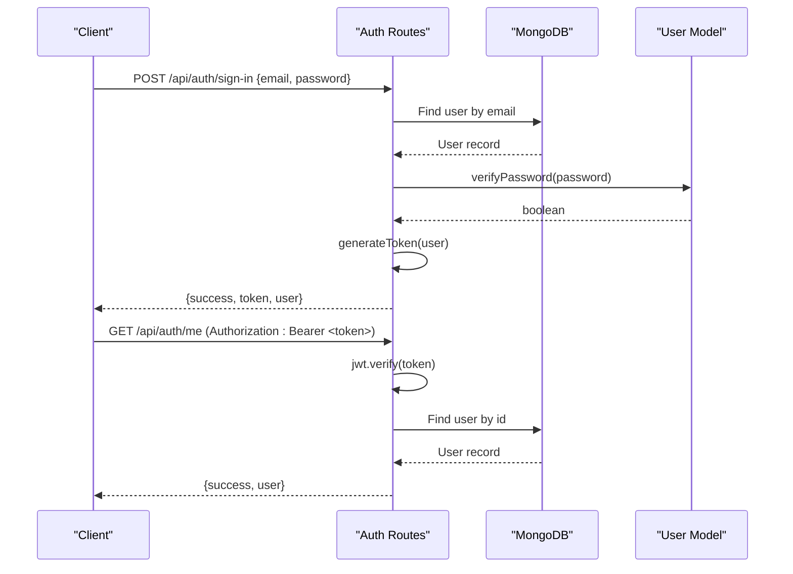
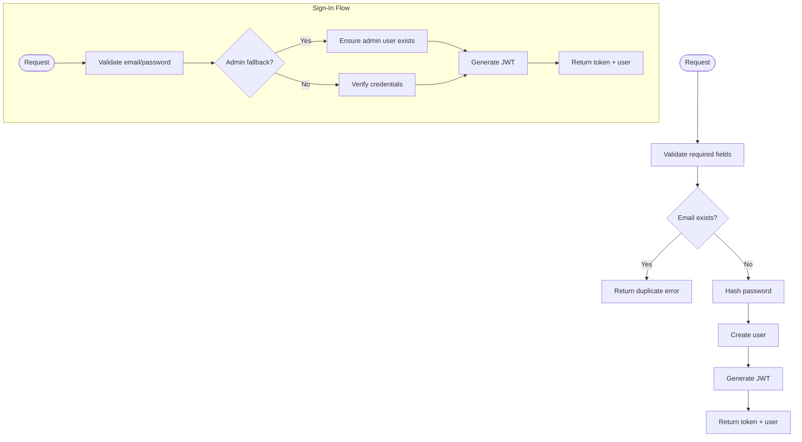
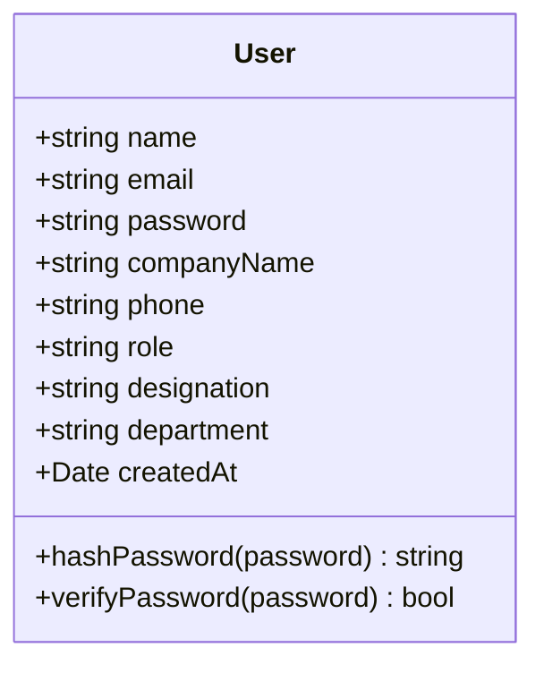
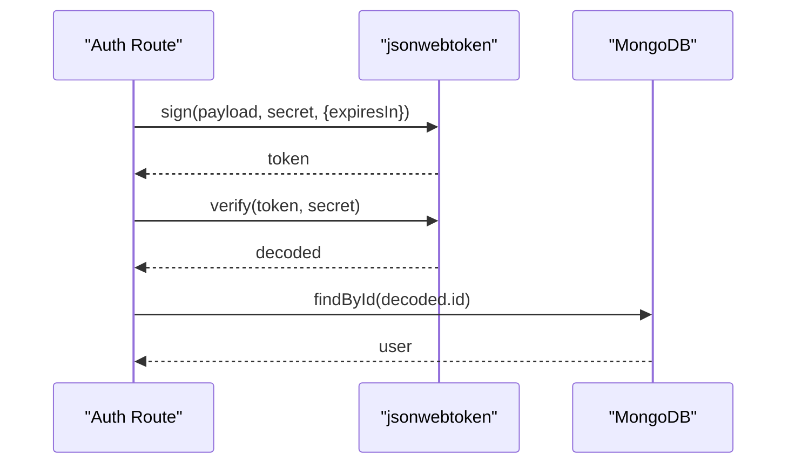
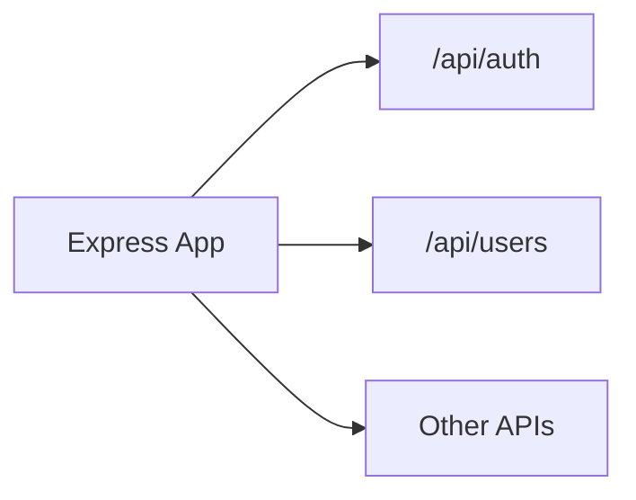
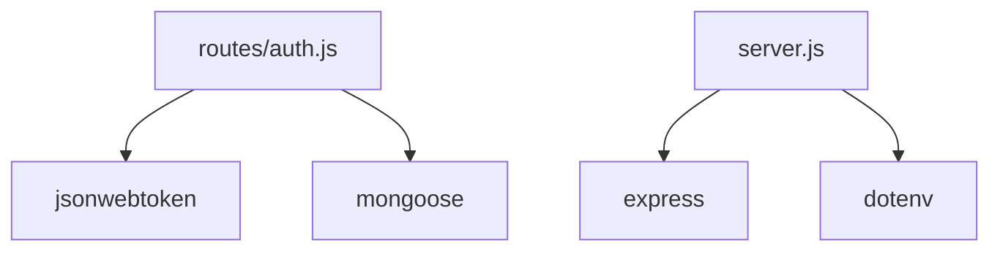

# Authentication System

<cite>
**Referenced Files in This Document**
- [server.js](file://backend/server.js)
- [auth.js](file://backend/routes/auth.js)
- [User.js](file://backend/models/User.js)
- [users.js](file://backend/routes/users.js)
</cite>

## Table of Contents
1. [Introduction](#introduction)
2. [Project Structure](#project-structure)
3. [Core Components](#core-components)
4. [Architecture Overview](#architecture-overview)
5. [Detailed Component Analysis](#detailed-component-analysis)
6. [Dependency Analysis](#dependency-analysis)
7. [Performance Considerations](#performance-considerations)
8. [Troubleshooting Guide](#troubleshooting-guide)
9. [Conclusion](#conclusion)

## Introduction
This document explains the authentication system implemented in the backend. It covers:
- JWT-based authentication flow for registration and login
- Token generation and verification
- Password hashing approach and security considerations
- Role-based access control (RBAC) foundations
- Protected route patterns and how to extend them
- User model schema, session management via tokens, and integration with other routes

The implementation uses Express for routing, Mongoose for data persistence, and JSON Web Tokens for stateless authentication.

## Project Structure
The authentication-related code is organized as follows:
- Server bootstrap and middleware configuration
- Authentication routes for sign-up, sign-in, and current user retrieval
- User model with password hashing helpers
- User management routes for CRUD operations

**Diagram sources**
- [server.js:44-56](file://backend/server.js#L44-L56)
- [auth.js:1-142](file://backend/routes/auth.js#L1-L142)
- [User.js:1-64](file://backend/models/User.js#L1-L64)
- [users.js:1-76](file://backend/routes/users.js#L1-L76)

**Section sources**
- [server.js:1-82](file://backend/server.js#L1-L82)

## Core Components
- Authentication routes: handle sign-up, sign-in, and fetching the authenticated user profile. They generate and verify JWTs and enforce Bearer token usage.
- User model: defines the user schema and provides password hashing and verification utilities.
- User management routes: provide CRUD endpoints for users; currently not protected by a global auth middleware but can be extended.

Key responsibilities:
- Sign-up: validate input, check uniqueness, hash password, create user, issue JWT.
- Sign-in: validate credentials, optionally initialize admin fallback, issue JWT.
- Current user: decode and verify JWT, return user profile without sensitive fields.
- RBAC: roles are stored on the user and included in the token payload for downstream authorization checks.

**Section sources**
- [auth.js:1-142](file://backend/routes/auth.js#L1-L142)
- [User.js:1-64](file://backend/models/User.js#L1-L64)

## Architecture Overview
The authentication architecture is centered around stateless JWTs:
- Clients authenticate via /api/auth/sign-up or /api/auth/login.
- On success, the server returns a signed JWT containing user identity and role.
- For subsequent requests, clients include the token in the Authorization header as Bearer <token>.
- The server verifies the token before granting access to protected resources.

**Diagram sources**
- [auth.js:60-113](file://backend/routes/auth.js#L60-L113)
- [auth.js:115-133](file://backend/routes/auth.js#L115-L133)
- [User.js:52-61](file://backend/models/User.js#L52-L61)

## Detailed Component Analysis

### Authentication Routes (/api/auth)
Responsibilities:
- Sign-up handler validates required fields, ensures unique email, hashes password, creates user, and issues a JWT.
- Sign-in handler supports multiple aliases, includes an initial admin fallback, verifies credentials, and issues a JWT.
- Current user handler verifies the Bearer token and returns the user profile without the password field.

Important behaviors:
- Token payload includes id, email, role, and name.
- Token expiration is set to 7 days.
- The secret used for signing/verifying is read from environment or falls back to a default value.

**Diagram sources**
- [auth.js:17-58](file://backend/routes/auth.js#L17-L58)
- [auth.js:60-113](file://backend/routes/auth.js#L60-L113)

**Section sources**
- [auth.js:1-142](file://backend/routes/auth.js#L1-L142)

### User Model and Password Security
Schema highlights:
- Fields: name, email (unique, lowercase), password, companyName, phone, role (enum), designation, department, createdAt.
- Roles supported: admin, manager, employee, user. Default is employee.

Password handling:
- Static helper hashes passwords using PBKDF2 with a salt derived from environment or a default value.
- Instance method compares provided password against stored hash.

Security notes:
- The current implementation uses PBKDF2 rather than bcrypt.
- The salt is derived from the same secret used for JWT signing when not configured via environment variables.
- Passwords are never returned in responses due to explicit field selection.

**Diagram sources**
- [User.js:4-50](file://backend/models/User.js#L4-L50)
- [User.js:52-61](file://backend/models/User.js#L52-L61)

**Section sources**
- [User.js:1-64](file://backend/models/User.js#L1-L64)

### JWT Generation and Verification
- Generation:
  - Payload includes id, email, role, and name.
  - Expiration is set to 7 days.
  - Secret is loaded from environment or defaults to a hardcoded value.
- Verification:
  - Extracted from Authorization header as Bearer token.
  - Verified using the same secret.
  - Decoded id is used to fetch user details.

**Diagram sources**
- [auth.js:8-15](file://backend/routes/auth.js#L8-L15)
- [auth.js:115-133](file://backend/routes/auth.js#L115-L133)

**Section sources**
- [auth.js:8-15](file://backend/routes/auth.js#L8-L15)
- [auth.js:115-133](file://backend/routes/auth.js#L115-L133)

### Role-Based Access Control (RBAC) Foundations
- The user model includes a role field with allowed values: admin, manager, employee, user.
- The JWT payload includes the role, enabling downstream authorization logic to make decisions based on user roles.
- Example use cases:
  - Restrict certain endpoints to admin or manager roles.
  - Show/hide UI features based on role.

Implementation guidance:
- Create a reusable middleware that decodes the JWT, attaches the user object to the request, and checks roles before allowing access.
- Apply this middleware to protected routes.

**Section sources**
- [User.js:31-35](file://backend/models/User.js#L31-L35)
- [auth.js:9-14](file://backend/routes/auth.js#L9-L14)

### Protected Route Implementation Pattern
While the current routes do not share a global auth middleware, you can protect routes by:
- Verifying the JWT in each route or a shared middleware.
- Attaching the decoded user to req.user.
- Checking req.user.role against allowed roles.

Example pattern (conceptual):
- Middleware extracts Authorization header, verifies token, loads user, and calls next().
- Route handlers then rely on req.user for identity and permissions.

[No sources needed since this section provides conceptual guidance]

### Session Management
- The application uses stateless sessions via JWTs.
- No server-side session store is used.
- Clients should persist the token (e.g., in memory or secure storage) and send it with each request.

**Section sources**
- [auth.js:8-15](file://backend/routes/auth.js#L8-L15)
- [auth.js:115-133](file://backend/routes/auth.js#L115-L133)

### Integration With Other Components
- Server bootstraps Express, mounts CORS, JSON parsing, static files, and registers all API routes under /api/*, including /api/auth and /api/users.
- WebSocket setup is present but not integrated into authentication at this time.

**Diagram sources**
- [server.js:37-56](file://backend/server.js#L37-L56)

**Section sources**
- [server.js:37-56](file://backend/server.js#L37-L56)

## Dependency Analysis
- Express handles HTTP requests and response lifecycle.
- jsonwebtoken is used for creating and verifying tokens.
- Mongoose interacts with MongoDB for user data.
- dotenv loads environment variables (e.g., JWT_SECRET).

**Diagram sources**
- [auth.js:1-5](file://backend/routes/auth.js#L1-L5)
- [server.js:1-11](file://backend/server.js#L1-L11)

**Section sources**
- [auth.js:1-5](file://backend/routes/auth.js#L1-L5)
- [server.js:1-11](file://backend/server.js#L1-L11)

## Performance Considerations
- Token size: Keep payloads minimal (id, email, role, name) to reduce bandwidth.
- Expiration: 7-day tokens are long-lived; consider shorter lifetimes with refresh mechanisms for improved security.
- Password hashing: PBKDF2 is CPU-bound; ensure appropriate iteration counts and avoid blocking the event loop during high load.
- Database queries: Use indexes on frequently queried fields like email.

[No sources needed since this section provides general guidance]

## Troubleshooting Guide
Common issues and resolutions:
- Missing or malformed Authorization header:
  - Ensure clients send Authorization: Bearer <token>.
  - Validate header presence and prefix in middleware.
- Invalid or expired token:
  - Verify the secret matches between signing and verification.
  - Handle token expiration gracefully and prompt re-authentication.
- Duplicate email during sign-up:
  - Enforce uniqueness at the database level and return clear errors.
- Incorrect password:
  - Use constant-time comparison where possible to mitigate timing attacks.
- Environment misconfiguration:
  - Ensure JWT_SECRET and MONGODB_URI are set correctly.

Operational tips:
- Log authentication failures without exposing sensitive details.
- Rate-limit authentication endpoints to prevent brute-force attempts.
- Rotate secrets periodically and invalidate existing tokens if compromised.

**Section sources**
- [auth.js:115-133](file://backend/routes/auth.js#L115-L133)
- [auth.js:17-58](file://backend/routes/auth.js#L17-L58)

## Conclusion
The authentication system implements a straightforward JWT-based flow with sign-up, sign-in, and current user retrieval. It stores roles in the user model and includes them in the token payload to support future RBAC enforcement. Passwords are hashed using PBKDF2, and tokens are verified using the configured secret. To strengthen security and scalability, consider adopting bcrypt for password hashing, short-lived tokens with refresh flows, centralized auth middleware, and robust rate limiting and logging.