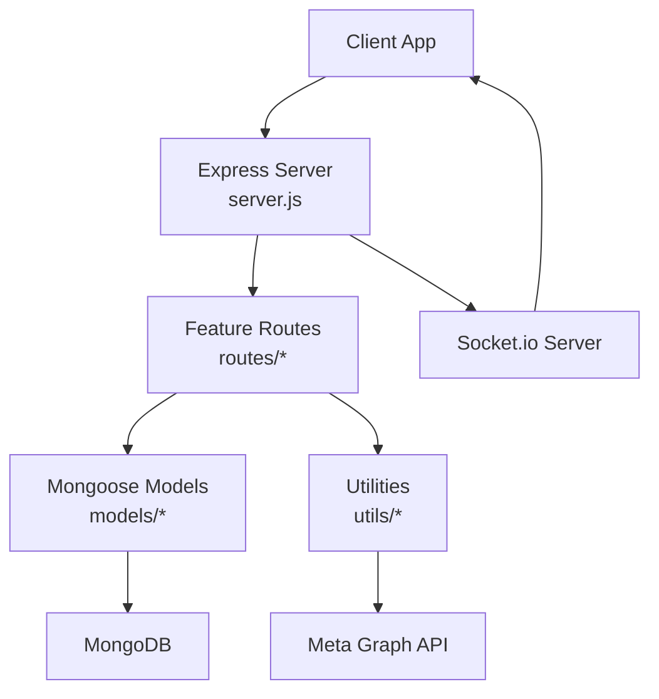
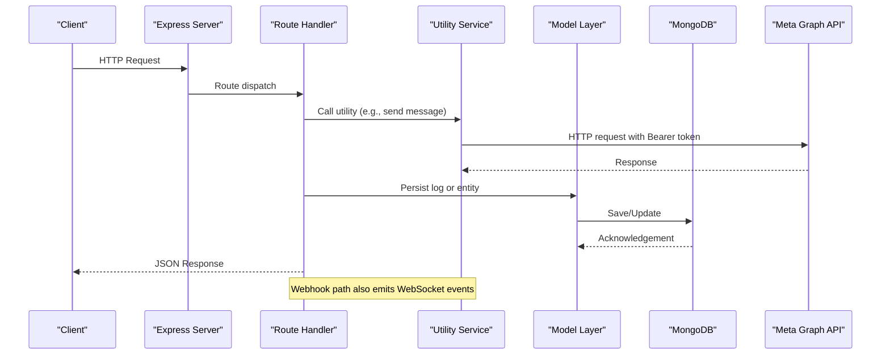
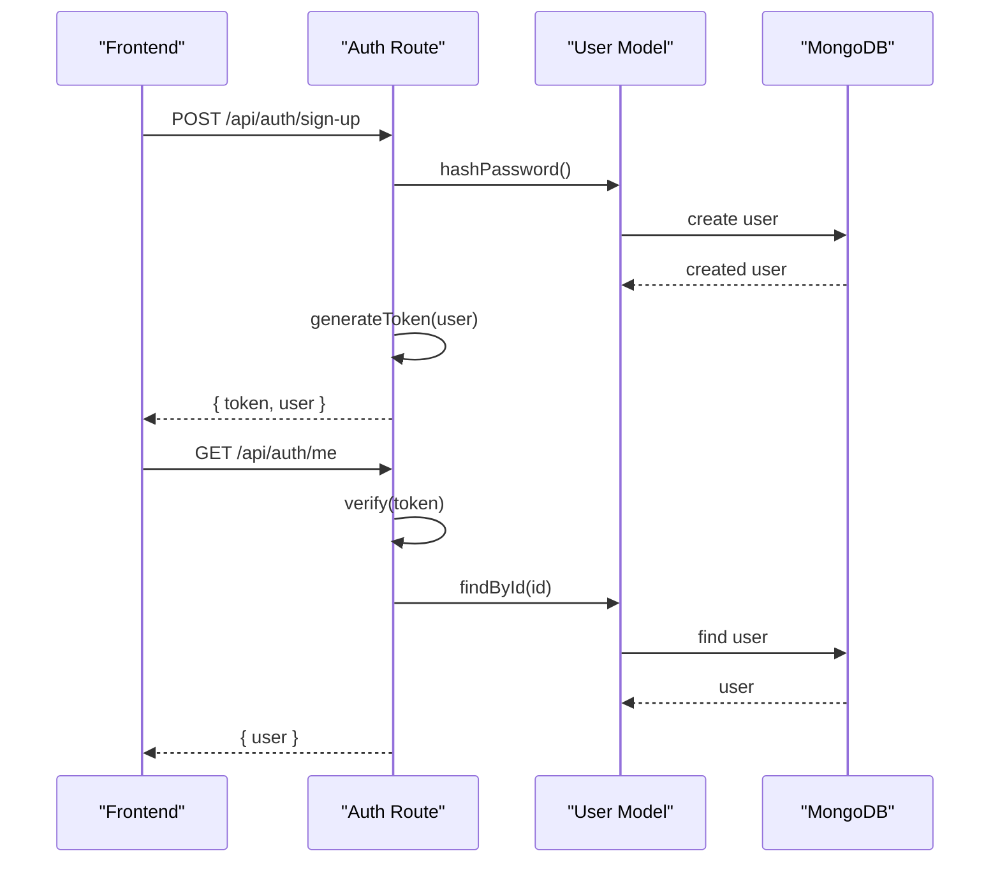
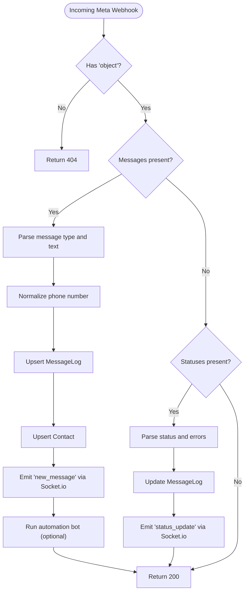
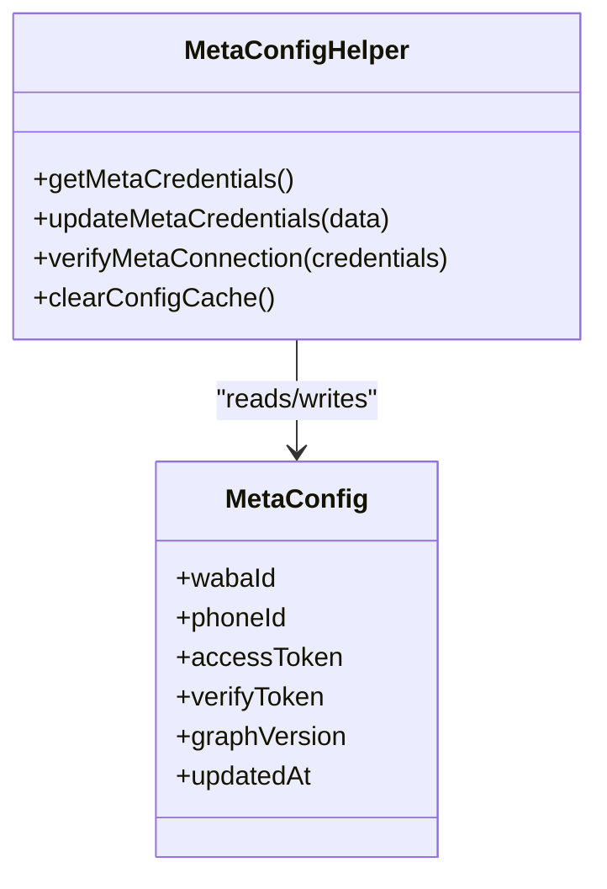
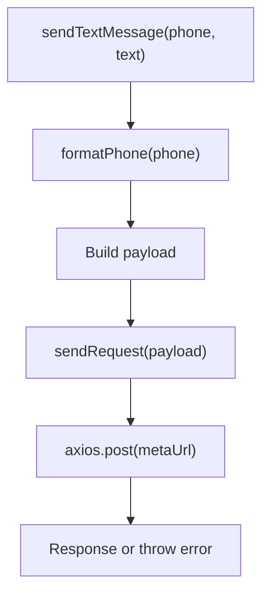
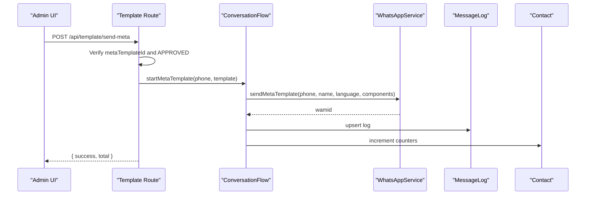
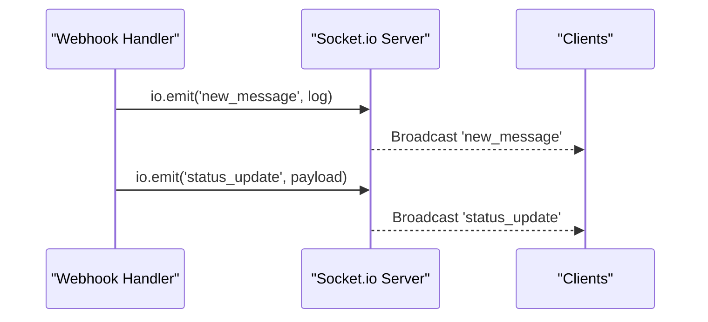
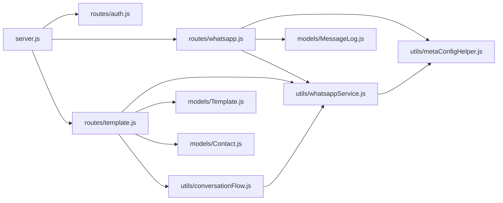

# Backend Architecture

<cite>
**Referenced Files in This Document**
- [server.js](file://backend/server.js)
- [package.json](file://backend/package.json)
- [auth.js](file://backend/routes/auth.js)
- [whatsapp.js](file://backend/routes/whatsapp.js)
- [template.js](file://backend/routes/template.js)
- [User.js](file://backend/models/User.js)
- [MetaConfig.js](file://backend/models/MetaConfig.js)
- [MessageLog.js](file://backend/models/MessageLog.js)
- [metaConfigHelper.js](file://backend/utils/metaConfigHelper.js)
- [whatsappService.js](file://backend/utils/whatsappService.js)
- [conversationFlow.js](file://backend/utils/conversationFlow.js)
</cite>

## Table of Contents
1. [Introduction](#introduction)
2. [Project Structure](#project-structure)
3. [Core Components](#core-components)
4. [Architecture Overview](#architecture-overview)
5. [Detailed Component Analysis](#detailed-component-analysis)
6. [Dependency Analysis](#dependency-analysis)
7. [Performance Considerations](#performance-considerations)
8. [Troubleshooting Guide](#troubleshooting-guide)
9. [Conclusion](#conclusion)

## Introduction
This document describes the backend architecture for a WhatsApp automation system built with Express.js, Mongoose ODM for MongoDB, and Socket.io for real-time communication. The system exposes RESTful APIs for authentication, user management, templates, contacts, orders, analytics, and WhatsApp integration. It integrates with the Meta WhatsApp Cloud API to send messages, manage templates, and process webhooks for incoming messages and delivery statuses. Real-time updates are broadcast via WebSocket events to clients.

Key design goals:
- Modular route organization by feature
- Centralized configuration and credentials handling for Meta API
- Robust error handling and consistent response shapes
- Secure authentication using JWT tokens
- Real-time event broadcasting for live chat and status updates
- Scalable template scheduling and bulk messaging

## Project Structure
The backend is organized into:
- Entry point and server setup (Express + HTTP + Socket.io)
- Feature routes under routes/
- Data models under models/
- Shared utilities under utils/
- Static file serving for uploads
- Environment-driven configuration via dotenv

**Diagram sources**
- [server.js:11-22](file://backend/server.js#L11-L22)
- [server.js:44-56](file://backend/server.js#L44-L56)
- [whatsapp.js:135-310](file://backend/routes/whatsapp.js#L135-L310)
- [metaConfigHelper.js:73-99](file://backend/utils/metaConfigHelper.js#L73-L99)

**Section sources**
- [server.js:1-82](file://backend/server.js#L1-L82)
- [package.json:10-26](file://backend/package.json#L10-L26)

## Core Components
- Express application with HTTP server and Socket.io instance
- Middleware stack: CORS, JSON parsing, URL-encoded parsing, static files
- Route modules: auth, users, leads, whatsapp, contacts, template, orders, menu, todos, paysip, analytics
- Mongoose models: User, MetaConfig, MessageLog, Contact, Template, etc.
- Utilities: Meta config helper, WhatsApp service, conversation flow, cloud storage helpers
- Cron scheduler for scheduled broadcasts

Responsibilities:
- server.js wires middleware, routes, WebSockets, cron, and database connection
- routes handle HTTP endpoints and orchestrate business logic
- models define schemas and data access patterns
- utils encapsulate external integrations and shared logic

**Section sources**
- [server.js:37-56](file://backend/server.js#L37-L56)
- [server.js:64-80](file://backend/server.js#L64-L80)
- [package.json:10-26](file://backend/package.json#L10-L26)

## Architecture Overview
High-level flows:
- REST requests enter Express, pass through middleware, reach feature routes
- Routes call models for persistence and utilities for external services
- Meta API calls are made via axios with bearer tokens from MetaConfig
- Incoming Meta webhooks update logs and emit WebSocket events
- Scheduled tasks run via node-cron to trigger template broadcasts

**Diagram sources**
- [whatsapp.js:135-310](file://backend/routes/whatsapp.js#L135-L310)
- [whatsappService.js:45-58](file://backend/utils/whatsappService.js#L45-L58)
- [metaConfigHelper.js:37-70](file://backend/utils/metaConfigHelper.js#L37-L70)

## Detailed Component Analysis

### Authentication Flow (JWT)
- Endpoints: sign-up, sign-in, login, me
- Password hashing uses PBKDF2 via model statics
- JWT generation includes user identity and role; expiration set to 7 days
- Token verification on /me endpoint returns user profile without password

**Diagram sources**
- [auth.js:17-58](file://backend/routes/auth.js#L17-L58)
- [auth.js:60-113](file://backend/routes/auth.js#L60-L113)
- [auth.js:115-133](file://backend/routes/auth.js#L115-L133)
- [User.js:52-61](file://backend/models/User.js#L52-L61)

**Section sources**
- [auth.js:1-142](file://backend/routes/auth.js#L1-L142)
- [User.js:1-64](file://backend/models/User.js#L1-L64)

### WhatsApp Integration and Webhooks
- Configuration endpoints to store and verify Meta credentials
- Webhook verification and inbound message processing
- Status updates persisted and broadcast via WebSocket
- Message retrieval endpoints for client polling

**Diagram sources**
- [whatsapp.js:111-132](file://backend/routes/whatsapp.js#L111-L132)
- [whatsapp.js:135-310](file://backend/routes/whatsapp.js#L135-L310)

**Section sources**
- [whatsapp.js:1-335](file://backend/routes/whatsapp.js#L1-L335)

### Meta Credentials Management
- In-memory cache for credentials with fallback to environment variables
- Validation against Meta Graph API before persisting changes
- Clear cache utility to force re-sync

**Diagram sources**
- [metaConfigHelper.js:6-35](file://backend/utils/metaConfigHelper.js#L6-L35)
- [metaConfigHelper.js:37-70](file://backend/utils/metaConfigHelper.js#L37-L70)
- [metaConfigHelper.js:73-99](file://backend/utils/metaConfigHelper.js#L73-L99)
- [MetaConfig.js:1-13](file://backend/models/MetaConfig.js#L1-L13)

**Section sources**
- [metaConfigHelper.js:1-112](file://backend/utils/metaConfigHelper.js#L1-L112)
- [MetaConfig.js:1-13](file://backend/models/MetaConfig.js#L1-L13)

### WhatsApp Messaging Utilities
- Phone normalization and formatting for Meta API
- Text, image, buttons, polls, list menus, and template sending
- Media upload to Meta when required
- Error propagation with detailed messages

**Diagram sources**
- [whatsappService.js:34-40](file://backend/utils/whatsappService.js#L34-L40)
- [whatsappService.js:61-78](file://backend/utils/whatsappService.js#L61-L78)
- [whatsappService.js:45-58](file://backend/utils/whatsappService.js#L45-L58)

**Section sources**
- [whatsappService.js:1-228](file://backend/utils/whatsappService.js#L1-L228)

### Template Management and Broadcasting
- Create, import, sync, update, and delete templates
- Upload media to Cloudinary and Meta
- Validate approval status before sending
- Bulk send with delays and jitter to respect rate limits
- Schedule recurring broadcasts via cron

**Diagram sources**
- [template.js:106-152](file://backend/routes/template.js#L106-L152)
- [conversationFlow.js:20-118](file://backend/utils/conversationFlow.js#L20-L118)
- [whatsappService.js:194-215](file://backend/utils/whatsappService.js#L194-L215)

**Section sources**
- [template.js:1-644](file://backend/routes/template.js#L1-L644)
- [conversationFlow.js:1-122](file://backend/utils/conversationFlow.js#L1-L122)

### Real-Time Communication (Socket.io)
- Server initializes Socket.io with CORS settings
- Clients can join rooms; events emitted include new messages and status updates
- Webhook handlers emit events after persisting logs

**Diagram sources**
- [server.js:14-35](file://backend/server.js#L14-L35)
- [whatsapp.js:206-211](file://backend/routes/whatsapp.js#L206-L211)
- [whatsapp.js:293-297](file://backend/routes/whatsapp.js#L293-L297)

**Section sources**
- [server.js:14-35](file://backend/server.js#L14-L35)
- [whatsapp.js:206-211](file://backend/routes/whatsapp.js#L206-L211)
- [whatsapp.js:293-297](file://backend/routes/whatsapp.js#L293-L297)

## Dependency Analysis
Component relationships and coupling:
- server.js depends on all route modules and Socket.io
- whatsapp.js depends on metaConfigHelper, whatsappService, and models
- template.js depends on conversationFlow, whatsappService, metaTemplateService, cloudinaryService, and models
- conversationFlow depends on whatsappService and models
- whatsappService depends on metaConfigHelper and axios

**Diagram sources**
- [server.js:44-56](file://backend/server.js#L44-L56)
- [whatsapp.js:1-5](file://backend/routes/whatsapp.js#L1-L5)
- [template.js:1-11](file://backend/routes/template.js#L1-L11)
- [conversationFlow.js:1-5](file://backend/utils/conversationFlow.js#L1-L5)
- [whatsappService.js:1-4](file://backend/utils/whatsappService.js#L1-L4)
- [metaConfigHelper.js:1-2](file://backend/utils/metaConfigHelper.js#L1-L2)

**Section sources**
- [server.js:44-56](file://backend/server.js#L44-L56)
- [whatsapp.js:1-5](file://backend/routes/whatsapp.js#L1-L5)
- [template.js:1-11](file://backend/routes/template.js#L1-L11)
- [conversationFlow.js:1-5](file://backend/utils/conversationFlow.js#L1-L5)
- [whatsappService.js:1-4](file://backend/utils/whatsappService.js#L1-L4)
- [metaConfigHelper.js:1-2](file://backend/utils/metaConfigHelper.js#L1-L2)

## Performance Considerations
- Bulk template sends use controlled delays and jitter to avoid rate limiting and reduce load spikes
- In-memory caching of Meta credentials reduces repeated lookups and network calls
- Uploading local media to Meta only when necessary; prefer direct links when available
- Limiting webhook processing to essential fields and minimizing synchronous operations
- Using upsert operations to reduce duplicate writes and improve throughput

Recommendations:
- Introduce a queue system (e.g., BullMQ) for large campaigns to decouple sending from request handling
- Add pagination and filtering for message logs to reduce payload sizes
- Implement retry logic with exponential backoff for Meta API failures
- Monitor memory usage and consider scaling horizontally behind a reverse proxy

[No sources needed since this section provides general guidance]

## Troubleshooting Guide
Common issues and strategies:
- Missing or invalid Meta credentials:
  - Use /api/whatsapp/config to inspect masked values
  - Use /api/whatsapp/sync-env to clear cached config and re-sync from environment
  - Validate connectivity via /api/whatsapp/status
- Webhook verification failures:
  - Ensure verifyToken matches between Meta dashboard and backend configuration
  - Confirm that the webhook URL is publicly accessible and points to /api/whatsapp/webhook
- Template approval issues:
  - Check template status via /api/template/meta/:id/status
  - Sync templates from Meta using /api/template/sync-meta
- Database connectivity:
  - Verify MONGODB_URI environment variable and network access to MongoDB
- Authentication problems:
  - Ensure JWT_SECRET is set and consistent across deployments
  - Validate token presence and format in Authorization header

Operational tips:
- Inspect console logs for webhook and Meta API errors
- Use /api/template/stats/summary to monitor sent/delivered/read/failed counts
- For scheduled broadcasts, verify nextRunAt and isActive flags on templates

**Section sources**
- [whatsapp.js:38-59](file://backend/routes/whatsapp.js#L38-L59)
- [whatsapp.js:61-76](file://backend/routes/whatsapp.js#L61-L76)
- [whatsapp.js:111-132](file://backend/routes/whatsapp.js#L111-L132)
- [template.js:531-558](file://backend/routes/template.js#L531-L558)
- [template.js:560-623](file://backend/routes/template.js#L560-L623)

## Conclusion
The backend implements a modular, secure, and scalable architecture for WhatsApp automation:
- Express routes organize functionality cleanly
- Mongoose models provide structured data access
- Socket.io enables real-time updates for live chat and status tracking
- Meta API integration is abstracted through utilities with robust credential management
- Scheduled broadcasts and bulk messaging are supported with rate-aware controls

For continued reliability and performance, adopt queue-based job processing, comprehensive monitoring, and automated testing for critical paths like authentication, webhook processing, and Meta API interactions.

[No sources needed since this section summarizes without analyzing specific files]