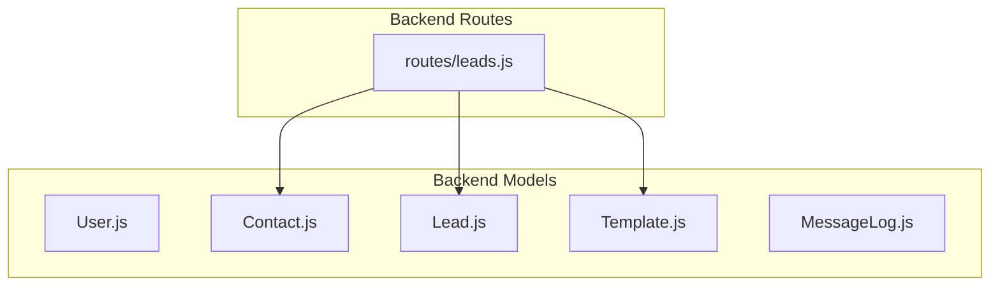
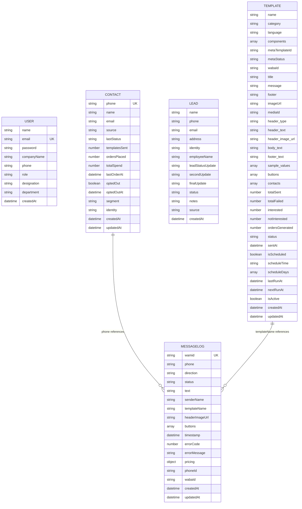
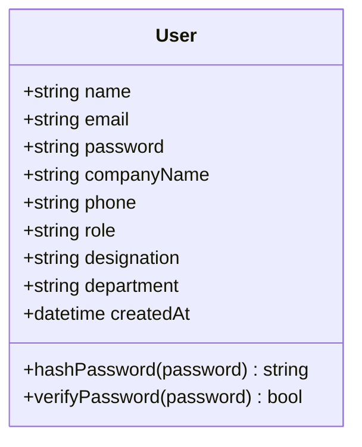
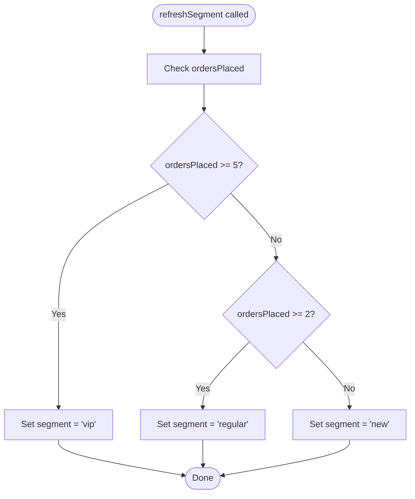
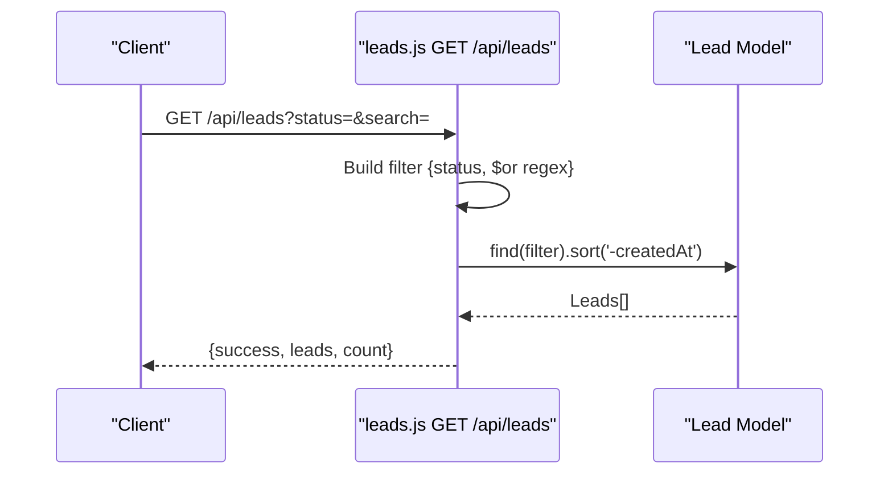
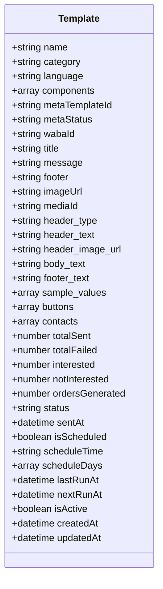
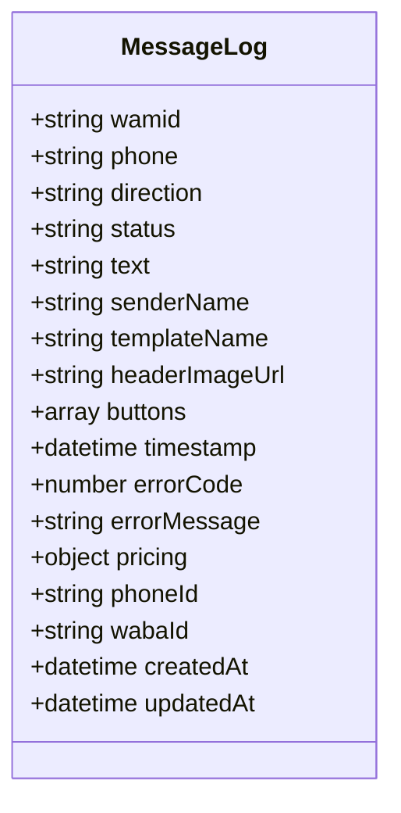
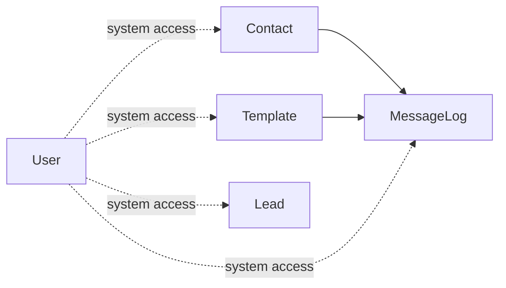

# Database Schema Design

<cite>
**Referenced Files in This Document**
- [User.js](file://backend/models/User.js)
- [Contact.js](file://backend/models/Contact.js)
- [Lead.js](file://backend/models/Lead.js)
- [Template.js](file://backend/models/Template.js)
- [MessageLog.js](file://backend/models/MessageLog.js)
- [leads.js](file://backend/routes/leads.js)
</cite>

## Table of Contents
1. [Introduction](#introduction)
2. [Project Structure](#project-structure)
3. [Core Components](#core-components)
4. [Architecture Overview](#architecture-overview)
5. [Detailed Component Analysis](#detailed-component-analysis)
6. [Dependency Analysis](#dependency-analysis)
7. [Performance Considerations](#performance-considerations)
8. [Troubleshooting Guide](#troubleshooting-guide)
9. [Conclusion](#conclusion)

## Introduction
This document describes the MongoDB schema design for the application’s core entities: User, Contact, Lead, Template, and MessageLog. It explains field definitions, data types, validation rules, business constraints, primary keys, indexes, query optimization strategies, Mongoose ODM patterns, data lifecycle management, archival policies, migration strategies, security considerations, access control at the model level, and performance techniques. The goal is to provide a comprehensive reference for developers and operators working with the database layer.

## Project Structure
The database models are implemented as Mongoose schemas under backend/models. Each file defines a schema, optional methods/statics, and exports a Mongoose model. Routes under backend/routes use these models to perform CRUD operations and orchestrate business logic.

**Diagram sources**
- [User.js:1-64](file://backend/models/User.js#L1-L64)
- [Contact.js:1-26](file://backend/models/Contact.js#L1-L26)
- [Lead.js:1-70](file://backend/models/Lead.js#L1-L70)
- [Template.js:1-70](file://backend/models/Template.js#L1-L70)
- [MessageLog.js:1-22](file://backend/models/MessageLog.js#L1-L22)
- [leads.js:1-55](file://backend/routes/leads.js#L1-L55)

**Section sources**
- [User.js:1-64](file://backend/models/User.js#L1-L64)
- [Contact.js:1-26](file://backend/models/Contact.js#L1-L26)
- [Lead.js:1-70](file://backend/models/Lead.js#L1-L70)
- [Template.js:1-70](file://backend/models/Template.js#L1-L70)
- [MessageLog.js:1-22](file://backend/models/MessageLog.js#L1-L22)
- [leads.js:1-55](file://backend/routes/leads.js#L1-L55)

## Core Components
This section summarizes each entity’s purpose, fields, validations, and key behaviors.

- User
  - Purpose: System account holder with role-based access.
  - Key fields: name, email (unique), password, companyName, phone, role (enum), designation, department, createdAt.
  - Validation: required fields, unique email, lowercase normalization, trim, enum role.
  - Security: password hashing via PBKDF2; verifyPassword method for authentication.
  - Primary key: _id (Mongoose default).
  - Indexes: unique index on email.

- Contact
  - Purpose: Customer or prospect profile with engagement metrics and segmentation.
  - Key fields: phone (unique), name, email, source (enum), lastStatus, templatesSent, ordersPlaced, totalSpend, lastOrderAt, optedOut, optedOutAt, segment (enum), identity.
  - Validation: required phone, enums for source and segment, defaults for counters and flags.
  - Business logic: refreshSegment method computes segment based on ordersPlaced thresholds.
  - Timestamps: enabled (createdAt, updatedAt).
  - Primary key: _id; unique index on phone.

- Lead
  - Purpose: Sales pipeline entry capturing lead details and status progression.
  - Key fields: name, phone, email, address, identity, employeeName, leadStatusUpdate, secondUpdate, finalUpdate, status, notes, source, createdAt.
  - Validation: required name and phone; trim and lowercase where applicable.
  - Primary key: _id.

- Template
  - Purpose: Reusable message template aligned with Meta WhatsApp Business API.
  - Key fields: name, category (enum), language, components (array), metaTemplateId, metaStatus (enum), wabaId; legacy fields title/message/footer/imageUrl/mediaId; friendly mirror header_type/header_text/header_image_url/body_text/footer_text/sample_values/buttons; stats contacts array, totalSent, totalFailed, interested, notInterested, ordersGenerated; status (enum), sentAt, scheduling flags and times, isActive.
  - Validation: required name/category/language; enums for categories and statuses; defaults for many fields.
  - Timestamps: enabled.
  - Primary key: _id.

- MessageLog
  - Purpose: Immutable audit trail of inbound/outbound messages with delivery status and pricing metadata.
  - Key fields: wamid (unique), phone, direction (enum), status, text, senderName, templateName, headerImageUrl, buttons (array), timestamp, errorCode, errorMessage, pricing (object), phoneId, wabaId.
  - Validation: required wamid, phone, status, timestamp; enums for direction; defaults for optional fields.
  - Timestamps: enabled.
  - Primary key: _id; unique index on wamid.

**Section sources**
- [User.js:4-63](file://backend/models/User.js#L4-L63)
- [Contact.js:3-26](file://backend/models/Contact.js#L3-L26)
- [Lead.js:3-69](file://backend/models/Lead.js#L3-L69)
- [Template.js:3-68](file://backend/models/Template.js#L3-L68)
- [MessageLog.js:3-21](file://backend/models/MessageLog.js#L3-L21)

## Architecture Overview
The data model centers around five core collections. Relationships are primarily logical rather than embedded:
- Contact and Lead share contact-like identifiers (phone, email) but serve different domains (marketing vs sales pipeline).
- Template is referenced by messaging workflows and may be associated with MessageLog entries via templateName.
- MessageLog records outbound/inbound events tied to phone numbers and optionally to templates and WABA contexts.
- User represents system users and is not directly linked to other collections in the schema files.

**Diagram sources**
- [User.js:4-63](file://backend/models/User.js#L4-L63)
- [Contact.js:3-26](file://backend/models/Contact.js#L3-L26)
- [Lead.js:3-69](file://backend/models/Lead.js#L3-L69)
- [Template.js:3-68](file://backend/models/Template.js#L3-L68)
- [MessageLog.js:3-21](file://backend/models/MessageLog.js#L3-L21)

## Detailed Component Analysis

### User Model
- Fields and Types
  - name: String, required, trimmed.
  - email: String, required, unique, lowercased, trimmed.
  - password: String, required.
  - companyName: String, default empty, trimmed.
  - phone: String, default empty, trimmed.
  - role: String, enum ['admin', 'manager', 'employee', 'user'], default 'employee'.
  - designation: String, default 'Operations Specialist', trimmed.
  - department: String, default 'General Operations', trimmed.
  - createdAt: Date, default now.
- Validation Rules
  - Required fields enforced at schema level.
  - Unique constraint on email.
  - Lowercase normalization for email.
  - Trim whitespace from string fields.
  - Enum validation for role.
- Business Constraints
  - Role controls access scope within the system.
- Primary Keys and Indexes
  - _id auto-generated.
  - Unique index on email.
- Data Access Methods
  - Static hashPassword(password): returns hashed password using PBKDF2.
  - Instance verifyPassword(password): compares provided password against stored hash.
- Security Considerations
  - Passwords are hashed before storage.
  - Salt derived from environment variable JWT_SECRET with fallback.
- Performance Notes
  - Minimal fields reduce write overhead.
  - Unique index on email ensures fast lookups during authentication.

**Diagram sources**
- [User.js:4-63](file://backend/models/User.js#L4-L63)

**Section sources**
- [User.js:4-63](file://backend/models/User.js#L4-L63)

### Contact Model
- Fields and Types
  - phone: String, required, unique.
  - name: String, default empty.
  - email: String, default empty.
  - source: String, enum ['excel', 'manual', 'whatsapp'], default 'manual'.
  - lastStatus: String, default 'pending'.
  - templatesSent: Number, default 0.
  - ordersPlaced: Number, default 0.
  - totalSpend: Number, default 0.
  - lastOrderAt: Date.
  - optedOut: Boolean, default false.
  - optedOutAt: Date.
  - segment: String, enum ['new', 'regular', 'vip'], default 'new'.
  - identity: String, default 'SAP FICO'.
  - timestamps: true (createdAt, updatedAt).
- Validation Rules
  - Required phone with unique constraint.
  - Enums for source and segment.
  - Defaults for counters and flags.
- Business Logic
  - refreshSegment(): updates segment based on ordersPlaced thresholds:
    - >= 5 → 'vip'
    - >= 2 → 'regular'
    - else → 'new'
- Primary Keys and Indexes
  - _id auto-generated.
  - Unique index on phone.
- Data Access Methods
  - refreshSegment() instance method.
- Lifecycle Management
  - Segment recomputation should be triggered after updating ordersPlaced or related metrics.
- Performance Notes
  - Counters enable fast segmentation queries without aggregation.

**Diagram sources**
- [Contact.js:19-24](file://backend/models/Contact.js#L19-L24)

**Section sources**
- [Contact.js:3-26](file://backend/models/Contact.js#L3-L26)

### Lead Model
- Fields and Types
  - name: String, required, trimmed.
  - phone: String, required, trimmed.
  - email: String, default empty, trimmed, lowercased.
  - address: String, default empty, trimmed.
  - identity: String, default 'SAP FICO', trimmed.
  - employeeName: String, default 'Jayaveer', trimmed.
  - leadStatusUpdate: String, default empty, trimmed.
  - secondUpdate: String, default empty, trimmed.
  - finalUpdate: String, default empty, trimmed.
  - status: String, default 'Intrest', trimmed.
  - notes: String, default empty.
  - source: String, default 'crm'.
  - createdAt: Date, default now.
- Validation Rules
  - Required name and phone.
  - Trimmed strings; lowercase email.
- Business Constraints
  - Status progression tracked via multiple update fields.
- Primary Keys and Indexes
  - _id auto-generated.
- Data Access Patterns
  - Route handlers filter by status and search across name/phone/email/address using regex.
  - Sorting by createdAt descending for listing.

**Diagram sources**
- [leads.js:16-34](file://backend/routes/leads.js#L16-L34)
- [Lead.js:3-69](file://backend/models/Lead.js#L3-L69)

**Section sources**
- [Lead.js:3-69](file://backend/models/Lead.js#L3-L69)
- [leads.js:16-34](file://backend/routes/leads.js#L16-L34)

### Template Model
- Fields and Types
  - Meta-specific: name (required), category (enum), language (required), components (array), metaTemplateId, metaStatus (enum), wabaId.
  - Legacy/fallback: title, message, footer, imageUrl, mediaId.
  - Friendly mirror: header_type, header_text, header_image_url, body_text, footer_text, sample_values (array), buttons (array).
  - Stats & Scheduling: contacts (array), totalSent, totalFailed, interested, notInterested, ordersGenerated, status (enum), sentAt, isScheduled, scheduleTime, scheduleDays (array), lastRunAt, nextRunAt, isActive.
  - timestamps: true.
- Validation Rules
  - Required name, category, language.
  - Enums for category, metaStatus, and status.
  - Defaults for most optional fields.
- Business Constraints
  - Mirrors Meta’s template vocabulary while maintaining backward compatibility.
  - Scheduling fields support recurring campaigns.
- Primary Keys and Indexes
  - _id auto-generated.
- Data Access Patterns
  - Used in campaign flows; counters track outcomes and scheduling state.

**Diagram sources**
- [Template.js:3-68](file://backend/models/Template.js#L3-L68)

**Section sources**
- [Template.js:3-68](file://backend/models/Template.js#L3-L68)

### MessageLog Model
- Fields and Types
  - wamid: String, required, unique.
  - phone: String, required.
  - direction: String, enum ['OUTGOING', 'INCOMING'], default 'OUTGOING'.
  - status: String, required (e.g., sent, delivered, read, failed, received).
  - text: String, default empty.
  - senderName: String, default empty.
  - templateName: String, default empty.
  - headerImageUrl: String, default empty.
  - buttons: Array, default [].
  - timestamp: Date, required.
  - errorCode: Number, default null.
  - errorMessage: String, default null.
  - pricing: Object, default null.
  - phoneId: String, default null.
  - wabaId: String, default null.
  - timestamps: true.
- Validation Rules
  - Required wamid, phone, status, timestamp.
  - Enum for direction.
  - Defaults for optional fields.
- Primary Keys and Indexes
  - _id auto-generated.
  - Unique index on wamid.
- Data Access Patterns
  - Append-only log; used for analytics and troubleshooting.

**Diagram sources**
- [MessageLog.js:3-21](file://backend/models/MessageLog.js#L3-L21)

**Section sources**
- [MessageLog.js:3-21](file://backend/models/MessageLog.js#L3-L21)

## Dependency Analysis
- Model Coupling
  - MessageLog references phone and templateName, creating logical relationships with Contact and Template.
  - No explicit foreign keys; referential integrity is enforced at the application layer.
- Cohesion
  - Each model encapsulates its own validations, defaults, and domain methods (e.g., refreshSegment, verifyPassword).
- External Dependencies
  - Mongoose ODM for schema definition and model creation.
  - Node crypto for password hashing in User model.
- Potential Circular Dependencies
  - None observed among the five models.

**Diagram sources**
- [Contact.js:3-26](file://backend/models/Contact.js#L3-L26)
- [Template.js:3-68](file://backend/models/Template.js#L3-L68)
- [MessageLog.js:3-21](file://backend/models/MessageLog.js#L3-L21)
- [User.js:4-63](file://backend/models/User.js#L4-L63)

**Section sources**
- [Contact.js:3-26](file://backend/models/Contact.js#L3-L26)
- [Template.js:3-68](file://backend/models/Template.js#L3-L68)
- [MessageLog.js:3-21](file://backend/models/MessageLog.js#L3-L21)
- [User.js:4-63](file://backend/models/User.js#L4-L63)

## Performance Considerations
- Indexing Strategy
  - Ensure indexes exist for frequently queried fields:
    - Contact.phone (already unique).
    - MessageLog.wamid (already unique).
    - MessageLog.timestamp for time-range queries.
    - MessageLog.status and MessageLog.direction for filtering.
    - Template.category and Template.metaStatus for template management UI.
    - Lead.name, Lead.phone, Lead.email for search queries.
- Query Optimization
  - Use projection to limit returned fields when full documents are unnecessary.
  - Prefer exact matches over regex where possible; if regex is needed (e.g., search), consider text indexes or dedicated search services.
  - Paginate large result sets (e.g., MessageLog history) using skip/limit or cursor-based pagination.
- Write Amplification
  - Avoid frequent full-document updates; use atomic increments for counters (e.g., templatesSent, ordersPlaced).
- Read Scalability
  - Denormalize frequently accessed attributes (e.g., templateName in MessageLog) to avoid joins.
- Storage Efficiency
  - Store arrays judiciously; consider embedding only small, bounded arrays (e.g., buttons, sample_values).
- Time-Based Archival
  - Partition or archive MessageLog by month/year to keep hot data small.

[No sources needed since this section provides general guidance]

## Troubleshooting Guide
- Authentication Failures
  - Verify that passwords are hashed using the same algorithm and salt as stored hashes.
  - Confirm that email normalization and trimming match input expectations.
- Duplicate Phone Numbers
  - Contact.phone has a unique constraint; duplicate inserts will fail. Normalize phone numbers before saving.
- Template Status Mismatches
  - Ensure metaStatus values align with Meta’s allowed set; unknown states must still save successfully per schema comments.
- Message Log Integrity
  - wamid uniqueness prevents duplicate logs; ensure upstream systems generate unique IDs.
- Search Performance
  - Regex searches across multiple fields can be slow; consider adding appropriate indexes or migrating to a search engine.

**Section sources**
- [User.js:52-61](file://backend/models/User.js#L52-L61)
- [Contact.js:3-17](file://backend/models/Contact.js#L3-L17)
- [Template.js:10-28](file://backend/models/Template.js#L10-L28)
- [MessageLog.js:3-19](file://backend/models/MessageLog.js#L3-L19)

## Conclusion
The schema design balances simplicity and extensibility:
- Clear separation of concerns across User, Contact, Lead, Template, and MessageLog.
- Strong validation and defaults enforce data quality.
- Logical relationships through shared identifiers facilitate cross-entity queries.
- Operational needs like auditing (MessageLog) and segmentation (Contact.refreshSegment) are supported.
Recommended next steps include adding targeted indexes, implementing archival pipelines for high-volume logs, and formalizing access control at the route/middleware layer to complement model-level validations.

[No sources needed since this section summarizes without analyzing specific files]