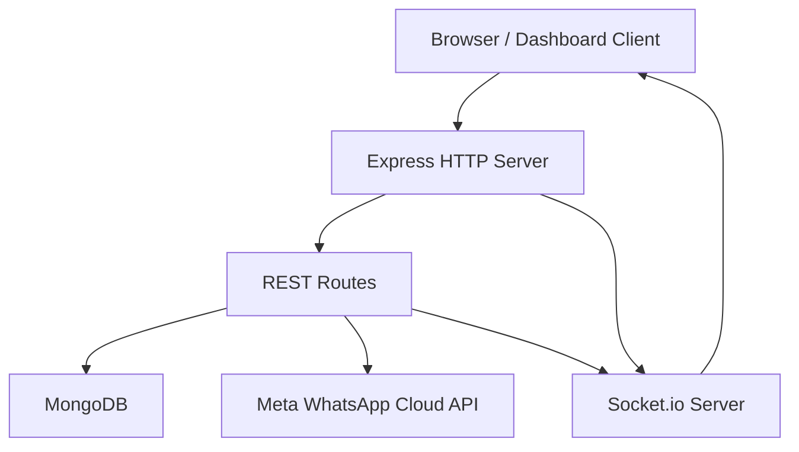
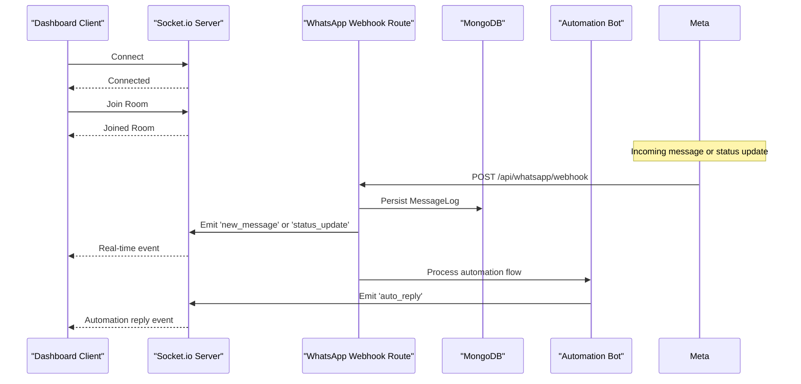
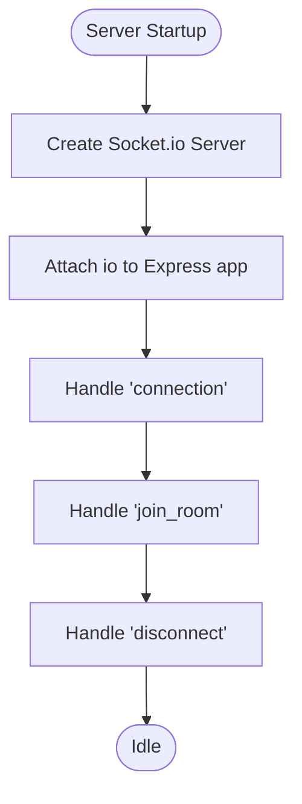
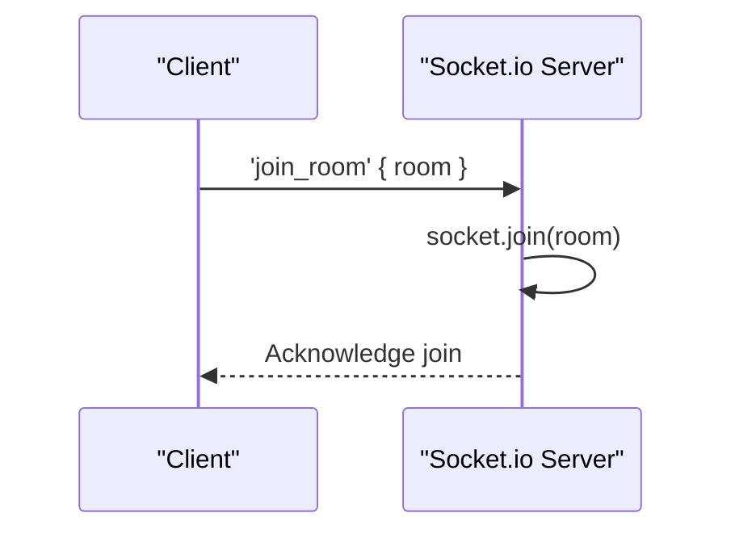
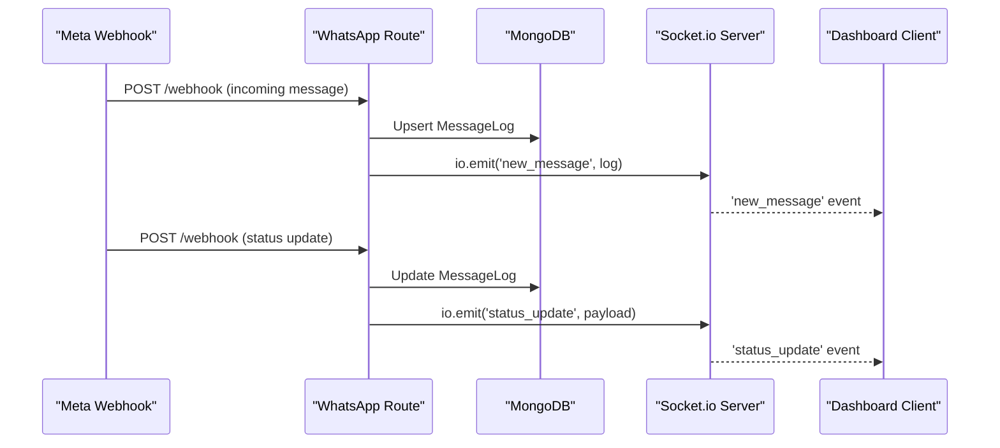
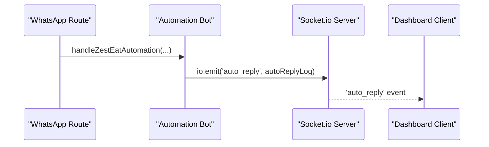
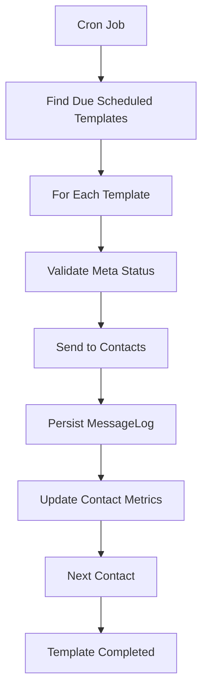
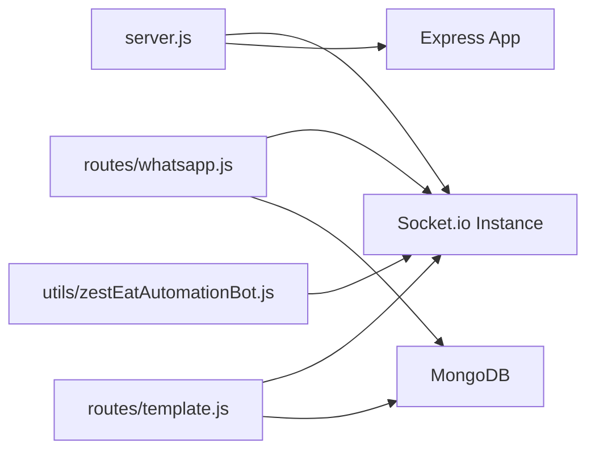

# Real-time Communication

<cite>
**Referenced Files in This Document**
- [server.js](file://backend/server.js)
- [whatsapp.js](file://backend/routes/whatsapp.js)
- [template.js](file://backend/routes/template.js)
- [zestEatAutomationBot.js](file://backend/utils/zestEatAutomationBot.js)
</cite>

## Table of Contents
1. [Introduction](#introduction)
2. [Project Structure](#project-structure)
3. [Core Components](#core-components)
4. [Architecture Overview](#architecture-overview)
5. [Detailed Component Analysis](#detailed-component-analysis)
6. [Dependency Analysis](#dependency-analysis)
7. [Performance Considerations](#performance-considerations)
8. [Troubleshooting Guide](#troubleshooting-guide)
9. [Conclusion](#conclusion)

## Introduction
This document describes the real-time communication system built with Socket.io in the backend. It covers the WebSocket server setup, room-based communication patterns, and event-driven architecture used to broadcast incoming WhatsApp messages, delivery/read statuses, and automation replies to connected clients. It also documents connection management, current authentication approach, broadcast mechanisms, and scalability considerations for high-concurrency scenarios.

## Project Structure
The real-time layer is implemented in the Express HTTP server:
- The Socket.io server is created on top of the same HTTP server as the REST API.
- The Socket.io instance is attached to the Express app so routes can emit events.
- Webhook handlers for Meta publish real-time events over Socket.io.
- A cron job triggers scheduled broadcasts that interact with templates and contacts.

**Diagram sources**
- [server.js:11-22](file://backend/server.js#L11-L22)
- [whatsapp.js:206-211](file://backend/routes/whatsapp.js#L206-L211)
- [whatsapp.js:293-297](file://backend/routes/whatsapp.js#L293-L297)

**Section sources**
- [server.js:1-82](file://backend/server.js#L1-L82)

## Core Components
- WebSocket server initialization and CORS configuration.
- Connection lifecycle handling (connect, join room, disconnect).
- Event emission from webhook handlers for new messages and status updates.
- Scheduled broadcast runner for template campaigns.

Key responsibilities:
- `server.js`: Initializes Socket.io, attaches it to Express, and handles basic socket lifecycle.
- `routes/whatsapp.js`: Processes Meta webhooks, persists logs, and emits real-time events.
- `routes/template.js`: Runs scheduled broadcasts and manages template lifecycle.
- `utils/zestEatAutomationBot.js`: Emits automation-related events back to clients.

**Section sources**
- [server.js:14-35](file://backend/server.js#L14-L35)
- [whatsapp.js:135-311](file://backend/routes/whatsapp.js#L135-L311)
- [template.js:1046-1062](file://backend/routes/template.js#L1046-L1062)
- [zestEatAutomationBot.js:380-390](file://backend/utils/zestEatAutomationBot.js#L380-L390)

## Architecture Overview
The system uses an event-driven architecture where external webhooks trigger server-side processing and real-time broadcasts to all connected clients. Clients connect via Socket.io and can optionally join rooms for targeted messaging.

**Diagram sources**
- [server.js:24-35](file://backend/server.js#L24-L35)
- [whatsapp.js:135-311](file://backend/routes/whatsapp.js#L135-L311)
- [zestEatAutomationBot.js:380-390](file://backend/utils/zestEatAutomationBot.js#L380-L390)

## Detailed Component Analysis

### WebSocket Server Setup and Connection Management
- The Socket.io server is created with permissive CORS to allow browser connections from any origin.
- The Socket.io instance is stored in Express app settings so route handlers can access it.
- Basic connection lifecycle includes logging connection/disconnection and a generic room join handler.

**Diagram sources**
- [server.js:14-35](file://backend/server.js#L14-L35)

**Section sources**
- [server.js:14-35](file://backend/server.js#L14-L35)

### Room-Based Communication Patterns
- Clients send a `join_room` event with a room identifier; the server joins the socket to that room.
- Rooms enable targeted broadcasting using Socket.io’s room APIs.
- Current implementation does not enforce authorization at room join time.

**Diagram sources**
- [server.js:27-30](file://backend/server.js#L27-L30)

**Section sources**
- [server.js:27-30](file://backend/server.js#L27-L30)

### Event-Driven Broadcasts from Webhooks
- Incoming WhatsApp messages are processed by the webhook route, persisted to MongoDB, then emitted to all connected clients via `io.emit('new_message', ...)`.
- Delivery/read statuses are similarly persisted and emitted via `io.emit('status_update', ...)`.
- These events provide real-time visibility into conversations and campaign performance.

**Diagram sources**
- [whatsapp.js:135-311](file://backend/routes/whatsapp.js#L135-L311)

**Section sources**
- [whatsapp.js:135-311](file://backend/routes/whatsapp.js#L135-L311)

### Automation Replies and Additional Events
- The automation bot processes incoming interactions and emits an `auto_reply` event to clients when applicable.
- This complements the core message/status events with automated responses.

**Diagram sources**
- [whatsapp.js:213-229](file://backend/routes/whatsapp.js#L213-L229)
- [zestEatAutomationBot.js:380-390](file://backend/utils/zestEatAutomationBot.js#L380-L390)

**Section sources**
- [whatsapp.js:213-229](file://backend/routes/whatsapp.js#L213-L229)
- [zestEatAutomationBot.js:380-390](file://backend/utils/zestEatAutomationBot.js#L380-L390)

### Scheduled Broadcasts and Template Campaigns
- A cron job runs every minute to find due scheduled templates and start sending them.
- The broadcast runner iterates through contacts, sends messages via the conversation flow, persists logs, and updates contact metrics.
- Templates are validated against Meta before sending, and failures are tracked.

**Diagram sources**
- [server.js:69-76](file://backend/server.js#L69-L76)
- [template.js:1046-1062](file://backend/routes/template.js#L1046-L1062)
- [template.js:319-391](file://backend/routes/template.js#L319-L391)

**Section sources**
- [server.js:69-76](file://backend/server.js#L69-L76)
- [template.js:319-391](file://backend/routes/template.js#L319-L391)
- [template.js:1046-1062](file://backend/routes/template.js#L1046-L1062)

## Dependency Analysis
- The Socket.io server depends on the HTTP server and Express app context.
- Routes depend on the Socket.io instance to emit real-time events.
- Models and utilities are used for persistence and business logic.

**Diagram sources**
- [server.js:11-22](file://backend/server.js#L11-L22)
- [whatsapp.js:206-211](file://backend/routes/whatsapp.js#L206-L211)
- [template.js:1046-1062](file://backend/routes/template.js#L1046-L1062)
- [zestEatAutomationBot.js:380-390](file://backend/utils/zestEatAutomationBot.js#L380-L390)

**Section sources**
- [server.js:11-22](file://backend/server.js#L11-L22)
- [whatsapp.js:206-211](file://backend/routes/whatsapp.js#L206-L211)
- [template.js:1046-1062](file://backend/routes/template.js#L1046-L1062)
- [zestEatAutomationBot.js:380-390](file://backend/utils/zestEatAutomationBot.js#L380-L390)

## Performance Considerations
- Broadcasting model: The current implementation uses global broadcasts (`io.emit`) for incoming messages and status updates. This is simple but scales linearly with the number of connected clients.
- Room scoping: The room join mechanism exists but is not yet used for targeted broadcasts. Introducing room-based targeting reduces unnecessary client processing.
- Concurrency: Webhook processing and template broadcasting run synchronously within request/response cycles. For high concurrency, consider offloading heavy work to background jobs.
- Database writes: Frequent upserts on message logs may become a bottleneck under load; consider batching or write optimization strategies.
- Memory usage: Keeping large payloads in memory during broadcasts should be avoided; prefer streaming or pagination where possible.

[No sources needed since this section provides general guidance]

## Troubleshooting Guide
- Connection issues: Verify CORS settings and ensure the client connects to the correct host/port. Check server logs for connection and disconnection events.
- Missing events: Confirm that the webhook route successfully persists data and emits events. Inspect logs for errors in database operations or Meta API calls.
- Room targeting: Ensure clients send the correct room identifiers and that the server joins sockets to those rooms before targeted broadcasts.
- Scheduled broadcasts: Verify cron scheduling and template status validation. Check logs for template retrieval and sending errors.

**Section sources**
- [server.js:24-35](file://backend/server.js#L24-L35)
- [whatsapp.js:135-311](file://backend/routes/whatsapp.js#L135-L311)
- [template.js:1046-1062](file://backend/routes/template.js#L1046-L1062)

## Conclusion
The real-time communication layer leverages Socket.io to deliver live updates for incoming messages, delivery/read statuses, and automation replies. The current design favors simplicity with global broadcasts and basic room support. To scale effectively, introduce room-based targeting, background job processing for heavy tasks, and robust error handling and monitoring. Authentication for Socket.io connections should be strengthened to prevent unauthorized access to real-time channels.

[No sources needed since this section summarizes without analyzing specific files]