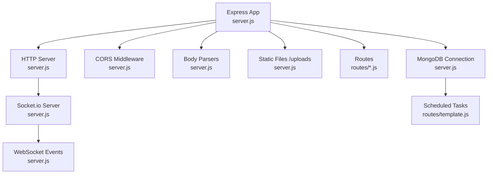
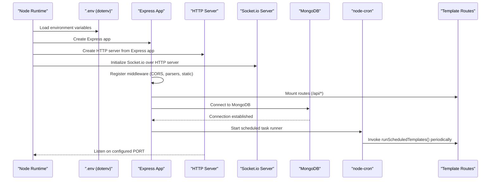
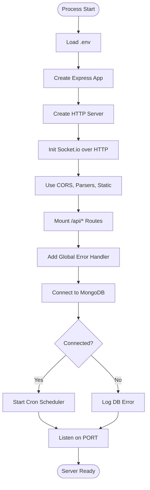
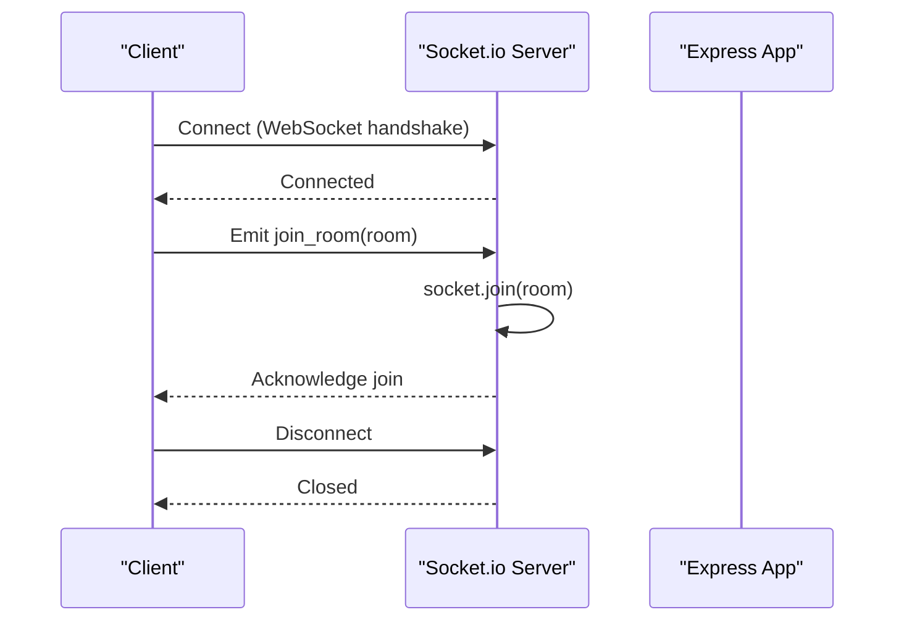
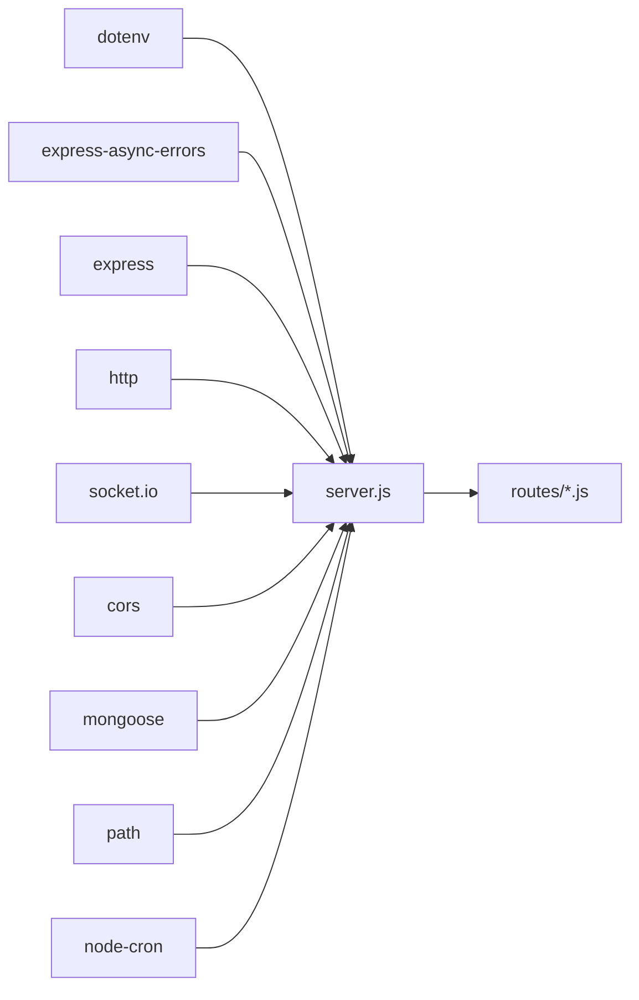

# Server Configuration

<cite>
**Referenced Files in This Document**
- [server.js](file://backend/server.js)
- [template.js](file://backend/routes/template.js)
</cite>

## Table of Contents
1. [Introduction](#introduction)
2. [Project Structure](#project-structure)
3. [Core Components](#core-components)
4. [Architecture Overview](#architecture-overview)
5. [Detailed Component Analysis](#detailed-component-analysis)
6. [Dependency Analysis](#dependency-analysis)
7. [Performance Considerations](#performance-considerations)
8. [Troubleshooting Guide](#troubleshooting-guide)
9. [Conclusion](#conclusion)

## Introduction
This document explains the server configuration for the Express.js application, focusing on bootstrap flow, environment handling, database connection, Socket.io integration, and the middleware stack. It also covers WebSocket event handling, real-time communication setup, startup sequence, port configuration, development versus production considerations, and troubleshooting guidance.

## Project Structure
The backend is an Express application with:
- A single entry point that initializes HTTP, CORS, body parsing, routes, error handling, MongoDB, and Socket.io.
- Feature-based route modules under routes/.
- Background scheduling via node-cron integrated at startup.

**Diagram sources**
- [server.js:1-82](file://backend/server.js#L1-L82)
- [template.js:625-644](file://backend/routes/template.js#L625-L644)

**Section sources**
- [server.js:1-82](file://backend/server.js#L1-L82)

## Core Components
- Application bootstrap: Creates Express app and HTTP server, then attaches Socket.io to the same HTTP server.
- Environment variables: Loads .env via dotenv; uses MONGODB_URI and PORT.
- Database initialization: Connects to MongoDB using mongoose; logs success or failure.
- Real-time layer: Initializes Socket.io with permissive CORS and basic room join/disconnect handlers.
- Middleware stack: Enables CORS, JSON and URL-encoded parsers with size limits, and static file serving for uploads.
- Routing: Mounts feature routes under /api/* prefixes.
- Error handling: Global error handler returns a standardized JSON response.
- Scheduling: Starts a cron job to run scheduled broadcasts every minute.

Key responsibilities by file:
- server.js: Bootstrap, middleware, Socket.io, DB connect, cron start, port listen.
- template.js: Exposes runScheduledTemplates used by the cron scheduler.

**Section sources**
- [server.js:1-82](file://backend/server.js#L1-L82)
- [template.js:625-644](file://backend/routes/template.js#L625-L644)

## Architecture Overview
The server starts an HTTP server, wires up middleware and routes, connects to MongoDB, and exposes a Socket.io server for real-time events. The cron scheduler runs background tasks after DB connectivity is established.

**Diagram sources**
- [server.js:1-82](file://backend/server.js#L1-L82)
- [template.js:625-644](file://backend/routes/template.js#L625-L644)

## Detailed Component Analysis

### Server Bootstrap and Startup Sequence
- Loads environment variables and async error wrapper.
- Creates Express app and HTTP server.
- Initializes Socket.io with CORS options and stores io on app locals for route access.
- Registers global WebSocket listeners for connection, room join, and disconnect.
- Applies middleware: CORS, JSON parser (50MB), URL-encoded parser (50MB), static files for uploads.
- Mounts all API routes under /api/* paths.
- Adds a global error handler returning JSON errors.
- Connects to MongoDB using MONGODB_URI with a fallback URI.
- On successful DB connection, starts a cron job that calls runScheduledTemplates every minute.
- Starts listening on PORT (from env or default).

**Diagram sources**
- [server.js:1-82](file://backend/server.js#L1-L82)

**Section sources**
- [server.js:1-82](file://backend/server.js#L1-L82)

### Environment Variable Handling
- Uses dotenv to load environment variables at startup.
- Reads MONGODB_URI for database connection string; falls back to a local MongoDB URI if not provided.
- Reads PORT for the listening port; defaults to 5000 when not set.

Practical examples:
- Development: Set PORT=5000 and MONGODB_URI=mongodb://localhost:27017/yourdb in .env.
- Production: Set MONGODB_URI to your managed MongoDB instance and PORT to your platform’s assigned port.

**Section sources**
- [server.js:1-1](file://backend/server.js#L1-L1)
- [server.js:65-65](file://backend/server.js#L65-L65)
- [server.js:79-80](file://backend/server.js#L79-L80)

### Database Connection Initialization
- Connects to MongoDB using mongoose.connect with the environment variable or a fallback URI.
- Logs success or error messages.
- After successful connection, initializes the cron scheduler for background tasks.

Operational notes:
- Ensure MONGODB_URI points to a reachable MongoDB instance.
- If the connection fails, the server still listens but will not be able to perform DB operations.

**Section sources**
- [server.js:65-77](file://backend/server.js#L65-L77)

### Socket.io Integration and Real-Time Communication
- Socket.io is initialized over the same HTTP server, enabling real-time features alongside REST APIs.
- CORS for Socket.io allows all origins and common methods.
- Event listeners:
  - connection: Logs client connection.
  - join_room: Joins a named room.
  - disconnect: Logs client disconnection.

Real-time usage patterns:
- Clients can connect to the same host/port as the HTTP server.
- Rooms can be used to target specific groups of clients.

**Diagram sources**
- [server.js:15-35](file://backend/server.js#L15-L35)

**Section sources**
- [server.js:15-35](file://backend/server.js#L15-L35)

### Middleware Stack
- CORS: Allows cross-origin requests from any origin.
- Body parsing:
  - JSON parser with 50MB limit.
  - URL-encoded parser with extended mode and 50MB limit.
- Static files: Serves uploaded assets from the uploads directory.

Security and performance tips:
- In production, restrict CORS to known frontend domains.
- Tune body parser limits based on expected payload sizes.
- Serve static assets through a CDN or reverse proxy for better performance.

**Section sources**
- [server.js:38-41](file://backend/server.js#L38-L41)

### Error Handling
- Global error handler catches unhandled errors and responds with a standardized JSON structure including status 500 and the error message.
- Express async errors are handled via express-async-errors to avoid try/catch in every route.

Best practices:
- Centralize error formatting and logging.
- Avoid exposing sensitive details in production error responses.

**Section sources**
- [server.js:59-62](file://backend/server.js#L59-L62)
- [server.js:2-2](file://backend/server.js#L2-L2)

### Port Configuration and Startup
- The server listens on PORT from environment or defaults to 5000.
- The log confirms the server is running with WebSockets enabled.

Development vs production:
- Development: PORT=5000, open CORS for localhost.
- Production: Set PORT to platform value, lock down CORS, enable HTTPS via reverse proxy.

**Section sources**
- [server.js:79-80](file://backend/server.js#L79-L80)

### Scheduled Tasks and Background Processing
- After MongoDB connection, a cron job runs every minute to execute runScheduledTemplates.
- runScheduledTemplates is exported from the template routes module and performs scheduled broadcasts.

Operational notes:
- Ensure the template routes are correctly loaded before starting the scheduler.
- Monitor scheduler logs for failures and adjust intervals as needed.

**Section sources**
- [server.js:69-76](file://backend/server.js#L69-L76)
- [template.js:625-644](file://backend/routes/template.js#L625-L644)

## Dependency Analysis
High-level dependencies and their roles:
- dotenv: Loads environment variables.
- express-async-errors: Converts async route errors into Express error middleware.
- express: Web framework.
- http: Node HTTP server.
- socket.io: Real-time bidirectional communication.
- cors: Cross-origin resource sharing.
- mongoose: MongoDB ODM.
- path: File path utilities.
- node-cron: Task scheduling.

**Diagram sources**
- [server.js:1-10](file://backend/server.js#L1-L10)

**Section sources**
- [server.js:1-10](file://backend/server.js#L1-L10)

## Performance Considerations
- Body parser limits: 50MB may be large; tune according to actual needs to prevent memory pressure.
- CORS: Restrict origins in production to reduce unnecessary preflight traffic.
- Static files: Offload uploads to object storage or CDN to reduce server load.
- Database: Use connection pooling and indexes; ensure MONGODB_URI points to a tuned instance.
- Scheduling: Adjust cron frequency based on workload; consider a queue system for heavy tasks.
- Logging: Use structured logging and consider sampling in high-traffic environments.

[No sources needed since this section provides general guidance]

## Troubleshooting Guide
Common issues and resolutions:
- MongoDB connection failures:
  - Verify MONGODB_URI is correct and reachable.
  - Check network/firewall rules and credentials.
  - Confirm MongoDB service is running locally or remotely.
- Server does not start or crashes early:
  - Inspect console logs for dotenv or dependency loading errors.
  - Validate environment variables exist and are properly formatted.
- CORS errors from frontend:
  - Ensure frontend origin matches allowed CORS settings.
  - Temporarily allow all origins during development; lock down in production.
- Large request bodies rejected:
  - Increase body parser limits if necessary; validate payload sizes at the API level.
- Socket.io connection issues:
  - Verify the client connects to the same host and port as the HTTP server.
  - Check browser console for WebSocket handshake errors.
- Scheduled tasks not running:
  - Confirm MongoDB connection succeeded before cron starts.
  - Validate runScheduledTemplates is exported and invoked.

**Section sources**
- [server.js:65-77](file://backend/server.js#L65-L77)
- [server.js:38-41](file://backend/server.js#L38-L41)
- [server.js:15-35](file://backend/server.js#L15-L35)
- [server.js:69-76](file://backend/server.js#L69-L76)

## Conclusion
The server configuration centers around a straightforward Express bootstrap that integrates CORS, body parsing, static file serving, routing, global error handling, MongoDB connectivity, and Socket.io for real-time communication. Environment variables control critical runtime behavior such as database connection and port. For production, tighten CORS, secure error responses, optimize body parser limits, and offload static assets. The cron scheduler enables background processing once the database is connected.

[No sources needed since this section summarizes without analyzing specific files]