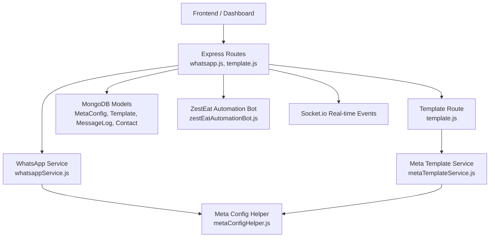
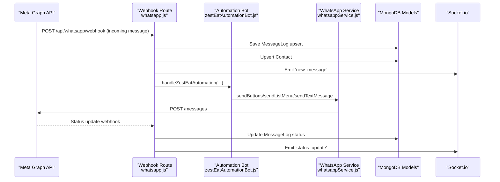
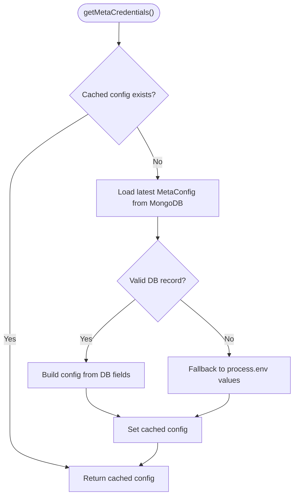
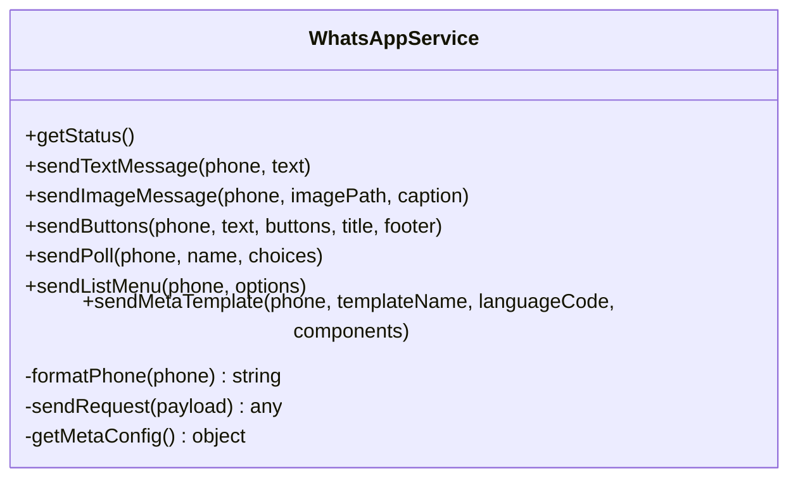
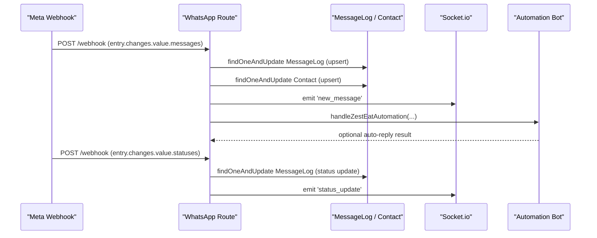
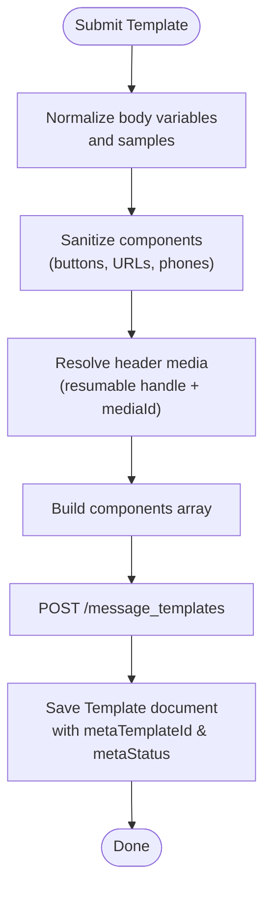
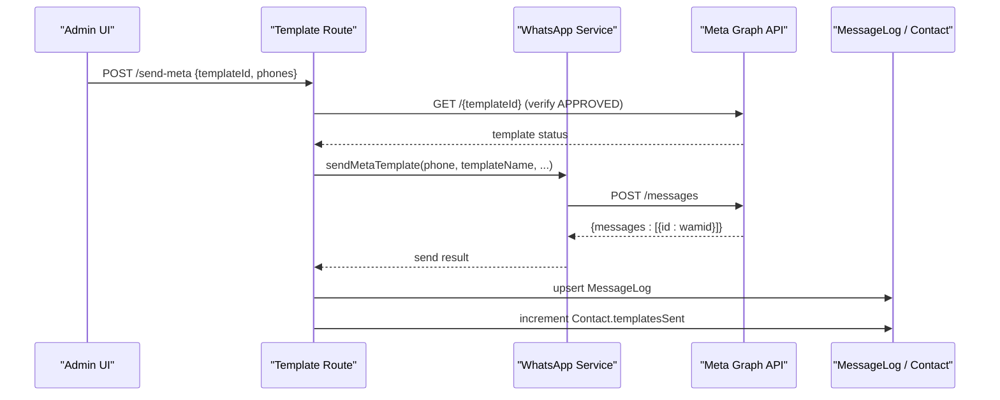
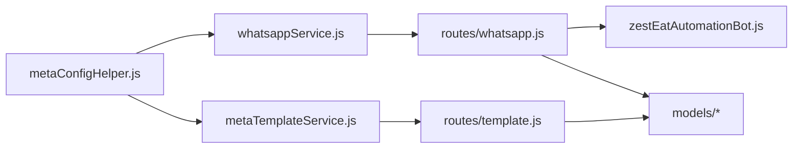
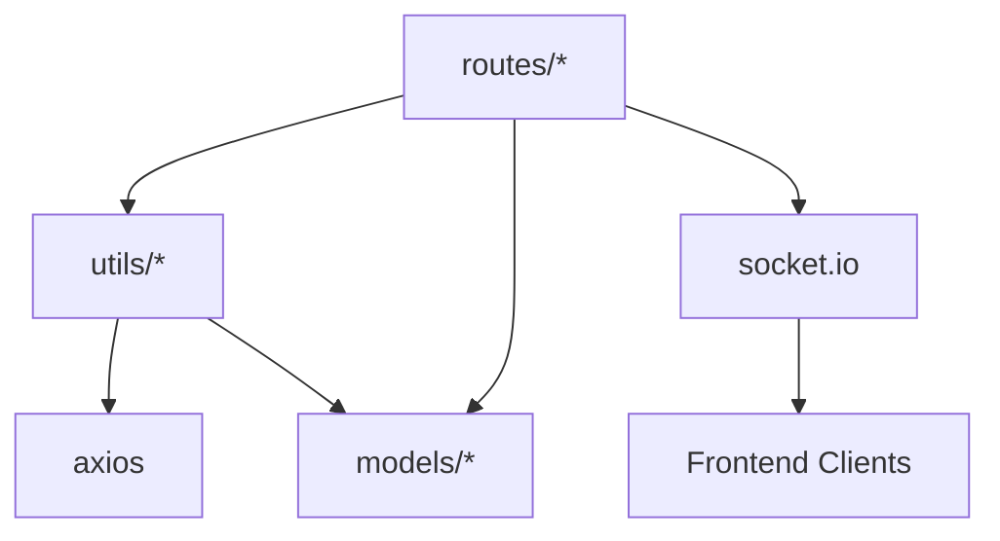

# WhatsApp Integration Layer

<cite>
**Referenced Files in This Document**
- [server.js](file://backend/server.js)
- [whatsapp.js](file://backend/routes/whatsapp.js)
- [template.js](file://backend/routes/template.js)
- [whatsappService.js](file://backend/utils/whatsappService.js)
- [metaTemplateService.js](file://backend/utils/metaTemplateService.js)
- [metaConfigHelper.js](file://backend/utils/metaConfigHelper.js)
- [zestEatAutomationBot.js](file://backend/utils/zestEatAutomationBot.js)
- [MetaConfig.js](file://backend/models/MetaConfig.js)
- [Template.js](file://backend/models/Template.js)
- [MessageLog.js](file://backend/models/MessageLog.js)
- [Contact.js](file://backend/models/Contact.js)
</cite>

## Table of Contents
1. [Introduction](#introduction)
2. [Project Structure](#project-structure)
3. [Core Components](#core-components)
4. [Architecture Overview](#architecture-overview)
5. [Detailed Component Analysis](#detailed-component-analysis)
6. [Dependency Analysis](#dependency-analysis)
7. [Performance Considerations](#performance-considerations)
8. [Troubleshooting Guide](#troubleshooting-guide)
9. [Conclusion](#conclusion)

## Introduction
This document explains the WhatsApp Business API integration layer for the project. It covers how Meta API credentials are managed, how incoming webhooks are handled, how templates are synchronized with Meta, and how messages are sent and received. It also documents the service layer architecture, configuration management, template versioning, relationships with routes and real-time messaging systems, common Meta API issues, rate limiting behavior, authentication strategies, and debugging approaches.

The integration uses:
- Express routes for HTTP endpoints and webhook handling
- A WhatsApp service layer for sending messages via Meta Graph API
- A template synchronization service for creating, updating, deleting, and importing Meta templates
- MongoDB models for storing Meta configuration, templates, message logs, and contacts
- Socket.io for real-time broadcast of incoming messages, auto-replies, and delivery statuses

## Project Structure
The WhatsApp integration is primarily implemented under `backend`:
- Routes: `/api/whatsapp` and `/api/template`
- Services: WhatsApp client helpers and Meta template synchronization
- Models: Meta configuration, templates, message logs, and contacts
- Server bootstrap: Express app, Socket.io, routes, and cron scheduler

**Diagram sources**
- [server.js:11-56](file://backend/server.js#L11-L56)
- [whatsapp.js:1-56](file://backend/routes/whatsapp.js#L1-L56)
- [template.js:1-30](file://backend/routes/template.js#L1-L30)
- [whatsappService.js:1-23](file://backend/utils/whatsappService.js#L1-L23)
- [metaTemplateService.js:1-21](file://backend/utils/metaTemplateService.js#L1-L21)
- [metaConfigHelper.js:1-35](file://backend/utils/metaConfigHelper.js#L1-L35)

**Section sources**
- [server.js:11-56](file://backend/server.js#L11-L56)
- [whatsapp.js:1-56](file://backend/routes/whatsapp.js#L1-L56)
- [template.js:1-30](file://backend/routes/template.js#L1-L30)

## Core Components
- Meta configuration helper: loads credentials from MongoDB or environment variables, verifies connectivity to Meta, and caches config.
- WhatsApp service: formats phone numbers, sends text, image, button, list menu, poll, and template messages through Meta Graph API.
- Meta template service: creates, deletes, fetches, and imports templates; uploads media; handles resumable upload handles required by Meta.
- Template route: orchestrates template lifecycle, validation, media resolution, recreation on Meta, scheduling, and broadcasting approved templates.
- WhatsApp route: manages connection status, credential updates, webhook verification, incoming message processing, status updates, and message retrieval.
- ZestEat automation bot: processes inbound interactions into a stateful conversation flow using buttons and list menus.
- Data models: MetaConfig, Template, MessageLog, Contact.

**Section sources**
- [metaConfigHelper.js:6-35](file://backend/utils/metaConfigHelper.js#L6-L35)
- [whatsappService.js:25-59](file://backend/utils/whatsappService.js#L25-L59)
- [metaTemplateService.js:114-179](file://backend/utils/metaTemplateService.js#L114-L179)
- [template.js:146-199](file://backend/routes/template.js#L146-L199)
- [whatsapp.js:78-109](file://backend/routes/whatsapp.js#L78-L109)
- [zestEatAutomationBot.js:12-51](file://backend/utils/zestEatAutomationBot.js#L12-L51)
- [MetaConfig.js:3-10](file://backend/models/MetaConfig.js#L3-L10)
- [Template.js:3-68](file://backend/models/Template.js#L3-L68)
- [MessageLog.js:3-19](file://backend/models/MessageLog.js#L3-L19)
- [Contact.js:3-17](file://backend/models/Contact.js#L3-L17)

## Architecture Overview
The system exposes REST endpoints for configuration, template management, and message operations. Incoming WhatsApp messages arrive as Meta webhooks and are processed by the WhatsApp route, which persists logs, updates contacts, emits real-time events, and triggers automation flows. Outbound messages are sent via the WhatsApp service using Meta Graph API. Templates are synchronized with Meta through the template route and meta template service, including media uploads and approval checks before broadcasting.

**Diagram sources**
- [whatsapp.js:114-311](file://backend/routes/whatsapp.js#L114-L311)
- [zestEatAutomationBot.js:12-394](file://backend/utils/zestEatAutomationBot.js#L12-L394)
- [whatsappService.js:61-215](file://backend/utils/whatsappService.js#L61-L215)
- [MessageLog.js:3-19](file://backend/models/MessageLog.js#L3-L19)
- [Contact.js:3-17](file://backend/models/Contact.js#L3-L17)

## Detailed Component Analysis

### Meta Configuration Management
The configuration manager provides:
- Credential loading from MongoDB with fallback to environment variables
- In-memory caching to reduce database reads
- Connection verification against Meta Graph API
- Safe update of credentials after successful verification

Key behaviors:
- Cached config avoids repeated DB queries during request lifetimes.
- Verification calls Meta’s WABA endpoint with timeout and returns structured reachability info.
- Updating credentials validates them before persisting and refreshes cache.

**Diagram sources**
- [metaConfigHelper.js:6-35](file://backend/utils/metaConfigHelper.js#L6-L35)

**Section sources**
- [metaConfigHelper.js:6-35](file://backend/utils/metaConfigHelper.js#L6-L35)
- [metaConfigHelper.js:37-71](file://backend/utils/metaConfigHelper.js#L37-L71)
- [metaConfigHelper.js:73-100](file://backend/utils/metaConfigHelper.js#L73-L100)
- [MetaConfig.js:3-10](file://backend/models/MetaConfig.js#L3-L10)

### WhatsApp Client Implementation
The WhatsApp service encapsulates:
- Phone number normalization to Meta-required format
- Text, image, interactive buttons, list menus, polls, and template message sending
- Media upload to Meta when sending local files
- Centralized error logging and propagation

Important implementation details:
- All outbound requests use Bearer token authorization derived from current Meta credentials.
- Local images are uploaded to Meta’s media endpoint first to obtain a media ID.
- Interactive messages support up to three quick reply buttons and list sections with rows.
- Template messages include language code and optional components.

**Diagram sources**
- [whatsappService.js:25-59](file://backend/utils/whatsappService.js#L25-L59)
- [whatsappService.js:61-215](file://backend/utils/whatsappService.js#L61-L215)

**Section sources**
- [whatsappService.js:25-59](file://backend/utils/whatsappService.js#L25-L59)
- [whatsappService.js:61-215](file://backend/utils/whatsappService.js#L61-L215)

### Webhook Handling for Incoming Messages
The WhatsApp route handles:
- Webhook verification challenge response
- Incoming customer messages (text, button clicks, interactive replies)
- Delivery/read/failure status updates
- Real-time broadcasts via Socket.io
- Auto-reply automation flow

Processing steps:
- Extract message payload and contact info
- Normalize phone numbers and store wamid
- Persist incoming message to MessageLog
- Upsert Contact record for inbound senders
- Emit real-time event for live chat UI
- Invoke automation bot to respond based on conversation state

Status updates:
- Parse status objects and errors
- Update MessageLog with delivery/read/failed states
- Emit real-time status update events

**Diagram sources**
- [whatsapp.js:114-311](file://backend/routes/whatsapp.js#L114-L311)
- [zestEatAutomationBot.js:12-394](file://backend/utils/zestEatAutomationBot.js#L12-L394)
- [MessageLog.js:3-19](file://backend/models/MessageLog.js#L3-L19)
- [Contact.js:3-17](file://backend/models/Contact.js#L3-L17)

**Section sources**
- [whatsapp.js:114-311](file://backend/routes/whatsapp.js#L114-L311)

### Template Synchronization with Meta
The template route and meta template service implement:
- Creation of templates on Meta with sanitized components and body variable normalization
- Deletion of templates on Meta
- Fetching all templates and individual template status
- Resumable media upload for header images
- Importing existing Meta templates into local storage
- Recreation workflow because Meta does not allow editing submitted templates

Key behaviors:
- Body variables are normalized to indexed placeholders and sample arrays generated automatically.
- Header media must be uploaded via resumable upload to get a handle accepted by Meta.
- Recreate flow deletes old Meta template and submits new content; if deletion fails due to missing template, it is treated gracefully.
- Before broadcasting, the route verifies that the template is APPROVED on Meta.

**Diagram sources**
- [metaTemplateService.js:23-70](file://backend/utils/metaTemplateService.js#L23-L70)
- [metaTemplateService.js:72-112](file://backend/utils/metaTemplateService.js#L72-L112)
- [metaTemplateService.js:114-179](file://backend/utils/metaTemplateService.js#L114-L179)
- [template.js:146-199](file://backend/routes/template.js#L146-L199)

**Section sources**
- [metaTemplateService.js:23-179](file://backend/utils/metaTemplateService.js#L23-L179)
- [template.js:146-199](file://backend/routes/template.js#L146-L199)
- [template.js:255-287](file://backend/routes/template.js#L255-L287)
- [template.js:397-441](file://backend/routes/template.js#L397-L441)

### Message Sending and Receiving Workflows
Sending:
- The WhatsApp service constructs payloads for different message types and posts to Meta Graph API.
- Template broadcasting iterates over recipients, sends messages, records logs, and increments contact stats.
- Broadcasting includes small delays between sends to respect platform limits.

Receiving:
- Webhook handlers parse incoming messages and statuses.
- Logs are persisted with direction, status, timestamps, pricing, and error information.
- Real-time events are emitted for live chat dashboards.

**Diagram sources**
- [template.js:397-441](file://backend/routes/template.js#L397-L441)
- [whatsappService.js:194-215](file://backend/utils/whatsappService.js#L194-L215)
- [MessageLog.js:3-19](file://backend/models/MessageLog.js#L3-L19)
- [Contact.js:3-17](file://backend/models/Contact.js#L3-L17)

**Section sources**
- [template.js:318-391](file://backend/routes/template.js#L318-L391)
- [whatsappService.js:61-215](file://backend/utils/whatsappService.js#L61-L215)

### Service Layer Architecture
The service layer separates concerns:
- Configuration: metaConfigHelper.js
- Messaging: whatsappService.js
- Template sync: metaTemplateService.js
- Conversation automation: zestEatAutomationBot.js
- Routes orchestrate user-facing APIs and coordinate services and models

**Diagram sources**
- [metaConfigHelper.js:1-112](file://backend/utils/metaConfigHelper.js#L1-L112)
- [whatsappService.js:1-228](file://backend/utils/whatsappService.js#L1-L228)
- [metaTemplateService.js:1-255](file://backend/utils/metaTemplateService.js#L1-L255)
- [whatsapp.js:1-335](file://backend/routes/whatsapp.js#L1-L335)
- [template.js:1-800](file://backend/routes/template.js#L1-L800)
- [zestEatAutomationBot.js:1-399](file://backend/utils/zestEatAutomationBot.js#L1-L399)

**Section sources**
- [metaConfigHelper.js:1-112](file://backend/utils/metaConfigHelper.js#L1-L112)
- [whatsappService.js:1-228](file://backend/utils/whatsappService.js#L1-L228)
- [metaTemplateService.js:1-255](file://backend/utils/metaTemplateService.js#L1-L255)
- [whatsapp.js:1-335](file://backend/routes/whatsapp.js#L1-L335)
- [template.js:1-800](file://backend/routes/template.js#L1-L800)
- [zestEatAutomationBot.js:1-399](file://backend/utils/zestEatAutomationBot.js#L1-L399)

### Configuration Management for Meta Credentials
Credential sources:
- Primary: MongoDB MetaConfig collection (latest record by updatedAt)
- Fallback: Environment variables for access token, WABA ID, phone number ID, verify token, and graph version

Operations:
- getMetaCredentials: load and cache
- updateMetaCredentials: validate via verifyMetaConnection, then persist and refresh cache
- verifyMetaConnection: call Meta Graph API to confirm WABA accessibility

Security considerations:
- Access tokens should be stored securely in environment variables or protected database stores.
- Verify token is used for webhook verification and can be configured per deployment.

**Section sources**
- [metaConfigHelper.js:6-35](file://backend/utils/metaConfigHelper.js#L6-L35)
- [metaConfigHelper.js:37-71](file://backend/utils/metaConfigHelper.js#L37-L71)
- [metaConfigHelper.js:73-100](file://backend/utils/metaConfigHelper.js#L73-L100)
- [MetaConfig.js:3-10](file://backend/models/MetaConfig.js#L3-L10)

### Template Versioning
Meta does not allow editing submitted templates. The system implements a recreate strategy:
- If content changes on a template already on Meta, the route requires explicit recreation.
- Recreate deletes the old Meta template and submits a new one.
- If deletion fails due to missing template, the local record is downgraded to a draft with a local identifier.
- Template documents store both Meta-specific fields and legacy fields for compatibility.

Versioning aspects:
- metaTemplateId links local template to Meta’s HSM ID.
- metaStatus mirrors Meta’s review states.
- components and sample_values capture raw structure for re-editing.

**Section sources**
- [template.js:249-287](file://backend/routes/template.js#L249-L287)
- [template.js:543-692](file://backend/routes/template.js#L543-L692)
- [Template.js:3-68](file://backend/models/Template.js#L3-L68)

### Relationships with Routes and Real-Time Messaging
Routes:
- `/api/whatsapp`: status, host info, config, connect/disconnect, webhook, messages listing
- `/api/template`: presets, CRUD, import/export, schedule, broadcast

Real-time messaging:
- Socket.io server is initialized in server.js and attached to Express app.
- Webhook handlers emit events like 'new_message', 'auto_reply', and 'status_update'.
- Frontend clients can join rooms and subscribe to these events for live chat and monitoring.

**Section sources**
- [server.js:11-35](file://backend/server.js#L11-L35)
- [whatsapp.js:206-211](file://backend/routes/whatsapp.js#L206-L211)
- [whatsapp.js:293-297](file://backend/routes/whatsapp.js#L293-L297)
- [zestEatAutomationBot.js:368-393](file://backend/utils/zestEatAutomationBot.js#L368-L393)

## Dependency Analysis
High-level dependencies:
- Routes depend on services for business logic and external API calls.
- Services depend on metaConfigHelper for credentials and on axios for HTTP requests.
- Models define data schemas and are used by routes and services for persistence.
- Socket.io is used for real-time communication across the application.

**Diagram sources**
- [server.js:11-56](file://backend/server.js#L11-L56)
- [whatsapp.js:1-56](file://backend/routes/whatsapp.js#L1-L56)
- [template.js:1-30](file://backend/routes/template.js#L1-L30)
- [whatsappService.js:1-23](file://backend/utils/whatsappService.js#L1-L23)
- [metaTemplateService.js:1-21](file://backend/utils/metaTemplateService.js#L1-L21)

**Section sources**
- [server.js:11-56](file://backend/server.js#L11-L56)
- [whatsapp.js:1-56](file://backend/routes/whatsapp.js#L1-L56)
- [template.js:1-30](file://backend/routes/template.js#L1-L30)

## Performance Considerations
- Rate limiting:
  - Broadcast loop uses a small delay between sends to avoid overwhelming Meta.
  - For bulk sending, consider adding jitter and backoff strategies.
- Media handling:
  - Resumable upload handles are required for template headers; ensure proper cleanup of temporary files.
  - Cloudinary uploads are used for public preview URLs; failures are logged but do not block template creation.
- Database operations:
  - Upserts for MessageLog and Contact reduce duplicate writes.
  - Indexing on phone and wamid improves query performance.
- Caching:
  - Meta credentials are cached in memory to reduce DB load.
  - Consider TTL-based invalidation if credentials change frequently.

[No sources needed since this section provides general guidance]

## Troubleshooting Guide
Common Meta API issues:
- Missing or invalid access token:
  - Ensure META_WA_ACCESS_TOKEN is set and valid.
  - Use `/api/whatsapp/config` to verify masked token presence.
- WABA ID mismatch:
  - Confirm META_WA_BUSINESS_ACCOUNT_ID matches the account associated with the token.
- Template not approved:
  - Before sending, the route checks template status on Meta; unapproved templates will fail.
- Media upload failures:
  - Resumable upload handles are required for template headers; check file size and MIME type.
- Webhook verification failure:
  - Ensure verifyToken matches the value configured in Meta dashboard and backend.

Authentication with Meta tokens:
- Authorization header uses Bearer token for Graph API calls.
- Media upload may require OAuth token depending on endpoint; the code sets appropriate headers.

Debugging strategies:
- Log Meta API errors and structured error objects.
- Inspect MessageLog entries for wamid, status, errorCode, errorMessage, and pricing.
- Use `/api/whatsapp/messages` to retrieve recent logs and filter by phone.
- Monitor Socket.io events for real-time diagnostics.

Error handling patterns:
- Services throw errors with structured messages; routes convert them to HTTP responses.
- Template route centralizes error formatting and maps Meta error codes to appropriate HTTP statuses.

**Section sources**
- [whatsappService.js:45-59](file://backend/utils/whatsappService.js#L45-L59)
- [metaTemplateService.js:125-179](file://backend/utils/metaTemplateService.js#L125-L179)
- [template.js:222-247](file://backend/routes/template.js#L222-L247)
- [whatsapp.js:114-132](file://backend/routes/whatsapp.js#L114-L132)
- [whatsapp.js:314-333](file://backend/routes/whatsapp.js#L314-L333)

## Conclusion
The WhatsApp integration layer provides a robust foundation for interacting with Meta’s WhatsApp Business API. It manages credentials securely, synchronizes templates with Meta, processes incoming webhooks reliably, and supports real-time messaging through Socket.io. Template versioning follows Meta’s constraints by recreating templates rather than editing them. Operational concerns such as rate limiting, media handling, and error reporting are addressed throughout the services and routes. For production deployments, ensure secure credential management, monitor Meta API quotas, and implement comprehensive logging and alerting around webhook processing and template approvals.

[No sources needed since this section summarizes without analyzing specific files]