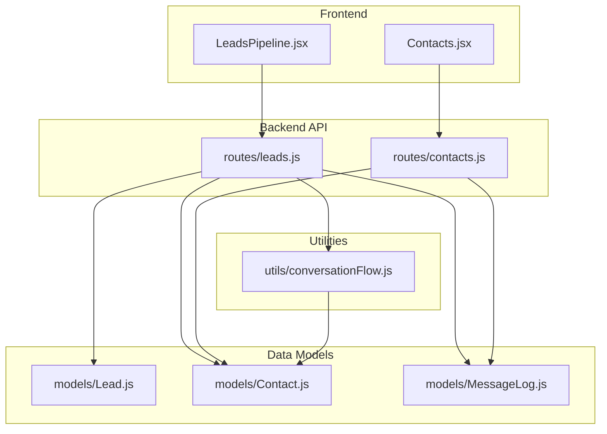
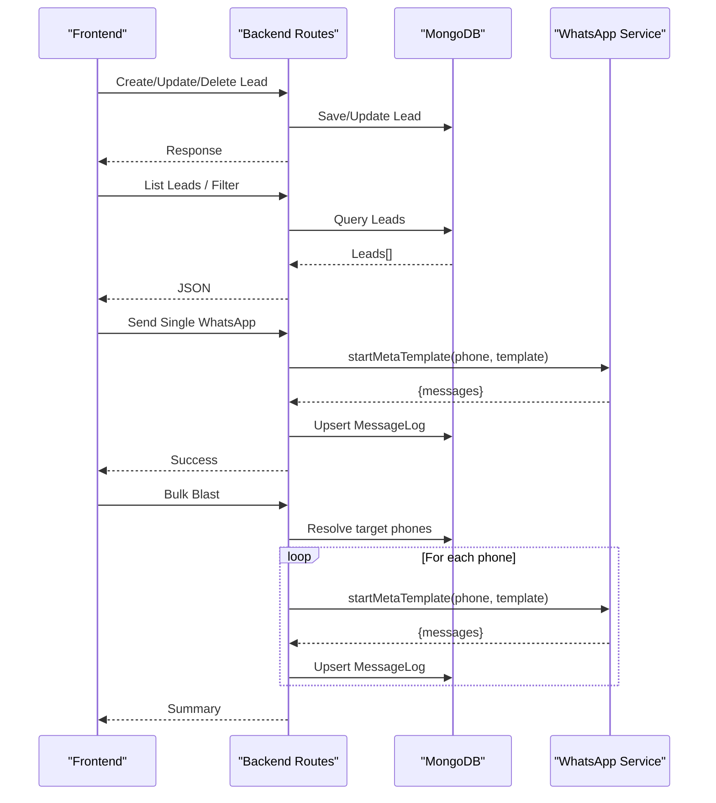
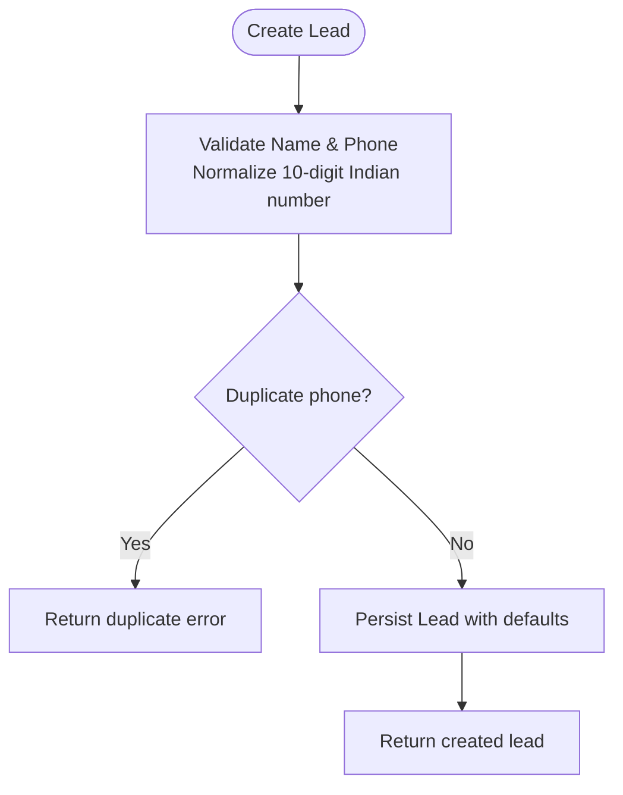
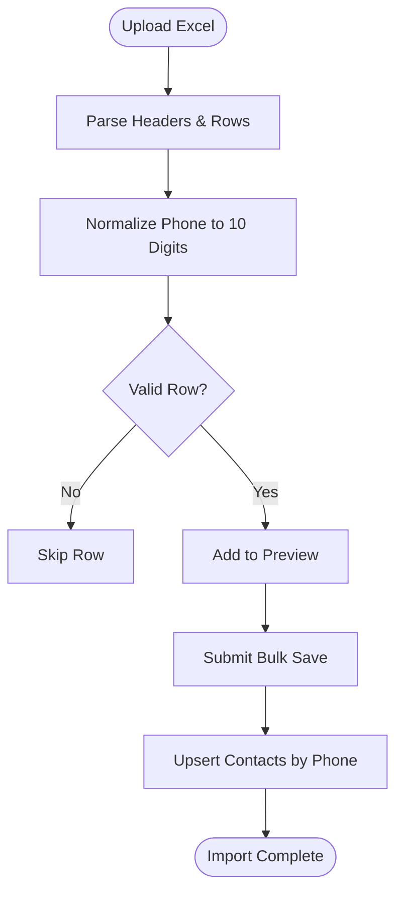
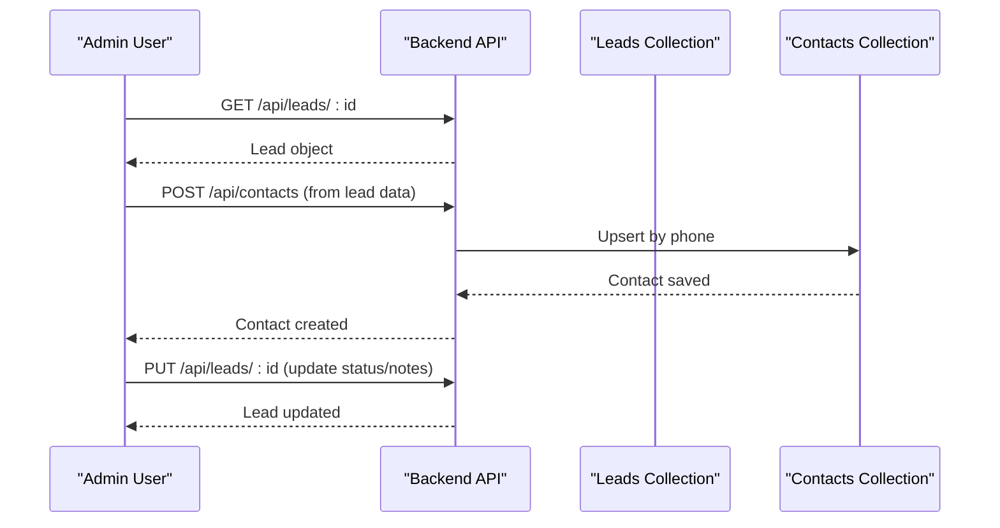
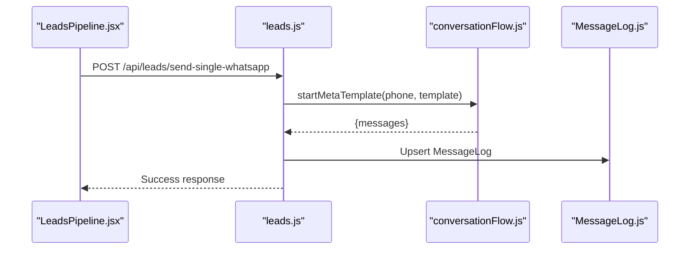
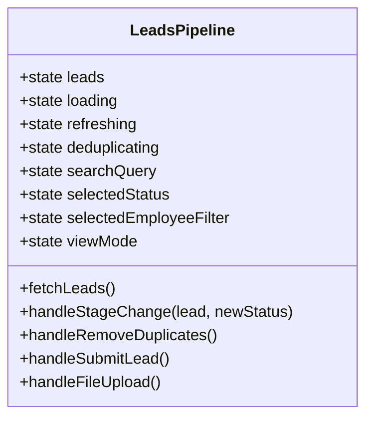
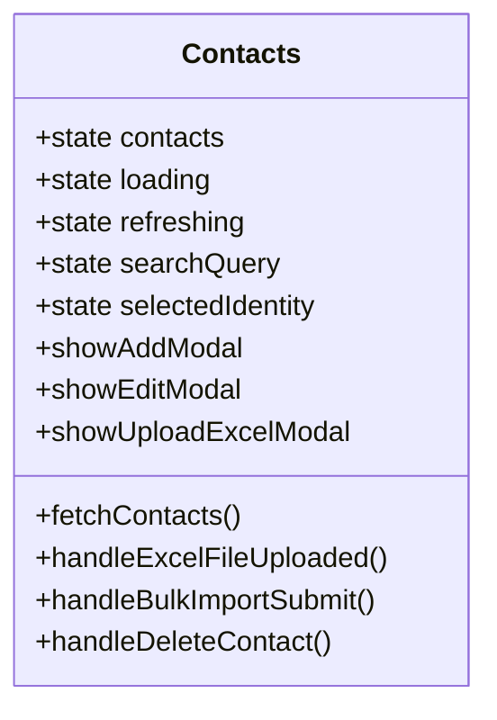
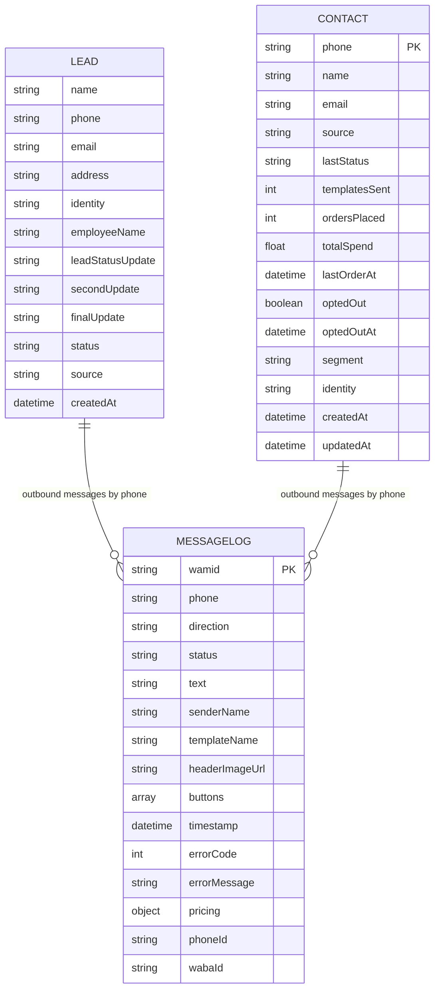
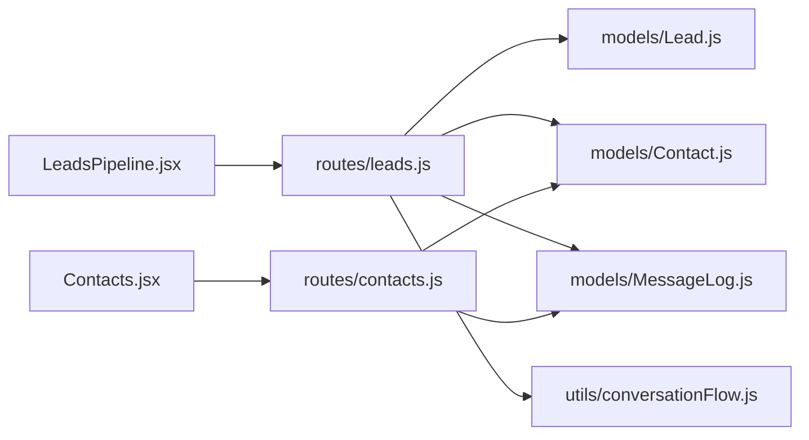

# CRM System

<cite>
**Referenced Files in This Document**   
- [Lead.js](file://backend/models/Lead.js)
- [Contact.js](file://backend/models/Contact.js)
- [MessageLog.js](file://backend/models/MessageLog.js)
- [leads.js](file://backend/routes/leads.js)
- [contacts.js](file://backend/routes/contacts.js)
- [conversationFlow.js](file://backend/utils/conversationFlow.js)
- [LeadsPipeline.jsx](file://frontend/src/Dashboard/LeadsPipeline.jsx)
- [Contacts.jsx](file://frontend/src/Dashboard/Contacts.jsx)
</cite>

## Table of Contents
1. [Introduction](#introduction)
2. [Project Structure](#project-structure)
3. [Core Components](#core-components)
4. [Architecture Overview](#architecture-overview)
5. [Detailed Component Analysis](#detailed-component-analysis)
6. [Dependency Analysis](#dependency-analysis)
7. [Performance Considerations](#performance-considerations)
8. [Troubleshooting Guide](#troubleshooting-guide)
9. [Conclusion](#conclusion)
10. [Appendices](#appendices)

## Introduction
This document explains the CRM system’s customer relationship management capabilities with a focus on lead lifecycle, contact database operations, WhatsApp interaction logging, and frontend interfaces for pipeline visualization and contact management. It also clarifies data model relationships between leads, contacts, and message history, and provides guidance for permissions and collaboration based on available implementation details.

The system supports:
- Lead creation, validation, updates, deletion, deduplication, and status tracking.
- Contact creation, bulk import from Excel/CSV, search/filtering by identity, opt-in/opt-out handling, and segment computation.
- WhatsApp outbound messaging via templates or direct text, with message logs stored for auditability.
- Frontend views for lead cards/table, employee performance summary, and contact grid with actions.

## Project Structure
The CRM is split into backend (Express + Mongoose) and frontend (React + Vite):
- Backend models define Leads, Contacts, and Message Logs.
- Backend routes expose REST endpoints for CRUD, filtering, deduplication, and WhatsApp dispatch.
- Frontend dashboards provide interactive UIs for leads and contacts.

**Diagram sources**
- [LeadsPipeline.jsx:90-110](file://frontend/src/Dashboard/LeadsPipeline.jsx#L90-L110)
- [Contacts.jsx:150-174](file://frontend/src/Dashboard/Contacts.jsx#L150-L174)
- [leads.js:1-6](file://backend/routes/leads.js#L1-L6)
- [contacts.js:1-8](file://backend/routes/contacts.js#L1-L8)
- [Lead.js:1-70](file://backend/models/Lead.js#L1-L70)
- [Contact.js:1-26](file://backend/models/Contact.js#L1-L26)
- [MessageLog.js:1-22](file://backend/models/MessageLog.js#L1-L22)
- [conversationFlow.js:1-122](file://backend/utils/conversationFlow.js#L1-L122)

**Section sources**
- [Lead.js:1-70](file://backend/models/Lead.js#L1-L70)
- [Contact.js:1-26](file://backend/models/Contact.js#L1-L26)
- [MessageLog.js:1-22](file://backend/models/MessageLog.js#L1-L22)
- [leads.js:1-344](file://backend/routes/leads.js#L1-L344)
- [contacts.js:1-232](file://backend/routes/contacts.js#L1-L232)
- [conversationFlow.js:1-122](file://backend/utils/conversationFlow.js#L1-L122)
- [LeadsPipeline.jsx:1-1382](file://frontend/src/Dashboard/LeadsPipeline.jsx#L1-L1382)
- [Contacts.jsx:1-1231](file://frontend/src/Dashboard/Contacts.jsx#L1-L1231)

## Core Components
- Lead Model: Stores prospect information including name, phone, email, address, identity, assigned employee, calling update notes, status, source, and timestamps.
- Contact Model: Stores validated contact records with identity, segment, opt-out flags, order metrics, and timestamps. Includes a method to compute segment based on orders placed.
- Message Log Model: Records outbound/inbound WhatsApp messages with unique WAMID, direction, status, content, template metadata, pricing, and device identifiers.
- Leads Routes: Provide full CRUD, filtering by status/search, deduplication, single test message, and batch blast sending. Integrates with conversation flow and message log.
- Contacts Routes: Provide upload/excel parsing, upsert create, bulk save, identity migration, listing with filters, update/delete, manual message send, segment refresh, and opt-in/out toggles.
- Conversation Flow Utility: Prepares Meta template payloads, handles media headers, substitutes variables, checks opt-out, and sends via WhatsApp service.

**Section sources**
- [Lead.js:3-67](file://backend/models/Lead.js#L3-L67)
- [Contact.js:3-24](file://backend/models/Contact.js#L3-L24)
- [MessageLog.js:3-19](file://backend/models/MessageLog.js#L3-L19)
- [leads.js:16-341](file://backend/routes/leads.js#L16-L341)
- [contacts.js:12-232](file://backend/routes/contacts.js#L12-L232)
- [conversationFlow.js:20-118](file://backend/utils/conversationFlow.js#L20-L118)

## Architecture Overview
The CRM follows a standard MVC-like pattern:
- Frontend components call backend REST endpoints.
- Backend routes validate input, interact with Mongoose models, and coordinate external services (WhatsApp).
- Data persistence uses MongoDB collections for Leads, Contacts, and MessageLogs.

**Diagram sources**
- [leads.js:159-341](file://backend/routes/leads.js#L159-L341)
- [conversationFlow.js:20-118](file://backend/utils/conversationFlow.js#L20-L118)
- [MessageLog.js:3-19](file://backend/models/MessageLog.js#L3-L19)

## Detailed Component Analysis

### Lead Management
- Creation: Validates required fields, normalizes Indian mobile numbers, prevents duplicates by phone, and persists lead with defaults for identity, employeeName, status, and source.
- Updates: Partial updates supported; phone normalization applied when provided; status can be updated independently.
- Deletion: Removes lead by ID.
- Deduplication: Scans all leads by phone and deletes duplicates keeping the first occurrence.
- Status Tracking: Supports statuses such as Interest, Not Interest, Pipeline, Overall Calls, Inquiries, Demo, Enrolled.
- Interaction Logging: Outbound WhatsApp messages are logged with WAMID, direction, status, text, template metadata, and timestamp.

**Diagram sources**
- [leads.js:36-84](file://backend/routes/leads.js#L36-L84)
- [Lead.js:3-67](file://backend/models/Lead.js#L3-L67)

**Section sources**
- [leads.js:16-132](file://backend/routes/leads.js#L16-L132)
- [Lead.js:3-67](file://backend/models/Lead.js#L3-L67)

### Contact Database Operations
- Upload Excel/CSV: Parses headers flexibly, extracts name/phone/email/identity, validates 10-digit Indian numbers, deduplicates within file, and returns preview.
- Create/Update: Upserts by phone; supports identity and segment fields.
- Listing & Filtering: Supports segment and optedOut query filters; sorts by creation date.
- Opt-Out/In: Toggles optedOut flag and timestamp.
- Segment Refresh: Recomputes segments across all contacts based on ordersPlaced thresholds.

**Diagram sources**
- [contacts.js:12-54](file://backend/routes/contacts.js#L12-L54)
- [contacts.js:86-122](file://backend/routes/contacts.js#L86-L122)

**Section sources**
- [contacts.js:12-122](file://backend/routes/contacts.js#L12-L122)
- [Contact.js:3-24](file://backend/models/Contact.js#L3-L24)

### Lead-to-Contact Conversion Workflow
There is no explicit conversion endpoint in the current codebase. However, the shared phone field enables logical linking:
- Leads store normalized 10-digit phone numbers.
- Contacts store normalized 10-digit phone numbers with identity and segment.
- WhatsApp blast endpoints accept either lead IDs, contact IDs, or raw phone strings, enabling cross-entity targeting.

Recommended workflow:
- Convert a lead to a contact by creating a contact record using the lead’s phone and relevant fields (name, email, identity).
- Optionally archive or mark the lead as converted in status or notes.

**Diagram sources**
- [leads.js:16-132](file://backend/routes/leads.js#L16-L132)
- [contacts.js:56-84](file://backend/routes/contacts.js#L56-L84)

**Section sources**
- [leads.js:16-132](file://backend/routes/leads.js#L16-L132)
- [contacts.js:56-84](file://backend/routes/contacts.js#L56-L84)

### Activity Tracking and WhatsApp Messaging
- Single Test Message: Sends a WhatsApp template to a single phone, logs message with WAMID, direction, status, and template metadata.
- Batch Blast: Accepts template_name, lead_ids, phones, sample_values; resolves targets from lead/contact IDs or raw phones; sends per recipient; logs each message; returns success/failure counts.
- Opt-Out Handling: Skips opted-out contacts during template sending.

**Diagram sources**
- [leads.js:159-227](file://backend/routes/leads.js#L159-L227)
- [conversationFlow.js:20-118](file://backend/utils/conversationFlow.js#L20-L118)
- [MessageLog.js:3-19](file://backend/models/MessageLog.js#L3-L19)

**Section sources**
- [leads.js:159-341](file://backend/routes/leads.js#L159-L341)
- [conversationFlow.js:20-118](file://backend/utils/conversationFlow.js#L20-L118)
- [MessageLog.js:3-19](file://backend/models/MessageLog.js#L3-L19)

### Frontend Interface Documentation

#### Lead Pipeline Visualization
- Features:
  - Cards and table view modes.
  - Status filter pills and employee filter.
  - Search across name, phone, email, identity, employee, address.
  - Employee performance summary showing total calls, interested, pipeline, joined.
  - Inline stage change dropdowns.
  - Actions: Edit, Delete, Direct WhatsApp chat, Direct call, optional Blast trigger.
  - File upload for CSV/XLSX import with validation and toast feedback.
  - Pagination controls.

**Diagram sources**
- [LeadsPipeline.jsx:37-110](file://frontend/src/Dashboard/LeadsPipeline.jsx#L37-L110)
- [LeadsPipeline.jsx:253-339](file://frontend/src/Dashboard/LeadsPipeline.jsx#L253-L339)
- [LeadsPipeline.jsx:405-480](file://frontend/src/Dashboard/LeadsPipeline.jsx#L405-L480)

**Section sources**
- [LeadsPipeline.jsx:37-1382](file://frontend/src/Dashboard/LeadsPipeline.jsx#L37-L1382)

#### Contact Management Views
- Features:
  - Grid view with avatar initials, identity tag, segment badge.
  - Search by name, phone, email, identity.
  - Identity filter pills with dynamic discovery.
  - Add/Edit modals with strict 10-digit phone validation and email validation.
  - Excel/CSV upload with flexible header detection and preview.
  - Actions: Edit, WhatsApp link, direct call, delete.
  - Pagination controls.

**Diagram sources**
- [Contacts.jsx:33-174](file://frontend/src/Dashboard/Contacts.jsx#L33-L174)
- [Contacts.jsx:241-364](file://frontend/src/Dashboard/Contacts.jsx#L241-L364)
- [Contacts.jsx:437-482](file://frontend/src/Dashboard/Contacts.jsx#L437-L482)

**Section sources**
- [Contacts.jsx:1-1231](file://frontend/src/Dashboard/Contacts.jsx#L1-L1231)

### Data Model Relationships
- Leads and Contacts share a normalized phone field used for matching and cross-targeting.
- MessageLog records outbound interactions tied to phone numbers and templates.
- Contacts include segment and opt-out flags influencing messaging behavior.

**Diagram sources**
- [Lead.js:3-67](file://backend/models/Lead.js#L3-L67)
- [Contact.js:3-24](file://backend/models/Contact.js#L3-L24)
- [MessageLog.js:3-19](file://backend/models/MessageLog.js#L3-L19)

**Section sources**
- [Lead.js:3-67](file://backend/models/Lead.js#L3-L67)
- [Contact.js:3-24](file://backend/models/Contact.js#L3-L24)
- [MessageLog.js:3-19](file://backend/models/MessageLog.js#L3-L19)

### User Permissions and Collaboration
- The current codebase does not implement role-based access control or user-specific data scoping for leads and contacts.
- Collaboration features visible in the UI include assigning an employee name to leads and computing per-employee stats.
- Access control would require additional authentication middleware and authorization logic at route level.

[No sources needed since this section summarizes available implementation without analyzing specific files]

## Dependency Analysis
- Leads routes depend on Lead, Contact, Template, MessageLog, and conversationFlow utilities.
- Contacts routes depend on Contact, multer, xlsx, whatsappService, and MessageLog.
- Frontend components depend on backend endpoints and use browser APIs for file reading and fetch for HTTP requests.

**Diagram sources**
- [LeadsPipeline.jsx:90-110](file://frontend/src/Dashboard/LeadsPipeline.jsx#L90-L110)
- [Contacts.jsx:150-174](file://frontend/src/Dashboard/Contacts.jsx#L150-L174)
- [leads.js:1-6](file://backend/routes/leads.js#L1-L6)
- [contacts.js:1-8](file://backend/routes/contacts.js#L1-L8)

**Section sources**
- [leads.js:1-344](file://backend/routes/leads.js#L1-L344)
- [contacts.js:1-232](file://backend/routes/contacts.js#L1-L232)

## Performance Considerations
- Phone normalization and regex checks occur frequently; ensure consistent patterns to avoid overhead.
- Bulk blast loops process recipients sequentially; consider batching or queueing for large lists.
- Deduplication scans all leads; index phone fields for faster lookups if dataset grows.
- Excel parsing runs client-side for preview; server-side parsing already exists for uploads; choose appropriate strategy for large files.
- MessageLog upserts per message; consider indexing wamid and phone for efficient queries.

[No sources needed since this section provides general guidance]

## Troubleshooting Guide
- Duplicate Lead Errors: Occur when phone already exists; normalize phone format and verify uniqueness before creation.
- Invalid Phone Numbers: Strict 10-digit Indian mobile validation rejects invalid formats; ensure leading digits are 6–9.
- WhatsApp Sending Failures: Check opted-out contacts, template availability, and Meta service responses; review MessageLog for error codes/messages.
- Excel Import Issues: Ensure correct headers (Name, Phone, Email, Identity); verify phone normalization and row validity.
- Segment Not Updating: Use segment refresh endpoint to recompute segments based on ordersPlaced thresholds.

**Section sources**
- [leads.js:36-84](file://backend/routes/leads.js#L36-L84)
- [contacts.js:12-54](file://backend/routes/contacts.js#L12-L54)
- [conversationFlow.js:20-118](file://backend/utils/conversationFlow.js#L20-L118)
- [contacts.js:208-218](file://backend/routes/contacts.js#L208-L218)

## Conclusion
The CRM system provides robust lead and contact management with strong validation, flexible filtering, and integrated WhatsApp messaging. While explicit lead-to-contact conversion is not implemented, shared phone fields enable practical workflows. The frontend offers intuitive pipelines and contact grids with actionable controls. Future enhancements could include role-based permissions, explicit conversion endpoints, and advanced analytics for sales funnel reporting.

[No sources needed since this section summarizes without analyzing specific files]

## Appendices

### API Endpoints Summary

- Leads
  - GET /api/leads: List leads with optional status and search filters.
  - POST /api/leads: Create lead with validation and normalization.
  - PUT /api/leads/:id: Update lead fields and status.
  - DELETE /api/leads/:id: Delete lead.
  - POST /api/leads/deduplicate: Remove duplicate leads by phone.
  - POST /api/leads/send-single-whatsapp: Send test WhatsApp message.
  - POST /api/leads/whatsapp-blast: Dispatch batch WhatsApp broadcast.

- Contacts
  - POST /api/contacts/upload-excel: Upload and parse Excel/CSV.
  - POST /api/contacts: Create or upsert contact.
  - POST /api/contacts/save: Bulk save contacts or phones.
  - POST /api/contacts/migrate-identity: Update legacy identities.
  - GET /api/contacts: List contacts with optional segment/optedOut filters.
  - PUT /api/contacts/:id: Update contact.
  - DELETE /api/contacts/:id: Delete contact.
  - POST /api/contacts/send-message: Send direct WhatsApp message.
  - POST /api/contacts/refresh-segments: Recompute segments.
  - PUT /api/contacts/:id/opt-out: Mark contact opted out.
  - PUT /api/contacts/:id/opt-in: Re-enable contact.

**Section sources**
- [leads.js:16-341](file://backend/routes/leads.js#L16-L341)
- [contacts.js:12-232](file://backend/routes/contacts.js#L12-L232)