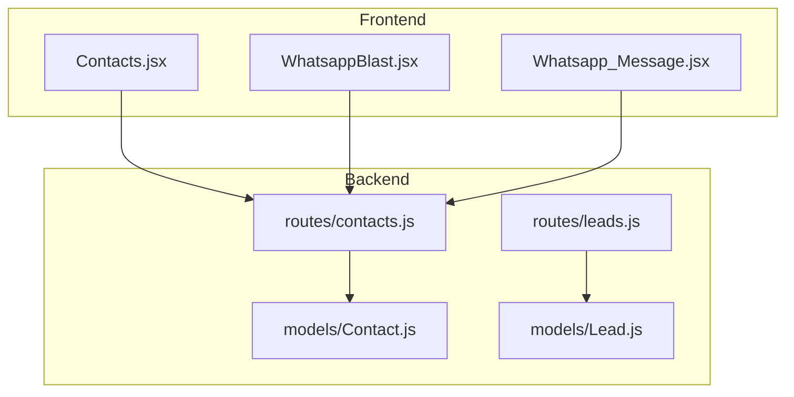
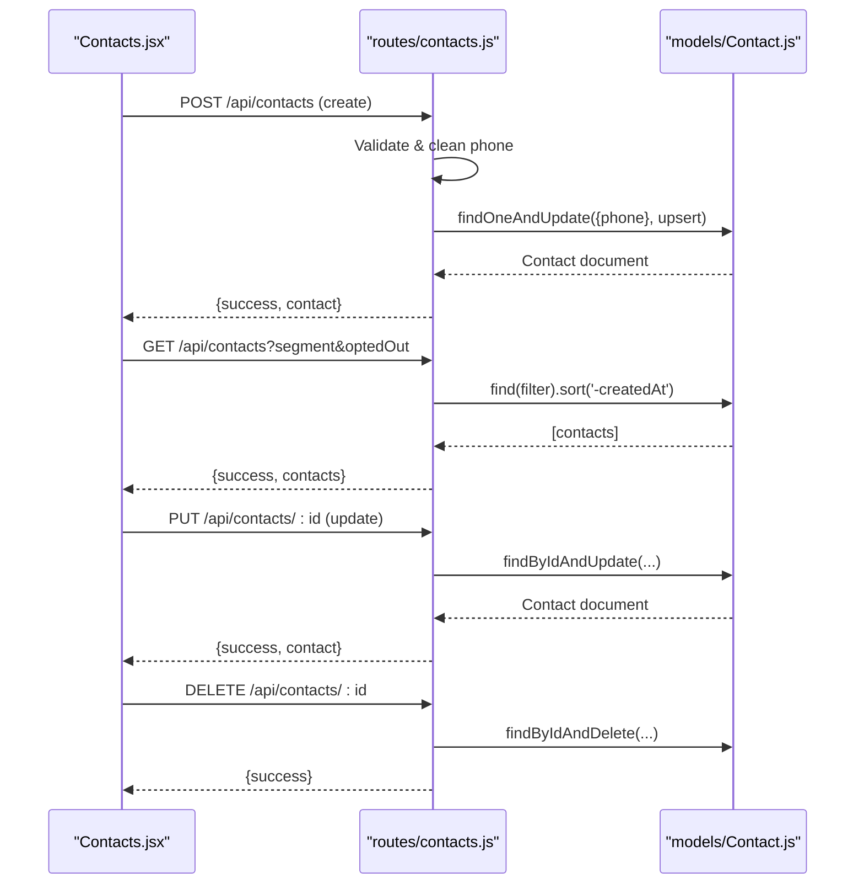
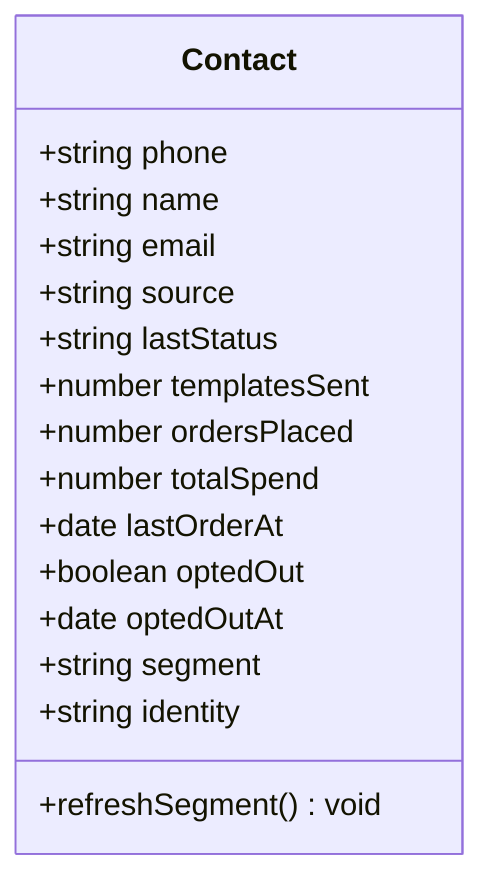
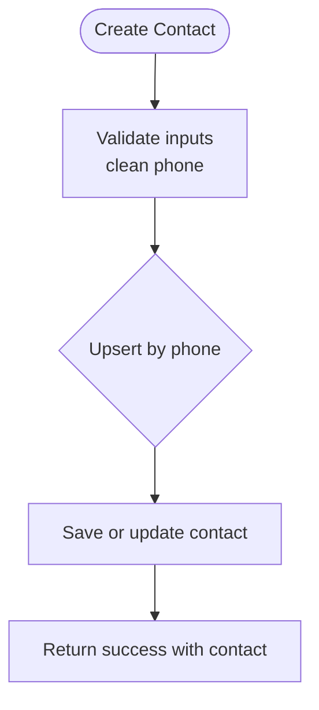
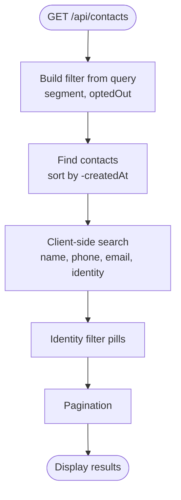
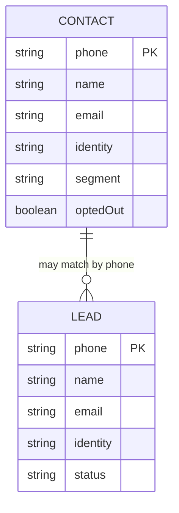
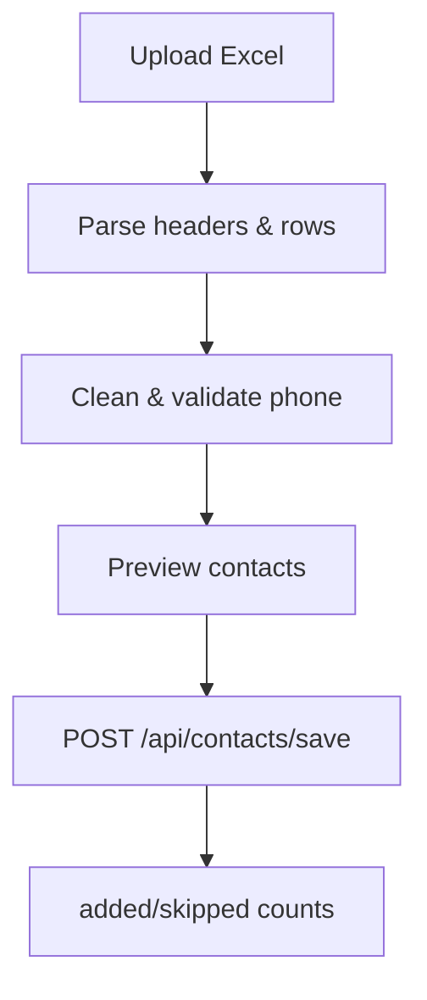
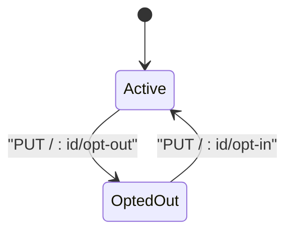
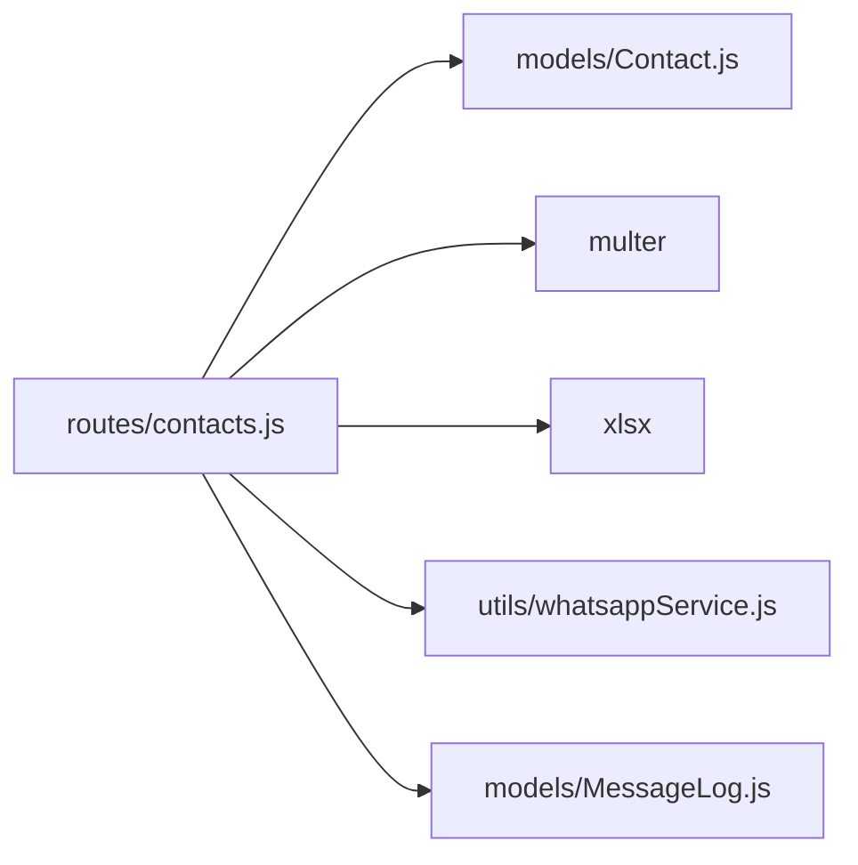

# Contact Database

<cite>
**Referenced Files in This Document**
- [Contact.js](file://backend/models/Contact.js)
- [contacts.js](file://backend/routes/contacts.js)
- [Lead.js](file://backend/models/Lead.js)
- [leads.js](file://backend/routes/leads.js)
- [Contacts.jsx](file://frontend/src/Dashboard/Contacts.jsx)
- [WhatsappBlast.jsx](file://frontend/src/Dashboard/WhatsappBlast.jsx)
- [Whatsapp_Message.jsx](file://frontend/src/Dashboard/Whatsapp_Message.jsx)
</cite>

## Table of Contents
1. [Introduction](#introduction)
2. [Project Structure](#project-structure)
3. [Core Components](#core-components)
4. [Architecture Overview](#architecture-overview)
5. [Detailed Component Analysis](#detailed-component-analysis)
6. [Dependency Analysis](#dependency-analysis)
7. [Performance Considerations](#performance-considerations)
8. [Troubleshooting Guide](#troubleshooting-guide)
9. [Conclusion](#conclusion)
10. [Appendices](#appendices)

## Introduction
This document explains the contact database system used by the application. It covers the contact data model, validation rules, CRUD operations, search and filtering, relationship to leads, import/export and bulk operations, security considerations, privacy controls, and compliance-related behaviors such as opt-out handling. The goal is to help both developers and product users understand how contacts are created, updated, searched, segmented, and managed across the frontend and backend.

## Project Structure
The contact feature spans three layers:
- Backend models define the persistent schema for contacts and leads.
- Backend routes expose REST endpoints for creating, updating, deleting, searching, importing, and managing contacts.
- Frontend components provide user interfaces for adding, editing, searching, filtering, uploading Excel sheets, and performing bulk actions.

**Diagram sources**
- [contacts.js:1-232](file://backend/routes/contacts.js#L1-L232)
- [Contact.js:1-26](file://backend/models/Contact.js#L1-L26)
- [leads.js:1-344](file://backend/routes/leads.js#L1-L344)
- [Lead.js:1-70](file://backend/models/Lead.js#L1-L70)
- [Contacts.jsx:1-800](file://frontend/src/Dashboard/Contacts.jsx#L1-L800)
- [WhatsappBlast.jsx:187-212](file://frontend/src/Dashboard/WhatsappBlast.jsx#L187-L212)
- [Whatsapp_Message.jsx:1178-1219](file://frontend/src/Dashboard/Whatsapp_Message.jsx#L1178-L1219)

**Section sources**
- [contacts.js:1-232](file://backend/routes/contacts.js#L1-L232)
- [Contact.js:1-26](file://backend/models/Contact.js#L1-L26)
- [leads.js:1-344](file://backend/routes/leads.js#L1-L344)
- [Lead.js:1-70](file://backend/models/Lead.js#L1-L70)
- [Contacts.jsx:1-800](file://frontend/src/Dashboard/Contacts.jsx#L1-L800)
- [WhatsappBlast.jsx:187-212](file://frontend/src/Dashboard/WhatsappBlast.jsx#L187-L212)
- [Whatsapp_Message.jsx:1178-1219](file://frontend/src/Dashboard/Whatsapp_Message.jsx#L1178-L1219)

## Core Components
- Contact model: Defines fields like phone (unique), name, email, source, lastStatus, templatesSent, ordersPlaced, totalSpend, lastOrderAt, optedOut, optedOutAt, segment, identity, plus timestamps. Includes a method to refresh segment based on ordersPlaced.
- Contacts routes: Provide endpoints for Excel upload, single create, bulk save, identity migration, listing with filters, update, delete, sending manual WhatsApp messages, refreshing segments, and opt-in/opt-out.
- Lead model and routes: Define lead entities and pipeline operations; they also support deduplication and WhatsApp blast dispatch using phone numbers that can be matched against contacts.
- Frontend Contacts UI: Provides form validation, Excel parsing, preview, bulk import, search, identity filter pills, pagination, edit/delete modals, and direct WhatsApp call links.

**Section sources**
- [Contact.js:1-26](file://backend/models/Contact.js#L1-L26)
- [contacts.js:12-232](file://backend/routes/contacts.js#L12-L232)
- [Lead.js:1-70](file://backend/models/Lead.js#L1-L70)
- [leads.js:1-344](file://backend/routes/leads.js#L1-L344)
- [Contacts.jsx:1-800](file://frontend/src/Dashboard/Contacts.jsx#L1-L800)

## Architecture Overview
The contact system follows a standard MVC-like pattern:
- Frontend components call REST endpoints.
- Routes validate input, normalize phone numbers, and perform database operations via Mongoose models.
- Models enforce schema constraints and include helper methods for business logic (e.g., segment refresh).

**Diagram sources**
- [contacts.js:56-168](file://backend/routes/contacts.js#L56-L168)
- [Contact.js:1-26](file://backend/models/Contact.js#L1-L26)
- [Contacts.jsx:369-435](file://frontend/src/Dashboard/Contacts.jsx#L369-L435)

## Detailed Component Analysis

### Contact Data Model
The contact schema defines core attributes and behavior:
- phone: required, unique string.
- name, email: optional strings with defaults.
- source: enum values excel/manual/whatsapp, default manual.
- lastStatus: default pending.
- templatesSent, ordersPlaced, totalSpend: numeric counters.
- lastOrderAt: date.
- optedOut: boolean flag for consent management.
- optedOutAt: timestamp when opted out.
- segment: computed category new/regular/vip.
- identity: free-form tag with default SAP FICO.
- timestamps: createdAt, updatedAt automatically managed.

A method refreshSegment updates segment based on ordersPlaced thresholds.

**Diagram sources**
- [Contact.js:3-24](file://backend/models/Contact.js#L3-L24)

**Section sources**
- [Contact.js:1-26](file://backend/models/Contact.js#L1-L26)

### Validation Rules and Sanitization
Phone number normalization:
- Non-digit characters are stripped.
- If the number starts with country code 91 and has length 12, the leading 91 is removed.
- Strict 10-digit Indian mobile validation in the frontend requires exactly 10 digits starting with 6, 7, 8, or 9.

Email validation:
- Frontend enforces a basic regex pattern for valid email format.

Identity field:
- Defaults to SAP FICO if empty or invalid.

These rules ensure consistent storage and reduce errors during messaging and reporting.

**Section sources**
- [contacts.js:56-84](file://backend/routes/contacts.js#L56-L84)
- [contacts.js:86-122](file://backend/routes/contacts.js#L86-L122)
- [contacts.js:142-162](file://backend/routes/contacts.js#L142-L162)
- [Contacts.jsx:176-219](file://frontend/src/Dashboard/Contacts.jsx#L176-L219)

### Contact Creation
Single contact creation:
- Endpoint accepts name, phone, email, address, source, segment, identity.
- Phone is cleaned and normalized.
- Upserts by phone to avoid duplicates.
- Returns success with the saved contact.

Bulk save:
- Accepts an array of contacts or phones.
- Normalizes each phone and upserts into the database.
- Tracks added and skipped counts.

Excel upload:
- Parses uploaded XLSX/CSV files.
- Detects headers flexibly for phone/name/email/identity.
- Validates and cleans phone numbers.
- Returns parsed contacts for preview before saving.

**Diagram sources**
- [contacts.js:56-84](file://backend/routes/contacts.js#L56-L84)
- [contacts.js:86-122](file://backend/routes/contacts.js#L86-L122)
- [contacts.js:12-54](file://backend/routes/contacts.js#L12-L54)

**Section sources**
- [contacts.js:12-122](file://backend/routes/contacts.js#L12-L122)
- [Contacts.jsx:369-409](file://frontend/src/Dashboard/Contacts.jsx#L369-L409)
- [Contacts.jsx:241-364](file://frontend/src/Dashboard/Contacts.jsx#L241-L364)

### Contact Update
Update endpoint:
- Accepts partial fields: name, phone, email, address, segment, identity.
- Cleans phone if provided.
- Trims text fields.
- Returns updated contact or 404 if not found.

Frontend edit flow:
- Opens modal with pre-filled fields.
- Performs client-side validation.
- Sends PUT request and refreshes list on success.

**Section sources**
- [contacts.js:142-162](file://backend/routes/contacts.js#L142-L162)
- [Contacts.jsx:80-126](file://frontend/src/Dashboard/Contacts.jsx#L80-L126)

### Contact Deletion
Delete endpoint:
- Removes contact by ID.
- Returns success response.

Frontend deletion:
- Confirms action via modal.
- Calls DELETE endpoint and refreshes list.

**Section sources**
- [contacts.js:164-168](file://backend/routes/contacts.js#L164-L168)
- [Contacts.jsx:411-435](file://frontend/src/Dashboard/Contacts.jsx#L411-L435)

### Search and Filtering
Server-side listing:
- Supports optional query parameters segment and optedOut.
- Returns contacts sorted by newest first.

Client-side search and filters:
- Full-text search across name, phone, email, and identity.
- Identity filter pills dynamically derived from existing identities.
- Pagination for large lists.

Advanced options:
- Segment-based filtering at server level.
- Opt-out filtering at server level.
- Identity-based filtering at client level.

**Diagram sources**
- [contacts.js:133-140](file://backend/routes/contacts.js#L133-L140)
- [Contacts.jsx:455-482](file://frontend/src/Dashboard/Contacts.jsx#L455-L482)
- [Contacts.jsx:562-611](file://frontend/src/Dashboard/Contacts.jsx#L562-L611)

**Section sources**
- [contacts.js:133-140](file://backend/routes/contacts.js#L133-L140)
- [Contacts.jsx:455-482](file://frontend/src/Dashboard/Contacts.jsx#L455-L482)
- [Contacts.jsx:562-611](file://frontend/src/Dashboard/Contacts.jsx#L562-L611)

### Relationship Between Contacts and Leads
Contacts and leads share common identifiers:
- Both store phone numbers normalized to 10 digits.
- Leads route supports deduplication by phone.
- Blast endpoints accept lead IDs, contact IDs, or raw phone numbers, enabling cross-entity targeting.

Relationship patterns:
- A contact may correspond to a lead if they share the same phone number.
- Bulk blast operations can target either contacts or leads, normalizing phone numbers to unify recipients.

**Diagram sources**
- [Contact.js:3-16](file://backend/models/Contact.js#L3-L16)
- [Lead.js:3-67](file://backend/models/Lead.js#L3-L67)
- [leads.js:134-157](file://backend/routes/leads.js#L134-L157)
- [leads.js:229-341](file://backend/routes/leads.js#L229-L341)

**Section sources**
- [Lead.js:1-70](file://backend/models/Lead.js#L1-L70)
- [leads.js:134-157](file://backend/routes/leads.js#L134-L157)
- [leads.js:229-341](file://backend/routes/leads.js#L229-L341)

### Import/Export and Bulk Operations
Import:
- Excel upload parses headers flexibly and validates phone numbers.
- Preview allows review before saving.
- Bulk save endpoint upserts contacts efficiently.

Export:
- Frontend provides template download for CSV format.
- No explicit export endpoint is present; clients can render and export from fetched data.

Bulk operations:
- Bulk save returns added/skipped counts.
- Identity migration endpoint updates legacy General identities to SAP FICO.
- Refresh segments recalculates segment for all contacts.

**Diagram sources**
- [contacts.js:12-54](file://backend/routes/contacts.js#L12-L54)
- [contacts.js:86-122](file://backend/routes/contacts.js#L86-L122)
- [contacts.js:124-131](file://backend/routes/contacts.js#L124-L131)
- [contacts.js:208-218](file://backend/routes/contacts.js#L208-L218)
- [Contacts.jsx:221-364](file://frontend/src/Dashboard/Contacts.jsx#L221-L364)

**Section sources**
- [contacts.js:12-131](file://backend/routes/contacts.js#L12-L131)
- [contacts.js:208-218](file://backend/routes/contacts.js#L208-L218)
- [Contacts.jsx:221-364](file://frontend/src/Dashboard/Contacts.jsx#L221-L364)

### Privacy, Consent, and Compliance
Opt-out management:
- Contact model includes optedOut and optedOutAt fields.
- Endpoints allow opt-in/opt-out toggling per contact.
- Listing endpoint supports filtering by optedOut.
- Messaging utilities skip opted-out contacts.

Compliance considerations:
- Enforce opt-out checks before sending messages.
- Maintain audit trails for opt-out timestamps.
- Ensure data minimization and accurate phone normalization.

**Diagram sources**
- [Contact.js:13-14](file://backend/models/Contact.js#L13-L14)
- [contacts.js:220-230](file://backend/routes/contacts.js#L220-L230)
- [contacts.js:133-140](file://backend/routes/contacts.js#L133-L140)

**Section sources**
- [Contact.js:13-14](file://backend/models/Contact.js#L13-L14)
- [contacts.js:133-140](file://backend/routes/contacts.js#L133-L140)
- [contacts.js:220-230](file://backend/routes/contacts.js#L220-L230)

### Security Considerations
Input sanitization:
- Strip non-digits from phone numbers.
- Trim whitespace from text fields.
- Normalize country codes consistently.

Validation:
- Strict 10-digit Indian mobile validation in frontend.
- Required fields enforced at both frontend and backend.

Data integrity:
- Unique constraint on phone prevents duplicates.
- Upsert semantics ensure idempotent saves.

Operational safety:
- Bulk operations track skipped entries to report failures without aborting entire batches.

**Section sources**
- [contacts.js:56-84](file://backend/routes/contacts.js#L56-L84)
- [contacts.js:86-122](file://backend/routes/contacts.js#L86-L122)
- [contacts.js:142-162](file://backend/routes/contacts.js#L142-L162)
- [Contacts.jsx:176-219](file://frontend/src/Dashboard/Contacts.jsx#L176-L219)

### Examples of Operations

- Create contact:
  - Call POST /api/contacts with name, phone, email, identity.
  - Expect success response with saved contact.

- Update contact:
  - Call PUT /api/contacts/:id with partial fields.
  - Expect updated contact or 404.

- Delete contact:
  - Call DELETE /api/contacts/:id.
  - Expect success response.

- Search and filter:
  - Call GET /api/contacts?segment=new&optedOut=false.
  - Apply client-side search by name, phone, email, identity.

- Bulk import:
  - Upload Excel file, parse and preview.
  - Submit bulk save to upsert contacts.

- Opt-out:
  - Call PUT /api/contacts/:id/opt-out.
  - Verify optedOutAt timestamp set.

- Opt-in:
  - Call PUT /api/contacts/:id/opt-in.
  - Clear optedOutAt and set optedOut false.

**Section sources**
- [contacts.js:56-168](file://backend/routes/contacts.js#L56-L168)
- [contacts.js:220-230](file://backend/routes/contacts.js#L220-L230)
- [Contacts.jsx:369-435](file://frontend/src/Dashboard/Contacts.jsx#L369-L435)

## Dependency Analysis
The contact module depends on:
- Express router for HTTP endpoints.
- Multer for file uploads.
- XLSX library for parsing spreadsheets.
- Mongoose model for persistence.
- WhatsApp service for outbound messaging.
- MessageLog model for logging outbound messages.

**Diagram sources**
- [contacts.js:1-8](file://backend/routes/contacts.js#L1-L8)
- [contacts.js:170-206](file://backend/routes/contacts.js#L170-L206)

**Section sources**
- [contacts.js:1-8](file://backend/routes/contacts.js#L1-L8)
- [contacts.js:170-206](file://backend/routes/contacts.js#L170-L206)

## Performance Considerations
- Use server-side filters (segment, optedOut) to reduce payload size.
- Prefer bulk save over individual creates for large datasets.
- Avoid unnecessary re-computation of segments; use refresh-segments endpoint judiciously.
- Implement pagination on the frontend to handle large lists efficiently.
- Deduplicate leads and contacts by phone to prevent redundant messaging and storage overhead.

[No sources needed since this section provides general guidance]

## Troubleshooting Guide
Common issues and resolutions:
- Phone validation errors:
  - Ensure exactly 10 digits starting with 6, 7, 8, or 9.
  - Remove non-digit characters and country code 91 if present.

- Duplicate contacts:
  - Upsert by phone prevents duplicates; verify uniqueness constraints.

- Excel parsing failures:
  - Confirm headers include recognizable names for phone/name/email/identity.
  - Check file encoding and row structure.

- Opt-out messaging:
  - Verify optedOut flag before sending messages.
  - Use opt-in/opt-out endpoints to manage consent.

- Missing contact updates:
  - Check 404 responses indicating nonexistent IDs.
  - Validate field trimming and normalization.

**Section sources**
- [contacts.js:56-84](file://backend/routes/contacts.js#L56-L84)
- [contacts.js:142-162](file://backend/routes/contacts.js#L142-L162)
- [contacts.js:164-168](file://backend/routes/contacts.js#L164-L168)
- [contacts.js:220-230](file://backend/routes/contacts.js#L220-L230)
- [Contacts.jsx:176-219](file://frontend/src/Dashboard/Contacts.jsx#L176-L219)

## Conclusion
The contact database system provides robust CRUD operations, flexible search and filtering, secure input handling, and compliance-aware consent management. Its integration with leads enables unified targeting across sales pipelines. By following the documented validation rules, privacy controls, and operational best practices, teams can maintain high-quality contact data and deliver reliable messaging workflows.

[No sources needed since this section summarizes without analyzing specific files]

## Appendices

### API Reference Summary

- POST /api/contacts/upload-excel
  - Purpose: Parse and preview Excel/CSV contacts.
  - Input: multipart/form-data with file.
  - Output: { success, contacts[], count }.

- POST /api/contacts
  - Purpose: Create or upsert a single contact.
  - Input: { name, phone, email, address, source, segment, identity }.
  - Output: { success, contact }.

- POST /api/contacts/save
  - Purpose: Bulk save contacts or phones.
  - Input: { contacts[] | phones[] , source }.
  - Output: { success, added, skipped }.

- POST /api/contacts/migrate-identity
  - Purpose: Update legacy identities to SAP FICO.
  - Output: { success, modifiedCount, message }.

- GET /api/contacts
  - Purpose: List contacts with optional filters.
  - Query: segment, optedOut.
  - Output: { success, contacts[] }.

- PUT /api/contacts/:id
  - Purpose: Update contact fields.
  - Input: { name, phone, email, address, segment, identity }.
  - Output: { success, contact }.

- DELETE /api/contacts/:id
  - Purpose: Delete contact.
  - Output: { success }.

- POST /api/contacts/send-message
  - Purpose: Send manual WhatsApp message and log it.
  - Input: { phone, message }.
  - Output: { success, metaRes }.

- POST /api/contacts/refresh-segments
  - Purpose: Recalculate segments for all contacts.
  - Output: { success, updated }.

- PUT /api/contacts/:id/opt-out
  - Purpose: Mark contact as opted out.
  - Output: { success, contact }.

- PUT /api/contacts/:id/opt-in
  - Purpose: Restore contact opt-in status.
  - Output: { success, contact }.

**Section sources**
- [contacts.js:12-232](file://backend/routes/contacts.js#L12-L232)