# Lead Management

<cite>
**Referenced Files in This Document**
- [Lead.js](file://backend/models/Lead.js)
- [leads.js](file://backend/routes/leads.js)
- [Contact.js](file://backend/models/Contact.js)
- [contacts.js](file://backend/routes/contacts.js)
- [LeadsPipeline.jsx](file://frontend/src/Dashboard/LeadsPipeline.jsx)
- [conversationFlow.js](file://backend/utils/conversationFlow.js)
- [MessageLog.js](file://backend/models/MessageLog.js)
- [Template.js](file://backend/models/Template.js)
</cite>

## Table of Contents
1. [Introduction](#introduction)
2. [Project Structure](#project-structure)
3. [Core Components](#core-components)
4. [Architecture Overview](#architecture-overview)
5. [Detailed Component Analysis](#detailed-component-analysis)
6. [Dependency Analysis](#dependency-analysis)
7. [Performance Considerations](#performance-considerations)
8. [Troubleshooting Guide](#troubleshooting-guide)
9. [Conclusion](#conclusion)

## Introduction
This document explains the lead management system, covering end-to-end functionality: lead creation with validation and normalization (including Indian mobile number cleaning), lifecycle tracking across pipeline stages, search and filtering, deduplication, conversion to contacts, WhatsApp messaging integration for automated follow-ups, assignment to employees, and source tracking for marketing attribution. It also provides practical examples of CRUD operations, bulk operations, and pipeline management from both backend APIs and frontend UI.

## Project Structure
The lead management feature spans backend models, routes, utilities, and a React dashboard component:
- Backend data models define Leads, Contacts, Templates, and Message Logs.
- Backend routes implement REST endpoints for lead CRUD, deduplication, and WhatsApp blast operations.
- Frontend provides a rich pipeline UI with cards/table views, status updates, employee performance stats, and file import/export.

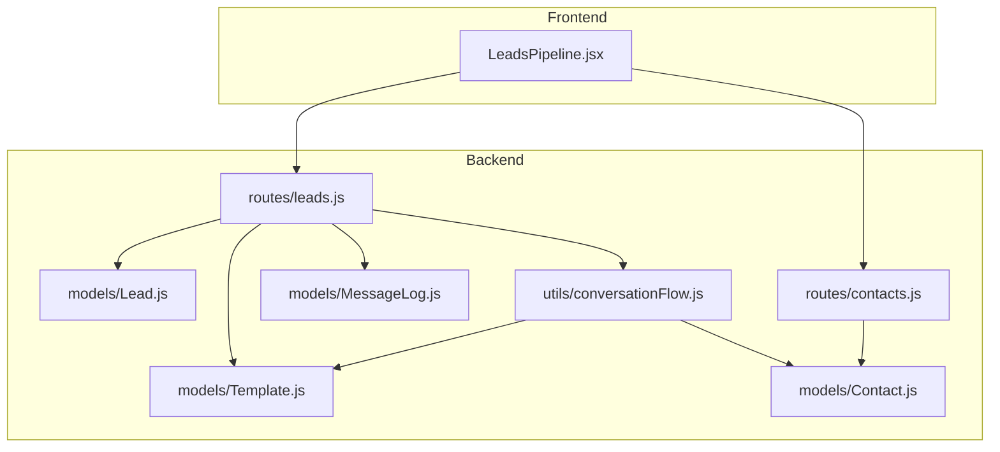

**Diagram sources**
- [LeadsPipeline.jsx:1-1382](file://frontend/src/Dashboard/LeadsPipeline.jsx#L1-L1382)
- [leads.js:1-344](file://backend/routes/leads.js#L1-L344)
- [contacts.js:1-232](file://backend/routes/contacts.js#L1-L232)
- [Lead.js:1-70](file://backend/models/Lead.js#L1-L70)
- [Contact.js:1-26](file://backend/models/Contact.js#L1-L26)
- [Template.js:1-42](file://backend/models/Template.js#L1-L42)
- [MessageLog.js:1-22](file://backend/models/MessageLog.js#L1-L22)
- [conversationFlow.js:1-122](file://backend/utils/conversationFlow.js#L1-L122)

**Section sources**
- [LeadsPipeline.jsx:1-1382](file://frontend/src/Dashboard/LeadsPipeline.jsx#L1-L1382)
- [leads.js:1-344](file://backend/routes/leads.js#L1-L344)
- [contacts.js:1-232](file://backend/routes/contacts.js#L1-L232)

## Core Components
- Lead model: stores core lead attributes including name, phone, email, address, identity tag, assigned employee, calling update fields, status, notes, and source.
- Contact model: represents converted or standalone contacts with segmentation and opt-out flags.
- Template model: defines approved Meta templates used for WhatsApp messaging.
- MessageLog model: records outbound/inbound message metadata and outcomes.
- ConversationFlow utility: orchestrates sending Meta template messages, handling media headers, and respecting contact opt-outs.
- Leads route: implements lead CRUD, search/filter, deduplication, single-message test, and batch WhatsApp blast.
- Contacts route: supports Excel upload, bulk save, segment refresh, opt-in/out, and direct messaging.
- LeadsPipeline frontend: provides UI for creating/editing leads, pipeline stage changes, employee performance summary, search/filter, pagination, and bulk imports.

**Section sources**
- [Lead.js:1-70](file://backend/models/Lead.js#L1-L70)
- [Contact.js:1-26](file://backend/models/Contact.js#L1-L26)
- [Template.js:1-42](file://backend/models/Template.js#L1-L42)
- [MessageLog.js:1-22](file://backend/models/MessageLog.js#L1-L22)
- [conversationFlow.js:1-122](file://backend/utils/conversationFlow.js#L1-L122)
- [leads.js:1-344](file://backend/routes/leads.js#L1-L344)
- [contacts.js:1-232](file://backend/routes/contacts.js#L1-L232)
- [LeadsPipeline.jsx:1-1382](file://frontend/src/Dashboard/LeadsPipeline.jsx#L1-L1382)

## Architecture Overview
The system follows a typical MVC-like pattern:
- Frontend components call backend REST endpoints.
- Backend routes validate input, normalize data, enforce business rules, and persist to MongoDB via Mongoose models.
- WhatsApp messaging is handled through a conversation flow utility that uses approved templates and logs all outbound interactions.

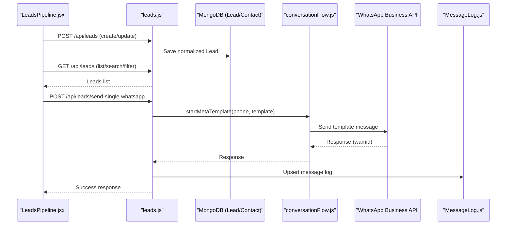

**Diagram sources**
- [LeadsPipeline.jsx:277-322](file://frontend/src/Dashboard/LeadsPipeline.jsx#L277-L322)
- [leads.js:36-84](file://backend/routes/leads.js#L36-L84)
- [leads.js:159-227](file://backend/routes/leads.js#L159-L227)
- [conversationFlow.js:21-118](file://backend/utils/conversationFlow.js#L21-L118)
- [MessageLog.js:1-22](file://backend/models/MessageLog.js#L1-L22)

## Detailed Component Analysis

### Lead Model and Lifecycle Fields
The Lead schema includes:
- Identity and assignment: identity, employeeName
- Pipeline updates: leadStatusUpdate, secondUpdate, finalUpdate
- Status tracking: status (default 'Intrest')
- Source tracking: source (default 'crm')
- Contact details: name, phone, email, address, notes

These fields support the full lifecycle from initial contact through follow-up updates and conversion.

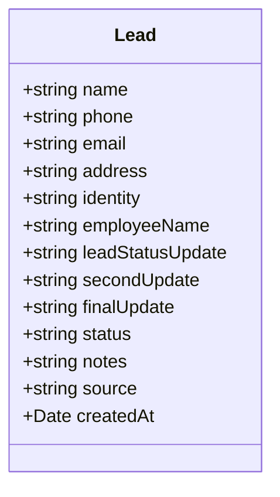

**Diagram sources**
- [Lead.js:1-70](file://backend/models/Lead.js#L1-L70)

**Section sources**
- [Lead.js:1-70](file://backend/models/Lead.js#L1-L70)

### Lead Creation, Validation, and Data Normalization
Creation endpoint enforces:
- Required fields: name and phone
- Phone normalization: strips non-digits, removes leading '91' if present, validates exactly 10 digits starting with 6/7/8/9
- Duplicate prevention on phone at creation time
- Field normalization: trimming, lowercasing email, default values for identity, employeeName, status, source

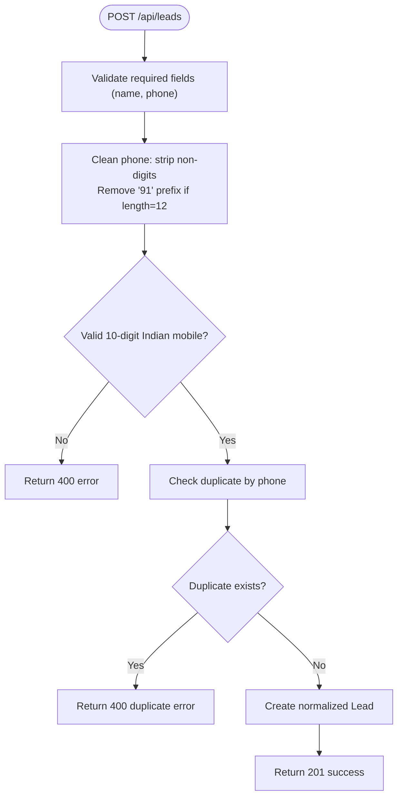

**Diagram sources**
- [leads.js:36-84](file://backend/routes/leads.js#L36-L84)

**Section sources**
- [leads.js:36-84](file://backend/routes/leads.js#L36-L84)

### Lead Search and Filtering
List endpoint supports:
- Filter by status (excluding 'ALL')
- Full-text search across name, phone, email, address using case-insensitive regex
- Sorting by newest first

Frontend adds additional client-side filters:
- Employee filter
- Identity tag search
- Pagination

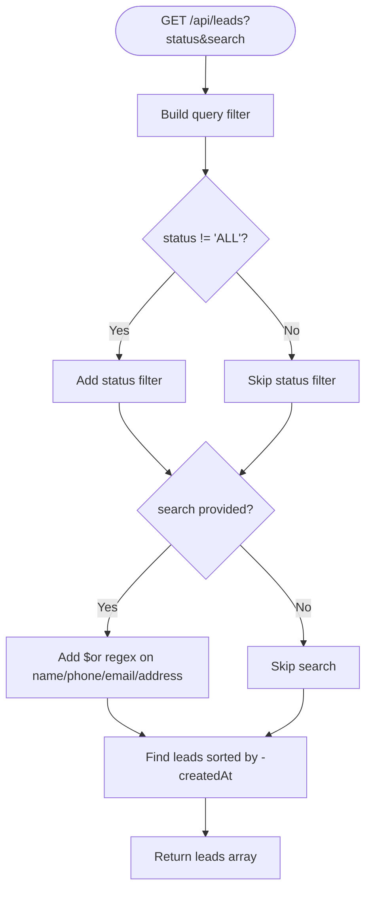

**Diagram sources**
- [leads.js:16-34](file://backend/routes/leads.js#L16-L34)

**Section sources**
- [leads.js:16-34](file://backend/routes/leads.js#L16-L34)
- [LeadsPipeline.jsx:450-467](file://frontend/src/Dashboard/LeadsPipeline.jsx#L450-L467)

### Lead Deduplication
Deduplicate endpoint:
- Scans all leads sorted by creation date
- Keeps the first occurrence per phone and deletes subsequent duplicates
- Returns count of removed duplicates

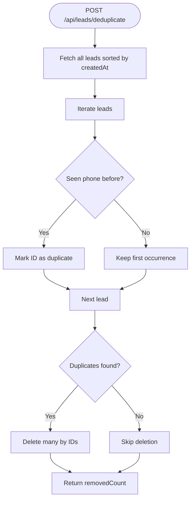

**Diagram sources**
- [leads.js:134-157](file://backend/routes/leads.js#L134-L157)

**Section sources**
- [leads.js:134-157](file://backend/routes/leads.js#L134-L157)

### Lead-to-Contact Conversion Workflow
While there is no explicit “convert” endpoint in the leads route, the system supports:
- Creating or upserting a Contact by phone (contacts route)
- Using the same phone normalization logic
- Maintaining separate data models for Leads and Contacts

Typical workflow:
- After a lead reaches a conversion stage (e.g., 'Enrolled'), create or update a Contact record with the same phone.
- Use Contact segmentation and opt-out flags for downstream messaging.

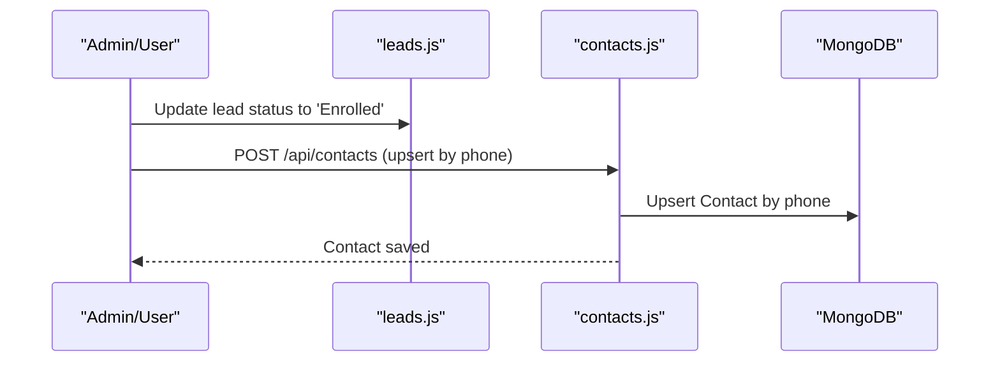

**Diagram sources**
- [leads.js:86-125](file://backend/routes/leads.js#L86-L125)
- [contacts.js:56-84](file://backend/routes/contacts.js#L56-L84)

**Section sources**
- [contacts.js:56-84](file://backend/routes/contacts.js#L56-L84)

### WhatsApp Messaging Integration
Two main flows:
- Single test message: send a template to a specific phone and log the result.
- Batch blast: dispatch a template to multiple recipients derived from lead_ids, phones, or raw numbers; log each attempt.

ConversationFlow handles:
- Phone normalization
- Opt-out checks against Contact model
- Template header media resolution (local files or URLs)
- Body variable substitution with contact name
- Sending via Meta API and returning wamid

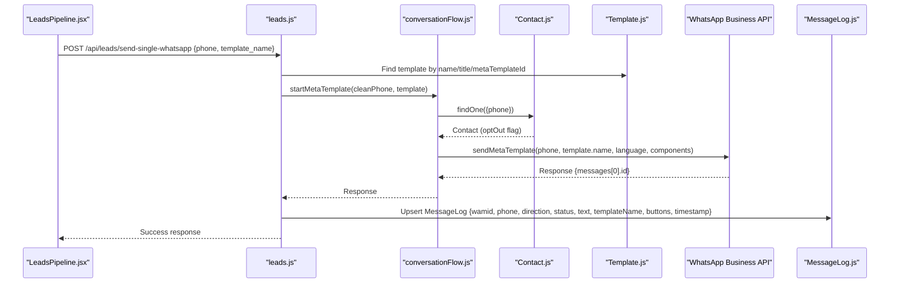

**Diagram sources**
- [leads.js:159-227](file://backend/routes/leads.js#L159-L227)
- [conversationFlow.js:21-118](file://backend/utils/conversationFlow.js#L21-L118)
- [Template.js:1-42](file://backend/models/Template.js#L1-L42)
- [MessageLog.js:1-22](file://backend/models/MessageLog.js#L1-L22)

**Section sources**
- [leads.js:159-227](file://backend/routes/leads.js#L159-L227)
- [conversationFlow.js:1-122](file://backend/utils/conversationFlow.js#L1-L122)

### Bulk Operations and Import
- Excel/CSV import for leads: frontend parses CSV rows, normalizes phone numbers, and posts each valid lead to the backend.
- Contacts Excel upload: backend reads XLSX, infers columns, cleans phone numbers, and returns validated contacts for saving.
- Bulk save contacts: backend accepts arrays of contact objects or phone strings and upserts them.

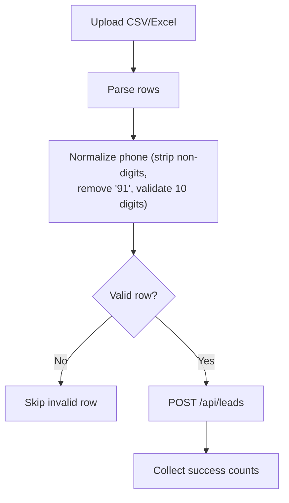

**Diagram sources**
- [LeadsPipeline.jsx:135-211](file://frontend/src/Dashboard/LeadsPipeline.jsx#L135-L211)
- [contacts.js:12-54](file://backend/routes/contacts.js#L12-L54)

**Section sources**
- [LeadsPipeline.jsx:135-211](file://frontend/src/Dashboard/LeadsPipeline.jsx#L135-L211)
- [contacts.js:12-54](file://backend/routes/contacts.js#L12-L54)

### Pipeline Management and Status Tracking
- Status options include 'Intrest', 'Not Intrest', 'Pipeline', 'Overall Calls', 'Inquiries', 'Demo', 'Enrolled'.
- Frontend allows inline status changes via dropdowns in card/table views.
- Employee performance summary aggregates total calls, interested leads, pipeline leads, and joined conversions per employee.

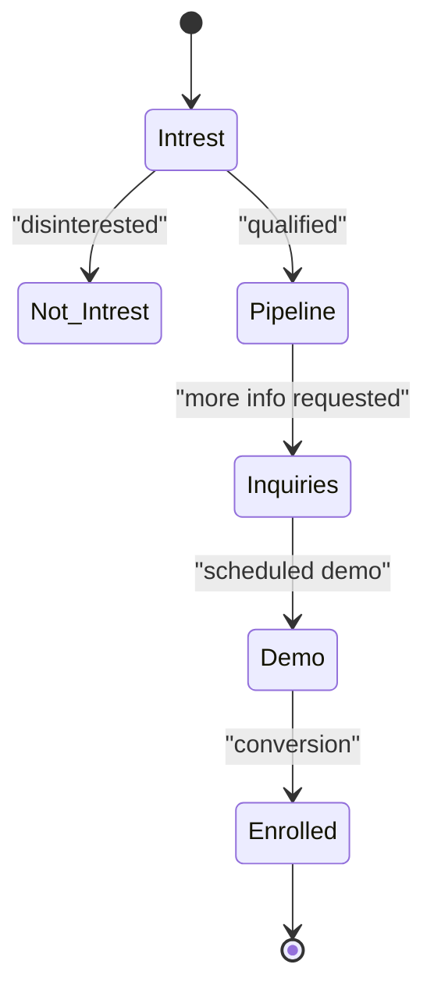

**Diagram sources**
- [LeadsPipeline.jsx:403-448](file://frontend/src/Dashboard/LeadsPipeline.jsx#L403-L448)

**Section sources**
- [LeadsPipeline.jsx:403-448](file://frontend/src/Dashboard/LeadsPipeline.jsx#L403-L448)

### Assignment to Employees and Source Tracking
- Each lead has an employeeName field for assignment and identity tag for categorization.
- Source field tracks origin (default 'crm').
- Frontend computes unique employee names dynamically and displays performance metrics.

**Section sources**
- [Lead.js:30-62](file://backend/models/Lead.js#L30-L62)
- [LeadsPipeline.jsx:405-448](file://frontend/src/Dashboard/LeadsPipeline.jsx#L405-L448)

## Dependency Analysis
Key dependencies and relationships:
- Leads route depends on Lead, Contact, Template, MessageLog, and conversationFlow.
- Contacts route depends on Contact and whatsappService.
- ConversationFlow depends on Contact, Template, and whatsappService.
- Frontend LeadsPipeline depends on backend leads and contacts endpoints.

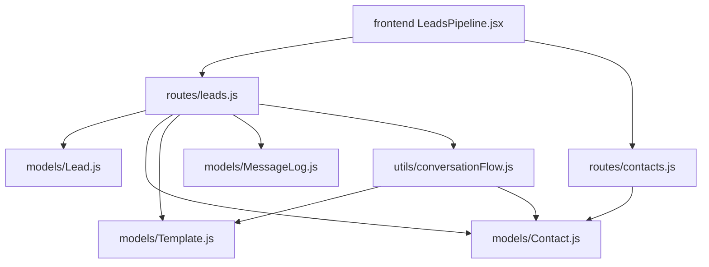

**Diagram sources**
- [leads.js:1-344](file://backend/routes/leads.js#L1-L344)
- [contacts.js:1-232](file://backend/routes/contacts.js#L1-L232)
- [conversationFlow.js:1-122](file://backend/utils/conversationFlow.js#L1-L122)
- [LeadsPipeline.jsx:1-1382](file://frontend/src/Dashboard/LeadsPipeline.jsx#L1-L1382)

**Section sources**
- [leads.js:1-344](file://backend/routes/leads.js#L1-L344)
- [contacts.js:1-232](file://backend/routes/contacts.js#L1-L232)
- [conversationFlow.js:1-122](file://backend/utils/conversationFlow.js#L1-L122)
- [LeadsPipeline.jsx:1-1382](file://frontend/src/Dashboard/LeadsPipeline.jsx#L1-L1382)

## Performance Considerations
- Phone normalization is performed consistently across routes and utilities to avoid redundant processing.
- Deduplication scans all leads; consider indexing phone fields for large datasets.
- WhatsApp blast loops over recipients; batching or queueing can improve throughput and resilience.
- Frontend pagination reduces payload size and improves UI responsiveness.

[No sources needed since this section provides general guidance]

## Troubleshooting Guide
Common issues and resolutions:
- Invalid phone number: ensure 10-digit Indian mobile format; verify leading digit is 6/7/8/9.
- Duplicate lead creation: check existing phone entries; use deduplicate endpoint to clean data.
- WhatsApp message failures: confirm template approval, correct phone normalization, and contact opt-out status.
- Missing message logs: verify MessageLog upsert logic and network connectivity to Meta API.

**Section sources**
- [leads.js:36-84](file://backend/routes/leads.js#L36-L84)
- [leads.js:159-227](file://backend/routes/leads.js#L159-L227)
- [conversationFlow.js:21-118](file://backend/utils/conversationFlow.js#L21-L118)

## Conclusion
The lead management system provides robust capabilities for creating, validating, and normalizing leads, tracking their lifecycle through pipeline stages, searching and filtering efficiently, deduplicating records, converting leads to contacts, and integrating WhatsApp messaging for automated follow-ups. The frontend offers a comprehensive pipeline interface with employee performance insights and bulk operations. Together, these components enable effective sales operations and marketing attribution.

[No sources needed since this section summarizes without analyzing specific files]