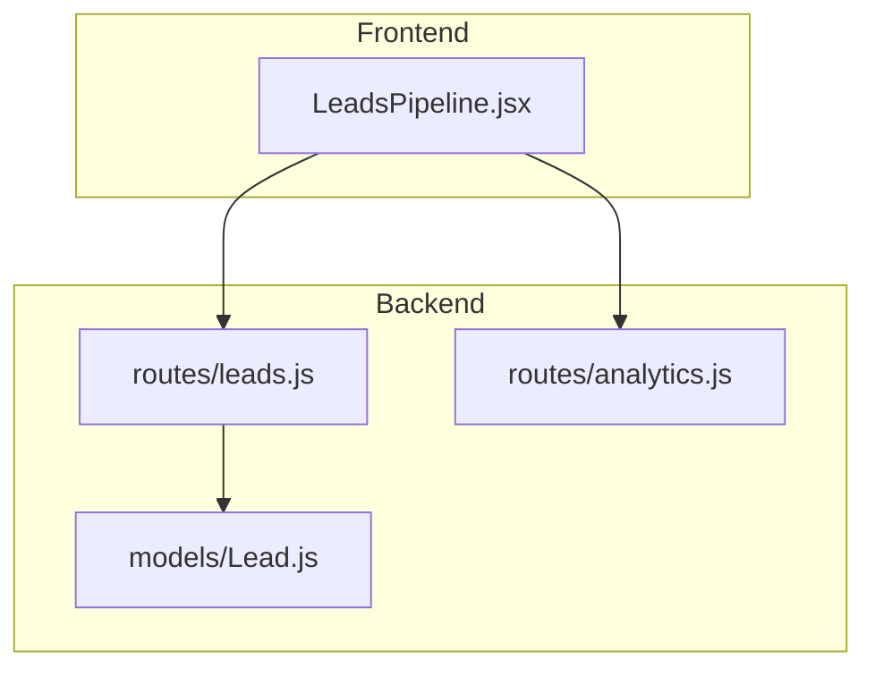
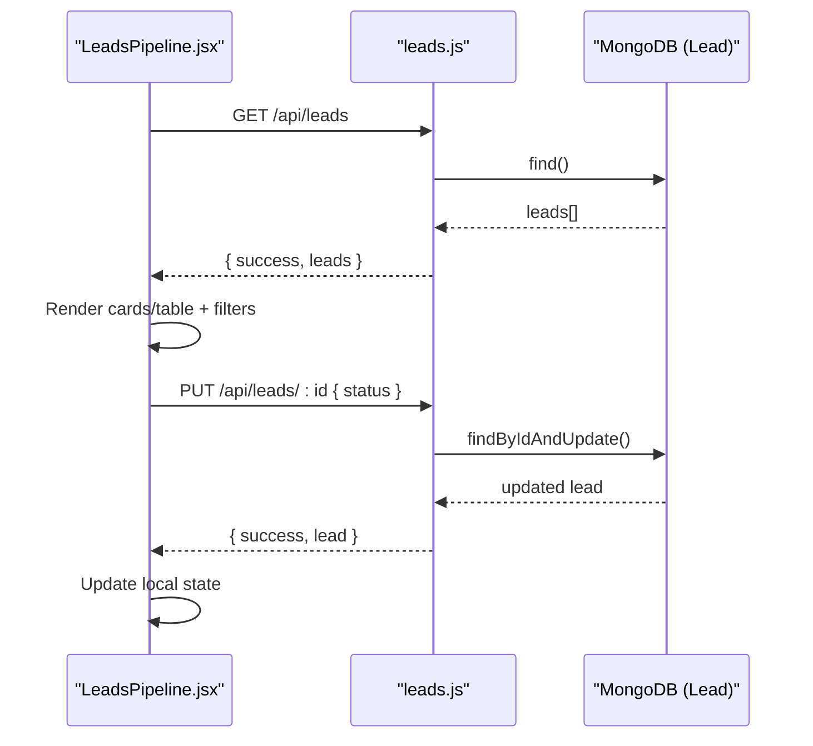
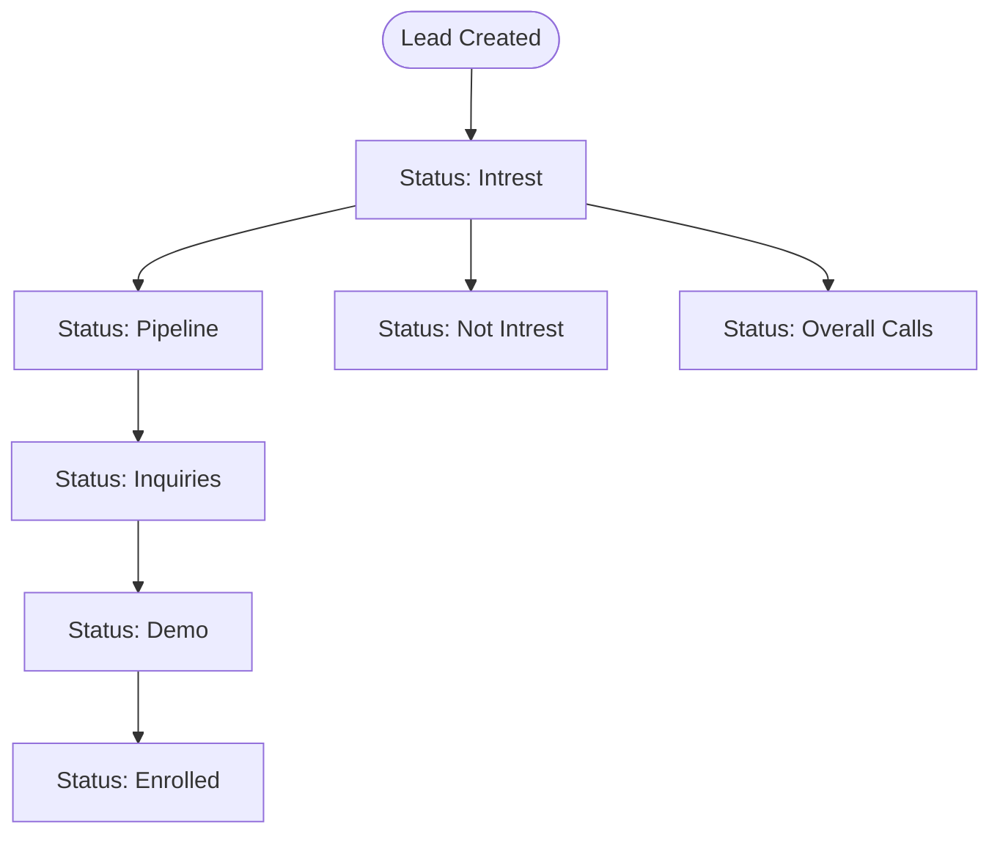
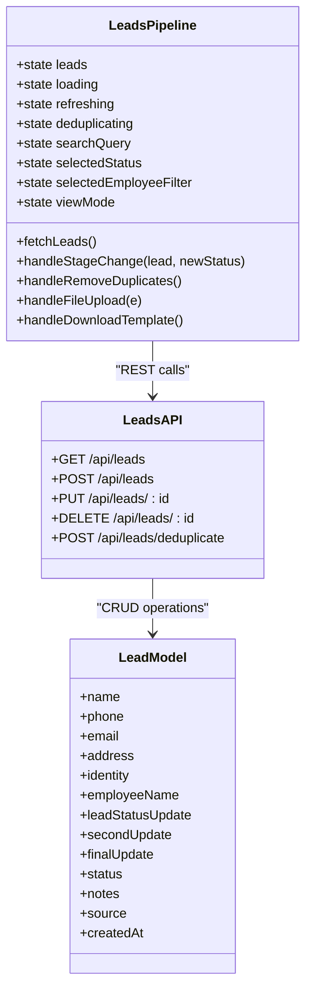
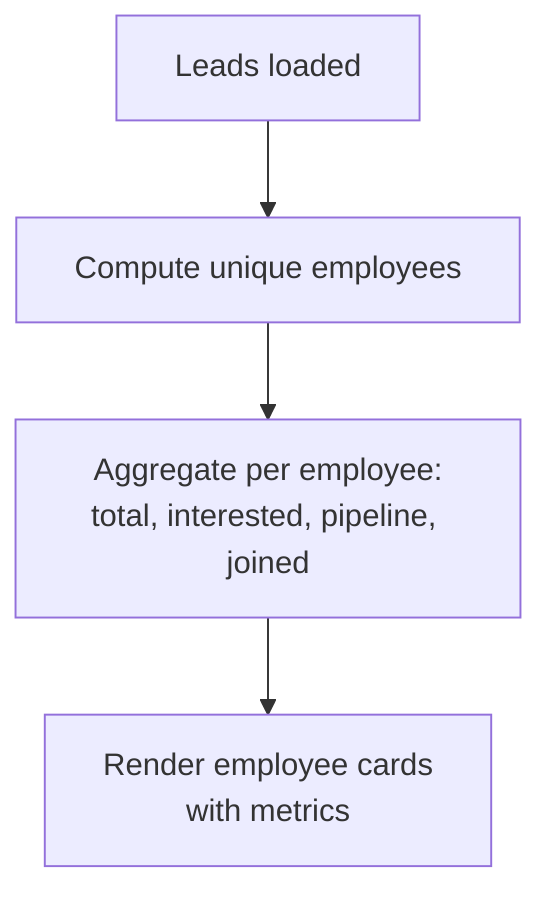
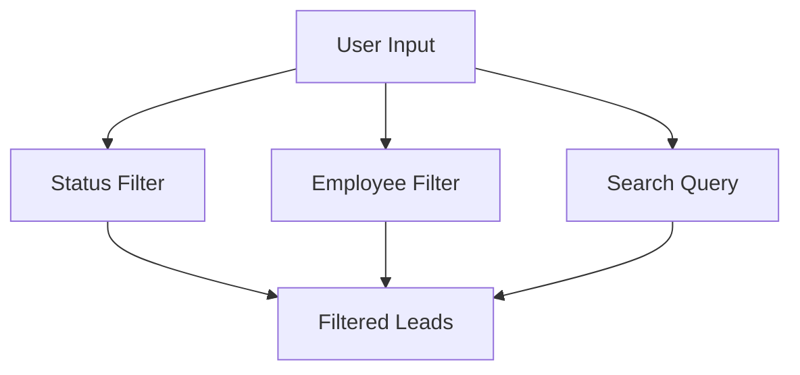
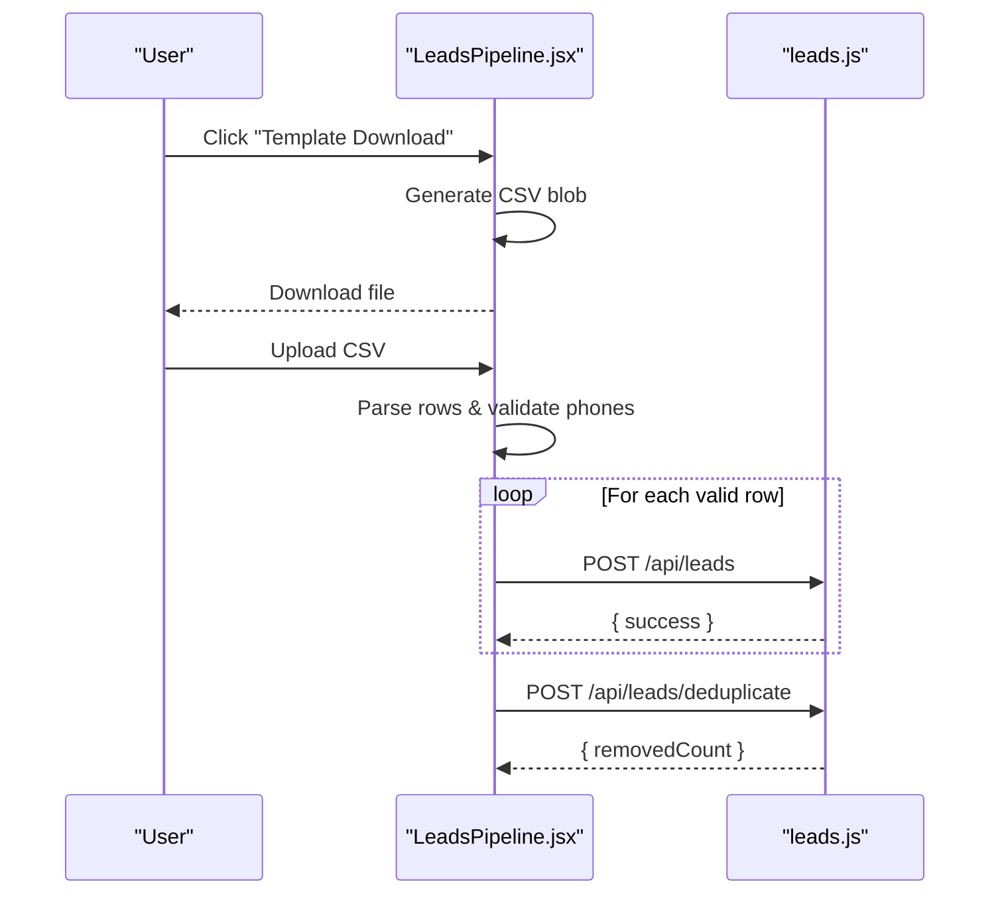
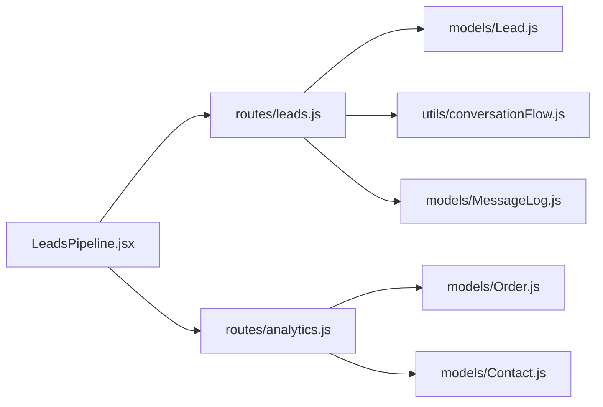

# Sales Pipeline & Analytics

<cite>
**Referenced Files in This Document**
- [LeadsPipeline.jsx](file://frontend/src/Dashboard/LeadsPipeline.jsx)
- [leads.js](file://backend/routes/leads.js)
- [Lead.js](file://backend/models/Lead.js)
- [analytics.js](file://backend/routes/analytics.js)
</cite>

## Table of Contents
1. [Introduction](#introduction)
2. [Project Structure](#project-structure)
3. [Core Components](#core-components)
4. [Architecture Overview](#architecture-overview)
5. [Detailed Component Analysis](#detailed-component-analysis)
6. [Dependency Analysis](#dependency-analysis)
7. [Performance Considerations](#performance-considerations)
8. [Troubleshooting Guide](#troubleshooting-guide)
9. [Conclusion](#conclusion)

## Introduction
This document explains the sales pipeline visualization and analytics features for managing leads, tracking calling updates, and reporting performance. It covers:
- Lead pipeline stages and how leads progress through the funnel
- The interactive pipeline interface with filtering, search, view modes, and stage transitions
- Pipeline analytics including conversion metrics and summary reporting
- Lead data model fields that support engagement tracking and priority assignment
- Filtering and segmentation by status, employee, and identity
- Examples of customization, import/export workflows, and WhatsApp blast integration
- Real-time update patterns and collaboration considerations for sales teams

## Project Structure
The feature spans a React frontend component and Express backend routes with a Mongoose model:
- Frontend: `frontend/src/Dashboard/LeadsPipeline.jsx` provides the UI for lead management, filtering, importing, and stage transitions.
- Backend: `backend/routes/leads.js` exposes REST endpoints for CRUD operations, deduplication, and WhatsApp messaging.
- Data Model: `backend/models/Lead.js` defines the schema for lead records.
- Analytics: `backend/routes/analytics.js` provides revenue, top items, and summary analytics (order-focused; can be extended to lead analytics).

**Diagram sources**
- [LeadsPipeline.jsx:90-110](file://frontend/src/Dashboard/LeadsPipeline.jsx#L90-L110)
- [leads.js:16-34](file://backend/routes/leads.js#L16-L34)
- [analytics.js:6-26](file://backend/routes/analytics.js#L6-L26)
- [Lead.js:3-67](file://backend/models/Lead.js#L3-L67)

**Section sources**
- [LeadsPipeline.jsx:1-1382](file://frontend/src/Dashboard/LeadsPipeline.jsx#L1-L1382)
- [leads.js:1-344](file://backend/routes/leads.js#L1-L344)
- [Lead.js:1-70](file://backend/models/Lead.js#L1-L70)
- [analytics.js:1-85](file://backend/routes/analytics.js#L1-L85)

## Core Components
- LeadsPipeline.jsx: Interactive dashboard for adding, editing, deleting, filtering, searching, importing, and updating lead statuses. Includes employee performance summaries and view mode toggles.
- leads.js: REST API for lead CRUD, deduplication, and WhatsApp blast endpoints. Validates phone numbers and enforces business rules.
- Lead.js: Mongoose schema defining lead attributes such as name, phone, email, address, identity, employeeName, calling updates, status, notes, source, and timestamps.
- analytics.js: Aggregation-based analytics endpoints for revenue, top items, and summary metrics.

Key responsibilities:
- Stage transitions: Update lead status via PUT endpoint.
- Filtering and segmentation: Status pills, employee filter, search across multiple fields.
- Import/export: CSV template download and CSV import with validation.
- Reporting: Employee stats computed from leads; analytics endpoints provide order-centric metrics that can be extended to lead KPIs.

**Section sources**
- [LeadsPipeline.jsx:37-110](file://frontend/src/Dashboard/LeadsPipeline.jsx#L37-L110)
- [leads.js:16-157](file://backend/routes/leads.js#L16-L157)
- [Lead.js:3-67](file://backend/models/Lead.js#L3-L67)
- [analytics.js:6-85](file://backend/routes/analytics.js#L6-L85)

## Architecture Overview
The system follows a standard client-server architecture:
- The React component fetches leads from the backend, renders them in cards or table views, and allows users to update lead stages and perform bulk actions.
- The backend validates inputs, persists changes to MongoDB via Mongoose, and supports deduplication and WhatsApp integrations.
- Analytics endpoints aggregate order data for revenue and summary metrics.

**Diagram sources**
- [LeadsPipeline.jsx:90-110](file://frontend/src/Dashboard/LeadsPipeline.jsx#L90-L110)
- [LeadsPipeline.jsx:324-339](file://frontend/src/Dashboard/LeadsPipeline.jsx#L324-L339)
- [leads.js:16-34](file://backend/routes/leads.js#L16-L34)
- [leads.js:86-125](file://backend/routes/leads.js#L86-L125)

## Detailed Component Analysis

### Lead Pipeline Stages and Progression
- Pipeline stages are represented by the lead status field. The UI provides a dropdown selector per lead card and row to transition between stages.
- Default status is “Intrest”. Additional options include “Not Intrest”, “Pipeline”, “Overall Calls”, “Inquiries”, “Demo”, and “Enrolled”.
- Stage transitions trigger a PUT request to update the lead’s status server-side and refresh the UI.

**Diagram sources**
- [LeadsPipeline.jsx:403-403](file://frontend/src/Dashboard/LeadsPipeline.jsx#L403-L403)
- [Lead.js:50-54](file://backend/models/Lead.js#L50-L54)

**Section sources**
- [LeadsPipeline.jsx:403-403](file://frontend/src/Dashboard/LeadsPipeline.jsx#L403-L403)
- [leads.js:86-125](file://backend/routes/leads.js#L86-L125)
- [Lead.js:50-54](file://backend/models/Lead.js#L50-L54)

### Interactive Pipeline Interface
- View Modes: Toggle between Cards and Table views for flexible browsing.
- Filters:
  - Status pills: Filter by ALL or specific statuses.
  - Employee filter: Derived dynamically from existing leads; click an employee card to filter by that employee.
  - Search: Full-text search across name, phone, email, identity, employee, and address.
- Actions:
  - Add/Edit/Delete leads via modal form and confirmation dialog.
  - Direct WhatsApp chat link and direct call links per lead.
  - Bulk operations: Download CSV template, upload CSV to import leads, deduplicate duplicates.
- Visual Indicators:
  - Status badges with color coding based on status keywords.
  - Employee performance cards showing total calls, interested count, pipeline count, and joined count.

**Diagram sources**
- [LeadsPipeline.jsx:37-110](file://frontend/src/Dashboard/LeadsPipeline.jsx#L37-L110)
- [LeadsPipeline.jsx:450-480](file://frontend/src/Dashboard/LeadsPipeline.jsx#L450-L480)
- [leads.js:16-157](file://backend/routes/leads.js#L16-L157)
- [Lead.js:3-67](file://backend/models/Lead.js#L3-L67)

**Section sources**
- [LeadsPipeline.jsx:450-480](file://frontend/src/Dashboard/LeadsPipeline.jsx#L450-L480)
- [LeadsPipeline.jsx:530-636](file://frontend/src/Dashboard/LeadsPipeline.jsx#L530-L636)
- [LeadsPipeline.jsx:732-762](file://frontend/src/Dashboard/LeadsPipeline.jsx#L732-L762)
- [leads.js:16-157](file://backend/routes/leads.js#L16-L157)

### Drag-and-Drop Functionality
- The current implementation does not include drag-and-drop for moving leads between stages. Stage transitions are handled via dropdown selectors in both card and table views.
- If drag-and-drop is required, it would involve integrating a drag library and mapping drop events to the same PUT stage transition logic already present.

[No sources needed since this section clarifies absence of drag-and-drop]

### Pipeline Analytics and Performance Reporting
- Employee Daily Calling & Conversion Summary:
  - Computed in the frontend using leads data.
  - Metrics include total calls (overall leads handled), interested leads, pipeline-related leads, and joined/enrolled leads per employee.
- Order-Centric Analytics:
  - Revenue aggregation by period (daily/weekly/monthly).
  - Top-selling items and overall summary metrics (orders, revenue, contacts).
- Extensibility:
  - Lead-specific analytics (conversion rates, stage duration) can be added by extending analytics endpoints to aggregate Lead.createdAt and status transitions.

**Diagram sources**
- [LeadsPipeline.jsx:405-448](file://frontend/src/Dashboard/LeadsPipeline.jsx#L405-L448)

**Section sources**
- [LeadsPipeline.jsx:405-448](file://frontend/src/Dashboard/LeadsPipeline.jsx#L405-L448)
- [analytics.js:6-85](file://backend/routes/analytics.js#L6-L85)

### Lead Scoring and Priority Assignment
- There is no explicit numeric scoring engine in the current codebase.
- Priority signals are embedded in fields:
  - Identity tag (e.g., VIP, Client, SAP FICO)
  - Calling updates (1st, 2nd, Final) indicating engagement progression
  - Status (e.g., Enrolled vs Not Intrest)
- Recommended approach:
  - Introduce a score field derived from identity weight, number of updates, and final status.
  - Sort leads by score to prioritize follow-ups.

[No sources needed since this section proposes enhancements without analyzing specific files]

### Pipeline Filtering and Segmentation
- Status filtering: ALL or specific statuses.
- Employee filtering: Click employee cards to filter by assigned employee; clear filter available.
- Search: Multi-field search across name, phone, email, identity, employee, and address.
- Pagination: Paginated display for large datasets.

**Diagram sources**
- [LeadsPipeline.jsx:450-480](file://frontend/src/Dashboard/LeadsPipeline.jsx#L450-L480)

**Section sources**
- [LeadsPipeline.jsx:450-480](file://frontend/src/Dashboard/LeadsPipeline.jsx#L450-L480)

### Import/Export and Customization
- Template Download: Generates a sample CSV template for bulk imports.
- CSV Import: Parses uploaded CSV, validates Indian mobile numbers, and creates leads via POST requests.
- Deduplication: Removes duplicate leads by phone number.
- Customization:
  - Quick-fill tags for identity.
  - Quick-select employees for assignment.
  - Status dropdowns for stage transitions.

**Diagram sources**
- [LeadsPipeline.jsx:115-130](file://frontend/src/Dashboard/LeadsPipeline.jsx#L115-L130)
- [LeadsPipeline.jsx:135-211](file://frontend/src/Dashboard/LeadsPipeline.jsx#L135-L211)
- [LeadsPipeline.jsx:256-272](file://frontend/src/Dashboard/LeadsPipeline.jsx#L256-L272)
- [leads.js:134-157](file://backend/routes/leads.js#L134-L157)

**Section sources**
- [LeadsPipeline.jsx:115-211](file://frontend/src/Dashboard/LeadsPipeline.jsx#L115-L211)
- [LeadsPipeline.jsx:256-272](file://frontend/src/Dashboard/LeadsPipeline.jsx#L256-L272)
- [leads.js:134-157](file://backend/routes/leads.js#L134-L157)

### Real-Time Updates and Collaboration
- Real-time updates:
  - The UI fetches leads on mount and supports manual refresh.
  - Stage changes update local state immediately after successful API responses.
- Collaboration:
  - Employee assignment enables team-based ownership.
  - Calling updates (1st, 2nd, Final) allow shared context on engagement.
- Enhancements:
  - WebSocket or polling could enable live updates across team members.
  - Audit logs for stage transitions and message blasts.

[No sources needed since this section provides general guidance]

## Dependency Analysis
- LeadsPipeline.jsx depends on:
  - Backend leads endpoints for CRUD and deduplication.
  - Optional blast integration via prop onOpenBlast.
- leads.js depends on:
  - Lead model for persistence.
  - ConversationFlow utility and MessageLog model for WhatsApp messaging.
- analytics.js depends on:
  - Order and Contact models for revenue and summary metrics.

**Diagram sources**
- [LeadsPipeline.jsx:90-110](file://frontend/src/Dashboard/LeadsPipeline.jsx#L90-L110)
- [leads.js:189-191](file://backend/routes/leads.js#L189-L191)
- [leads.js:289-290](file://backend/routes/leads.js#L289-L290)
- [analytics.js:3-4](file://backend/routes/analytics.js#L3-L4)

**Section sources**
- [LeadsPipeline.jsx:90-110](file://frontend/src/Dashboard/LeadsPipeline.jsx#L90-L110)
- [leads.js:189-191](file://backend/routes/leads.js#L189-L191)
- [leads.js:289-290](file://backend/routes/leads.js#L289-L290)
- [analytics.js:3-4](file://backend/routes/analytics.js#L3-L4)

## Performance Considerations
- Client-side filtering and pagination reduce rendering overhead for large lead sets.
- Server-side sorting ensures consistent ordering when fetching leads.
- Deduplication runs once per operation; consider caching results if frequently used.
- WhatsApp blast loops process recipients sequentially; batch size should be controlled to avoid timeouts.

[No sources needed since this section provides general guidance]

## Troubleshooting Guide
Common issues and resolutions:
- Phone validation errors:
  - Ensure 10-digit Indian mobile numbers starting with 6–9.
  - The backend rejects invalid formats; correct input before saving.
- Duplicate leads:
  - Use the “Purge Dupes” action to remove duplicates by phone.
- Empty import results:
  - Verify CSV format matches the template and contains valid phone numbers.
- API connectivity:
  - Confirm VITE_API_BASE_URL or fallback URLs are correctly configured.

**Section sources**
- [leads.js:53-66](file://backend/routes/leads.js#L53-L66)
- [leads.js:134-157](file://backend/routes/leads.js#L134-L157)
- [LeadsPipeline.jsx:135-211](file://frontend/src/Dashboard/LeadsPipeline.jsx#L135-L211)
- [LeadsPipeline.jsx:75-83](file://frontend/src/Dashboard/LeadsPipeline.jsx#L75-L83)

## Conclusion
The sales pipeline feature provides a robust interface for managing leads, tracking engagement through calling updates, and performing basic analytics. While drag-and-drop is not implemented, the dropdown-driven stage transitions offer a straightforward workflow. Employee performance summaries and filtering capabilities support targeted analysis. Extending the analytics layer to include lead conversion rates and stage durations will further enhance decision-making. WhatsApp blast integration enables direct outreach from the pipeline.

[No sources needed since this section summarizes without analyzing specific files]