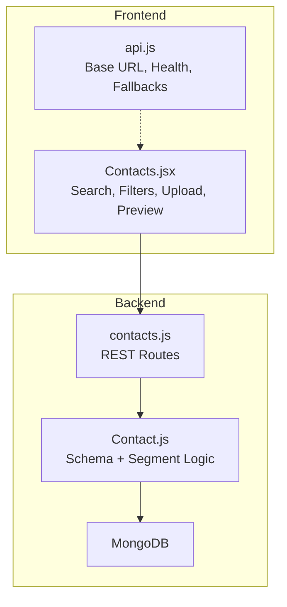
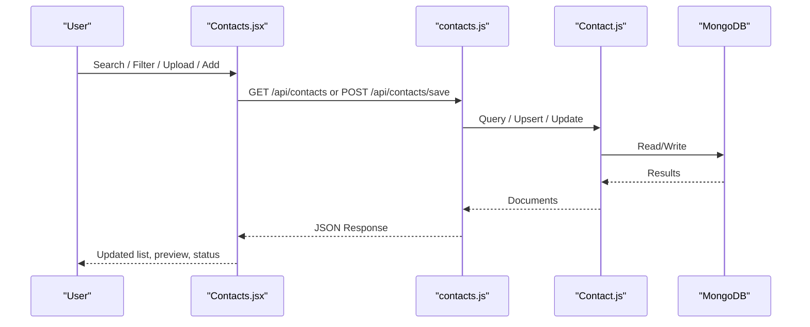
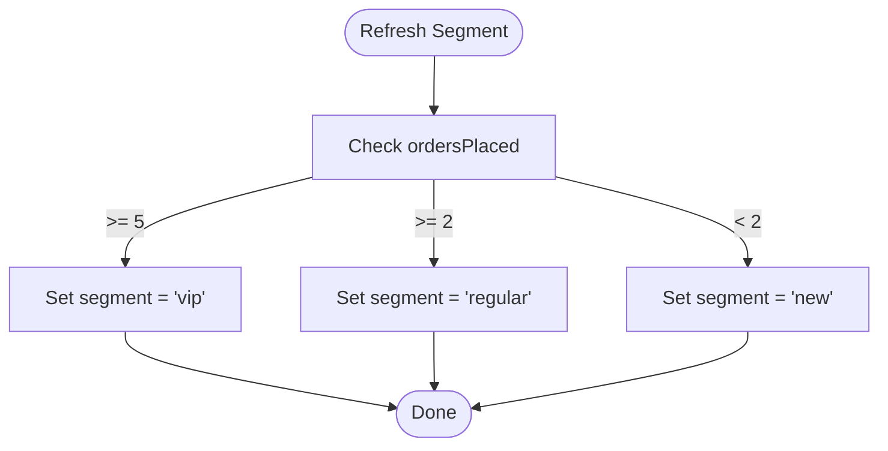
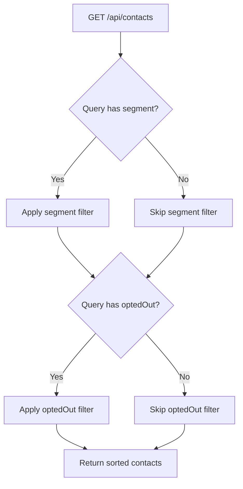
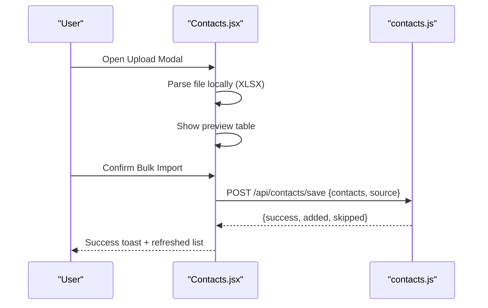
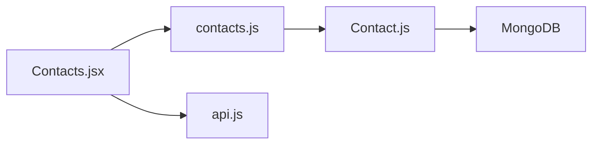

# Audience Targeting and Segmentation

<cite>
**Referenced Files in This Document**   
- [Contact.js](file://backend/models/Contact.js)
- [contacts.js](file://backend/routes/contacts.js)
- [Contacts.jsx](file://frontend/src/Dashboard/Contacts.jsx)
- [api.js](file://frontend/src/services/api.js)
</cite>

## Table of Contents
1. [Introduction](#introduction)
2. [Project Structure](#project-structure)
3. [Core Components](#core-components)
4. [Architecture Overview](#architecture-overview)
5. [Detailed Component Analysis](#detailed-component-analysis)
6. [Dependency Analysis](#dependency-analysis)
7. [Performance Considerations](#performance-considerations)
8. [Troubleshooting Guide](#troubleshooting-guide)
9. [Conclusion](#conclusion)

## Introduction
This document explains the audience targeting and segmentation system for WhatsApp campaign management. It covers how contacts are stored, filtered, segmented, and presented to users. It also documents static segments, dynamic rules, imported contact lists, frontend search and filtering, bulk selection tools, privacy compliance features such as opt-out handling, and performance considerations for large audiences.

The system uses a Node.js backend with MongoDB for contact storage and a React frontend for audience selection, search, and bulk operations.

## Project Structure
The relevant parts of the codebase include:
- Backend data model for contacts and segment computation
- Backend REST routes for contact CRUD, Excel import, messaging, segment refresh, and opt-in/opt-out
- Frontend contact management UI with search, identity filters, Excel upload, and preview
- API helper utilities for base URL resolution and optional GraphQL fallback

**Diagram sources**
- [Contacts.jsx:150-174](file://frontend/src/Dashboard/Contacts.jsx#L150-L174)
- [api.js:1-14](file://frontend/src/services/api.js#L1-L14)
- [contacts.js:1-10](file://backend/routes/contacts.js#L1-L10)
- [Contact.js:1-17](file://backend/models/Contact.js#L1-L17)

**Section sources**
- [Contact.js:1-26](file://backend/models/Contact.js#L1-L26)
- [contacts.js:1-232](file://backend/routes/contacts.js#L1-L232)
- [Contacts.jsx:1-1231](file://frontend/src/Dashboard/Contacts.jsx#L1-L1231)
- [api.js:1-73](file://frontend/src/services/api.js#L1-L73)

## Core Components
- Contact Model: Defines fields like phone, name, email, source, ordersPlaced, totalSpend, lastOrderAt, optedOut, segment, and identity. Includes a method to compute segment based on orders placed.
- Contacts Routes: Provide endpoints for creating, updating, deleting, listing, importing from Excel, sending messages, refreshing segments, and managing opt-in/opt-out.
- Frontend Contacts UI: Provides search by name/phone/email/identity, identity filter pills, pagination, add/edit modals, Excel upload with preview, and bulk import submission.

Key responsibilities:
- Data persistence and segment logic live in the backend model and routes.
- User interactions (search, filters, uploads, previews) live in the frontend component.
- API base URL resolution is centralized in the frontend service utility.

**Section sources**
- [Contact.js:3-24](file://backend/models/Contact.js#L3-L24)
- [contacts.js:13-230](file://backend/routes/contacts.js#L13-L230)
- [Contacts.jsx:33-174](file://frontend/src/Dashboard/Contacts.jsx#L33-L174)

## Architecture Overview
The audience targeting flow integrates frontend user actions with backend processing and database storage.

**Diagram sources**
- [Contacts.jsx:150-174](file://frontend/src/Dashboard/Contacts.jsx#L150-L174)
- [contacts.js:56-122](file://backend/routes/contacts.js#L56-L122)
- [Contact.js:3-24](file://backend/models/Contact.js#L3-L24)

## Detailed Component Analysis

### Contact Model and Dynamic Segmentation
The contact schema includes:
- Identifiers and profile fields: phone (unique), name, email
- Campaign-related fields: source, lastStatus, templatesSent, ordersPlaced, totalSpend, lastOrderAt
- Privacy and permissions: optedOut, optedOutAt
- Segmentation: segment (computed via refreshSegment)
- Custom attributes: identity (free-form tag used for audience grouping)

Dynamic rule:
- Segment is computed from ordersPlaced:
  - VIP if ordersPlaced >= 5
  - Regular if ordersPlaced >= 2
  - New otherwise

**Diagram sources**
- [Contact.js:19-24](file://backend/models/Contact.js#L19-L24)

**Section sources**
- [Contact.js:3-24](file://backend/models/Contact.js#L3-L24)

### Backend Routes: Filtering, Import, Messaging, Opt-Out
Endpoints relevant to audience targeting:
- GET /api/contacts: List contacts with optional query filters for segment and optedOut
- POST /api/contacts: Create or update a single contact (upsert by phone)
- POST /api/contacts/save: Bulk save contacts or phones
- POST /api/contacts/upload-excel: Parse uploaded Excel/CSV and return parsed rows
- PUT /api/contacts/:id: Update a contact
- DELETE /api/contacts/:id: Delete a contact
- POST /api/contacts/send-message: Send a direct WhatsApp message and log it
- POST /api/contacts/refresh-segments: Recompute segments across all contacts
- PUT /api/contacts/:id/opt-out: Mark a contact as opted out
- PUT /api/contacts/:id/opt-in: Re-enable a contact

Filtering behavior:
- The list endpoint supports filtering by segment and optedOut boolean via query parameters.
- Identity-based filtering is performed client-side in the frontend using the identity field.

Opt-out handling:
- Opt-out sets optedOut to true and records optedOutAt timestamp.
- Opt-in clears optedOut and removes optedOutAt.

**Diagram sources**
- [contacts.js:133-140](file://backend/routes/contacts.js#L133-L140)

**Section sources**
- [contacts.js:13-230](file://backend/routes/contacts.js#L13-L230)

### Frontend Audience Selector Interface
The Contacts page provides:
- Real-time search across name, phone, email, and identity
- Identity filter pills that dynamically include default categories and discovered identities
- Pagination for display efficiency
- Add/Edit modals with strict validation for Indian mobile numbers and email format
- Excel upload with flexible header detection, preview, and bulk import
- Direct links to WhatsApp chat and phone call per contact

Audience filtering:
- Client-side filtering applies both identity and search queries against loaded contacts.
- The UI computes available identities from existing contacts plus defaults.

Bulk selection tools:
- The interface supports bulk import via Excel/CSV with preview before committing to the database.
- While there is no explicit multi-select checkbox grid shown here, bulk import acts as a bulk selection tool for building audiences from external lists.

Real-time audience preview:
- The Excel upload modal shows a preview table of parsed contacts before import.

**Diagram sources**
- [Contacts.jsx:241-364](file://frontend/src/Dashboard/Contacts.jsx#L241-L364)
- [contacts.js:86-122](file://backend/routes/contacts.js#L86-L122)

**Section sources**
- [Contacts.jsx:33-174](file://frontend/src/Dashboard/Contacts.jsx#L33-L174)
- [Contacts.jsx:241-364](file://frontend/src/Dashboard/Contacts.jsx#L241-L364)
- [Contacts.jsx:438-482](file://frontend/src/Dashboard/Contacts.jsx#L438-L482)

### Examples of Creating Static Segments, Dynamic Rules, and Imported Lists

- Static segments:
  - Use the segment field on the contact model. The UI displays the current segment per contact card.
  - Administrators can recompute segments via the refresh-segments endpoint when underlying metrics change.

- Dynamic rules:
  - Segment is automatically computed based on ordersPlaced using the refreshSegment method.
  - Business logic can be extended by updating the method thresholds or adding new rules.

- Imported contact lists:
  - Use the Excel upload feature to parse and preview contacts, then submit them to the backend for upsert into the database.
  - The backend normalizes phone numbers and deduplicates by phone during import.

Operational references:
- Segment computation: [Contact.js:19-24](file://backend/models/Contact.js#L19-L24)
- Segment refresh endpoint: [contacts.js:208-218](file://backend/routes/contacts.js#L208-L218)
- Excel parsing and preview: [Contacts.jsx:241-364](file://frontend/src/Dashboard/Contacts.jsx#L241-L364)
- Bulk save endpoint: [contacts.js:86-122](file://backend/routes/contacts.js#L86-L122)

**Section sources**
- [Contact.js:19-24](file://backend/models/Contact.js#L19-L24)
- [contacts.js:86-122](file://backend/routes/contacts.js#L86-L122)
- [contacts.js:208-218](file://backend/routes/contacts.js#L208-L218)
- [Contacts.jsx:241-364](file://frontend/src/Dashboard/Contacts.jsx#L241-L364)

## Dependency Analysis
The following diagram maps key dependencies between components:

- Contacts.jsx depends on contacts.js for data operations and on api.js for base URL configuration.
- contacts.js depends on Contact.js for schema and methods.
- Contact.js defines the data contract and segment logic consumed by routes.

**Diagram sources**
- [Contacts.jsx:150-174](file://frontend/src/Dashboard/Contacts.jsx#L150-L174)
- [contacts.js:1-10](file://backend/routes/contacts.js#L1-L10)
- [Contact.js:1-17](file://backend/models/Contact.js#L1-L17)
- [api.js:1-14](file://frontend/src/services/api.js#L1-L14)

**Section sources**
- [contacts.js:1-10](file://backend/routes/contacts.js#L1-L10)
- [Contact.js:1-17](file://backend/models/Contact.js#L1-L17)
- [Contacts.jsx:150-174](file://frontend/src/Dashboard/Contacts.jsx#L150-L174)
- [api.js:1-14](file://frontend/src/services/api.js#L1-L14)

## Performance Considerations
- Large audience processing:
  - The list endpoint returns all matching contacts without server-side pagination; consider adding server-side pagination for very large datasets.
  - Client-side filtering and pagination are implemented in the frontend for display efficiency.

- Caching strategies:
  - No explicit caching layer is present. Consider introducing an in-memory cache or Redis for frequently accessed audience lists and identity filters.
  - Cache computed segments after running refresh-segments to avoid repeated computations.

- Query optimization:
  - Index frequently filtered fields such as segment, optedOut, and identity on the database side to speed up list queries.
  - Normalize phone numbers consistently at write time to reduce comparison overhead.

- Bulk operations:
  - The bulk save endpoint processes contacts sequentially; consider batching writes or using bulkWrite for higher throughput.

[No sources needed since this section provides general guidance]

## Troubleshooting Guide
Common issues and resolutions:
- Phone number validation errors:
  - The frontend enforces strict 10-digit Indian mobile numbers and strips country codes. Ensure inputs match expected formats.
  - Reference: [Contacts.jsx:177-219](file://frontend/src/Dashboard/Contacts.jsx#L177-L219)

- Email validation errors:
  - The frontend validates email format before submission. Correct invalid emails to proceed.
  - Reference: [Contacts.jsx:205-219](file://frontend/src/Dashboard/Contacts.jsx#L205-L219)

- Excel parsing failures:
  - Ensure the uploaded file contains recognized headers or enough columns for Name, Phone, Email, Identity.
  - The parser detects headers flexibly but requires at least some valid rows.
  - Reference: [Contacts.jsx:256-333](file://frontend/src/Dashboard/Contacts.jsx#L256-L333)

- Opt-out not applied:
  - Verify that the opt-out endpoint was called successfully and that the contact’s optedOut flag is set.
  - Reference: [contacts.js:220-224](file://backend/routes/contacts.js#L220-L224)

- Segment not updated:
  - After changing ordersPlaced or related metrics, run the refresh-segments endpoint to recompute segments.
  - Reference: [contacts.js:208-218](file://backend/routes/contacts.js#L208-L218)

**Section sources**
- [Contacts.jsx:177-219](file://frontend/src/Dashboard/Contacts.jsx#L177-L219)
- [Contacts.jsx:256-333](file://frontend/src/Dashboard/Contacts.jsx#L256-L333)
- [contacts.js:208-224](file://backend/routes/contacts.js#L208-L224)

## Conclusion
The audience targeting and segmentation system combines a robust backend data model with a flexible frontend interface. It supports static and dynamic segmentation, imported contact lists, and privacy-compliant opt-out handling. For production-scale usage, consider adding server-side pagination, indexing, caching, and batched writes to improve performance and scalability.

[No sources needed since this section summarizes without analyzing specific files]