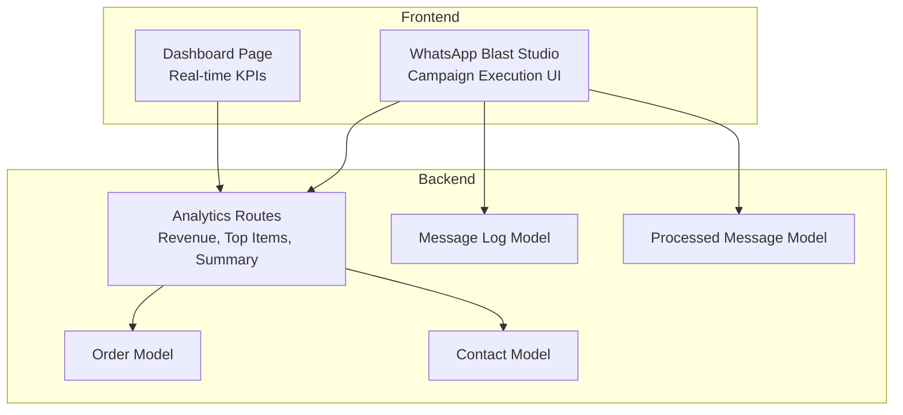
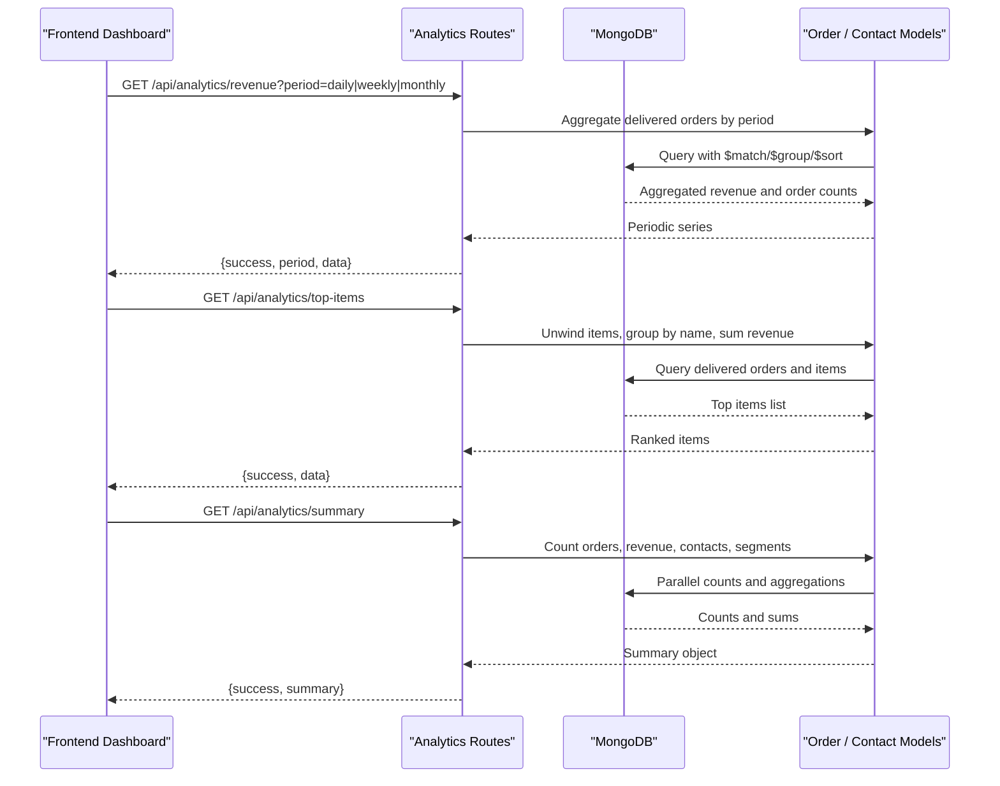
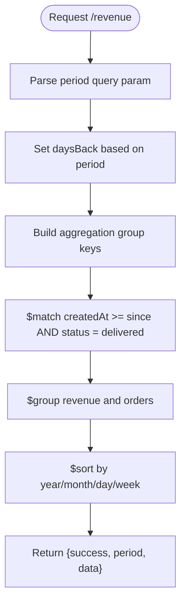
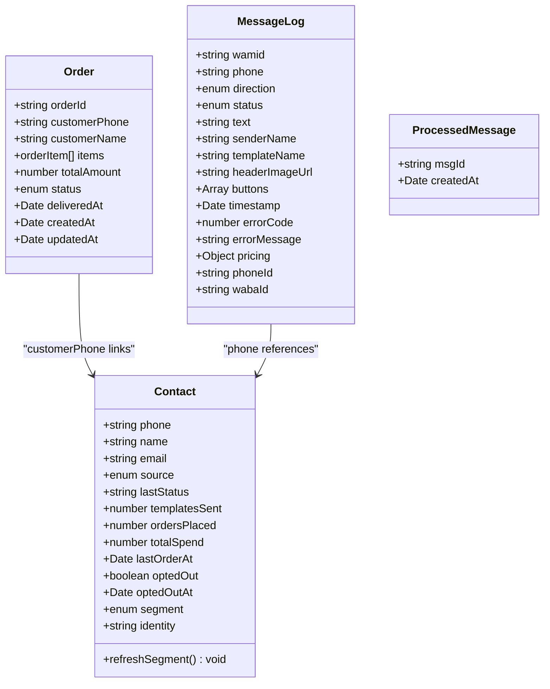
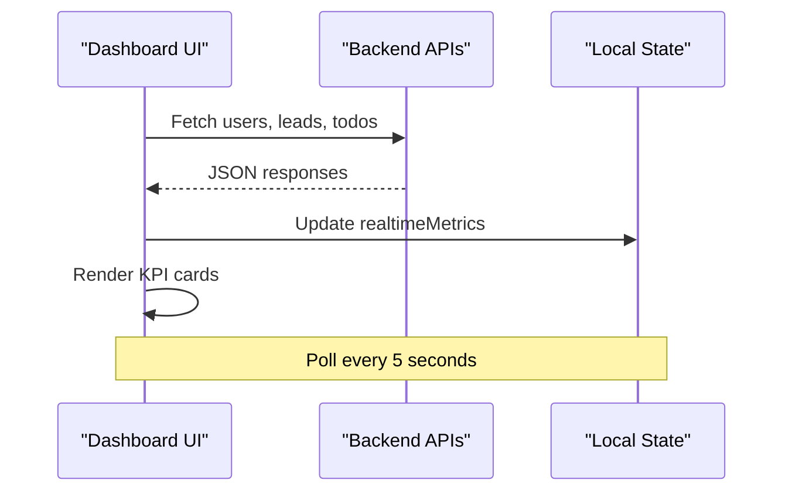
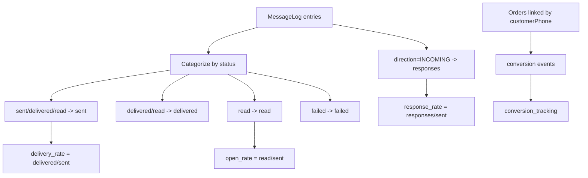
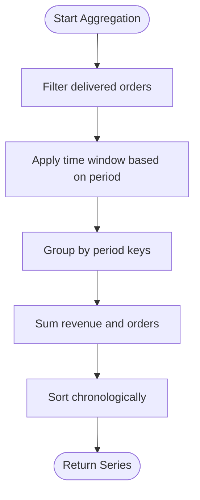
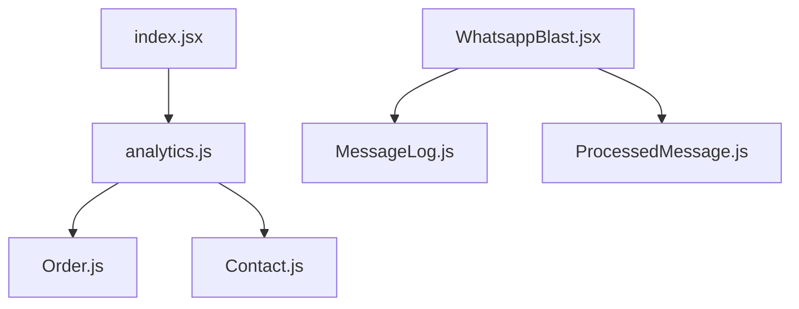

# Campaign Analytics and Reporting

<cite>
**Referenced Files in This Document**
- [analytics.js](file://backend/routes/analytics.js)
- [Order.js](file://backend/models/Order.js)
- [Contact.js](file://backend/models/Contact.js)
- [MessageLog.js](file://backend/models/MessageLog.js)
- [ProcessedMessage.js](file://backend/models/ProcessedMessage.js)
- [index.jsx](file://frontend/src/Dashboard/index.jsx)
- [WhatsappBlast.jsx](file://frontend/src/Dashboard/WhatsappBlast.jsx)
</cite>

## Table of Contents
1. [Introduction](#introduction)
2. [Project Structure](#project-structure)
3. [Core Components](#core-components)
4. [Architecture Overview](#architecture-overview)
5. [Detailed Component Analysis](#detailed-component-analysis)
6. [Dependency Analysis](#dependency-analysis)
7. [Performance Considerations](#performance-considerations)
8. [Troubleshooting Guide](#troubleshooting-guide)
9. [Conclusion](#conclusion)
10. [Appendices](#appendices)

## Introduction
This document explains the campaign analytics and reporting capabilities implemented in the project. It focuses on:
- Metrics collection for campaign performance, including delivery rates, open/read rates, response indicators, and conversion tracking via orders.
- The analytics data model and aggregation strategies used by the backend.
- Performance calculation algorithms for revenue, top items, and summary metrics.
- Frontend dashboard components that visualize campaign execution results and real-time system health.
- Examples of generating reports, exporting functionality, and custom metric definitions.
- A/B testing framework, statistical analysis tools, and performance benchmarking guidance.
- Data retention policies, historical analysis, and trend identification features.

The current implementation provides a solid foundation for WhatsApp blast campaigns and order-based analytics, with clear extension points for advanced measurement and experimentation.

## Project Structure
The analytics and reporting capability spans both backend and frontend layers:
- Backend routes expose analytics endpoints for revenue, top items, and summary metrics.
- Models define core entities such as Orders, Contacts, Message Logs, and processed message deduplication.
- Frontend dashboard pages provide real-time KPIs, WhatsApp blast orchestration, and result summaries.

**Diagram sources**
- [analytics.js:1-85](file://backend/routes/analytics.js#L1-L85)
- [Order.js:1-27](file://backend/models/Order.js#L1-L27)
- [Contact.js:1-26](file://backend/models/Contact.js#L1-L26)
- [MessageLog.js:1-22](file://backend/models/MessageLog.js#L1-L22)
- [ProcessedMessage.js:1-9](file://backend/models/ProcessedMessage.js#L1-L9)
- [index.jsx:185-250](file://frontend/src/Dashboard/index.jsx#L185-L250)
- [WhatsappBlast.jsx:67-151](file://frontend/src/Dashboard/WhatsappBlast.jsx#L67-L151)

**Section sources**
- [analytics.js:1-85](file://backend/routes/analytics.js#L1-L85)
- [Order.js:1-27](file://backend/models/Order.js#L1-L27)
- [Contact.js:1-26](file://backend/models/Contact.js#L1-L26)
- [MessageLog.js:1-22](file://backend/models/MessageLog.js#L1-L22)
- [ProcessedMessage.js:1-9](file://backend/models/ProcessedMessage.js#L1-L9)
- [index.jsx:185-250](file://frontend/src/Dashboard/index.jsx#L185-L250)
- [WhatsappBlast.jsx:67-151](file://frontend/src/Dashboard/WhatsappBlast.jsx#L67-L151)

## Core Components
- Analytics Routes: Provide aggregated metrics for revenue, top-selling items, and summary counts across time periods. Revenue is calculated only from delivered orders.
- Order Model: Defines order structure, status lifecycle, and timestamps used for time-based aggregations.
- Contact Model: Tracks contact attributes, segments, opt-out state, and derived segment logic based on order history.
- Message Log Model: Records outgoing/incoming messages, statuses (sent, delivered, read, failed), template metadata, and pricing.
- Processed Message Model: Deduplicates incoming/outgoing messages with TTL expiration to avoid reprocessing.
- Frontend Dashboard: Displays real-time KPIs and integrates with backend analytics endpoints.
- WhatsApp Blast Studio: Orchestrates campaign dispatch, shows success/failure results, and previews templates.

**Section sources**
- [analytics.js:6-85](file://backend/routes/analytics.js#L6-L85)
- [Order.js:12-25](file://backend/models/Order.js#L12-L25)
- [Contact.js:3-17](file://backend/models/Contact.js#L3-L17)
- [MessageLog.js:3-19](file://backend/models/MessageLog.js#L3-L19)
- [ProcessedMessage.js:3-6](file://backend/models/ProcessedMessage.js#L3-L6)
- [index.jsx:185-250](file://frontend/src/Dashboard/index.jsx#L185-L250)
- [WhatsappBlast.jsx:276-327](file://frontend/src/Dashboard/WhatsappBlast.jsx#L276-L327)

## Architecture Overview
The analytics pipeline collects raw events (orders, contacts, message logs), aggregates them using MongoDB pipelines, and exposes REST endpoints consumed by the frontend dashboard and blast studio.

**Diagram sources**
- [analytics.js:8-26](file://backend/routes/analytics.js#L8-L26)
- [analytics.js:28-38](file://backend/routes/analytics.js#L28-L38)
- [analytics.js:40-76](file://backend/routes/analytics.js#L40-L76)
- [Order.js:12-25](file://backend/models/Order.js#L12-L25)
- [Contact.js:3-17](file://backend/models/Contact.js#L3-L17)

## Detailed Component Analysis

### Analytics Endpoints and Aggregation Strategies
- Revenue Endpoint: Filters orders by status 'delivered' within a configurable lookback window, groups by year/month/day or week depending on the selected period, and sums totalAmount and order count. Sorting ensures chronological ordering.
- Top Items Endpoint: Unwinds nested items, filters by delivered status, groups by item name, and computes quantity, revenue, and order count; returns top 10 ranked by revenue.
- Summary Endpoint: Computes totals and time-bucketed counts for orders and revenue (delivered-only), plus contact counts segmented by opted-out state and predefined segments; also includes pending order counts.

**Diagram sources**
- [analytics.js:8-26](file://backend/routes/analytics.js#L8-L26)

**Section sources**
- [analytics.js:8-26](file://backend/routes/analytics.js#L8-L26)
- [analytics.js:28-38](file://backend/routes/analytics.js#L28-L38)
- [analytics.js:40-76](file://backend/routes/analytics.js#L40-L76)

### Data Model for Campaign Analytics
- Order: Captures customer identifiers, items, amounts, status transitions, and timestamps. Statuses include confirmed, preparing, out_for_delivery, delivered, cancelled. Timestamps enable time-series analytics.
- Contact: Stores phone, name, email, source, lastStatus, template usage counters, order-related fields (ordersPlaced, totalSpend, lastOrderAt), opt-out flags, and segment classification. Segment refresh method derives VIP/regular/new based on ordersPlaced thresholds.
- MessageLog: Records per-message metadata including wamid, phone, direction, status (sent/delivered/read/failed/received), text content, senderName, templateName, headerImageUrl, buttons array, timestamp, error details, pricing, and WABA/phone IDs.
- ProcessedMessage: Deduplicates messages by msgId with a TTL of 24 hours to prevent reprocessing.

**Diagram sources**
- [Order.js:12-25](file://backend/models/Order.js#L12-L25)
- [Contact.js:3-24](file://backend/models/Contact.js#L3-L24)
- [MessageLog.js:3-19](file://backend/models/MessageLog.js#L3-L19)
- [ProcessedMessage.js:3-6](file://backend/models/ProcessedMessage.js#L3-L6)

**Section sources**
- [Order.js:12-25](file://backend/models/Order.js#L12-L25)
- [Contact.js:3-24](file://backend/models/Contact.js#L3-L24)
- [MessageLog.js:3-19](file://backend/models/MessageLog.js#L3-L19)
- [ProcessedMessage.js:3-6](file://backend/models/ProcessedMessage.js#L3-L6)

### Frontend Dashboard Components for Visualization
- Real-time KPIs: The dashboard page fetches users, leads, and todos concurrently and displays live counts for total users, active leads, todo list, employees, and system health. It polls every 5 seconds to keep metrics fresh.
- WhatsApp Blast Studio: Provides template selection, recipient filtering (contacts vs leads), search and identity/stage filters, bulk selection, preview personalization, single test message sending, and batch blast execution. Results show successful and failed counts.

**Diagram sources**
- [index.jsx:185-250](file://frontend/src/Dashboard/index.jsx#L185-L250)

**Section sources**
- [index.jsx:185-250](file://frontend/src/Dashboard/index.jsx#L185-L250)
- [WhatsappBlast.jsx:67-151](file://frontend/src/Dashboard/WhatsappBlast.jsx#L67-L151)
- [WhatsappBlast.jsx:247-327](file://frontend/src/Dashboard/WhatsappBlast.jsx#L247-L327)
- [WhatsappBlast.jsx:671-691](file://frontend/src/Dashboard/WhatsappBlast.jsx#L671-L691)

### Metrics Collection for Campaign Performance
- Delivery Rates: Derived from MessageLog statuses. Sent/delivered/read counts can be computed by iterating logs and categorizing statuses.
- Open/Read Rates: Read status indicates opened messages; read/sent ratio yields open rate.
- Response Rates: Inbound messages (direction INCOMING) indicate responses; counting inbound logs per outbound campaign enables response rate calculation.
- Conversion Tracking: Orders linked to customerPhone allow mapping campaign recipients to conversions; delivered orders are used for revenue calculations.

**Diagram sources**
- [MessageLog.js:3-19](file://backend/models/MessageLog.js#L3-L19)
- [Order.js:12-25](file://backend/models/Order.js#L12-L25)

**Section sources**
- [MessageLog.js:3-19](file://backend/models/MessageLog.js#L3-L19)
- [Order.js:12-25](file://backend/models/Order.js#L12-L25)

### Aggregation Strategies and Performance Calculation Algorithms
- Revenue Aggregation: Uses MongoDB aggregation pipeline with $match for delivered orders within a time window, $group to sum revenue and count orders, and $sort for chronological output. Lookback windows vary by period (daily: 30 days, weekly: 90 days, monthly: 365 days).
- Top Items Aggregation: Unwinds nested items, matches delivered orders, groups by item name, sums quantity/revenue/orders, sorts descending by revenue, and limits to top 10.
- Summary Aggregation: Runs parallel queries for counts and revenue sums across today/week/month boundaries, plus contact segment counts and pending order counts.

**Diagram sources**
- [analytics.js:8-26](file://backend/routes/analytics.js#L8-L26)

**Section sources**
- [analytics.js:8-26](file://backend/routes/analytics.js#L8-L26)
- [analytics.js:28-38](file://backend/routes/analytics.js#L28-L38)
- [analytics.js:40-76](file://backend/routes/analytics.js#L40-L76)

### Report Generation, Export Functionality, and Custom Metric Definitions
- Report Generation: The analytics endpoints provide structured datasets suitable for report generation. For example, revenue series and top items lists can be exported into CSV or PDF formats by the frontend or a reporting service.
- Export Functionality: While no explicit export endpoint exists in the analyzed files, the returned JSON structures can be transformed client-side into downloadable formats.
- Custom Metric Definitions: Extend the analytics routes to compute additional metrics such as cost-per-delivery (using MessageLog.pricing), response latency (timestamp differences), and conversion funnel stages (template sent -> delivered -> read -> order placed).

[No sources needed since this section provides general guidance]

### A/B Testing Framework, Statistical Analysis Tools, and Performance Benchmarking
- A/B Testing Framework: Introduce variant labels on templates or campaigns, track outcomes per variant via MessageLog and Order associations, and compare conversion rates between variants.
- Statistical Analysis Tools: Implement hypothesis testing (e.g., chi-squared for categorical outcomes, t-tests for continuous metrics like revenue per recipient) to determine significance of differences between variants.
- Performance Benchmarking: Measure throughput of blast dispatches, webhook processing latency, and database query times; set SLOs for delivery rates and error rates.

[No sources needed since this section provides general guidance]

### Data Retention Policies, Historical Analysis, and Trend Identification
- Data Retention: ProcessedMessage uses TTL indexing to automatically expire records after 24 hours, preventing unbounded growth. MessageLog and Order documents persist indefinitely unless explicitly purged.
- Historical Analysis: Use the time-based aggregation patterns already implemented (daily/weekly/monthly) to analyze trends over extended periods.
- Trend Identification: Compute moving averages, growth rates, and anomaly detection on revenue and engagement metrics to identify significant changes.

**Section sources**
- [ProcessedMessage.js:3-6](file://backend/models/ProcessedMessage.js#L3-L6)
- [analytics.js:8-26](file://backend/routes/analytics.js#L8-L26)

## Dependency Analysis
The analytics module depends on Order and Contact models for business metrics and on MessageLog for campaign delivery insights. The frontend dashboard and blast studio depend on these backend endpoints to render visualizations and orchestrate campaigns.

**Diagram sources**
- [analytics.js:1-85](file://backend/routes/analytics.js#L1-L85)
- [Order.js:1-27](file://backend/models/Order.js#L1-L27)
- [Contact.js:1-26](file://backend/models/Contact.js#L1-L26)
- [MessageLog.js:1-22](file://backend/models/MessageLog.js#L1-L22)
- [ProcessedMessage.js:1-9](file://backend/models/ProcessedMessage.js#L1-L9)
- [index.jsx:185-250](file://frontend/src/Dashboard/index.jsx#L185-L250)
- [WhatsappBlast.jsx:67-151](file://frontend/src/Dashboard/WhatsappBlast.jsx#L67-L151)

**Section sources**
- [analytics.js:1-85](file://backend/routes/analytics.js#L1-L85)
- [Order.js:1-27](file://backend/models/Order.js#L1-L27)
- [Contact.js:1-26](file://backend/models/Contact.js#L1-L26)
- [MessageLog.js:1-22](file://backend/models/MessageLog.js#L1-L22)
- [ProcessedMessage.js:1-9](file://backend/models/ProcessedMessage.js#L1-L9)
- [index.jsx:185-250](file://frontend/src/Dashboard/index.jsx#L185-L250)
- [WhatsappBlast.jsx:67-151](file://frontend/src/Dashboard/WhatsappBlast.jsx#L67-L151)

## Performance Considerations
- Aggregation Efficiency: Ensure indexes on frequently filtered fields such as createdAt and status to optimize $match operations in aggregation pipelines.
- Parallel Queries: The summary endpoint uses parallel Promise.all calls to reduce latency; maintain similar patterns when adding new metrics.
- TTL Management: Leverage TTL on temporary collections like ProcessedMessage to control storage growth.
- Frontend Polling: Limit polling frequency to balance freshness and network overhead; consider WebSocket or Server-Sent Events for real-time updates if needed.

[No sources needed since this section provides general guidance]

## Troubleshooting Guide
- Missing or Incorrect Period Parameters: Validate period query parameters and ensure lookback windows align with expected data ranges.
- Empty Aggregation Results: Check whether orders have status 'delivered' and valid timestamps; verify date filters and timezone handling.
- Template and Recipient Issues: Confirm templates are approved and recipients are selected; validate sample values for personalization.
- Error Handling: Inspect HTTP responses and error messages from backend endpoints; log failures and surface user-friendly errors in the UI.

**Section sources**
- [analytics.js:8-26](file://backend/routes/analytics.js#L8-L26)
- [WhatsappBlast.jsx:276-327](file://frontend/src/Dashboard/WhatsappBlast.jsx#L276-L327)

## Conclusion
The project implements a robust foundation for campaign analytics and reporting through well-defined models, aggregation pipelines, and a responsive frontend dashboard. Revenue and top-item analytics focus on delivered orders, while message logs provide delivery and engagement signals. The WhatsApp Blast Studio enables campaign orchestration with clear result feedback. Extending the system with A/B testing, statistical analysis, and export capabilities will further enhance its analytical depth and usability.

[No sources needed since this section summarizes without analyzing specific files]

## Appendices

### Example: Generating a Campaign Report
- Retrieve revenue series for a chosen period using the analytics endpoint.
- Combine with top items and summary metrics to produce a comprehensive report.
- Export the resulting dataset to CSV or PDF using frontend utilities or a reporting service.

[No sources needed since this section provides general guidance]

### Example: Defining Custom Metrics
- Cost Per Delivery: Sum MessageLog.pricing for delivered messages and divide by delivered count.
- Response Latency: Calculate average time between outbound sent and inbound received timestamps.
- Conversion Funnel: Track progression from template sent to delivered to read to order placed.

[No sources needed since this section provides general guidance]