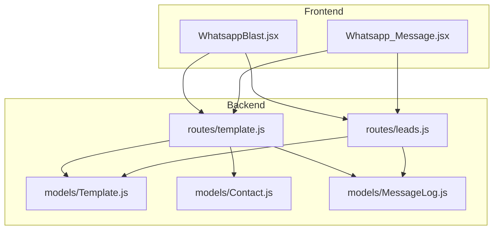
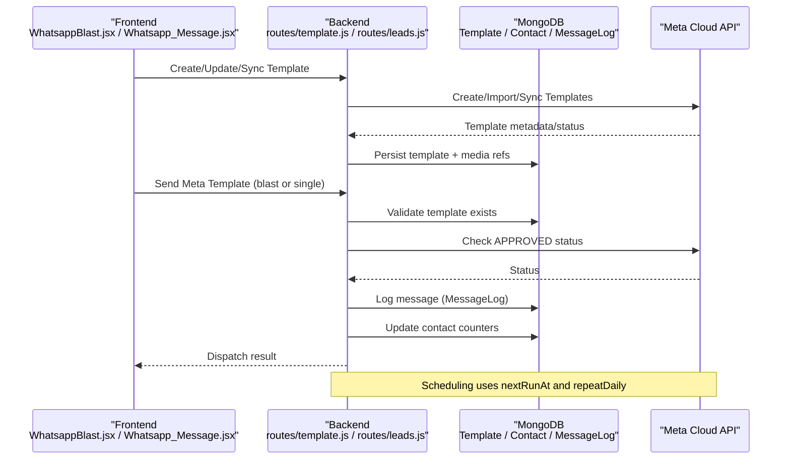
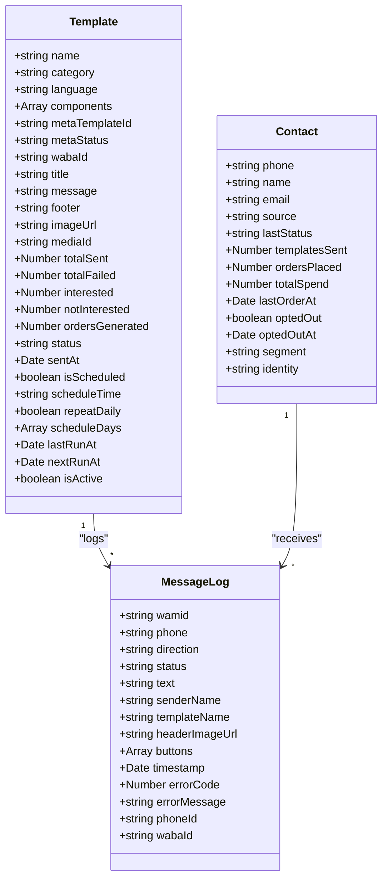
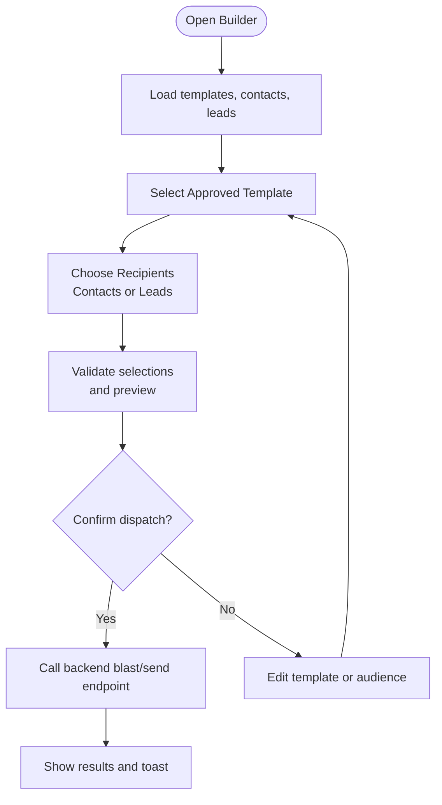
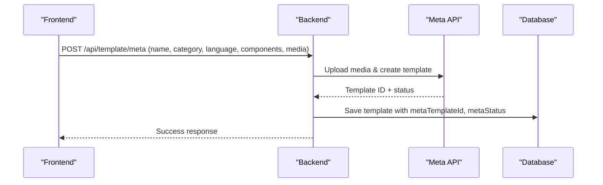
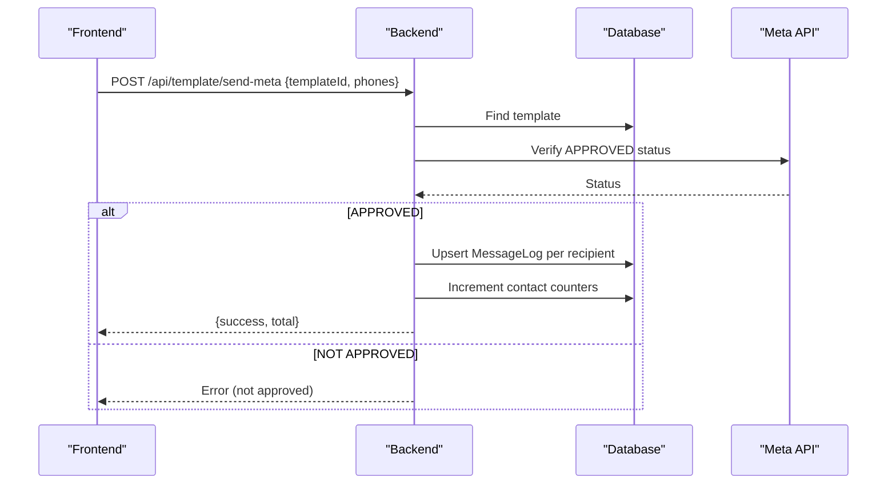
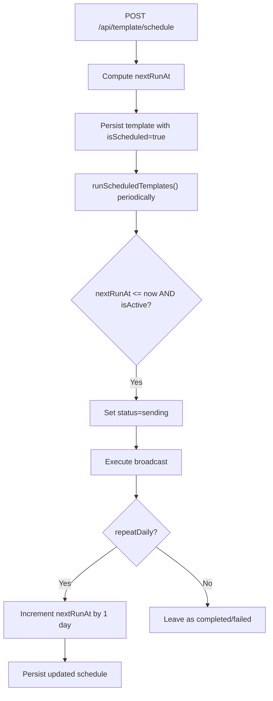
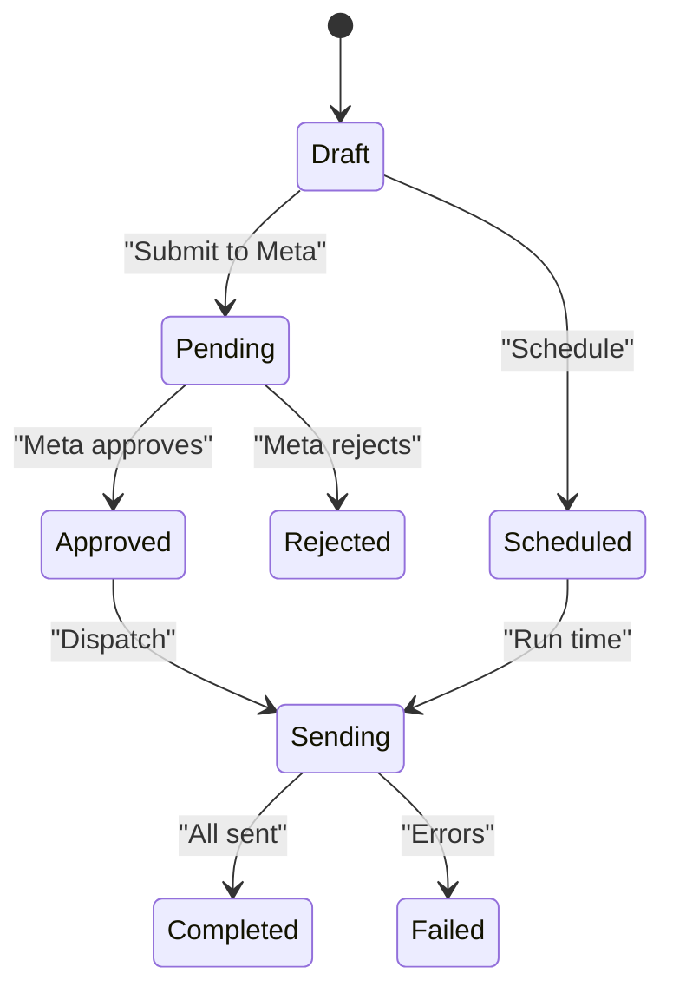
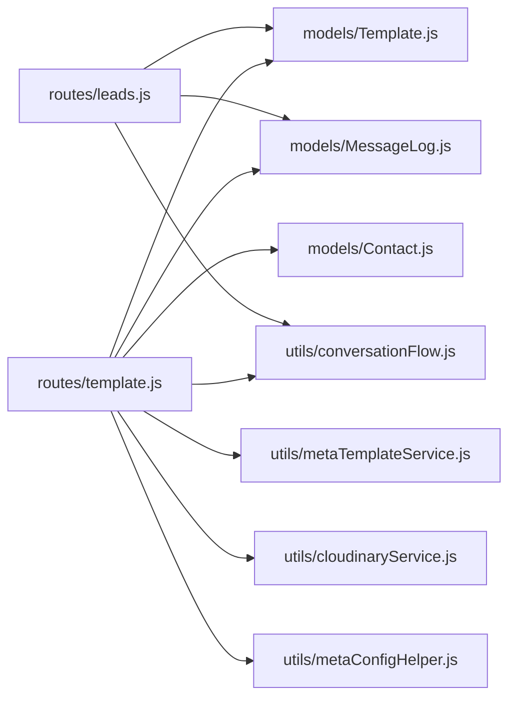

# Campaign Creation and Configuration

<cite>
**Referenced Files in This Document**
- [Template.js](file://backend/models/Template.js)
- [Contact.js](file://backend/models/Contact.js)
- [MessageLog.js](file://backend/models/MessageLog.js)
- [template.js](file://backend/routes/template.js)
- [leads.js](file://backend/route/leads.js)
- [WhatsappBlast.jsx](file://frontend/src/Dashboard/WhatsappBlast.jsx)
- [Whatsapp_Message.jsx](file://frontend/src/Dashboard/Whatsapp_Message.jsx)
</cite>

## Table of Contents
1. Introduction
2. Project Structure
3. Core Components
4. Architecture Overview
5. Detailed Component Analysis
6. Dependency Analysis
7. Performance Considerations
8. Troubleshooting Guide
9. Conclusion

## Introduction
This document explains the campaign creation and configuration system for WhatsApp messaging. It covers:
- The campaign data model (templates, contacts, message logs)
- Frontend campaign builder UI with template selection, audience targeting, and validation
- Backend API endpoints for creating, scheduling, syncing, and sending campaigns
- Business rules such as Meta approval checks, scheduling behavior, and status management
- Examples for blast messages, scheduled broadcasts, and automated sequences

## Project Structure
The system is split into a Node/Express backend and a React frontend:
- Backend models define templates, contacts, and message logs
- Backend routes implement template CRUD, Meta sync, scheduling, and broadcast flows
- Frontend provides two main interfaces:
  - Template Builder and Live Chat interface
  - Blast Studio for selecting approved templates and recipients to dispatch campaigns

**Diagram sources**
- [template.js:108-152](file://backend/routes/template.js#L108-L152)
- [template.js:154-215](file://backend/routes/template.js#L154-L215)
- [template.js:283-365](file://backend/routes/template.js#L283-L365)
- [template.js:413-529](file://backend/routes/template.js#L413-L529)
- [leads.js:159-227](file://backend/route/leads.js#L159-L227)
- [leads.js:229-256](file://backend/route/leads.js#L229-L256)
- [WhatsappBlast.jsx:67-147](file://frontend/src/Dashboard/WhatsappBlast.jsx#L67-L147)
- [Whatsapp_Message.jsx:376-408](file://frontend/src/Dashboard/Whatsapp_Message.jsx#L376-L408)

**Section sources**
- [template.js:1-28](file://backend/routes/template.js#L1-L28)
- [WhatsappBlast.jsx:1-46](file://frontend/src/Dashboard/WhatsappBlast.jsx#L1-L46)
- [Whatsapp_Message.jsx:93-186](file://frontend/src/Dashboard/Whatsapp_Message.jsx#L93-L186)

## Core Components
- Template model: stores campaign content, Meta metadata, scheduling fields, and stats
- Contact model: recipient identity, segmentation, opt-out flags
- MessageLog model: per-message delivery tracking and status
- Template routes: create/update/import/sync templates, schedule broadcasts, send meta templates
- Leads routes: single test message and batch blast endpoints
- Frontend builders: template editor and blast studio

Key responsibilities:
- Template model defines allowed categories, languages, components, statuses, and scheduling parameters
- Template routes enforce Meta approval before sending and manage scheduled runs
- Frontend validates inputs, previews templates, and targets contacts or leads

**Section sources**
- [Template.js:1-42](file://backend/models/Template.js#L1-L42)
- [Contact.js:1-26](file://backend/models/Contact.js#L1-L26)
- [MessageLog.js:1-22](file://backend/models/MessageLog.js#L1-L22)
- [template.js:108-152](file://backend/routes/template.js#L108-L152)
- [template.js:154-215](file://backend/routes/template.js#L154-L215)
- [template.js:283-365](file://backend/routes/template.js#L283-L365)
- [template.js:413-529](file://backend/routes/template.js#L413-L529)
- [leads.js:159-227](file://backend/route/leads.js#L159-L227)
- [leads.js:229-256](file://backend/route/leads.js#L229-L256)
- [WhatsappBlast.jsx:67-147](file://frontend/src/Dashboard/WhatsappBlast.jsx#L67-L147)
- [Whatsapp_Message.jsx:376-408](file://frontend/src/Dashboard/Whatsapp_Message.jsx#L376-L408)

## Architecture Overview
Campaigns are built from templates and sent to audiences via Meta’s WhatsApp Cloud API. The flow includes:
- Template creation and import/sync with Meta
- Audience selection (contacts or leads)
- Validation and approval checks
- Immediate blast or scheduled dispatch
- Delivery tracking through message logs

**Diagram sources**
- [template.js:108-152](file://backend/routes/template.js#L108-L152)
- [template.js:283-365](file://backend/routes/template.js#L283-L365)
- [template.js:413-529](file://backend/routes/template.js#L413-L529)
- [leads.js:159-227](file://backend/route/leads.js#L159-L227)
- [leads.js:229-256](file://backend/route/leads.js#L229-L256)

## Detailed Component Analysis

### Campaign Data Model
The Template model centralizes campaign content and scheduling:
- Meta-specific fields: name, category, language, components, metaTemplateId, metaStatus, wabaId
- Legacy fields: title, message, footer, imageUrl, mediaId
- Stats: totalSent, totalFailed, interested, notInterested, ordersGenerated
- Scheduling: isScheduled, scheduleTime, repeatDaily, scheduleDays, lastRunAt, nextRunAt, isActive
- Status enum: draft, sending, completed, failed, scheduled

Contact model tracks recipients:
- phone (unique), name, email, source, lastStatus, optedOut/optedOutAt
- segment derived from ordersPlaced, plus identity field used for filtering

MessageLog model records per-message lifecycle:
- wamid, phone, direction, status, text, templateName, headerImageUrl, buttons, timestamp, errorCode, errorMessage, phoneId, wabaId

**Diagram sources**
- [Template.js:1-42](file://backend/models/Template.js#L1-L42)
- [Contact.js:1-26](file://backend/models/Contact.js#L1-L26)
- [MessageLog.js:1-22](file://backend/models/MessageLog.js#L1-L22)

**Section sources**
- [Template.js:1-42](file://backend/models/Template.js#L1-L42)
- [Contact.js:1-26](file://backend/models/Contact.js#L1-L26)
- [MessageLog.js:1-22](file://backend/models/MessageLog.js#L1-L22)

### Frontend Campaign Builder Interface
Two primary interfaces:
- Template Builder and Live Chat (Whatsapp_Message.jsx):
  - Create/edit templates with header type (none/text/image), body text, footer, and buttons
  - Build Meta components array and submit to backend
  - Sync templates from Meta and update local status
  - Live chat view with real-time WebSocket updates and message logs
- Blast Studio (WhatsappBlast.jsx):
  - Select an approved template
  - Choose recipients from Contacts or Leads
  - Filter by identity/stage and search
  - Preview personalized message and trigger blast

Validation and UX:
- Name normalization and required fields
- Image upload validation (type and size)
- Confirmation modal before dispatch
- Toast notifications for success/error
- Real-time preview of variables and buttons

**Diagram sources**
- [WhatsappBlast.jsx:67-147](file://frontend/src/Dashboard/WhatsappBlast.jsx#L67-L147)
- [WhatsappBlast.jsx:247-327](file://frontend/src/Dashboard/WhatsappBlast.jsx#L247-L327)
- [Whatsapp_Message.jsx:735-785](file://frontend/src/Dashboard/Whatsapp_Message.jsx#L735-L785)
- [Whatsapp_Message.jsx:787-800](file://frontend/src/Dashboard/Whatsapp_Message.jsx#L787-L800)

**Section sources**
- [WhatsappBlast.jsx:67-147](file://frontend/src/Dashboard/WhatsappBlast.jsx#L67-L147)
- [WhatsappBlast.jsx:247-327](file://frontend/src/Dashboard/WhatsappBlast.jsx#L247-L327)
- [Whatsapp_Message.jsx:735-785](file://frontend/src/Dashboard/Whatsapp_Message.jsx#L735-L785)
- [Whatsapp_Message.jsx:787-800](file://frontend/src/Dashboard/Whatsapp_Message.jsx#L787-L800)

### Backend API Endpoints and Business Logic

#### Template Management
- POST /api/template/meta
  - Creates a template on Meta, uploads media, builds components, persists locally with metaTemplateId and metaStatus
  - Validates required fields; handles media upload and component sanitization
- POST /api/template/import-meta
  - Imports an existing Meta template into the database
- POST /api/template/sync-meta (alias /api/template/sync)
  - Syncs all Meta templates, deduplicates, auto-hosts images to Cloudinary, filters by WABA
- GET /api/template
  - Lists templates excluding scheduled ones, filtered by current WABA if present
- PUT /api/template/:id
  - Updates template fields and optional media; supports both legacy and Meta fields
- DELETE /api/template/:id
  - Deletes a template

**Diagram sources**
- [template.js:283-365](file://backend/routes/template.js#L283-L365)

**Section sources**
- [template.js:283-365](file://backend/routes/template.js#L283-L365)
- [template.js:368-409](file://backend/routes/template.js#L368-L409)
- [template.js:413-529](file://backend/routes/template.js#L413-L529)
- [template.js:226-269](file://backend/routes/template.js#L226-L269)
- [template.js:217-224](file://backend/routes/template.js#L217-L224)

#### Sending and Broadcasting
- POST /api/template/send-meta
  - Validates template existence and Meta APPROVED status before sending
  - Accepts phones list or defaults to opted-out=false contacts
  - Runs async broadcast, updates counts and status
- POST /api/leads/send-single-whatsapp
  - Sends a single test message using a template by name or default
- POST /api/leads/whatsapp-blast
  - Batch dispatch using template_name and lead_ids/phones

**Diagram sources**
- [template.js:108-152](file://backend/routes/template.js#L108-L152)
- [leads.js:159-227](file://backend/route/leads.js#L159-L227)
- [leads.js:229-256](file://backend/route/leads.js#L229-L256)

**Section sources**
- [template.js:108-152](file://backend/routes/template.js#L108-L152)
- [leads.js:159-227](file://backend/route/leads.js#L159-L227)
- [leads.js:229-256](file://backend/route/leads.js#L229-L256)

#### Scheduling and Automation
- POST /api/template/schedule
  - Accepts image, scheduleTime, repeatDaily, scheduleDays
  - Computes nextRunAt and saves template with isScheduled=true
- GET /api/template/schedules
  - Lists scheduled templates
- PUT /api/template/schedule/:id/toggle
  - Toggles isActive
- DELETE /api/template/schedule/:id
  - Removes scheduled entry
- runScheduledTemplates (exported)
  - Finds due scheduled templates, sets status to sending, executes broadcast, and reschedules if repeatDaily

**Diagram sources**
- [template.js:154-197](file://backend/routes/template.js#L154-L197)
- [template.js:199-215](file://backend/routes/template.js#L199-L215)
- [template.js:625-643](file://backend/routes/template.js#L625-L643)

**Section sources**
- [template.js:154-197](file://backend/routes/template.js#L154-L197)
- [template.js:199-215](file://backend/routes/template.js#L199-L215)
- [template.js:625-643](file://backend/routes/template.js#L625-L643)

### Campaign Types and Examples
- Blast messages:
  - Use POST /api/template/send-meta with templateId and phones
  - Or use POST /api/leads/whatsapp-blast with template_name and lead_ids/phones
- Scheduled broadcasts:
  - Use POST /api/template/schedule with scheduleTime, repeatDaily, scheduleDays
  - System runs due schedules and updates status accordingly
- Automated sequences:
  - Leverage repeatDaily and scheduleDays to automate recurring sends
  - Monitor status transitions: scheduled -> sending -> completed/failed

**Section sources**
- [template.js:108-152](file://backend/routes/template.js#L108-L152)
- [template.js:154-197](file://backend/routes/template.js#L154-L197)
- [template.js:625-643](file://backend/routes/template.js#L625-L643)
- [leads.js:159-227](file://backend/route/leads.js#L159-L227)
- [leads.js:229-256](file://backend/route/leads.js#L229-L256)

### Status Management, Draft Workflows, and Approvals
- Template statuses:
  - Local status: draft, sending, completed, failed, scheduled
  - Meta status: PENDING, APPROVED, REJECTED, DRAFT
- Approval enforcement:
  - Before sending, backend verifies Meta APPROVED status
  - If not approved, request fails with descriptive error
- Draft workflow:
  - New templates created via /api/template/meta start as draft with metaStatus reflecting Meta state
  - Import/sync operations persist templates as drafts until approved

**Diagram sources**
- [Template.js:27-39](file://backend/models/Template.js#L27-L39)
- [template.js:108-152](file://backend/routes/template.js#L108-L152)
- [template.js:283-365](file://backend/routes/template.js#L283-L365)

**Section sources**
- [Template.js:27-39](file://backend/models/Template.js#L27-L39)
- [template.js:108-152](file://backend/routes/template.js#L108-L152)
- [template.js:283-365](file://backend/routes/template.js#L283-L365)

### Validation Rules and Dependency Checking
- Template creation:
  - Required fields: name, category, language, components
  - Media handling: optional file upload; header IMAGE requires valid handle
- Sending:
  - Must have a valid metaTemplateId
  - Must be APPROVED on Meta at send time
- Scheduling:
  - scheduleTime required (HH:MM)
  - nextRunAt computed; repeatDaily toggles daily recurrence
- Audience:
  - Phone list can be provided or defaults to opted-out=false contacts
  - Single test requires a valid 10-digit phone number

**Section sources**
- [template.js:283-365](file://backend/routes/template.js#L283-L365)
- [template.js:108-152](file://backend/routes/template.js#L108-L152)
- [template.js:154-197](file://backend/routes/template.js#L154-L197)
- [leads.js:159-227](file://backend/route/leads.js#L159-L227)

### Error Handling During Creation
- Missing required fields return 400 with descriptive messages
- Invalid Meta Template ID or inaccessible template returns 400
- Sync failures return 500 with error details
- File upload errors are logged and handled gracefully

**Section sources**
- [template.js:283-365](file://backend/routes/template.js#L283-L365)
- [template.js:413-529](file://backend/routes/template.js#L413-L529)

## Dependency Analysis
The following diagram shows key dependencies between routes, models, and external services:

**Diagram sources**
- [template.js:1-11](file://backend/routes/template.js#L1-L11)
- [leads.js:159-227](file://backend/route/leads.js#L159-L227)

**Section sources**
- [template.js:1-11](file://backend/routes/template.js#L1-L11)
- [leads.js:159-227](file://backend/route/leads.js#L159-L227)

## Performance Considerations
- Broadcast delays:
  - Meta broadcast uses jittered delays to avoid rate limits
- Asynchronous dispatch:
  - Sending is initiated immediately; background processing updates status and logs
- Scheduling:
  - Only active and due templates are processed; repeatDaily adjusts nextRunAt
- Media handling:
  - Cloudinary uploads may add latency; fallbacks exist for local paths

[No sources needed since this section provides general guidance]

## Troubleshooting Guide
Common issues and resolutions:
- Template not found:
  - Ensure templateId or metaTemplateId exists; verify sync/import steps
- Template not approved:
  - Check Meta status; do not send until APPROVED
- No contacts to send:
  - Provide explicit phone list or ensure contacts are opted-in
- Schedule not running:
  - Verify isActive and nextRunAt; confirm scheduler invocation
- Media upload failures:
  - Check Cloudinary configuration and file constraints

**Section sources**
- [template.js:108-152](file://backend/routes/template.js#L108-L152)
- [template.js:154-197](file://backend/routes/template.js#L154-L197)
- [template.js:283-365](file://backend/routes/template.js#L283-L365)

## Conclusion
The campaign system integrates template authoring, Meta approvals, audience targeting, and scheduling into a cohesive workflow. Frontend builders provide intuitive controls for template creation and blast dispatch, while backend routes enforce business rules and integrate with Meta’s APIs. Proper validation, status management, and scheduling enable reliable automation for blasts and recurring campaigns.

[No sources needed since this section summarizes without analyzing specific files]