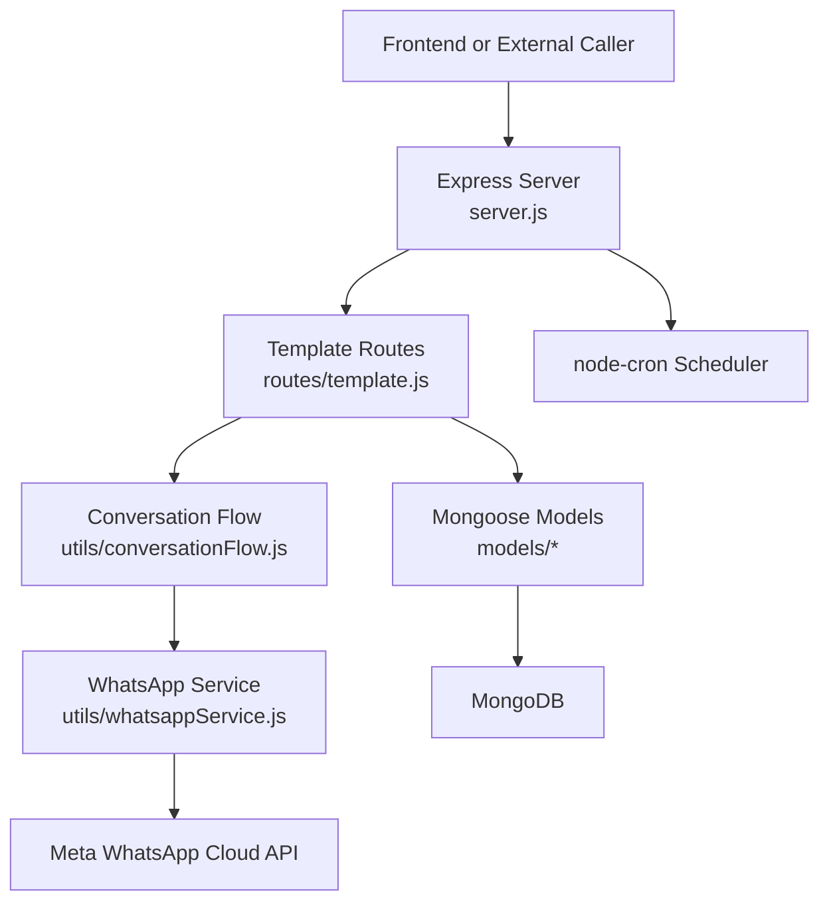
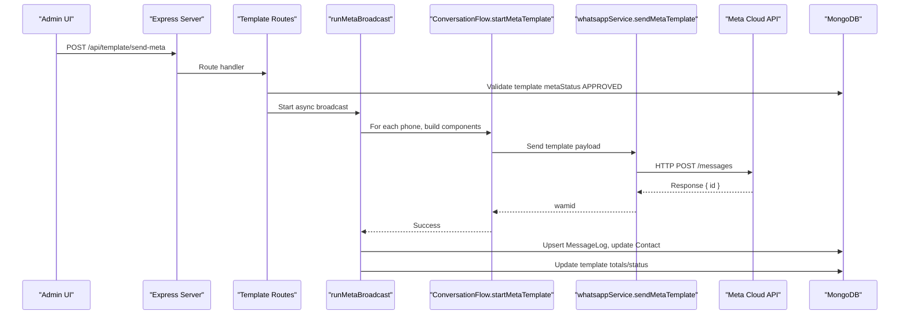
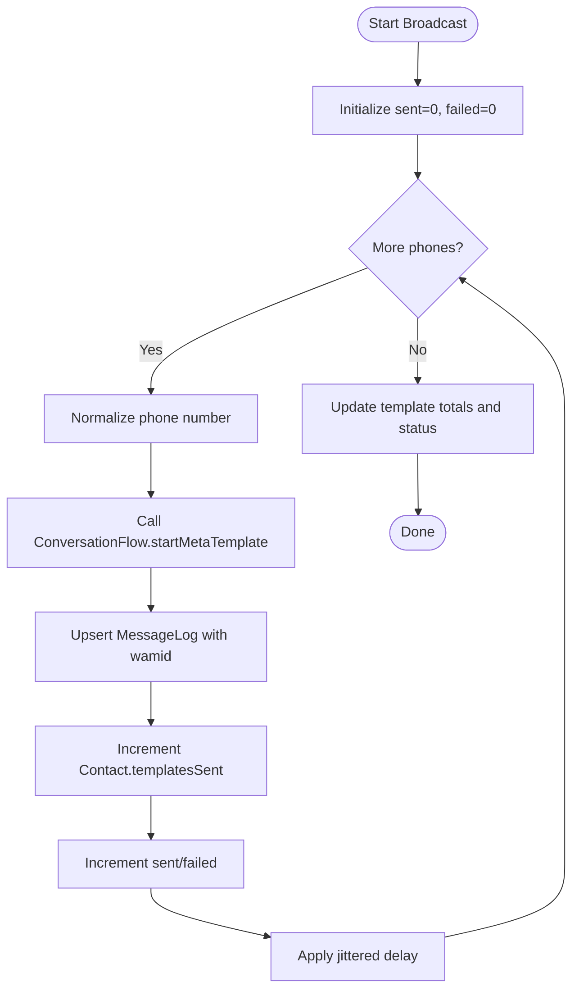
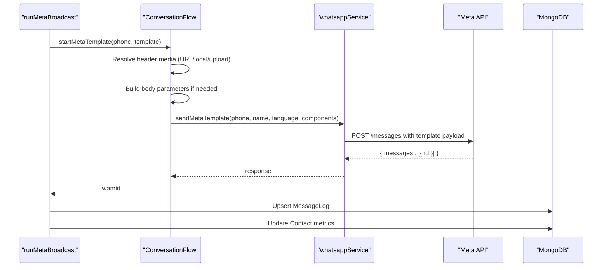
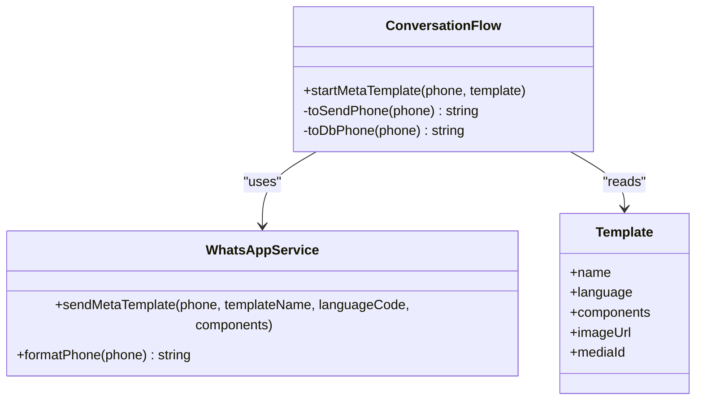
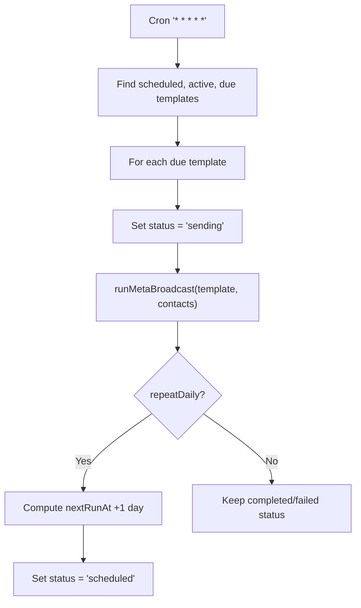
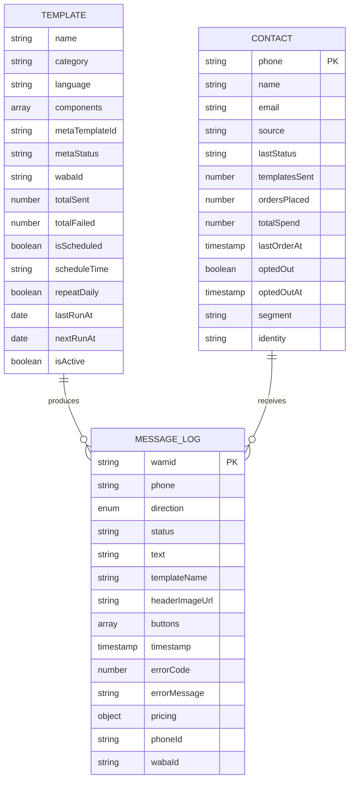
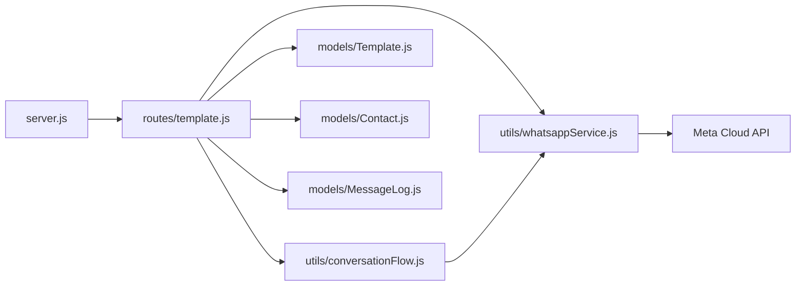

# Campaign Execution Engine

<cite>
**Referenced Files in This Document**
- [server.js](file://backend/server.js)
- [template.js](file://backend/routes/template.js)
- [conversationFlow.js](file://backend/utils/conversationFlow.js)
- [whatsappService.js](file://backend/utils/whatsappService.js)
- [Template.js](file://backend/models/Template.js)
- [MessageLog.js](file://backend/models/MessageLog.js)
- [Contact.js](file://backend/models/Contact.js)
- [ProcessedMessage.js](file://backend/models/ProcessedMessage.js)
</cite>

## Table of Contents
1. [Introduction](#introduction)
2. [Project Structure](#project-structure)
3. [Core Components](#core-components)
4. [Architecture Overview](#architecture-overview)
5. [Detailed Component Analysis](#detailed-component-analysis)
6. [Dependency Analysis](#dependency-analysis)
7. [Performance Considerations](#performance-considerations)
8. [Troubleshooting Guide](#troubleshooting-guide)
9. [Conclusion](#conclusion)

## Introduction
This document explains the campaign execution engine for WhatsApp-based automated campaigns. It covers:
- Message queuing and batch processing architecture
- Delivery pipeline to Meta’s WhatsApp Cloud API
- Conversation flow engine for template-driven messaging
- Scheduling system with cron integration and execution monitoring
- Error recovery, retry behavior, pause/resume controls
- Progress tracking and analytics collection
- Performance scaling strategies and resource management

The engine is implemented as a Node.js Express backend that orchestrates templates, contacts, scheduled jobs, message logs, and Meta API integrations.

## Project Structure
The campaign execution engine lives primarily in the backend:
- Server bootstrap and cron scheduler
- Template routes for creation, scheduling, broadcasting, and status management
- Conversation flow utility for building and sending Meta templates
- WhatsApp service for Meta API calls
- Data models for templates, contacts, message logs, and processed messages

**Diagram sources**
- [server.js:1-82](file://backend/server.js#L1-L82)
- [template.js:318-391](file://backend/routes/template.js#L318-L391)
- [conversationFlow.js:20-118](file://backend/utils/conversationFlow.js#L20-L118)
- [whatsappService.js:194-215](file://backend/utils/whatsappService.js#L194-L215)
- [Template.js:1-70](file://backend/models/Template.js#L1-L70)
- [MessageLog.js:1-22](file://backend/models/MessageLog.js#L1-L22)
- [Contact.js:1-26](file://backend/models/Contact.js#L1-L26)

**Section sources**
- [server.js:1-82](file://backend/server.js#L1-L82)
- [template.js:1-1044](file://backend/routes/template.js#L1-L1044)

## Core Components
- Server bootstrap and WebSockets: initializes Express, HTTP server, Socket.io, CORS, static uploads, routes, error handler, MongoDB connection, and cron scheduler.
- Template routes: handle template lifecycle (create, update, recreate on Meta), scheduling, broadcast dispatch, schedule toggling, deletion, and stats.
- Conversation flow: prepares header/body components, resolves media, and sends approved Meta templates to contacts.
- WhatsApp service: formats phone numbers, builds payloads, and calls Meta Graph API endpoints for text, media, buttons, lists, polls, and templates.
- Data models:
  - Template: stores template metadata, Meta fields, scheduling flags, run counters, and activity state.
  - MessageLog: tracks outgoing/incoming messages, statuses, errors, pricing, and identifiers.
  - Contact: stores contact details, opt-out state, segment, and campaign metrics.
  - ProcessedMessage: deduplication helper with TTL.

**Section sources**
- [server.js:1-82](file://backend/server.js#L1-L82)
- [template.js:318-391](file://backend/routes/template.js#L318-L391)
- [conversationFlow.js:1-122](file://backend/utils/conversationFlow.js#L1-L122)
- [whatsappService.js:1-228](file://backend/utils/whatsappService.js#L1-L228)
- [Template.js:1-70](file://backend/models/Template.js#L1-L70)
- [MessageLog.js:1-22](file://backend/models/MessageLog.js#L1-L22)
- [Contact.js:1-26](file://backend/models/Contact.js#L1-L26)
- [ProcessedMessage.js:1-8](file://backend/models/ProcessedMessage.js#L1-L8)

## Architecture Overview
The campaign execution engine follows a request-driven architecture with an internal cron job scanning for due scheduled templates. There is no external queueing system; batching occurs in-process within the broadcast runner.

**Diagram sources**
- [template.js:395-441](file://backend/routes/template.js#L395-L441)
- [template.js:318-391](file://backend/routes/template.js#L318-L391)
- [conversationFlow.js:20-118](file://backend/utils/conversationFlow.js#L20-L118)
- [whatsappService.js:194-215](file://backend/utils/whatsappService.js#L194-L215)
- [MessageLog.js:1-22](file://backend/models/MessageLog.js#L1-L22)
- [Contact.js:1-26](file://backend/models/Contact.js#L1-L26)

## Detailed Component Analysis

### Message Queuing System
There is no dedicated message queue implementation. The engine uses:
- In-process asynchronous execution via `runMetaBroadcast` invoked from route handlers.
- A simple in-memory loop over a phone list with per-message delays.
- Optional deduplication model `ProcessedMessage` with TTL for short-term idempotency.

Implications:
- No persistent queue means restarts do not recover in-flight batches.
- Concurrency is limited by the single process loop; there are no worker pools or queues.
- Deduplication can be extended by checking `ProcessedMessage` before sending.

**Section sources**
- [template.js:318-391](file://backend/routes/template.js#L318-L391)
- [ProcessedMessage.js:1-8](file://backend/models/ProcessedMessage.js#L1-L8)

### Batch Processing Architecture
Batch processing is implemented as a sequential loop:
- Iterates through the phone list.
- Sends one template at a time.
- Applies jittered delay between messages to avoid rate limits.
- Updates message logs and contact metrics after each send.
- Aggregates sent/failed counts and updates template status.

**Diagram sources**
- [template.js:318-391](file://backend/routes/template.js#L318-L391)

**Section sources**
- [template.js:318-391](file://backend/routes/template.js#L318-L391)

### Delivery Pipeline
The delivery pipeline transforms a stored template into a Meta template payload:
- Conversation flow resolves header media (URL, local file, or uploaded Media ID).
- Body parameters are injected when variables like `{{1}}` exist.
- WhatsApp service formats the phone and posts the template payload to Meta.
- On success, the engine records the message log and increments contact counters.

**Diagram sources**
- [conversationFlow.js:20-118](file://backend/utils/conversationFlow.js#L20-L118)
- [whatsappService.js:194-215](file://backend/utils/whatsappService.js#L194-L215)
- [template.js:318-391](file://backend/routes/template.js#L318-L391)

**Section sources**
- [conversationFlow.js:1-122](file://backend/utils/conversationFlow.js#L1-L122)
- [whatsappService.js:1-228](file://backend/utils/whatsappService.js#L1-L228)
- [template.js:318-391](file://backend/routes/template.js#L318-L391)

### Conversation Flow Engine
The conversation flow engine focuses on template-driven messaging:
- Normalizes phone numbers to 10-digit format.
- Skips opted-out contacts.
- Resolves header media:
  - Uses existing Meta Media ID if present.
  - Uploads local files to Meta to obtain a Media ID.
  - Falls back to public URL or default image link if necessary.
- Injects body parameters for variable placeholders.
- Delegates actual sending to the WhatsApp service.

State management and conditional logic:
- Opt-out check prevents sending to opted-out contacts.
- Header type/format determines whether to include media parameters.
- Variable detection triggers parameter injection.

Response handling:
- Errors during sending are logged and rethrown to the caller.
- Successful sends return the Meta response containing message IDs.

**Diagram sources**
- [conversationFlow.js:1-122](file://backend/utils/conversationFlow.js#L1-L122)
- [whatsappService.js:194-215](file://backend/utils/whatsappService.js#L194-L215)
- [Template.js:1-70](file://backend/models/Template.js#L1-L70)

**Section sources**
- [conversationFlow.js:1-122](file://backend/utils/conversationFlow.js#L1-L122)

### Scheduling System
Scheduling is implemented using `node-cron`:
- Every minute, the scheduler queries templates marked as scheduled and active with a next run time in the past.
- Each due template transitions to `sending`, then runs the broadcast asynchronously.
- If repeat daily is enabled, it schedules the next day’s run and resets status to `scheduled`.

Pause/resume functionality:
- Templates have an `isActive` flag toggled via `/schedule/:id/toggle`.
- Only active scheduled templates are picked up by the scheduler.

Execution monitoring:
- Template fields track `lastRunAt`, `nextRunAt`, `totalSent`, `totalFailed`, and `status`.
- Message logs provide granular per-message status and error information.

**Diagram sources**
- [server.js:64-77](file://backend/server.js#L64-L77)
- [template.js:625-641](file://backend/routes/template.js#L625-L641)
- [template.js:493-499](file://backend/routes/template.js#L493-L499)
- [Template.js:48-67](file://backend/models/Template.js#L48-L67)

**Section sources**
- [server.js:64-77](file://backend/server.js#L64-L77)
- [template.js:443-499](file://backend/routes/template.js#L443-L499)
- [template.js:625-641](file://backend/routes/template.js#L625-L641)
- [Template.js:48-67](file://backend/models/Template.js#L48-L67)

### Error Recovery and Retry Logic
Current behavior:
- Per-message failures increment a failure counter but continue processing subsequent recipients.
- Errors are logged with context (index, phone, error message).
- Template final status becomes `completed` if any messages succeeded, otherwise `failed`.
- No automatic retry mechanism is implemented in the current code.

Recommended enhancements:
- Implement exponential backoff retries for transient Meta API errors.
- Track retry attempts in `MessageLog` and set thresholds for permanent failures.
- Introduce a dead-letter queue for unrecoverable messages.

**Section sources**
- [template.js:318-391](file://backend/routes/template.js#L318-L391)

### Pause/Resume Functionality
- Toggle endpoint `/schedule/:id/toggle` flips `isActive`.
- Scheduler only processes templates where `isActive` is true.
- This provides simple pause/resume control for scheduled campaigns.

**Section sources**
- [template.js:493-499](file://backend/routes/template.js#L493-L499)
- [template.js:625-641](file://backend/routes/template.js#L625-L641)

### Progress Tracking and Analytics Collection
Progress tracking:
- Template-level counters: `totalSent`, `totalFailed`, `lastRunAt`, `status`.
- Contact-level counters: `templatesSent`, `lastStatus`.
- Message logs: per-message status (`sent`, `delivered`, `read`, `failed`), timestamps, error codes/messages, pricing, and identifiers.

Analytics:
- Stats aggregation queries count sent/delivered/read/failed messages and active templates/contacts/campaigns.
- Chart data returns recent logs for visualization.

**Diagram sources**
- [Template.js:1-70](file://backend/models/Template.js#L1-L70)
- [MessageLog.js:1-22](file://backend/models/MessageLog.js#L1-L22)
- [Contact.js:1-26](file://backend/models/Contact.js#L1-L26)

**Section sources**
- [template.js:318-391](file://backend/routes/template.js#L318-L391)
- [MessageLog.js:1-22](file://backend/models/MessageLog.js#L1-L22)
- [Contact.js:1-26](file://backend/models/Contact.js#L1-L26)

## Dependency Analysis
Key dependencies and relationships:
- Server depends on Express, Socket.io, Mongoose, node-cron, and route modules.
- Template routes depend on:
  - Template and Contact models
  - ConversationFlow utility
  - Meta template services and cloud storage utilities
  - WhatsApp service for API calls
- ConversationFlow depends on WhatsApp service and Template/Contact models.
- WhatsApp service depends on Meta credentials helper and Axios for HTTP requests.

**Diagram sources**
- [server.js:1-82](file://backend/server.js#L1-L82)
- [template.js:1-1044](file://backend/routes/template.js#L1-L1044)
- [conversationFlow.js:1-122](file://backend/utils/conversationFlow.js#L1-L122)
- [whatsappService.js:1-228](file://backend/utils/whatsappService.js#L1-L228)
- [Template.js:1-70](file://backend/models/Template.js#L1-L70)
- [Contact.js:1-26](file://backend/models/Contact.js#L1-L26)
- [MessageLog.js:1-22](file://backend/models/MessageLog.js#L1-L22)

**Section sources**
- [server.js:1-82](file://backend/server.js#L1-L82)
- [template.js:1-1044](file://backend/routes/template.js#L1-L1044)
- [conversationFlow.js:1-122](file://backend/utils/conversationFlow.js#L1-L122)
- [whatsappService.js:1-228](file://backend/utils/whatsappService.js#L1-L228)

## Performance Considerations
Current characteristics:
- Sequential batch processing with jittered delays reduces burst traffic and respects Meta rate limits.
- No concurrency control beyond the single-threaded loop.
- File I/O for local media resolution may block the event loop.

Scaling strategies:
- Introduce a task queue (e.g., BullMQ with Redis) to distribute work across multiple workers.
- Add concurrency limits per worker and global rate limiting.
- Use streaming uploads and background media processing to reduce blocking.
- Partition large phone lists into shards for parallel processing.
- Cache frequently accessed template definitions and contact segments.

Resource management:
- Limit concurrent HTTP requests to Meta API.
- Enforce timeouts and circuit breakers for external API calls.
- Clean up temporary files after upload operations.
- Monitor memory usage and GC pressure under heavy loads.

[No sources needed since this section provides general guidance]

## Troubleshooting Guide
Common issues and diagnostics:
- Missing Meta credentials:
  - Symptom: API calls fail with authorization errors.
  - Check: Ensure `META_WA_BUSINESS_ACCOUNT_ID`, `META_WA_PHONE_NUMBER_ID`, and token are configured.
- Template not approved:
  - Symptom: Sending blocked until Meta approves the template.
  - Check: Verify `metaStatus` is `APPROVED` before dispatch.
- Media upload failures:
  - Symptom: Header media missing or invalid.
  - Check: Confirm file paths, MIME types, and Cloudinary/Meta upload endpoints.
- Opted-out contacts:
  - Symptom: Messages skipped for specific phones.
  - Check: Contact `optedOut` flag and ensure compliance workflows.
- Rate limiting:
  - Symptom: Delays or throttling from Meta.
  - Check: Adjust delays and implement backoff/retry logic.

Recovery steps:
- Inspect `MessageLog` for error codes and messages.
- Review template status and Meta approval state.
- Re-run failed batches after resolving underlying issues.
- Extend retry logic with exponential backoff and dead-letter handling.

**Section sources**
- [whatsappService.js:45-59](file://backend/utils/whatsappService.js#L45-L59)
- [template.js:395-441](file://backend/routes/template.js#L395-L441)
- [MessageLog.js:1-22](file://backend/models/MessageLog.js#L1-L22)

## Conclusion
The campaign execution engine provides a robust foundation for WhatsApp template campaigns with:
- Template-driven conversation flows
- In-process batch processing with controlled pacing
- Cron-based scheduling with pause/resume controls
- Comprehensive logging and analytics
- Clear separation of concerns across routes, utilities, and models

To scale further, adopt a distributed queue, add retry/backoff mechanisms, and implement advanced concurrency controls while preserving compliance and observability.