# Campaign Management

<cite>
**Referenced Files in This Document**
- [server.js](file://backend/server.js)
- [template.js](file://backend/routes/template.js)
- [leads.js](file://backend/routes/leads.js)
- [Template.js](file://backend/models/Template.js)
- [Contact.js](file://backend/models/Contact.js)
- [WhatsappBlast.jsx](file://frontend/src/Dashboard/WhatsappBlast.jsx)
- [App.jsx](file://frontend/src/App.jsx)
</cite>

## Table of Contents
1. [Introduction](#introduction)
2. [Project Structure](#project-structure)
3. [Core Components](#core-components)
4. [Architecture Overview](#architecture-overview)
5. [Detailed Component Analysis](#detailed-component-analysis)
6. [Dependency Analysis](#dependency-analysis)
7. [Performance Considerations](#performance-considerations)
8. [Troubleshooting Guide](#troubleshooting-guide)
9. [Conclusion](#conclusion)
10. [Appendices](#appendices)

## Introduction
This document explains the marketing campaign management system built for WhatsApp outreach. It covers how campaigns are created, how audiences are targeted and segmented, how scheduling works, and how bulk messaging is executed. It also documents the execution engine, message logging, delivery tracking endpoints, frontend campaign builder, audience segmentation tools, analytics, and integrations with Meta templates and the contact database.

The system supports:
- Creating and managing Meta-approved templates
- Scheduling automated broadcasts (daily or one-time)
- Bulk messaging to contacts and leads
- Live preview and personalization
- Delivery tracking via message logs and analytics endpoints

## Project Structure
At a high level:
- Backend Express server registers routes for templates, leads, contacts, analytics, and more
- Templates and schedules are persisted in MongoDB using Mongoose models
- A cron job runs scheduled broadcasts every minute
- Frontend dashboard provides a campaign builder UI for selecting templates, recipients, and triggering blasts

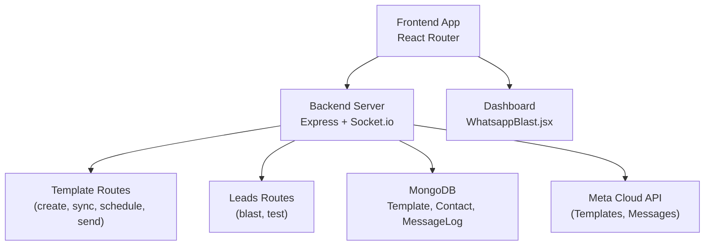

**Diagram sources**
- [server.js:43-56](file://backend/server.js#L43-L56)
- [template.js:106-197](file://backend/routes/template.js#L106-L197)
- [leads.js:159-341](file://backend/routes/leads.js#L159-L341)
- [App.jsx:9-24](file://frontend/src/App.jsx#L9-L24)

**Section sources**
- [server.js:1-82](file://backend/server.js#L1-L82)
- [App.jsx:1-27](file://frontend/src/App.jsx#L1-L27)

## Core Components
- Template model and routes: manage Meta template metadata, approval status, media handling, syncing from Meta, and scheduling
- Leads routes: support single test messages and batch blast dispatching to selected recipients
- Contact model: stores contact records used as target audiences; includes opt-out flags and segment fields
- Cron scheduler: runs scheduled templates every minute and executes broadcasts
- Frontend WhatsappBlast component: template selection, recipient selection (contacts or leads), live preview, and blast trigger

Key responsibilities:
- Template lifecycle: create on Meta, import/sync, update, check approval status
- Audience targeting: select by phone numbers, lead/contact IDs, or all opted-in contacts
- Scheduling: store next run time, repeat daily, toggle active/inactive
- Execution: iterate recipients, send via Meta Cloud API, log messages, update counters
- Analytics: aggregate sent/delivered/read/failed counts and chart data

**Section sources**
- [Template.js:1-42](file://backend/models/Template.js#L1-L42)
- [Contact.js:1-26](file://backend/models/Contact.js#L1-L26)
- [template.js:106-197](file://backend/routes/template.js#L106-L197)
- [leads.js:159-341](file://backend/routes/leads.js#L159-L341)
- [WhatsappBlast.jsx:18-327](file://frontend/src/Dashboard/WhatsappBlast.jsx#L18-L327)

## Architecture Overview
The campaign flow integrates frontend UI, backend routes, MongoDB, and Meta Cloud API.

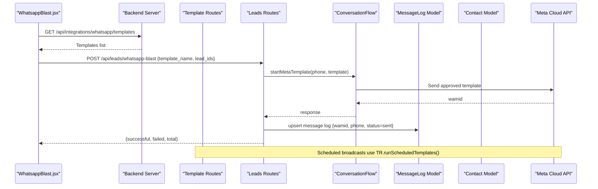

**Diagram sources**
- [WhatsappBlast.jsx:303-327](file://frontend/src/Dashboard/WhatsappBlast.jsx#L303-L327)
- [leads.js:229-341](file://backend/routes/leads.js#L229-L341)
- [template.js:625-643](file://backend/routes/template.js#L625-L643)

## Detailed Component Analysis

### Campaign Creation Workflow
Campaigns are centered around Meta templates. The system supports:
- Creating templates directly on Meta
- Importing existing Meta templates
- Syncing all Meta templates into the local database
- Updating template content and media
- Checking approval status before sending

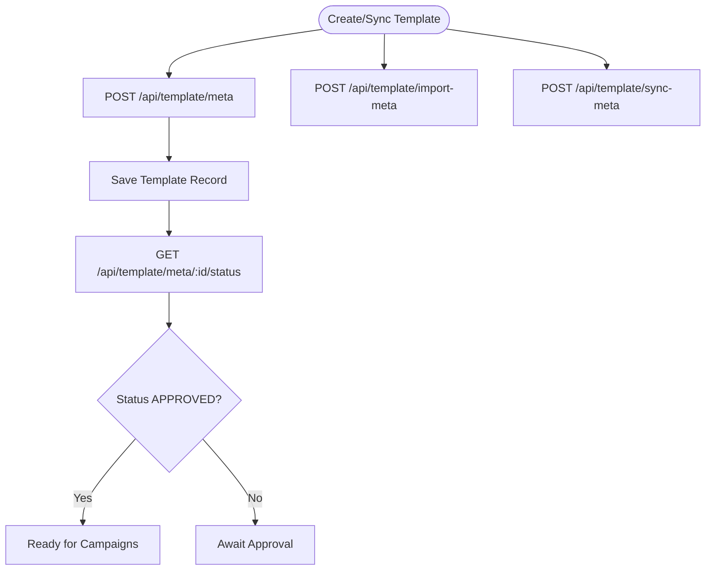

**Diagram sources**
- [template.js:283-365](file://backend/routes/template.js#L283-L365)
- [template.js:368-409](file://backend/routes/template.js#L368-L409)
- [template.js:411-529](file://backend/routes/template.js#L411-L529)
- [template.js:531-558](file://backend/routes/template.js#L531-L558)

**Section sources**
- [template.js:283-558](file://backend/routes/template.js#L283-L558)
- [Template.js:1-42](file://backend/models/Template.js#L1-L42)

### Audience Targeting and Segmentation
Target audiences can be:
- Contacts from the contact database
- Leads from the pipeline
- Explicit phone lists
- All opted-in contacts when no explicit list is provided

Segmentation features:
- Contact identity filter in the frontend
- Lead stage filter in the frontend
- Opt-out exclusion in scheduled broadcasts
- Automatic segment computation based on orders placed

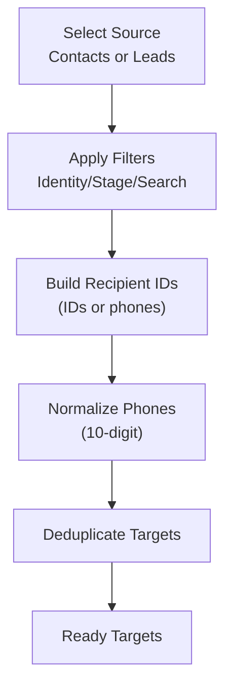

**Diagram sources**
- [WhatsappBlast.jsx:155-238](file://frontend/src/Dashboard/WhatsappBlast.jsx#L155-L238)
- [leads.js:252-282](file://backend/routes/leads.js#L252-L282)
- [Contact.js:1-26](file://backend/models/Contact.js#L1-L26)

**Section sources**
- [WhatsappBlast.jsx:155-238](file://frontend/src/Dashboard/WhatsappBlast.jsx#L155-L238)
- [leads.js:252-282](file://backend/routes/leads.js#L252-L282)
- [Contact.js:1-26](file://backend/models/Contact.js#L1-L26)

### Scheduling Options and Automated Campaigns
Scheduling allows:
- One-time scheduled broadcasts at a specific time
- Daily repeating broadcasts
- Toggle active/inactive schedules
- Next run calculation and automatic updates after execution

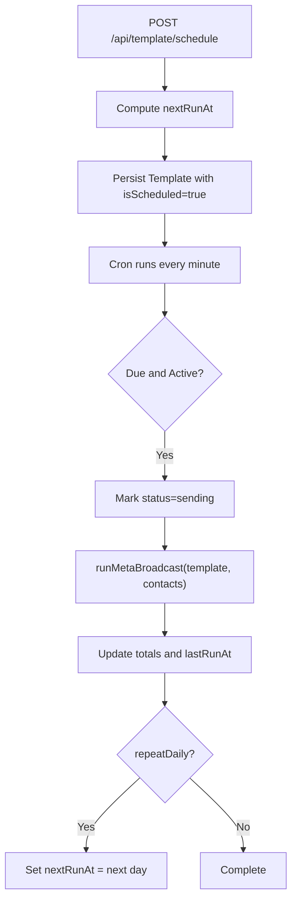

**Diagram sources**
- [template.js:154-197](file://backend/routes/template.js#L154-L197)
- [template.js:625-643](file://backend/routes/template.js#L625-L643)
- [server.js:69-76](file://backend/server.js#L69-L76)

**Section sources**
- [template.js:154-197](file://backend/routes/template.js#L154-L197)
- [template.js:625-643](file://backend/routes/template.js#L625-L643)
- [server.js:69-76](file://backend/server.js#L69-L76)

### Bulk Messaging Capabilities
Bulk messaging is supported through:
- Single test message endpoint for quick validation
- Batch blast endpoint that iterates recipients and sends via Meta Cloud API
- Message logging for each outgoing message
- Contact counter increments for templates sent

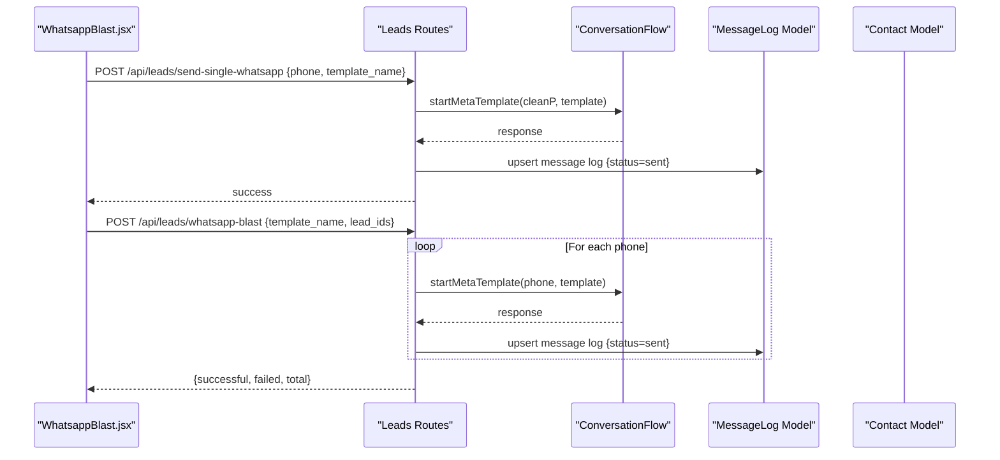

**Diagram sources**
- [leads.js:159-227](file://backend/routes/leads.js#L159-L227)
- [leads.js:229-341](file://backend/routes/leads.js#L229-L341)

**Section sources**
- [leads.js:159-341](file://backend/routes/leads.js#L159-L341)

### Campaign Execution Engine
The execution engine:
- Validates template approval status before sending
- Iterates through phone targets
- Sends via ConversationFlow integration with Meta Cloud API
- Logs each message with wamid, direction, status, text, template name, header image, and buttons
- Updates contact counters and template statistics

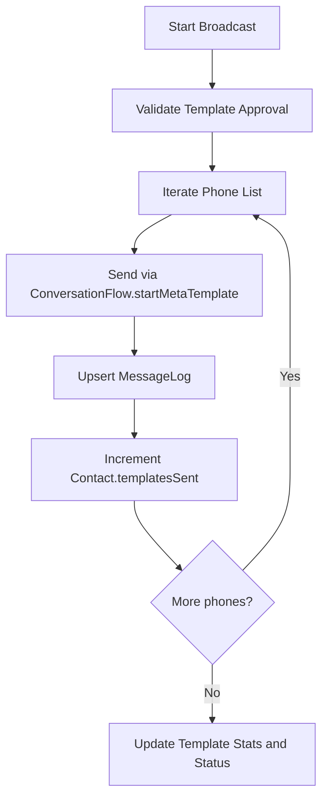

**Diagram sources**
- [template.js:29-102](file://backend/routes/template.js#L29-L102)
- [template.js:106-152](file://backend/routes/template.js#L106-L152)

**Section sources**
- [template.js:29-152](file://backend/routes/template.js#L29-L152)

### Message Queuing System and Delivery Tracking
- There is no dedicated queue service; messages are sent synchronously per recipient within the route handler
- Message delivery states are tracked via MessageLog entries
- Webhook-driven state updates (delivered, read, failed) are reflected in MessageLog and aggregated by analytics endpoints

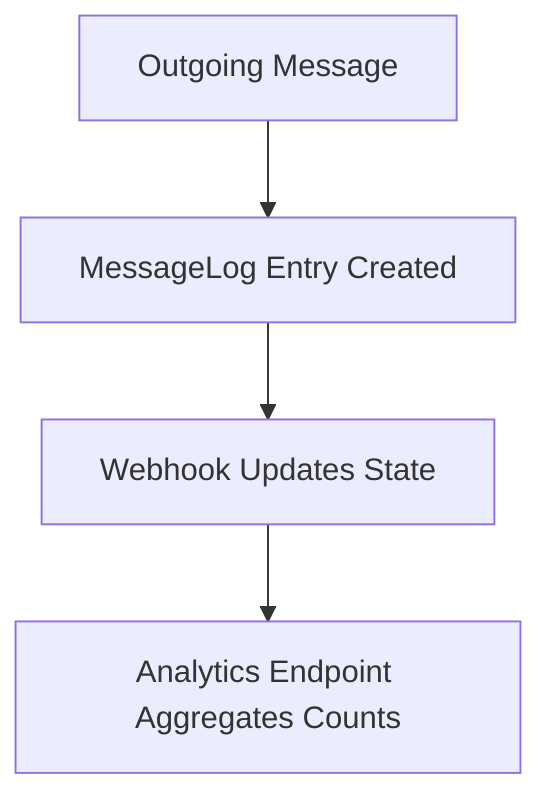

**Diagram sources**
- [template.js:64-85](file://backend/routes/template.js#L64-L85)
- [template.js:560-623](file://backend/routes/template.js#L560-L623)

**Section sources**
- [template.js:64-85](file://backend/routes/template.js#L64-L85)
- [template.js:560-623](file://backend/routes/template.js#L560-L623)

### Frontend Campaign Builder Interface
The WhatsappBlast component provides:
- Template selection panel showing approved templates and their components
- Recipient selection toggling between contacts and leads
- Search and filters by identity or stage
- Live preview of template content including headers, body, footer, and buttons
- Test message sending and blast dispatch confirmation modal

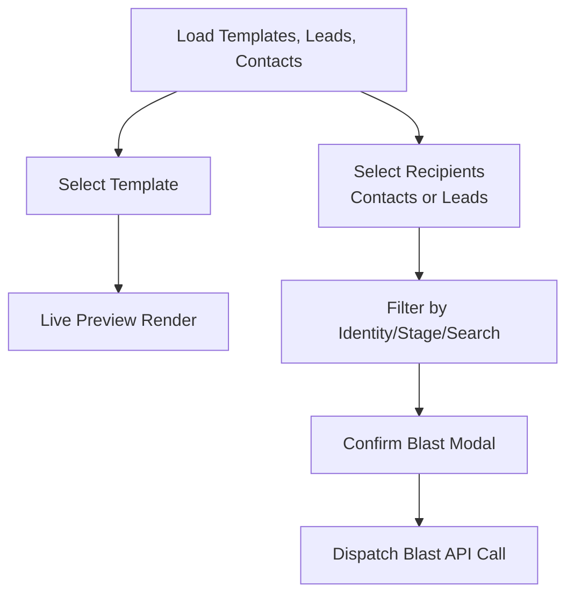

**Diagram sources**
- [WhatsappBlast.jsx:67-151](file://frontend/src/Dashboard/WhatsappBlast.jsx#L67-L151)
- [WhatsappBlast.jsx:247-327](file://frontend/src/Dashboard/WhatsappBlast.jsx#L247-L327)
- [WhatsappBlast.jsx:378-713](file://frontend/src/Dashboard/WhatsappBlast.jsx#L378-L713)

**Section sources**
- [WhatsappBlast.jsx:67-327](file://frontend/src/Dashboard/WhatsappBlast.jsx#L67-L327)
- [WhatsappBlast.jsx:378-713](file://frontend/src/Dashboard/WhatsappBlast.jsx#L378-L713)

### Campaign Performance Analytics
Analytics aggregation endpoint computes:
- Sent, delivered, read, failed counts
- Active templates count
- Total contacts (opted out excluded)
- Total campaigns (templates with non-empty contacts)
- Chart data derived from MessageLog

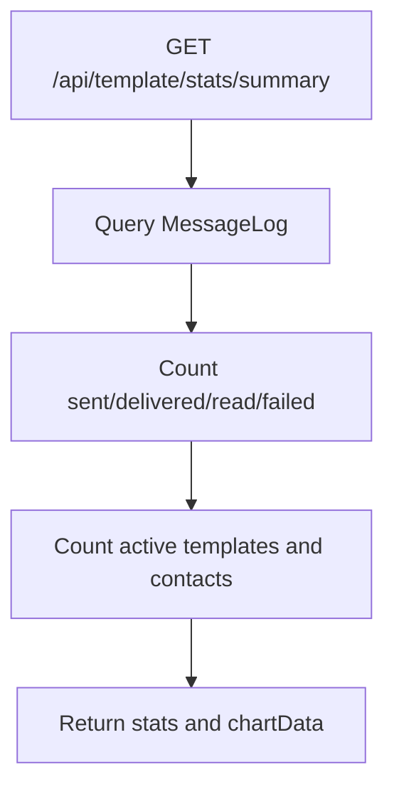

**Diagram sources**
- [template.js:560-623](file://backend/routes/template.js#L560-L623)

**Section sources**
- [template.js:560-623](file://backend/routes/template.js#L560-L623)

### Integration With Template System and Contact Database
- Templates are synchronized with Meta, stored locally, and used for sending
- Contacts are used as target audiences; opted-out contacts are excluded in scheduled broadcasts
- Message logs record outgoing messages and link them to templates and phone numbers

```mermaid
graph TB
Meta["Meta Cloud API"] < --> TplRoutes["Template Routes"]
TplRoutes --> TplModel["Template Model"]
TplModel --> MsgLog["MessageLog Model"]
TplRoutes --> CntModel["Contact Model"]
```

**Diagram sources**
- [template.js:283-529](file://backend/routes/template.js#L283-L529)
- [template.js:106-152](file://backend/routes/template.js#L106-L152)
- [Contact.js:1-26](file://backend/models/Contact.js#L1-L26)

**Section sources**
- [template.js:283-529](file://backend/routes/template.js#L283-L529)
- [Contact.js:1-26](file://backend/models/Contact.js#L1-L26)

## Dependency Analysis
High-level dependencies:
- Backend server depends on Express, Socket.io, Mongoose, node-cron
- Template routes depend on Meta services, conversation flow, cloud storage, and models
- Leads routes depend on models and conversation flow
- Frontend app uses React Router and calls backend APIs

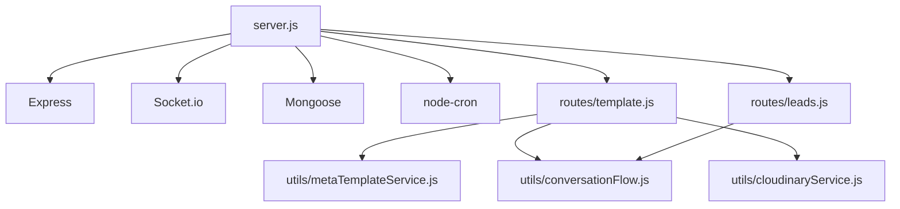

**Diagram sources**
- [server.js:1-10](file://backend/server.js#L1-L10)
- [server.js:43-56](file://backend/server.js#L43-L56)
- [template.js:1-11](file://backend/routes/template.js#L1-L11)
- [leads.js:1-5](file://backend/routes/leads.js#L1-L5)

**Section sources**
- [server.js:1-82](file://backend/server.js#L1-L82)
- [template.js:1-11](file://backend/routes/template.js#L1-L11)
- [leads.js:1-5](file://backend/routes/leads.js#L1-L5)

## Performance Considerations
- Bulk sends iterate recipients sequentially; consider rate limiting and jitter to avoid platform throttling
- Use deduplication of phone numbers to reduce redundant sends
- Avoid large payloads by filtering opted-out contacts early
- Monitor MessageLog growth and archive old logs if needed
- Ensure Media uploads are cached or reused to minimize repeated uploads

[No sources needed since this section provides general guidance]

## Troubleshooting Guide
Common issues and resolutions:
- Template not approved: Check Meta approval status via template status endpoint; do not send until APPROVED
- No valid recipients: Ensure phone numbers are normalized to 10 digits and exist in leads/contacts
- Scheduler not running: Verify cron registration and MongoDB connection
- Upload failures: Check Cloudinary configuration and file types
- Analytics mismatch: Confirm webhooks update MessageLog statuses correctly

Operational checks:
- Verify server startup logs for MongoDB connection and cron scheduler
- Inspect route responses for errors and validation messages
- Review MessageLog entries for wamid and status transitions

**Section sources**
- [template.js:121-134](file://backend/routes/template.js#L121-L134)
- [template.js:531-558](file://backend/routes/template.js#L531-L558)
- [server.js:64-77](file://backend/server.js#L64-L77)
- [leads.js:282-285](file://backend/routes/leads.js#L282-L285)

## Conclusion
The campaign management system provides a robust workflow for creating Meta templates, scheduling automated broadcasts, and executing bulk WhatsApp messaging. It integrates tightly with the contact database and message logging for delivery tracking and analytics. The frontend offers an intuitive builder for template selection, audience segmentation, live preview, and dispatch control. While there is no dedicated queue, the synchronous send pattern is straightforward and suitable for moderate volumes. For higher throughput, consider introducing a background job queue and improved retry logic.

[No sources needed since this section summarizes without analyzing specific files]

## Appendices

### Examples

- Creating an automated campaign
  - Create or sync a Meta template
  - Schedule a broadcast with a time and optional daily repeat
  - Monitor scheduled templates and activation status

- Setting up a scheduled broadcast
  - Submit schedule payload with HH:MM time and optional repeat settings
  - Verify nextRunAt and isActive flags
  - Let cron execute and update template stats

- Monitoring campaign progress
  - Use analytics summary endpoint to view sent/delivered/read/failed metrics
  - Inspect MessageLog entries for detailed delivery states

- Campaign optimization and A/B testing
  - Maintain multiple templates and rotate by audience segments
  - Compare performance via analytics summary and MessageLog trends
  - Personalize body variables in the frontend preview to refine messaging

- Integrating with template system and contact database
  - Sync templates from Meta and keep local records updated
  - Exclude opted-out contacts during scheduling
  - Increment contact counters upon successful sends

**Section sources**
- [template.js:154-197](file://backend/routes/template.js#L154-L197)
- [template.js:625-643](file://backend/routes/template.js#L625-L643)
- [template.js:560-623](file://backend/routes/template.js#L560-L623)
- [Contact.js:1-26](file://backend/models/Contact.js#L1-L26)