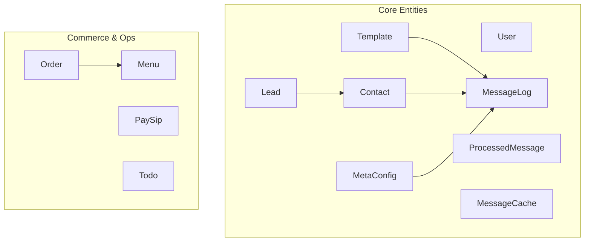
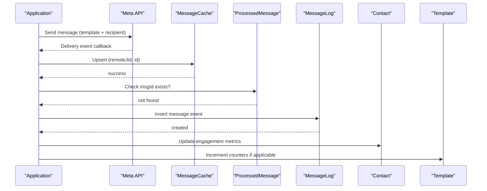
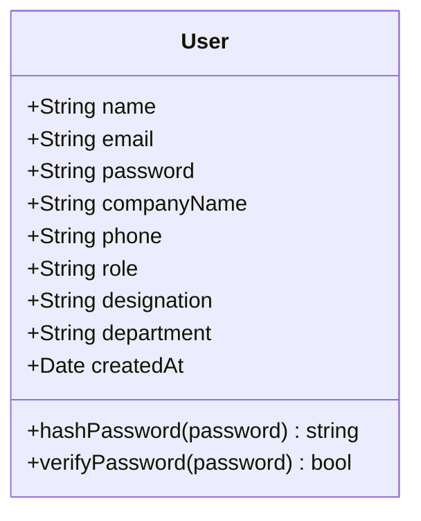
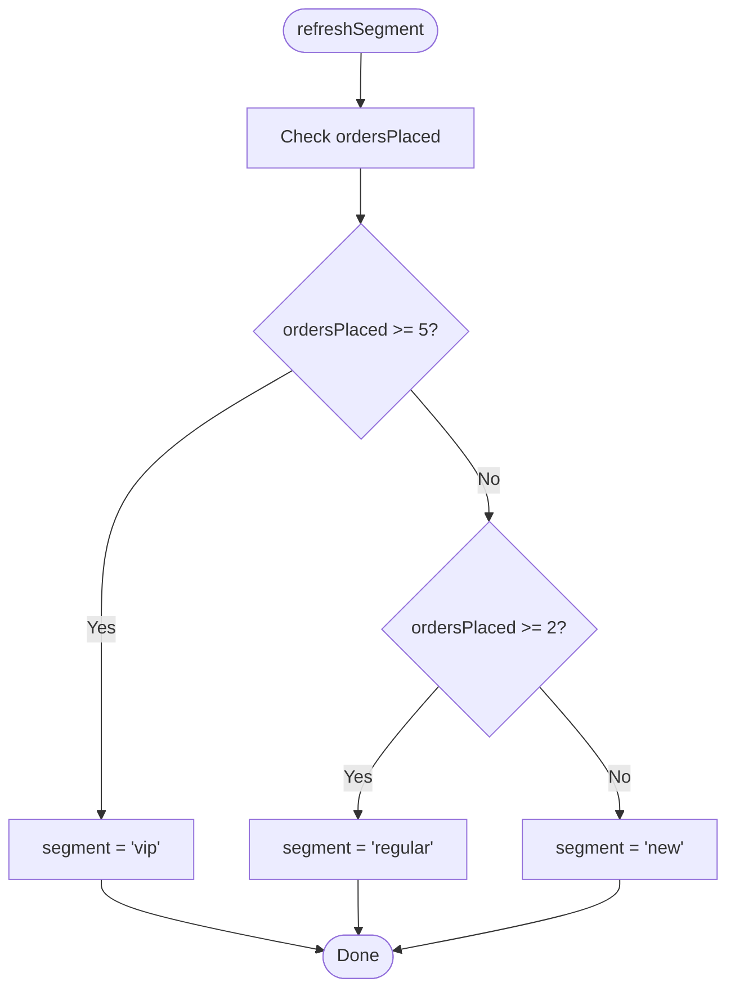
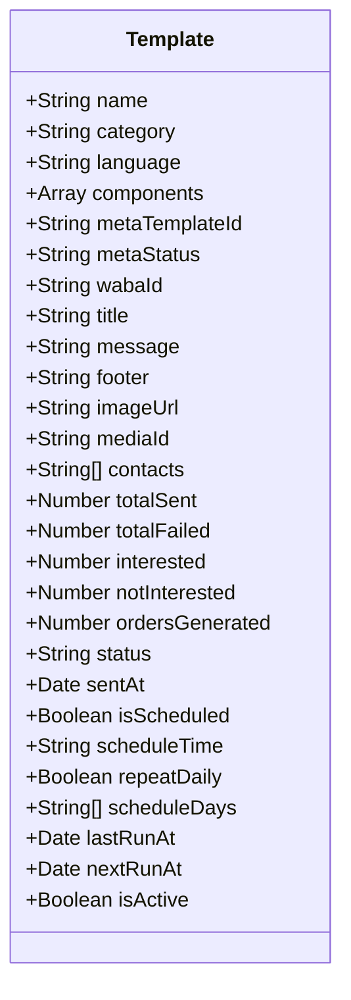
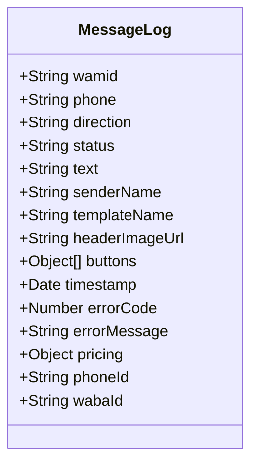
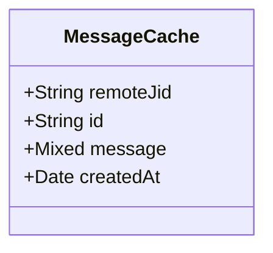
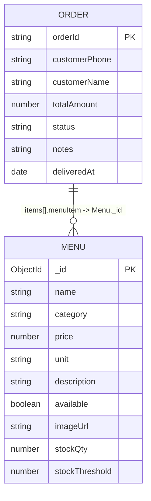
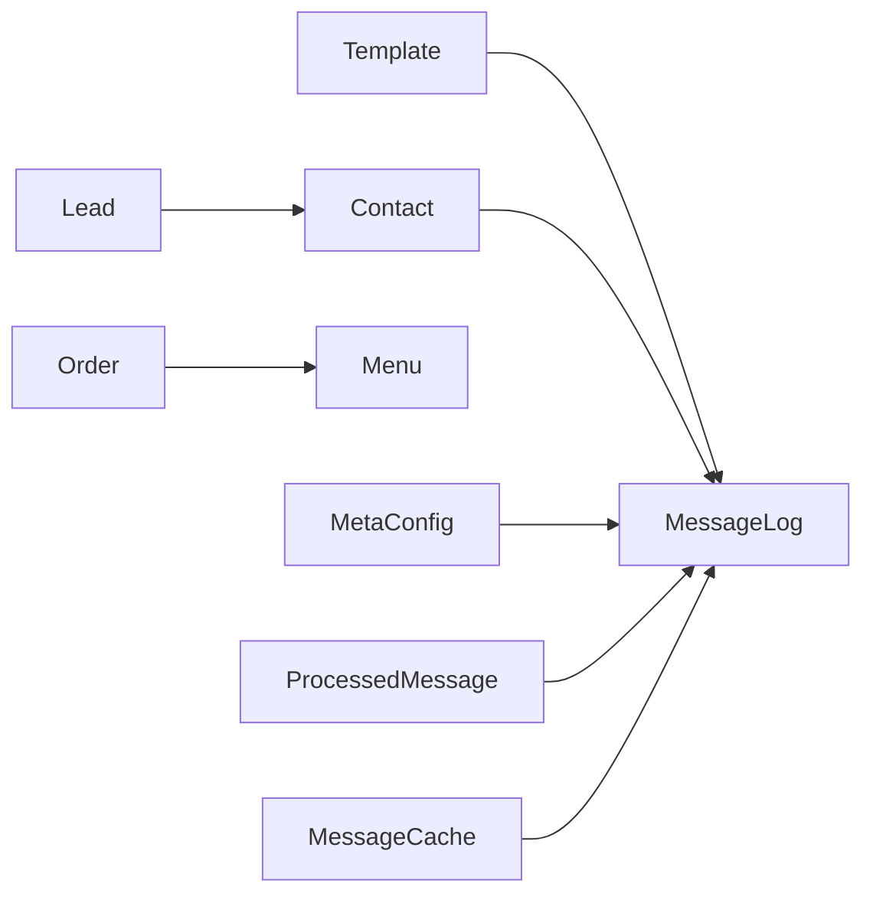

# Database Schema

<cite>
**Referenced Files in This Document**
- [User.js](file://backend/models/User.js)
- [Contact.js](file://backend/models/Contact.js)
- [Lead.js](file://backend/models/Lead.js)
- [Template.js](file://backend/models/Template.js)
- [MessageLog.js](file://backend/models/MessageLog.js)
- [ProcessedMessage.js](file://backend/models/ProcessedMessage.js)
- [MessageCache.js](file://backend/models/MessageCache.js)
- [MetaConfig.js](file://backend/models/MetaConfig.js)
- [Order.js](file://backend/models/Order.js)
- [Menu.js](file://backend/models/Menu.js)
- [PaySip.js](file://backend/models/PaySip.js)
- [Todo.js](file://backend/models/Todo.js)
</cite>

## Table of Contents
1. [Introduction](#introduction)
2. [Project Structure](#project-structure)
3. [Core Components](#core-components)
4. [Architecture Overview](#architecture-overview)
5. [Detailed Component Analysis](#detailed-component-analysis)
6. [Dependency Analysis](#dependency-analysis)
7. [Performance Considerations](#performance-considerations)
8. [Troubleshooting Guide](#troubleshooting-guide)
9. [Conclusion](#conclusion)
10. [Appendices](#appendices)

## Introduction
This document provides comprehensive data model documentation for the MongoDB database schema used by the application. It covers entity relationships, field definitions, data types, validation rules, primary keys, indexes, and query optimization strategies. It also explains data relationships between users, contacts, leads, templates, and message logs; documents data migration strategies, backup procedures, retention policies, security considerations, access controls, privacy compliance, common queries, aggregation pipelines, lifecycle management, archival processes, and cleanup procedures.

## Project Structure
The database models are defined as Mongoose schemas under backend/models. Each file defines a collection with fields, validations, defaults, timestamps, and optional indexes or TTL behavior. The core entities relevant to WhatsApp automation include User, Contact, Lead, Template, MessageLog, ProcessedMessage, MessageCache, MetaConfig, Order, Menu, PaySip, and Todo.

**Diagram sources**
- [User.js:4-50](file://backend/models/User.js#L4-L50)
- [Contact.js:3-17](file://backend/models/Contact.js#L3-L17)
- [Lead.js:3-67](file://backend/models/Lead.js#L3-L67)
- [Template.js:3-40](file://backend/models/Template.js#L3-L40)
- [MessageLog.js:3-19](file://backend/models/MessageLog.js#L3-L19)
- [ProcessedMessage.js:3-6](file://backend/models/ProcessedMessage.js#L3-L6)
- [MessageCache.js:3-8](file://backend/models/MessageCache.js#L3-L8)
- [MetaConfig.js:3-10](file://backend/models/MetaConfig.js#L3-L10)
- [Order.js:12-25](file://backend/models/Order.js#L12-L25)
- [Menu.js:3-13](file://backend/models/Menu.js#L3-L13)
- [PaySip.js:3-45](file://backend/models/PaySip.js#L3-L45)
- [Todo.js:3-11](file://backend/models/Todo.js#L3-L11)

**Section sources**
- [User.js:1-64](file://backend/models/User.js#L1-L64)
- [Contact.js:1-26](file://backend/models/Contact.js#L1-L26)
- [Lead.js:1-70](file://backend/models/Lead.js#L1-L70)
- [Template.js:1-42](file://backend/models/Template.js#L1-L42)
- [MessageLog.js:1-22](file://backend/models/MessageLog.js#L1-L22)
- [ProcessedMessage.js:1-9](file://backend/models/ProcessedMessage.js#L1-L9)
- [MessageCache.js:1-16](file://backend/models/MessageCache.js#L1-L16)
- [MetaConfig.js:1-13](file://backend/models/MetaConfig.js#L1-L13)
- [Order.js:1-27](file://backend/models/Order.js#L1-L27)
- [Menu.js:1-22](file://backend/models/Menu.js#L1-L22)
- [PaySip.js:1-49](file://backend/models/PaySip.js#L1-L49)
- [Todo.js:1-14](file://backend/models/Todo.js#L1-L14)

## Core Components
This section summarizes each model’s purpose, key fields, constraints, and behaviors.

- User
  - Purpose: Application user accounts with authentication and profile attributes.
  - Key fields: name, email (unique, lowercase), password, companyName, phone, role (enum), designation, department, createdAt.
  - Validation: required fields, trim, unique on email, enum on role.
  - Security: PBKDF2-based password hashing helper and verification method.
  - Indexes: Unique index on email via schema definition.

- Contact
  - Purpose: Customer contact records with engagement metrics and segmentation.
  - Key fields: phone (unique), name, email, source (enum), lastStatus, templatesSent, ordersPlaced, totalSpend, lastOrderAt, optedOut, optedOutAt, segment (enum), identity.
  - Behavior: Segment computed based on ordersPlaced using a method.
  - Timestamps: Enabled.

- Lead
  - Purpose: Sales lead tracking with status updates and notes.
  - Key fields: name, phone, email, address, identity, employeeName, leadStatusUpdate, secondUpdate, finalUpdate, status, notes, source, createdAt.
  - Validation: required name and phone; trim and lowercase where applicable.

- Template
  - Purpose: WhatsApp template definitions including Meta-specific fields and legacy fields, plus scheduling and stats.
  - Key fields: name, category (enum), language, components (array), metaTemplateId, metaStatus (enum), wabaId; legacy title/message/footer/imageUrl/mediaId; contacts array; counters; status (enum); sentAt; isScheduled; scheduleTime; repeatDaily; scheduleDays; lastRunAt; nextRunAt; isActive.
  - Timestamps: Enabled.

- MessageLog
  - Purpose: Immutable log of WhatsApp messages with direction, status, content, pricing, and identifiers.
  - Key fields: wamid (unique), phone, direction (enum), status, text, senderName, templateName, headerImageUrl, buttons (array), timestamp, errorCode, errorMessage, pricing (object), phoneId, wabaId.
  - Timestamps: Enabled.

- ProcessedMessage
  - Purpose: Deduplication cache with TTL to avoid processing duplicate messages within 24 hours.
  - Key fields: msgId (unique), createdAt (TTL 24h).

- MessageCache
  - Purpose: Short-term cache for incoming/outgoing messages with TTL and compound uniqueness.
  - Key fields: remoteJid, id, message (mixed), createdAt (TTL 7 days).
  - Indexes: Compound unique index on (remoteJid, id); single-field index on id.

- MetaConfig
  - Purpose: Stores Meta Business Account configuration and credentials.
  - Key fields: wabaId, phoneId, accessToken, verifyToken, graphVersion, updatedAt.

- Order
  - Purpose: Orders placed by customers with line items referencing Menu.
  - Key fields: orderId (unique), customerPhone, customerName, items (array of embedded orderItemSchema), totalAmount, status (enum), notes, deliveredAt.
  - Embedded reference: orderItem.menuItem references Menu._id.

- Menu
  - Purpose: Catalog of menu items with availability and stock tracking.
  - Key fields: name, category (enum), price, unit, description, available, imageUrl, stockQty, stockThreshold.
  - Virtual: isLowStock derived from stockQty vs stockThreshold.

- PaySip
  - Purpose: Payslip generation data with flexible schema.
  - Key fields: clientName, phone, folioNumber, sipAmount, monthlyDay, installmentCount, fundName, paymentStatus; employee details; bank/statutory info; salary breakdown; net pay; timestamps enabled; strict mode disabled.

- Todo
  - Purpose: Task management with priority, category, and status enums.
  - Key fields: title, assignee, dueDate, priority (enum), category, status (enum), done; timestamps enabled.

**Section sources**
- [User.js:4-61](file://backend/models/User.js#L4-L61)
- [Contact.js:3-24](file://backend/models/Contact.js#L3-L24)
- [Lead.js:3-67](file://backend/models/Lead.js#L3-L67)
- [Template.js:3-40](file://backend/models/Template.js#L3-L40)
- [MessageLog.js:3-19](file://backend/models/MessageLog.js#L3-L19)
- [ProcessedMessage.js:3-6](file://backend/models/ProcessedMessage.js#L3-L6)
- [MessageCache.js:3-13](file://backend/models/MessageCache.js#L3-L13)
- [MetaConfig.js:3-10](file://backend/models/MetaConfig.js#L3-L10)
- [Order.js:3-25](file://backend/models/Order.js#L3-L25)
- [Menu.js:3-18](file://backend/models/Menu.js#L3-L18)
- [PaySip.js:3-45](file://backend/models/PaySip.js#L3-L45)
- [Todo.js:3-11](file://backend/models/Todo.js#L3-L11)

## Architecture Overview
The data architecture centers around WhatsApp messaging operations and business workflows:

- Users authenticate and manage campaigns.
- Contacts and Leads represent target audiences and prospects.
- Templates define message content and scheduling.
- MessageLog captures all message events and outcomes.
- ProcessedMessage and MessageCache provide deduplication and short-lived caching.
- MetaConfig holds integration credentials.
- Order and Menu support commerce flows triggered by conversations.
- PaySip and Todo support operational tasks.

**Diagram sources**
- [MessageCache.js:3-13](file://backend/models/MessageCache.js#L3-L13)
- [ProcessedMessage.js:3-6](file://backend/models/ProcessedMessage.js#L3-L6)
- [MessageLog.js:3-19](file://backend/models/MessageLog.js#L3-L19)
- [Contact.js:3-24](file://backend/models/Contact.js#L3-L24)
- [Template.js:3-40](file://backend/models/Template.js#L3-L40)

## Detailed Component Analysis

### User Model
- Primary key: _id (MongoDB default).
- Unique constraints: email.
- Data types and validation:
  - name: String, required, trimmed.
  - email: String, required, unique, lowercased, trimmed.
  - password: String, required.
  - companyName, phone: String, optional, trimmed.
  - role: String, enum ['admin','manager','employee','user'], default 'employee'.
  - designation, department: String, defaults provided.
  - createdAt: Date, default now.
- Security:
  - Password hashing via PBKDF2 helper.
  - Verification method compares stored hash with computed hash.
- Indexes:
  - Unique index on email.

**Diagram sources**
- [User.js:4-61](file://backend/models/User.js#L4-L61)

**Section sources**
- [User.js:4-61](file://backend/models/User.js#L4-L61)

### Contact Model
- Primary key: _id.
- Unique constraints: phone.
- Fields:
  - phone: String, required, unique.
  - name, email: String, optional.
  - source: String, enum ['excel','manual','whatsapp'], default 'manual'.
  - lastStatus: String, default 'pending'.
  - templatesSent, ordersPlaced, totalSpend: Number, default 0.
  - lastOrderAt: Date.
  - optedOut: Boolean, default false.
  - optedOutAt: Date.
  - segment: String, enum ['new','regular','vip'], default 'new'.
  - identity: String, default 'SAP FICO'.
- Behavior:
  - refreshSegment() computes segment based on ordersPlaced thresholds.
- Timestamps: Enabled.

**Diagram sources**
- [Contact.js:20-24](file://backend/models/Contact.js#L20-L24)

**Section sources**
- [Contact.js:3-24](file://backend/models/Contact.js#L3-L24)

### Lead Model
- Primary key: _id.
- Fields:
  - name, phone: String, required, trimmed.
  - email: String, optional, trimmed, lowercased.
  - address, identity, employeeName, leadStatusUpdate, secondUpdate, finalUpdate, status, notes, source: Strings with defaults.
  - createdAt: Date, default now.
- No explicit indexes beyond defaults.

**Section sources**
- [Lead.js:3-67](file://backend/models/Lead.js#L3-L67)

### Template Model
- Primary key: _id.
- Fields:
  - Meta-specific: name, category (enum), language, components (array), metaTemplateId, metaStatus (enum), wabaId.
  - Legacy: title, message, footer, imageUrl, mediaId.
  - Campaign stats: contacts (array), totalSent, totalFailed, interested, notInterested, ordersGenerated.
  - Scheduling: status (enum), sentAt, isScheduled, scheduleTime, repeatDaily, scheduleDays, lastRunAt, nextRunAt, isActive.
- Timestamps: Enabled.

**Diagram sources**
- [Template.js:3-40](file://backend/models/Template.js#L3-L40)

**Section sources**
- [Template.js:3-40](file://backend/models/Template.js#L3-L40)

### MessageLog Model
- Primary key: _id.
- Unique constraints: wamid.
- Fields:
  - wamid: String, required, unique.
  - phone: String, required.
  - direction: String, enum ['OUTGOING','INCOMING'], default 'OUTGOING'.
  - status: String, required.
  - text, senderName, templateName, headerImageUrl: Strings with defaults.
  - buttons: Array, default [].
  - timestamp: Date, required.
  - errorCode: Number, nullable.
  - errorMessage: String, nullable.
  - pricing: Object, nullable.
  - phoneId, wabaId: Strings, nullable.
- Timestamps: Enabled.

**Diagram sources**
- [MessageLog.js:3-19](file://backend/models/MessageLog.js#L3-L19)

**Section sources**
- [MessageLog.js:3-19](file://backend/models/MessageLog.js#L3-L19)

### ProcessedMessage Model
- Purpose: Deduplication with TTL.
- Fields:
  - msgId: String, required, unique.
  - createdAt: Date, default now, TTL 86400 seconds (24 hours).

**Section sources**
- [ProcessedMessage.js:3-6](file://backend/models/ProcessedMessage.js#L3-L6)

### MessageCache Model
- Purpose: Short-lived cache with TTL and fast lookups.
- Fields:
  - remoteJid: String, required.
  - id: String, required.
  - message: Mixed, required.
  - createdAt: Date, default now, TTL 604800 seconds (7 days).
- Indexes:
  - Compound unique index on (remoteJid, id).
  - Single-field index on id.

**Diagram sources**
- [MessageCache.js:3-13](file://backend/models/MessageCache.js#L3-L13)

**Section sources**
- [MessageCache.js:3-13](file://backend/models/MessageCache.js#L3-L13)

### MetaConfig Model
- Purpose: Store Meta Business Account configuration.
- Fields:
  - wabaId: String, required.
  - phoneId: String, required.
  - accessToken: String, required.
  - verifyToken: String, default value.
  - graphVersion: String, default 'v19.0'.
  - updatedAt: Date, default now.

**Section sources**
- [MetaConfig.js:3-10](file://backend/models/MetaConfig.js#L3-L10)

### Order and Menu Models
- Order
  - Fields: orderId (unique), customerPhone, customerName, items (embedded array), totalAmount, status (enum), notes, deliveredAt.
  - Embedded item references Menu._id.
- Menu
  - Fields: name, category (enum), price, unit, description, available, imageUrl, stockQty, stockThreshold.
  - Virtual: isLowStock derived from stockQty <= stockThreshold.

**Diagram sources**
- [Order.js:3-25](file://backend/models/Order.js#L3-L25)
- [Menu.js:3-18](file://backend/models/Menu.js#L3-L18)

**Section sources**
- [Order.js:3-25](file://backend/models/Order.js#L3-L25)
- [Menu.js:3-18](file://backend/models/Menu.js#L3-L18)

### PaySip and Todo Models
- PaySip
  - Flexible schema with many numeric and string fields for payroll and SIP data.
  - Strict mode disabled to allow additional fields.
- Todo
  - Task tracking with enums for priority and status.

**Section sources**
- [PaySip.js:3-45](file://backend/models/PaySip.js#L3-L45)
- [Todo.js:3-11](file://backend/models/Todo.js#L3-L11)

## Dependency Analysis
Relationships across models:

- Template to MessageLog: Templates are referenced by message logs via templateName and associated counters increment when messages are sent.
- Contact to MessageLog: Contacts receive messages; their metrics update upon interactions.
- Lead to Contact: Leads can be converted into contacts.
- Order to Menu: Order items embed references to Menu entries.
- MetaConfig to MessageLog: Messages are tied to WABA and Phone IDs configured here.
- ProcessedMessage and MessageCache: Support deduplication and caching for message handling.

**Diagram sources**
- [Template.js:3-40](file://backend/models/Template.js#L3-L40)
- [MessageLog.js:3-19](file://backend/models/MessageLog.js#L3-L19)
- [Contact.js:3-24](file://backend/models/Contact.js#L3-L24)
- [Lead.js:3-67](file://backend/models/Lead.js#L3-L67)
- [Order.js:3-25](file://backend/models/Order.js#L3-L25)
- [Menu.js:3-18](file://backend/models/Menu.js#L3-L18)
- [MetaConfig.js:3-10](file://backend/models/MetaConfig.js#L3-L10)
- [ProcessedMessage.js:3-6](file://backend/models/ProcessedMessage.js#L3-L6)
- [MessageCache.js:3-13](file://backend/models/MessageCache.js#L3-L13)

**Section sources**
- [Template.js:3-40](file://backend/models/Template.js#L3-L40)
- [MessageLog.js:3-19](file://backend/models/MessageLog.js#L3-L19)
- [Contact.js:3-24](file://backend/models/Contact.js#L3-L24)
- [Lead.js:3-67](file://backend/models/Lead.js#L3-L67)
- [Order.js:3-25](file://backend/models/Order.js#L3-L25)
- [Menu.js:3-18](file://backend/models/Menu.js#L3-L18)
- [MetaConfig.js:3-10](file://backend/models/MetaConfig.js#L3-L10)
- [ProcessedMessage.js:3-6](file://backend/models/ProcessedMessage.js#L3-L6)
- [MessageCache.js:3-13](file://backend/models/MessageCache.js#L3-L13)

## Performance Considerations
Indexing strategy recommendations:

- MessageLog
  - Add composite indexes for frequent filters: (phone, timestamp), (status, timestamp), (wabaId, timestamp), (direction, status).
  - Consider TTL on older logs if retention policy requires automatic deletion.
- Contact
  - Index on segment for segmentation queries.
  - Index on optedOut for opt-out filtering.
- Template
  - Index on metaStatus and wabaId for campaign management.
  - Index on scheduleDays and nextRunAt for scheduled runs.
- ProcessedMessage
  - Unique index on msgId already present; ensure TTL cleanup runs.
- MessageCache
  - Compound unique index on (remoteJid, id) and index on id already present.
- Order
  - Index on customerPhone and status for order lookup and reporting.
- Menu
  - Index on category and available for catalog queries.

Query optimization tips:
- Use projection to limit returned fields.
- Prefer $match early in aggregation pipelines.
- Use $lookup sparingly; precompute aggregates where possible.
- Leverage TTL collections for ephemeral data like MessageCache and ProcessedMessage.

[No sources needed since this section provides general guidance]

## Troubleshooting Guide
Common issues and resolutions:

- Duplicate message processing
  - Ensure ProcessedMessage contains msgId before insertion; check TTL expiration.
  - Validate MessageCache compound uniqueness on (remoteJid, id).
- Failed message delivery
  - Inspect MessageLog.status and errorCode; correlate with MetaConfig.wabaId and phoneId.
- Opt-out compliance
  - Verify Contact.optedOut flag before sending; enforce checks at service layer.
- Template approval workflow
  - Monitor Template.metaStatus; handle DRAFT, PENDING, APPROVED, REJECTED states.
- Low stock alerts
  - Use Menu.isLowStock virtual to trigger notifications when stockQty <= stockThreshold.

**Section sources**
- [ProcessedMessage.js:3-6](file://backend/models/ProcessedMessage.js#L3-L6)
- [MessageCache.js:3-13](file://backend/models/MessageCache.js#L3-L13)
- [MessageLog.js:3-19](file://backend/models/MessageLog.js#L3-L19)
- [MetaConfig.js:3-10](file://backend/models/MetaConfig.js#L3-L10)
- [Contact.js:3-24](file://backend/models/Contact.js#L3-L24)
- [Template.js:3-40](file://backend/models/Template.js#L3-L40)
- [Menu.js:3-18](file://backend/models/Menu.js#L3-L18)

## Conclusion
The schema provides a robust foundation for WhatsApp automation, contact and lead management, templated messaging, and commerce integrations. Enforcing validation, leveraging indexes, and applying TTLs ensures data integrity and performance. Adhering to opt-out flags and secure credential storage supports privacy and compliance. Operational models like PaySip and Todo complement the core messaging and sales workflows.

[No sources needed since this section summarizes without analyzing specific files]

## Appendices

### Data Migration Strategies
- Schema evolution
  - Introduce new fields with defaults to maintain backward compatibility.
  - For enum changes, migrate existing values explicitly.
- Backward compatibility
  - Keep legacy fields (e.g., Template.title/message) during transition periods.
- Versioning
  - Track MetaConfig.graphVersion to align with Meta API versions.

[No sources needed since this section provides general guidance]

### Backup Procedures
- Regular backups
  - Schedule daily logical backups of all collections.
  - Include TTL collections (MessageCache, ProcessedMessage) in backups.
- Point-in-time recovery
  - Enable oplog-based incremental backups for near real-time recovery.
- Credential protection
  - Encrypt backups containing MetaConfig.accessToken and User.password hashes.

[No sources needed since this section provides general guidance]

### Data Retention Policies
- MessageLog
  - Retain recent logs for analytics; archive older logs to cold storage.
  - Consider TTL on MessageLog if automatic deletion is desired.
- ProcessedMessage
  - TTL set to 24 hours; ensure cleanup jobs run.
- MessageCache
  - TTL set to 7 days; monitor memory usage.

**Section sources**
- [ProcessedMessage.js:3-6](file://backend/models/ProcessedMessage.js#L3-L6)
- [MessageCache.js:3-8](file://backend/models/MessageCache.js#L3-L8)

### Data Security and Privacy Compliance
- Authentication
  - Hash passwords using PBKDF2; never store plaintext.
- Access control
  - Restrict MetaConfig access to privileged services.
- Privacy
  - Honor Contact.optedOut; mask sensitive fields in logs where appropriate.
- Compliance
  - Maintain audit trails in MessageLog for regulatory requirements.

**Section sources**
- [User.js:52-61](file://backend/models/User.js#L52-L61)
- [Contact.js:3-24](file://backend/models/Contact.js#L3-L24)
- [MessageLog.js:3-19](file://backend/models/MessageLog.js#L3-L19)
- [MetaConfig.js:3-10](file://backend/models/MetaConfig.js#L3-L10)

### Common Queries and Aggregation Pipelines
- Find active templates for a WABA
  - Match Template.metaStatus = 'APPROVED' and Template.wabaId.
- Count messages by status per day
  - Aggregate MessageLog by date truncation of timestamp and status.
- Segment contacts by ordersPlaced
  - Use Contact.refreshSegment logic or compute via aggregation.
- Low stock menu items
  - Query Menu where stockQty <= stockThreshold and available = true.

[No sources needed since this section provides general guidance]

### Data Lifecycle Management and Cleanup
- Archival
  - Move old MessageLog entries to an archive collection.
- Cleanup
  - Rely on TTL for ProcessedMessage and MessageCache.
  - Periodically purge stale leads or inactive contacts based on business rules.

**Section sources**
- [MessageLog.js:3-19](file://backend/models/MessageLog.js#L3-L19)
- [ProcessedMessage.js:3-6](file://backend/models/ProcessedMessage.js#L3-L6)
- [MessageCache.js:3-8](file://backend/models/MessageCache.js#L3-L8)