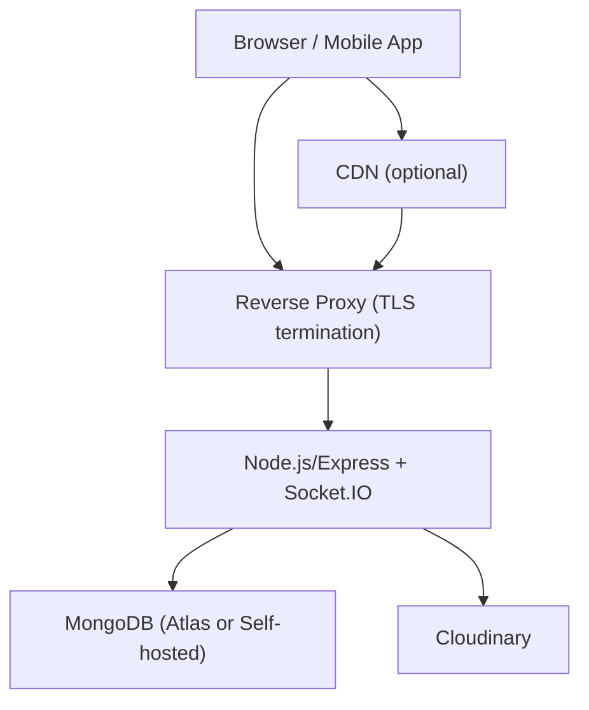
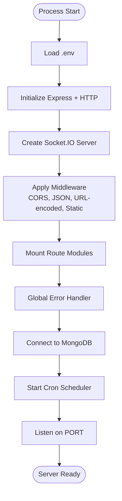
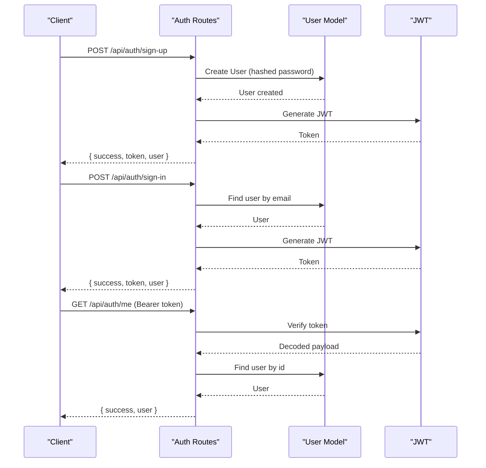
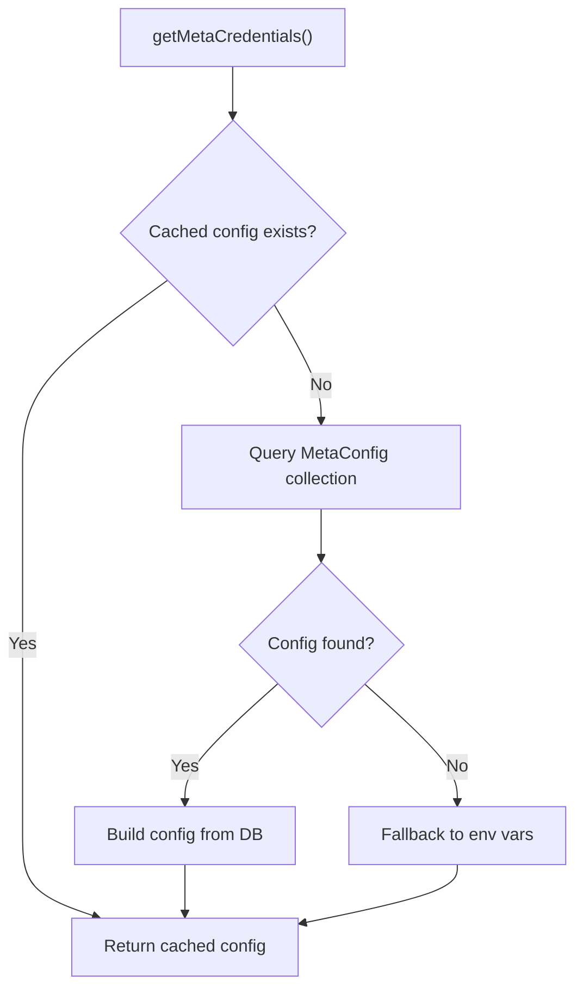

# Deployment Guide

<cite>
**Referenced Files in This Document**
- [backend/server.js](file://backend/server.js)
- [backend/package.json](file://backend/package.json)
- [backend/models/User.js](file://backend/models/User.js)
- [backend/routes/auth.js](file://backend/routes/auth.js)
- [backend/utils/metaConfigHelper.js](file://backend/utils/metaConfigHelper.js)
- [backend/utils/cloudinaryService.js](file://backend/utils/cloudinaryService.js)
- [frontend/vite.config.js](file://frontend/vite.config.js)
- [frontend/vercel.json](file://frontend/vercel.json)
- [frontend/package.json](file://frontend/package.json)
</cite>

## Table of Contents
1. [Introduction](#introduction)
2. [Project Structure](#project-structure)
3. [Core Components](#core-components)
4. [Architecture Overview](#architecture-overview)
5. [Detailed Component Analysis](#detailed-component-analysis)
6. [Environment Configuration](#environment-configuration)
7. [Deployment Strategies](#deployment-strategies)
8. [Containerization and CI/CD](#containerization-and-cicd)
9. [Scaling, Load Balancing, and Monitoring](#scaling-load-balancing-and-monitoring)
10. [Health Checks, Logging, and Error Tracking](#health-checks-logging-and-error-tracking)
11. [Troubleshooting Guide](#troubleshooting-guide)
12. [Conclusion](#conclusion)

## Introduction
This deployment guide provides production-ready instructions for deploying the backend (Node.js/Express with Socket.IO and MongoDB) and frontend (React/Vite). It covers environment configuration, SSL setup, database options (MongoDB Atlas or self-hosted), reverse proxy configuration, containerization with Docker, CI/CD pipelines, automated deployments, scaling strategies, load balancing, monitoring, health checks, logging, error tracking, performance monitoring, and step-by-step instructions for Vercel, Heroku, AWS, and traditional servers.

## Project Structure
The repository is organized into two main applications:
- Backend: Express server with REST APIs, WebSockets (Socket.IO), scheduled tasks (cron), and MongoDB integration.
- Frontend: React application built with Vite, Tailwind CSS, and a development proxy to the backend.

```mermaid
graph TB
subgraph "Frontend"
FE_Vite["Vite Build"]
FE_Config["vite.config.js"]
FE_Vercel["vercel.json"]
end
subgraph "Backend"
BE_Server["server.js"]
BE_Routes["Routes (/api/*)"]
BE_Socket["Socket.IO Server"]
BE_DB["MongoDB"]
BE_Cloudinary["Cloudinary"]
end
FE_Vite --> FE_Config
FE_Vite --> FE_Vercel
FE_Vercel --> |Static Hosting| CDN["CDN / Edge Cache"]
CDN --> |HTTP(S)| API["API Gateway / Reverse Proxy"]
API --> BE_Server
BE_Server --> BE_Routes
BE_Server --> BE_Socket
BE_Server --> BE_DB
BE_Routes --> BE_Cloudinary
```

**Diagram sources**
- [backend/server.js:1-82](file://backend/server.js#L1-L82)
- [frontend/vite.config.js:1-29](file://frontend/vite.config.js#L1-L29)
- [frontend/vercel.json:1-9](file://frontend/vercel.json#L1-L9)

**Section sources**
- [backend/server.js:1-82](file://backend/server.js#L1-L82)
- [frontend/vite.config.js:1-29](file://frontend/vite.config.js#L1-L29)
- [frontend/vercel.json:1-9](file://frontend/vercel.json#L1-L9)

## Core Components
- Backend entrypoint initializes Express, HTTP server, Socket.IO, CORS, static files, routes, error handling, MongoDB connection, and cron scheduler.
- Authentication uses JWT tokens with a configurable secret; password hashing relies on PBKDF2 using a salt derived from an environment variable.
- Meta WhatsApp configuration supports both in-database storage and environment variables with caching.
- Cloudinary integration handles image uploads via environment-configured credentials.
- Frontend build uses Vite with Tailwind plugin and a dev proxy to the backend.

**Section sources**
- [backend/server.js:1-82](file://backend/server.js#L1-L82)
- [backend/models/User.js:52-61](file://backend/models/User.js#L52-L61)
- [backend/routes/auth.js:1-15](file://backend/routes/auth.js#L1-L15)
- [backend/utils/metaConfigHelper.js:6-35](file://backend/utils/metaConfigHelper.js#L6-L35)
- [backend/utils/cloudinaryService.js:1-8](file://backend/utils/cloudinaryService.js#L1-L8)
- [frontend/vite.config.js:11-29](file://frontend/vite.config.js#L11-L29)

## Architecture Overview
Production architecture typically includes:
- A reverse proxy (e.g., Nginx, Caddy, Traefik) terminating TLS and routing traffic to the backend.
- The backend serving REST APIs and WebSocket connections.
- A managed or self-hosted MongoDB instance.
- Optional CDN for frontend assets.
- Optional cloud storage (Cloudinary) for media.



[No sources needed since this diagram shows conceptual workflow, not actual code structure]

## Detailed Component Analysis

### Backend Server Initialization and Runtime
- Initializes Express and HTTP server.
- Configures Socket.IO with CORS.
- Mounts middleware: CORS, JSON parsing, URL-encoded parsing, static file serving.
- Registers route modules under /api prefixes.
- Global error handler returns JSON errors.
- Connects to MongoDB and starts a cron job for scheduled broadcasts.
- Exposes app, server, and io instances.



**Diagram sources**
- [backend/server.js:1-82](file://backend/server.js#L1-L82)

**Section sources**
- [backend/server.js:1-82](file://backend/server.js#L1-L82)

### Authentication Flow
- Sign-up validates input, hashes password, creates user, issues JWT.
- Sign-in verifies credentials, optionally auto-creates admin fallback, issues JWT.
- Protected endpoint verifies token and returns user profile.



**Diagram sources**
- [backend/routes/auth.js:1-142](file://backend/routes/auth.js#L1-L142)
- [backend/models/User.js:52-61](file://backend/models/User.js#L52-L61)

**Section sources**
- [backend/routes/auth.js:1-142](file://backend/routes/auth.js#L1-L142)
- [backend/models/User.js:1-64](file://backend/models/User.js#L1-L64)

### Meta WhatsApp Configuration
- Retrieves credentials from database with cache; falls back to environment variables if missing.
- Validates connection to Meta Graph API before persisting credentials.
- Supports dynamic graph version and verify token.



**Diagram sources**
- [backend/utils/metaConfigHelper.js:6-35](file://backend/utils/metaConfigHelper.js#L6-L35)

**Section sources**
- [backend/utils/metaConfigHelper.js:1-112](file://backend/utils/metaConfigHelper.js#L1-L112)

### Cloudinary Integration
- Configures Cloudinary client using environment variables.
- Provides functions to upload local files or remote URLs.
- Returns secure HTTPS URLs or logs warnings/errors when credentials are missing.

**Section sources**
- [backend/utils/cloudinaryService.js:1-62](file://backend/utils/cloudinaryService.js#L1-L62)

### Frontend Build and Dev Proxy
- Vite config enables React and Tailwind plugins.
- Defines path alias for src directory.
- Development server proxies /api requests to a local backend port.

**Section sources**
- [frontend/vite.config.js:1-29](file://frontend/vite.config.js#L1-L29)

### Vercel Frontend Configuration
- Rewrites all routes to index.html for SPA routing.

**Section sources**
- [frontend/vercel.json:1-9](file://frontend/vercel.json#L1-L9)

## Environment Configuration
Required environment variables for production:
- Backend
  - MONGODB_URI: Connection string for MongoDB (Atlas recommended).
  - PORT: Server listening port (typically handled by platform).
  - JWT_SECRET: Secret used for signing and verifying JWTs.
  - META_WA_ACCESS_TOKEN: Meta Graph API access token.
  - META_WA_BUSINESS_ACCOUNT_ID: WABA ID.
  - META_WA_PHONE_NUMBER_ID: Phone number ID.
  - META_WA_VERIFY_TOKEN: Verify token for webhook verification.
  - META_GRAPH_VERSION: Graph API version.
  - CLOUDINARY_CLOUD_NAME, CLOUDINARY_API_KEY, CLOUDINARY_API_SECRET: Cloudinary credentials.
  - RENDER_EXTERNAL_URL: Base host for links (used in conversation flow utilities).
- Frontend
  - VITE_API_BASE_URL: Base URL for API calls (set at build time for static hosting).

Notes:
- The backend reads these variables at runtime. Ensure they are injected securely by your deployment platform.
- For local development, use a .env file; do not commit secrets to version control.

**Section sources**
- [backend/server.js:65-80](file://backend/server.js#L65-L80)
- [backend/utils/metaConfigHelper.js:16-31](file://backend/utils/metaConfigHelper.js#L16-L31)
- [backend/utils/cloudinaryService.js:3-8](file://backend/utils/cloudinaryService.js#L3-L8)
- [backend/models/User.js:54-55](file://backend/models/User.js#L54-L55)
- [backend/routes/auth.js:6](file://backend/routes/auth.js#L6)

## Deployment Strategies

### Backend Deployment Options

#### Traditional Server (Linux)
- Install Node.js LTS.
- Clone repository, install dependencies, set environment variables.
- Run the server using a process manager (PM2) or systemd service.
- Configure Nginx/Caddy/Traefik as reverse proxy with SSL termination.
- Enable WebSocket support in the reverse proxy.

Key steps:
- Set MONGODB_URI, JWT_SECRET, Meta and Cloudinary credentials.
- Ensure firewall allows inbound HTTPS and outbound to MongoDB and external APIs.
- Use PM2 ecosystem file to manage processes and auto-restart.

#### Platform-as-a-Service (Heroku)
- Create a Procfile with web: node server.js.
- Set environment variables in Heroku dashboard or CLI.
- Ensure MongoDB URI points to a hosted database (e.g., MongoDB Atlas).
- Configure any required add-ons (e.g., Redis for sessions if added later).

#### AWS
- EC2: Deploy behind ALB/Nginx with SSL certificates via ACM or Let’s Encrypt.
- ECS/EKS: Containerize the backend and deploy with task definitions/services.
- RDS/DocumentDB: Consider managed databases if migrating from MongoDB Atlas.

### Frontend Deployment Options

#### Vercel
- Push code to Git provider connected to Vercel.
- Build command: npm run build.
- Output directory: dist.
- Set environment variables for API base URL at build time.
- vercel.json rewrites routes for SPA.

#### Netlify
- Similar to Vercel: configure build command and output directory.
- Add redirects for SPA routing.

#### AWS S3 + CloudFront
- Build frontend and upload static assets to S3.
- Serve via CloudFront with custom domain and SSL.
- Configure origin request policy to forward headers if needed.

### Reverse Proxy Configuration
- Terminate TLS at the reverse proxy.
- Forward /api to backend.
- Allow WebSocket upgrades for Socket.IO.
- Set appropriate headers (Host, X-Forwarded-Proto, X-Real-IP).

Example patterns:
- Nginx: location /api and WebSocket upgrade blocks.
- Caddy: handle_path and reverse_proxy with websocket.
- Traefik: routers and middlewares for path-based routing and WebSocket.

### SSL Certificate Setup
- Use ACME clients (Let’s Encrypt) with Certbot for Nginx/Caddy.
- On managed platforms (Vercel, Heroku, AWS ACM), enable automatic HTTPS.
- Ensure backend does not serve HTTPS directly unless configured as a standalone HTTPS server.

### Database Deployment Options

#### MongoDB Atlas
- Create cluster, whitelist IP ranges or use VPC peering where supported.
- Set MONGODB_URI with username/password and replica set info.
- Configure network access and backups.

#### Self-hosted MongoDB
- Install MongoDB on Linux, configure authentication and TLS.
- Back up data regularly and monitor disk usage.
- Place behind a firewall and restrict access.

**Section sources**
- [backend/server.js:65-80](file://backend/server.js#L65-L80)
- [frontend/vercel.json:1-9](file://frontend/vercel.json#L1-L9)

## Containerization and CI/CD

### Dockerizing the Backend
- Multi-stage build:
  - Stage 1: Install dependencies and build artifacts if needed.
  - Stage 2: Minimal runtime image with Node.js, copy only necessary files.
- Expose the port defined by PORT environment variable.
- Use docker-compose for local testing with MongoDB service.

### Dockerizing the Frontend
- Build with Vite to produce static assets.
- Serve via Nginx or another static server image.
- Inject build-time environment variables for API base URL.

### CI/CD Pipeline
- GitHub Actions example:
  - Lint and test backend and frontend.
  - Build frontend and backend artifacts.
  - Push images to container registry (ECR, GHCR).
  - Deploy to target platform (Vercel, Heroku, AWS) via CLI or SDK.
- Secrets management:
  - Store DB URIs, JWT_SECRET, Meta and Cloudinary credentials in platform secret stores.

### Automated Deployment Workflows
- Vercel: Automatic deployments on push to main branch.
- Heroku: Git push to deploy or connect to CI pipeline.
- AWS: CodePipeline or GitHub Actions to update ECS services or EC2 instances.

**Section sources**
- [backend/package.json:6-9](file://backend/package.json#L6-L9)
- [frontend/package.json:6-10](file://frontend/package.json#L6-L10)

## Scaling, Load Balancing, and Monitoring

### Scaling Considerations
- Horizontal scaling:
  - Run multiple backend instances behind a load balancer.
  - Ensure stateless design; store session data externally if needed.
- Vertical scaling:
  - Increase CPU/memory for single-instance deployments during growth phases.
- Database scaling:
  - Use MongoDB Atlas sharding or read replicas.
  - Tune connection pools and indexes.

### Load Balancing Strategies
- Round-robin across backend instances.
- Sticky sessions if using in-memory sessions (not applicable here due to stateless JWT).
- Health checks to remove unhealthy instances.

### Monitoring Setup
- Application metrics:
  - Use structured logging (Pino) and ship logs to centralized logging (CloudWatch, ELK).
- Uptime and alerts:
  - External uptime monitors (UptimeRobot, Pingdom).
- Performance monitoring:
  - APM tools (New Relic, Datadog) for tracing and profiling.
- WebSocket monitoring:
  - Track connection counts and room activity.

**Section sources**
- [backend/package.json:23](file://backend/package.json#L23)

## Health Checks, Logging, and Error Tracking

### Health Checks
- Implement a dedicated /health endpoint returning status and dependency checks (DB connectivity).
- Integrate with load balancers and orchestrators for readiness/liveness probes.

### Logging Configuration
- Use Pino for structured logs.
- Rotate logs and aggregate centrally.
- Mask sensitive fields (tokens, passwords).

### Error Tracking
- Integrate error reporting (Sentry, LogRocket) for frontend and backend.
- Capture unhandled exceptions and report stack traces.

### Performance Monitoring
- Monitor API latency, throughput, and error rates.
- Profile critical endpoints and optimize queries.
- Optimize static asset delivery via CDN.

**Section sources**
- [backend/package.json:23](file://backend/package.json#L23)

## Troubleshooting Guide

### Common Issues and Resolutions
- MongoDB connection failures:
  - Validate MONGODB_URI format and network access rules.
  - Check DNS resolution and firewall rules.
- WebSocket connection drops:
  - Ensure reverse proxy allows WebSocket upgrades.
  - Verify CORS settings for Socket.IO.
- JWT authentication errors:
  - Confirm JWT_SECRET matches between environments.
  - Check token expiration and header format.
- Cloudinary upload failures:
  - Verify CLOUDINARY_* credentials and permissions.
  - Inspect error messages for invalid resource types or folders.
- Frontend API calls failing:
  - Ensure VITE_API_BASE_URL is correctly set for production builds.
  - Check CORS policies on backend for production origins.

### Optimization Recommendations
- Enable gzip/brotli compression at the reverse proxy.
- Cache static assets with long-lived cache headers.
- Use connection pooling and tune MongoDB connection limits.
- Minimize payload sizes and paginate large datasets.
- Offload heavy processing to background jobs if introduced.

**Section sources**
- [backend/server.js:37-41](file://backend/server.js#L37-L41)
- [backend/utils/cloudinaryService.js:16-31](file://backend/utils/cloudinaryService.js#L16-L31)
- [backend/routes/auth.js:117-132](file://backend/routes/auth.js#L117-L132)

## Conclusion
This guide outlines production deployment practices for the backend and frontend, covering environment configuration, SSL, database options, reverse proxy setup, containerization, CI/CD, scaling, monitoring, health checks, logging, error tracking, and troubleshooting. Follow the platform-specific steps and security best practices to ensure a reliable and performant production environment.