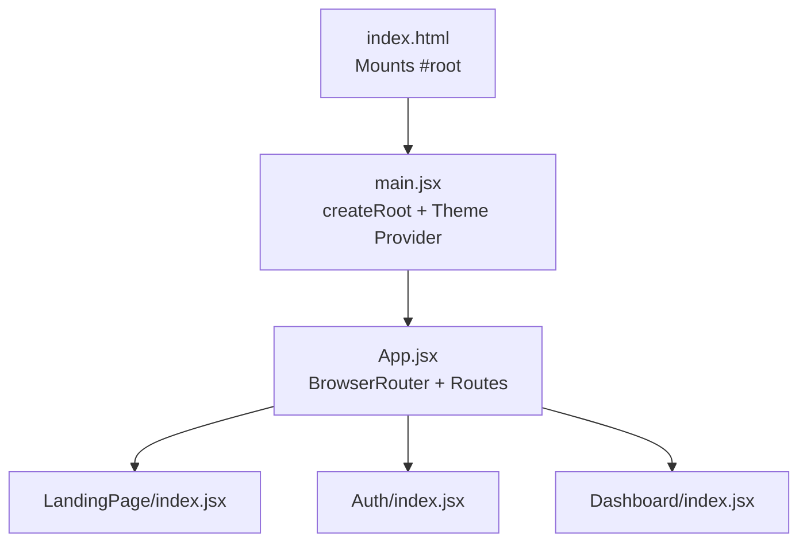
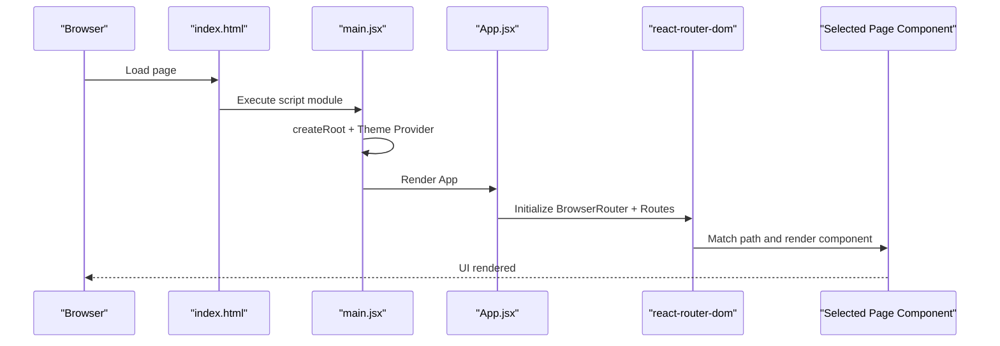
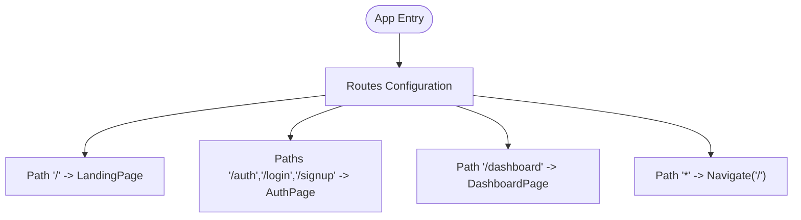
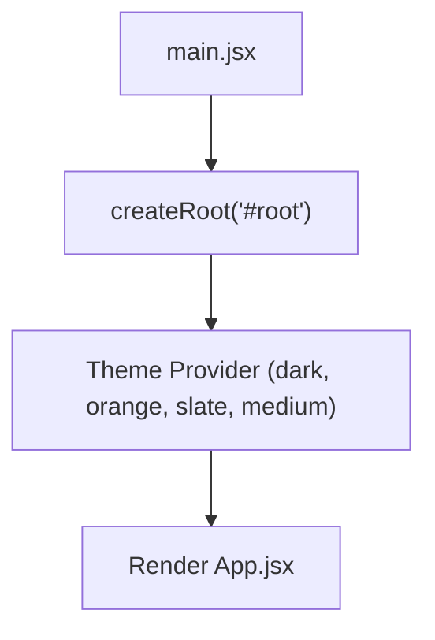
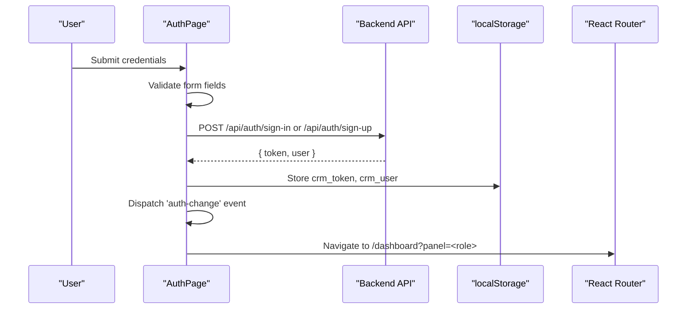
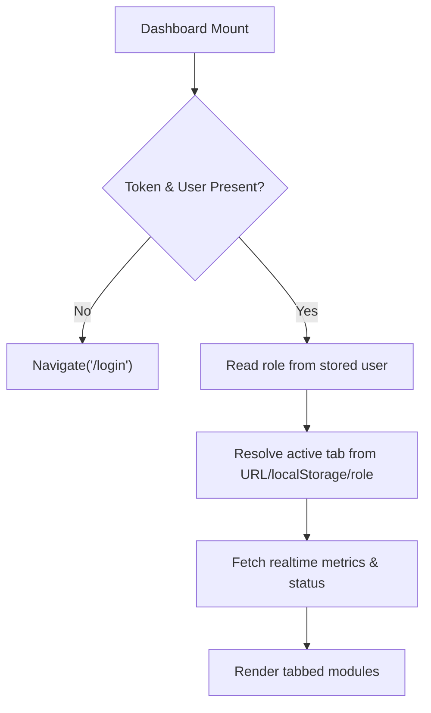
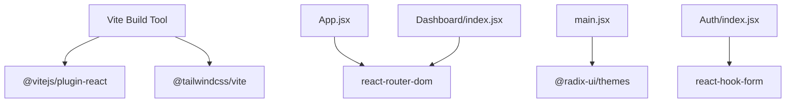

# Application Structure & Routing

<cite>
**Referenced Files in This Document**   
- [App.jsx](file://frontend/src/App.jsx)
- [main.jsx](file://frontend/src/main.jsx)
- [vite.config.js](file://frontend/vite.config.js)
- [package.json](file://frontend/package.json)
- [index.html](file://frontend/index.html)
- [Auth/index.jsx](file://frontend/src/Auth/index.jsx)
- [Dashboard/index.jsx](file://frontend/src/Dashboard/index.jsx)
- [LandingPage/index.jsx](file://frontend/src/LandingPage/index.jsx)
- [services/api.js](file://frontend/src/services/api.js)
</cite>

## Table of Contents
1. [Introduction](#introduction)
2. [Project Structure](#project-structure)
3. [Core Components](#core-components)
4. [Architecture Overview](#architecture-overview)
5. [Detailed Component Analysis](#detailed-component-analysis)
6. [Dependency Analysis](#dependency-analysis)
7. [Performance Considerations](#performance-considerations)
8. [Troubleshooting Guide](#troubleshooting-guide)
9. [Conclusion](#conclusion)

## Introduction
This document explains the React application structure and routing system for the frontend of the WhatsApp Automation CRM. It covers:
- The main App component architecture and route configuration
- Vite build configuration, development server setup, and asset handling
- Application bootstrap in main.jsx, global theme provider, and CSS imports
- Authentication flow integration with local storage and backend endpoints
- Error handling patterns and loading state management
- Route-based code splitting and lazy loading recommendations
- Environment-specific configurations and deployment considerations

The goal is to provide a clear, progressive guide that helps both new and experienced developers understand how the app boots, routes, authenticates, and builds.

## Project Structure
The frontend is a Vite + React application using react-router-dom for routing and Radix UI Themes for global styling. The entry point renders the root React tree inside index.html, then mounts the App component wrapped by a Theme provider.

**Diagram sources**
- [index.html:14-16](file://frontend/index.html#L14-L16)
- [main.jsx:1-11](file://frontend/src/main.jsx#L1-L11)
- [App.jsx:1-27](file://frontend/src/App.jsx#L1-L27)
- [LandingPage/index.jsx:1-23](file://frontend/src/LandingPage/index.jsx#L1-L23)
- [Auth/index.jsx:1-489](file://frontend/src/Auth/index.jsx#L1-L489)
- [Dashboard/index.jsx:1-800](file://frontend/src/Dashboard/index.jsx#L1-L800)

**Section sources**
- [index.html:1-19](file://frontend/index.html#L1-L19)
- [main.jsx:1-12](file://frontend/src/main.jsx#L1-L12)
- [App.jsx:1-27](file://frontend/src/App.jsx#L1-L27)

## Core Components
- App.jsx: Defines top-level routes for landing, authentication, and dashboard pages. Includes a fallback route that redirects to home.
- main.jsx: Bootstraps the React app, applies global theme settings from Radix UI Themes, and imports global styles.
- Auth/index.jsx: Handles sign-in and sign-up flows, stores JWT tokens and user profile in localStorage, and navigates to the dashboard based on user role.
- Dashboard/index.jsx: Role-aware dashboard shell with tabbed navigation, real-time metrics, and integrations management (WhatsApp/Instagram).
- LandingPage/index.jsx: Public-facing landing page composed of Navbar and HeroSection.

Key responsibilities:
- Routing: App.jsx uses BrowserRouter and Routes to map URL paths to components.
- Global theme: main.jsx wraps App with Theme to apply dark mode and accent colors.
- Authentication: Auth/index.jsx manages form validation, API calls, token persistence, and redirection.
- Dashboard: Dashboard/index.jsx enforces auth checks, manages tabs via URL query parameters, and fetches live data.

**Section sources**
- [App.jsx:1-27](file://frontend/src/App.jsx#L1-L27)
- [main.jsx:1-12](file://frontend/src/main.jsx#L1-L12)
- [Auth/index.jsx:1-489](file://frontend/src/Auth/index.jsx#L1-L489)
- [Dashboard/index.jsx:1-800](file://frontend/src/Dashboard/index.jsx#L1-L800)
- [LandingPage/index.jsx:1-23](file://frontend/src/LandingPage/index.jsx#L1-L23)

## Architecture Overview
At runtime, the browser loads index.html, which mounts the React root and executes main.jsx. main.jsx creates the root container, applies the Radix Theme provider, and renders App.jsx. App.jsx sets up routing and selects the appropriate page component based on the current URL.

**Diagram sources**
- [index.html:14-16](file://frontend/index.html#L14-L16)
- [main.jsx:1-11](file://frontend/src/main.jsx#L1-L11)
- [App.jsx:1-27](file://frontend/src/App.jsx#L1-L27)

## Detailed Component Analysis

### App.jsx: Top-Level Routing
App.jsx configures the following routes:
- "/" -> LandingPage
- "/auth", "/login", "/signup" -> AuthPage with defaultMode prop
- "/dashboard" -> DashboardPage
- Fallback "*" -> Navigate to "/"

This provides a simple, declarative routing setup without nested layouts or guards at this level.

**Diagram sources**
- [App.jsx:1-27](file://frontend/src/App.jsx#L1-L27)

**Section sources**
- [App.jsx:1-27](file://frontend/src/App.jsx#L1-L27)

### main.jsx: Bootstrap and Global Theme
main.jsx:
- Creates the React root at "#root"
- Imports global CSS and Radix UI themes
- Wraps App with Theme provider configured for dark appearance, orange accent, slate gray, and medium radius

This establishes the visual baseline for the entire application.

**Diagram sources**
- [main.jsx:1-11](file://frontend/src/main.jsx#L1-L11)

**Section sources**
- [main.jsx:1-12](file://frontend/src/main.jsx#L1-L12)

### Auth/index.jsx: Authentication Flow
AuthPage handles:
- Form state and validation using react-hook-form
- Dynamic API base URL selection via environment variables and hostname detection
- Sign-up and sign-in requests to backend endpoints
- Storing JWT token and user profile in localStorage
- Dispatching a custom 'auth-change' event for cross-component synchronization
- Redirecting to /dashboard with panel parameter based on user role

**Diagram sources**
- [Auth/index.jsx:34-119](file://frontend/src/Auth/index.jsx#L34-L119)

**Section sources**
- [Auth/index.jsx:1-489](file://frontend/src/Auth/index.jsx#L1-L489)

### Dashboard/index.jsx: Role-Aware Shell and Tabs
DashboardPage:
- Reads stored user and token from localStorage
- Determines default tab based on role and URL query params
- Persists active tab to localStorage and URL
- Enforces authentication by redirecting to /login if no token/user present
- Fetches real-time metrics and integrates with Meta APIs (WhatsApp/Instagram)
- Provides tabbed UI for modules like users, leads, employees, whatsapp, todos, etc.

**Diagram sources**
- [Dashboard/index.jsx:53-87](file://frontend/src/Dashboard/index.jsx#L53-L87)
- [Dashboard/index.jsx:336-352](file://frontend/src/Dashboard/index.jsx#L336-L352)

**Section sources**
- [Dashboard/index.jsx:1-800](file://frontend/src/Dashboard/index.jsx#L1-L800)

### LandingPage/index.jsx: Public Landing
LandingPage composes Navbar and HeroSection within a dark-themed layout. It serves as the public entry point before authentication.

**Section sources**
- [LandingPage/index.jsx:1-23](file://frontend/src/LandingPage/index.jsx#L1-L23)

## Dependency Analysis
The frontend depends on:
- React and ReactDOM for rendering
- react-router-dom for client-side routing
- Radix UI Themes for global theme provider
- Tailwind CSS via @tailwindcss/vite plugin
- Vite for build tooling and dev server
- Additional libraries for forms, icons, animations, and state management

**Diagram sources**
- [package.json:12-47](file://frontend/package.json#L12-L47)
- [vite.config.js:1-29](file://frontend/vite.config.js#L1-L29)
- [App.jsx:1-27](file://frontend/src/App.jsx#L1-L27)
- [main.jsx:1-11](file://frontend/src/main.jsx#L1-L11)
- [Auth/index.jsx:1-489](file://frontend/src/Auth/index.jsx#L1-L489)
- [Dashboard/index.jsx:1-800](file://frontend/src/Dashboard/index.jsx#L1-L800)

**Section sources**
- [package.json:1-49](file://frontend/package.json#L1-L49)
- [vite.config.js:1-29](file://frontend/vite.config.js#L1-L29)

## Performance Considerations
- Code Splitting and Lazy Loading:
  - Use React.lazy and Suspense to load heavy route components (e.g., DashboardPage, large dashboards) only when needed.
  - Example pattern: wrap DashboardPage with React.lazy and show a loading indicator while it loads.
- Asset Handling:
  - Static assets under public are served directly; ensure images and fonts are optimized.
  - Use import.meta.env for environment-specific URLs to avoid hardcoding.
- Network Requests:
  - Debounce or throttle frequent network calls (e.g., polling metrics) to reduce overhead.
  - Cache responses where possible and invalidate caches on relevant actions.
- Bundle Size:
  - Remove unused dependencies and avoid importing heavy libraries unless necessary.
  - Leverage Vite’s native ESM support and tree-shaking.

[No sources needed since this section provides general guidance]

## Troubleshooting Guide
Common issues and resolutions:
- Authentication Redirect Loop:
  - Ensure localStorage contains both crm_token and crm_user. If missing, Dashboard redirects to /login.
  - Verify backend returns valid token and user payload.
- API Base URL Misconfiguration:
  - Confirm VITE_API_BASE_URL is set correctly in environment variables.
  - For local development, hostname detection falls back to http://localhost:5000; ensure backend runs there.
- Dev Server Proxy:
  - Vite proxies /api to http://127.0.0.1:8000 by default; adjust target if your backend runs on a different port.
- Theme Not Applied:
  - Ensure main.jsx wraps App with Theme provider and imports Radix theme CSS.
- Navigation Issues:
  - Verify routes in App.jsx match the intended paths and that Navigate fallback is configured.

**Section sources**
- [Dashboard/index.jsx:336-352](file://frontend/src/Dashboard/index.jsx#L336-L352)
- [Auth/index.jsx:34-119](file://frontend/src/Auth/index.jsx#L34-L119)
- [vite.config.js:21-28](file://frontend/vite.config.js#L21-L28)
- [main.jsx:1-11](file://frontend/src/main.jsx#L1-L11)
- [App.jsx:1-27](file://frontend/src/App.jsx#L1-L27)

## Conclusion
The application follows a straightforward React + Vite architecture with clear separation between routing, authentication, and dashboard modules. The bootstrap process applies a global theme, and routing is declaratively defined in App.jsx. Authentication persists tokens and user profiles locally and synchronizes across components via events. Development benefits from Vite’s fast dev server and proxy configuration, while production builds can be optimized through lazy loading and careful dependency management. Environment variables enable flexible configuration across local and deployed environments.

[No sources needed since this section summarizes without analyzing specific files]