# Campaign Automation System

<cite>
**Referenced Files in This Document**
- [server.js](file://backend/server.js)
- [template.js](file://backend/routes/template.js)
- [contacts.js](file://backend/routes/contacts.js)
- [leads.js](file://backend/routes/leads.js)
- [analytics.js](file://backend/routes/analytics.js)
- [Template.js](file://backend/models/Template.js)
- [Contact.js](file://backend/models/Contact.js)
- [Lead.js](file://backend/models/Lead.js)
- [MessageLog.js](file://backend/models/MessageLog.js)
- [metaTemplateService.js](file://backend/utils/metaTemplateService.js)
- [conversationFlow.js](file://backend/utils/conversationFlow.js)
- [WhatsappBlast.jsx](file://frontend/src/Dashboard/WhatsappBlast.jsx)
- [Whatsapp_Message.jsx](file://frontend/src/Dashboard/Whatsapp_Message.jsx)
</cite>

## Table of Contents
1. [Introduction](#introduction)
2. [Project Structure](#project-structure)
3. [Core Components](#core-components)
4. [Architecture Overview](#architecture-overview)
5. [Detailed Component Analysis](#detailed-component-analysis)
6. [Dependency Analysis](#dependency-analysis)
7. [Performance Considerations](#performance-considerations)
8. [Troubleshooting Guide](#troubleshooting-guide)
9. [Conclusion](#conclusion)

## Introduction
This document explains the campaign automation system for WhatsApp messaging. It covers how campaigns are created, how audiences are segmented, how scheduling and execution work, and how template-based messaging with personalization is implemented. It also documents monitoring, analytics, integration with contacts and leads, real-time status updates, error handling, retry behavior, and compliance features such as opt-out controls.

The system uses:
- A Node.js Express backend with MongoDB models for templates, contacts, leads, and message logs.
- Meta WhatsApp Cloud API for template creation, approval, and sending.
- A React dashboard for template authoring, audience selection, blast dispatch, and live chat monitoring.
- WebSockets for real-time inbound messages, auto-replies, and delivery status updates.

## Project Structure
At a high level:
- Backend routes expose APIs for templates, contacts, leads, analytics, and WhatsApp operations.
- Models define data structures for templates, contacts, leads, and message logs.
- Utilities handle Meta API interactions and conversation flow logic.
- Frontend dashboards provide UI for template studio, blast dispatch, and live chat.

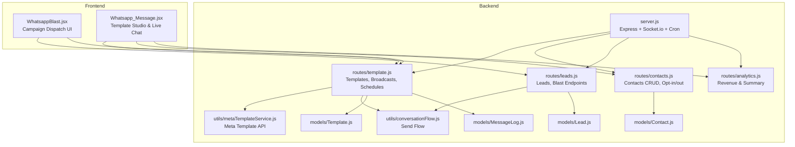

**Diagram sources**
- [server.js:1-82](file://backend/server.js#L1-L82)
- [template.js:1-1065](file://backend/routes/template.js#L1-L1065)
- [contacts.js:1-232](file://backend/routes/contacts.js#L1-L232)
- [leads.js:1-344](file://backend/routes/leads.js#L1-L344)
- [analytics.js:1-85](file://backend/routes/analytics.js#L1-L85)
- [Template.js:1-70](file://backend/models/Template.js#L1-L70)
- [Contact.js:1-26](file://backend/models/Contact.js#L1-L26)
- [Lead.js:1-70](file://backend/models/Lead.js#L1-L70)
- [MessageLog.js:1-22](file://backend/models/MessageLog.js#L1-L22)
- [metaTemplateService.js:1-255](file://backend/utils/metaTemplateService.js#L1-L255)
- [conversationFlow.js:1-122](file://backend/utils/conversationFlow.js#L1-L122)
- [WhatsappBlast.jsx:1-713](file://frontend/src/Dashboard/WhatsappBlast.jsx#L1-L713)
- [Whatsapp_Message.jsx:1-800](file://frontend/src/Dashboard/Whatsapp_Message.jsx#L1-L800)

**Section sources**
- [server.js:1-82](file://backend/server.js#L1-L82)

## Core Components
- Templates: Store approved or draft Meta templates, including components, media references, scheduling fields, and send counters.
- Contacts: Store opted-in recipients with segmentation and opt-out flags.
- Leads: Store sales pipeline entries; can be used as blast targets.
- Message Logs: Persist outbound/inbound message metadata for monitoring and analytics.
- Meta Integration: Create, delete, fetch, and upload media for templates via Meta Graph API.
- Conversation Flow: Build personalized template payloads and send them through Meta Cloud API.
- Dashboard: Provide UI for template authoring, audience selection, blast dispatch, and live chat.

Key responsibilities:
- Template lifecycle: create, validate, submit to Meta, update, recreate, import, list.
- Audience management: import, upsert, segment, opt-out/opt-in.
- Blast execution: direct send and scheduled broadcasts.
- Real-time monitoring: WebSocket events for incoming messages, auto-replies, and status updates.

**Section sources**
- [Template.js:1-70](file://backend/models/Template.js#L1-L70)
- [Contact.js:1-26](file://backend/models/Contact.js#L1-L26)
- [Lead.js:1-70](file://backend/models/Lead.js#L1-L70)
- [MessageLog.js:1-22](file://backend/models/MessageLog.js#L1-L22)
- [metaTemplateService.js:1-255](file://backend/utils/metaTemplateService.js#L1-L255)
- [conversationFlow.js:1-122](file://backend/utils/conversationFlow.js#L1-L122)
- [WhatsappBlast.jsx:1-713](file://frontend/src/Dashboard/WhatsappBlast.jsx#L1-L713)
- [Whatsapp_Message.jsx:1-800](file://frontend/src/Dashboard/Whatsapp_Message.jsx#L1-L800)

## Architecture Overview
The system follows a layered architecture:
- Presentation layer (React): Template studio, blast studio, live chat.
- API layer (Express): Route handlers for templates, contacts, leads, analytics, and WhatsApp operations.
- Service layer (Utilities): Meta API client and conversation flow builder.
- Data layer (MongoDB): Templates, contacts, leads, message logs.
- Real-time layer (Socket.io): Inbound messages, auto-replies, status updates.
- Scheduler (cron): Runs scheduled broadcasts every minute.

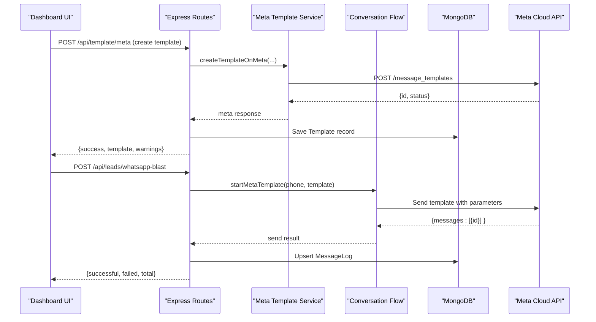

**Diagram sources**
- [template.js:747-786](file://backend/routes/template.js#L747-L786)
- [metaTemplateService.js:114-137](file://backend/utils/metaTemplateService.js#L114-L137)
- [conversationFlow.js:21-118](file://backend/utils/conversationFlow.js#L21-L118)
- [leads.js:229-341](file://backend/routes/leads.js#L229-L341)

## Detailed Component Analysis

### Campaign Creation Workflow
- Template authoring occurs in the frontend studio, which validates inputs against backend presets and limits.
- The backend normalizes the payload, resolves header media, builds components, and submits to Meta.
- On success, the system stores a local template record with Meta ID, status, and preview assets.

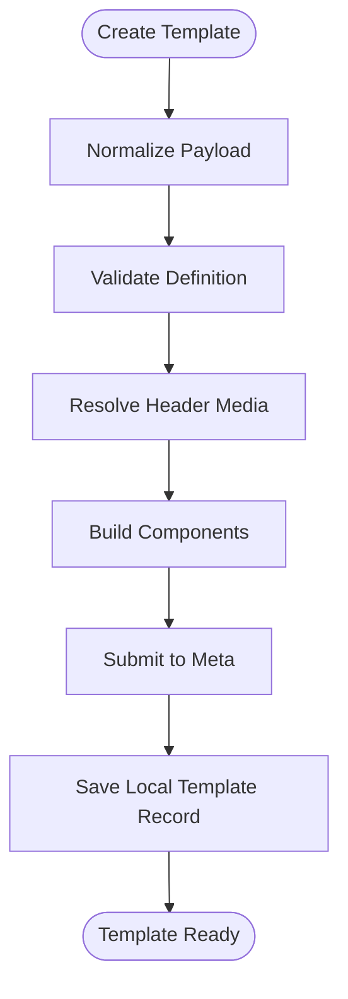

**Diagram sources**
- [template.js:146-199](file://backend/routes/template.js#L146-L199)
- [metaTemplateService.js:114-137](file://backend/utils/metaTemplateService.js#L114-L137)

**Section sources**
- [Whatsapp_Message.jsx:93-210](file://frontend/src/Dashboard/Whatsapp_Message.jsx#L93-L210)
- [template.js:146-199](file://backend/routes/template.js#L146-L199)
- [metaTemplateService.js:114-137](file://backend/utils/metaTemplateService.js#L114-L137)

### Audience Segmentation
- Contacts support segmentation into new, regular, and VIP based on order history.
- Segment refresh endpoint recomputes segments across all contacts.
- Opt-out/opt-in endpoints enforce compliance by excluding opted-out contacts from sends.

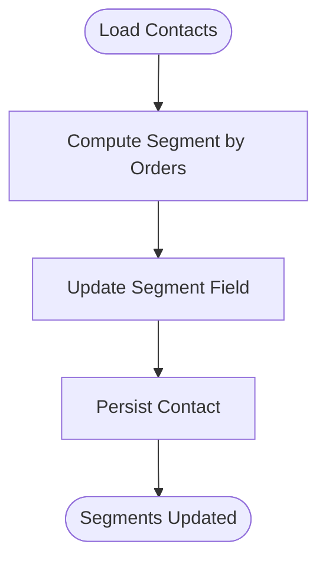

**Diagram sources**
- [Contact.js:19-24](file://backend/models/Contact.js#L19-L24)
- [contacts.js:208-218](file://backend/routes/contacts.js#L208-L218)

**Section sources**
- [Contact.js:1-26](file://backend/models/Contact.js#L1-L26)
- [contacts.js:133-140](file://backend/routes/contacts.js#L133-L140)
- [contacts.js:208-218](file://backend/routes/contacts.js#L208-L218)

### Scheduling Mechanisms
- Templates can be scheduled with time, repeat options, and day filters.
- A cron job runs every minute to execute due scheduled templates.
- Scheduled templates toggle active state and track next run times.

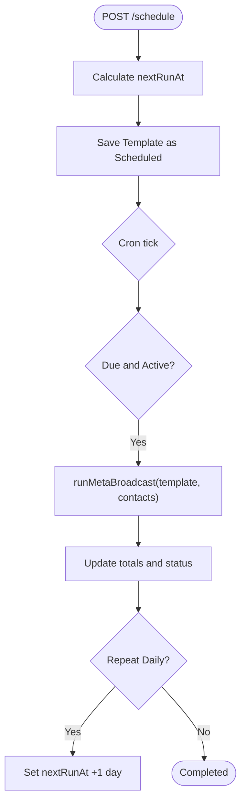

**Diagram sources**
- [template.js:443-486](file://backend/routes/template.js#L443-L486)
- [server.js:69-75](file://backend/server.js#L69-L75)

**Section sources**
- [template.js:443-504](file://backend/routes/template.js#L443-L504)
- [server.js:69-75](file://backend/server.js#L69-L75)

### Execution Engine
- Direct blast endpoint accepts template name and target IDs or phones.
- Targets are normalized to 10-digit phone numbers.
- For each recipient, the engine checks opt-out, personalizes body variables, and sends via Meta Cloud API.
- Each send attempt logs results to MessageLog and increments contact counters.

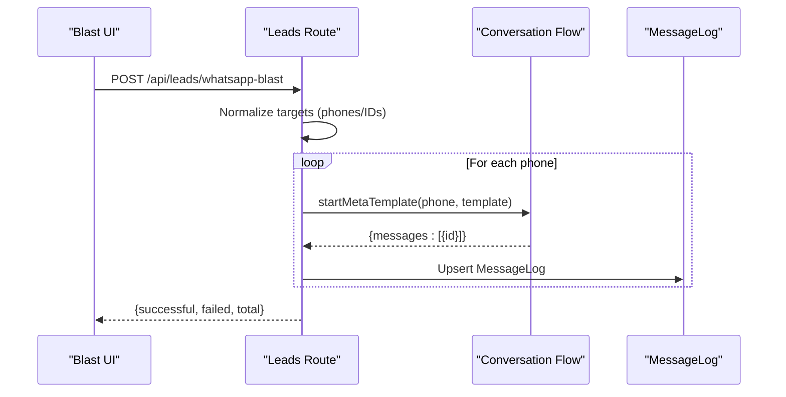

**Diagram sources**
- [leads.js:229-341](file://backend/routes/leads.js#L229-L341)
- [conversationFlow.js:21-118](file://backend/utils/conversationFlow.js#L21-L118)
- [MessageLog.js:1-22](file://backend/models/MessageLog.js#L1-L22)

**Section sources**
- [leads.js:229-341](file://backend/routes/leads.js#L229-L341)
- [conversationFlow.js:21-118](file://backend/utils/conversationFlow.js#L21-L118)

### Template-Based Messaging and Personalization
- Templates include headers (image/text), body text with variables, footers, and buttons.
- Body variables are normalized to indexed placeholders and sample values are generated or preserved.
- During send, the engine substitutes contact names into variables when present.

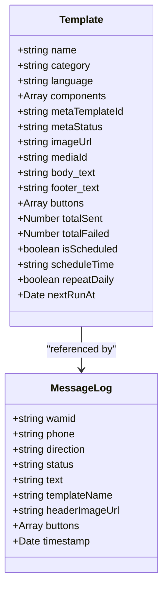

**Diagram sources**
- [Template.js:1-70](file://backend/models/Template.js#L1-L70)
- [MessageLog.js:1-22](file://backend/models/MessageLog.js#L1-L22)

**Section sources**
- [metaTemplateService.js:23-70](file://backend/utils/metaTemplateService.js#L23-L70)
- [conversationFlow.js:101-118](file://backend/utils/conversationFlow.js#L101-L118)

### A/B Testing Capabilities
- The current implementation does not include built-in A/B testing variants or split routing.
- Teams can simulate A/B testing by creating multiple templates and dispatching them to different audience subsets using the blast endpoints.

[No sources needed since this section provides conceptual guidance]

### Monitoring, Performance Analytics, and ROI Tracking
- Message logs capture outbound messages with template details, enabling per-campaign performance tracking.
- Analytics endpoints provide revenue summaries, top items, and contact counts.
- Revenue metrics consider only delivered orders, aligning ROI calculations with successful outcomes.

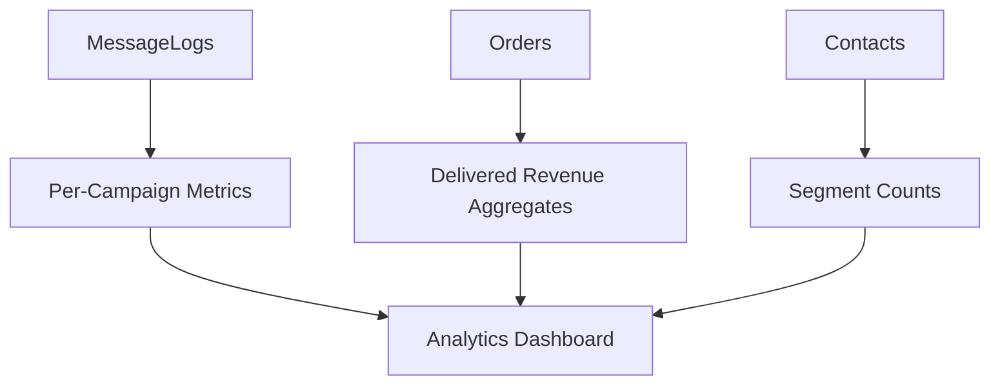

**Diagram sources**
- [MessageLog.js:1-22](file://backend/models/MessageLog.js#L1-L22)
- [analytics.js:1-85](file://backend/routes/analytics.js#L1-L85)

**Section sources**
- [analytics.js:1-85](file://backend/routes/analytics.js#L1-L85)
- [MessageLog.js:1-22](file://backend/models/MessageLog.js#L1-L22)

### Integration with Contact Databases and Lead Management
- Contacts: CRUD, Excel import, identity migration, opt-out/opt-in, segment refresh.
- Leads: CRUD, deduplication, single test message, batch blast.
- Both datasets can be used as blast targets; phone normalization ensures consistent matching.

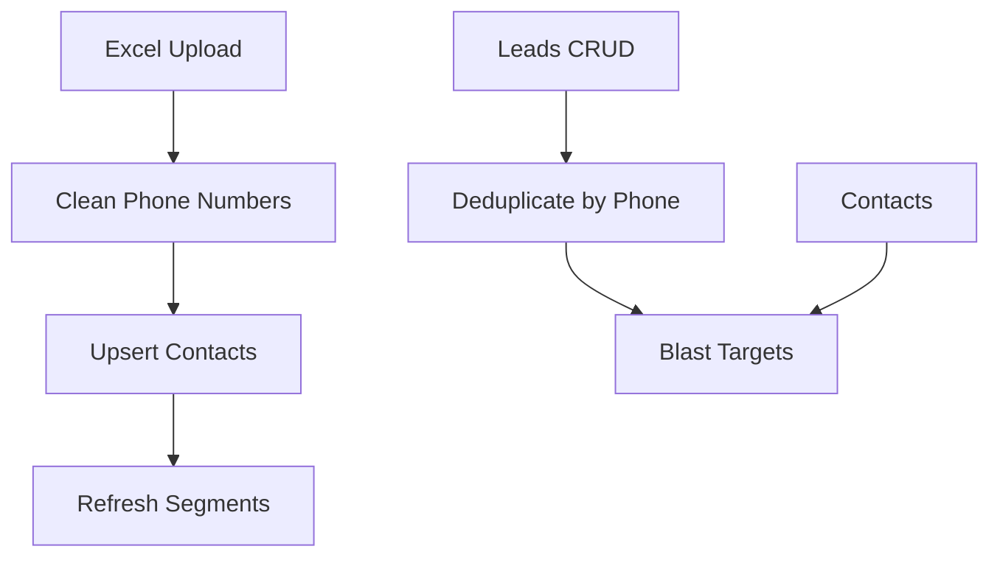

**Diagram sources**
- [contacts.js:12-54](file://backend/routes/contacts.js#L12-L54)
- [contacts.js:86-122](file://backend/routes/contacts.js#L86-L122)
- [contacts.js:208-218](file://backend/routes/contacts.js#L208-L218)
- [leads.js:134-157](file://backend/routes/leads.js#L134-L157)

**Section sources**
- [contacts.js:12-54](file://backend/routes/contacts.js#L12-L54)
- [contacts.js:86-122](file://backend/routes/contacts.js#L86-L122)
- [contacts.js:208-218](file://backend/routes/contacts.js#L208-L218)
- [leads.js:134-157](file://backend/routes/leads.js#L134-L157)

### Real-Time Campaign Status Updates
- WebSockets broadcast inbound messages, auto-replies, and delivery status updates.
- Frontend listens for events and updates chat logs and unread badges in real time.

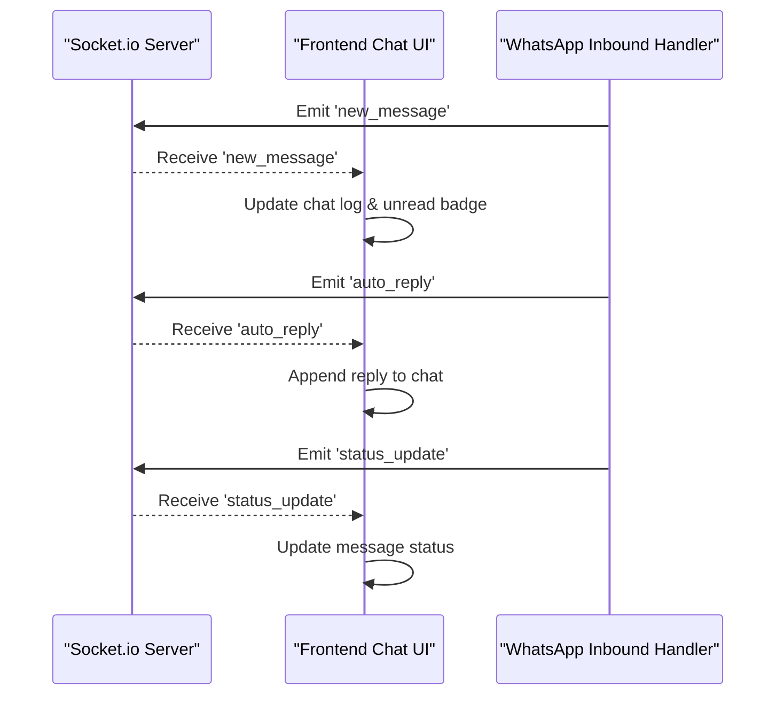

**Diagram sources**
- [server.js:14-35](file://backend/server.js#L14-L35)
- [Whatsapp_Message.jsx:470-537](file://frontend/src/Dashboard/Whatsapp_Message.jsx#L470-L537)

**Section sources**
- [server.js:14-35](file://backend/server.js#L14-L35)
- [Whatsapp_Message.jsx:470-537](file://frontend/src/Dashboard/Whatsapp_Message.jsx#L470-L537)

### Error Handling, Retry Mechanisms, and Compliance
- Error handling:
  - Global Express error middleware returns standardized JSON errors.
  - Template route helper formats Meta API errors and maps HTTP statuses.
  - Individual endpoints catch and return user-friendly messages.
- Retry mechanisms:
  - No explicit retry queue is implemented; sends are attempted once per recipient with jittered delays between calls.
  - Failed sends increment failure counters and persist logs for later analysis.
- Compliance:
  - Opt-out flag prevents sending to opted-out contacts.
  - Opt-in/opt-out endpoints allow users to manage consent.
  - Template submission requires Meta approval before sending.

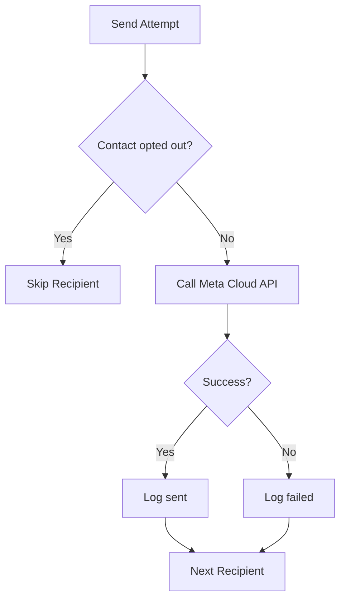

**Diagram sources**
- [conversationFlow.js:21-26](file://backend/utils/conversationFlow.js#L21-L26)
- [template.js:319-391](file://backend/routes/template.js#L319-L391)
- [contacts.js:220-230](file://backend/routes/contacts.js#L220-L230)

**Section sources**
- [server.js:58-62](file://backend/server.js#L58-L62)
- [template.js:222-247](file://backend/routes/template.js#L222-L247)
- [conversationFlow.js:21-26](file://backend/utils/conversationFlow.js#L21-L26)
- [contacts.js:220-230](file://backend/routes/contacts.js#L220-L230)

## Dependency Analysis
Key dependencies and relationships:
- server.js wires routes, WebSockets, and cron scheduler.
- template.js depends on metaTemplateService.js and conversationFlow.js for Meta integration and sending.
- contacts.js and leads.js depend on models and utilities for data persistence and sending.
- analytics.js aggregates order and contact data for reporting.
- Frontend components call backend routes and consume WebSocket events.

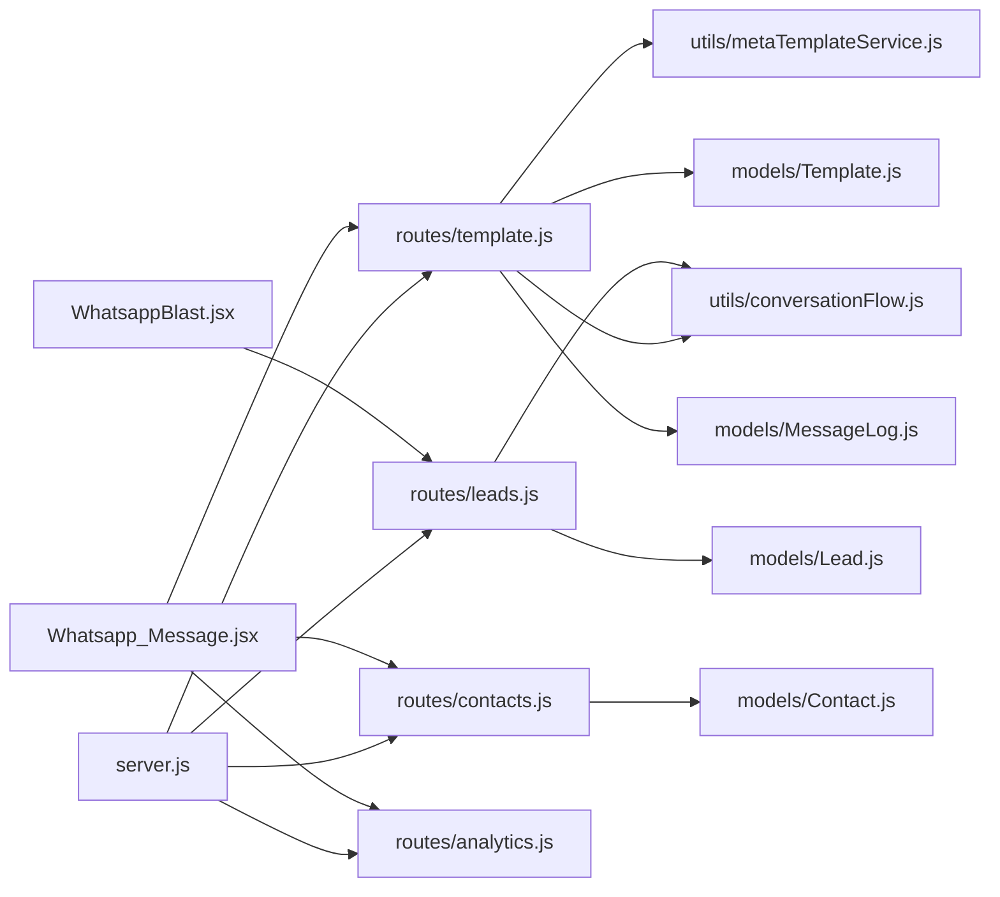

**Diagram sources**
- [server.js:43-56](file://backend/server.js#L43-L56)
- [template.js:1-31](file://backend/routes/template.js#L1-L31)
- [contacts.js:1-9](file://backend/routes/contacts.js#L1-L9)
- [leads.js:1-6](file://backend/routes/leads.js#L1-L6)
- [analytics.js:1-5](file://backend/routes/analytics.js#L1-L5)
- [metaTemplateService.js:1-4](file://backend/utils/metaTemplateService.js#L1-L4)
- [conversationFlow.js:1-7](file://backend/utils/conversationFlow.js#L1-L7)
- [WhatsappBlast.jsx:67-75](file://frontend/src/Dashboard/WhatsappBlast.jsx#L67-L75)
- [Whatsapp_Message.jsx:545-577](file://frontend/src/Dashboard/Whatsapp_Message.jsx#L545-L577)

**Section sources**
- [server.js:43-56](file://backend/server.js#L43-L56)
- [template.js:1-31](file://backend/routes/template.js#L1-L31)
- [contacts.js:1-9](file://backend/routes/contacts.js#L1-L9)
- [leads.js:1-6](file://backend/routes/leads.js#L1-L6)
- [analytics.js:1-5](file://backend/routes/analytics.js#L1-L5)

## Performance Considerations
- Jittered delays between sends reduce rate-limit pressure on Meta API.
- Bulk sends iterate sequentially; consider batching or worker queues for large audiences.
- Media resolution may involve network I/O; caching media IDs where possible reduces repeated uploads.
- Real-time polling for chat logs runs every 3 seconds; adjust frequency based on traffic.

[No sources needed since this section provides general guidance]

## Troubleshooting Guide
Common issues and resolutions:
- Meta template submission failures:
  - Ensure required body component exists and variables are valid.
  - Verify header media is uploaded correctly and accessible.
  - Check Meta credentials and WABA configuration.
- Sending failures:
  - Confirm recipient phone number format and opt-out status.
  - Inspect MessageLog for error codes and messages.
- Scheduling not executing:
  - Verify cron is running and template is active and due.
  - Check nextRunAt and repeat settings.
- Real-time updates not appearing:
  - Confirm WebSocket connection and event listeners.
  - Validate server emits correct events and frontend subscribes.

**Section sources**
- [template.js:222-247](file://backend/routes/template.js#L222-L247)
- [conversationFlow.js:21-26](file://backend/utils/conversationFlow.js#L21-L26)
- [server.js:69-75](file://backend/server.js#L69-L75)
- [Whatsapp_Message.jsx:470-537](file://frontend/src/Dashboard/Whatsapp_Message.jsx#L470-L537)

## Conclusion
The campaign automation system provides a robust foundation for WhatsApp marketing and engagement:
- Template-driven messaging with personalization and media support.
- Flexible audience segmentation and compliance controls.
- Scheduling and execution engines for both immediate and recurring campaigns.
- Real-time monitoring and analytics for performance insights.
- Clear error handling and logging to aid troubleshooting and optimization.

For advanced needs like A/B testing, multi-channel orchestration, and sophisticated retry queues, consider extending the current architecture with dedicated services and background workers.