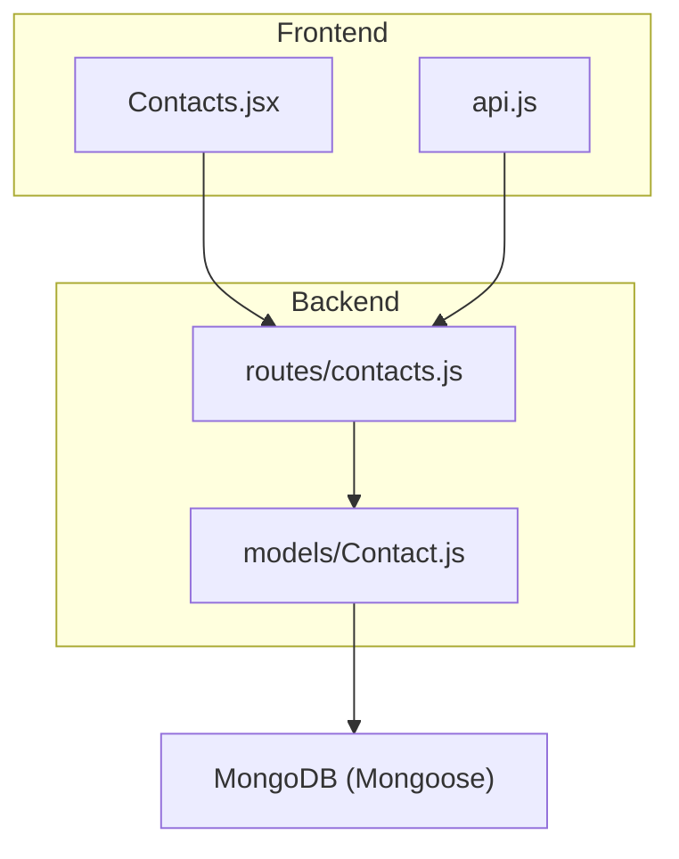
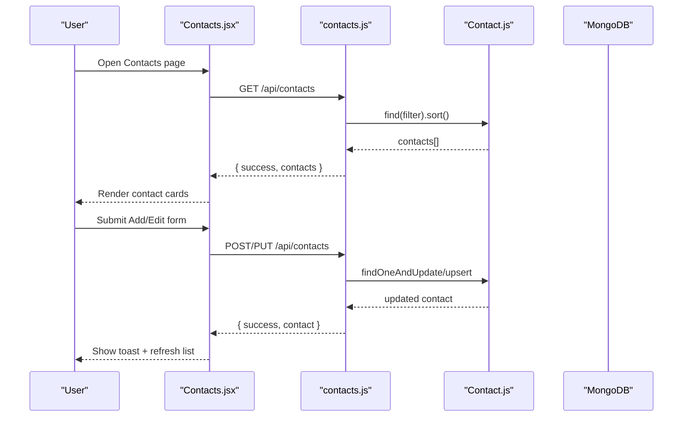
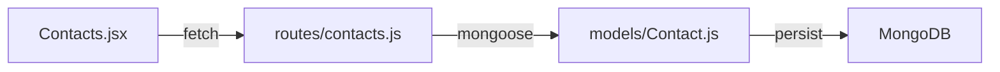

# Contacts Management Module

<cite>
**Referenced Files in This Document**
- [Contact.js](file://backend/models/Contact.js)
- [contacts.js](file://backend/routes/contacts.js)
- [Contacts.jsx](file://frontend/src/Dashboard/Contacts.jsx)
- [api.js](file://frontend/src/services/api.js)
</cite>

## Table of Contents
1. [Introduction](#introduction)
2. [Project Structure](#project-structure)
3. [Core Components](#core-components)
4. [Architecture Overview](#architecture-overview)
5. [Detailed Component Analysis](#detailed-component-analysis)
6. [Dependency Analysis](#dependency-analysis)
7. [Performance Considerations](#performance-considerations)
8. [Troubleshooting Guide](#troubleshooting-guide)
9. [Conclusion](#conclusion)

## Introduction
This document explains the contacts management module that allows users to manage WhatsApp-related contact records. It covers data display, search and filtering, CRUD operations, Excel-based bulk import, manual messaging, status tracking, segmentation, opt-in/opt-out controls, and UI components for contact cards and modals. The module integrates a React frontend with an Express backend and MongoDB via Mongoose.

## Project Structure
The contacts module spans both backend and frontend:
- Backend model defines the Contact schema and segment computation logic.
- Backend routes expose REST endpoints for upload, create, update, delete, list, send message, refresh segments, and opt-in/out.
- Frontend component provides the user interface for listing, searching, filtering, adding/editing contacts, bulk importing from Excel/CSV, and triggering actions like direct chat or deletion.
- A shared API helper provides base URL resolution and health checks.

**Diagram sources**
- [Contacts.jsx:135-170](file://frontend/src/Dashboard/Contacts.jsx#L135-L170)
- [api.js:1-14](file://frontend/src/services/api.js#L1-L14)
- [contacts.js:1-10](file://backend/routes/contacts.js#L1-L10)
- [Contact.js:1-17](file://backend/models/Contact.js#L1-L17)

**Section sources**
- [Contact.js:1-26](file://backend/models/Contact.js#L1-L26)
- [contacts.js:1-232](file://backend/routes/contacts.js#L1-L232)
- [Contacts.jsx:1-1231](file://frontend/src/Dashboard/Contacts.jsx#L1-L1231)
- [api.js:1-73](file://frontend/src/services/api.js#L1-L73)

## Core Components
- Contact Model: Defines fields such as phone, name, email, source, lastStatus, templatesSent, ordersPlaced, totalSpend, lastOrderAt, optedOut, optedOutAt, segment, identity; includes a method to compute segment based on ordersPlaced.
- Contacts Routes: Provide endpoints for Excel upload, single/bulk save, list with filters, update, delete, send-message, refresh-segments, opt-out, opt-in, and identity migration.
- Contacts UI: Provides contact card grid, search/filter toolbar, add/edit modals, Excel upload modal, pagination, toast notifications, and confirmation modal.

Key responsibilities:
- Data persistence and validation at the model layer.
- Business logic and API contracts at the route layer.
- User interactions, form handling, and client-side validation at the UI layer.

**Section sources**
- [Contact.js:3-24](file://backend/models/Contact.js#L3-L24)
- [contacts.js:12-230](file://backend/routes/contacts.js#L12-L230)
- [Contacts.jsx:33-170](file://frontend/src/Dashboard/Contacts.jsx#L33-L170)

## Architecture Overview
The module follows a standard MVC-like pattern:
- Frontend component calls REST endpoints using fetch.
- Backend routes handle request parsing, validation, and business rules.
- Mongoose model persists data to MongoDB and computes derived fields.

**Diagram sources**
- [Contacts.jsx:150-170](file://frontend/src/Dashboard/Contacts.jsx#L150-L170)
- [contacts.js:56-84](file://backend/routes/contacts.js#L56-L84)
- [contacts.js:143-162](file://backend/routes/contacts.js#L143-L162)
- [Contact.js:3-17](file://backend/models/Contact.js#L3-L17)

## Detailed Component Analysis

### Contact Data Display
- The frontend fetches all contacts and maps backend IDs to a stable id field for rendering.
- Contact cards show initials avatar, identity tag, name, formatted phone (+91), optional email, and segment badge.
- Cards include quick actions: edit, open WhatsApp chat, call, and delete.

Implementation highlights:
- List fetching uses a centralized base URL resolver.
- Pagination is implemented client-side with 12 items per page.
- Empty state guidance encourages adding or uploading contacts.

**Section sources**
- [Contacts.jsx:150-170](file://frontend/src/Dashboard/Contacts.jsx#L150-L170)
- [Contacts.jsx:649-752](file://frontend/src/Dashboard/Contacts.jsx#L649-L752)
- [Contacts.jsx:755-788](file://frontend/src/Dashboard/Contacts.jsx#L755-L788)

### Search and Filter Functionality
- Search supports name, phone, email, and identity substring matching.
- Identity filter pills are dynamically computed from existing contacts plus defaults, with case-insensitive normalization.
- Filtering resets pagination to page 1.

Behavioral notes:
- Identity values normalize “General” to “SAP FICO” for display and filtering.
- Available identities include default tags and any custom ones present in the dataset.

**Section sources**
- [Contacts.jsx:437-467](file://frontend/src/Dashboard/Contacts.jsx#L437-L467)
- [Contacts.jsx:469-482](file://frontend/src/Dashboard/Contacts.jsx#L469-L482)

### CRUD Operations

#### Create Contact
- Validates required fields: name, phone (strict 10 digits), email (regex), identity.
- Normalizes phone by stripping non-digits and removing leading country code when needed.
- Sends POST to create or upsert by phone.

Validation rules:
- Phone must be exactly 10 digits and start with 6, 7, 8, or 9.
- Email must match a basic regex pattern.

**Section sources**
- [Contacts.jsx:177-219](file://frontend/src/Dashboard/Contacts.jsx#L177-L219)
- [Contacts.jsx:369-409](file://frontend/src/Dashboard/Contacts.jsx#L369-L409)
- [contacts.js:56-84](file://backend/routes/contacts.js#L56-L84)

#### Update Contact
- Edit modal pre-fills fields and sends PUT to update by ID.
- Server normalizes phone and identity before saving.

**Section sources**
- [Contacts.jsx:80-126](file://frontend/src/Dashboard/Contacts.jsx#L80-L126)
- [contacts.js:143-162](file://backend/routes/contacts.js#L143-L162)

#### Delete Contact
- Uses an in-app confirmation modal before calling DELETE by ID.
- On success, refreshes the contact list.

**Section sources**
- [Contacts.jsx:411-435](file://frontend/src/Dashboard/Contacts.jsx#L411-L435)
- [contacts.js:164-168](file://backend/routes/contacts.js#L164-L168)

### Bulk Import from Excel/CSV
- Supports .xlsx, .xls, and .csv files.
- Parses headers flexibly to detect Name, Phone, Email, Identity columns.
- Normalizes phone numbers and formats them for preview.
- Shows a preview table and submits parsed contacts to the backend bulk save endpoint.

Parsing behavior:
- Detects header row by scanning first rows for known column keywords.
- Falls back to positional indices if headers are not recognized.
- Skips blank rows and duplicates during server-side processing.

**Section sources**
- [Contacts.jsx:221-364](file://frontend/src/Dashboard/Contacts.jsx#L221-L364)
- [contacts.js:12-54](file://backend/routes/contacts.js#L12-L54)
- [contacts.js:86-122](file://backend/routes/contacts.js#L86-L122)

### Manual Messaging Integration
- The frontend can trigger sending a text message via the backend’s send-message endpoint.
- The backend sends the message through the WhatsApp service and logs it to MessageLog with direction OUTGOING and status sent.

Notes:
- The shared API helper demonstrates a sample call to send-message.
- Message logging is resilient to errors and continues after attempting to log.

**Section sources**
- [api.js:51-72](file://frontend/src/services/api.js#L51-L72)
- [contacts.js:170-206](file://backend/routes/contacts.js#L170-L206)

### Status Tracking and Segmentation
- Segment is auto-computed based on ordersPlaced: new (<2), regular (2–4), vip (≥5).
- A dedicated endpoint recomputes segments across all contacts.
- Opt-out flags and timestamps are supported; opt-in clears opt-out state.

Operational details:
- Segment computation is encapsulated in a model method and applied during refresh.
- Opt-out updates set optedOutAt; opt-in unsets optedOutAt.

**Section sources**
- [Contact.js:3-24](file://backend/models/Contact.js#L3-L24)
- [contacts.js:208-218](file://backend/routes/contacts.js#L208-L218)
- [contacts.js:220-230](file://backend/routes/contacts.js#L220-L230)

### UI Components
- Contact Card: Displays avatar initials, identity tag, name, phone, email, segment badge, and action buttons.
- Modals:
  - Add Contact: Enforces strict validation and shows real-time feedback.
  - Edit Contact: Pre-populates fields and allows updating identity and segment.
  - Upload Excel: Accepts files, parses, previews, and confirms bulk import.
- Toolbar: Search input, identity filter pills, and refresh button.
- Toast Notifications: Success/error messages with auto-dismiss.
- Confirmation Modal: Reusable confirmation dialog for destructive actions.

**Section sources**
- [Contacts.jsx:484-788](file://frontend/src/Dashboard/Contacts.jsx#L484-L788)
- [Contacts.jsx:792-964](file://frontend/src/Dashboard/Contacts.jsx#L792-L964)
- [Contacts.jsx:966-1095](file://frontend/src/Dashboard/Contacts.jsx#L966-L1095)
- [Contacts.jsx:1097-1214](file://frontend/src/Dashboard/Contacts.jsx#L1097-L1214)
- [Contacts.jsx:1216-1226](file://frontend/src/Dashboard/Contacts.jsx#L1216-L1226)

### Data Export Capabilities
- The current implementation does not provide a dedicated export endpoint or UI for exporting contacts.
- Users can download a CSV template for imports, but no reverse export functionality is present.

[No sources needed since this section summarizes missing capability]

### Real-Time Updates
- There is no WebSocket integration for live contact updates in this module.
- Refreshing the list requires explicit user action or re-fetching.

[No sources needed since this section summarizes absence of feature]

### Error Handling Strategies
- Client-side validation prevents invalid submissions and displays inline errors.
- Network errors and non-success responses are caught and shown via toast notifications.
- Backend returns structured JSON with success flag and message for error propagation.

**Section sources**
- [Contacts.jsx:177-219](file://frontend/src/Dashboard/Contacts.jsx#L177-L219)
- [Contacts.jsx:369-409](file://frontend/src/Dashboard/Contacts.jsx#L369-L409)
- [contacts.js:56-84](file://backend/routes/contacts.js#L56-L84)

## Dependency Analysis
The module has clear separation between UI, API, and data layers.

**Diagram sources**
- [Contacts.jsx:150-170](file://frontend/src/Dashboard/Contacts.jsx#L150-L170)
- [contacts.js:1-10](file://backend/routes/contacts.js#L1-L10)
- [Contact.js:1-17](file://backend/models/Contact.js#L1-L17)

**Section sources**
- [Contacts.jsx:1-1231](file://frontend/src/Dashboard/Contacts.jsx#L1-L1231)
- [contacts.js:1-232](file://backend/routes/contacts.js#L1-L232)
- [Contact.js:1-26](file://backend/models/Contact.js#L1-L26)

## Performance Considerations
- Client-side pagination reduces DOM size by rendering only a subset of contacts per page.
- Excel parsing occurs in-memory; large files may impact browser performance. Consider streaming or server-side parsing for very large datasets.
- Bulk save uses upserts per contact; for extremely large batches, consider batching writes or using ordered bulk operations on the backend.
- Avoid unnecessary re-renders by memoizing filtered results if the dataset grows significantly.
- Debounce search input to reduce frequent re-filtering on large lists.

[No sources needed since this section provides general guidance]

## Troubleshooting Guide
Common issues and resolutions:
- Phone validation fails: Ensure the number is exactly 10 digits and starts with 6, 7, 8, or 9.
- Email validation fails: Use a valid email format.
- Excel import yields no rows: Verify headers contain recognizable names for Name, Phone, Email, Identity; ensure rows are not blank.
- Duplicate contacts: The backend deduplicates by phone during upload and bulk save.
- Messaging failures: Check backend WhatsApp configuration and network connectivity; review MessageLog entries for outbound attempts.

**Section sources**
- [Contacts.jsx:177-219](file://frontend/src/Dashboard/Contacts.jsx#L177-L219)
- [Contacts.jsx:256-333](file://frontend/src/Dashboard/Contacts.jsx#L256-L333)
- [contacts.js:12-54](file://backend/routes/contacts.js#L12-L54)
- [contacts.js:170-206](file://backend/routes/contacts.js#L170-L206)

## Conclusion
The contacts management module provides a robust foundation for managing WhatsApp-related contacts with strong validation, flexible identity tagging, bulk import capabilities, and essential CRUD operations. While it lacks built-in export and real-time updates, its modular design makes these features straightforward to add. For production-scale usage, consider enhancing server-side pagination, debouncing search, optimizing bulk operations, and adding WebSocket-driven updates for live synchronization.