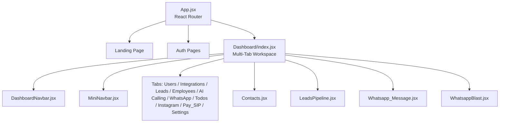
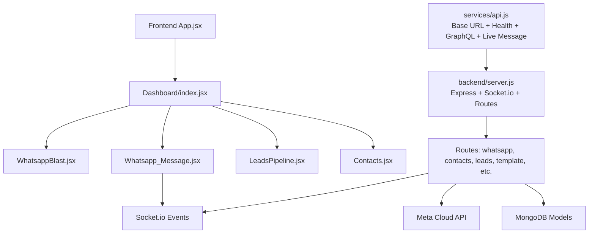
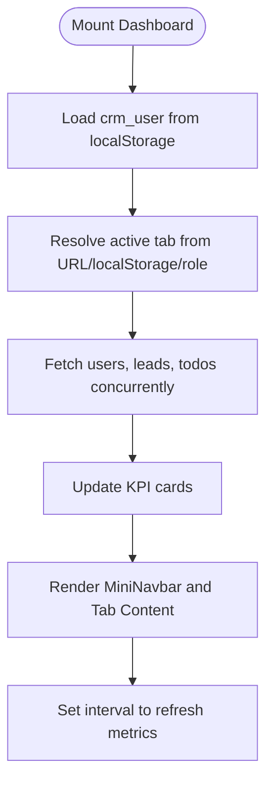
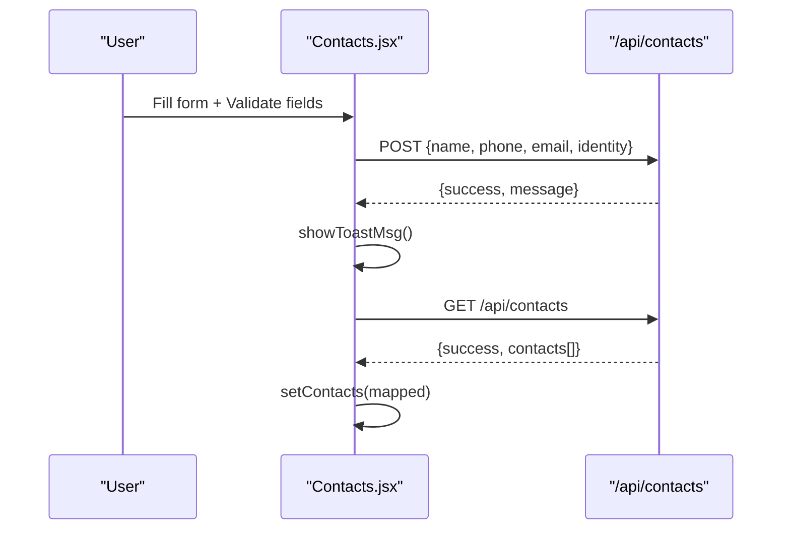
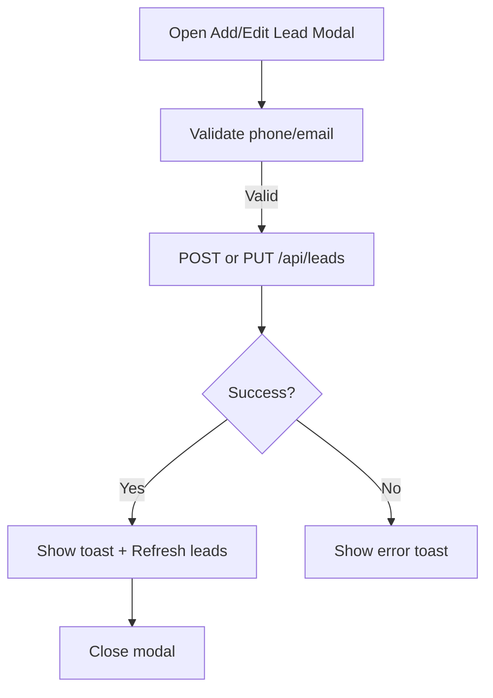
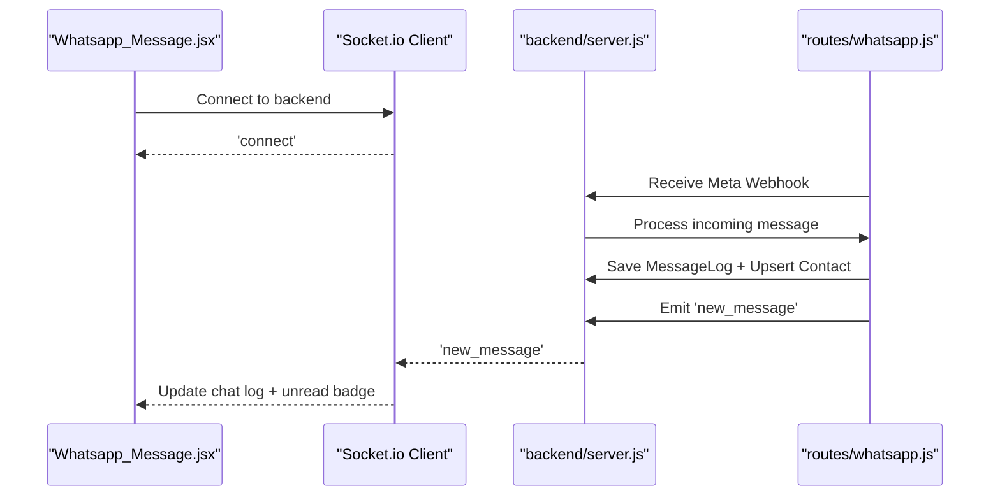
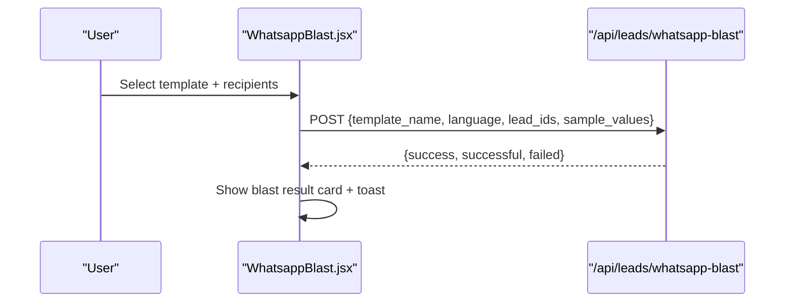
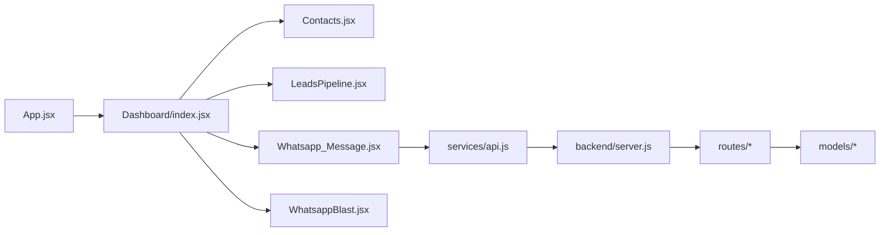

# Dashboard Components & Business Logic

<cite>
**Referenced Files in This Document**   
- [App.jsx](file://frontend/src/App.jsx)
- [Dashboard/index.jsx](file://frontend/src/Dashboard/index.jsx)
- [Contacts.jsx](file://frontend/src/Dashboard/Contacts.jsx)
- [LeadsPipeline.jsx](file://frontend/src/Dashboard/LeadsPipeline.jsx)
- [Whatsapp_Message.jsx](file://frontend/src/Dashboard/Whatsapp_Message.jsx)
- [WhatsappBlast.jsx](file://frontend/src/Dashboard/WhatsappBlast.jsx)
- [api.js](file://frontend/src/services/api.js)
- [server.js](file://backend/server.js)
- [whatsapp.js](file://backend/routes/whatsapp.js)
</cite>

## Table of Contents
1. [Introduction](#introduction)
2. [Project Structure](#project-structure)
3. [Core Components](#core-components)
4. [Architecture Overview](#architecture-overview)
5. [Detailed Component Analysis](#detailed-component-analysis)
6. [Dependency Analysis](#dependency-analysis)
7. [Performance Considerations](#performance-considerations)
8. [Troubleshooting Guide](#troubleshooting-guide)
9. [Conclusion](#conclusion)

## Introduction
This document explains the dashboard’s layout, navigation system, and module organization, then dives into key business components: Contacts management, Leads Pipeline visualization, WhatsApp messaging interface, and campaign automation features. It also documents data flow from API responses to UI updates, real-time message handling through WebSockets, user interaction patterns, state management, form handling, validation, backend integration, error handling, performance techniques, and responsive design patterns.

## Project Structure
The project is split into a React frontend under `frontend/src` and an Express backend under `backend`. The frontend app defines routes for landing, authentication, and the enterprise CRM dashboard. The dashboard itself is a multi-tab workspace with top KPI cards, a mini navigation bar, and tabbed modules such as User Management, Integrations, Leads, Employees, AI Calling, WhatsApp Gateway, Todo List, Instagram, Pay_SIP, and Settings.

**Diagram sources**
- [App.jsx:7-26](file://frontend/src/App.jsx#L7-L26)
- [Dashboard/index.jsx:53-87](file://frontend/src/Dashboard/index.jsx#L53-L87)

**Section sources**
- [App.jsx:7-26](file://frontend/src/App.jsx#L7-L26)
- [Dashboard/index.jsx:53-87](file://frontend/src/Dashboard/index.jsx#L53-L87)

## Core Components
- Dashboard Layout and Navigation
  - Role-based default tabs and URL-synced active tab state.
  - Top KPI cards showing total users, active leads, todo list, employees, and system health.
  - Mini navbar with tab selection persisted to localStorage and URL query parameters.
- Contacts Management
  - CRUD operations, Excel/CSV import, strict phone/email validation, identity filters, pagination, and toast feedback.
- Leads Pipeline Visualization
  - Cards/table view toggle, employee performance summary, status filtering, deduplication, bulk import/export, and stage updates.
- WhatsApp Messaging Interface
  - Template manager, live chat pane, WebSocket-driven inbound messages and auto-replies, unread badges, polling for logs, and optimistic UI updates.
- Campaign Automation (WhatsApp Blast)
  - Template selection, recipient selection from contacts or leads, preview personalization, single test send, and batch blast dispatch with result reporting.

**Section sources**
- [Dashboard/index.jsx:53-87](file://frontend/src/Dashboard/index.jsx#L53-L87)
- [Dashboard/index.jsx:185-250](file://frontend/src/Dashboard/index.jsx#L185-L250)
- [Contacts.jsx:33-174](file://frontend/src/Dashboard/Contacts.jsx#L33-L174)
- [LeadsPipeline.jsx:37-110](file://frontend/src/Dashboard/LeadsPipeline.jsx#L37-L110)
- [Whatsapp_Message.jsx:93-130](file://frontend/src/Dashboard/Whatsapp_Message.jsx#L93-L130)
- [WhatsappBlast.jsx:18-59](file://frontend/src/Dashboard/WhatsappBlast.jsx#L18-L59)

## Architecture Overview
The frontend communicates with the backend via REST APIs and real-time events over Socket.io. The backend exposes route handlers for auth, users, leads, whatsapp, contacts, templates, orders, menu, todos, paysip, and analytics. It also sets up a global Socket.io server and cron jobs for scheduled broadcasts.

**Diagram sources**
- [server.js:1-82](file://backend/server.js#L1-L82)
- [whatsapp.js:1-335](file://backend/routes/whatsapp.js#L1-L335)
- [api.js:1-73](file://frontend/src/services/api.js#L1-L73)

**Section sources**
- [server.js:1-82](file://backend/server.js#L1-L82)
- [whatsapp.js:1-335](file://backend/routes/whatsapp.js#L1-L335)
- [api.js:1-73](file://frontend/src/services/api.js#L1-L73)

## Detailed Component Analysis

### Dashboard Layout and Navigation
- Role-aware defaults: managers see leads by default; employees see WhatsApp; admins see users.
- Active tab persistence: stored in localStorage and mirrored in URL query params for shareable links.
- Realtime metrics: fetches users, leads, and todos concurrently every 5 seconds to update KPI cards.
- Integration panel: manages Meta WhatsApp configuration, including token masking, webhook sync, and connection status.

**Diagram sources**
- [Dashboard/index.jsx:53-87](file://frontend/src/Dashboard/index.jsx#L53-L87)
- [Dashboard/index.jsx:185-250](file://frontend/src/Dashboard/index.jsx#L185-L250)

**Section sources**
- [Dashboard/index.jsx:53-87](file://frontend/src/Dashboard/index.jsx#L53-L87)
- [Dashboard/index.jsx:185-250](file://frontend/src/Dashboard/index.jsx#L185-L250)

### Contacts Management
Key responsibilities:
- Fetch contacts from `/api/contacts`, map IDs, and render paginated grid.
- Create, edit, delete contacts with toast notifications and confirmation modal.
- Strict validation: exactly 10-digit Indian mobile numbers starting with 6–9; email regex validation.
- Excel/CSV upload using xlsx library with flexible header detection and normalization.
- Identity filter pills derived dynamically from existing contacts plus defaults.

Data flow example:
- Submitting a new contact triggers POST `/api/contacts`, then refreshes the list and shows success toast.

**Diagram sources**
- [Contacts.jsx:369-409](file://frontend/src/Dashboard/Contacts.jsx#L369-L409)
- [Contacts.jsx:150-174](file://frontend/src/Dashboard/Contacts.jsx#L150-L174)

Validation highlights:
- Phone input strips non-digits, removes leading 91 if present, caps at 10 digits, and enforces first digit range.
- Email input validates format with regex and clears errors on valid input.

Excel parsing highlights:
- Detects header row flexibly by scanning common column names.
- Normalizes phone numbers and maps columns to name, phone, email, identity.

**Section sources**
- [Contacts.jsx:176-219](file://frontend/src/Dashboard/Contacts.jsx#L176-L219)
- [Contacts.jsx:221-333](file://frontend/src/Dashboard/Contacts.jsx#L221-L333)
- [Contacts.jsx:369-409](file://frontend/src/Dashboard/Contacts.jsx#L369-L409)

### Leads Pipeline Visualization
Key responsibilities:
- Fetch leads from `/api/leads`, support create/update/delete, and stage changes.
- Employee performance summary computed from lead statuses and employee names.
- View mode toggle between cards and table.
- Bulk import CSV with per-row validation and individual POST calls.
- Deduplication endpoint call to purge duplicates.

State management:
- Form state includes name, phone, email, address, identity, employeeName, leadStatusUpdate, secondUpdate, finalUpdate, status.
- Validation mirrors Contacts component rules for phone and email.

**Diagram sources**
- [LeadsPipeline.jsx:274-322](file://frontend/src/Dashboard/LeadsPipeline.jsx#L274-L322)

Employee stats computation:
- Uses useMemo to compute per-employee totals based on statuses like interest, pipeline, demo, enrollment.

**Section sources**
- [LeadsPipeline.jsx:57-88](file://frontend/src/Dashboard/LeadsPipeline.jsx#L57-L88)
- [LeadsPipeline.jsx:213-251](file://frontend/src/Dashboard/LeadsPipeline.jsx#L213-L251)
- [LeadsPipeline.jsx:405-448](file://frontend/src/Dashboard/LeadsPipeline.jsx#L405-L448)

### WhatsApp Messaging Interface
Key responsibilities:
- Template management: fetch, preview, create/edit, update status, and sync with Meta.
- Live chat pane: select contacts, send direct text or approved templates, display chat logs grouped by date, show unread badges.
- Real-time events: connect to Socket.io, handle incoming messages, auto-replies, and delivery/read status updates.
- Polling: periodically fetch chat logs and unread counts while in live chat mode.

Real-time event flow:
- Backend emits `new_message`, `auto_reply`, and `status_update`; frontend listens and updates chat logs and unread counters.

**Diagram sources**
- [Whatsapp_Message.jsx:301-368](file://frontend/src/Dashboard/Whatsapp_Message.jsx#L301-L368)
- [whatsapp.js:134-233](file://backend/routes/whatsapp.js#L134-L233)

Template rendering and variable replacement:
- Helper function replaces numbered variables `{{1}}`, `{{2}}` with sample values for preview.

Optimistic UI updates:
- On sending direct or template messages, the UI immediately inserts a temporary message with status “sent”, then reconciles with server logs after a short delay.

**Section sources**
- [Whatsapp_Message.jsx:36-63](file://frontend/src/Dashboard/Whatsapp_Message.jsx#L36-L63)
- [Whatsapp_Message.jsx:612-733](file://frontend/src/Dashboard/Whatsapp_Message.jsx#L612-L733)
- [Whatsapp_Message.jsx:370-408](file://frontend/src/Dashboard/Whatsapp_Message.jsx#L370-L408)

### Campaign Automation (WhatsApp Blast)
Key responsibilities:
- Load templates, leads, and contacts concurrently.
- Select recipients from either contacts or leads with search and filter controls.
- Preview personalized message body using selected recipient’s name.
- Send single test message to a phone number.
- Dispatch batch blast to selected recipients with result reporting.

Data flow example:
- Trigger blast sends POST `/api/leads/whatsapp-blast` with template name, language, lead_ids, and sample_values; backend returns success/failure counts.

**Diagram sources**
- [WhatsappBlast.jsx:276-327](file://frontend/src/Dashboard/WhatsappBlast.jsx#L276-L327)

**Section sources**
- [WhatsappBlast.jsx:67-147](file://frontend/src/Dashboard/WhatsappBlast.jsx#L67-L147)
- [WhatsappBlast.jsx:247-327](file://frontend/src/Dashboard/WhatsappBlast.jsx#L247-L327)

## Dependency Analysis
- Frontend routing: App.jsx defines routes for landing, auth, and dashboard.
- Dashboard index orchestrates tab switching, role-based defaults, and realtime metrics.
- Services/api.js centralizes base URL resolution, health checks, GraphQL fallback, and live message helper.
- Backend server.js wires Express routes, Socket.io, CORS, static uploads, MongoDB connection, and cron scheduler.
- Whatsapp routes implement Meta webhook verification, incoming message processing, status updates, and message log retrieval.

**Diagram sources**
- [App.jsx:7-26](file://frontend/src/App.jsx#L7-L26)
- [Dashboard/index.jsx:53-87](file://frontend/src/Dashboard/index.jsx#L53-L87)
- [api.js:1-73](file://frontend/src/services/api.js#L1-L73)
- [server.js:1-82](file://backend/server.js#L1-L82)

**Section sources**
- [App.jsx:7-26](file://frontend/src/App.jsx#L7-L26)
- [Dashboard/index.jsx:53-87](file://frontend/src/Dashboard/index.jsx#L53-L87)
- [api.js:1-73](file://frontend/src/services/api.js#L1-L73)
- [server.js:1-82](file://backend/server.js#L1-L82)

## Performance Considerations
- Concurrent metric fetching: uses Promise.allSettled to fetch users, leads, and todos simultaneously, reducing latency.
- Debounced polling: WhatsApp live chat polls logs and unread counts every 3 seconds only when in live chat mode.
- Optimistic UI updates: immediate insertion of outgoing messages before server reconciliation improves perceived responsiveness.
- Local storage caching: active tab, WhatsApp view mode, read timestamps, and integration configs are cached to reduce re-fetching.
- Pagination: Contacts and Leads use client-side pagination to limit DOM size.
- Conditional rendering: heavy components render only when their tab is active.

[No sources needed since this section provides general guidance]

## Troubleshooting Guide
Common issues and strategies:
- Backend connectivity:
  - Use health check helper to verify backend status and fallback behavior.
- WebSocket connection:
  - Ensure Socket.io client connects successfully; monitor connect/disconnect events and handle reconnection gracefully.
- Meta integration:
  - Verify credentials via config endpoints; clear and re-sync environment variables if needed; confirm webhook verification succeeds.
- Form validation:
  - Enforce 10-digit Indian mobile numbers and email formats; surface inline errors and prevent submission until valid.
- Error handling:
  - Display toast messages for success and error states; avoid blocking UI during network requests; provide retry options where applicable.

**Section sources**
- [api.js:19-29](file://frontend/src/services/api.js#L19-L29)
- [Whatsapp_Message.jsx:301-368](file://frontend/src/Dashboard/Whatsapp_Message.jsx#L301-L368)
- [whatsapp.js:38-76](file://backend/routes/whatsapp.js#L38-L76)

## Conclusion
The dashboard integrates a robust multi-module CRM experience with strong emphasis on real-time communication and automation. Contacts and Leads modules provide comprehensive CRUD, validation, and bulk operations. The WhatsApp messaging interface combines template management, live chat, and WebSocket-driven updates for a responsive user experience. Campaign automation streamlines outreach by selecting templates and recipients, previewing personalization, and dispatching blasts with clear results. The architecture leverages concurrent API calls, local caching, optimistic UI updates, and structured error handling to deliver a performant and user-friendly platform.