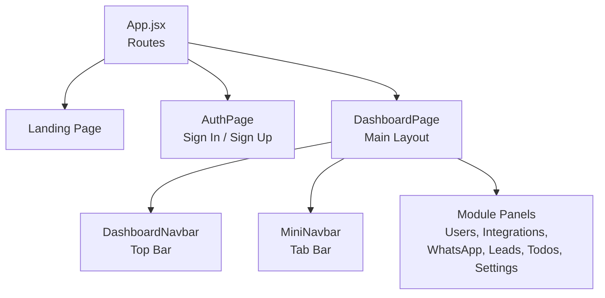
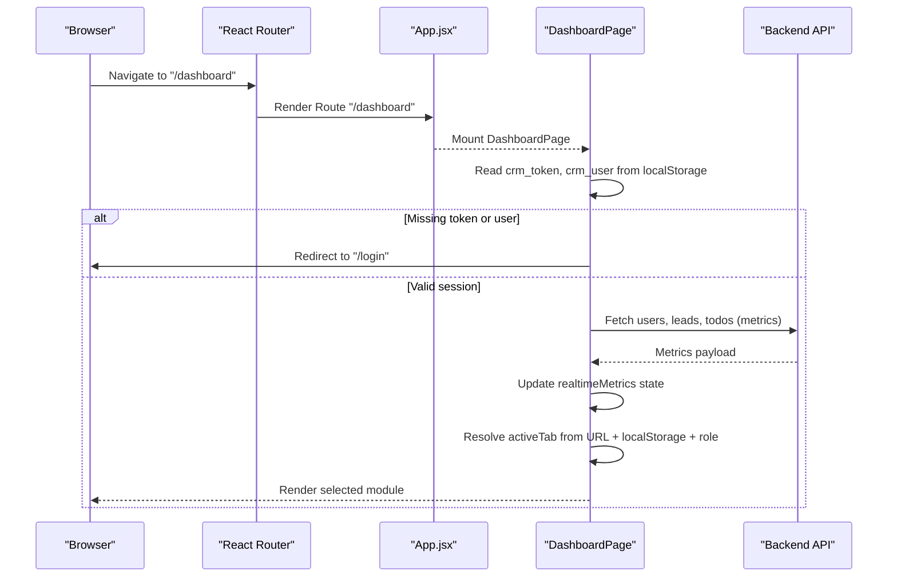
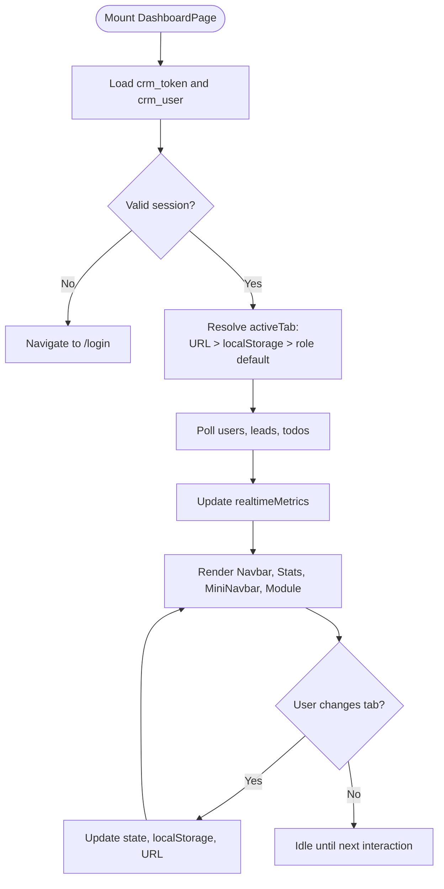
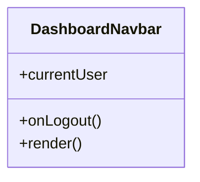
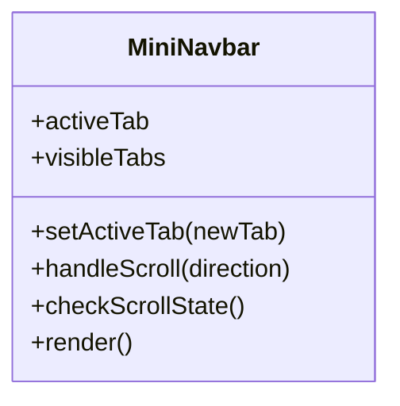
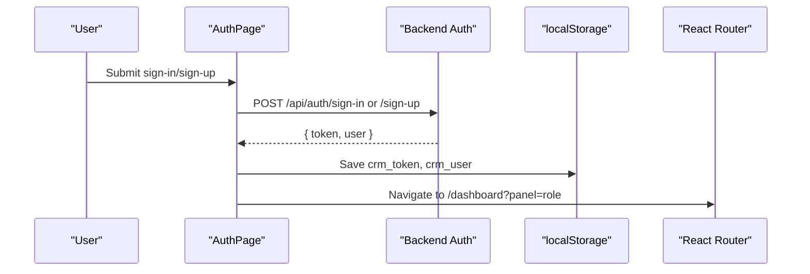
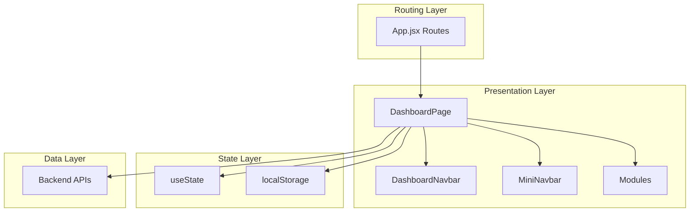
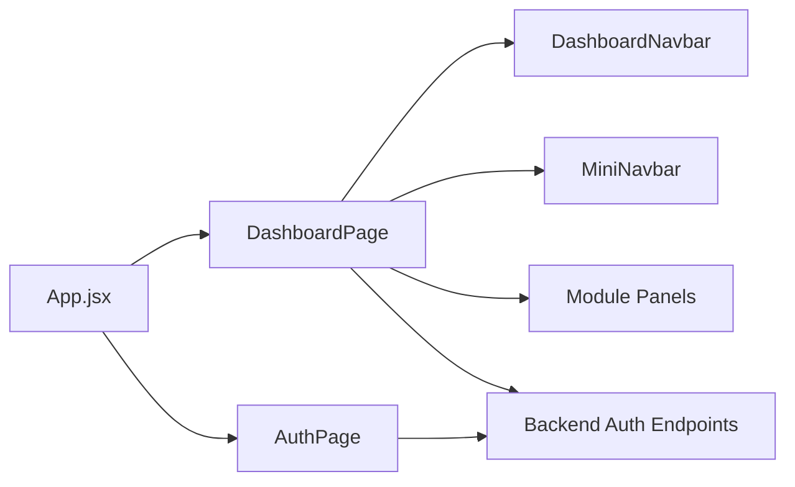

# Dashboard Layout & Navigation System

<cite>
**Referenced Files in This Document**
- [App.jsx](file://frontend/src/App.jsx)
- [DashboardPage index.jsx](file://frontend/src/Dashboard/index.jsx)
- [DashboardNavbar.jsx](file://frontend/src/Dashboard/DashboardNavbar.jsx)
- [MiniNavbar.jsx](file://frontend/src/Dashboard/MiniNavbar.jsx)
- [AuthPage index.jsx](file://frontend/src/Auth/index.jsx)
- [auth-switch.jsx](file://frontend/src/Components/ui/auth-switch.jsx)
- [auth-switch.tsx](file://frontend/src/Components/ui/auth-switch.tsx)
- [useStore.js](file://frontend/src/Stores/useStore.js)
</cite>

## Table of Contents
1. [Introduction](#introduction)
2. [Project Structure](#project-structure)
3. [Core Components](#core-components)
4. [Architecture Overview](#architecture-overview)
5. [Detailed Component Analysis](#detailed-component-analysis)
6. [Dependency Analysis](#dependency-analysis)
7. [Performance Considerations](#performance-considerations)
8. [Troubleshooting Guide](#troubleshooting-guide)
9. [Conclusion](#conclusion)

## Introduction
This document explains the dashboard layout and navigation system for the CRM application. It focuses on the main DashboardPage component, role-based tab management, URL-driven navigation, real-time metrics, responsive design patterns, session persistence, authentication guards, route protection, and performance considerations such as lazy rendering and efficient re-renders. The goal is to make the architecture understandable for both technical and non-technical readers while providing precise references to source files.

## Project Structure
The frontend is a React application using React Router for routing and local state plus localStorage for session and UI state. The dashboard is composed of:
- App-level routing that maps URLs to pages
- A top navigation bar showing user context and actions
- A mini navigation bar with role-filtered tabs
- A main content area that renders modules based on the active tab
- Authentication flows that store JWT tokens and user profiles

**Diagram sources**
- [App.jsx:8-24](file://frontend/src/App.jsx#L8-L24)
- [DashboardPage index.jsx:53-1037](file://frontend/src/Dashboard/index.jsx#L53-L1037)
- [DashboardNavbar.jsx:10-112](file://frontend/src/Dashboard/DashboardNavbar.jsx#L10-L112)
- [MiniNavbar.jsx:18-123](file://frontend/src/Dashboard/MiniNavbar.jsx#L18-L123)

**Section sources**
- [App.jsx:8-24](file://frontend/src/App.jsx#L8-L24)

## Core Components
- DashboardPage: Orchestrates dashboard layout, active tab state, URL parameters, real-time metrics, integration configuration, and module rendering.
- DashboardNavbar: Displays brand, role badge, global search placeholder, notifications, user profile, and logout action.
- MiniNavbar: Provides horizontal scrollable tabs filtered by user role, with active indicator and scroll arrows.
- AuthPage: Handles sign-in/sign-up, stores JWT and user profile, and redirects to dashboard with panel parameter.
- auth-switch components: Utility UIs for testing Better Auth gateway and session quotas (not directly used by dashboard navigation).
- useStore: Minimal Zustand store example; not currently used by dashboard navigation.

Key responsibilities:
- Role-based default panels and tab visibility
- Active tab persistence via URL and localStorage
- Real-time KPI cards polling backend endpoints
- Integration forms for WhatsApp and Instagram
- Session guard and logout flow

**Section sources**
- [DashboardPage index.jsx:53-1037](file://frontend/src/Dashboard/index.jsx#L53-L1037)
- [DashboardNavbar.jsx:10-112](file://frontend/src/Dashboard/DashboardNavbar.jsx#L10-L112)
- [MiniNavbar.jsx:18-123](file://frontend/src/Dashboard/MiniNavbar.jsx#L18-L123)
- [AuthPage index.jsx:22-119](file://frontend/src/Auth/index.jsx#L22-L119)

## Architecture Overview
The dashboard follows a single-page application pattern with client-side routing. The app defines routes for landing, authentication, and dashboard. On entering the dashboard, the page validates session data, resolves the active tab from URL or storage, and renders the appropriate module. Real-time metrics are polled at intervals, and integrations can be configured through dedicated forms.

**Diagram sources**
- [App.jsx:8-24](file://frontend/src/App.jsx#L8-L24)
- [DashboardPage index.jsx:53-1037](file://frontend/src/Dashboard/index.jsx#L53-L1037)

## Detailed Component Analysis

### DashboardPage: Main Layout and Tab Management
DashboardPage manages:
- User session loading and validation
- Default tab resolution based on role and URL
- Active tab state synchronization with URL and localStorage
- Real-time metrics polling
- Integration configuration workflows
- Conditional rendering of modules

Role-based defaults:
- Manager: default panel leads
- Employee: default panel whatsapp
- Admin: default panel users

Active tab resolution order:
1. URL query param tab
2. localStorage crm_active_tab
3. Role-based default tab

URL handling:
- Uses react-router-dom’s useSearchParams and useNavigate
- Updates URL with tab parameter when switching tabs
- Navigates to login if session is missing

Real-time metrics:
- Polls users, leads, and todos endpoints concurrently
- Computes counts for total users, active leads, todo list items, employees, and displays system health

Integrations:
- Loads Meta config and WhatsApp status
- Saves credentials to localStorage
- Submits connection requests to backend endpoints
- Shows success/error banners

Responsive design:
- Uses Tailwind utility classes for grid layouts, spacing, typography, and color themes
- Adapts header, stats cards, and navigation across breakpoints

State management:
- Local useState for UI state
- localStorage for session and active tab persistence
- No global store usage in this component

**Diagram sources**
- [DashboardPage index.jsx:53-1037](file://frontend/src/Dashboard/index.jsx#L53-L1037)

**Section sources**
- [DashboardPage index.jsx:53-1037](file://frontend/src/Dashboard/index.jsx#L53-L1037)

### DashboardNavbar: Top Navigation Bar
Responsibilities:
- Display brand logo and role badge
- Provide global search input placeholder
- Show notification bell
- Render user avatar and name
- Trigger logout action

Role badge logic:
- Admin Panel
- Manager Panel
- Employee Panel

Logout behavior:
- Clears stored token and user
- Dispatches an auth-change event
- Navigates to login

**Diagram sources**
- [DashboardNavbar.jsx:10-112](file://frontend/src/Dashboard/DashboardNavbar.jsx#L10-L112)

**Section sources**
- [DashboardNavbar.jsx:10-112](file://frontend/src/Dashboard/DashboardNavbar.jsx#L10-L112)

### MiniNavbar: Mini Navigation System
Responsibilities:
- Define tab definitions with icons and labels
- Filter visible tabs by role
- Handle horizontal scrolling with left/right arrows
- Highlight active tab and update parent state

Role filtering:
- Admin sees all tabs
- Manager sees contacts, whatsapp-blast, whatsapp, todos
- Employee sees whatsapp-blast, whatsapp, contacts, todos

Scroll behavior:
- Detects scroll position and toggles arrow visibility
- Smooth scrolls by fixed amount on arrow click

**Diagram sources**
- [MiniNavbar.jsx:18-123](file://frontend/src/Dashboard/MiniNavbar.jsx#L18-L123)

**Section sources**
- [MiniNavbar.jsx:18-123](file://frontend/src/Dashboard/MiniNavbar.jsx#L18-L123)

### AuthPage: Authentication Guards and Route Protection
Responsibilities:
- Handle sign-in and sign-up forms
- Validate inputs using react-hook-form
- Call backend auth endpoints
- Store JWT token and user profile in localStorage
- Redirect to dashboard with panel parameter based on role

Route protection:
- DashboardPage checks for token and user before rendering
- If missing, navigates to login

Session persistence:
- Stores crm_token and crm_user
- Dispatches auth-change event for other components to react

**Diagram sources**
- [AuthPage index.jsx:34-119](file://frontend/src/Auth/index.jsx#L34-L119)
- [DashboardPage index.jsx:336-352](file://frontend/src/Dashboard/index.jsx#L336-L352)

**Section sources**
- [AuthPage index.jsx:22-119](file://frontend/src/Auth/index.jsx#L22-L119)
- [DashboardPage index.jsx:336-352](file://frontend/src/Dashboard/index.jsx#L336-L352)

### Conceptual Overview
The dashboard uses a layered approach:
- Routing layer: App.jsx defines routes
- Presentation layer: DashboardPage composes navbar, stats, mini-navbar, and modules
- State layer: Local state and localStorage manage session and UI state
- Data layer: Backend APIs provide metrics, user data, and integration configurations

[No sources needed since this diagram shows conceptual workflow, not actual code structure]

## Dependency Analysis
- App.jsx depends on React Router and imports LandingPage, AuthPage, and DashboardPage.
- DashboardPage depends on:
  - react-router-dom for navigation and URL params
  - DashboardNavbar and MiniNavbar for layout
  - Module components (UserManagement, WhatsappMessage, LeadsPipeline, etc.)
  - External icon libraries
- MiniNavbar depends on role-based filtering logic and scroll utilities.
- AuthPage depends on react-hook-form and backend auth endpoints.

**Diagram sources**
- [App.jsx:8-24](file://frontend/src/App.jsx#L8-L24)
- [DashboardPage index.jsx:53-1037](file://frontend/src/Dashboard/index.jsx#L53-L1037)
- [AuthPage index.jsx:34-119](file://frontend/src/Auth/index.jsx#L34-L119)

**Section sources**
- [App.jsx:8-24](file://frontend/src/App.jsx#L8-L24)
- [DashboardPage index.jsx:53-1037](file://frontend/src/Dashboard/index.jsx#L53-L1037)
- [AuthPage index.jsx:34-119](file://frontend/src/Auth/index.jsx#L34-L119)

## Performance Considerations
- Efficient re-renders:
  - Use conditional rendering for modules based on activeTab to avoid mounting unnecessary components.
  - Keep state localized where possible; avoid global store unless necessary.
- Lazy loading:
  - Consider dynamic imports for heavy modules like WhatsappBlast or Contacts to reduce initial bundle size.
- Polling optimization:
  - Use Promise.allSettled for concurrent metric fetches to minimize latency.
  - Debounce or throttle frequent updates if needed.
- URL synchronization:
  - Update URL only on tab change to prevent excessive history entries.
- Memory management:
  - Clear intervals and event listeners in cleanup functions.
- Responsive design:
  - Leverage Tailwind’s responsive utilities to optimize layout across devices without extra JS.

[No sources needed since this section provides general guidance]

## Troubleshooting Guide
Common issues and resolutions:
- Dashboard redirects to login unexpectedly:
  - Ensure crm_token and crm_user exist in localStorage.
  - Verify backend auth endpoints return valid tokens and user profiles.
- Tabs not persisting after refresh:
  - Confirm localStorage key crm_active_tab is set on tab change.
  - Check URL query param tab is updated correctly.
- Real-time metrics not updating:
  - Verify backend endpoints /api/users, /api/leads, /api/todos are accessible.
  - Inspect network errors and handle failures gracefully.
- Integration form fails to save:
  - Check API base URL configuration and CORS settings.
  - Validate required fields and token permissions for Meta APIs.

**Section sources**
- [DashboardPage index.jsx:336-352](file://frontend/src/Dashboard/index.jsx#L336-L352)
- [DashboardPage index.jsx:194-241](file://frontend/src/Dashboard/index.jsx#L194-L241)
- [DashboardPage index.jsx:274-316](file://frontend/src/Dashboard/index.jsx#L274-L316)

## Conclusion
The dashboard layout and navigation system is built around a clear separation of concerns: routing, presentation, state, and data. DashboardPage orchestrates role-based tab management, URL synchronization, and real-time metrics. DashboardNavbar and MiniNavbar provide intuitive navigation and user context. AuthPage ensures secure access and session persistence. By leveraging local state, localStorage, and conditional rendering, the system achieves responsive design and efficient re-renders. Future enhancements could include lazy loading for heavy modules and centralized state management for complex cross-module interactions.

[No sources needed since this section summarizes without analyzing specific files]