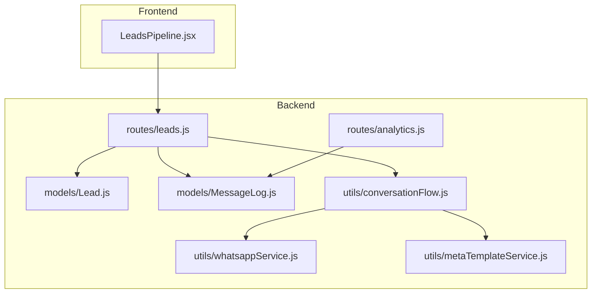
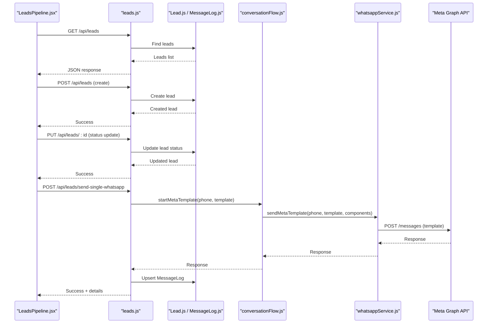
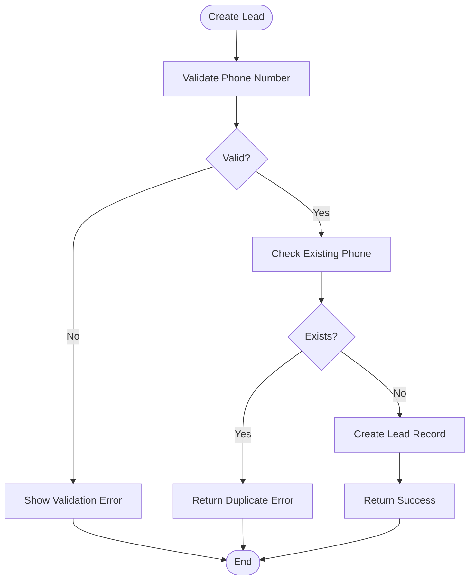
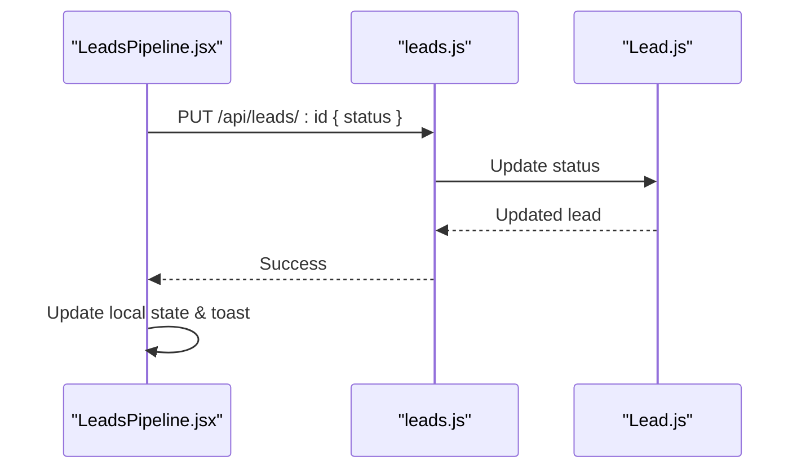
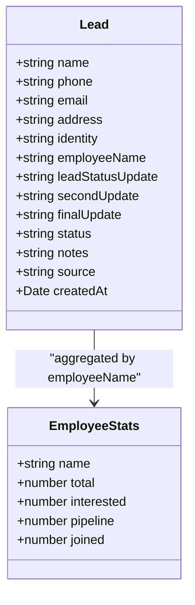
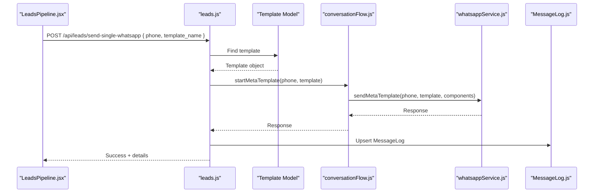
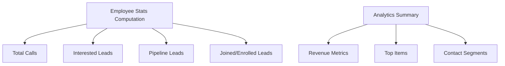
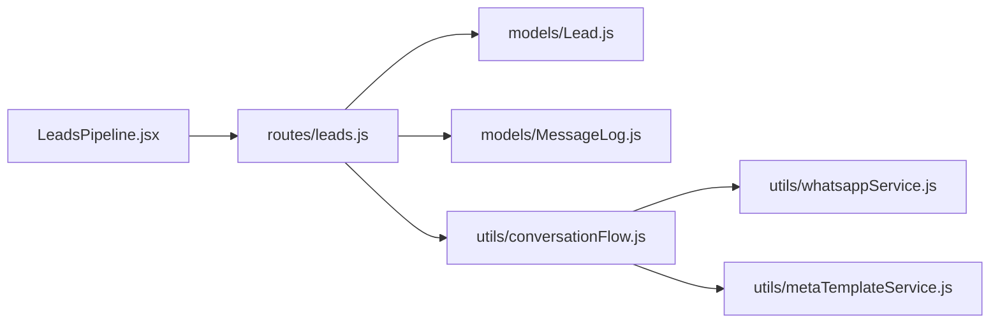

# Leads Pipeline Management

<cite>
**Referenced Files in This Document**   
- [Lead.js](file://backend/models/Lead.js)
- [leads.js](file://backend/routes/leads.js)
- [LeadsPipeline.jsx](file://frontend/src/Dashboard/LeadsPipeline.jsx)
- [conversationFlow.js](file://backend/utils/conversationFlow.js)
- [whatsappService.js](file://backend/utils/whatsappService.js)
- [metaTemplateService.js](file://backend/utils/metaTemplateService.js)
- [MessageLog.js](file://backend/models/MessageLog.js)
- [analytics.js](file://backend/routes/analytics.js)
</cite>

## Table of Contents
1. [Introduction](#introduction)
2. [Project Structure](#project-structure)
3. [Core Components](#core-components)
4. [Architecture Overview](#architecture-overview)
5. [Detailed Component Analysis](#detailed-component-analysis)
6. [Dependency Analysis](#dependency-analysis)
7. [Performance Considerations](#performance-considerations)
8. [Troubleshooting Guide](#troubleshooting-guide)
9. [Conclusion](#conclusion)

## Introduction
This document explains the leads pipeline management system built for WhatsApp-driven sales workflows. It covers the visual pipeline interface, lead stage management, bulk operations, conversion tracking, assignment logic, automated follow-ups via WhatsApp templates, and analytics/reporting features. The system is composed of a React frontend dashboard and a Node.js backend with MongoDB models and Meta WhatsApp API integrations.

## Project Structure
The project follows a feature-based structure:
- Backend: Express routes, Mongoose models, and utility services for WhatsApp messaging and Meta template handling.
- Frontend: React dashboard components for lead management, filtering, status updates, and WhatsApp blast actions.

**Diagram sources**
- [LeadsPipeline.jsx:1-100](file://frontend/src/Dashboard/LeadsPipeline.jsx#L1-L100)
- [leads.js:1-30](file://backend/routes/leads.js#L1-L30)
- [Lead.js:1-70](file://backend/models/Lead.js#L1-L70)
- [MessageLog.js:1-22](file://backend/models/MessageLog.js#L1-L22)
- [conversationFlow.js:1-20](file://backend/utils/conversationFlow.js#L1-L20)
- [whatsappService.js:1-25](file://backend/utils/whatsappService.js#L1-L25)
- [metaTemplateService.js:1-25](file://backend/utils/metaTemplateService.js#L1-L25)
- [analytics.js:1-20](file://backend/routes/analytics.js#L1-L20)

**Section sources**
- [LeadsPipeline.jsx:1-100](file://frontend/src/Dashboard/LeadsPipeline.jsx#L1-L100)
- [leads.js:1-30](file://backend/routes/leads.js#L1-L30)

## Core Components
- Lead model: Stores lead identity, contact details, calling updates, status, source, and timestamps.
- Leads API: CRUD endpoints, deduplication, single test message, and batch WhatsApp blast.
- Conversation flow: Prepares and sends Meta templates with media headers and body variables.
- WhatsApp service: Formats phone numbers, constructs payloads, and calls Meta Graph API.
- Message log: Records outgoing/incoming messages, statuses, template metadata, and pricing.
- Analytics: Aggregates order revenue, top items, and summary metrics (not directly tied to leads but part of the broader reporting).

Key responsibilities:
- Visual pipeline UI: Cards/table views, filters, search, pagination, status dropdowns, employee stats.
- Lead creation workflow: Form validation, duplicate prevention, import/export templates.
- Status transitions: Stage updates via PUT endpoint; UI reflects changes immediately.
- Assignment logic: Employee name field drives per-employee statistics and filtering.
- Automated follow-ups: Template-based WhatsApp blasts with logging.

**Section sources**
- [Lead.js:1-70](file://backend/models/Lead.js#L1-L70)
- [leads.js:16-132](file://backend/routes/leads.js#L16-L132)
- [LeadsPipeline.jsx:37-110](file://frontend/src/Dashboard/LeadsPipeline.jsx#L37-L110)

## Architecture Overview
The pipeline integrates front-end interactions with back-end business logic and external WhatsApp services.

**Diagram sources**
- [LeadsPipeline.jsx:90-110](file://frontend/src/Dashboard/LeadsPipeline.jsx#L90-L110)
- [leads.js:16-84](file://backend/routes/leads.js#L16-L84)
- [leads.js:86-125](file://backend/routes/leads.js#L86-L125)
- [leads.js:159-227](file://backend/routes/leads.js#L159-L227)
- [conversationFlow.js:20-118](file://backend/utils/conversationFlow.js#L20-L118)
- [whatsappService.js:194-215](file://backend/utils/whatsappService.js#L194-L215)
- [MessageLog.js:1-22](file://backend/models/MessageLog.js#L1-L22)

## Detailed Component Analysis

### Visual Pipeline Interface
- View modes: Cards and table views with consistent data fields.
- Filters: By status, employee, and free-text search across multiple fields.
- Pagination: Client-side pagination with page controls.
- Employee performance summary: Computes total calls, interested, pipeline, and joined counts per employee.

User interactions:
- Add/Edit lead modal with validation for phone and email.
- Inline status dropdown on each card/table row.
- Quick actions: WhatsApp chat link, direct call, edit, delete.
- Bulk tools: Download CSV template, upload CSV, deduplicate records, refresh.

Status options include interest-related stages and enrollment outcomes.

**Section sources**
- [LeadsPipeline.jsx:37-110](file://frontend/src/Dashboard/LeadsPipeline.jsx#L37-L110)
- [LeadsPipeline.jsx:403-448](file://frontend/src/Dashboard/LeadsPipeline.jsx#L403-L448)
- [LeadsPipeline.jsx:450-480](file://frontend/src/Dashboard/LeadsPipeline.jsx#L450-L480)
- [LeadsPipeline.jsx:482-489](file://frontend/src/Dashboard/LeadsPipeline.jsx#L482-L489)
- [LeadsPipeline.jsx:530-636](file://frontend/src/Dashboard/LeadsPipeline.jsx#L530-L636)
- [LeadsPipeline.jsx:638-730](file://frontend/src/Dashboard/LeadsPipeline.jsx#L638-L730)
- [LeadsPipeline.jsx:732-762](file://frontend/src/Dashboard/LeadsPipeline.jsx#L732-L762)
- [LeadsPipeline.jsx:764-976](file://frontend/src/Dashboard/LeadsPipeline.jsx#L764-L976)
- [LeadsPipeline.jsx:979-1138](file://frontend/src/Dashboard/LeadsPipeline.jsx#L979-L1138)

### Lead Creation Workflow
- Validation: Strict 10-digit Indian mobile number starting with 6/7/8/9; optional email format check.
- Duplicate prevention: Server checks existing phone before creating a lead.
- Default values: Identity defaults to a specific value; employee name defaults to a default user.
- Import: CSV parsing with sample template download; rows validated and sent to create endpoint.

**Diagram sources**
- [leads.js:36-84](file://backend/routes/leads.js#L36-L84)
- [LeadsPipeline.jsx:214-251](file://frontend/src/Dashboard/LeadsPipeline.jsx#L214-L251)
- [LeadsPipeline.jsx:277-322](file://frontend/src/Dashboard/LeadsPipeline.jsx#L277-L322)

**Section sources**
- [leads.js:36-84](file://backend/routes/leads.js#L36-L84)
- [LeadsPipeline.jsx:214-251](file://frontend/src/Dashboard/LeadsPipeline.jsx#L214-L251)
- [LeadsPipeline.jsx:277-322](file://frontend/src/Dashboard/LeadsPipeline.jsx#L277-L322)
- [LeadsPipeline.jsx:115-210](file://frontend/src/Dashboard/LeadsPipeline.jsx#L115-L210)

### Status Transitions and Stage Management
- Status dropdowns in both cards and table views trigger PUT requests to update lead status.
- UI updates locally upon successful server response.
- Status badge classes provide color-coded visuals based on status keywords.

**Diagram sources**
- [LeadsPipeline.jsx:324-339](file://frontend/src/Dashboard/LeadsPipeline.jsx#L324-L339)
- [leads.js:86-125](file://backend/routes/leads.js#L86-L125)

**Section sources**
- [LeadsPipeline.jsx:324-339](file://frontend/src/Dashboard/LeadsPipeline.jsx#L324-L339)
- [leads.js:86-125](file://backend/routes/leads.js#L86-L125)

### Assignment Logic and Employee Performance
- Each lead has an assigned employee name used for grouping and filtering.
- Employee stats compute totals and categorize by status keywords (interest, pipeline, enrolled/joined).
- Filtering by employee allows focused dashboards per team member.

**Diagram sources**
- [Lead.js:1-70](file://backend/models/Lead.js#L1-L70)
- [LeadsPipeline.jsx:405-448](file://frontend/src/Dashboard/LeadsPipeline.jsx#L405-L448)

**Section sources**
- [LeadsPipeline.jsx:405-448](file://frontend/src/Dashboard/LeadsPipeline.jsx#L405-L448)

### Automated Follow-ups and WhatsApp Integration
- Single test message: Sends a WhatsApp template to a specified phone, logs the message, and returns details.
- Batch blast: Accepts lead IDs or raw phones, resolves to unique 10-digit numbers, sends templates, and logs results.
- Template resolution: Looks up templates by name/title/metaTemplateId; falls back to approved template or defaults.
- Media support: Handles image/video/document headers via URL or uploaded media ID.

**Diagram sources**
- [leads.js:159-227](file://backend/routes/leads.js#L159-L227)
- [conversationFlow.js:20-118](file://backend/utils/conversationFlow.js#L20-L118)
- [whatsappService.js:194-215](file://backend/utils/whatsappService.js#L194-L215)
- [MessageLog.js:1-22](file://backend/models/MessageLog.js#L1-L22)

**Section sources**
- [leads.js:159-227](file://backend/routes/leads.js#L159-L227)
- [leads.js:229-341](file://backend/routes/leads.js#L229-L341)
- [conversationFlow.js:20-118](file://backend/utils/conversationFlow.js#L20-L118)
- [whatsappService.js:194-215](file://backend/utils/whatsappService.js#L194-L215)
- [metaTemplateService.js:1-25](file://backend/utils/metaTemplateService.js#L1-L25)

### Data Visualization and Reporting
- Employee daily calling summary: Displays per-employee metrics including total calls, interested leads, pipeline leads, and enrollments.
- Analytics endpoints: Provide aggregated revenue, top items, and summary metrics for orders and contacts.
- While not directly tied to leads, these analytics can be combined with lead conversion data to monitor sales performance.

**Diagram sources**
- [LeadsPipeline.jsx:423-448](file://frontend/src/Dashboard/LeadsPipeline.jsx#L423-L448)
- [analytics.js:6-26](file://backend/routes/analytics.js#L6-L26)
- [analytics.js:28-38](file://backend/routes/analytics.js#L28-L38)
- [analytics.js:40-76](file://backend/routes/analytics.js#L40-L76)

**Section sources**
- [LeadsPipeline.jsx:423-448](file://frontend/src/Dashboard/LeadsPipeline.jsx#L423-L448)
- [analytics.js:6-26](file://backend/routes/analytics.js#L6-L26)
- [analytics.js:28-38](file://backend/routes/analytics.js#L28-L38)
- [analytics.js:40-76](file://backend/routes/analytics.js#L40-L76)

## Dependency Analysis
- Frontend depends on backend routes for all lead operations and WhatsApp blast triggers.
- Backend routes depend on Mongoose models (Lead, MessageLog) and utilities (conversationFlow, whatsappService, metaTemplateService).
- conversationFlow orchestrates template preparation and delegates sending to whatsappService.
- metaTemplateService handles Meta template lifecycle and media uploads.

**Diagram sources**
- [LeadsPipeline.jsx:1-100](file://frontend/src/Dashboard/LeadsPipeline.jsx#L1-L100)
- [leads.js:1-30](file://backend/routes/leads.js#L1-L30)
- [conversationFlow.js:1-20](file://backend/utils/conversationFlow.js#L1-L20)
- [whatsappService.js:1-25](file://backend/utils/whatsappService.js#L1-L25)
- [metaTemplateService.js:1-25](file://backend/utils/metaTemplateService.js#L1-L25)

**Section sources**
- [leads.js:1-30](file://backend/routes/leads.js#L1-L30)
- [conversationFlow.js:1-20](file://backend/utils/conversationFlow.js#L1-L20)

## Performance Considerations
- Client-side pagination reduces payload size and improves UI responsiveness.
- Deduplication runs server-side using a Set for O(n) complexity over leads.
- Batch blast processes recipients sequentially; consider queueing for large volumes.
- Image/header media handling may involve network uploads; caching media IDs can reduce repeated uploads.

[No sources needed since this section provides general guidance]

## Troubleshooting Guide
Common issues and resolutions:
- Invalid phone number: Ensure 10-digit Indian mobile numbers starting with 6/7/8/9; strip country code if provided.
- Duplicate leads: Use the deduplicate endpoint to remove duplicates by phone.
- WhatsApp template errors: Verify template exists and is approved; ensure header media is accessible or uploaded.
- Message logging: Confirm MessageLog entries are created for outgoing messages; check wamid uniqueness.

Operational tips:
- Refresh the pipeline after bulk operations to reflect latest data.
- Use the sample CSV template to validate import formats.
- Monitor toast notifications for success/error feedback during operations.

**Section sources**
- [leads.js:36-84](file://backend/routes/leads.js#L36-L84)
- [leads.js:134-157](file://backend/routes/leads.js#L134-L157)
- [leads.js:159-227](file://backend/routes/leads.js#L159-L227)
- [MessageLog.js:1-22](file://backend/models/MessageLog.js#L1-L22)

## Conclusion
The leads pipeline management system provides a robust, visually rich interface for managing leads, tracking conversions, assigning employees, and automating follow-ups through WhatsApp templates. With strong validation, deduplication, and logging capabilities, it supports scalable sales operations and offers analytical insights for performance monitoring. Future enhancements could include drag-and-drop pipeline columns, advanced scoring algorithms, and deeper integration with CRM systems.

[No sources needed since this section summarizes without analyzing specific files]