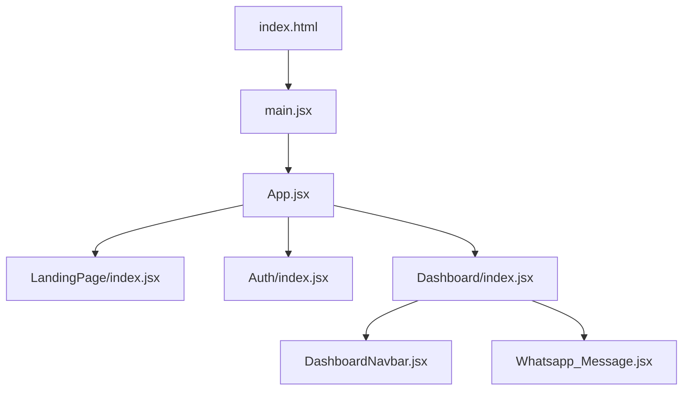
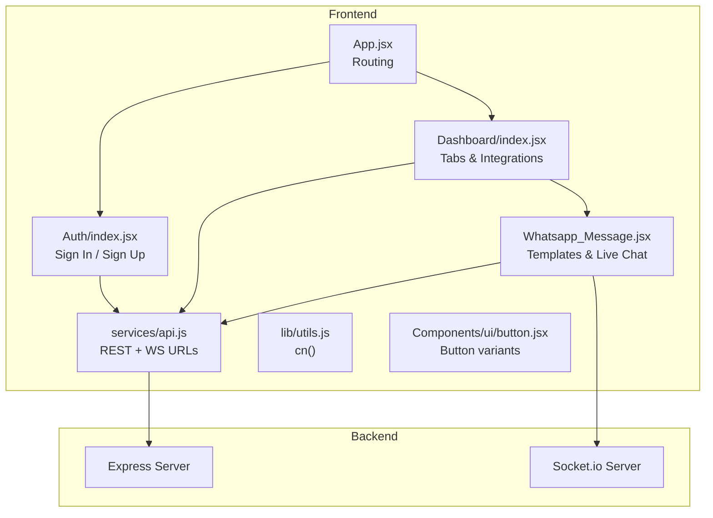
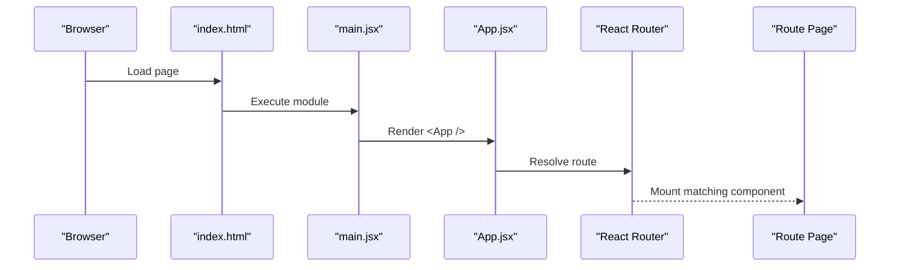
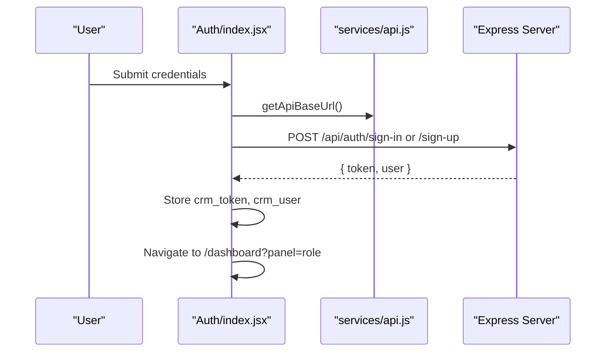
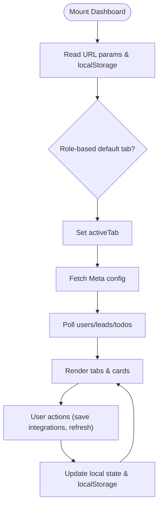
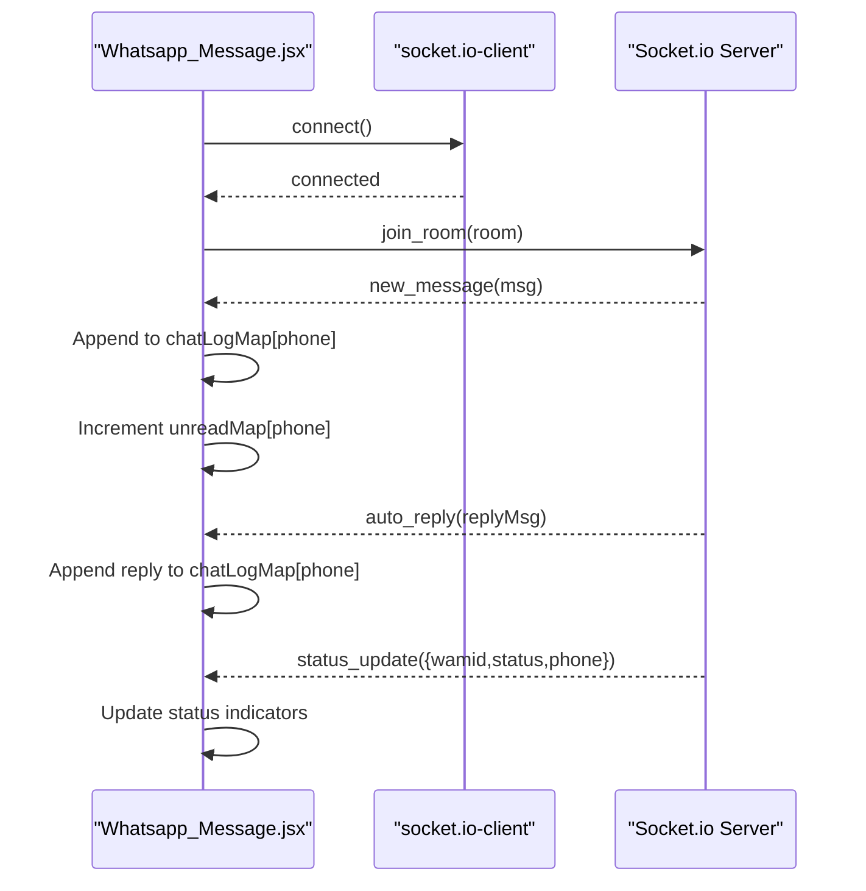
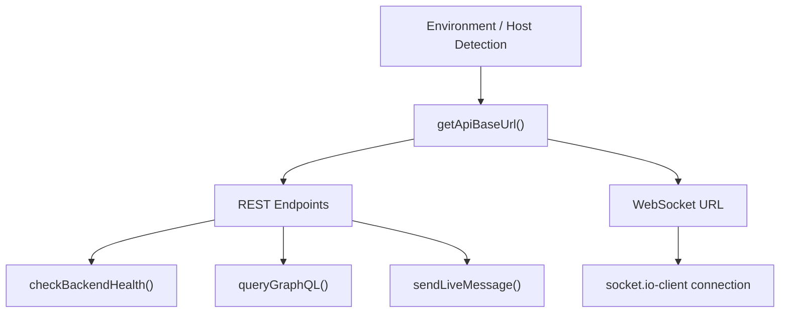
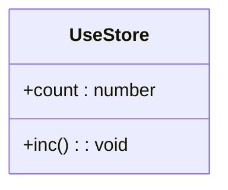
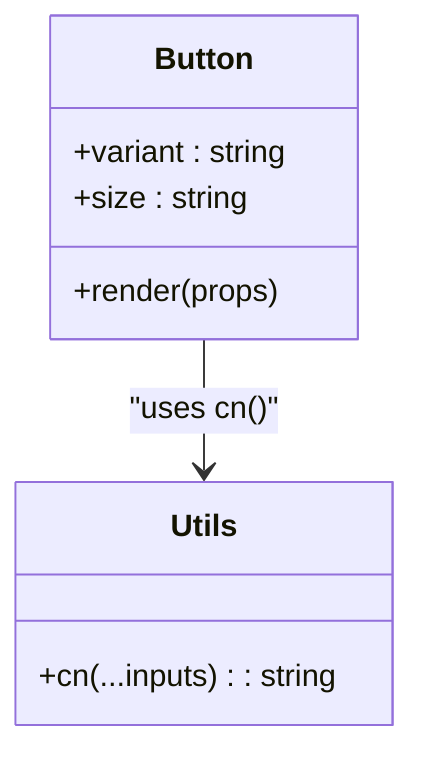
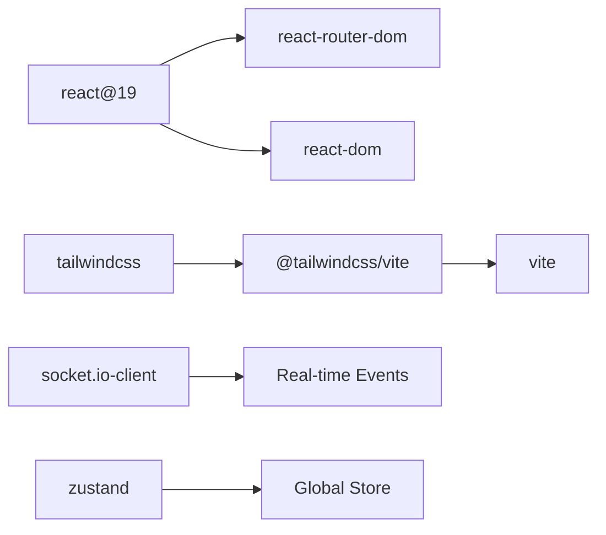

# Frontend Architecture

<cite>
**Referenced Files in This Document**
- [main.jsx](file://frontend/src/main.jsx)
- [App.jsx](file://frontend/src/App.jsx)
- [index.html](file://frontend/index.html)
- [package.json](file://frontend/package.json)
- [vite.config.js](file://frontend/vite.config.js)
- [api.js](file://frontend/src/services/api.js)
- [useStore.js](file://frontend/src/Stores/useStore.js)
- [Auth index.jsx](file://frontend/src/Auth/index.jsx)
- [Dashboard index.jsx](file://frontend/src/Dashboard/index.jsx)
- [DashboardNavbar.jsx](file://frontend/src/Dashboard/DashboardNavbar.jsx)
- [Whatsapp_Message.jsx](file://frontend/src/Dashboard/Whatsapp_Message.jsx)
- [LandingPage index.jsx](file://frontend/src/LandingPage/index.jsx)
- [button.jsx](file://frontend/src/Components/ui/button.jsx)
- [utils.js](file://frontend/src/lib/utils.js)
- [server.js](file://backend/server.js)
</cite>

## Table of Contents
1. [Introduction](#introduction)
2. [Project Structure](#project-structure)
3. [Core Components](#core-components)
4. [Architecture Overview](#architecture-overview)
5. [Detailed Component Analysis](#detailed-component-analysis)
6. [Dependency Analysis](#dependency-analysis)
7. [Performance Considerations](#performance-considerations)
8. [Troubleshooting Guide](#troubleshooting-guide)
9. [Conclusion](#conclusion)

## Introduction
This document describes the React 19 frontend architecture for the WhatsApp Automation CRM system. It explains the component-based design, routing, state management, API service layer, real-time WebSocket communication with Socket.io-client, build configuration with Vite and Tailwind CSS, asset handling, and deployment considerations. The goal is to provide a clear mental model for both new contributors and experienced developers.

## Project Structure
The frontend is a modern React application built with Vite, styled with Tailwind CSS, and uses React Router for navigation. The entry point renders a Radix UI theme wrapper around the app. Routing separates public pages (landing page), authentication flows, and the enterprise dashboard. Dashboard modules are organized by feature, while shared UI components live under a common UI folder.

**Diagram sources**
- [index.html:1-19](file://frontend/index.html#L1-L19)
- [main.jsx:1-12](file://frontend/src/main.jsx#L1-L12)
- [App.jsx:1-27](file://frontend/src/App.jsx#L1-L27)
- [LandingPage index.jsx:1-23](file://frontend/src/LandingPage/index.jsx#L1-L23)
- [Auth index.jsx:1-489](file://frontend/src/Auth/index.jsx#L1-L489)
- [Dashboard index.jsx:1-800](file://frontend/src/Dashboard/index.jsx#L1-L800)
- [DashboardNavbar.jsx:1-112](file://frontend/src/Dashboard/DashboardNavbar.jsx#L1-L112)
- [Whatsapp_Message.jsx:1-200](file://frontend/src/Dashboard/Whatsapp_Message.jsx#L1-L200)

**Section sources**
- [index.html:1-19](file://frontend/index.html#L1-L19)
- [main.jsx:1-12](file://frontend/src/main.jsx#L1-L12)
- [App.jsx:1-27](file://frontend/src/App.jsx#L1-L27)

## Core Components
- Application shell and routing:
  - main.jsx initializes the React root and wraps the app with a dark-themed Radix UI provider.
  - App.jsx defines routes for landing, authentication, and dashboard, including fallback navigation.
- Authentication:
  - Auth/index.jsx implements sign-in and sign-up flows, stores JWT tokens and user profile in localStorage, and redirects based on role.
- Dashboard:
  - Dashboard/index.jsx orchestrates tabs, role-based defaults, integration configuration, and real-time metrics polling.
  - DashboardNavbar.jsx displays branding, role badge, search bar, notifications, and logout action.
- Real-time messaging:
  - Whatsapp_Message.jsx manages templates, contacts, chat logs, unread counts, and WebSocket events for incoming messages, auto-replies, and status updates.
- Shared UI:
  - Components/ui/button.jsx provides a varianted button using class-variance-authority and Tailwind merge utilities.
  - lib/utils.js exposes a cn helper for merging Tailwind classes safely.

Key responsibilities:
- Routing and layout composition: App.jsx, main.jsx
- Authentication flow and token persistence: Auth/index.jsx
- Dashboard orchestration and tabbed modules: Dashboard/index.jsx, DashboardNavbar.jsx
- Real-time WhatsApp messaging and template management: Whatsapp_Message.jsx
- Reusable UI primitives: button.jsx, utils.js

**Section sources**
- [main.jsx:1-12](file://frontend/src/main.jsx#L1-L12)
- [App.jsx:1-27](file://frontend/src/App.jsx#L1-L27)
- [Auth index.jsx:1-489](file://frontend/src/Auth/index.jsx#L1-L489)
- [Dashboard index.jsx:1-800](file://frontend/src/Dashboard/index.jsx#L1-L800)
- [DashboardNavbar.jsx:1-112](file://frontend/src/Dashboard/DashboardNavbar.jsx#L1-L112)
- [Whatsapp_Message.jsx:1-200](file://frontend/src/Dashboard/Whatsapp_Message.jsx#L1-L200)
- [button.jsx:1-66](file://frontend/src/Components/ui/button.jsx#L1-L66)
- [utils.js:1-7](file://frontend/src/lib/utils.js#L1-L7)

## Architecture Overview
The frontend follows a layered approach:
- Presentation layer: React components (pages, dashboards, UI primitives)
- State layer: Local component state, localStorage for auth and preferences, and a small Zustand store for global state
- Service layer: api.js centralizes base URL resolution, health checks, GraphQL queries, and message sending
- Transport layer: REST via fetch and WebSockets via socket.io-client for real-time updates
- Build tooling: Vite with React plugin and Tailwind CSS; alias @ for src; dev proxy for backend APIs

**Diagram sources**
- [App.jsx:1-27](file://frontend/src/App.jsx#L1-L27)
- [Auth index.jsx:1-489](file://frontend/src/Auth/index.jsx#L1-L489)
- [Dashboard index.jsx:1-800](file://frontend/src/Dashboard/index.jsx#L1-L800)
- [Whatsapp_Message.jsx:1-200](file://frontend/src/Dashboard/Whatsapp_Message.jsx#L1-L200)
- [api.js:1-73](file://frontend/src/services/api.js#L1-L73)
- [utils.js:1-7](file://frontend/src/lib/utils.js#L1-L7)
- [button.jsx:1-66](file://frontend/src/Components/ui/button.jsx#L1-L66)
- [server.js:1-40](file://backend/server.js#L1-L40)

## Detailed Component Analysis

### Routing and App Shell
- main.jsx creates the React root and applies a dark theme from Radix UI.
- App.jsx configures routes for landing, authentication, and dashboard, with a catch-all redirect to home.

**Diagram sources**
- [index.html:1-19](file://frontend/index.html#L1-L19)
- [main.jsx:1-12](file://frontend/src/main.jsx#L1-L12)
- [App.jsx:1-27](file://frontend/src/App.jsx#L1-L27)

**Section sources**
- [main.jsx:1-12](file://frontend/src/main.jsx#L1-L12)
- [App.jsx:1-27](file://frontend/src/App.jsx#L1-L27)

### Authentication Flow
- Auth/index.jsx handles sign-in and sign-up:
  - Validates inputs using react-hook-form
  - Calls backend endpoints for authentication
  - Stores JWT token and user profile in localStorage
  - Dispatches an auth-change event and navigates to dashboard with role-based panel

**Diagram sources**
- [Auth index.jsx:1-489](file://frontend/src/Auth/index.jsx#L1-L489)
- [api.js:1-73](file://frontend/src/services/api.js#L1-L73)

**Section sources**
- [Auth index.jsx:1-489](file://frontend/src/Auth/index.jsx#L1-L489)
- [api.js:1-73](file://frontend/src/services/api.js#L1-L73)

### Dashboard Orchestration
- Dashboard/index.jsx:
  - Determines active tab from URL params, localStorage, and user role
  - Fetches Meta integration configuration and WhatsApp status
  - Polls real-time metrics from multiple endpoints using Promise.allSettled
  - Renders tabbed content and integration forms

**Diagram sources**
- [Dashboard index.jsx:1-800](file://frontend/src/Dashboard/index.jsx#L1-L800)

**Section sources**
- [Dashboard index.jsx:1-800](file://frontend/src/Dashboard/index.jsx#L1-L800)

### Real-Time WhatsApp Messaging
- Whatsapp_Message.jsx:
  - Connects to WebSocket server using socket.io-client
  - Subscribes to events: new_message, auto_reply, status_update
  - Maintains per-phone chat logs, unread counts, and read timestamps
  - Provides template creation, preview, and sending workflows

**Diagram sources**
- [Whatsapp_Message.jsx:1-200](file://frontend/src/Dashboard/Whatsapp_Message.jsx#L1-L200)
- [server.js:1-40](file://backend/server.js#L1-L40)

**Section sources**
- [Whatsapp_Message.jsx:1-200](file://frontend/src/Dashboard/Whatsapp_Message.jsx#L1-L200)
- [server.js:1-40](file://backend/server.js#L1-L40)

### API Service Layer
- services/api.js:
  - Resolves base URL from environment variables or runtime host detection
  - Exposes health check, GraphQL query helper, and a message-sending utility
  - Computes WebSocket URL by converting HTTP base to WS

**Diagram sources**
- [api.js:1-73](file://frontend/src/services/api.js#L1-L73)

**Section sources**
- [api.js:1-73](file://frontend/src/services/api.js#L1-L73)

### Global State Management
- useStore.js demonstrates a minimal Zustand store pattern for global state.
- Current usage is minimal; most state is component-local or persisted in localStorage.

**Diagram sources**
- [useStore.js:1-12](file://frontend/src/Stores/useStore.js#L1-L12)

**Section sources**
- [useStore.js:1-12](file://frontend/src/Stores/useStore.js#L1-L12)

### UI Components and Styling
- Components/ui/button.jsx:
  - Uses class-variance-authority for variant and size control
  - Merges Tailwind classes via cn() from lib/utils.js
- lib/utils.js:
  - Exports cn() combining clsx and tailwind-merge for safe class composition

**Diagram sources**
- [button.jsx:1-66](file://frontend/src/Components/ui/button.jsx#L1-L66)
- [utils.js:1-7](file://frontend/src/lib/utils.js#L1-L7)

**Section sources**
- [button.jsx:1-66](file://frontend/src/Components/ui/button.jsx#L1-L66)
- [utils.js:1-7](file://frontend/src/lib/utils.js#L1-L7)

## Dependency Analysis
- Runtime dependencies include React 19, React Router, Tailwind CSS, Radix UI themes, Framer Motion, GSAP, Three.js ecosystem, Socket.io-client, and Zustand.
- Development dependencies include Vite, ESLint, and related plugins.

**Diagram sources**
- [package.json:1-49](file://frontend/package.json#L1-L49)

**Section sources**
- [package.json:1-49](file://frontend/package.json#L1-L49)

## Performance Considerations
- Rendering:
  - Keep heavy computations out of render paths; memoize derived data where needed.
  - Avoid unnecessary re-renders by splitting large components into smaller ones.
- Data fetching:
  - Use Promise.allSettled for parallel requests to avoid blocking UI.
  - Debounce frequent operations like search and polling intervals.
- Real-time:
  - Throttle WebSocket event handlers to prevent excessive state updates.
  - Limit rendered chat history and virtualize long lists if needed.
- Assets:
  - Prefer lazy loading for non-critical assets and code-splitting via dynamic imports.
- Styling:
  - Use Tailwind’s utility classes efficiently; avoid deeply nested custom styles.

## Troubleshooting Guide
- Authentication issues:
  - Verify that crm_token and crm_user exist in localStorage after login.
  - Ensure the backend returns a valid token and user object.
- API connectivity:
  - Check getApiBaseUrl() logic and environment variables.
  - Confirm CORS settings on the backend and any reverse proxies.
- WebSocket connectivity:
  - Validate that the WebSocket URL matches the backend’s ws endpoint.
  - Inspect browser console for connection errors and event subscriptions.
- Dashboard metrics:
  - Ensure endpoints for users, leads, and todos return expected structures.
  - Review error handling in Promise.allSettled branches.

**Section sources**
- [Auth index.jsx:1-489](file://frontend/src/Auth/index.jsx#L1-L489)
- [api.js:1-73](file://frontend/src/services/api.js#L1-L73)
- [Whatsapp_Message.jsx:1-200](file://frontend/src/Dashboard/Whatsapp_Message.jsx#L1-L200)
- [Dashboard index.jsx:1-800](file://frontend/src/Dashboard/index.jsx#L1-L800)

## Conclusion
The frontend is a modular React 19 application with clear separation between routing, authentication, dashboard orchestration, and real-time messaging. It leverages Vite for fast builds, Tailwind CSS for styling, and Zustand for lightweight global state. The API service layer abstracts REST and WebSocket interactions, enabling consistent data flow across components. With robust error handling, responsive design patterns, and reusable UI components, the system is well-positioned for scalability and maintainability.