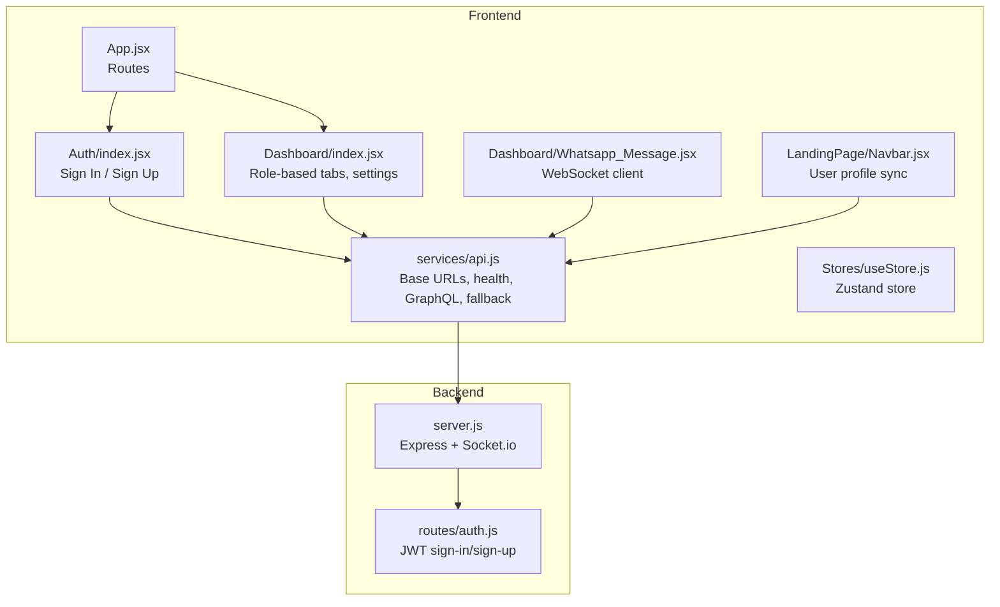
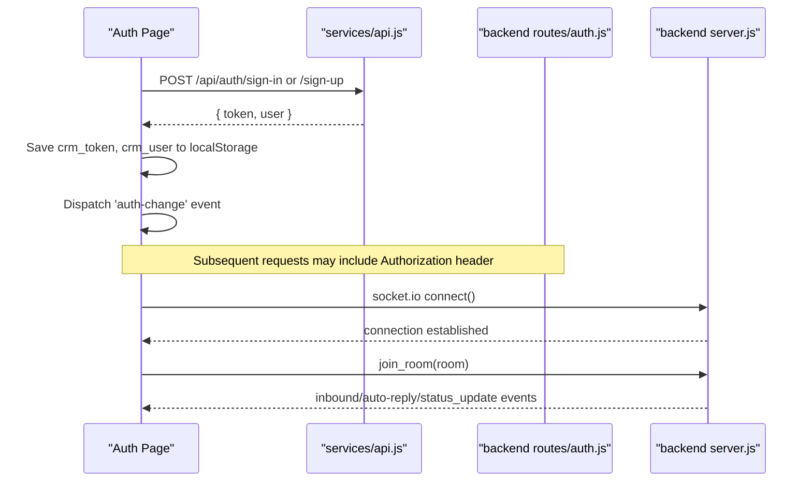
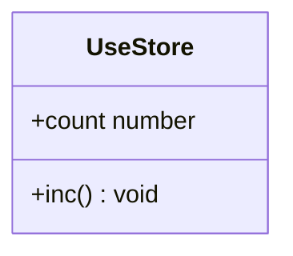
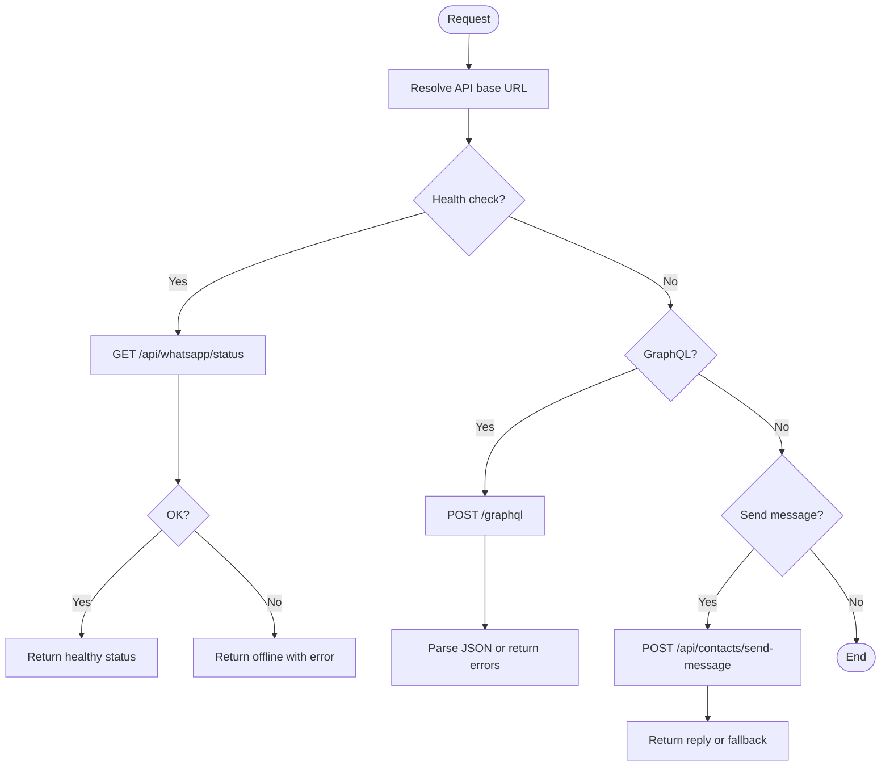
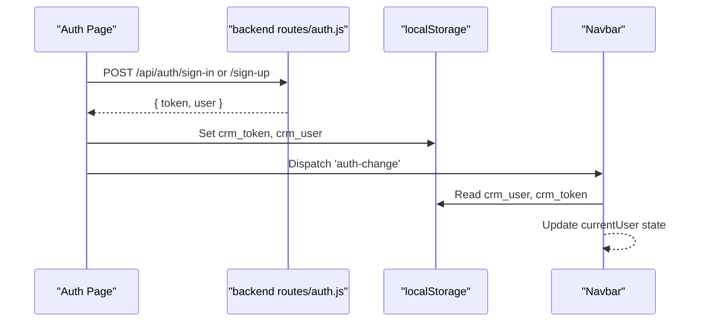
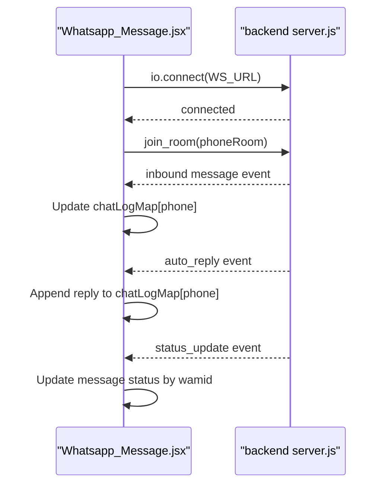
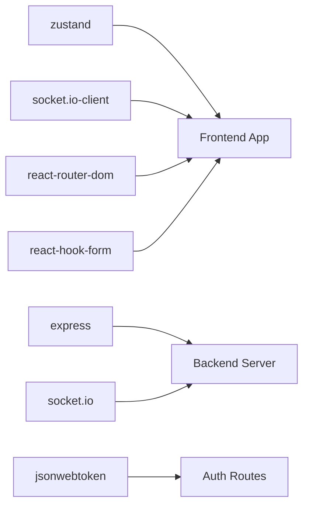

# State Management & Services

<cite>
**Referenced Files in This Document**
- [useStore.js](file://frontend/src/Stores/useStore.js)
- [api.js](file://frontend/src/services/api.js)
- [Auth/index.jsx](file://frontend/src/Auth/index.jsx)
- [App.jsx](file://frontend/src/App.jsx)
- [Navbar.jsx](file://frontend/src/LandingPage/Navbar.jsx)
- [Dashboard/index.jsx](file://frontend/src/Dashboard/index.jsx)
- [Whatsapp_Message.jsx](file://frontend/src/Dashboard/Whatsapp_Message.jsx)
- [package.json](file://frontend/package.json)
- [server.js](file://backend/server.js)
- [auth.js](file://backend/routes/auth.js)
</cite>

## Table of Contents
1. [Introduction](#introduction)
2. [Project Structure](#project-structure)
3. [Core Components](#core-components)
4. [Architecture Overview](#architecture-overview)
5. [Detailed Component Analysis](#detailed-component-analysis)
6. [Dependency Analysis](#dependency-analysis)
7. [Performance Considerations](#performance-considerations)
8. [Troubleshooting Guide](#troubleshooting-guide)
9. [Conclusion](#conclusion)

## Introduction
This document explains the frontend state management and service layer architecture for the application. It focuses on:
- Zustand store usage for global state (current implementation is minimal and can be extended).
- API service abstraction, request/response handling, error management, and environment-based base URL resolution.
- Authentication flow using JWT tokens stored in localStorage, with cross-tab synchronization via custom events.
- Protected route access control patterns and role-based navigation.
- Real-time data synchronization using WebSockets for live messaging and status updates.
- Caching strategies, performance optimization, and debugging techniques for complex state interactions.

## Project Structure
The frontend uses React with Vite, React Router, Zustand, and Socket.io client. The backend provides REST endpoints, GraphQL endpoint configuration, and a WebSocket server.

**Diagram sources**
- [App.jsx:1-27](file://frontend/src/App.jsx#L1-L27)
- [Auth/index.jsx:1-120](file://frontend/src/Auth/index.jsx#L1-L120)
- [Navbar.jsx:37-68](file://frontend/src/LandingPage/Navbar.jsx#L37-L68)
- [Dashboard/index.jsx:53-87](file://frontend/src/Dashboard/index.jsx#L53-L87)
- [Whatsapp_Message.jsx:472-486](file://frontend/src/Dashboard/Whatsapp_Message.jsx#L472-L486)
- [api.js:1-14](file://frontend/src/services/api.js#L1-L14)
- [server.js:14-35](file://backend/server.js#L14-L35)
- [auth.js:17-113](file://backend/routes/auth.js#L17-L113)

**Section sources**
- [App.jsx:1-27](file://frontend/src/App.jsx#L1-L27)
- [package.json:12-35](file://frontend/package.json#L12-L35)

## Core Components
- Zustand Store: Minimal example demonstrating create/set pattern; intended as foundation for global state like user session, app settings, and real-time channels.
- API Service Layer: Centralized base URL resolution, health check, GraphQL query helper, and a fallback message sender.
- Authentication UI: Handles sign-in/sign-up, stores JWT token and user profile in localStorage, dispatches auth-change event to keep UI consistent.
- Dashboard: Role-aware tab selection, integration configuration persistence, and real-time metrics polling.
- WebSocket Client: Connects to backend, listens to inbound messages, auto-replies, and status updates, updating local chat logs reactively.

**Section sources**
- [useStore.js:1-12](file://frontend/src/Stores/useStore.js#L1-L12)
- [api.js:1-73](file://frontend/src/services/api.js#L1-L73)
- [Auth/index.jsx:34-119](file://frontend/src/Auth/index.jsx#L34-L119)
- [Dashboard/index.jsx:53-87](file://frontend/src/Dashboard/index.jsx#L53-L87)
- [Whatsapp_Message.jsx:472-486](file://frontend/src/Dashboard/Whatsapp_Message.jsx#L472-L486)

## Architecture Overview
The frontend communicates with the backend through:
- REST APIs for authentication, integrations, and data fetching.
- GraphQL endpoint configured via environment variables.
- WebSocket channel for real-time messaging and status updates.

**Diagram sources**
- [Auth/index.jsx:34-119](file://frontend/src/Auth/index.jsx#L34-L119)
- [api.js:1-14](file://frontend/src/services/api.js#L1-L14)
- [auth.js:17-113](file://backend/routes/auth.js#L17-L113)
- [server.js:14-35](file://backend/server.js#L14-L35)

## Detailed Component Analysis

### Zustand Store Implementation
Current store exposes a simple counter and increment action. It serves as a template for adding:
- User authentication state (token, user profile, roles).
- Application settings (theme, language, feature flags).
- Real-time channels (active rooms, pending operations).

Recommended extensions:
- Persist user session and settings to localStorage.
- Provide actions for login/logout, update settings, and manage WebSocket room subscriptions.
- Integrate optimistic updates for mutations that will later call the API.

**Diagram sources**
- [useStore.js:1-12](file://frontend/src/Stores/useStore.js#L1-L12)

**Section sources**
- [useStore.js:1-12](file://frontend/src/Stores/useStore.js#L1-L12)

### API Service Layer Abstraction
Responsibilities:
- Base URL resolution based on environment variables and host detection.
- Health check endpoint to monitor backend availability.
- GraphQL query helper with error handling.
- Fallback message sender when backend is unavailable.

Key behaviors:
- getApiBaseUrl returns environment-specific base URL.
- WS_URL derived from HTTP base URL by replacing protocol to ws/wss.
- queryGraphQL wraps fetch with JSON payload and returns normalized errors.
- sendLiveMessage attempts backend call and falls back to local response.

**Diagram sources**
- [api.js:1-73](file://frontend/src/services/api.js#L1-L73)

**Section sources**
- [api.js:1-73](file://frontend/src/services/api.js#L1-L73)

### Authentication Flow and Token Management
Flow:
- User submits credentials via Auth page.
- Frontend calls backend sign-in/sign-up endpoints.
- Backend issues a 7-day JWT token and user object.
- Frontend persists token and user profile in localStorage.
- Custom 'auth-change' event notifies other components (e.g., Navbar) to update UI.

Protected route behavior:
- Dashboard checks for token and user presence; if missing, redirects to login.
- Navbar reads localStorage to display user profile and offers logout.

**Diagram sources**
- [Auth/index.jsx:34-119](file://frontend/src/Auth/index.jsx#L34-L119)
- [Navbar.jsx:37-68](file://frontend/src/LandingPage/Navbar.jsx#L37-L68)
- [auth.js:17-113](file://backend/routes/auth.js#L17-L113)

**Section sources**
- [Auth/index.jsx:34-119](file://frontend/src/Auth/index.jsx#L34-L119)
- [Navbar.jsx:37-68](file://frontend/src/LandingPage/Navbar.jsx#L37-L68)
- [Dashboard/index.jsx:336-352](file://frontend/src/Dashboard/index.jsx#L336-L352)

### Protected Route Access Control
Patterns observed:
- Dashboard performs initial guard: if token or user is missing, navigate to login.
- Navbar conditionally shows profile dropdown or login/signup links based on localStorage.

Recommendations:
- Implement a centralized protected route wrapper that checks token validity and role before rendering dashboard modules.
- Add token refresh logic and handle expired tokens gracefully.

**Section sources**
- [Dashboard/index.jsx:336-352](file://frontend/src/Dashboard/index.jsx#L336-L352)
- [Navbar.jsx:37-68](file://frontend/src/LandingPage/Navbar.jsx#L37-L68)

### Real-Time Data Synchronization with WebSocket Events
Implementation:
- Whatsapp_Message component connects to the backend WebSocket server using socket.io-client.
- On connection, it joins a room and listens for events: inbound messages, auto-replies, and status updates.
- Local chat log maps are updated reactively per phone number, ensuring immediate UI feedback.

**Diagram sources**
- [Whatsapp_Message.jsx:472-486](file://frontend/src/Dashboard/Whatsapp_Message.jsx#L472-L486)
- [server.js:14-35](file://backend/server.js#L14-L35)

**Section sources**
- [Whatsapp_Message.jsx:472-486](file://frontend/src/Dashboard/Whatsapp_Message.jsx#L472-L486)

### State Persistence Examples
Observed patterns:
- Authentication: crm_token and crm_user persisted in localStorage.
- Settings: Integration configurations (WhatsApp, Instagram) saved to localStorage.
- Active tab: crm_active_tab persisted to remember last used dashboard tab.

Best practices:
- Centralize persistence logic in the Zustand store to avoid duplication.
- Use structured keys and versioning for schema evolution.
- Debounce frequent writes to reduce storage overhead.

**Section sources**
- [Auth/index.jsx:69-102](file://frontend/src/Auth/index.jsx#L69-L102)
- [Dashboard/index.jsx:113-134](file://frontend/src/Dashboard/index.jsx#L113-L134)
- [Dashboard/index.jsx:75-87](file://frontend/src/Dashboard/index.jsx#L75-L87)

### Optimistic Updates
Guidance:
- For actions like sending messages or toggling statuses, update local state immediately.
- If API fails, revert changes and show user-friendly error.
- Leverage Zustand’s immer-like set functions to batch updates efficiently.

[No sources needed since this section provides general guidance]

### Caching Strategies
Recommendations:
- Cache GET responses using an in-memory map keyed by URL and parameters.
- Invalidate cache on mutations or periodic refresh intervals.
- Use SWR or React Query for advanced caching, retries, and background refetching.

[No sources needed since this section provides general guidance]

## Dependency Analysis
Frontend dependencies relevant to state and services:
- zustand: Global state management.
- socket.io-client: Real-time communication.
- react-router-dom: Routing and navigation.
- react-hook-form: Form handling in authentication.

Backend dependencies:
- express: Server framework.
- socket.io: WebSocket server.
- jsonwebtoken: JWT issuance and verification.

**Diagram sources**
- [package.json:12-35](file://frontend/package.json#L12-L35)
- [server.js:1-12](file://backend/server.js#L1-L12)
- [auth.js:1-15](file://backend/routes/auth.js#L1-L15)

**Section sources**
- [package.json:12-35](file://frontend/package.json#L12-L35)
- [server.js:1-12](file://backend/server.js#L1-L12)
- [auth.js:1-15](file://backend/routes/auth.js#L1-L15)

## Performance Considerations
- Minimize re-renders by splitting Zustand store into focused slices (auth, settings, realtime).
- Batch multiple state updates within a single set call.
- Debounce localStorage writes for frequently changing settings.
- Use efficient selectors in components to subscribe only to necessary state parts.
- Limit WebSocket event handlers to essential updates; avoid heavy computations in event callbacks.

[No sources needed since this section provides general guidance]

## Troubleshooting Guide
Common issues and resolutions:
- Authentication not persisting across tabs: Ensure 'auth-change' event is dispatched after localStorage updates and listeners are attached.
- WebSocket connection failures: Verify WS_URL derivation and CORS settings on the backend.
- GraphQL queries failing: Check network errors and normalize error responses.
- Dashboard redirect loops: Confirm token and user presence before allowing access.

Debugging tips:
- Log WebSocket connection lifecycle and events.
- Inspect localStorage keys and values during auth flows.
- Monitor API base URL resolution to ensure correct environment targeting.

**Section sources**
- [Navbar.jsx:37-68](file://frontend/src/LandingPage/Navbar.jsx#L37-L68)
- [api.js:1-73](file://frontend/src/services/api.js#L1-L73)
- [Whatsapp_Message.jsx:472-486](file://frontend/src/Dashboard/Whatsapp_Message.jsx#L472-L486)

## Conclusion
The frontend currently implements a minimal Zustand store, a robust API service layer with environment-aware base URLs, and a clear authentication flow using JWT tokens persisted in localStorage. Real-time capabilities are provided via WebSocket events for live messaging and status updates. To scale further, centralize state management in Zustand, implement protected route wrappers, add caching layers, and optimize WebSocket event handling for performance and reliability.

[No sources needed since this section summarizes without analyzing specific files]