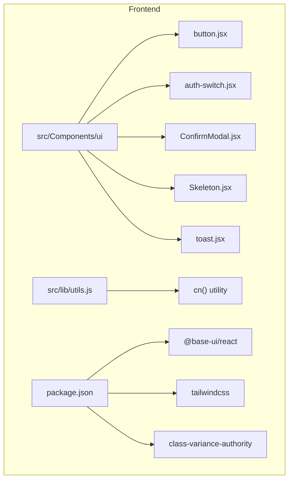
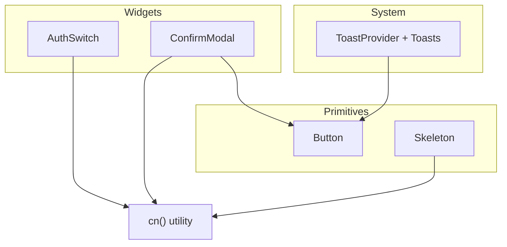
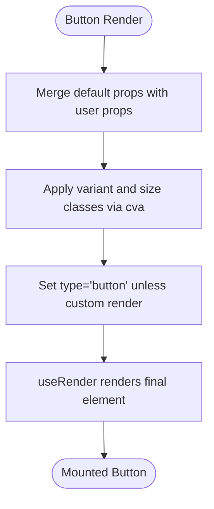
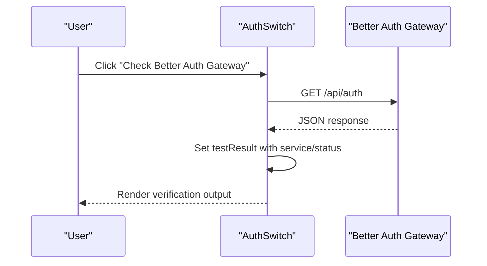
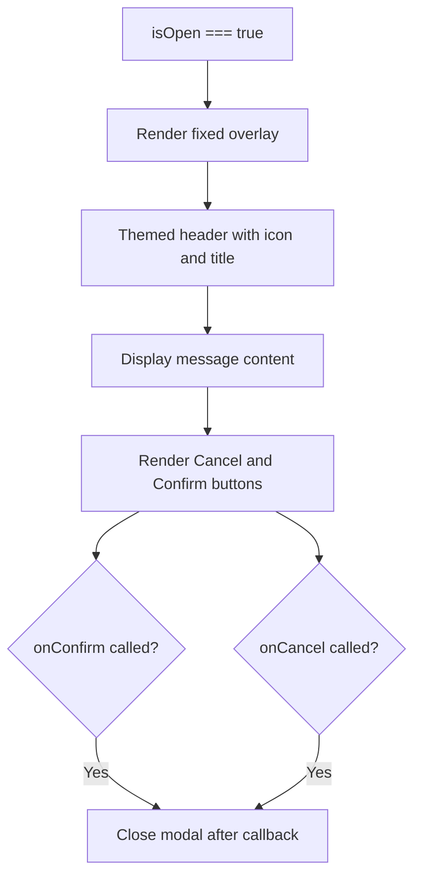
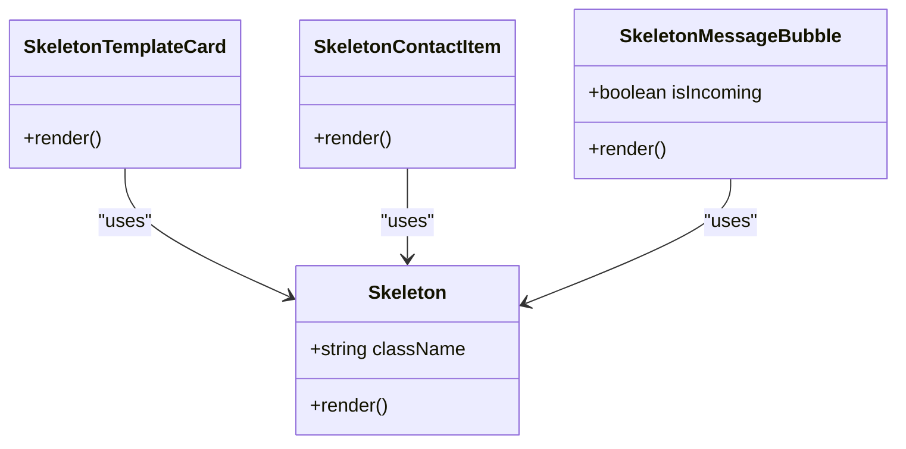
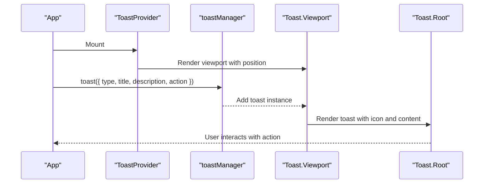
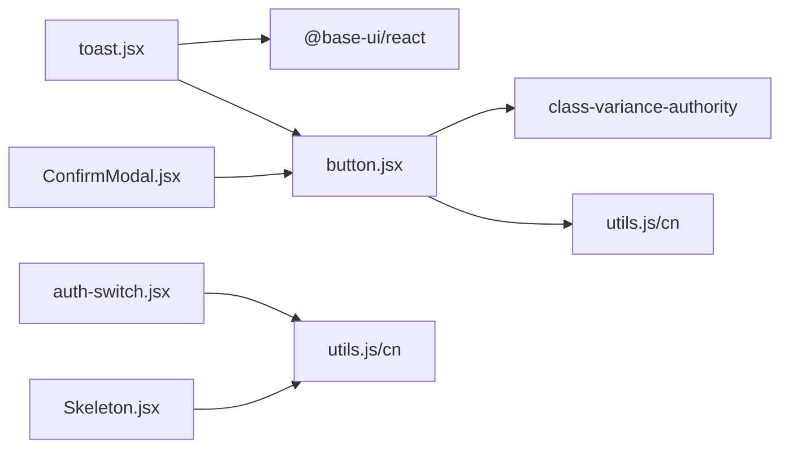

# UI Component Library

<cite>
**Referenced Files in This Document**   
- [button.jsx](file://frontend/src/Components/ui/button.jsx)
- [auth-switch.jsx](file://frontend/src/Components/ui/auth-switch.jsx)
- [ConfirmModal.jsx](file://frontend/src/Components/ui/ConfirmModal.jsx)
- [Skeleton.jsx](file://frontend/src/Components/ui/Skeleton.jsx)
- [toast.jsx](file://frontend/src/Components/ui/toast.jsx)
- [utils.js](file://frontend/src/lib/utils.js)
- [package.json](file://frontend/package.json)
</cite>

## Table of Contents
1. [Introduction](#introduction)
2. [Project Structure](#project-structure)
3. [Core Components](#core-components)
4. [Architecture Overview](#architecture-overview)
5. [Detailed Component Analysis](#detailed-component-analysis)
6. [Dependency Analysis](#dependency-analysis)
7. [Performance Considerations](#performance-considerations)
8. [Accessibility and Compatibility](#accessibility-and-compatibility)
9. [Theme Customization](#theme-customization)
10. [Integration Guidelines](#integration-guidelines)
11. [Troubleshooting Guide](#troubleshooting-guide)
12. [Conclusion](#conclusion)

## Introduction
This document describes the reusable UI component library used across the frontend application. The library is built with modern React patterns, Tailwind CSS for styling, and leverages Base UI primitives for robust accessibility and behavior. It includes core components such as Button, AuthSwitch, ConfirmModal, Skeleton loaders, and Toast notifications. Each component is documented with its props, event handlers, customization options, usage examples, accessibility considerations, responsive behavior, and cross-browser compatibility notes.

## Project Structure
The UI components are organized under a dedicated folder to promote reusability and consistency:
- Components/ui: Contains all shared UI primitives and higher-level UI widgets.
- lib/utils: Provides utility functions like cn for safe class merging.
- package.json: Declares dependencies including Base UI, Tailwind CSS, and related tooling.

**Diagram sources**
- [button.jsx:1-66](file://frontend/src/Components/ui/button.jsx#L1-L66)
- [auth-switch.jsx:1-201](file://frontend/src/Components/ui/auth-switch.jsx#L1-L201)
- [ConfirmModal.jsx:1-96](file://frontend/src/Components/ui/ConfirmModal.jsx#L1-L96)
- [Skeleton.jsx:1-82](file://frontend/src/Components/ui/Skeleton.jsx#L1-L82)
- [toast.jsx:1-105](file://frontend/src/Components/ui/toast.jsx#L1-L105)
- [utils.js:1-7](file://frontend/src/lib/utils.js#L1-L7)
- [package.json:12-34](file://frontend/package.json#L12-L34)

**Section sources**
- [button.jsx:1-66](file://frontend/src/Components/ui/button.jsx#L1-L66)
- [auth-switch.jsx:1-201](file://frontend/src/Components/ui/auth-switch.jsx#L1-L201)
- [ConfirmModal.jsx:1-96](file://frontend/src/Components/ui/ConfirmModal.jsx#L1-L96)
- [Skeleton.jsx:1-82](file://frontend/src/Components/ui/Skeleton.jsx#L1-L82)
- [toast.jsx:1-105](file://frontend/src/Components/ui/toast.jsx#L1-L105)
- [utils.js:1-7](file://frontend/src/lib/utils.js#L1-L7)
- [package.json:12-34](file://frontend/package.json#L12-L34)

## Core Components
This section provides an overview of each core component, including purpose, props, events, variants, and customization options.

- Button: A highly customizable button using class-variance-authority for variants and sizes, Base UI merge utilities, and Tailwind classes. Supports multiple visual variants and sizes, icon support, and accessible focus states.
- AuthSwitch: A demo widget that toggles between sign-in and sign-up modes, displays test results from an external auth endpoint, and includes session seat controls.
- ConfirmModal: A confirmation dialog with type-based theming (primary, danger, warning), loading state, and composed Button usage.
- Skeleton: A set of skeleton loaders for cards, list items, and message bubbles, providing consistent placeholder visuals during data loading.
- Toast: A toast notification system powered by Base UI, supporting types, icons, actions, positioning, and swipe gestures.

**Section sources**
- [button.jsx:10-65](file://frontend/src/Components/ui/button.jsx#L10-L65)
- [auth-switch.jsx:20-198](file://frontend/src/Components/ui/auth-switch.jsx#L20-L198)
- [ConfirmModal.jsx:5-95](file://frontend/src/Components/ui/ConfirmModal.jsx#L5-L95)
- [Skeleton.jsx:3-79](file://frontend/src/Components/ui/Skeleton.jsx#L3-L79)
- [toast.jsx:15-103](file://frontend/src/Components/ui/toast.jsx#L15-L103)

## Architecture Overview
The UI library follows a layered architecture:
- Primitives: Low-level components like Button and Skeleton.
- Widgets: Higher-level components like ConfirmModal and AuthSwitch that compose primitives.
- System: Toast system using Base UI providers and managers.
- Utilities: Shared helpers like cn for class merging.

**Diagram sources**
- [button.jsx:10-65](file://frontend/src/Components/ui/button.jsx#L10-L65)
- [ConfirmModal.jsx:5-95](file://frontend/src/Components/ui/ConfirmModal.jsx#L5-L95)
- [toast.jsx:30-103](file://frontend/src/Components/ui/toast.jsx#L30-L103)
- [utils.js:4-6](file://frontend/src/lib/utils.js#L4-L6)

## Detailed Component Analysis

### Button
Purpose:
- A flexible button component with variant and size control, icon support, and accessible focus rings.

Props:
- className: Additional Tailwind classes merged via cn.
- variant: Visual style preset (default, destructive, destructive-outline, ghost, link, outline, secondary).
- size: Size preset (default, sm, lg, xl, xs, icon, icon-sm, icon-lg, icon-xl, icon-xs).
- render: Optional custom renderer function passed to Base UI useRender.
- ...props: Any native button attributes (onClick, disabled, aria-*).

Event Handlers:
- onClick: Standard click handler inherited from native button.
- onKeyDown/onFocus: Accessible focus management handled by Base UI and Tailwind focus-visible styles.

Customization:
- Variants and sizes are defined via class-variance-authority; extend by adding new entries to buttonVariants.
- Use className to override or augment styles.
- Icons can be included as children; sizing and pointer-events are managed automatically.

Usage Examples:
- Default primary action: variant="default", size="default".
- Destructive action: variant="destructive".
- Ghost link-like action: variant="ghost" or variant="link".
- Icon-only buttons: size="icon" or other icon sizes.

Accessibility:
- Focus-visible ring and offset ensure keyboard navigation visibility.
- Disabled state reduces opacity and disables pointer events.
- Semantic <button> element ensures correct semantics and screen reader support.

Responsive Behavior:
- Sizes adapt at small breakpoints; icon sizes scale appropriately.

Cross-Browser Compatibility:
- Uses standard HTML button semantics and widely supported Tailwind utilities.

**Diagram sources**
- [button.jsx:49-62](file://frontend/src/Components/ui/button.jsx#L49-L62)

**Section sources**
- [button.jsx:10-65](file://frontend/src/Components/ui/button.jsx#L10-L65)

### AuthSwitch
Purpose:
- A demo authentication switcher that toggles between sign-in and sign-up modes, tests an external Better Auth Gateway endpoint, and shows session seat counts.

Props:
- className: Additional container classes.
- onClose: Callback invoked when closing the widget (not wired internally; intended for parent modal integration).

State:
- authMode: "signin" | "signup".
- email/password inputs with defaults.
- testResult: Displays verification output.
- loading: Indicates network request status.
- count: Session seats counter.

Event Handlers:
- handleTestAuth: Fetches an external endpoint and sets testResult with service info and status.
- Mode switchers update authMode.
- Seat increment/decrement buttons adjust count.

Customization:
- Styling uses Tailwind classes; customize colors, spacing, and layout via className.
- Replace the external endpoint URL to match your environment.

Usage Examples:
- Embed within a modal or page header to quickly verify auth gateway connectivity.
- Display testResult to users or log it for debugging.

Accessibility:
- Inputs have labels via placeholders; consider adding explicit aria-labels for better accessibility.
- Buttons are semantic and keyboard navigable.

Responsive Behavior:
- Container adapts width and internal spacing; suitable for mobile and desktop.

Cross-Browser Compatibility:
- Uses fetch API and standard DOM APIs; compatible with modern browsers.

**Diagram sources**
- [auth-switch.jsx:28-58](file://frontend/src/Components/ui/auth-switch.jsx#L28-L58)
- [auth-switch.jsx:165-177](file://frontend/src/Components/ui/auth-switch.jsx#L165-L177)

**Section sources**
- [auth-switch.jsx:20-198](file://frontend/src/Components/ui/auth-switch.jsx#L20-L198)

### ConfirmModal
Purpose:
- A confirmation dialog with themed headers, icons, and composed Button usage.

Props:
- isOpen: Controls visibility.
- title: Header text.
- message: Body text.
- confirmText: Text for the confirm button.
- cancelText: Text for the cancel button.
- type: Theme type ("primary", "danger", "warning").
- loading: Disables buttons and changes confirm button text.
- onConfirm: Callback executed on confirm.
- onCancel: Callback executed on cancel/close.

Event Handlers:
- onConfirm: Triggered when confirm button is clicked.
- onCancel: Triggered when cancel button or close icon is clicked.

Customization:
- Type maps to icons and gradient backgrounds.
- Composes Button with variant and size; can be extended with additional className overrides.

Usage Examples:
- Show before destructive actions (type="danger").
- Use for general confirmations (type="primary").
- Indicate warnings (type="warning").

Accessibility:
- Modal overlay traps focus contextually when integrated with a parent modal manager; currently relies on static rendering.
- Buttons are semantic and keyboard accessible.

Responsive Behavior:
- Fixed overlay with centered card; max-width constraints ensure readability on small screens.

Cross-Browser Compatibility:
- Uses standard DOM APIs and Tailwind utilities.

**Diagram sources**
- [ConfirmModal.jsx:30-93](file://frontend/src/Components/ui/ConfirmModal.jsx#L30-L93)

**Section sources**
- [ConfirmModal.jsx:5-95](file://frontend/src/Components/ui/ConfirmModal.jsx#L5-L95)

### Skeleton Loaders
Purpose:
- Provide lightweight placeholder animations while content loads.

Exports:
- Skeleton: Basic pulsing block with configurable className.
- SkeletonTemplateCard: Card-shaped skeleton for template listings.
- SkeletonContactItem: List item skeleton for contact lists.
- SkeletonMessageBubble: Chat bubble skeleton with incoming/outcoming orientation.

Props:
- Skeleton accepts className and spreads additional props.
- SkeletonMessageBubble accepts isIncoming boolean.

Customization:
- Override Skeleton base classes via className.
- Compose skeletons to match specific layouts.

Usage Examples:
- Wrap template grid items with SkeletonTemplateCard while fetching templates.
- Show SkeletonContactItem rows while loading contacts.
- Display SkeletonMessageBubble for chat messages during initial load.

Accessibility:
- Skeletons are presentational; avoid placing interactive elements inside them.

Responsive Behavior:
- Widths and heights are fixed or percentage-based; adjust via className as needed.

Cross-Browser Compatibility:
- Uses CSS animation and Tailwind utilities; broadly supported.

**Diagram sources**
- [Skeleton.jsx:3-79](file://frontend/src/Components/ui/Skeleton.jsx#L3-L79)

**Section sources**
- [Skeleton.jsx:3-79](file://frontend/src/Components/ui/Skeleton.jsx#L3-L79)

### Toast Notifications
Purpose:
- A toast notification system built on Base UI, supporting types, icons, actions, positioning, and swipe gestures.

Exports:
- ToastProvider: Provider wrapping app content and rendering Toasts viewport.
- toastManager, anchoredToastManager: Managers for toast instances.
- ToastPrimitive: Underlying Base UI Toast component.

Props:
- ToastProvider accepts position ("top-left", "top-right", "bottom-left", "bottom-right", "center", etc.) and forwards other provider props.

Behavior:
- Toasts are rendered via Toast.Portal and Toast.Viewport.
- Icons map per type (error, info, loading, success, warning).
- Swipe direction is computed based on position.
- Action buttons reuse Button variants for consistent styling.

Usage Examples:
- Wrap app root with ToastProvider to enable toasts globally.
- Use toastManager to enqueue toasts with type, title, description, and optional action.

Accessibility:
- Base UI manages focus and announcements; ensure toasts include meaningful titles and descriptions.

Responsive Behavior:
- Viewport adapts margins and centering based on position; works across screen sizes.

Cross-Browser Compatibility:
- Relies on Base UI primitives and standard DOM APIs.

**Diagram sources**
- [toast.jsx:30-88](file://frontend/src/Components/ui/toast.jsx#L30-L88)
- [toast.jsx:91-103](file://frontend/src/Components/ui/toast.jsx#L91-L103)

**Section sources**
- [toast.jsx:15-103](file://frontend/src/Components/ui/toast.jsx#L15-L103)

## Dependency Analysis
Key dependencies and their roles:
- @base-ui/react: Provides accessible primitives (Toast, merge-props, use-render).
- class-variance-authority: Defines Button variants and sizes.
- tailwindcss and tailwind-merge: Utility-first styling and safe class merging.
- clsx: Conditional class composition.
- lucide-react: Icons used across components.

**Diagram sources**
- [button.jsx:3-8](file://frontend/src/Components/ui/button.jsx#L3-L8)
- [toast.jsx:3-13](file://frontend/src/Components/ui/toast.jsx#L3-L13)
- [auth-switch.jsx:2-18](file://frontend/src/Components/ui/auth-switch.jsx#L2-L18)
- [ConfirmModal.jsx:1-3](file://frontend/src/Components/ui/ConfirmModal.jsx#L1-L3)
- [Skeleton.jsx:1-1](file://frontend/src/Components/ui/Skeleton.jsx#L1-L1)
- [utils.js:1-6](file://frontend/src/lib/utils.js#L1-L6)

**Section sources**
- [package.json:12-34](file://frontend/package.json#L12-L34)
- [button.jsx:3-8](file://frontend/src/Components/ui/button.jsx#L3-L8)
- [toast.jsx:3-13](file://frontend/src/Components/ui/toast.jsx#L3-L13)
- [utils.js:1-6](file://frontend/src/lib/utils.js#L1-L6)

## Performance Considerations
- Button: Uses cva to compute classes once per variant/size; minimal runtime overhead. Avoid excessive className overrides that cause re-renders.
- AuthSwitch: Network requests are triggered on demand; debounce repeated clicks if necessary. Consider caching test results to reduce redundant calls.
- ConfirmModal: Renders only when isOpen is true; keep payload minimal to avoid unnecessary re-renders.
- Skeleton: Lightweight CSS animations; prefer Skeleton over heavy placeholder components during loading.
- Toast: Base UI manages portal rendering; limit concurrent toasts to prevent layout thrashing. Use actionProps sparingly.

[No sources needed since this section provides general guidance]

## Accessibility and Compatibility
- Button:
  - Keyboard accessible with focus-visible rings.
  - Semantic <button> ensures proper ARIA roles.
  - Disabled state is visually distinct and non-interactive.
- AuthSwitch:
  - Inputs should include explicit aria-labels for improved screen reader support.
  - Buttons are keyboard navigable.
- ConfirmModal:
  - Ensure focus trapping when integrated with a modal manager.
  - Provide descriptive titles and messages for assistive technologies.
- Skeleton:
  - Presentational only; do not wrap interactive content.
- Toast:
  - Base UI handles announcements; provide clear titles and descriptions.
  - Swipe gestures are supported; ensure touch targets meet minimum sizes.

Cross-Browser Compatibility:
- All components rely on standard HTML, CSS, and JavaScript features supported by modern browsers.
- Base UI primitives enhance compatibility and accessibility across environments.

[No sources needed since this section provides general guidance]

## Theme Customization
- Button:
  - Extend variants and sizes by modifying buttonVariants in button.jsx.
  - Use Tailwind color tokens and spacing utilities to align with your design system.
- AuthSwitch:
  - Customize colors and gradients via Tailwind classes; replace brand tokens as needed.
  - Update the external endpoint URL to match your deployment.
- ConfirmModal:
  - Add new theme types by extending icons and bgGradients mappings.
  - Adjust border and shadow styles to match your theme.
- Skeleton:
  - Override base Skeleton classes via className to match theme colors and radii.
- Toast:
  - Configure position via ToastProvider.
  - Customize icon mapping and action styling by editing toast.jsx.

[No sources needed since this section provides general guidance]

## Integration Guidelines
- Install dependencies: Ensure @base-ui/react, tailwindcss, class-variance-authority, clsx, and tailwind-merge are installed.
- Setup:
  - Wrap your app with ToastProvider to enable global toasts.
  - Import components from src/Components/ui and use them throughout your application.
- Composition:
  - Compose ConfirmModal with your own state management for isOpen and callbacks.
  - Use Skeleton loaders around async data sections to improve perceived performance.
- Styling:
  - Leverage Tailwind classes and the cn utility for safe class merging.
  - Align component styles with your design tokens and breakpoints.

**Section sources**
- [package.json:12-34](file://frontend/package.json#L12-L34)
- [toast.jsx:94-103](file://frontend/src/Components/ui/toast.jsx#L94-L103)
- [utils.js:4-6](file://frontend/src/lib/utils.js#L4-L6)

## Troubleshooting Guide
- Button not responding to clicks:
  - Verify onClick is passed correctly and not overridden by disabled state.
  - Check that className does not inadvertently disable pointer events.
- AuthSwitch network errors:
  - Inspect the external endpoint URL and CORS settings.
  - Review testResult for error messages and timestamp.
- ConfirmModal not closing:
  - Ensure onCancel is wired and isOpen state is updated in the parent.
  - Check loading state prevents unintended interactions.
- Skeleton not animating:
  - Ensure Tailwind’s animate-pulse is available and not overridden.
  - Verify CSS is compiled and applied.
- Toast not appearing:
  - Confirm ToastProvider wraps the app tree.
  - Check toastManager usage and ensure toasts are enqueued with required fields.

**Section sources**
- [auth-switch.jsx:28-58](file://frontend/src/Components/ui/auth-switch.jsx#L28-L58)
- [ConfirmModal.jsx:47-54](file://frontend/src/Components/ui/ConfirmModal.jsx#L47-L54)
- [toast.jsx:30-88](file://frontend/src/Components/ui/toast.jsx#L30-L88)

## Conclusion
The UI component library provides a cohesive set of reusable primitives and widgets built with React, Tailwind CSS, and Base UI. By following the documented prop interfaces, event handlers, and customization strategies, developers can consistently implement accessible, responsive, and performant features. The architecture encourages composition, theme alignment, and clear integration patterns, enabling scalable growth of the application’s interface.

[No sources needed since this section summarizes without analyzing specific files]