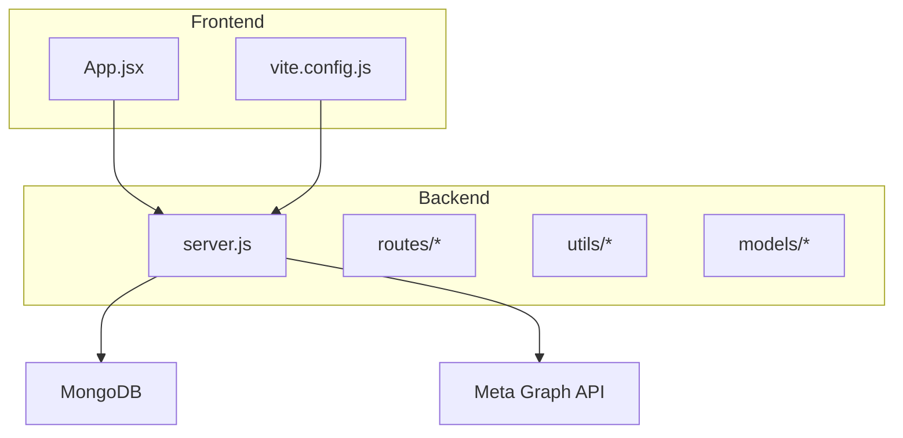
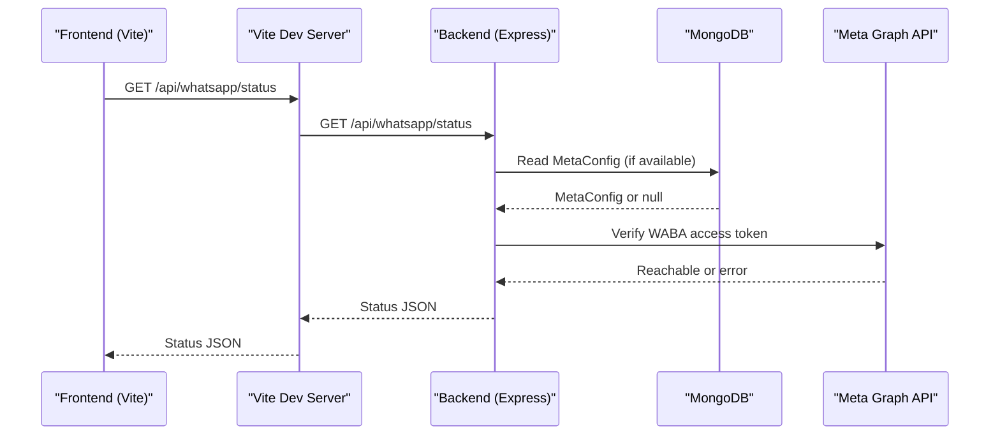
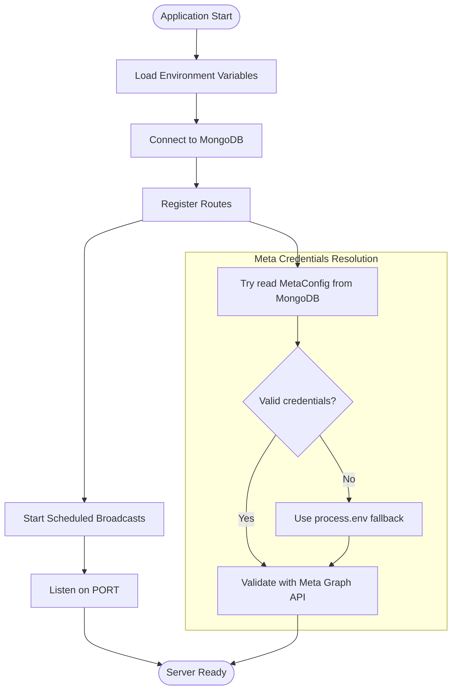
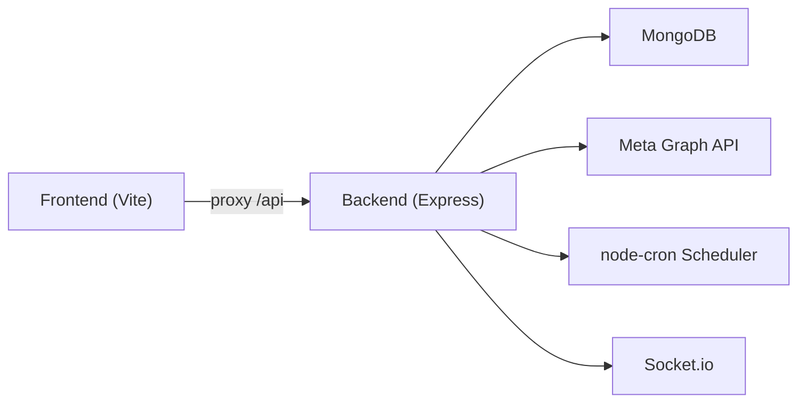

# Getting Started

<cite>
**Referenced Files in This Document**
- [backend/server.js](file://backend/server.js)
- [backend/package.json](file://backend/package.json)
- [backend/nodemon.json](file://backend/nodemon.json)
- [backend/routes/whatsapp.js](file://backend/routes/whatsapp.js)
- [backend/utils/metaConfigHelper.js](file://backend/utils/metaConfigHelper.js)
- [backend/models/MetaConfig.js](file://backend/models/MetaConfig.js)
- [frontend/package.json](file://frontend/package.json)
- [frontend/vite.config.js](file://frontend/vite.config.js)
- [frontend/src/App.jsx](file://frontend/src/App.jsx)
</cite>

## Table of Contents
1. [Introduction](#introduction)
2. [Project Structure](#project-structure)
3. [Core Components](#core-components)
4. [Architecture Overview](#architecture-overview)
5. [Detailed Component Analysis](#detailed-component-analysis)
6. [Dependency Analysis](#dependency-analysis)
7. [Performance Considerations](#performance-considerations)
8. [Troubleshooting Guide](#troubleshooting-guide)
9. [Conclusion](#conclusion)

## Introduction
This guide helps you set up and run Whatsapp_Automachine locally for development and production. It covers:
- Installing Node.js dependencies for backend and frontend
- Setting up MongoDB
- Configuring Meta WhatsApp Business API credentials
- Environment variables and application settings
- Starting the backend and frontend servers
- Verifying installation and resolving common issues

The project consists of:
- A Node.js/Express backend with WebSocket support, REST APIs, and a scheduled broadcast system
- A React/Vite frontend that proxies API calls to the backend during development

## Project Structure
At a high level:
- backend/: Express server, routes, models, utilities, and scripts
- frontend/: React application built with Vite and Tailwind CSS

**Diagram sources**
- [backend/server.js:1-82](file://backend/server.js#L1-L82)
- [frontend/vite.config.js:21-28](file://frontend/vite.config.js#L21-L28)
- [frontend/src/App.jsx:1-27](file://frontend/src/App.jsx#L1-L27)

**Section sources**
- [backend/server.js:1-82](file://backend/server.js#L1-L82)
- [frontend/vite.config.js:1-29](file://frontend/vite.config.js#L1-L29)
- [frontend/src/App.jsx:1-27](file://frontend/src/App.jsx#L1-L27)

## Core Components
- Backend server (Express + Socket.io): Loads environment variables, sets up middleware, registers routes, connects to MongoDB, starts a cron job, and listens on a port.
- Frontend app (React + Vite): Provides routing and UI; proxies /api requests to the backend during development.
- Meta WhatsApp integration: Reads or updates Meta credentials from MongoDB or environment variables and verifies connectivity to Meta Graph API.

Key responsibilities:
- Backend: HTTP/WebSocket server, database connection, route handlers, scheduled tasks, Meta credential management
- Frontend: User interface, API proxying, real-time updates via WebSockets

**Section sources**
- [backend/server.js:1-82](file://backend/server.js#L1-L82)
- [backend/routes/whatsapp.js:1-109](file://backend/routes/whatsapp.js#L1-L109)
- [backend/utils/metaConfigHelper.js:1-112](file://backend/utils/metaConfigHelper.js#L1-L112)
- [frontend/vite.config.js:21-28](file://frontend/vite.config.js#L21-L28)

## Architecture Overview
The runtime architecture includes:
- Frontend dev server (Vite) proxying API calls to the backend
- Backend Express server exposing REST endpoints and WebSockets
- MongoDB storing application data and Meta configuration
- Meta Graph API used to verify and interact with WhatsApp Business Account

**Diagram sources**
- [frontend/vite.config.js:21-28](file://frontend/vite.config.js#L21-L28)
- [backend/routes/whatsapp.js:8-22](file://backend/routes/whatsapp.js#L8-L22)
- [backend/utils/metaConfigHelper.js:73-100](file://backend/utils/metaConfigHelper.js#L73-L100)

## Detailed Component Analysis

### Environment Setup

#### Prerequisites
- Node.js (recommended LTS version)
- npm (comes with Node.js)
- MongoDB running locally or accessible remotely
- Meta WhatsApp Business Account with:
  - Business Account ID
  - Phone Number ID
  - Access Token
  - Verify Token (for webhook verification)

#### Install Dependencies

Backend
- Navigate to the backend directory
- Install dependencies using npm

Frontend
- Navigate to the frontend directory
- Install dependencies using npm

Scripts
- Backend start script runs the server
- Backend dev script uses nodemon for auto-restart during development
- Frontend dev script runs the Vite development server
- Frontend build script creates a production build

**Section sources**
- [backend/package.json:6-9](file://backend/package.json#L6-L9)
- [frontend/package.json:6-10](file://frontend/package.json#L6-L10)

#### MongoDB Setup
- Ensure MongoDB is installed and running
- The backend connects to MongoDB using an environment variable with a local fallback
- Create or use an existing database for the application

Configuration
- Set MONGODB_URI to your MongoDB connection string
- If not set, the backend falls back to a local MongoDB instance and database name

**Section sources**
- [backend/server.js:65-77](file://backend/server.js#L65-L77)

#### Meta WhatsApp Business API Credentials
You can configure Meta credentials in two ways:
- Environment variables (recommended for production)
- Through the backend’s configuration endpoint (stored in MongoDB)

Environment variables
- META_WA_ACCESS_TOKEN: Your Meta Graph API access token
- META_WA_BUSINESS_ACCOUNT_ID: Your WABA ID
- META_WA_PHONE_NUMBER_ID: Your Phone Number ID
- META_WA_VERIFY_TOKEN: Webhook verification token
- META_GRAPH_VERSION: Meta Graph API version (default provided)

Via API
- Use the backend’s configuration endpoint to save and verify credentials
- The helper validates credentials against Meta before saving them to MongoDB

Fallback behavior
- If no valid credentials are found in MongoDB, the backend reads from environment variables
- A default verify token is used if not provided

**Section sources**
- [backend/utils/metaConfigHelper.js:6-35](file://backend/utils/metaConfigHelper.js#L6-L35)
- [backend/utils/metaConfigHelper.js:37-71](file://backend/utils/metaConfigHelper.js#L37-L71)
- [backend/utils/metaConfigHelper.js:73-100](file://backend/utils/metaConfigHelper.js#L73-L100)
- [backend/models/MetaConfig.js:3-10](file://backend/models/MetaConfig.js#L3-L10)
- [backend/routes/whatsapp.js:78-109](file://backend/routes/whatsapp.js#L78-L109)

#### Application Settings

Backend
- PORT: Port for the backend server (default provided)
- CORS: Allows cross-origin requests (configured to allow all origins in development)
- File uploads: Static upload folder exposed under /uploads
- WebSockets: Socket.io configured with permissive CORS for development

Frontend
- Development server proxies /api to the backend at a specific host and port
- Routing defines landing page, authentication pages, and dashboard

Important note
- The frontend dev server proxies to a backend port different than the default backend listen port. Ensure your backend is listening on the same port expected by the frontend proxy.

**Section sources**
- [backend/server.js:37-56](file://backend/server.js#L37-L56)
- [backend/server.js:79-80](file://backend/server.js#L79-L80)
- [frontend/vite.config.js:21-28](file://frontend/vite.config.js#L21-L28)
- [frontend/src/App.jsx:7-26](file://frontend/src/App.jsx#L7-L26)

### First Launch Instructions

Start MongoDB
- Start your local MongoDB service or ensure your remote MongoDB is reachable

Start Backend
- From the backend directory, run the development script
- The server will load environment variables, connect to MongoDB, register routes, and start listening on the configured port

Start Frontend
- From the frontend directory, run the development script
- Open the browser at the URL shown by Vite
- The frontend will proxy API calls to the backend

Verify Installation
- Check backend logs for successful MongoDB connection and server startup
- In the frontend, navigate to the WhatsApp integration section and check status
- Optionally call the backend status endpoint to confirm connectivity to Meta

**Section sources**
- [backend/server.js:65-80](file://backend/server.js#L65-L80)
- [backend/package.json:6-9](file://backend/package.json#L6-L9)
- [frontend/package.json:6-10](file://frontend/package.json#L6-L10)
- [frontend/vite.config.js:21-28](file://frontend/vite.config.js#L21-L28)

### Configuration Flow

**Diagram sources**
- [backend/server.js:65-80](file://backend/server.js#L65-L80)
- [backend/utils/metaConfigHelper.js:6-35](file://backend/utils/metaConfigHelper.js#L6-L35)
- [backend/utils/metaConfigHelper.js:73-100](file://backend/utils/metaConfigHelper.js#L73-L100)

## Dependency Analysis

**Diagram sources**
- [frontend/vite.config.js:21-28](file://frontend/vite.config.js#L21-L28)
- [backend/server.js:14-22](file://backend/server.js#L14-L22)
- [backend/server.js:69-75](file://backend/server.js#L69-L75)
- [backend/server.js:79-80](file://backend/server.js#L79-L80)

**Section sources**
- [backend/server.js:14-22](file://backend/server.js#L14-L22)
- [backend/server.js:69-75](file://backend/server.js#L69-L75)
- [backend/server.js:79-80](file://backend/server.js#L79-L80)
- [frontend/vite.config.js:21-28](file://frontend/vite.config.js#L21-L28)

## Performance Considerations
- Keep large file uploads enabled only when needed; the backend configures generous limits for JSON and form payloads
- Use environment variables for secrets instead of hardcoding values
- Avoid unnecessary reconnections to Meta Graph API; the helper caches credentials in memory
- Monitor MongoDB performance and indexes for message logs and contacts

[No sources needed since this section provides general guidance]

## Troubleshooting Guide

Common Issues and Solutions

- Backend cannot connect to MongoDB
  - Ensure MongoDB is running and reachable
  - Verify MONGODB_URI is correct
  - Check network access if using a remote MongoDB instance

- Frontend cannot reach backend APIs
  - Confirm the frontend dev server proxy target matches the backend port
  - Ensure the backend is started and listening on the expected port
  - Check CORS settings if calling from a different origin in production

- Meta credentials validation fails
  - Verify META_WA_ACCESS_TOKEN, META_WA_BUSINESS_ACCOUNT_ID, and META_WA_PHONE_NUMBER_ID are correct
  - Ensure the account has permissions to access the specified phone number
  - Check META_GRAPH_VERSION compatibility with your Meta setup

- Webhook verification fails
  - Ensure META_WA_VERIFY_TOKEN matches what Meta expects
  - Confirm the webhook URL is publicly reachable and points to the backend’s webhook endpoint

- Frontend build errors
  - Clear node_modules and reinstall dependencies
  - Ensure Node.js version is compatible with the project’s toolchain

Verification Steps
- Backend logs should show successful MongoDB connection and server startup
- Frontend should load without console errors and display the dashboard
- Use the WhatsApp status endpoint to confirm connectivity to Meta

**Section sources**
- [backend/server.js:65-80](file://backend/server.js#L65-L80)
- [frontend/vite.config.js:21-28](file://frontend/vite.config.js#L21-L28)
- [backend/utils/metaConfigHelper.js:73-100](file://backend/utils/metaConfigHelper.js#L73-L100)
- [backend/routes/whatsapp.js:114-132](file://backend/routes/whatsapp.js#L114-L132)

## Conclusion
You now have the steps to install dependencies, configure MongoDB and Meta WhatsApp credentials, and launch both backend and frontend servers. Use the environment variables for secure configuration, verify connectivity through the provided endpoints, and refer to the troubleshooting section for common issues. For production deployments, ensure proper secret management, CORS configuration, and monitoring of external integrations like Meta Graph API.

[No sources needed since this section summarizes without analyzing specific files]