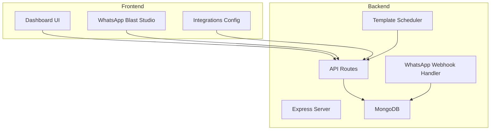
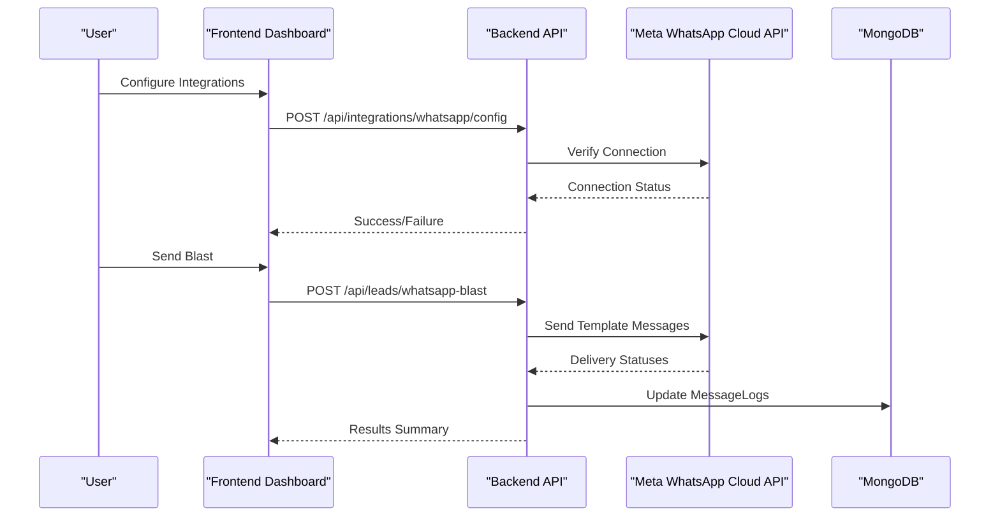
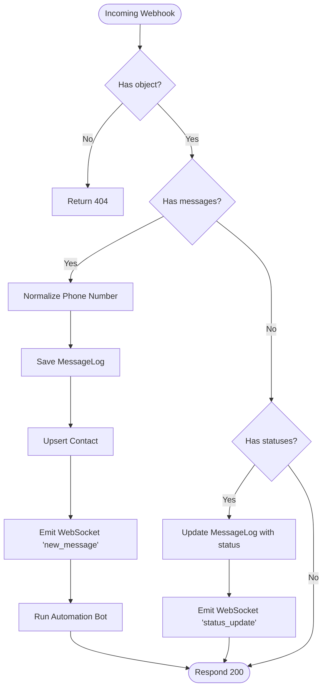
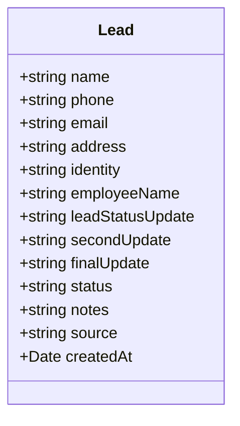
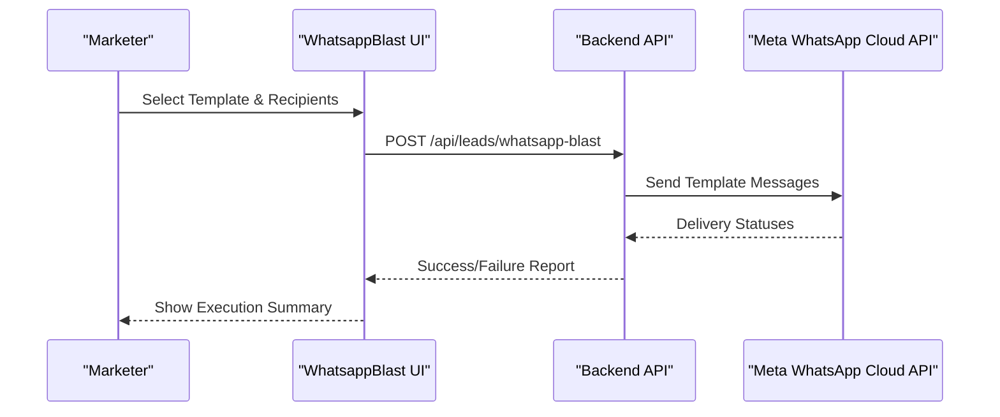
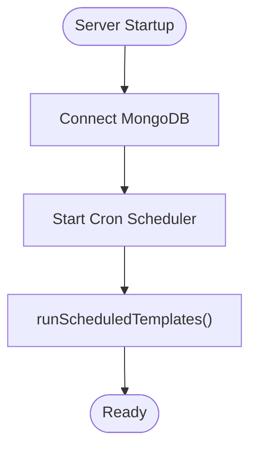
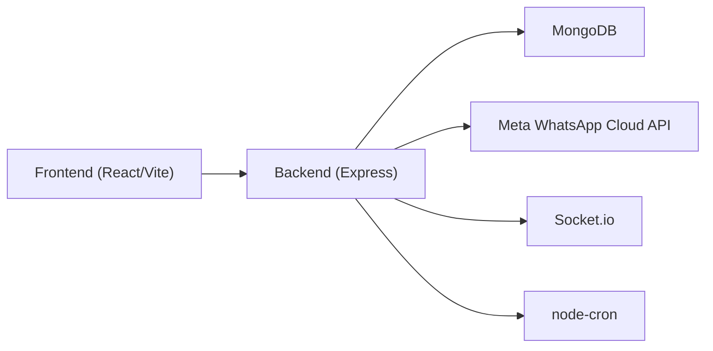

# Introduction and Purpose

<cite>
**Referenced Files in This Document**
- [server.js](file://backend/server.js)
- [whatsapp.js](file://backend/routes/whatsapp.js)
- [Lead.js](file://backend/models/Lead.js)
- [WhatsappBlast.jsx](file://frontend/src/Dashboard/WhatsappBlast.jsx)
- [index.jsx](file://frontend/src/Dashboard/index.jsx)
</cite>

## Table of Contents
1. [Introduction](#introduction)
2. [Project Structure](#project-structure)
3. [Core Components](#core-components)
4. [Architecture Overview](#architecture-overview)
5. [Detailed Component Analysis](#detailed-component-analysis)
6. [Dependency Analysis](#dependency-analysis)
7. [Performance Considerations](#performance-considerations)
8. [Troubleshooting Guide](#troubleshooting-guide)
9. [Conclusion](#conclusion)

## Introduction
Whatsapp_Automachine is a full-stack WhatsApp Business automation platform that combines CRM functionality with marketing automation capabilities. Its primary purpose is to streamline WhatsApp Business communication through automated messaging, customer relationship management, and campaign execution. The system integrates directly with the Meta WhatsApp Cloud API to send approved templates, receive inbound messages via webhooks, track delivery statuses, and broadcast campaigns at scale.

At its core, Whatsapp_Automachine solves common challenges in WhatsApp Business communication:
- Manual message handling: Incoming customer messages are captured, normalized, stored, and surfaced in real time.
- Customer tracking: Contacts and leads are maintained with identity, status, and interaction history.
- Campaign management: Users can select recipients from contacts or leads, preview personalized templates, and dispatch bulk broadcasts with live progress and results.

Target audience:
- Businesses seeking reliable WhatsApp outreach and support workflows.
- Marketers who need templated, compliant, and trackable campaigns.
- Developers integrating WhatsApp Business API features into existing systems.

Business value proposition:
- Increased efficiency through automated flows and scheduled broadcasts.
- Better customer engagement via timely, personalized, and interactive messages.
- Automated workflows that reduce manual effort while improving consistency and compliance.

**Section sources**
- [server.js:1-82](file://backend/server.js#L1-L82)
- [whatsapp.js:1-335](file://backend/routes/whatsapp.js#L1-L335)
- [Lead.js:1-69](file://backend/models/Lead.js#L1-L69)
- [WhatsappBlast.jsx:1-713](file://frontend/src/Dashboard/WhatsappBlast.jsx#L1-L713)
- [index.jsx:1-64](file://frontend/src/Dashboard/index.jsx#L1-L64)

## Project Structure
The project follows a clear separation between backend and frontend:
- Backend (Express + Mongoose): Provides REST APIs for authentication, users, contacts, leads, orders, menus, todos, analytics, templates, and WhatsApp integration. It also exposes WebSockets for real-time updates and runs scheduled tasks for template broadcasting.
- Frontend (React + Vite): Offers dashboards for contacts, leads pipeline, employees, user management, WhatsApp blast studio, and integrations configuration.

**Diagram sources**
- [server.js:43-56](file://backend/server.js#L43-L56)
- [whatsapp.js:111-311](file://backend/routes/whatsapp.js#L111-L311)
- [index.jsx:1-64](file://frontend/src/Dashboard/index.jsx#L1-L64)
- [WhatsappBlast.jsx:67-147](file://frontend/src/Dashboard/WhatsappBlast.jsx#L67-L147)

**Section sources**
- [server.js:1-82](file://backend/server.js#L1-L82)
- [index.jsx:1-64](file://frontend/src/Dashboard/index.jsx#L1-L64)

## Core Components
- WhatsApp Integration Layer: Manages connection status, credentials, webhook verification, incoming message processing, and delivery status updates.
- CRM Data Layer: Stores contacts and leads with attributes such as name, phone, email, address, identity, and status.
- Marketing Automation Layer: Enables template selection, recipient targeting (contacts or leads), personalization preview, and batch sending.
- Real-Time Communication: Uses WebSockets to broadcast new messages and status updates to the dashboard.
- Scheduled Broadcasts: Runs periodic jobs to process queued templates.

Key responsibilities:
- Inbound message normalization and contact auto-upsert.
- Outbound template dispatch and status tracking.
- Bulk campaign orchestration with success/failure reporting.
- Live chat experience with real-time updates.

**Section sources**
- [whatsapp.js:8-109](file://backend/routes/whatsapp.js#L8-L109)
- [whatsapp.js:111-311](file://backend/routes/whatsapp.js#L111-L311)
- [Lead.js:1-69](file://backend/models/Lead.js#L1-L69)
- [WhatsappBlast.jsx:276-327](file://frontend/src/Dashboard/WhatsappBlast.jsx#L276-L327)
- [server.js:64-77](file://backend/server.js#L64-L77)

## Architecture Overview
The platform integrates React-based dashboards with an Express backend that connects to MongoDB and the Meta WhatsApp Cloud API. WebSockets provide real-time visibility for operations like incoming messages and delivery statuses.

**Diagram sources**
- [whatsapp.js:78-109](file://backend/routes/whatsapp.js#L78-L109)
- [whatsapp.js:134-311](file://backend/routes/whatsapp.js#L134-L311)
- [WhatsappBlast.jsx:298-327](file://frontend/src/Dashboard/WhatsappBlast.jsx#L298-L327)

## Detailed Component Analysis

### WhatsApp Integration and Webhooks
This component handles:
- Connection status checks and credential management.
- Webhook verification required by Meta.
- Processing incoming messages and auto-upserting contacts.
- Tracking delivery/read statuses and emitting real-time events.

**Diagram sources**
- [whatsapp.js:111-311](file://backend/routes/whatsapp.js#L111-L311)

**Section sources**
- [whatsapp.js:8-109](file://backend/routes/whatsapp.js#L8-L109)
- [whatsapp.js:111-311](file://backend/routes/whatsapp.js#L111-L311)

### CRM Data Model: Leads
Leads capture essential prospect information including name, phone, email, address, identity, employee ownership, notes, and status. This model supports segmentation and targeted messaging within campaigns.

**Diagram sources**
- [Lead.js:1-69](file://backend/models/Lead.js#L1-L69)

**Section sources**
- [Lead.js:1-69](file://backend/models/Lead.js#L1-L69)

### Marketing Automation: WhatsApp Blast Studio
The blast studio enables marketers to:
- Select approved templates.
- Choose recipients from contacts or leads.
- Preview personalized messages.
- Dispatch bulk campaigns and view execution reports.

**Diagram sources**
- [WhatsappBlast.jsx:276-327](file://frontend/src/Dashboard/WhatsappBlast.jsx#L276-L327)

**Section sources**
- [WhatsappBlast.jsx:1-713](file://frontend/src/Dashboard/WhatsappBlast.jsx#L1-L713)

### Real-Time Updates and Scheduling
The server initializes WebSockets for live updates and schedules template broadcasts periodically.

**Diagram sources**
- [server.js:64-77](file://backend/server.js#L64-L77)

**Section sources**
- [server.js:14-35](file://backend/server.js#L14-L35)
- [server.js:64-77](file://backend/server.js#L64-L77)

## Dependency Analysis
- Backend depends on Express, Mongoose, Socket.io, node-cron, axios, and environment configuration.
- Frontend depends on React, Vite, Tailwind, and socket.io-client for real-time interactions.
- The WhatsApp route depends on utility helpers for Meta configuration and template services.

**Diagram sources**
- [server.js:1-10](file://backend/server.js#L1-L10)
- [server.js:43-56](file://backend/server.js#L43-L56)

**Section sources**
- [server.js:1-82](file://backend/server.js#L1-L82)

## Performance Considerations
- Use efficient queries and indexes on frequently filtered fields such as phone and status to improve performance during blasts and searches.
- Batch operations where possible to reduce API calls to Meta and database writes.
- Leverage WebSockets for real-time updates instead of polling endpoints.
- Monitor webhook payload sizes and handle large message histories gracefully.

[No sources needed since this section provides general guidance]

## Troubleshooting Guide
Common issues and resolutions:
- Webhook verification failures: Ensure verify token matches the configured value and the endpoint is publicly accessible.
- Connection status shows disconnected: Validate WABA ID, phone number ID, access token, and graph version; re-sync environment if necessary.
- Missing contacts after inbound messages: Confirm contact upsert logic triggers and phone normalization is correct.
- Blast sends zero recipients: Verify selected IDs and recipient type mapping before dispatch.

Operational tips:
- Use the status endpoint to check connectivity and account details.
- Inspect MessageLog entries for delivery statuses and error codes.
- Clear and re-sync MetaConfig when environment variables change.

**Section sources**
- [whatsapp.js:8-22](file://backend/routes/whatsapp.js#L8-L22)
- [whatsapp.js:78-109](file://backend/routes/whatsapp.js#L78-L109)
- [whatsapp.js:111-132](file://backend/routes/whatsapp.js#L111-L132)
- [whatsapp.js:134-311](file://backend/routes/whatsapp.js#L134-L311)

## Conclusion
Whatsapp_Automachine delivers a robust, developer-friendly platform for automating WhatsApp Business communications while maintaining strong CRM capabilities. By combining templated outbound messaging, inbound message handling, real-time updates, and scheduled broadcasts, it helps businesses increase efficiency, improve customer engagement, and automate repetitive workflows. The modular architecture and clear separation of concerns make it adaptable for both marketing-driven campaigns and technical integrations.

[No sources needed since this section summarizes without analyzing specific files]