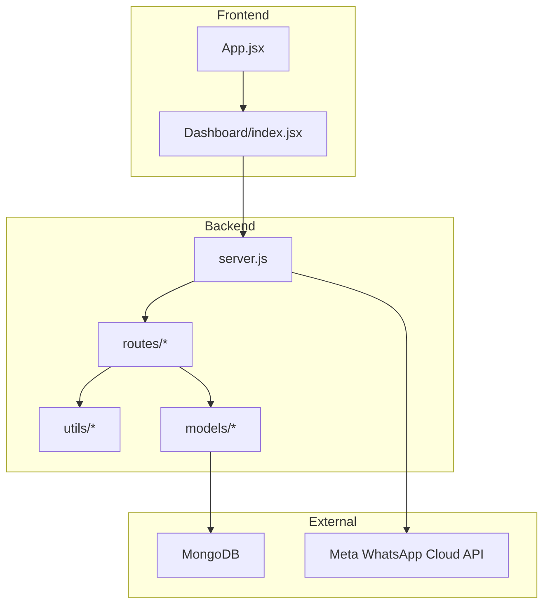
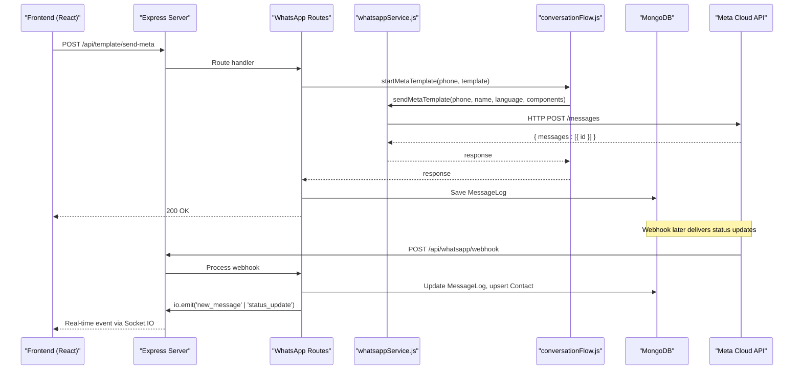
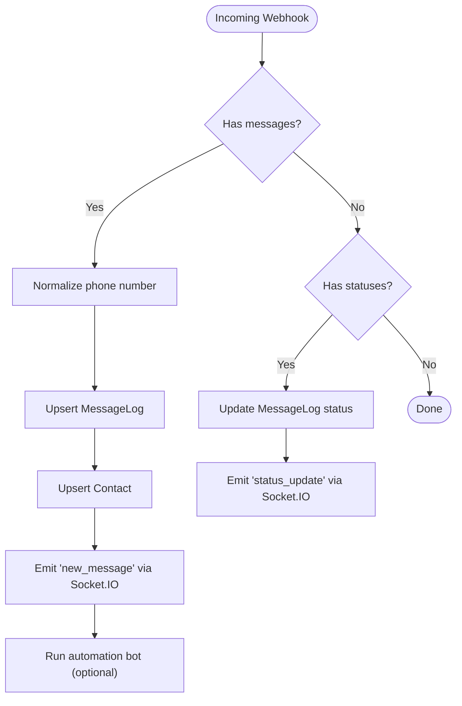
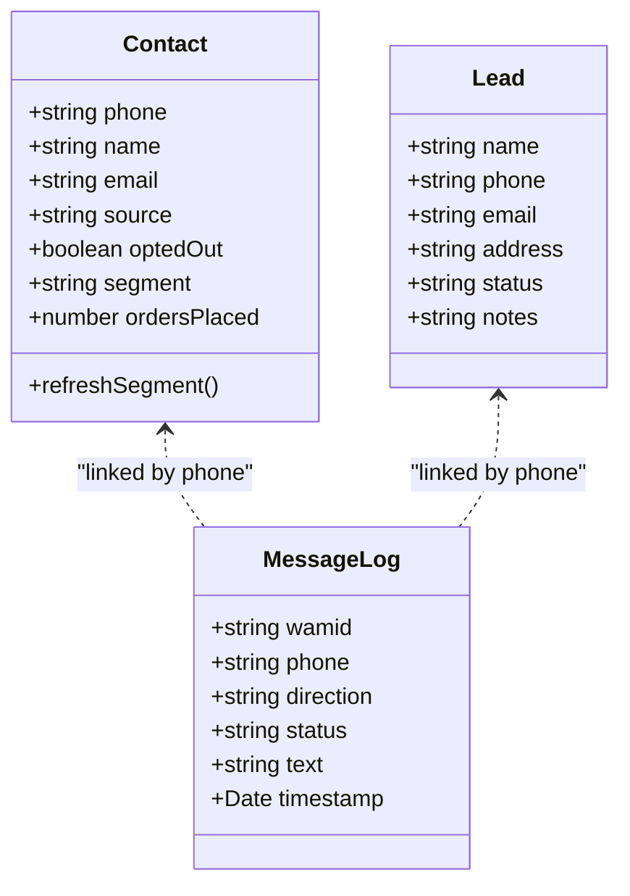
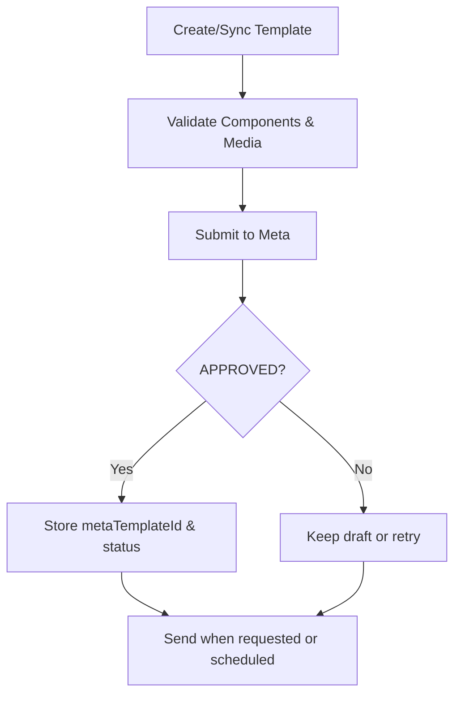
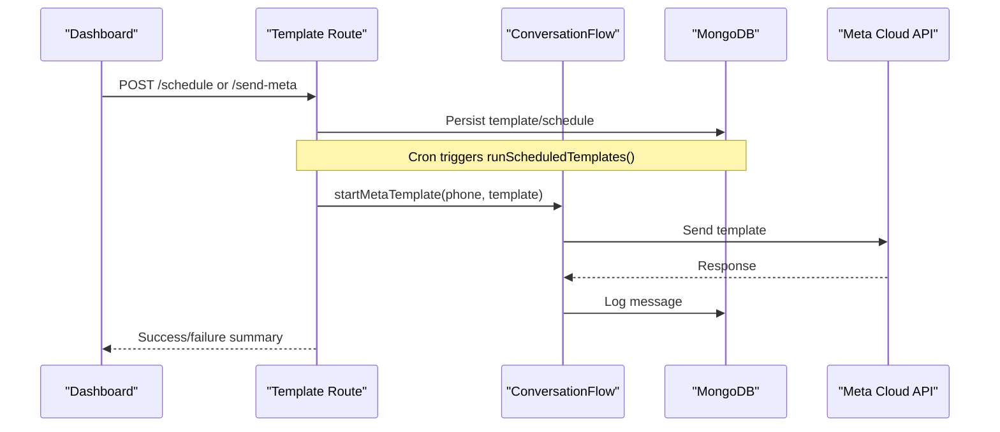
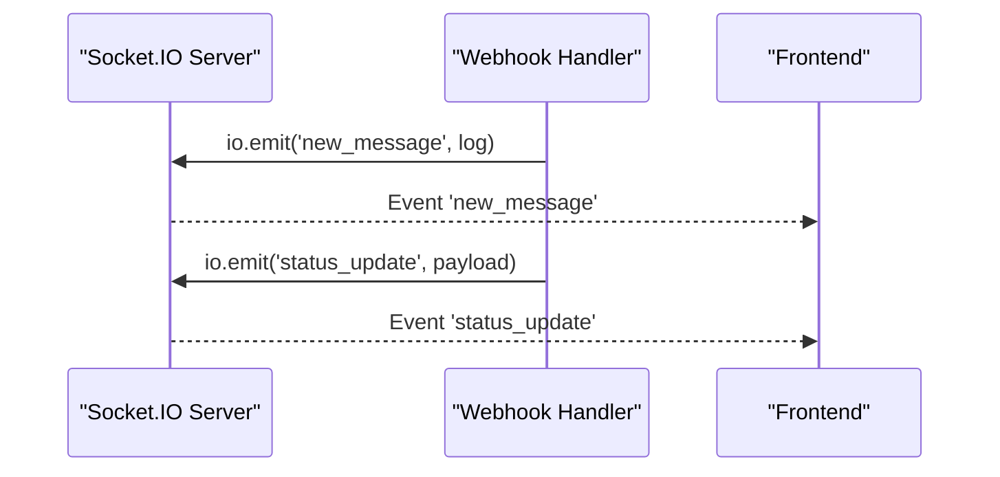
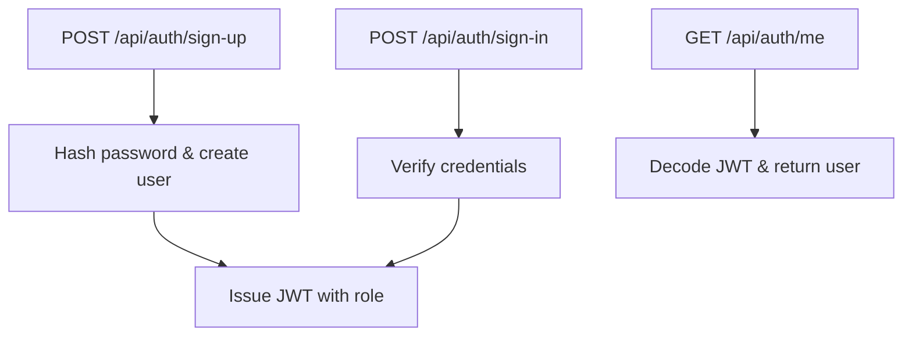
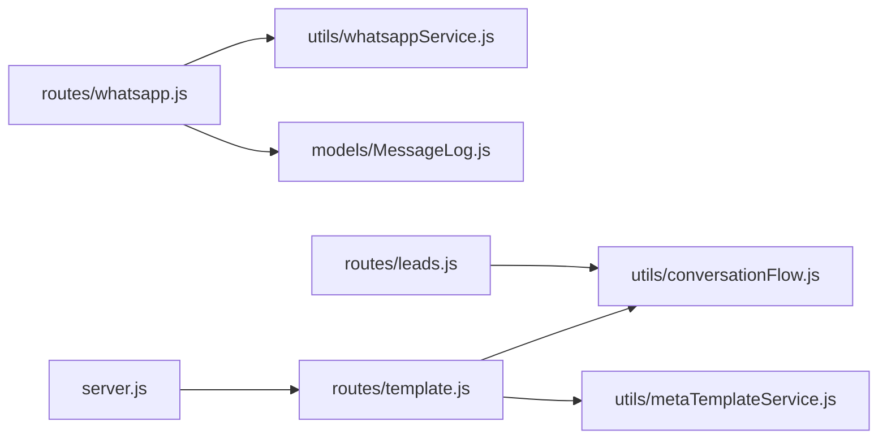

# Key Features and Capabilities

<cite>
**Referenced Files in This Document**
- [server.js](file://backend/server.js)
- [whatsapp.js](file://backend/routes/whatsapp.js)
- [auth.js](file://backend/routes/auth.js)
- [contacts.js](file://backend/routes/contacts.js)
- [leads.js](file://backend/routes/leads.js)
- [template.js](file://backend/routes/template.js)
- [analytics.js](file://backend/routes/analytics.js)
- [whatsappService.js](file://backend/utils/whatsappService.js)
- [conversationFlow.js](file://backend/utils/conversationFlow.js)
- [User.js](file://backend/models/User.js)
- [Contact.js](file://backend/models/Contact.js)
- [Lead.js](file://backend/models/Lead.js)
- [Template.js](file://backend/models/Template.js)
- [MessageLog.js](file://backend/models/MessageLog.js)
- [App.jsx](file://frontend/src/App.jsx)
- [index.jsx](file://frontend/src/Dashboard/index.jsx)
</cite>

## Table of Contents
1. [Introduction](#introduction)
2. [Project Structure](#project-structure)
3. [Core Components](#core-components)
4. [Architecture Overview](#architecture-overview)
5. [Detailed Component Analysis](#detailed-component-analysis)
6. [Dependency Analysis](#dependency-analysis)
7. [Performance Considerations](#performance-considerations)
8. [Troubleshooting Guide](#troubleshooting-guide)
9. [Conclusion](#conclusion)

## Introduction
This document explains the key features and capabilities of Whatsapp_Automachine, focusing on end-to-end WhatsApp Business workflows. It covers:
- WhatsApp Business API integration for sending and receiving messages
- CRM system for leads and contacts
- Template management for creating and organizing message templates
- Campaign management for bulk messaging and automated broadcasts
- Real-time chat interface with WebSocket support
- Analytics dashboard for performance tracking
- User authentication with role-based access control

The goal is to show how these modules integrate to deliver a complete automation platform for WhatsApp Business communication.

## Project Structure
At a high level, the application consists of:
- Backend (Express + Socket.IO + MongoDB): REST APIs, WebSockets, business logic, and integrations
- Frontend (React + Vite): Dashboard UI for configuration, messaging, campaigns, and analytics

**Diagram sources**
- [server.js:1-82](file://backend/server.js#L1-L82)
- [App.jsx:1-27](file://frontend/src/App.jsx#L1-L27)
- [index.jsx:1-800](file://frontend/src/Dashboard/index.jsx#L1-L800)

**Section sources**
- [server.js:1-82](file://backend/server.js#L1-L82)
- [App.jsx:1-27](file://frontend/src/App.jsx#L1-L27)

## Core Components
- WhatsApp Business API Integration: Connects to Meta’s Graph API for outbound messaging and receives inbound webhooks; persists logs and updates contact records.
- CRM System: Manages Contacts and Leads with segmentation, opt-in/opt-out, and deduplication utilities.
- Template Management: Creates, imports, syncs, and sends Meta-approved templates; supports media headers and scheduling.
- Campaign Management: Bulk send flows with rate limiting, status tracking, and scheduled broadcasts.
- Real-Time Chat Interface: WebSocket events broadcast incoming messages and delivery statuses to the UI.
- Analytics Dashboard: Aggregates order revenue, top items, and contact metrics.
- Authentication & RBAC: JWT-based sign-up/sign-in with roles (admin, manager, employee).

**Section sources**
- [whatsapp.js:1-335](file://backend/routes/whatsapp.js#L1-L335)
- [contacts.js:1-232](file://backend/routes/contacts.js#L1-L232)
- [leads.js:1-344](file://backend/routes/leads.js#L1-L344)
- [template.js:1-663](file://backend/routes/template.js#L1-L663)
- [analytics.js:1-85](file://backend/routes/analytics.js#L1-L85)
- [auth.js:1-142](file://backend/routes/auth.js#L1-L142)

## Architecture Overview
The system integrates React frontend, Express backend, Socket.IO for real-time updates, and Meta’s WhatsApp Cloud API. Data persistence is handled by MongoDB.

**Diagram sources**
- [template.js:125-171](file://backend/routes/template.js#L125-L171)
- [conversationFlow.js:20-118](file://backend/utils/conversationFlow.js#L20-L118)
- [whatsappService.js:194-215](file://backend/utils/whatsappService.js#L194-L215)
- [whatsapp.js:134-311](file://backend/routes/whatsapp.js#L134-L311)
- [server.js:14-35](file://backend/server.js#L14-L35)

## Detailed Component Analysis

### WhatsApp Business API Integration
- Functionality:
  - Outbound: Send text, images, buttons, lists, polls, and approved Meta templates.
  - Inbound: Receive webhooks for messages and status updates; persist logs and auto-create/update contacts.
  - Configuration: Store and verify Meta credentials; expose status and host info endpoints.
- Use cases:
  - Automated replies triggered by customer messages.
  - Broadcast campaigns using approved templates.
  - Real-time visibility into message lifecycle.
- Benefits:
  - Reliable, official channel with high throughput.
  - Centralized logging and auditability.
  - Seamless integration with CRM and templates.

**Diagram sources**
- [whatsapp.js:134-311](file://backend/routes/whatsapp.js#L134-L311)
- [server.js:14-35](file://backend/server.js#L14-L35)

**Section sources**
- [whatsapp.js:1-335](file://backend/routes/whatsapp.js#L1-L335)
- [whatsappService.js:1-228](file://backend/utils/whatsappService.js#L1-L228)

### CRM System (Leads and Contacts)
- Functionality:
  - Contacts: Create/update from manual entry or Excel upload; segment by activity; opt-in/out controls; direct message sending.
  - Leads: Pipeline fields, deduplication, and one-click test/bulk WhatsApp sends.
- Use cases:
  - Importing prospect lists and segmenting them automatically.
  - Sending personalized outreach to leads using templates.
- Benefits:
  - Clean data hygiene with normalization and deduplication.
  - Direct linkage between CRM entities and messaging actions.

**Diagram sources**
- [Contact.js:1-26](file://backend/models/Contact.js#L1-L26)
- [Lead.js:1-70](file://backend/models/Lead.js#L1-L70)
- [MessageLog.js:1-22](file://backend/models/MessageLog.js#L1-L22)

**Section sources**
- [contacts.js:1-232](file://backend/routes/contacts.js#L1-L232)
- [leads.js:1-344](file://backend/routes/leads.js#L1-L344)
- [Contact.js:1-26](file://backend/models/Contact.js#L1-L26)
- [Lead.js:1-70](file://backend/models/Lead.js#L1-L70)

### Template Management
- Functionality:
  - Create/import/sync Meta templates; manage approval status; attach media; schedule broadcasts; check status remotely.
  - Validate approval before sending; update local status; store metadata for analytics.
- Use cases:
  - Marketing campaigns with approved templates.
  - Scheduling daily reminders or promotions.
- Benefits:
  - Compliance with Meta’s template policy.
  - Centralized template governance and reuse.

**Diagram sources**
- [template.js:302-384](file://backend/routes/template.js#L302-L384)
- [template.js:430-548](file://backend/routes/template.js#L430-L548)
- [template.js:550-577](file://backend/routes/template.js#L550-L577)

**Section sources**
- [template.js:1-663](file://backend/routes/template.js#L1-L663)

### Campaign Management (Bulk Messaging and Automated Broadcasts)
- Functionality:
  - Bulk send to selected phones or all non-opted-out contacts.
  - Rate-limited dispatch with jitter to respect provider limits.
  - Scheduled broadcasts with repeat options; background scheduler runs every minute.
- Use cases:
  - Promotional blasts to segmented audiences.
  - Daily stock alerts or appointment reminders.
- Benefits:
  - Scalable, reliable delivery with observability.
  - Automation reduces manual effort.

**Diagram sources**
- [template.js:48-121](file://backend/routes/template.js#L48-L121)
- [template.js:173-234](file://backend/routes/template.js#L173-L234)
- [template.js:644-662](file://backend/routes/template.js#L644-L662)
- [server.js:64-77](file://backend/server.js#L64-L77)

**Section sources**
- [template.js:1-663](file://backend/routes/template.js#L1-L663)
- [server.js:64-77](file://backend/server.js#L64-L77)

### Real-Time Chat Interface with WebSocket Support
- Functionality:
  - Socket.IO server emits new_message and status_update events.
  - Frontend can join rooms and receive live updates for chats and campaign progress.
- Use cases:
  - Live agent view of incoming customer messages.
  - Real-time monitoring of broadcast delivery statuses.
- Benefits:
  - Immediate feedback without polling.
  - Improved operational responsiveness.

**Diagram sources**
- [server.js:14-35](file://backend/server.js#L14-L35)
- [whatsapp.js:206-211](file://backend/routes/whatsapp.js#L206-L211)
- [whatsapp.js:293-297](file://backend/routes/whatsapp.js#L293-L297)

**Section sources**
- [server.js:14-35](file://backend/server.js#L14-L35)
- [whatsapp.js:206-211](file://backend/routes/whatsapp.js#L206-L211)
- [whatsapp.js:293-297](file://backend/routes/whatsapp.js#L293-L297)

### Analytics Dashboard
- Functionality:
  - Revenue aggregation by period (daily/weekly/monthly), only counting delivered orders.
  - Top-selling items and overall summary metrics including contacts and pending orders.
- Use cases:
  - Track campaign ROI and sales trends.
  - Monitor operational health and pipeline volume.
- Benefits:
  - Actionable insights tied to actual delivered outcomes.
  - Quick overview of business KPIs.

**Section sources**
- [analytics.js:1-85](file://backend/routes/analytics.js#L1-L85)

### User Authentication with Role-Based Access Control
- Functionality:
  - Sign-up and sign-in with hashed passwords and JWT issuance.
  - Roles include admin, manager, employee; token includes user identity and role.
- Use cases:
  - Secure access to dashboard and sensitive operations.
  - Tailored default views based on role.
- Benefits:
  - Strong security posture with simple token-based auth.
  - Flexible team collaboration with role-scoped access.

**Diagram sources**
- [auth.js:1-142](file://backend/routes/auth.js#L1-L142)
- [User.js:1-64](file://backend/models/User.js#L1-L64)

**Section sources**
- [auth.js:1-142](file://backend/routes/auth.js#L1-L142)
- [User.js:1-64](file://backend/models/User.js#L1-L64)

## Dependency Analysis
Key module relationships:
- routes/whatsapp.js depends on utils/whatsappService.js and models/MessageLog.js
- routes/template.js orchestrates utils/conversationFlow.js and utils/metaTemplateService.js
- routes/leads.js uses utils/conversationFlow.js for single/bulk sends
- server.js wires Socket.IO and cron scheduler that invokes template scheduling

**Diagram sources**
- [whatsapp.js:1-10](file://backend/routes/whatsapp.js#L1-L10)
- [template.js:1-20](file://backend/routes/template.js#L1-L20)
- [leads.js:1-10](file://backend/routes/leads.js#L1-L10)
- [server.js:64-77](file://backend/server.js#L64-L77)

**Section sources**
- [whatsapp.js:1-335](file://backend/routes/whatsapp.js#L1-L335)
- [template.js:1-663](file://backend/routes/template.js#L1-L663)
- [leads.js:1-344](file://backend/routes/leads.js#L1-L344)
- [server.js:64-77](file://backend/server.js#L64-L77)

## Performance Considerations
- Rate limiting and jitter are applied during bulk sends to avoid provider throttling.
- Webhook processing is asynchronous; database writes use upserts to minimize contention.
- Cron-based scheduler runs at a fixed interval; ensure environment variables are correct to avoid unnecessary retries.
- Prefer approved Meta templates for higher reliability and throughput.

[No sources needed since this section provides general guidance]

## Troubleshooting Guide
- Meta credentials missing or invalid:
  - Verify WABA ID, Phone Number ID, and Access Token; re-sync environment if needed.
- Template not approved:
  - Check template status endpoint; do not send until APPROVED.
- Webhook not receiving messages:
  - Confirm verification token and public URL; ensure server is reachable.
- Real-time events not appearing:
  - Ensure Socket.IO is running and clients connect to the same origin/methods.

**Section sources**
- [whatsapp.js:38-109](file://backend/routes/whatsapp.js#L38-L109)
- [template.js:550-577](file://backend/routes/template.js#L550-L577)
- [server.js:14-35](file://backend/server.js#L14-L35)

## Conclusion
Whatsapp_Automachine provides an integrated, production-ready solution for WhatsApp Business communications. By combining robust API integration, a flexible CRM, compliant template management, scalable campaigns, real-time chat, actionable analytics, and secure authentication, it enables end-to-end automation workflows that drive engagement and conversion while maintaining compliance and operational efficiency.

[No sources needed since this section summarizes without analyzing specific files]