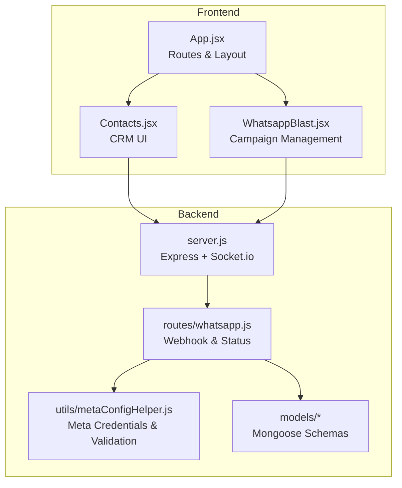
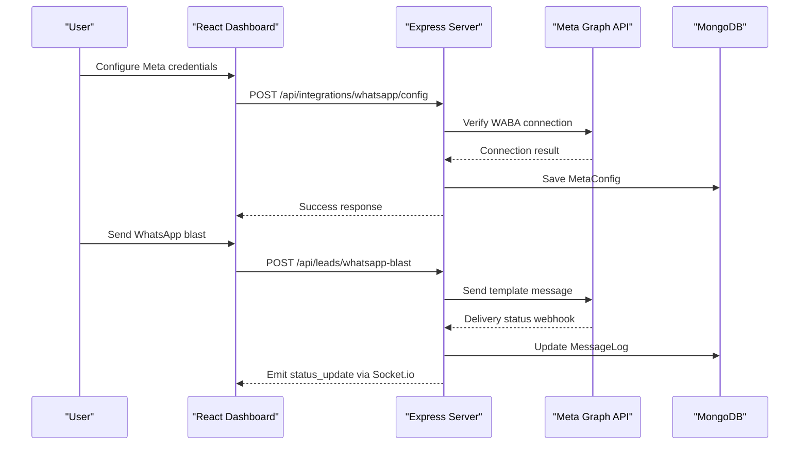
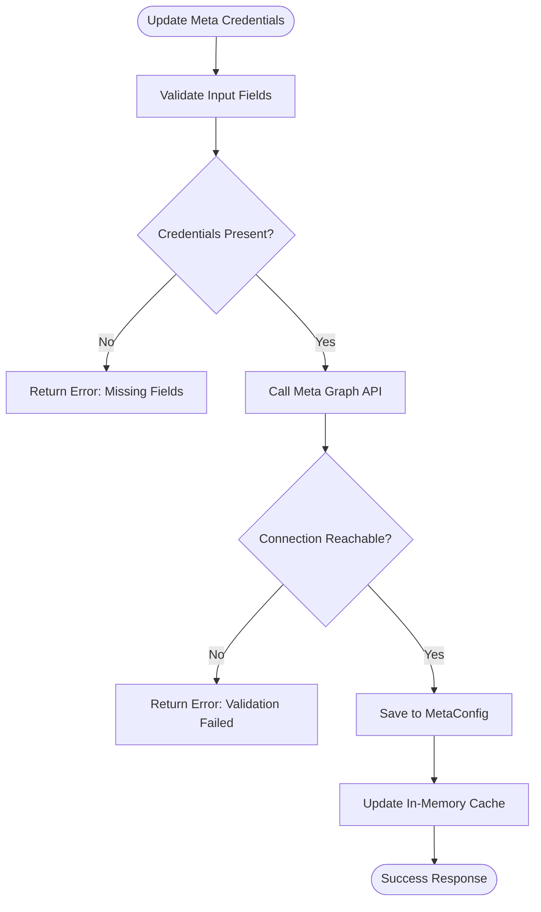
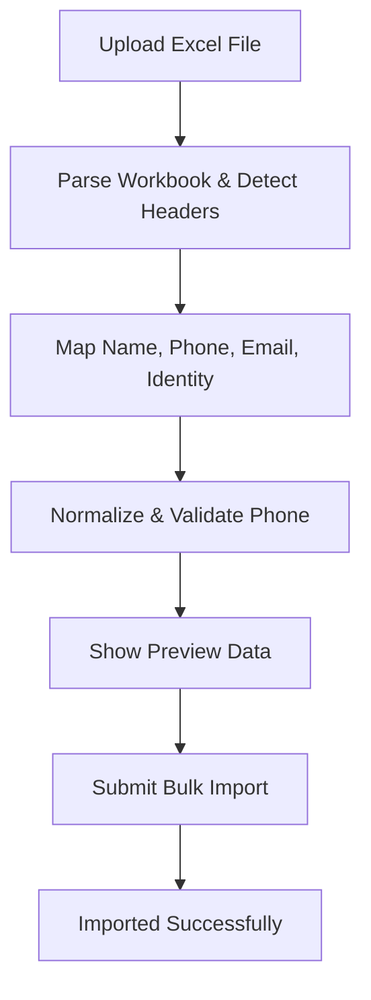
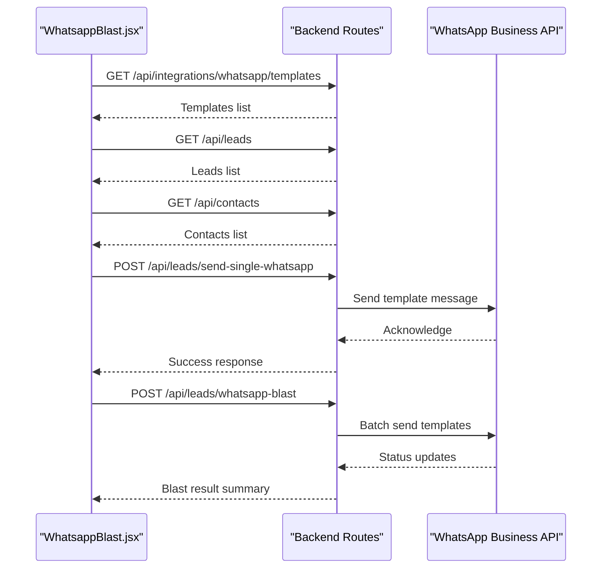
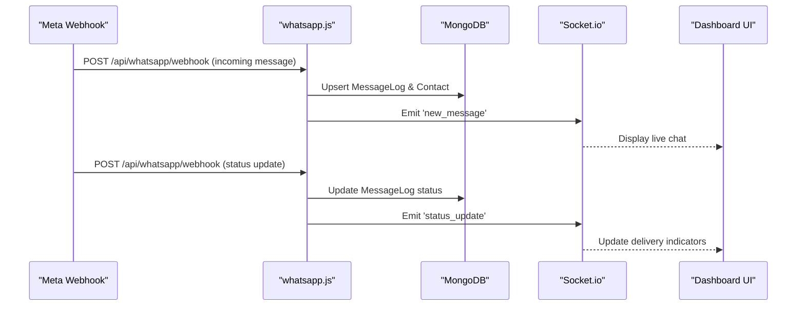
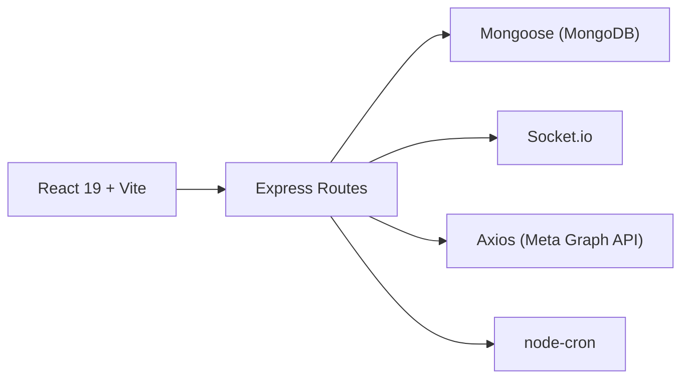

# Project Overview

<cite>
**Referenced Files in This Document**
- [server.js](file://backend/server.js)
- [package.json (backend)](file://backend/package.json)
- [package.json (frontend)](file://frontend/package.json)
- [App.jsx](file://frontend/src/App.jsx)
- [whatsapp.js](file://backend/routes/whatsapp.js)
- [metaConfigHelper.js](file://backend/utils/metaConfigHelper.js)
- [MetaConfig.js](file://backend/models/MetaConfig.js)
- [Contact.js](file://backend/models/Contact.js)
- [Template.js](file://backend/models/Template.js)
- [Contacts.jsx](file://frontend/src/Dashboard/Contacts.jsx)
- [WhatsappBlast.jsx](file://frontend/src/Dashboard/WhatsappBlast.jsx)
</cite>

## Table of Contents
1. [Introduction](#introduction)
2. [Project Structure](#project-structure)
3. [Core Components](#core-components)
4. [Architecture Overview](#architecture-overview)
5. [Detailed Component Analysis](#detailed-component-analysis)
6. [Dependency Analysis](#dependency-analysis)
7. [Performance Considerations](#performance-considerations)
8. [Troubleshooting Guide](#troubleshooting-guide)
9. [Conclusion](#conclusion)

## Introduction
Whatsapp_Automachine is a WhatsApp Business automation platform that combines a React-based dashboard with a Node.js backend to manage customer relationships, run marketing campaigns, and enable real-time communication through the Meta integration. It leverages the WhatsApp Business API to send approved templates, receive inbound messages, track delivery status, and automate conversations. The system provides CRM functionality for managing contacts and leads, campaign management for bulk messaging, and a real-time chat experience powered by WebSockets.

For beginners, this project demonstrates how businesses can automate WhatsApp outreach using pre-approved templates, segment audiences, and monitor message delivery. For experienced developers, it shows a full-stack architecture with Express.js routes, Mongoose models, Socket.io for live updates, and Meta Graph API integration for credentials, webhooks, and template operations.

Key capabilities:
- CRM functionality: create, update, search, and segment contacts; import from Excel; auto-create contacts from inbound messages.
- Marketing campaigns: select approved templates, choose recipients from contacts or leads, preview personalization, and dispatch blasts.
- Real-time communication: receive incoming messages via webhook, broadcast live updates over WebSocket, and display delivery statuses.
- Automated messaging: scheduled broadcasts, automated bot flows triggered by user interactions, and template-driven replies.

Technology stack:
- Frontend: React 19, Vite, Tailwind CSS, Zustand, socket.io-client, react-router-dom.
- Backend: Express.js, Mongoose (MongoDB), Socket.io, node-cron, axios, multer, xlsx, pino logging.
- Integration: Meta Graph API v19.0, WhatsApp Business API, WABA account configuration, webhook verification and message/status handling.

**Section sources**
- [package.json (frontend):12-35](file://frontend/package.json#L12-L35)
- [package.json (backend):10-26](file://backend/package.json#L10-L26)
- [metaConfigHelper.js:73-99](file://backend/utils/metaConfigHelper.js#L73-L99)

## Project Structure
The repository is organized into two main parts:
- backend: Express server, routes, Mongoose models, utilities for Meta integration, and cron jobs for scheduling.
- frontend: React application with routing, dashboard modules for CRM and campaign management, and WebSocket client for live updates.

**Diagram sources**
- [App.jsx:7-26](file://frontend/src/App.jsx#L7-L26)
- [server.js:11-56](file://backend/server.js#L11-L56)
- [whatsapp.js:1-6](file://backend/routes/whatsapp.js#L1-L6)
- [metaConfigHelper.js:1-35](file://backend/utils/metaConfigHelper.js#L1-L35)

**Section sources**
- [App.jsx:7-26](file://frontend/src/App.jsx#L7-L26)
- [server.js:11-56](file://backend/server.js#L11-L56)

## Core Components
This section highlights the primary building blocks that power the platform’s CRM, campaign management, and real-time features.

- Express server and WebSockets:
  - Initializes HTTP server, mounts CORS and JSON middleware, serves static uploads, registers API routes, and sets up Socket.io for real-time events.
  - Connects to MongoDB and starts a cron scheduler for scheduled broadcasts.

- Meta integration helper:
  - Loads and caches Meta credentials from MongoDB or environment variables.
  - Validates connection to Meta Graph API before saving credentials.
  - Provides functions to update and verify WABA configuration.

- Mongoose models:
  - MetaConfig stores WABA ID, phone number ID, access token, verify token, and graph version.
  - Contact tracks phone, name, email, source, segment, opt-out flags, and order metrics.
  - Template stores Meta-specific fields like category, language, components, metaTemplateId, and metaStatus alongside legacy fields and scheduling stats.

- Dashboard UI:
  - Contacts module supports manual entry, Excel upload, validation, filtering by identity, and direct WhatsApp links.
  - Campaign module allows selecting approved templates, choosing recipients from contacts or leads, previewing personalized content, and triggering blasts.

**Section sources**
- [server.js:11-80](file://backend/server.js#L11-L80)
- [metaConfigHelper.js:6-70](file://backend/utils/metaConfigHelper.js#L6-L70)
- [MetaConfig.js:3-12](file://backend/models/MetaConfig.js#L3-L12)
- [Contact.js:3-26](file://backend/models/Contact.js#L3-L26)
- [Template.js:3-40](file://backend/models/Template.js#L3-L40)
- [Contacts.jsx:33-174](file://frontend/src/Dashboard/Contacts.jsx#L33-L174)
- [WhatsappBlast.jsx:18-151](file://frontend/src/Dashboard/WhatsappBlast.jsx#L18-L151)

## Architecture Overview
The system follows a typical full-stack pattern:
- React frontend communicates with Express backend via REST APIs and listens to WebSocket events for live updates.
- Backend exposes routes for authentication, users, leads, contacts, templates, orders, menu, todos, payslip generation, analytics, and WhatsApp integration.
- Meta integration uses Graph API for credential validation and webhooks for inbound messages and delivery statuses.
- Cron jobs schedule template broadcasts at defined intervals.

**Diagram sources**
- [whatsapp.js:78-109](file://backend/routes/whatsapp.js#L78-L109)
- [metaConfigHelper.js:37-70](file://backend/utils/metaConfigHelper.js#L37-L70)
- [whatsapp.js:134-311](file://backend/routes/whatsapp.js#L134-L311)
- [server.js:64-76](file://backend/server.js#L64-L76)

## Detailed Component Analysis

### Meta Integration and Configuration
The Meta integration manages credentials and validates connectivity to the WhatsApp Business API. It supports both database-stored configurations and environment variable fallbacks, caching credentials for performance.

Key behaviors:
- Load cached config or fetch from MongoDB; if missing, fall back to environment variables.
- Validate WABA endpoint via Graph API before persisting credentials.
- Provide endpoints to get current status, host info, and masked configuration details.
- Handle webhook verification and incoming message/status processing.

**Diagram sources**
- [metaConfigHelper.js:37-70](file://backend/utils/metaConfigHelper.js#L37-L70)
- [metaConfigHelper.js:73-99](file://backend/utils/metaConfigHelper.js#L73-L99)

**Section sources**
- [metaConfigHelper.js:6-35](file://backend/utils/metaConfigHelper.js#L6-L35)
- [metaConfigHelper.js:37-70](file://backend/utils/metaConfigHelper.js#L37-L70)
- [whatsapp.js:33-59](file://backend/routes/whatsapp.js#L33-L59)

### CRM Functionality: Contacts Management
The Contacts module enables adding, editing, deleting, and importing contacts. It enforces strict mobile number validation (10 digits, Indian prefixes), email validation, and identity tagging. It also supports Excel/CSV parsing and bulk import.

Highlights:
- Manual form submission with validation errors and toast feedback.
- Excel upload with flexible header detection and data mapping.
- Filtering by identity and search across name, phone, email, and identity.
- Direct WhatsApp link generation and call shortcuts.

**Diagram sources**
- [Contacts.jsx:241-333](file://frontend/src/Dashboard/Contacts.jsx#L241-L333)
- [Contacts.jsx:335-364](file://frontend/src/Dashboard/Contacts.jsx#L335-L364)

**Section sources**
- [Contacts.jsx:176-219](file://frontend/src/Dashboard/Contacts.jsx#L176-L219)
- [Contacts.jsx:221-333](file://frontend/src/Dashboard/Contacts.jsx#L221-L333)
- [Contacts.jsx:335-409](file://frontend/src/Dashboard/Contacts.jsx#L335-L409)
- [Contact.js:3-26](file://backend/models/Contact.js#L3-L26)

### Campaign Management: WhatsApp Blast Studio
The Campaign module allows selecting an approved template, choosing recipients from contacts or leads, previewing personalized content, and dispatching blasts. It integrates with backend endpoints to send single test messages and batch blasts.

Highlights:
- Fetch templates, leads, and contacts concurrently.
- Toggle recipient type between contacts and leads.
- Filter recipients by identity or pipeline stage.
- Personalize template body with variables and render buttons.
- Trigger single test or batch blast with confirmation modal.

**Diagram sources**
- [WhatsappBlast.jsx:67-151](file://frontend/src/Dashboard/WhatsappBlast.jsx#L67-L151)
- [WhatsappBlast.jsx:247-327](file://frontend/src/Dashboard/WhatsappBlast.jsx#L247-L327)

**Section sources**
- [WhatsappBlast.jsx:18-151](file://frontend/src/Dashboard/WhatsappBlast.jsx#L18-L151)
- [WhatsappBlast.jsx:247-327](file://frontend/src/Dashboard/WhatsappBlast.jsx#L247-L327)
- [Template.js:3-40](file://backend/models/Template.js#L3-L40)

### Real-Time Communication: Webhooks and Live Chat
Incoming messages and delivery statuses are handled via Meta webhooks. The backend persists logs, auto-creates contacts, and emits real-time events over Socket.io. The frontend can poll or listen for live updates to display chat history and status changes.

Key flows:
- Webhook verification using verifyToken.
- Incoming message processing: extract text/button/interactive payloads, normalize phone numbers, save MessageLog, upsert Contact, emit new_message event.
- Status updates: parse delivery/read/failure statuses, update MessageLog, emit status_update event.
- Message retrieval endpoint supports querying by phone or fetching recent logs.

**Diagram sources**
- [whatsapp.js:113-132](file://backend/routes/whatsapp.js#L113-L132)
- [whatsapp.js:134-233](file://backend/routes/whatsapp.js#L134-L233)
- [whatsapp.js:236-311](file://backend/routes/whatsapp.js#L236-L311)
- [whatsapp.js:313-333](file://backend/routes/whatsapp.js#L313-L333)

**Section sources**
- [whatsapp.js:113-132](file://backend/routes/whatsapp.js#L113-L132)
- [whatsapp.js:134-233](file://backend/routes/whatsapp.js#L134-L233)
- [whatsapp.js:236-311](file://backend/routes/whatsapp.js#L236-L311)
- [whatsapp.js:313-333](file://backend/routes/whatsapp.js#L313-L333)

## Dependency Analysis
The backend depends on Express for routing, Mongoose for MongoDB interaction, Socket.io for real-time events, and axios for Meta Graph API calls. The frontend depends on React 19, Vite, Tailwind CSS, and socket.io-client for live updates.

**Diagram sources**
- [package.json (frontend):12-35](file://frontend/package.json#L12-L35)
- [package.json (backend):10-26](file://backend/package.json#L10-L26)
- [server.js:1-10](file://backend/server.js#L1-L10)

**Section sources**
- [package.json (frontend):12-35](file://frontend/package.json#L12-L35)
- [package.json (backend):10-26](file://backend/package.json#L10-L26)
- [server.js:1-10](file://backend/server.js#L1-L10)

## Performance Considerations
- Credential caching reduces repeated Meta API calls and database queries.
- Webhook handlers use upsert operations to avoid duplicate logs and contacts.
- Socket.io broadcasting ensures efficient real-time updates without polling overhead.
- Cron-based scheduling runs once per minute for template broadcasts, minimizing resource usage.
- Frontend pagination and filtering reduce UI load when displaying large contact lists.

[No sources needed since this section provides general guidance]

## Troubleshooting Guide
Common issues and resolutions:
- Meta connection failures: Ensure WABA ID, phone number ID, and access token are correct; verifyGraphVersion matches Meta API version; check network connectivity and firewall settings.
- Webhook verification errors: Confirm verifyToken matches the configured value; ensure the public URL is reachable by Meta.
- Message sending errors: Validate template approval status and language codes; check recipient phone formatting and opt-out flags.
- Real-time updates not appearing: Verify Socket.io server is running and frontend connects to the correct namespace; check browser console for WebSocket errors.

Operational tips:
- Use the sync-env endpoint to clear MetaConfig and re-sync with environment variables.
- Monitor logs for webhook errors and status updates.
- Validate phone numbers strictly to prevent failed sends.

**Section sources**
- [metaConfigHelper.js:73-99](file://backend/utils/metaConfigHelper.js#L73-L99)
- [whatsapp.js:78-109](file://backend/routes/whatsapp.js#L78-L109)
- [whatsapp.js:113-132](file://backend/routes/whatsapp.js#L113-L132)

## Conclusion
Whatsapp_Automachine provides a robust foundation for WhatsApp Business automation, combining CRM capabilities, campaign management, and real-time communication. Its architecture leverages React 19 and Express.js with MongoDB and Socket.io, integrating seamlessly with Meta’s WhatsApp Business API. Users can set up templates, manage contacts, and run automated campaigns, while developers benefit from a clear, modular codebase with well-defined routes, models, and utilities.

[No sources needed since this section summarizes without analyzing specific files]