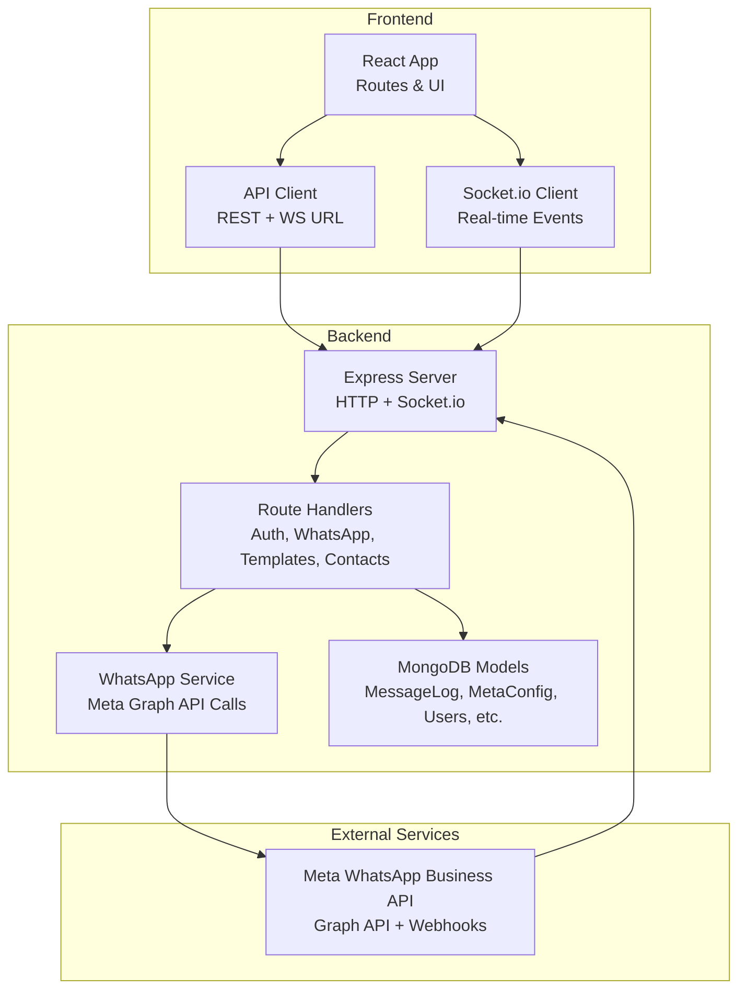
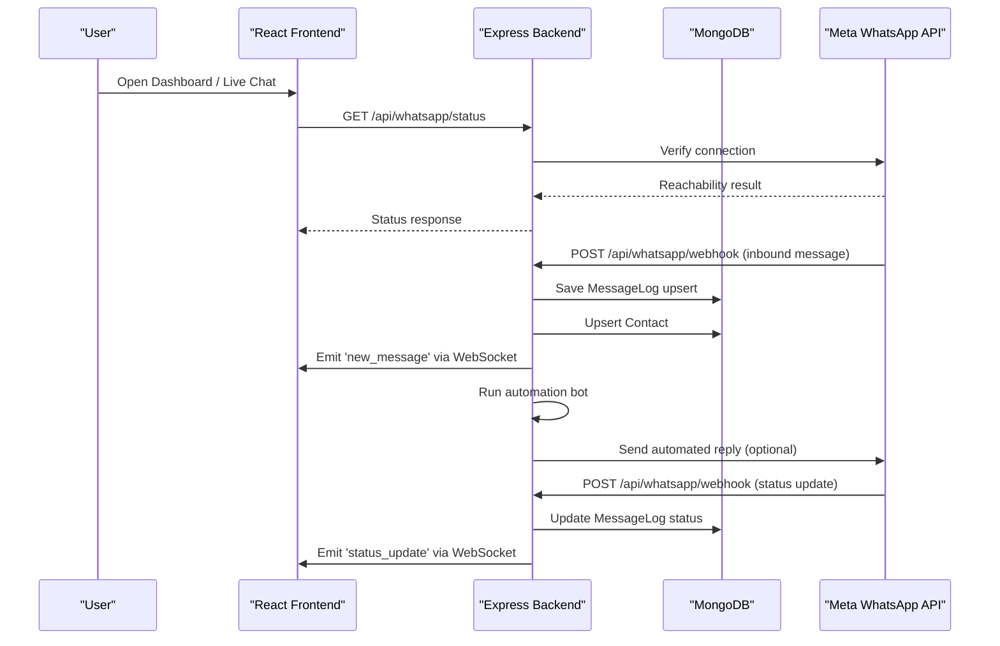
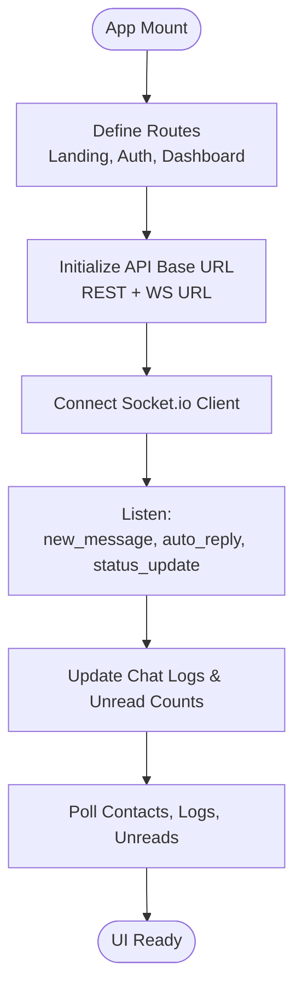
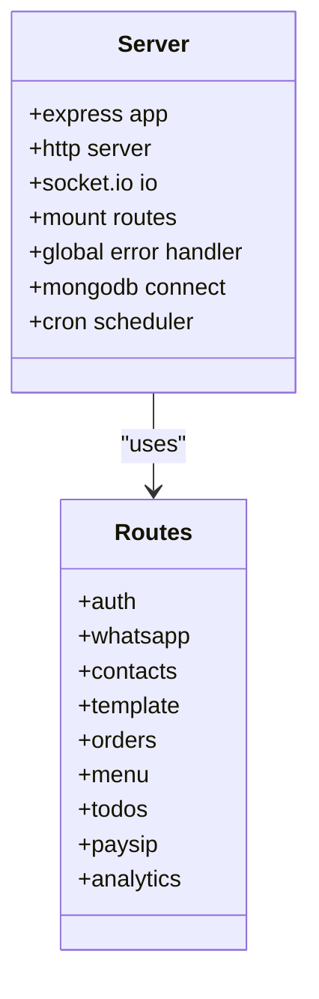
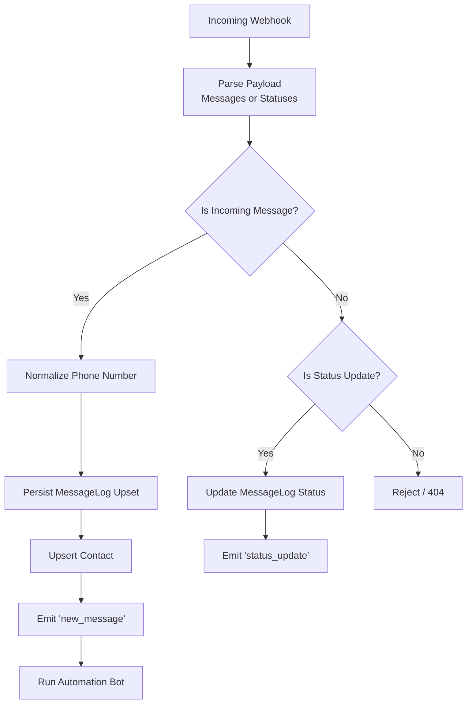
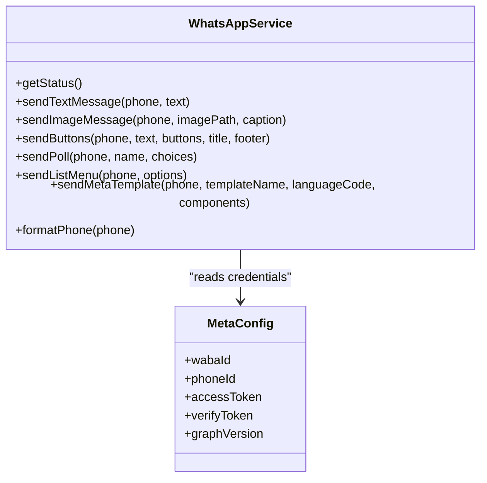
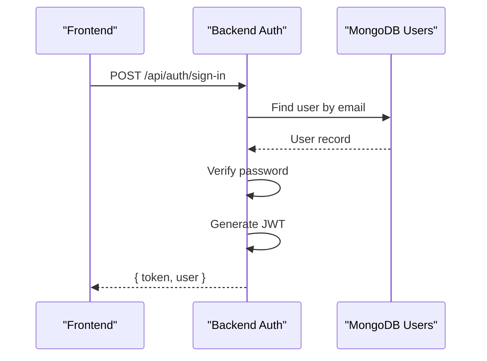
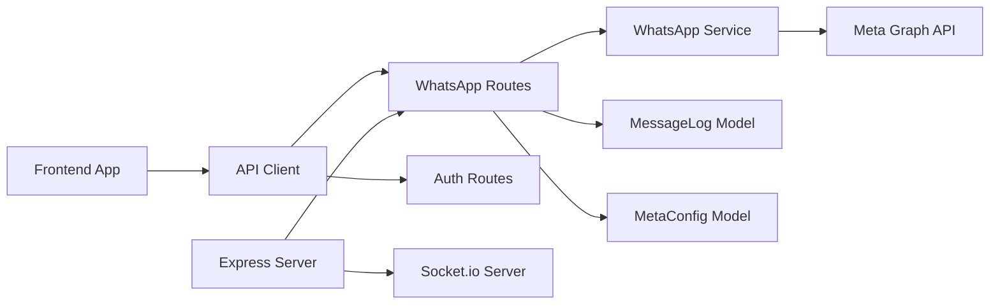

# System Architecture Diagram

<cite>
**Referenced Files in This Document**
- [server.js](file://backend/server.js)
- [whatsapp.js](file://backend/routes/whatsapp.js)
- [whatsappService.js](file://backend/utils/whatsappService.js)
- [MessageLog.js](file://backend/models/MessageLog.js)
- [MetaConfig.js](file://backend/models/MetaConfig.js)
- [auth.js](file://backend/routes/auth.js)
- [App.jsx](file://frontend/src/App.jsx)
- [api.js](file://frontend/src/services/api.js)
- [Whatsapp_Message.jsx](file://frontend/src/Dashboard/Whatsapp_Message.jsx)
</cite>

## Table of Contents
1. [Introduction](#introduction)
2. [Project Structure](#project-structure)
3. [Core Components](#core-components)
4. [Architecture Overview](#architecture-overview)
5. [Detailed Component Analysis](#detailed-component-analysis)
6. [Dependency Analysis](#dependency-analysis)
7. [Performance Considerations](#performance-considerations)
8. [Troubleshooting Guide](#troubleshooting-guide)
9. [Conclusion](#conclusion)

## Introduction
This document explains the system architecture for a WhatsApp Business automation platform with a React frontend, a Node.js Express backend, MongoDB storage, and integration with the Meta WhatsApp Business API. It focuses on how the frontend and backend separate responsibilities, how incoming WhatsApp messages are processed via webhooks, how real-time updates are delivered through WebSockets, and how outbound messages are sent to Meta. It also covers security boundaries, scalability considerations, and third-party integration points.

## Project Structure
The application is split into two main parts:
- Frontend (React + Vite): Provides the user interface for dashboard, templates, live chat, and configuration.
- Backend (Node.js + Express): Exposes REST APIs, handles Meta webhooks, manages WebSocket connections, and integrates with MongoDB and Meta’s Graph API.

**Diagram sources**
- [App.jsx:7-26](file://frontend/src/App.jsx#L7-L26)
- [api.js:1-14](file://frontend/src/services/api.js#L1-L14)
- [server.js:11-22](file://backend/server.js#L11-L22)
- [whatsapp.js:1-6](file://backend/routes/whatsapp.js#L1-L6)
- [whatsappService.js:1-23](file://backend/utils/whatsappService.js#L1-L23)
- [MessageLog.js:1-22](file://backend/models/MessageLog.js#L1-L22)
- [MetaConfig.js:1-13](file://backend/models/MetaConfig.js#L1-L13)

**Section sources**
- [App.jsx:7-26](file://frontend/src/App.jsx#L7-L26)
- [server.js:11-80](file://backend/server.js#L11-L80)

## Core Components
- Frontend React Application: Routes for landing, authentication, and dashboard; communicates with backend via REST and WebSockets.
- Backend Server: Express server with CORS, JSON parsing, static uploads, route mounting, global error handling, MongoDB connection, cron scheduler, and Socket.io server.
- WhatsApp Integration Layer: Route handlers for status, configuration, webhook verification, inbound message processing, status updates, and message retrieval.
- WhatsApp Service: Encapsulates Meta Graph API calls for sending text, images, buttons, polls, list menus, and templates.
- Data Models: MessageLog stores message history and delivery statuses; MetaConfig stores WABA credentials and settings; User model supports authentication.

Key responsibilities:
- Frontend: UI state, template management, live chat view, WebSocket event handling, polling for unread counts and logs.
- Backend: HTTP API endpoints, webhook ingestion, real-time broadcasting, database persistence, external API calls.
- External: Meta provides inbound webhooks and receives outbound messages.

**Section sources**
- [server.js:11-80](file://backend/server.js#L11-L80)
- [whatsapp.js:1-335](file://backend/routes/whatsapp.js#L1-L335)
- [whatsappService.js:1-228](file://backend/utils/whatsappService.js#L1-L228)
- [MessageLog.js:1-22](file://backend/models/MessageLog.js#L1-L22)
- [MetaConfig.js:1-13](file://backend/models/MetaConfig.js#L1-L13)
- [App.jsx:7-26](file://frontend/src/App.jsx#L7-L26)
- [api.js:1-73](file://frontend/src/services/api.js#L1-L73)
- [Whatsapp_Message.jsx:470-537](file://frontend/src/Dashboard/Whatsapp_Message.jsx#L470-L537)

## Architecture Overview
The system follows a clear separation of concerns:
- The React frontend renders dashboards and forms and interacts with the backend via REST endpoints and WebSocket events.
- The Express backend exposes REST APIs and serves as a bridge between the frontend and Meta’s WhatsApp Business API.
- MongoDB persists message logs, configuration, users, contacts, templates, and other domain entities.
- Meta sends webhooks to the backend for inbound messages and delivery/read statuses; the backend processes these events, persists them, and broadcasts updates to connected clients.

**Diagram sources**
- [whatsapp.js:114-311](file://backend/routes/whatsapp.js#L114-L311)
- [server.js:14-35](file://backend/server.js#L14-L35)
- [whatsappService.js:45-59](file://backend/utils/whatsappService.js#L45-L59)
- [MessageLog.js:1-22](file://backend/models/MessageLog.js#L1-L22)

## Detailed Component Analysis

### Frontend React Application
- Routing: Defines routes for landing page, authentication, and dashboard.
- API client: Determines base URLs for REST and WebSocket endpoints; includes health check and fallback logic.
- Live chat component: Connects to WebSocket, listens for new messages, auto-replies, and status updates; polls for contact lists, chat logs, and unread counts; manages template creation and syncing.

**Diagram sources**
- [App.jsx:7-26](file://frontend/src/App.jsx#L7-L26)
- [api.js:1-14](file://frontend/src/services/api.js#L1-L14)
- [Whatsapp_Message.jsx:470-537](file://frontend/src/Dashboard/Whatsapp_Message.jsx#L470-L537)

**Section sources**
- [App.jsx:7-26](file://frontend/src/App.jsx#L7-L26)
- [api.js:1-73](file://frontend/src/services/api.js#L1-L73)
- [Whatsapp_Message.jsx:470-537](file://frontend/src/Dashboard/Whatsapp_Message.jsx#L470-L537)

### Backend Server and WebSockets
- Express server mounts routes under /api prefixes and exposes an integrated Socket.io server.
- Global middleware enables CORS, JSON parsing, and static file serving.
- Global error handler returns structured error responses.
- On startup, connects to MongoDB and starts a cron job for scheduled broadcasts.

**Diagram sources**
- [server.js:11-80](file://backend/server.js#L11-L80)

**Section sources**
- [server.js:11-80](file://backend/server.js#L11-L80)

### WhatsApp Integration Layer
- Status and configuration endpoints allow the frontend to verify connectivity and manage Meta credentials.
- Webhook verification endpoint validates Meta’s challenge token.
- Inbound message handler:
  - Parses incoming message payload.
  - Normalizes phone numbers.
  - Persists message log and contact records.
  - Broadcasts real-time events via WebSocket.
  - Invokes automation bot engine for intelligent replies.
- Status update handler:
  - Parses delivery/read/failure events.
  - Updates message logs.
  - Broadcasts status updates via WebSocket.
- Message retrieval endpoint supports both per-contact and global queries for live chat UI.

**Diagram sources**
- [whatsapp.js:114-311](file://backend/routes/whatsapp.js#L114-L311)

**Section sources**
- [whatsapp.js:1-335](file://backend/routes/whatsapp.js#L1-L335)

### WhatsApp Service and Meta API
- Centralizes Meta Graph API interactions using dynamic credentials from configuration.
- Supports sending text, images (via upload or link), interactive buttons, polls, list menus, and templates.
- Formats phone numbers consistently for Meta requirements.
- Throws structured errors when credentials are missing or API calls fail.

**Diagram sources**
- [whatsappService.js:1-228](file://backend/utils/whatsappService.js#L1-L228)
- [MetaConfig.js:1-13](file://backend/models/MetaConfig.js#L1-L13)

**Section sources**
- [whatsappService.js:1-228](file://backend/utils/whatsappService.js#L1-L228)
- [MetaConfig.js:1-13](file://backend/models/MetaConfig.js#L1-L13)

### Authentication and Security Boundaries
- JWT-based authentication for protected routes.
- Token generation and verification with configurable secret.
- Fallback admin login for initial setup.
- Frontend uses environment variables to determine API base URL and WebSocket URL.

**Diagram sources**
- [auth.js:60-113](file://backend/routes/auth.js#L60-L113)

**Section sources**
- [auth.js:1-142](file://backend/routes/auth.js#L1-L142)
- [api.js:1-14](file://frontend/src/services/api.js#L1-L14)

## Dependency Analysis
The following diagram shows key dependencies among modules and services:

**Diagram sources**
- [server.js:43-56](file://backend/server.js#L43-L56)
- [whatsapp.js:1-6](file://backend/routes/whatsapp.js#L1-L6)
- [whatsappService.js:1-23](file://backend/utils/whatsappService.js#L1-L23)
- [MessageLog.js:1-22](file://backend/models/MessageLog.js#L1-L22)
- [MetaConfig.js:1-13](file://backend/models/MetaConfig.js#L1-L13)

**Section sources**
- [server.js:43-56](file://backend/server.js#L43-L56)
- [whatsapp.js:1-6](file://backend/routes/whatsapp.js#L1-L6)
- [whatsappService.js:1-23](file://backend/utils/whatsappService.js#L1-L23)

## Performance Considerations
- Real-time communication: Use WebSocket events for immediate UI updates; retain periodic polling as a fallback for reliability.
- Database operations: Prefer upserts for high-frequency webhook events to reduce contention; index frequently queried fields like phone and wamid.
- External API calls: Batch or throttle Meta API requests where possible; handle rate limits and retries gracefully.
- Frontend rendering: Virtualize large chat histories; avoid unnecessary re-renders by diffing incoming messages and statuses.
- Scalability: Consider horizontal scaling of the backend behind a load balancer; ensure WebSocket sessions are sticky or use a shared adapter if running multiple instances.

[No sources needed since this section provides general guidance]

## Troubleshooting Guide
Common issues and diagnostics:
- Webhook not verified: Ensure the verify token matches Meta’s expected value and that the GET /api/whatsapp/webhook endpoint responds with the challenge.
- Missing Meta credentials: Check that WABA ID, phone number ID, access token, and graph version are configured; verify connection via /api/whatsapp/status.
- WebSocket disconnects: Inspect browser console for connection errors; confirm CORS settings and that the WS URL is correctly derived from the API base URL.
- Message logs not updating: Confirm that inbound webhooks reach the backend and that MessageLog upserts succeed; check for database connectivity errors.
- Template sync failures: Validate Meta API permissions and template names; retry sync endpoints and inspect error messages returned by the backend.

**Section sources**
- [whatsapp.js:114-311](file://backend/routes/whatsapp.js#L114-L311)
- [server.js:58-62](file://backend/server.js#L58-L62)
- [api.js:19-29](file://frontend/src/services/api.js#L19-L29)

## Conclusion
The system cleanly separates frontend and backend responsibilities while integrating with Meta’s WhatsApp Business API. The backend acts as a robust hub for webhook ingestion, message persistence, real-time broadcasting, and outbound messaging. The React frontend provides an intuitive interface for managing templates, monitoring live chats, and reacting to real-time events. With careful attention to security, performance, and scalability, this architecture supports reliable WhatsApp automation at scale.

[No sources needed since this section summarizes without analyzing specific files]