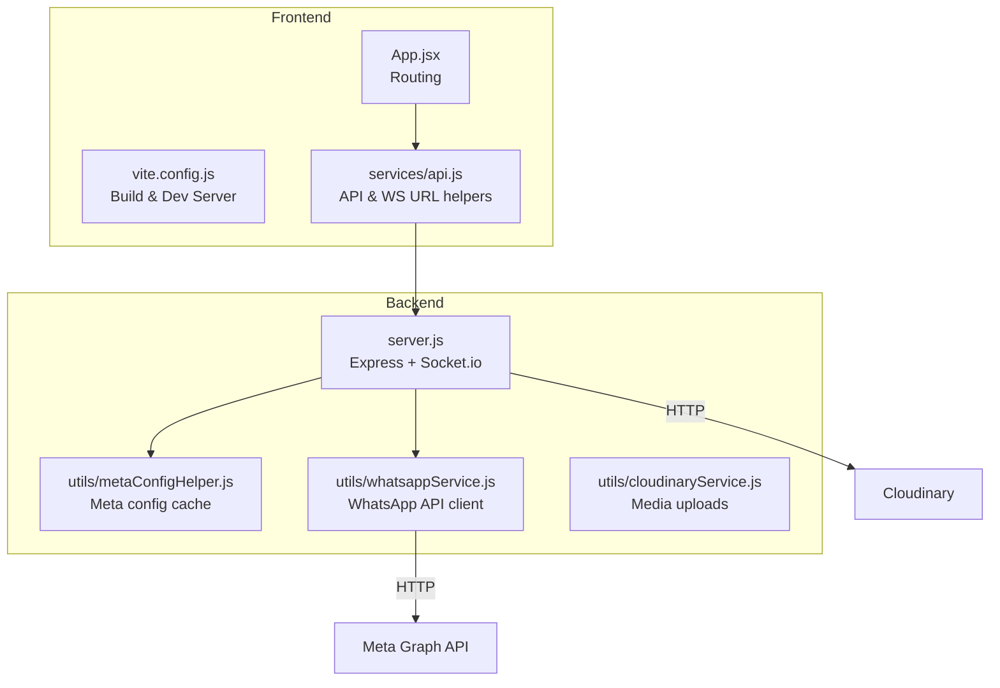
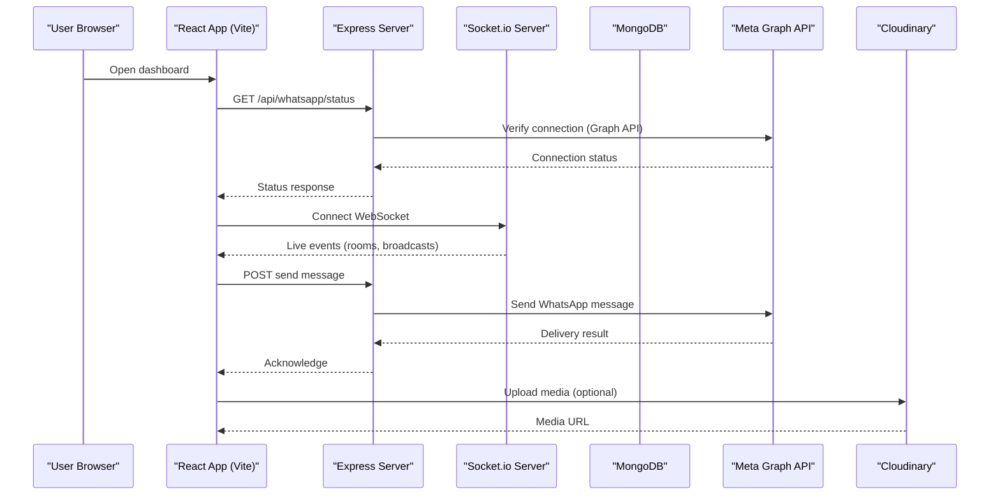
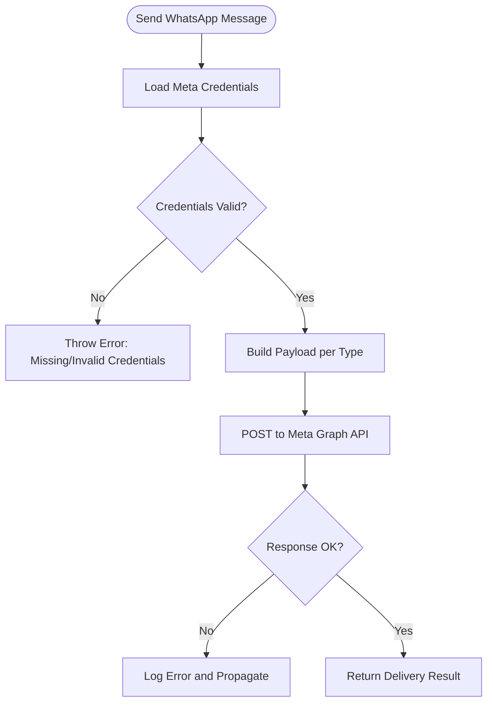
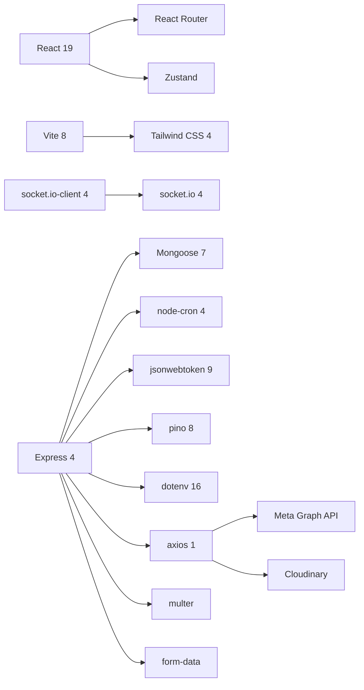

# Technology Stack Overview

<cite>
**Referenced Files in This Document**
- [backend/package.json](file://backend/package.json)
- [frontend/package.json](file://frontend/package.json)
- [backend/server.js](file://backend/server.js)
- [frontend/src/App.jsx](file://frontend/src/App.jsx)
- [frontend/vite.config.js](file://frontend/vite.config.js)
- [frontend/src/services/api.js](file://frontend/src/services/api.js)
- [backend/utils/metaConfigHelper.js](file://backend/utils/metaConfigHelper.js)
- [backend/utils/whatsappService.js](file://backend/utils/whatsappService.js)
- [backend/utils/cloudinaryService.js](file://backend/utils/cloudinaryService.js)
</cite>

## Table of Contents
1. [Introduction](#introduction)
2. [Project Structure](#project-structure)
3. [Core Components](#core-components)
4. [Architecture Overview](#architecture-overview)
5. [Detailed Component Analysis](#detailed-component-analysis)
6. [Dependency Analysis](#dependency-analysis)
7. [Performance Considerations](#performance-considerations)
8. [Troubleshooting Guide](#troubleshooting-guide)
9. [Conclusion](#conclusion)

## Introduction
This document provides a comprehensive overview of the technology stack powering Whatsapp_Automachine. It explains how frontend and backend technologies, databases, and external integrations work together to deliver a scalable, maintainable, and performant WhatsApp automation platform. The stack emphasizes modern web development practices: component-driven UI with React, fast build tooling with Vite, utility-first styling with Tailwind CSS, real-time communication via Socket.io, a Node.js/Express API layer, MongoDB for persistence, and integrations with Meta’s WhatsApp Business Cloud API and Cloudinary for media handling.

## Project Structure
The project is organized into two primary layers:
- Frontend (React 19 + Vite + Tailwind CSS): Provides the user interface, routing, state management, and real-time features.
- Backend (Node.js + Express + Mongoose + Socket.io): Serves REST APIs, manages WebSocket connections, persists data in MongoDB, and integrates with external services.

**Diagram sources**
- [frontend/src/App.jsx:1-27](file://frontend/src/App.jsx#L1-L27)
- [frontend/vite.config.js:1-29](file://frontend/vite.config.js#L1-L29)
- [frontend/src/services/api.js:1-73](file://frontend/src/services/api.js#L1-L73)
- [backend/server.js:1-82](file://backend/server.js#L1-L82)
- [backend/utils/metaConfigHelper.js:1-112](file://backend/utils/metaConfigHelper.js#L1-L112)
- [backend/utils/whatsappService.js:1-228](file://backend/utils/whatsappService.js#L1-L228)
- [backend/utils/cloudinaryService.js:1-61](file://backend/utils/cloudinaryService.js#L1-L61)

**Section sources**
- [frontend/src/App.jsx:1-27](file://frontend/src/App.jsx#L1-L27)
- [backend/server.js:1-82](file://backend/server.js#L1-L82)

## Core Components
This section summarizes the key technologies, versions, roles, and rationale behind each choice.

- Frontend
  - React 19: Component-based UI library enabling modular, reusable interfaces.
  - Vite 8: Fast build tool and dev server with HMR and optimized bundling.
  - Tailwind CSS 4: Utility-first CSS framework for rapid, consistent styling.
  - Socket.io-client 4: Real-time bidirectional communication with the backend.
  - Additional libraries: React Router for navigation, Zustand for lightweight state, Framer Motion/GSAP for animations, Three.js ecosystem for 3D visuals, and XLSX for spreadsheet operations.

- Backend
  - Node.js runtime with Express 4: Lightweight HTTP server and middleware ecosystem.
  - Mongoose 7: ODM for MongoDB schema modeling and validation.
  - Socket.io 4: WebSocket server for live updates and room-based messaging.
  - Axios: HTTP client for external API calls (Meta Graph API).
  - Multer: File upload handling for local processing before cloud storage.
  - Cron (node-cron): Scheduled tasks for automated broadcasts.
  - JSON Web Tokens (jsonwebtoken): Authentication utilities.
  - Pino: Structured logging.
  - Environment configuration via dotenv.

- Database
  - MongoDB: NoSQL database for flexible schema and high scalability.

- External Integrations
  - Meta WhatsApp Business Cloud API: Official channel for sending messages, templates, and managing business account metadata.
  - Cloudinary: Cloud-based media storage and delivery for images and other assets.

Why these choices?
- React + Vite + Tailwind provide a modern, fast, and developer-friendly frontend stack that scales well as the application grows.
- Node.js + Express offer a familiar, high-performance backend with rich ecosystems for authentication, file handling, and scheduling.
- Mongoose + MongoDB enable flexible data models suited for CRM-like entities (contacts, leads, orders, templates).
- Socket.io enables real-time dashboards and live status updates without extra infrastructure.
- Meta’s official API ensures compliance and reliability for WhatsApp messaging at scale.
- Cloudinary offloads media storage and CDN delivery, improving performance and reducing backend load.

**Section sources**
- [backend/package.json:10-26](file://backend/package.json#L10-L26)
- [frontend/package.json:12-46](file://frontend/package.json#L12-L46)
- [backend/server.js:1-82](file://backend/server.js#L1-L82)
- [frontend/vite.config.js:1-29](file://frontend/vite.config.js#L1-L29)

## Architecture Overview
The system follows a layered architecture:
- Frontend SPA built with React and Vite, served by a static host or dev server.
- Backend API server exposing REST endpoints and WebSocket connections.
- Data persistence through MongoDB via Mongoose.
- External integrations via HTTP clients to Meta Graph API and Cloudinary.

**Diagram sources**
- [frontend/src/services/api.js:1-73](file://frontend/src/services/api.js#L1-L73)
- [backend/server.js:1-82](file://backend/server.js#L1-L82)
- [backend/utils/metaConfigHelper.js:1-112](file://backend/utils/metaConfigHelper.js#L1-L112)
- [backend/utils/whatsappService.js:1-228](file://backend/utils/whatsappService.js#L1-L228)
- [backend/utils/cloudinaryService.js:1-61](file://backend/utils/cloudinaryService.js#L1-L61)

## Detailed Component Analysis

### Frontend Technologies
- React 19
  - Role: UI composition, stateful components, and integration with routing and stores.
  - Version: 19.x (latest stable series).
  - Rationale: Strong ecosystem, concurrent features, and broad community support.

- Vite 8
  - Role: Build pipeline, dev server, plugin ecosystem, and proxy configuration.
  - Version: 8.x.
  - Rationale: Extremely fast builds and HMR; supports modern JS features out of the box.

- Tailwind CSS 4
  - Role: Utility-first styling integrated via Vite plugin.
  - Version: 4.x.
  - Rationale: Rapid UI development with consistent design tokens and responsive patterns.

- Socket.io-client 4
  - Role: Real-time event subscription and broadcasting from the backend.
  - Version: 4.x.
  - Rationale: Robust reconnection, rooms, and cross-browser compatibility.

- Routing and State
  - React Router: Declarative routing for landing, auth, and dashboard pages.
  - Zustand: Lightweight global state for app-wide settings and UI state.

- Development and Tooling
  - ESLint and Prettier-compatible configs ensure code quality.
  - Proxy in Vite forwards /api requests to the backend during development.

Key files:
- [frontend/src/App.jsx:1-27](file://frontend/src/App.jsx#L1-L27)
- [frontend/vite.config.js:1-29](file://frontend/vite.config.js#L1-L29)
- [frontend/src/services/api.js:1-73](file://frontend/src/services/api.js#L1-L73)
- [frontend/package.json:12-46](file://frontend/package.json#L12-L46)

**Section sources**
- [frontend/package.json:12-46](file://frontend/package.json#L12-L46)
- [frontend/src/App.jsx:1-27](file://frontend/src/App.jsx#L1-L27)
- [frontend/vite.config.js:1-29](file://frontend/vite.config.js#L1-L29)
- [frontend/src/services/api.js:1-73](file://frontend/src/services/api.js#L1-L73)

### Backend Technologies
- Node.js + Express 4
  - Role: HTTP server, middleware, route handlers, and error handling.
  - Version: 4.x.
  - Rationale: Mature ecosystem, minimal overhead, and easy integration with third-party packages.

- Socket.io 4
  - Role: WebSocket server for real-time notifications and broadcast scheduling.
  - Version: 4.x.
  - Rationale: Production-ready, supports rooms and scaling patterns.

- Mongoose 7 + MongoDB
  - Role: Schema modeling, validation, and CRUD operations for contacts, leads, templates, etc.
  - Version: 7.x.
  - Rationale: Developer-friendly ODM with strong typing and middleware hooks.

- Axios
  - Role: HTTP client for calling Meta Graph API and Cloudinary.
  - Version: 1.x.
  - Rationale: Promise-based, interceptors, and robust error handling.

- Multer + Form-Data
  - Role: Handling multipart/form-data for file uploads and streaming to external services.
  - Versions: Multer LTS, form-data latest.
  - Rationale: Streamlined file processing and reliable uploads.

- node-cron
  - Role: Scheduled jobs (e.g., running template broadcasts).
  - Version: 4.x.
  - Rationale: Simple cron syntax and reliable task execution.

- jsonwebtoken
  - Role: Token generation and verification for authentication flows.
  - Version: 9.x.
  - Rationale: Widely adopted standard for JWTs.

- Pino
  - Role: Structured logging for observability.
  - Version: 8.x.
  - Rationale: High-performance logger suitable for production.

- dotenv
  - Role: Environment variable loading for secrets and configuration.
  - Version: 16.x.
  - Rationale: Secure and simple environment management.

Key files:
- [backend/server.js:1-82](file://backend/server.js#L1-L82)
- [backend/package.json:10-26](file://backend/package.json#L10-L26)

**Section sources**
- [backend/package.json:10-26](file://backend/package.json#L10-L26)
- [backend/server.js:1-82](file://backend/server.js#L1-L82)

### Database: MongoDB
- Role: Stores application entities such as users, contacts, leads, templates, orders, and configurations.
- Integration: Mongoose connects to MongoDB using a URI configured via environment variables.
- Benefits: Flexible schemas, horizontal scalability, and rich query capabilities.

Operational notes:
- Connection string is loaded from environment variables with a local fallback for development.
- Collections are modeled via Mongoose schemas defined in backend models.

**Section sources**
- [backend/server.js:64-77](file://backend/server.js#L64-L77)

### External Integrations

#### Meta WhatsApp Business Cloud API
- Purpose: Official channel for sending text, media, templates, and interactive messages.
- Implementation highlights:
  - Credentials cached in-memory and persisted in MongoDB for dynamic updates.
  - Health checks verify connectivity to Meta Graph API.
  - Message builders format payloads per Meta’s specification.
  - Supports text, image, buttons, polls, list menus, and template messages.

Key files:
- [backend/utils/metaConfigHelper.js:1-112](file://backend/utils/metaConfigHelper.js#L1-L112)
- [backend/utils/whatsappService.js:1-228](file://backend/utils/whatsappService.js#L1-L228)

**Diagram sources**
- [backend/utils/whatsappService.js:45-59](file://backend/utils/whatsappService.js#L45-L59)
- [backend/utils/metaConfigHelper.js:6-35](file://backend/utils/metaConfigHelper.js#L6-L35)

**Section sources**
- [backend/utils/metaConfigHelper.js:1-112](file://backend/utils/metaConfigHelper.js#L1-L112)
- [backend/utils/whatsappService.js:1-228](file://backend/utils/whatsappService.js#L1-L228)

#### Cloudinary
- Purpose: Cloud storage and CDN for media assets (images, documents).
- Implementation highlights:
  - Configured via environment variables (cloud name, API key, secret).
  - Utilities support uploading local files or remote URLs.
  - Returns secure HTTPS URLs for use in templates and messages.

Key files:
- [backend/utils/cloudinaryService.js:1-61](file://backend/utils/cloudinaryService.js#L1-L61)

**Section sources**
- [backend/utils/cloudinaryService.js:1-61](file://backend/utils/cloudinaryService.js#L1-L61)

## Dependency Analysis
This section maps core dependencies and their relationships across the stack.

**Diagram sources**
- [frontend/package.json:12-46](file://frontend/package.json#L12-L46)
- [backend/package.json:10-26](file://backend/package.json#L10-L26)
- [backend/server.js:1-82](file://backend/server.js#L1-L82)

**Section sources**
- [frontend/package.json:12-46](file://frontend/package.json#L12-L46)
- [backend/package.json:10-26](file://backend/package.json#L10-L26)

## Performance Considerations
- Frontend
  - Vite’s optimized build reduces bundle size and improves load times.
  - Tailwind’s tree-shaking minimizes unused CSS.
  - Lazy loading routes and components can further reduce initial payload.

- Backend
  - In-memory caching of Meta credentials avoids repeated DB lookups.
  - Streaming uploads to Meta and Cloudinary reduce memory pressure.
  - Structured logging with Pino aids performance monitoring.

- Database
  - Indexes on frequently queried fields (e.g., phone numbers, template names) improve lookup speed.
  - Connection pooling and read replicas can be introduced for scale.

- Integrations
  - Use Cloudinary CDN for media delivery to minimize latency.
  - Implement retry logic and circuit breakers for external API calls.

[No sources needed since this section provides general guidance]

## Troubleshooting Guide
Common issues and resolutions:
- Meta API connectivity failures
  - Symptom: “Missing Meta Access Token or WABA Account ID” or connection errors.
  - Resolution: Ensure credentials are set in environment variables or saved via the admin UI; verify Graph API version matches your account setup.

- WebSocket connection issues
  - Symptom: Clients cannot connect or receive events.
  - Resolution: Confirm CORS settings and port configuration; check that the server starts successfully and listens on the expected port.

- Media upload failures
  - Symptom: Cloudinary upload returns null or errors.
  - Resolution: Verify Cloudinary environment variables; ensure file paths or URLs are valid and accessible.

- Environment configuration
  - Symptom: Backend fails to start due to missing variables.
  - Resolution: Provide required .env values (MongoDB URI, Meta tokens, Cloudinary keys, PORT).

**Section sources**
- [backend/utils/metaConfigHelper.js:73-99](file://backend/utils/metaConfigHelper.js#L73-L99)
- [backend/utils/cloudinaryService.js:16-31](file://backend/utils/cloudinaryService.js#L16-L31)
- [backend/server.js:64-80](file://backend/server.js#L64-L80)

## Conclusion
Whatsapp_Automachine leverages a modern, cohesive technology stack designed for scalability, maintainability, and performance. React 19 and Vite deliver a fast, responsive frontend; Express and Socket.io power a robust backend with real-time capabilities; MongoDB provides flexible data storage; and integrations with Meta’s WhatsApp Business API and Cloudinary enable reliable messaging and efficient media handling. Together, these components create a production-ready platform for WhatsApp automation and customer engagement.

[No sources needed since this section summarizes without analyzing specific files]