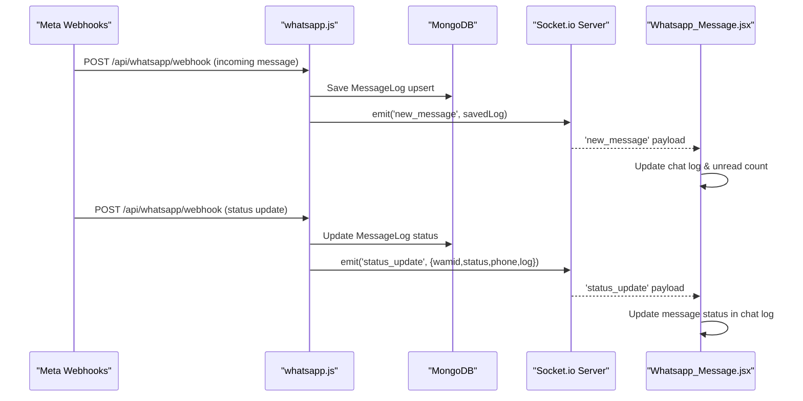
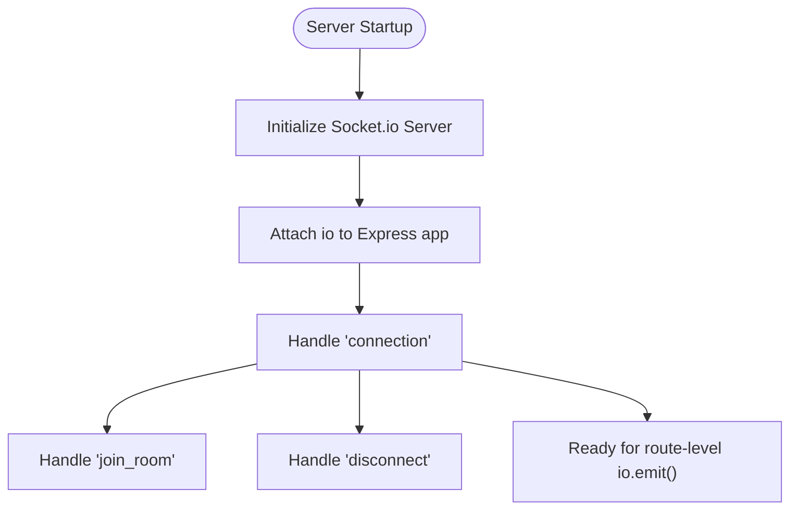
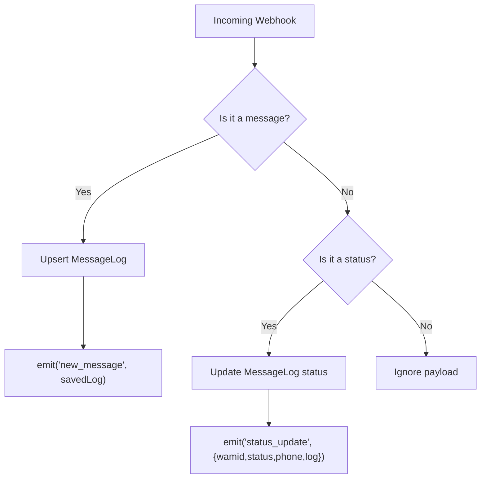
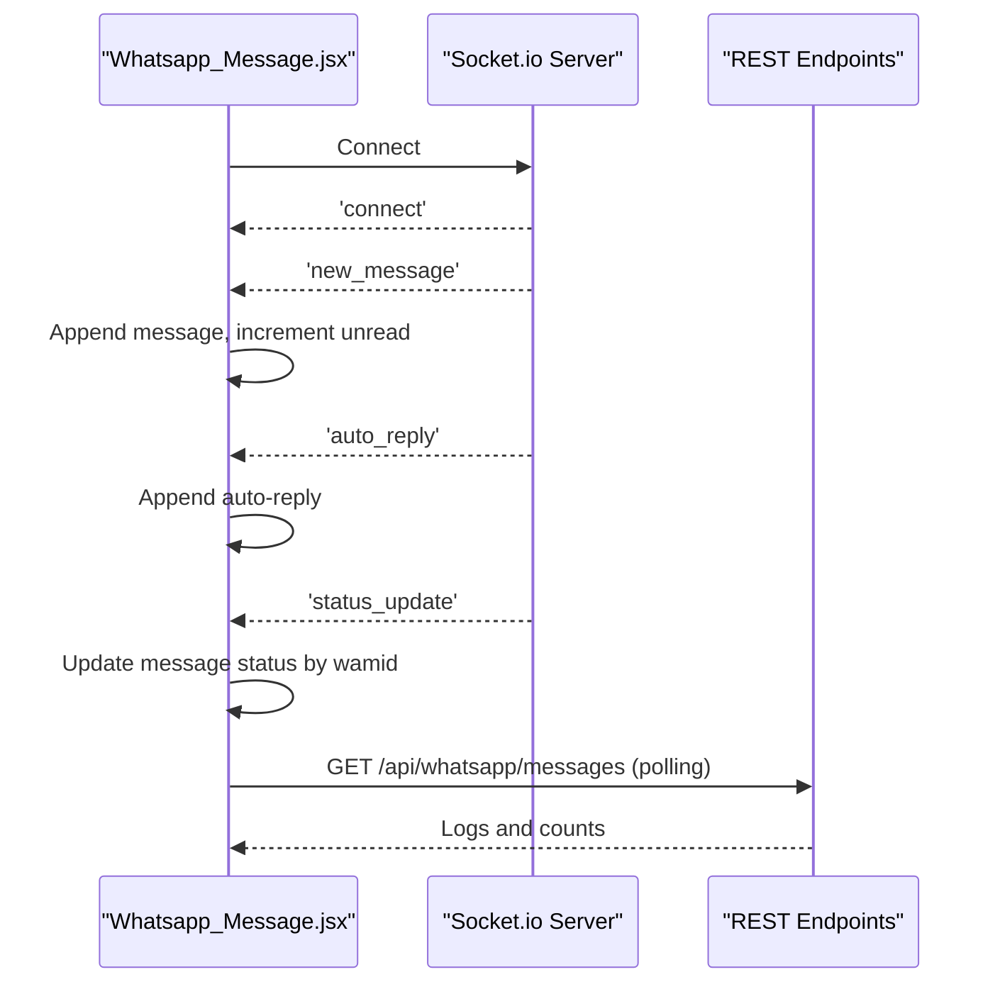
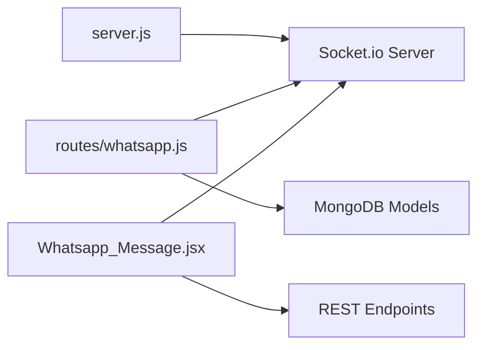

# Real-time Communication

<cite>
**Referenced Files in This Document**
- [server.js](file://backend/server.js)
- [whatsapp.js](file://backend/routes/whatsapp.js)
- [Whatsapp_Message.jsx](file://frontend/src/Dashboard/Whatsapp_Message.jsx)
</cite>

## Table of Contents
1. [Introduction](#introduction)
2. [Project Structure](#project-structure)
3. [Core Components](#core-components)
4. [Architecture Overview](#architecture-overview)
5. [Detailed Component Analysis](#detailed-component-analysis)
6. [Dependency Analysis](#dependency-analysis)
7. [Performance Considerations](#performance-considerations)
8. [Troubleshooting Guide](#troubleshooting-guide)
9. [Conclusion](#conclusion)

## Introduction
This document explains the real-time communication system built on Socket.io that powers live WhatsApp message updates and status synchronization in the application. It covers WebSocket connection management, room-based patterns, event broadcasting, the real-time chat interface, message synchronization across clients, and integration with the WhatsApp webhook flow. It also includes guidance for extending the system to support live notifications and collaborative editing, along with scalability considerations for production deployments.

## Project Structure
The real-time layer spans three primary areas:
- Backend server initialization and Socket.io setup
- WhatsApp webhook route handling that emits real-time events
- Frontend component that connects via Socket.io client and renders live chat

```mermaid
graph TB
subgraph "Frontend"
FE["Whatsapp_Message.jsx<br/>Socket.io Client"]
end
subgraph "Backend"
SRV["server.js<br/>Express + HTTP Server"]
IO["Socket.io Server"]
WA["routes/whatsapp.js<br/>Webhook Handler"]
DB["MongoDB (MessageLog, Contacts)"]
end
META["Meta WhatsApp Webhooks"] --> WA
FE --> |WebSocket Events| IO
WA --> |io.emit()| IO
WA --> DB
FE --> |HTTP Polling| WA
```

**Diagram sources**
- [server.js:11-35](file://backend/server.js#L11-L35)
- [whatsapp.js:134-310](file://backend/routes/whatsapp.js#L134-L310)
- [Whatsapp_Message.jsx:301-368](file://frontend/src/Dashboard/Whatsapp_Message.jsx#L301-L368)

**Section sources**
- [server.js:11-35](file://backend/server.js#L11-L35)
- [whatsapp.js:134-310](file://backend/routes/whatsapp.js#L134-L310)
- [Whatsapp_Message.jsx:301-368](file://frontend/src/Dashboard/Whatsapp_Message.jsx#L301-L368)

## Core Components
- Backend Socket.io server: Initializes a Socket.io server attached to the Express HTTP server, exposes a basic room join handler, and stores the io instance on the app for use by routes.
- WhatsApp webhook route: Processes incoming Meta webhooks, persists messages and statuses, and emits real-time events to all connected clients.
- Frontend live chat component: Connects via socket.io-client, listens for new messages, auto-replies, and status updates, and maintains local state for chat logs and unread counts.

Key responsibilities:
- Connection lifecycle: connect, disconnect, and optional room membership
- Event broadcasting: global broadcast of inbound messages and delivery/read statuses
- UI synchronization: optimistic updates and polling fallback for reliable chat state

**Section sources**
- [server.js:14-35](file://backend/server.js#L14-L35)
- [whatsapp.js:134-310](file://backend/routes/whatsapp.js#L134-L310)
- [Whatsapp_Message.jsx:301-368](file://frontend/src/Dashboard/Whatsapp_Message.jsx#L301-L368)

## Architecture Overview
The system integrates three main flows:
- Inbound customer messages from Meta via webhook
- Outbound template or direct message sending via REST endpoints
- Real-time UI updates via Socket.io events



**Diagram sources**
- [whatsapp.js:134-310](file://backend/routes/whatsapp.js#L134-L310)
- [Whatsapp_Message.jsx:321-360](file://frontend/src/Dashboard/Whatsapp_Message.jsx#L321-L360)

## Detailed Component Analysis

### Backend Socket.io Server
Responsibilities:
- Create an HTTP server and attach Socket.io with CORS enabled
- Expose a simple room join event for future room-based features
- Store the io instance on the Express app for route-level broadcasting

Connection management:
- Logs connection and disconnection events
- Provides a join_room handler for grouping clients into rooms

Broadcasting:
- Routes can access io via req.app.get('io') and emit events globally



**Diagram sources**
- [server.js:14-35](file://backend/server.js#L14-L35)

**Section sources**
- [server.js:14-35](file://backend/server.js#L14-L35)

### WhatsApp Webhook Route and Real-time Broadcasting
Responsibilities:
- Verify and process Meta webhook payloads
- Persist incoming messages and delivery/read statuses to MongoDB
- Emit real-time events to all connected clients

Event types emitted:
- new_message: Sent when an inbound customer message is received
- status_update: Sent when delivery/read/failure statuses arrive

Data flow highlights:
- Incoming message processing normalizes phone numbers, saves to MessageLog, optionally creates Contact records, then emits new_message
- Status processing updates MessageLog and emits status_update with wamid, status, phone, and updated log



**Diagram sources**
- [whatsapp.js:134-310](file://backend/routes/whatsapp.js#L134-L310)

**Section sources**
- [whatsapp.js:134-310](file://backend/routes/whatsapp.js#L134-L310)

### Frontend Live Chat Component and State Synchronization
Responsibilities:
- Establish a Socket.io client connection
- Listen for new_message, auto_reply, and status_update events
- Maintain per-phone chat logs and unread counts
- Provide polling fallback to keep UI consistent during transient network issues

State synchronization:
- new_message adds a new entry to the chat log for the phone and increments unread count
- auto_reply inserts automated replies into the chat log
- status_update updates the status field of an existing message by wamid

Polling strategy:
- Periodically fetches contact list, chat logs for the selected contact, and unread counts
- Uses localStorage to track read timestamps and compute unread badges



**Diagram sources**
- [Whatsapp_Message.jsx:301-368](file://frontend/src/Dashboard/Whatsapp_Message.jsx#L301-L368)
- [Whatsapp_Message.jsx:490-603](file://frontend/src/Dashboard/Whatsapp_Message.jsx#L490-L603)

**Section sources**
- [Whatsapp_Message.jsx:301-368](file://frontend/src/Dashboard/Whatsapp_Message.jsx#L301-L368)
- [Whatsapp_Message.jsx:490-603](file://frontend/src/Dashboard/Whatsapp_Message.jsx#L490-L603)

## Dependency Analysis
- The backend server initializes Socket.io and attaches it to Express so routes can emit events.
- The WhatsApp route depends on:
  - Meta credentials helpers for configuration
  - MessageLog model for persistence
  - Socket.io server instance for broadcasting
- The frontend component depends on:
  - socket.io-client for real-time events
  - REST endpoints for initial data load and periodic refresh



**Diagram sources**
- [server.js:14-35](file://backend/server.js#L14-L35)
- [whatsapp.js:134-310](file://backend/routes/whatsapp.js#L134-L310)
- [Whatsapp_Message.jsx:301-368](file://frontend/src/Dashboard/Whatsapp_Message.jsx#L301-L368)

**Section sources**
- [server.js:14-35](file://backend/server.js#L14-L35)
- [whatsapp.js:134-310](file://backend/routes/whatsapp.js#L134-L310)
- [Whatsapp_Message.jsx:301-368](file://frontend/src/Dashboard/Whatsapp_Message.jsx#L301-L368)

## Performance Considerations
- Connection overhead: Each client maintains a persistent WebSocket; ensure proper cleanup on component unmount to avoid leaks.
- Broadcast scope: Current implementation uses global broadcasts; consider scoping to rooms (e.g., per agent or per conversation) to reduce unnecessary traffic.
- Polling frequency: The frontend polls every few seconds; tune intervals based on expected message volume and device constraints.
- Database writes: Webhook handlers perform upserts; ensure indexes on fields like wamid and phone for performance at scale.
- Payload size: Keep event payloads minimal; avoid embedding large media in WebSocket messages.

[No sources needed since this section provides general guidance]

## Troubleshooting Guide
Common issues and resolutions:
- No real-time updates:
  - Verify the frontend connects successfully and receives connect/disconnect events.
  - Confirm the backend emits events from the webhook route.
- Duplicate messages:
  - Ensure clients deduplicate by wamid before appending to chat logs.
- Stale status indicators:
  - Validate that status_update events include correct wamid and phone values.
- CORS errors:
  - Ensure the Socket.io server allows the frontend origin and methods.
- Webhook not triggering:
  - Check Meta verification token and endpoint configuration.

Operational checks:
- Inspect server logs for connection and event emission.
- Validate database entries for MessageLog after webhook processing.
- Test both inbound messages and status updates through the webhook route.

**Section sources**
- [server.js:24-35](file://backend/server.js#L24-L35)
- [whatsapp.js:134-310](file://backend/routes/whatsapp.js#L134-L310)
- [Whatsapp_Message.jsx:321-360](file://frontend/src/Dashboard/Whatsapp_Message.jsx#L321-L360)

## Conclusion
The real-time communication system leverages Socket.io to deliver immediate visibility of WhatsApp inbound messages and delivery/read statuses to the dashboard. The backend emits events upon webhook processing, while the frontend synchronizes chat state and unread counts in real time, with polling as a robustness mechanism. To extend the system for multi-agent collaboration, consider implementing room-based routing and per-room broadcasts. For high-scale environments, adopt horizontal scaling strategies such as Redis adapter-backed Socket.io and reverse proxy load balancing.

[No sources needed since this section summarizes without analyzing specific files]

## Appendices

### Event Types and Message Formats
- new_message
  - Emitted when an inbound customer message arrives
  - Payload includes message metadata and normalized phone number
- status_update
  - Emitted when delivery/read/failure statuses are received
  - Payload includes wamid, status, phone, and updated log reference

### Room-Based Patterns
- join_room
  - Allows clients to subscribe to named rooms for targeted broadcasts
  - Useful for agent-specific channels or per-conversation rooms

### Extending to Collaborative Editing
- Use rooms to isolate edits per document or session
- Emit incremental diff events rather than full payloads
- Implement conflict resolution strategies (e.g., CRDTs) at the application layer

### Scalability Strategies
- Horizontal scaling:
  - Use a Socket.io adapter backed by Redis to share state across multiple server instances
- Load balancing:
  - Place a reverse proxy (e.g., Nginx) in front of Node.js instances with sticky sessions if required
- Connection pooling:
  - Tune server-side limits and client reconnection backoff
- Rate limiting:
  - Apply rate limiting on webhook endpoints and outbound broadcasts

[No sources needed since this section provides general guidance]