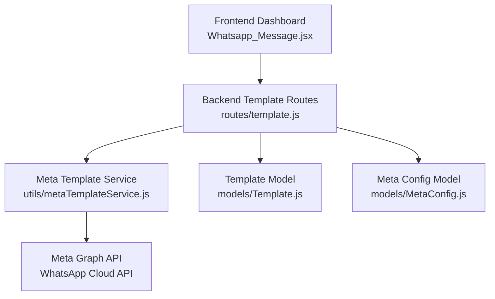
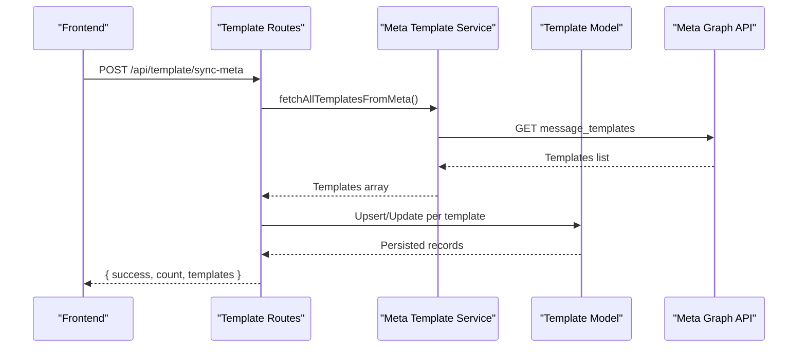
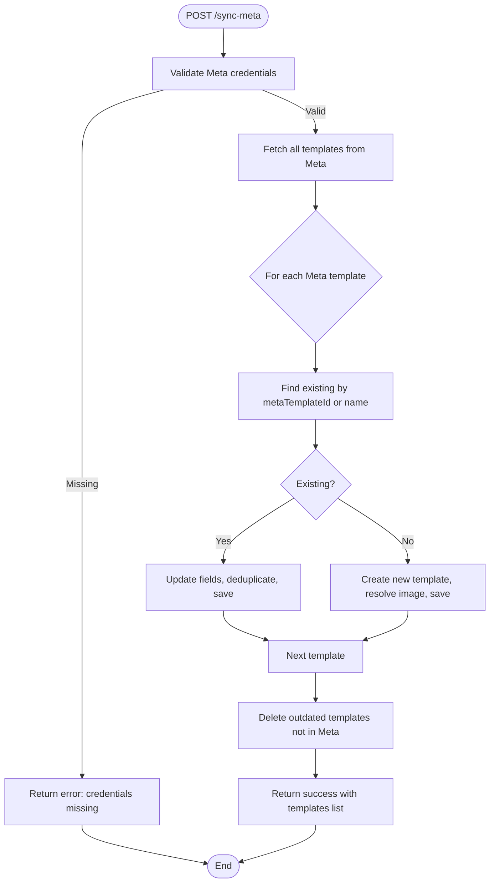
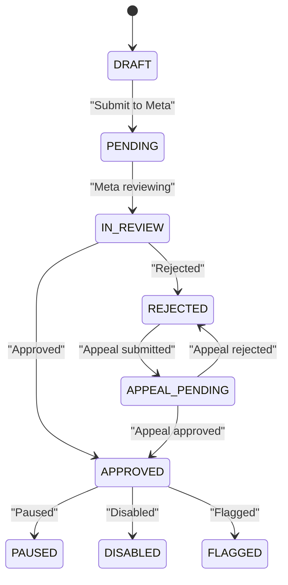
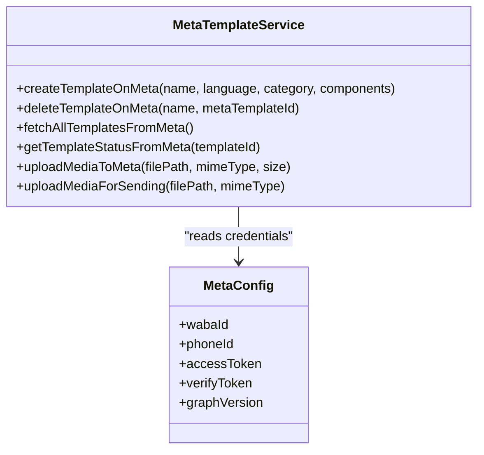
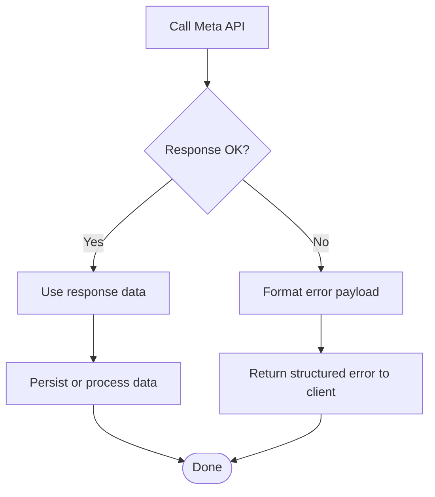
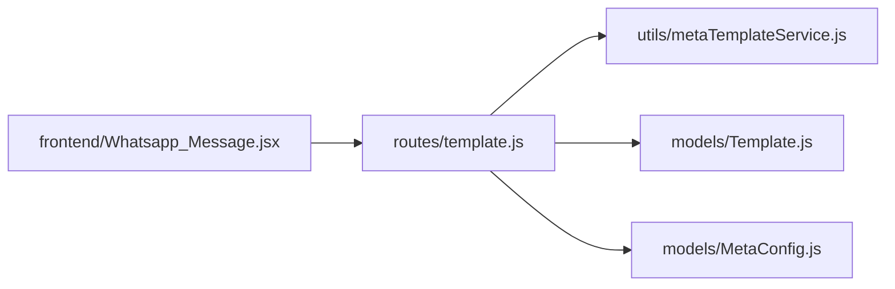

# Meta API Synchronization

<cite>
**Referenced Files in This Document**
- [template.js](file://backend/routes/template.js)
- [metaTemplateService.js](file://backend/utils/metaTemplateService.js)
- [Template.js](file://backend/models/Template.js)
- [MetaConfig.js](file://backend/models/MetaConfig.js)
- [Whatsapp_Message.jsx](file://frontend/src/Dashboard/Whatsapp_Message.jsx)
</cite>

## Table of Contents
1. [Introduction](#introduction)
2. [Project Structure](#project-structure)
3. [Core Components](#core-components)
4. [Architecture Overview](#architecture-overview)
5. [Detailed Component Analysis](#detailed-component-analysis)
6. [Dependency Analysis](#dependency-analysis)
7. [Performance Considerations](#performance-considerations)
8. [Troubleshooting Guide](#troubleshooting-guide)
9. [Conclusion](#conclusion)

## Introduction
This document explains the Meta API synchronization functionality for WhatsApp Business templates. It covers how local templates are synchronized with Meta’s template system, including creation on Meta, status checking, approval workflows, and import/sync endpoints. It also documents request/response schemas, error handling, and operational guidance for importing existing Meta templates and syncing updates.

## Project Structure
The Meta template synchronization is implemented primarily in:
- Backend routes that expose REST endpoints for sync and import operations.
- A utility service that calls Meta Graph API endpoints for template lifecycle and media uploads.
- Data models that store template definitions and Meta-specific metadata.
- Frontend integration that triggers synchronization from the dashboard.

**Diagram sources**
- [template.js:1-30](file://backend/routes/template.js#L1-L30)
- [metaTemplateService.js:1-21](file://backend/utils/metaTemplateService.js#L1-L21)
- [Template.js:1-28](file://backend/models/Template.js#L1-L28)
- [MetaConfig.js:1-12](file://backend/models/MetaConfig.js#L1-L12)
- [Whatsapp_Message.jsx:420-448](file://frontend/src/Dashboard/Whatsapp_Message.jsx#L420-L448)

**Section sources**
- [template.js:1-30](file://backend/routes/template.js#L1-L30)
- [metaTemplateService.js:1-21](file://backend/utils/metaTemplateService.js#L1-L21)
- [Template.js:1-28](file://backend/models/Template.js#L1-L28)
- [MetaConfig.js:1-12](file://backend/models/MetaConfig.js#L1-L12)
- [Whatsapp_Message.jsx:420-448](file://frontend/src/Dashboard/Whatsapp_Message.jsx#L420-L448)

## Core Components
- Template route handlers:
  - POST /api/template/import-meta: Import a single Meta template by ID into the local database.
  - POST /api/template/sync-meta (and /api/template/sync): Sync all Meta templates into the local database and reconcile duplicates.
  - GET /api/template/meta/:id/status: Fetch and refresh template approval status from Meta.
- Meta Template Service:
  - Encapsulates authentication, template CRUD against Meta Graph API, and media upload flows.
- Template Model:
  - Stores template content, Meta identifiers, and Meta status values.
- Meta Config Model:
  - Stores WABA ID, phone ID, access token, and graph version used to authenticate Meta API calls.

**Section sources**
- [template.js:657-698](file://backend/routes/template.js#L657-L698)
- [template.js:700-818](file://backend/routes/template.js#L700-L818)
- [template.js:820-847](file://backend/routes/template.js#L820-L847)
- [metaTemplateService.js:114-179](file://backend/utils/metaTemplateService.js#L114-L179)
- [Template.js:3-28](file://backend/models/Template.js#L3-L28)
- [MetaConfig.js:3-10](file://backend/models/MetaConfig.js#L3-L10)

## Architecture Overview
The synchronization flow connects the frontend dashboard to backend routes, which call the Meta Template Service to interact with Meta Graph API. The service authenticates using stored credentials and performs template listing, status checks, and media uploads as needed. Results are persisted in the Template model.

**Diagram sources**
- [template.js:700-818](file://backend/routes/template.js#L700-L818)
- [metaTemplateService.js:163-179](file://backend/utils/metaTemplateService.js#L163-L179)

## Detailed Component Analysis

### Endpoint: POST /api/template/import-meta
Purpose:
- Import an existing Meta template into the local database using its Meta template ID.

Request schema:
- Body fields:
  - metaTemplateId: string, required. The Meta template identifier.
  - imageUrl: string, optional. Optional image URL override for display.

Response schema:
- Success:
  - success: boolean true
  - template: object representing the created Template document
  - message: string confirmation
- Error:
  - success: boolean false
  - message: string describing failure (e.g., missing ID, not found on Meta, already exists)

Behavior highlights:
- Validates presence of metaTemplateId.
- Calls Meta to retrieve template details.
- Checks for duplicate local records by metaTemplateId.
- Creates a new Template record with imported components and status.

**Section sources**
- [template.js:657-698](file://backend/routes/template.js#L657-L698)

### Endpoint: POST /api/template/sync-meta (alias /api/template/sync)
Purpose:
- Synchronize all Meta templates into the local database, updating or creating records and cleaning up stale entries.

Request schema:
- No body required.

Response schema:
- Success:
  - success: boolean true
  - count: number of synced templates
  - templates: array of Template objects currently stored
  - currentWabaId: string Meta WABA account identifier
  - message: human-readable summary
- Error:
  - success: boolean false
  - message: string describing sync failure (e.g., missing credentials, Meta API error)

Processing logic:
- Validates Meta credentials (WABA ID and token).
- Fetches all templates from Meta.
- For each Meta template:
  - Finds existing local record by metaTemplateId or name.
  - Updates existing record with latest Meta data (components, language, category, status, etc.).
  - If no local record exists, creates one and sets initial image via Cloudinary when possible.
  - Deduplicates records by name or Meta ID.
- Cleans up outdated templates not present in Meta results, excluding scheduled templates and those still pending review.

**Diagram sources**
- [template.js:700-818](file://backend/routes/template.js#L700-L818)

**Section sources**
- [template.js:700-818](file://backend/routes/template.js#L700-L818)

### Endpoint: GET /api/template/meta/:id/status
Purpose:
- Retrieve and refresh the approval status of a specific Meta template.

Request schema:
- Path parameter: id (local Template document ID).

Response schema:
- Success:
  - success: boolean true
  - status: string Meta status value
- Error:
  - success: boolean false
  - message: string describing failure (e.g., not found, invalid local draft)

Behavior highlights:
- Looks up the local Template by ID.
- Rejects local-only drafts identified by a local_ prefix.
- Calls Meta to get current status and persists updated metaStatus.

**Section sources**
- [template.js:820-847](file://backend/routes/template.js#L820-L847)

### Template Status Management and Approval Workflow
Supported Meta statuses in the Template model include:
- DRAFT, PENDING, IN_REVIEW, APPROVED, REJECTED, PAUSED, DISABLED, FLAGGED, PENDING_DELETION, LIMIT_EXCEEDED, APPEAL_PENDING.

Operational rules:
- When sending a template via Meta broadcast, the system verifies the template is APPROVED on Meta before dispatching.
- During sync, local records are updated with the latest Meta status.
- Outdated templates removed during sync exclude those with PENDING or IN_REVIEW status and scheduled campaigns.

**Diagram sources**
- [Template.js:12-27](file://backend/models/Template.js#L12-L27)
- [template.js:410-423](file://backend/routes/template.js#L410-L423)
- [template.js:790-797](file://backend/routes/template.js#L790-L797)

**Section sources**
- [Template.js:12-27](file://backend/models/Template.js#L12-L27)
- [template.js:410-423](file://backend/routes/template.js#L410-L423)
- [template.js:790-797](file://backend/routes/template.js#L790-L797)

### Authentication with Meta Business API
Authentication is handled by the Meta Template Service:
- Credentials are retrieved from the MetaConfig model (WABA ID, phone ID, access token, graph version).
- Requests to Meta Graph API use Bearer tokens and appropriate headers.
- Media uploads require separate endpoints:
  - Resumable upload session for template header handles.
  - Media endpoint for obtaining media IDs used when sending messages.

**Diagram sources**
- [metaTemplateService.js:6-21](file://backend/utils/metaTemplateService.js#L6-L21)
- [metaTemplateService.js:192-245](file://backend/utils/metaTemplateService.js#L192-L245)
- [MetaConfig.js:3-10](file://backend/models/MetaConfig.js#L3-L10)

**Section sources**
- [metaTemplateService.js:6-21](file://backend/utils/metaTemplateService.js#L6-L21)
- [metaTemplateService.js:192-245](file://backend/utils/metaTemplateService.js#L192-L245)
- [MetaConfig.js:3-10](file://backend/models/MetaConfig.js#L3-L10)

### Error Handling and Retry Mechanisms
Error handling patterns:
- Route-level errors are formatted and returned with structured JSON responses, including metaError payloads where available.
- Sync endpoint catches Meta API failures and returns a user-friendly error message.
- Import endpoint logs and surfaces Meta API errors.

Retry mechanisms:
- There is no built-in automatic retry for failed synchronizations in the analyzed code.
- The frontend attempts multiple sync endpoints and reports the first successful result; if all fail, it shows an error.
- For robustness, consider implementing exponential backoff and retry queues at the service layer for transient Meta API errors.

**Diagram sources**
- [template.js:222-247](file://backend/routes/template.js#L222-L247)
- [template.js:811-814](file://backend/routes/template.js#L811-L814)
- [metaTemplateService.js:125-137](file://backend/utils/metaTemplateService.js#L125-L137)

**Section sources**
- [template.js:222-247](file://backend/routes/template.js#L222-L247)
- [template.js:811-814](file://backend/routes/template.js#L811-L814)
- [metaTemplateService.js:125-137](file://backend/utils/metaTemplateService.js#L125-L137)

### Examples and Operational Guidance

- Importing an existing Meta template:
  - Send POST /api/template/import-meta with metaTemplateId.
  - On success, the template appears in the local database with imported components and status.
  - If the template already exists locally, the endpoint returns an error indicating duplication.

- Syncing template updates:
  - Send POST /api/template/sync-meta (or /api/template/sync).
  - The server fetches all templates from Meta, updates local records, and cleans up stale entries.
  - Returns a list of templates and a count of synced items.

- Handling template rejections:
  - After sync, templates with REJECTED status will be reflected locally.
  - To resend, recreate or edit the template and submit again to Meta.
  - Sending requires APPROVED status; the send endpoint validates this before dispatch.

- Frontend behavior:
  - The dashboard triggers sync endpoints and maps returned templates for display.
  - It shows status badges and allows users to update local status values for UI purposes.

**Section sources**
- [template.js:657-698](file://backend/routes/template.js#L657-L698)
- [template.js:700-818](file://backend/routes/template.js#L700-L818)
- [template.js:410-423](file://backend/routes/template.js#L410-L423)
- [Whatsapp_Message.jsx:420-448](file://frontend/src/Dashboard/Whatsapp_Message.jsx#L420-L448)

## Dependency Analysis
Key dependencies:
- Express router defines endpoints and orchestrates business logic.
- Meta Template Service depends on axios and form-data for HTTP requests and file uploads.
- Models define data structures and persistence contracts.
- Frontend integrates via fetch calls to backend endpoints.

**Diagram sources**
- [template.js:1-30](file://backend/routes/template.js#L1-L30)
- [metaTemplateService.js:1-4](file://backend/utils/metaTemplateService.js#L1-L4)
- [Template.js:1-28](file://backend/models/Template.js#L1-L28)
- [MetaConfig.js:1-12](file://backend/models/MetaConfig.js#L1-L12)
- [Whatsapp_Message.jsx:420-448](file://frontend/src/Dashboard/Whatsapp_Message.jsx#L420-L448)

**Section sources**
- [template.js:1-30](file://backend/routes/template.js#L1-L30)
- [metaTemplateService.js:1-4](file://backend/utils/metaTemplateService.js#L1-L4)
- [Template.js:1-28](file://backend/models/Template.js#L1-L28)
- [MetaConfig.js:1-12](file://backend/models/MetaConfig.js#L1-L12)
- [Whatsapp_Message.jsx:420-448](file://frontend/src/Dashboard/Whatsapp_Message.jsx#L420-L448)

## Performance Considerations
- Batch operations:
  - Sync iterates over all Meta templates; large catalogs may incur latency. Consider pagination or incremental sync strategies.
- Media handling:
  - Header images require resumable uploads to Meta and additional uploads for sending and preview hosting. Optimize file sizes and caching.
- Network resilience:
  - Add retries with exponential backoff for transient network errors and rate-limits from Meta.
- Database writes:
  - Minimize redundant updates by comparing incoming Meta data with existing records before saving.

[No sources needed since this section provides general guidance]

## Troubleshooting Guide
Common issues and resolutions:
- Missing Meta credentials:
  - Ensure WABA ID, phone ID, access token, and graph version are configured in MetaConfig.
- Template not found on Meta:
  - Verify the provided metaTemplateId exists and belongs to the active WABA.
- Duplicate local templates:
  - Import endpoint rejects duplicates; remove or merge local records before re-importing.
- Rejected templates:
  - Check Meta status; edit and resubmit the template to Meta.
- Send failures due to non-approved status:
  - Confirm template status is APPROVED on Meta before sending.

Operational tips:
- Use GET /api/template/meta/:id/status to refresh and verify status.
- Run POST /api/template/sync-meta periodically to keep local state aligned with Meta.
- Monitor logs for formatted Meta API errors to diagnose issues quickly.

**Section sources**
- [template.js:700-714](file://backend/routes/template.js#L700-L714)
- [template.js:657-698](file://backend/routes/template.js#L657-L698)
- [template.js:820-847](file://backend/routes/template.js#L820-L847)
- [template.js:410-423](file://backend/routes/template.js#L410-L423)

## Conclusion
The Meta API synchronization system provides robust endpoints to import and sync WhatsApp Business templates between Meta and the local database. It enforces approval workflows, maintains accurate status tracking, and supports media handling for template headers and sending. While there is no built-in retry mechanism, the architecture is well-suited for adding resilient retry logic and performance optimizations. Administrators should ensure proper configuration of Meta credentials and leverage sync and status endpoints to maintain alignment with Meta’s template lifecycle.