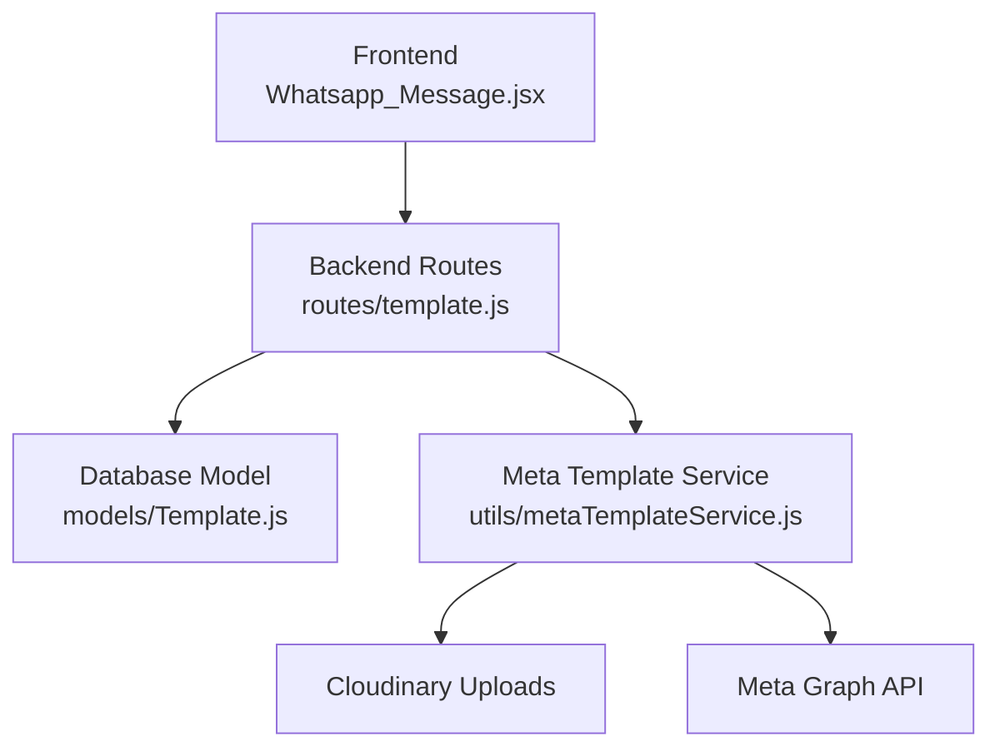
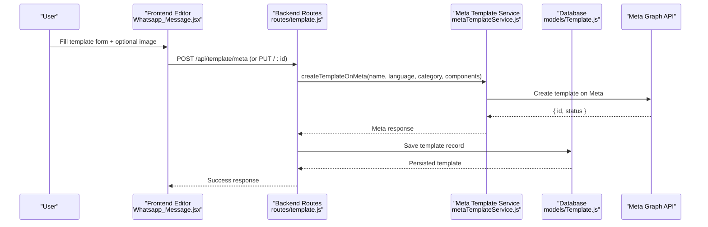
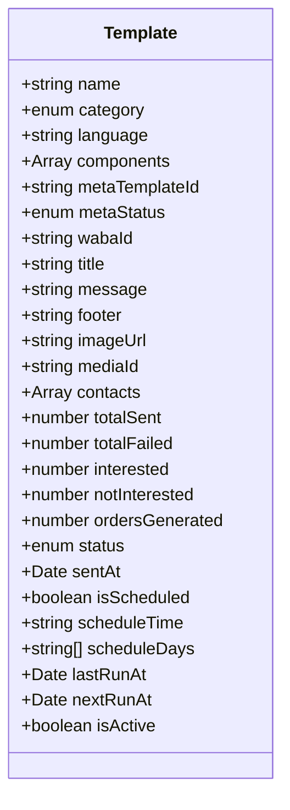
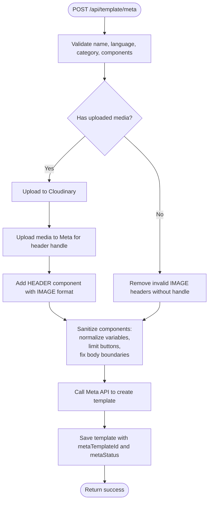
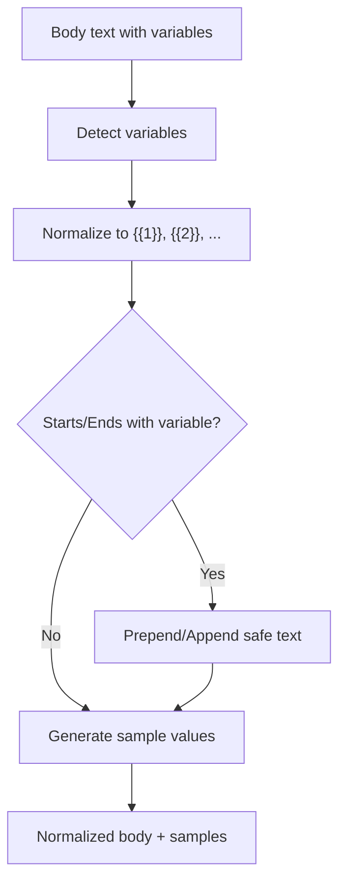
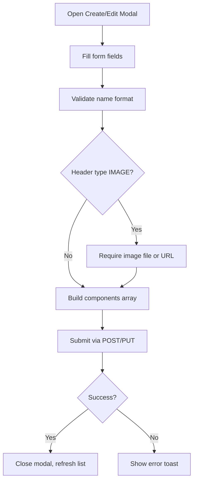
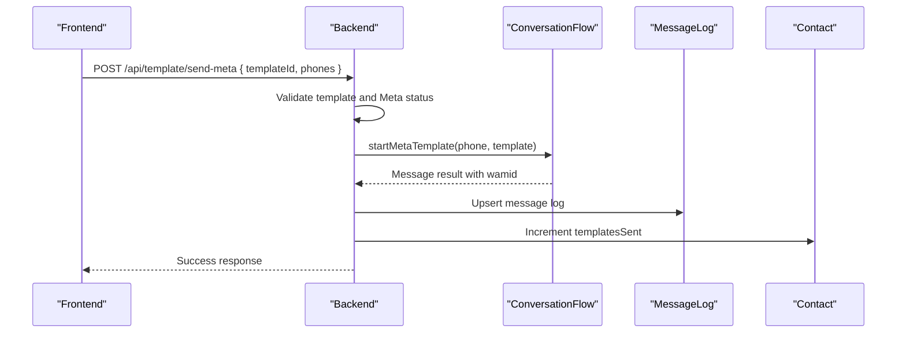
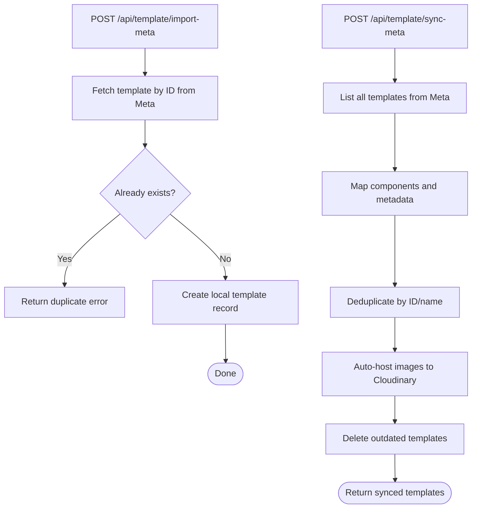
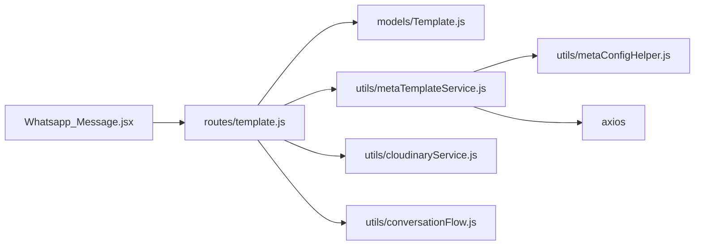

# Template Creation and Editing

<cite>
**Referenced Files in This Document**
- [Template.js](file://backend/models/Template.js)
- [template.js](file://backend/routes/template.js)
- [metaTemplateService.js](file://backend/utils/metaTemplateService.js)
- [Whatsapp_Message.jsx](file://frontend/src/Dashboard/Whatsapp_Message.jsx)
</cite>

## Table of Contents
1. [Introduction](#introduction)
2. [Project Structure](#project-structure)
3. [Core Components](#core-components)
4. [Architecture Overview](#architecture-overview)
5. [Detailed Component Analysis](#detailed-component-analysis)
6. [Dependency Analysis](#dependency-analysis)
7. [Performance Considerations](#performance-considerations)
8. [Troubleshooting Guide](#troubleshooting-guide)
9. [Conclusion](#conclusion)
10. [Appendices](#appendices)

## Introduction
This document explains how templates are created, edited, validated, and sent in the application. It covers:
- Text templates with parameterized variables
- Media attachments for headers (images)
- Interactive buttons (call, URL, quick reply)
- Component-based template structure aligned with Meta WhatsApp Cloud API
- The template editor interface, validation rules, and composition constraints
- Metadata management such as name, language, category, and status
- Error handling and best practices for designing robust templates

The system integrates a React frontend with a Node/Express backend that communicates with Meta’s WhatsApp Cloud API. Templates are stored locally and can be synchronized with Meta.

## Project Structure
The template feature spans both frontend and backend:
- Frontend: A React component provides the template creation/editing UI, preview, media upload, and sending flows.
- Backend: Express routes handle CRUD operations, file uploads, Meta API calls, and scheduling.
- Data Model: A Mongoose schema stores template metadata, components, and operational fields.
- Utilities: Services encapsulate Meta API interactions, including template creation, media upload, and status checks.

**Diagram sources**
- [Whatsapp_Message.jsx:763-879](file://frontend/src/Dashboard/Whatsapp_Message.jsx#L763-L879)
- [template.js:283-365](file://backend/routes/template.js#L283-L365)
- [Template.js:3-40](file://backend/models/Template.js#L3-L40)
- [metaTemplateService.js:114-136](file://backend/utils/metaTemplateService.js#L114-L136)

**Section sources**
- [Whatsapp_Message.jsx:172-186](file://frontend/src/Dashboard/Whatsapp_Message.jsx#L172-L186)
- [template.js:1-21](file://backend/routes/template.js#L1-L21)
- [Template.js:3-40](file://backend/models/Template.js#L3-L40)
- [metaTemplateService.js:1-21](file://backend/utils/metaTemplateService.js#L1-L21)

## Core Components
- Template model: Stores template metadata, components, and operational fields.
- Template routes: Provide endpoints to create, update, sync, import, send, and schedule templates.
- Meta template service: Encapsulates Meta API calls for creating templates, uploading media, fetching statuses, and listing templates.
- Frontend template editor: Provides form inputs, validation, preview, media upload, and submission logic.

Key responsibilities:
- Frontend builds a components array representing header/body/footer/buttons and sends it to the backend.
- Backend validates and sanitizes components, handles media uploads, and persists data.
- Meta service ensures variable normalization and button sanitization before calling Meta.

**Section sources**
- [Template.js:3-40](file://backend/models/Template.js#L3-L40)
- [template.js:283-365](file://backend/routes/template.js#L283-L365)
- [metaTemplateService.js:23-112](file://backend/utils/metaTemplateService.js#L23-L112)
- [Whatsapp_Message.jsx:763-879](file://frontend/src/Dashboard/Whatsapp_Message.jsx#L763-L879)

## Architecture Overview
The template lifecycle involves:
1. User fills out the template editor and optionally uploads an image.
2. Frontend constructs a components array and submits via POST or PUT.
3. Backend validates input, uploads media if provided, and calls Meta API to create/import the template.
4. Backend saves template metadata and links to Meta ID/status.
5. Users can sync existing Meta templates into the local database.
6. Approved templates can be sent to contacts through the backend.

**Diagram sources**
- [Whatsapp_Message.jsx:787-879](file://frontend/src/Dashboard/Whatsapp_Message.jsx#L787-L879)
- [template.js:283-365](file://backend/routes/template.js#L283-L365)
- [metaTemplateService.js:114-136](file://backend/utils/metaTemplateService.js#L114-L136)
- [Template.js:3-40](file://backend/models/Template.js#L3-L40)

## Detailed Component Analysis

### Template Data Model
The template model includes:
- Meta-specific fields: name, category, language, components, metaTemplateId, metaStatus, wabaId
- Legacy fields: title, message, footer, imageUrl, mediaId
- Operational fields: contacts, totalSent, totalFailed, interested, notInterested, ordersGenerated, status, timestamps, scheduling flags

Validation and constraints:
- name is required
- category is restricted to MARKETING, UTILITY, AUTHENTICATION
- language defaults to en
- components is an array used by Meta
- metaStatus enum includes PENDING, APPROVED, REJECTED, DRAFT

**Diagram sources**
- [Template.js:3-40](file://backend/models/Template.js#L3-L40)

**Section sources**
- [Template.js:3-40](file://backend/models/Template.js#L3-L40)

### Template Creation Workflow (Meta Cloud API)
The backend route for creating templates on Meta performs:
- Validates required fields: name, language, category, components
- Handles optional media upload:
  - Uploads file to Cloudinary for local hosting
  - Uploads media to Meta to get a handle for the header
  - Adds or updates HEADER component with IMAGE format
- Sanitizes components:
  - Normalizes body variables to numbered placeholders
  - Ensures body does not start/end with a variable
  - Generates sample values for variables
  - Limits buttons to three and normalizes types
- Calls Meta API to create the template
- Saves template record with Meta ID and status

**Diagram sources**
- [template.js:283-365](file://backend/routes/template.js#L283-L365)
- [metaTemplateService.js:23-112](file://backend/utils/metaTemplateService.js#L23-L112)

**Section sources**
- [template.js:283-365](file://backend/routes/template.js#L283-L365)
- [metaTemplateService.js:23-112](file://backend/utils/metaTemplateService.js#L23-L112)

### Parameterized Messages and Variables
Body text supports parameters using numbered placeholders like {{1}}, {{2}}. The service:
- Detects named or indexed variables
- Replaces them with sequential indices
- Prevents body from starting or ending with a variable
- Generates sample values based on variable names or defaults

**Diagram sources**
- [metaTemplateService.js:23-70](file://backend/utils/metaTemplateService.js#L23-L70)

**Section sources**
- [metaTemplateService.js:23-70](file://backend/utils/metaTemplateService.js#L23-L70)

### Template Editor Interface and Validation
The frontend editor provides:
- Fields for name, category, language
- Header type selection: NONE, TEXT, IMAGE
- Header text/image URL or file upload
- Body text with live preview replacing variables
- Footer text
- Up to three interactive buttons (PHONE_NUMBER, URL, QUICK_REPLY)
- Validation:
  - Name must be lowercase and underscores only
  - If header type is IMAGE, require either selected file or URL
  - Button count limited to three
- Submission:
  - Builds components array
  - Sends JSON or FormData (with media)
  - Tries multiple endpoint variants for compatibility

**Diagram sources**
- [Whatsapp_Message.jsx:735-879](file://frontend/src/Dashboard/Whatsapp_Message.jsx#L735-L879)

**Section sources**
- [Whatsapp_Message.jsx:735-879](file://frontend/src/Dashboard/Whatsapp_Message.jsx#L735-L879)

### Template Types and Components
Supported template components:
- HEADER:
  - Format TEXT: displays header text
  - Format IMAGE: requires media upload; backend adds handle
- BODY:
  - Supports parameterized variables
  - Automatically normalized and sanitized
- FOOTER:
  - Optional footer text
- BUTTONS:
  - Up to three buttons
  - Types: PHONE_NUMBER, URL, QUICK_REPLY
  - Phone numbers normalized and URL defaults applied

Template types in practice:
- Text-only templates: HEADER NONE, BODY with variables, optional FOOTER
- Image header templates: HEADER IMAGE with uploaded media
- Document/video/audio templates: Not directly supported by current flow; the editor focuses on image headers and text bodies. For other media types, consider extending the backend to accept additional formats and updating the frontend accordingly.

**Section sources**
- [Whatsapp_Message.jsx:763-785](file://frontend/src/Dashboard/Whatsapp_Message.jsx#L763-L785)
- [metaTemplateService.js:72-112](file://backend/utils/metaTemplateService.js#L72-L112)

### Managing Template Metadata
Metadata managed by the system:
- name: unique identifier for the template
- category: MARKETING, UTILITY, AUTHENTICATION
- language: default en
- components: structured representation of header/body/footer/buttons
- metaTemplateId: ID returned by Meta
- metaStatus: PENDING, APPROVED, REJECTED, DRAFT
- wabaId: associated Meta Business Account
- imageUrl/mediaId: local hosting and Meta media references

Best practices:
- Use descriptive, lowercase names with underscores
- Choose appropriate categories for approval workflows
- Keep language consistent across templates
- Maintain clean components arrays to avoid Meta rejections

**Section sources**
- [Template.js:3-40](file://backend/models/Template.js#L3-L40)
- [template.js:283-365](file://backend/routes/template.js#L283-L365)

### Sending Templates
Approved templates can be sent to one or more contacts:
- Frontend triggers send via POST /api/template/send-meta
- Backend verifies template exists and has a valid Meta ID
- Strict validation fetches current status from Meta to ensure APPROVED
- Broadcast runner iterates over phone numbers, sends messages, logs outcomes, and updates contact stats

**Diagram sources**
- [template.js:106-152](file://backend/routes/template.js#L106-L152)
- [template.js:30-102](file://backend/routes/template.js#L30-L102)

**Section sources**
- [template.js:106-152](file://backend/routes/template.js#L106-L152)
- [template.js:30-102](file://backend/routes/template.js#L30-L102)

### Importing and Syncing Templates
- Import single template by Meta ID: fetches metadata and creates a local record
- Sync all templates from Meta: pulls list, maps components, deduplicates, auto-hosts images to Cloudinary, and cleans up outdated records

**Diagram sources**
- [template.js:368-409](file://backend/routes/template.js#L368-L409)
- [template.js:411-529](file://backend/routes/template.js#L411-L529)

**Section sources**
- [template.js:368-409](file://backend/routes/template.js#L368-L409)
- [template.js:411-529](file://backend/routes/template.js#L411-L529)

## Dependency Analysis
Component relationships:
- Frontend depends on backend routes for template CRUD and sending
- Backend routes depend on:
  - Database model for persistence
  - Meta template service for API interactions
  - Cloudinary service for media hosting
  - Conversation flow utility for sending messages
- Meta template service depends on credentials helper and Axios for HTTP requests

**Diagram sources**
- [Whatsapp_Message.jsx:787-879](file://frontend/src/Dashboard/Whatsapp_Message.jsx#L787-L879)
- [template.js:1-11](file://backend/routes/template.js#L1-L11)
- [metaTemplateService.js:1-4](file://backend/utils/metaTemplateService.js#L1-L4)

**Section sources**
- [template.js:1-11](file://backend/routes/template.js#L1-L11)
- [metaTemplateService.js:1-4](file://backend/utils/metaTemplateService.js#L1-L4)

## Performance Considerations
- Avoid excessive retries: The frontend tries multiple endpoints but stops on first success to reduce load.
- Limit button count: Enforced at both frontend and backend to prevent payload bloat.
- Variable normalization: Reduces Meta rejection risk and improves processing speed.
- Media handling: Uploads to Cloudinary for fast local access; separate upload for Meta to optimize sending.
- Scheduling delays: Minimal jitter added to bulk sends to respect platform limits while maintaining throughput.

[No sources needed since this section provides general guidance]

## Troubleshooting Guide
Common issues and resolutions:
- Missing required fields: Ensure name, language, category, and components are provided when creating templates.
- Invalid header image: When header type is IMAGE, provide a file or URL; otherwise, remove invalid IMAGE headers.
- Variable boundary violations: Body cannot start or end with a variable; the service automatically fixes this.
- Button limit exceeded: Maximum three buttons per template; remove extras.
- Meta approval required: Before sending, verify template status is APPROVED; the backend checks this before dispatch.
- Credentials missing: Ensure Meta WABA ID and token are configured; otherwise, sync/create operations will fail.

Operational tips:
- Use the “Sync Meta API” button to pull latest template statuses and content.
- Monitor message logs to track delivery states and errors.
- Keep template names consistent and use categories to organize approvals.

**Section sources**
- [template.js:283-365](file://backend/routes/template.js#L283-L365)
- [template.js:106-152](file://backend/routes/template.js#L106-L152)
- [metaTemplateService.js:23-112](file://backend/utils/metaTemplateService.js#L23-L112)

## Conclusion
The template system provides a robust workflow for creating, editing, validating, and sending WhatsApp templates with Meta Cloud API integration. It supports parameterized messages, media attachments for headers, and interactive buttons. The frontend offers a user-friendly editor with real-time previews and validation, while the backend ensures compliance with Meta’s requirements and maintains local records for operational tracking. Following the documented best practices helps achieve higher approval rates and reliable messaging performance.

[No sources needed since this section summarizes without analyzing specific files]

## Appendices

### Best Practices for Template Design
- Use clear, concise body text with meaningful variables
- Provide realistic sample values for variables to aid approval
- Limit buttons to essential actions (call, website, quick reply)
- Keep header images optimized for size and clarity
- Organize templates by category and maintain consistent naming conventions
- Regularly sync templates to reflect Meta’s current state

[No sources needed since this section provides general guidance]