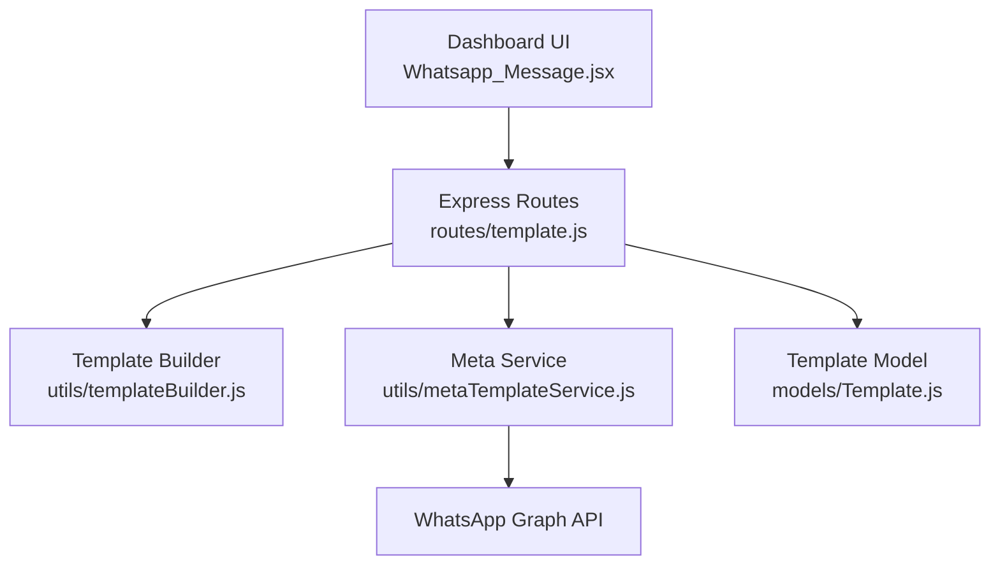
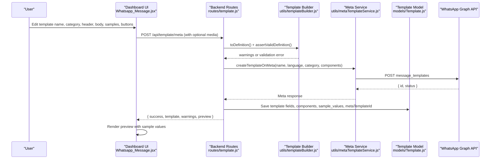
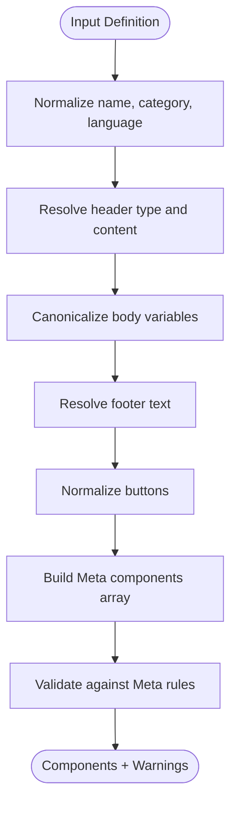
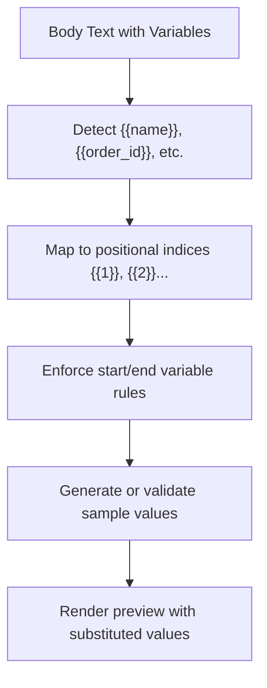
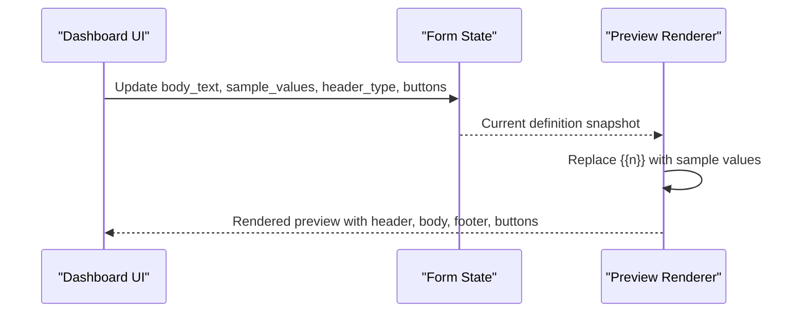
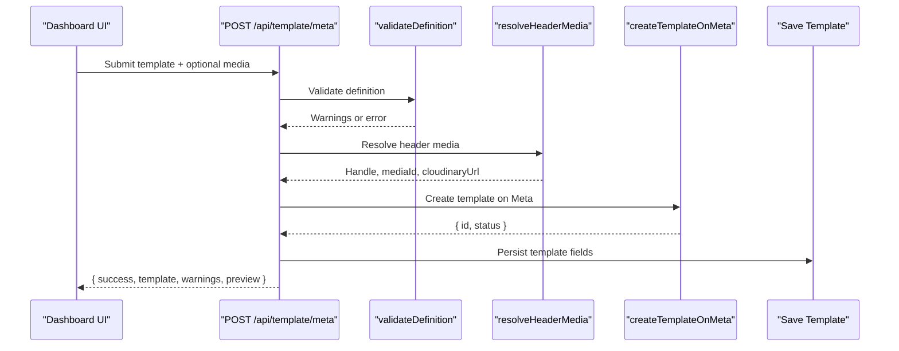
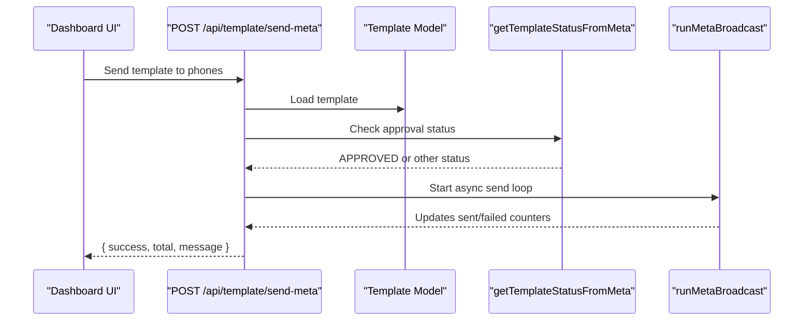
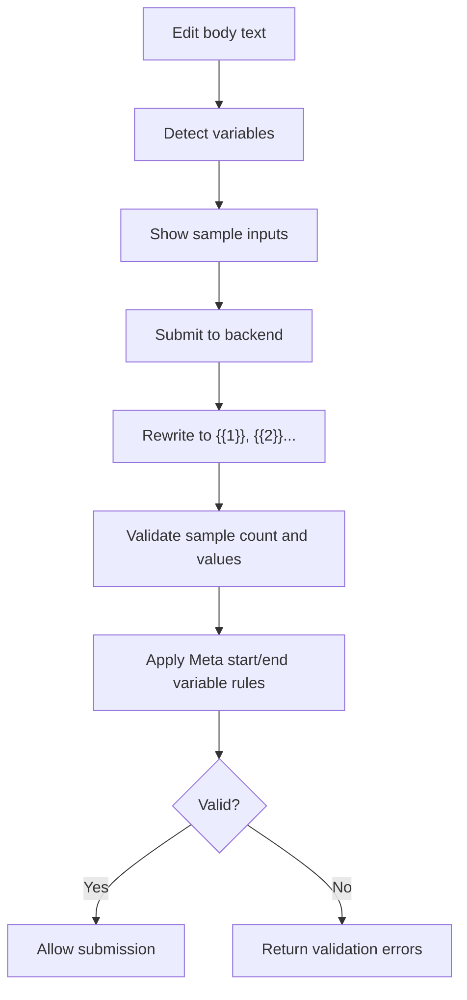
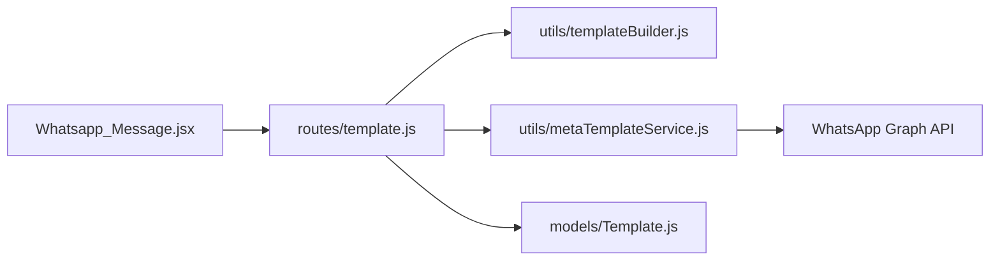

# Template Testing and Preview

<cite>
**Referenced Files in This Document**
- [Template.js](file://backend/models/Template.js)
- [template.js](file://backend/routes/template.js)
- [metaTemplateService.js](file://backend/utils/metaTemplateService.js)
- [templateBuilder.js](file://backend/utils/templateBuilder.js)
- [Whatsapp_Message.jsx](file://frontend/src/Dashboard/Whatsapp_Message.jsx)
</cite>

## Table of Contents
1. [Introduction](#introduction)
2. [Project Structure](#project-structure)
3. [Core Components](#core-components)
4. [Architecture Overview](#architecture-overview)
5. [Detailed Component Analysis](#detailed-component-analysis)
6. [Dependency Analysis](#dependency-analysis)
7. [Performance Considerations](#performance-considerations)
8. [Troubleshooting Guide](#troubleshooting-guide)
9. [Conclusion](#conclusion)
10. [Appendices](#appendices)

## Introduction
This document explains how the application tests, validates, previews, and sends WhatsApp Business API templates. It focuses on:
- The template rendering engine that converts user-friendly definitions into Meta’s `components` structure.
- Parameter substitution using positional variables like `{{1}}`, `{{2}}`.
- Live preview generation in the dashboard.
- Sending test messages through the Meta broadcast flow.
- Validation rules, character limits, and compliance checks aligned with WhatsApp Business API requirements.

The system is split between a React dashboard for authoring and preview, an Express backend for validation and Meta integration, and a Meta Cloud API layer for template submission and sending.

## Project Structure
The template testing and preview capability spans four main areas:

| Area | Responsibility | Key Files |
|---|---|---|
| Data model | Stores template metadata, Meta status, sample values, buttons, and scheduling fields | [Template.js](file://backend/models/Template.js) |
| Backend routes | Exposes endpoints for creating, updating, recreating, importing, previewing, and sending templates | [template.js](file://backend/routes/template.js) |
| Template builder | Normalizes input, builds Meta components, enforces validation rules, and formats errors | [templateBuilder.js](file://backend/utils/templateBuilder.js) |
| Meta service | Calls the WhatsApp Graph API for template lifecycle, media upload, and status checks | [metaTemplateService.js](file://backend/utils/metaTemplateService.js) |
| Frontend studio | Provides live preview, variable sampling, button editing, and category-aware UI behavior | [Whatsapp_Message.jsx](file://frontend/src/Dashboard/Whatsapp_Message.jsx) |

**Diagram sources**
- [Whatsapp_Message.jsx:2400-2650](file://frontend/src/Dashboard/Whatsapp_Message.jsx#L2400-L2650)
- [template.js:146-170](file://backend/routes/template.js#L146-L170)
- [templateBuilder.js:178-289](file://backend/utils/templateBuilder.js#L178-L289)
- [metaTemplateService.js:114-137](file://backend/utils/metaTemplateService.js#L114-L137)
- [Template.js:3-68](file://backend/models/Template.js#L3-L68)

**Section sources**
- [Template.js:3-68](file://backend/models/Template.js#L3-L68)
- [template.js:146-170](file://backend/routes/template.js#L146-L170)
- [templateBuilder.js:178-289](file://backend/utils/templateBuilder.js#L178-L289)
- [metaTemplateService.js:114-137](file://backend/utils/metaTemplateService.js#L114-L137)
- [Whatsapp_Message.jsx:2400-2650](file://frontend/src/Dashboard/Whatsapp_Message.jsx#L2400-L2650)

## Core Components
The template testing and preview workflow relies on these core pieces:

- **Template definition normalization**: Converts friendly UI inputs into a canonical definition object used by both validation and component building.
- **Component builder**: Produces the exact Meta `components` array, including header, body, footer, and buttons.
- **Validation engine**: Enforces naming rules, category constraints, body variable rules, header/media rules, footer rules, and button limits.
- **Preview renderer**: Replaces positional variables with sample values to show the final message appearance in the dashboard.
- **Meta integration**: Submits templates, uploads media, imports existing templates, checks approval status, and sends approved templates.
- **Broadcast runner**: Iterates over phone numbers, calls the conversation flow, logs results, and updates template statistics.

Key responsibilities are distributed so that:
- The frontend focuses on authoring and preview.
- The backend centralizes validation and Meta API interactions.
- The model persists template state and sample data.

**Section sources**
- [templateBuilder.js:178-289](file://backend/utils/templateBuilder.js#L178-L289)
- [templateBuilder.js:300-415](file://backend/utils/templateBuilder.js#L300-L415)
- [template.js:146-170](file://backend/routes/template.js#L146-L170)
- [template.js:722-765](file://backend/routes/template.js#L722-L765)
- [template.js:395-441](file://backend/routes/template.js#L395-L441)
- [Template.js:3-68](file://backend/models/Template.js#L3-L68)

## Architecture Overview
The end-to-end template testing and preview architecture follows this flow:

**Diagram sources**
- [template.js:722-765](file://backend/routes/template.js#L722-L765)
- [templateBuilder.js:178-289](file://backend/utils/templateBuilder.js#L178-L289)
- [metaTemplateService.js:114-137](file://backend/utils/metaTemplateService.js#L114-L137)
- [Template.js:3-68](file://backend/models/Template.js#L3-L68)

## Detailed Component Analysis

### Template Rendering Engine
The rendering engine is not a traditional HTML renderer; it is a Meta component generator. Its job is to turn a friendly definition into the exact structure WhatsApp expects.

Key behaviors:
- **Name normalization**: Lowercase, underscores only, trimmed, slugified.
- **Category normalization**: Defaults to `MARKETING`; accepts `MARKETING`, `UTILITY`, `AUTHENTICATION`.
- **Language normalization**: Supports locale codes such as `en`, `en_US`, `hi`, `te`.
- **Header handling**: Supports `NONE`, `TEXT`, `IMAGE`, `VIDEO`, `DOCUMENT`. Media headers require a resumable upload handle.
- **Body canonicalization**: Rewrites named variables like `{{name}}` into positional variables like `{{1}}`, `{{2}}`, and generates sample arrays for Meta review.
- **Footer handling**: Optional text without variables.
- **Button handling**: Normalizes quick replies, URLs, phone numbers, contacts, OTP, and WhatsApp call buttons.

**Diagram sources**
- [templateBuilder.js:178-289](file://backend/utils/templateBuilder.js#L178-L289)
- [templateBuilder.js:300-415](file://backend/utils/templateBuilder.js#L300-L415)

**Section sources**
- [templateBuilder.js:178-289](file://backend/utils/templateBuilder.js#L178-L289)
- [templateBuilder.js:300-415](file://backend/utils/templateBuilder.js#L300-L415)

### Parameter Substitution and Sample Values
Parameter substitution is based on positional variables:
- Named placeholders like `{{name}}` are converted to `{{1}}`, `{{2}}`, etc.
- Every variable must have a corresponding sample value.
- If a variable appears at the start or end of the body, the engine adds safe text so Meta does not reject the template.
- Sample values are stored in `sample_values` and also embedded in the body example for Meta review.

Frontend behavior:
- The dashboard detects variables in the body text.
- It shows one input per variable.
- It provides default sample suggestions based on variable names.
- It displays the live preview after substitution.

**Diagram sources**
- [templateBuilder.js:123-168](file://backend/utils/templateBuilder.js#L123-L168)
- [metaTemplateService.js:23-70](file://backend/utils/metaTemplateService.js#L23-L70)
- [Whatsapp_Message.jsx:2445-2472](file://frontend/src/Dashboard/Whatsapp_Message.jsx#L2445-L2472)

**Section sources**
- [templateBuilder.js:123-168](file://backend/utils/templateBuilder.js#L123-L168)
- [metaTemplateService.js:23-70](file://backend/utils/metaTemplateService.js#L23-L70)
- [Whatsapp_Message.jsx:2445-2472](file://frontend/src/Dashboard/Whatsapp_Message.jsx#L2445-L2472)

### Preview Generation Functionality
The dashboard preview renders:
- Header image or header text.
- Body text with live variable substitution.
- Footer text.
- Interactive action buttons.

The preview uses the current form data and sample values to simulate the final message appearance before submitting to Meta.

Important preview-related details:
- Image headers show a live thumbnail when available.
- Text headers display the header copy.
- Body variables are replaced with sample values.
- Buttons are rendered according to their type.

**Diagram sources**
- [Whatsapp_Message.jsx:2306-2331](file://frontend/src/Dashboard/Whatsapp_Message.jsx#L2306-L2331)
- [Whatsapp_Message.jsx:2400-2650](file://frontend/src/Dashboard/Whatsapp_Message.jsx#L2400-L2650)

**Section sources**
- [Whatsapp_Message.jsx:2306-2331](file://frontend/src/Dashboard/Whatsapp_Message.jsx#L2306-L2331)
- [Whatsapp_Message.jsx:2400-2650](file://frontend/src/Dashboard/Whatsapp_Message.jsx#L2400-L2650)

### Template Submission and Approval Flow
When you submit a template:
1. The route normalizes the payload.
2. The builder validates the definition.
3. Media headers are resolved and uploaded to Meta.
4. Components are built.
5. The template is submitted to Meta.
6. The backend saves local fields, including `metaTemplateId`, `metaStatus`, `components`, and `sample_values`.
7. The response includes a preview object with components and samples.

**Diagram sources**
- [template.js:146-170](file://backend/routes/template.js#L146-L170)
- [template.js:722-765](file://backend/routes/template.js#L722-L765)
- [metaTemplateService.js:114-137](file://backend/utils/metaTemplateService.js#L114-L137)

**Section sources**
- [template.js:146-170](file://backend/routes/template.js#L146-L170)
- [template.js:722-765](file://backend/routes/template.js#L722-L765)
- [metaTemplateService.js:114-137](file://backend/utils/metaTemplateService.js#L114-L137)

### Sending Test Messages
The backend exposes a Meta broadcast endpoint:
- Validates the template ID.
- Ensures the template has a valid Meta template ID.
- Checks Meta approval status immediately before sending.
- Accepts phone numbers from the request or falls back to opted-in contacts.
- Starts an asynchronous broadcast loop.

**Diagram sources**
- [template.js:395-441](file://backend/routes/template.js#L395-L441)
- [template.js:319-391](file://backend/routes/template.js#L319-L391)
- [metaTemplateService.js:181-190](file://backend/utils/metaTemplateService.js#L181-L190)

**Section sources**
- [template.js:395-441](file://backend/routes/template.js#L395-L441)
- [template.js:319-391](file://backend/routes/template.js#L319-L391)
- [metaTemplateService.js:181-190](file://backend/utils/metaTemplateService.js#L181-L190)

### Template Validation Rules, Character Limits, and Compliance
The template builder defines explicit limits and rules:

| Rule Area | Constraint | Behavior |
|---|---|---|
| Name | Max 512 characters; lowercase letters, digits, underscores only | Slugified and validated |
| Category | Must be `MARKETING`, `UTILITY`, or `AUTHENTICATION` | Defaults to `MARKETING` if invalid |
| Language | Locale code normalization | Keeps caller casing but ensures valid format |
| Header text | Max 60 characters | Clamped and validated |
| Body text | Max 1024 characters | Clamped; variables rewritten to positional form |
| Footer text | Max 60 characters | No variables allowed |
| Button text | Max 25 characters | Clamped |
| Mixed buttons | Up to 3 when any button is URL or phone number | Quick-reply-only allows more |
| Quick-reply buttons | Up to 10 | Only applies when all buttons are quick replies |
| Authentication templates | No header; fixed body/footer/button structure | Enforced during component building |
| Utility templates | Promotional wording triggers warnings | Does not block submission but warns about likely Meta rejection |

Compliance highlights:
- Body variables must have matching sample values.
- Body cannot start or end with a variable.
- Headers cannot contain variables.
- Footer cannot contain variables.
- URLs must start with `http://` or `https://`.
- Phone numbers must include a country code and meet minimum length.

**Section sources**
- [templateBuilder.js:15-24](file://backend/utils/templateBuilder.js#L15-L24)
- [templateBuilder.js:300-415](file://backend/utils/templateBuilder.js#L300-L415)
- [templateBuilder.js:421-493](file://backend/utils/templateBuilder.js#L421-L493)

### Testing Templates with Sample Data
To test a parameterized template:
1. Open the template editor in the dashboard.
2. Choose a category: marketing, utility, or authentication.
3. Enter the template name and language.
4. Configure the header: none, text, or media.
5. Write the body text using positional variables like `{{1}}`, `{{2}}`, or named variables like `{{name}}`.
6. Provide sample values for each detected variable.
7. Add optional footer text.
8. Add interactive buttons: quick reply, URL, phone number, contact, OTP, or WhatsApp call.
9. Review the live preview.
10. Submit the template to Meta for approval.

Example scenarios:
- **Marketing template**: Use a promotional body with two variables, such as customer name and discount amount, plus a URL button and a quick reply.
- **Utility template**: Use order confirmation variables such as customer name, order ID, amount, and delivery time, plus track-order and support-call buttons.
- **Authentication template**: Let Meta generate the passcode body and use the required OTP button.

**Section sources**
- [Whatsapp_Message.jsx:2400-2650](file://frontend/src/Dashboard/Whatsapp_Message.jsx#L2400-L2650)
- [templateBuilder.js:499-537](file://backend/utils/templateBuilder.js#L499-L537)

### Validating Parameter Placeholders
The system validates placeholders in multiple layers:
- Frontend detects variables and asks for sample values.
- Backend canonicalizes named variables into positional variables.
- Backend ensures every variable has a sample value.
- Backend rejects templates where the body starts or ends with a variable.
- Backend warns if utility template copy looks promotional.

**Diagram sources**
- [templateBuilder.js:123-168](file://backend/utils/templateBuilder.js#L123-L168)
- [templateBuilder.js:300-415](file://backend/utils/templateBuilder.js#L300-L415)

**Section sources**
- [templateBuilder.js:123-168](file://backend/utils/templateBuilder.js#L123-L168)
- [templateBuilder.js:300-415](file://backend/utils/templateBuilder.js#L300-L415)

### Previewing Different Template Variants
You can preview variants by changing:
- Category: marketing, utility, authentication.
- Header type: none, text, image, video, document.
- Body variables and sample values.
- Footer text.
- Buttons and their configuration.

The dashboard preview updates live as you edit. When you submit, the backend returns a preview object containing the generated components and sample values, which can be used to verify what will be sent to Meta.

**Section sources**
- [Whatsapp_Message.jsx:2306-2331](file://frontend/src/Dashboard/Whatsapp_Message.jsx#L2306-L2331)
- [template.js:751-760](file://backend/routes/template.js#L751-L760)

### Debugging Template Rendering Issues
Common debugging steps:
- Check validation errors returned by the backend.
- Inspect warnings about promotional utility copy.
- Verify that sample values match the number of variables.
- Confirm that media headers are uploaded correctly.
- Check Meta error hints for specific codes.
- Ensure the template is approved before sending.

Error decoding maps Meta API responses into readable messages and hints, covering issues such as invalid tokens, duplicate templates, missing header handles, mismatched example values, unknown templates, paused or disabled templates, opt-in restrictions, outside the 24-hour window, and account quality blocks.

**Section sources**
- [templateBuilder.js:421-493](file://backend/utils/templateBuilder.js#L421-L493)
- [template.js:222-242](file://backend/routes/template.js#L222-L242)

## Dependency Analysis
The template testing and preview system has clear dependency boundaries:

Coupling and cohesion:
- The frontend depends only on the backend API surface.
- The backend routes coordinate validation, media handling, Meta integration, and persistence.
- The template builder is a cohesive module responsible for normalization, component building, validation, and error formatting.
- The Meta service encapsulates Graph API calls.
- The model stores template state and sample values.

Potential circular dependencies:
- None are evident in the analyzed files.
- The routes import utilities and models.
- Utilities do not import routes.

External dependencies:
- WhatsApp Graph API for template creation, deletion, status checks, and media upload.
- Cloud storage services for public preview URLs.
- Database persistence via Mongoose.

**Diagram sources**
- [template.js:1-30](file://backend/routes/template.js#L1-L30)
- [templateBuilder.js:549-567](file://backend/utils/templateBuilder.js#L549-L567)
- [metaTemplateService.js:247-254](file://backend/utils/metaTemplateService.js#L247-L254)
- [Template.js:1-70](file://backend/models/Template.js#L1-L70)

**Section sources**
- [template.js:1-30](file://backend/routes/template.js#L1-L30)
- [templateBuilder.js:549-567](file://backend/utils/templateBuilder.js#L549-L567)
- [metaTemplateService.js:247-254](file://backend/utils/metaTemplateService.js#L247-L254)
- [Template.js:1-70](file://backend/models/Template.js#L1-L70)

## Performance Considerations
- Template submission involves multiple external calls: media upload, template creation, and database persistence.
- Broadcasting sends messages asynchronously to avoid blocking the HTTP response.
- Delays between sends reduce rate-limit pressure on Meta.
- Media downloads for remote header images are bounded by size limits and temporary file cleanup.
- Preview rendering happens client-side and should remain lightweight.

Recommendations:
- Keep sample values concise to avoid unnecessary payload growth.
- Avoid large media files for headers.
- Batch preview operations carefully if extending the UI.
- Monitor Meta API rate limits and adjust broadcast delays if needed.

[No sources needed since this section provides general guidance]

## Troubleshooting Guide
Use this guide when template testing or preview fails.

| Symptom | Likely Cause | Resolution |
|---|---|---|
| Validation error about template name | Invalid characters or too long | Use lowercase letters, digits, underscores; keep under 512 characters |
| Validation error about body variables | Missing or mismatched sample values | Add one sample value per variable; ensure counts match |
| Meta rejects body starting or ending with a variable | Meta rule violation | Add safe text or rewrite variables so they are not at the boundary |
| Utility template rejected | Promotional wording in utility category | Switch to marketing or rewrite around a transaction |
| Header media upload fails | Invalid file, missing handle, or network issue | Re-upload a supported image under the expected size limit |
| Duplicate template error | Same name and language already exist | Change the template name or delete the existing version |
| Unknown template error | Local record out of sync with Meta | Sync or recreate the template on Meta |
| Template not approved | Still pending, rejected, paused, or disabled | Check Meta status and wait or revise content |
| Send fails due to opt-in or 24-hour window | Recipient policy restriction | Obtain opt-in or send within the allowed window |

**Section sources**
- [templateBuilder.js:421-493](file://backend/utils/templateBuilder.js#L421-L493)
- [template.js:222-242](file://backend/routes/template.js#L222-L242)
- [template.js:395-441](file://backend/routes/template.js#L395-L441)

## Conclusion
The template testing and preview system combines a structured validation engine, a Meta-focused component builder, a live dashboard preview, and a robust Meta integration layer. By following the validation rules, providing correct sample values, and using the preview to verify formatting, you can confidently test parameterized templates, validate placeholders, and prepare compliant messages for WhatsApp Business API approval and delivery.

[No sources needed since this section summarizes without analyzing specific files]

## Appendices

### Template Testing Workflow Checklist
- Define template name, category, and language.
- Configure header: none, text, or media.
- Write body text with positional or named variables.
- Provide sample values for every variable.
- Add optional footer text.
- Add up to three mixed buttons or up to ten quick replies.
- Review live preview.
- Submit to Meta and monitor approval status.
- Once approved, send to test contacts using the broadcast endpoint.

**Section sources**
- [templateBuilder.js:499-537](file://backend/utils/templateBuilder.js#L499-L537)
- [template.js:395-441](file://backend/routes/template.js#L395-L441)

### Example Scenarios Summary
- **Parameterized marketing template**: Two variables for customer name and discount; URL and quick-reply buttons.
- **Parameterized utility template**: Four variables for order context; track-order URL and support phone button.
- **Authentication template**: No custom body; OTP button configured by Meta.

**Section sources**
- [templateBuilder.js:499-537](file://backend/utils/templateBuilder.js#L499-L537)
- [Whatsapp_Message.jsx:2400-2650](file://frontend/src/Dashboard/Whatsapp_Message.jsx#L2400-L2650)