# Template Versioning and Lifecycle Management

<cite>
**Referenced Files in This Document**
- [Template.js](file://backend/models/Template.js)
- [template.js](file://backend/routes/template.js)
- [metaTemplateService.js](file://backend/utils/metaTemplateService.js)
- [WhatsappBlast.jsx](file://frontend/src/Dashboard/WhatsappBlast.jsx)
</cite>

## Table of Contents
1. [Introduction](#introduction)
2. [Project Structure](#project-structure)
3. [Core Components](#core-components)
4. [Architecture Overview](#architecture-overview)
5. [Detailed Component Analysis](#detailed-component-analysis)
6. [Dependency Analysis](#dependency-analysis)
7. [Performance Considerations](#performance-considerations)
8. [Troubleshooting Guide](#troubleshooting-guide)
9. [Conclusion](#conclusion)
10. [Appendices](#appendices)

## Introduction
This document explains how templates are versioned, approved, deployed, and retired in the system. It focuses on:
- Template status transitions between draft, pending, approved, active, and archived states.
- Version control mechanisms for Meta WhatsApp Cloud API templates.
- Template history tracking and auditability.
- Approval workflows and change management processes.
- Rollback capabilities, version comparison strategies, and deprecation handling.
- Performance optimization, caching strategies, and bulk operations at scale.

The implementation centers around a Mongoose template model, an Express route layer that coordinates with the Meta Graph API, and a small frontend list view that displays template status.

## Project Structure
The relevant backend structure for template lifecycle is:
- `backend/models/Template.js`: Defines the template data model, including Meta-specific fields and local operational fields.
- `backend/routes/template.js`: Implements all template APIs, including creation, sync, update, recreation, deletion, scheduling, sending, and status checks.
- `backend/utils/metaTemplateService.js`: Encapsulates Meta API calls for creating, deleting, fetching, and checking template status, plus media uploads.
- `frontend/src/Dashboard/WhatsappBlast.jsx`: Displays templates and their statuses in the dashboard.

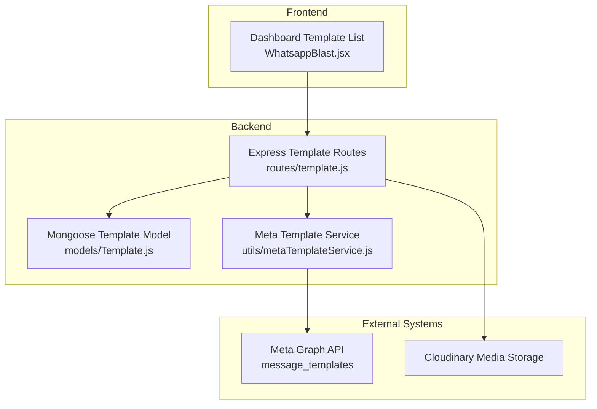

**Diagram sources**
- [template.js:1-30](file://backend/routes/template.js#L1-L30)
- [Template.js:1-70](file://backend/models/Template.js#L1-L70)
- [metaTemplateService.js:1-21](file://backend/utils/metaTemplateService.js#L1-L21)
- [WhatsappBlast.jsx:396-414](file://frontend/src/Dashboard/WhatsappBlast.jsx#L396-L414)

**Section sources**
- [Template.js:1-70](file://backend/models/Template.js#L1-L70)
- [template.js:1-30](file://backend/routes/template.js#L1-L30)
- [metaTemplateService.js:1-21](file://backend/utils/metaTemplateService.js#L1-L21)
- [WhatsappBlast.jsx:396-414](file://frontend/src/Dashboard/WhatsappBlast.jsx#L396-L414)

## Core Components
- Template model: Stores both Meta-specific metadata (`name`, `category`, `language`, `components`, `metaTemplateId`, `metaStatus`, `wabaId`) and local operational fields (`title`, `message`, `footer`, `imageUrl`, `mediaId`, `status`, `isActive`, scheduling fields).
- Template routes: Provide endpoints to create, import, sync, update, recreate, delete, schedule, send, and check status of templates. They also handle header media resolution and component building.
- Meta service: Handles authentication, template CRUD against Meta, status polling, and media upload flows.

Key responsibilities:
- Enforce Meta’s immutable content policy by recreating templates when content changes.
- Keep local `metaStatus` synchronized with Meta’s approval state.
- Support bulk sending and scheduled broadcasts.
- Provide status-only updates without triggering recreation.

**Section sources**
- [Template.js:1-70](file://backend/models/Template.js#L1-L70)
- [template.js:146-199](file://backend/routes/template.js#L146-L199)
- [metaTemplateService.js:114-137](file://backend/utils/metaTemplateService.js#L114-L137)

## Architecture Overview
The template lifecycle spans three layers:
- Frontend: Displays templates and their statuses; allows selection and actions like sending or scheduling.
- Backend routes: Validate inputs, resolve media, build components, interact with Meta, and persist template records.
- External Meta API: Owns the canonical template definitions and approval workflow.

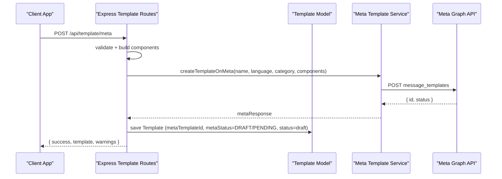

**Diagram sources**
- [template.js:747-786](file://backend/routes/template.js#L747-L786)
- [metaTemplateService.js:114-137](file://backend/utils/metaTemplateService.js#L114-L137)
- [Template.js:1-70](file://backend/models/Template.js#L1-L70)

## Detailed Component Analysis

### Template Data Model and Status Fields
The template model defines two distinct status dimensions:
- `metaStatus`: Mirrors Meta’s approval states such as DRAFT, PENDING, IN_REVIEW, APPROVED, REJECTED, PAUSED, DISABLED, FLAGGED, PENDING_DELETION, LIMIT_EXCEEDED, APPEAL_PENDING.
- `status`: Local operational state such as draft, sending, completed, failed, scheduled.

Additional fields include:
- `metaTemplateId`: Canonical ID from Meta.
- `wabaId`: Business account identifier.
- `components`: Raw Meta components array used for preview and re-editing.
- `header_type`, `header_text`, `header_image_url`, `body_text`, `footer_text`, `sample_values`, `buttons`: Friendly mirrors for editing and display.
- `isActive`: Controls whether scheduled templates run.
- Scheduling fields: `isScheduled`, `scheduleTime`, `repeatDaily`, `scheduleDays`, `nextRunAt`, `lastRunAt`.

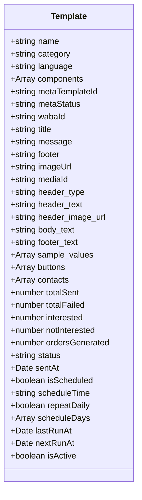

**Diagram sources**
- [Template.js:1-70](file://backend/models/Template.js#L1-L70)

**Section sources**
- [Template.js:1-70](file://backend/models/Template.js#L1-L70)

### Template Creation and Submission Flow
Creation follows this path:
- Normalize and validate the friendly payload into a definition.
- Resolve header media (resumable upload handle, media ID for sending, public URL for preview).
- Build components ensuring a BODY exists.
- Submit to Meta and persist the resulting template record with `metaStatus` set to the returned status and local `status` set to `draft`.

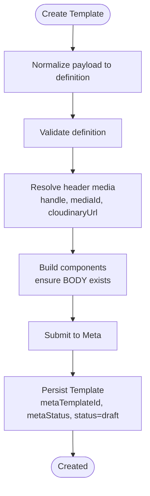

**Diagram sources**
- [template.js:146-199](file://backend/routes/template.js#L146-L199)
- [metaTemplateService.js:114-137](file://backend/utils/metaTemplateService.js#L114-L137)

**Section sources**
- [template.js:146-199](file://backend/routes/template.js#L146-L199)
- [metaTemplateService.js:114-137](file://backend/utils/metaTemplateService.js#L114-L137)

### Update vs Recreate Workflow
Meta does not allow editing submitted templates’ content. The system enforces this:
- If content changes on a template already on Meta, the PUT endpoint returns `requiresRecreate` and lists changed fields.
- Explicit recreation deletes the old Meta version and submits a new one under the same name, then persists the new record with updated `metaStatus`.
- Local drafts can be edited in place without recreation.

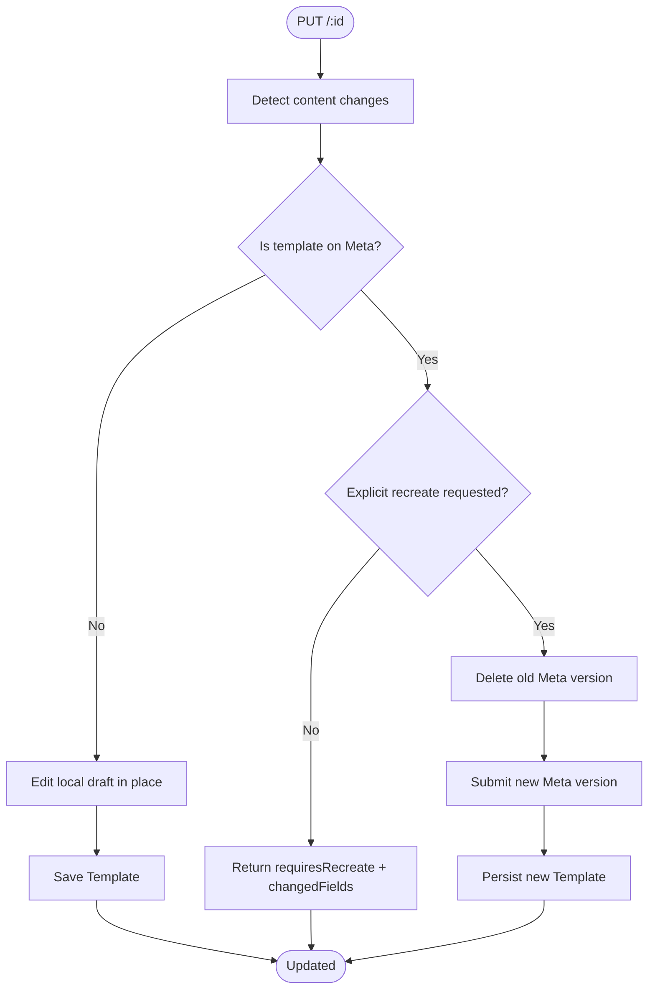

**Diagram sources**
- [template.js:547-692](file://backend/routes/template.js#L547-L692)
- [template.js:694-723](file://backend/routes/template.js#L694-L723)

**Section sources**
- [template.js:547-692](file://backend/routes/template.js#L547-L692)
- [template.js:694-723](file://backend/routes/template.js#L694-L723)

### Import and Sync Operations
- Import single template by Meta ID: Creates a local record mirroring Meta’s definition and sets initial `metaStatus` and local `status`.
- Bulk sync: Fetches all templates from Meta, deduplicates by ID/name, updates existing records, auto-hosts header images to Cloudinary if needed, and cleans up outdated records not present in Meta.

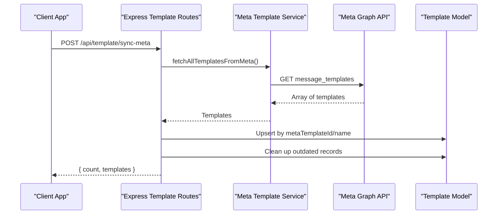

**Diagram sources**
- [template.js:832-950](file://backend/routes/template.js#L832-L950)
- [metaTemplateService.js:163-179](file://backend/utils/metaTemplateService.js#L163-L179)

**Section sources**
- [template.js:832-950](file://backend/routes/template.js#L832-L950)
- [metaTemplateService.js:163-179](file://backend/utils/metaTemplateService.js#L163-L179)

### Sending and Deployment
Before sending:
- Verify the template has a valid Meta ID.
- Check current Meta status is APPROVED; otherwise reject sending.
- Optionally update local `metaStatus` to APPROVED if Meta confirms it.

Broadcast flow:
- Parse phone list (from request or contacts).
- Send via Meta Cloud API using conversation flow utilities.
- Log messages and update contact stats.
- Update template counters and final status.

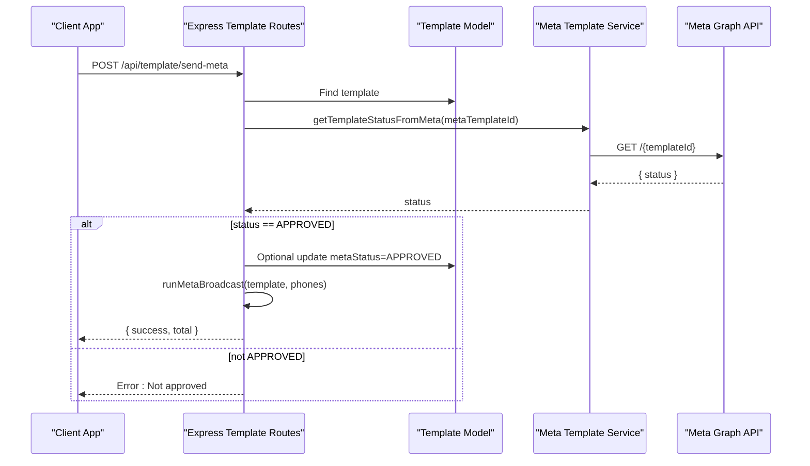

**Diagram sources**
- [template.js:397-441](file://backend/routes/template.js#L397-L441)
- [metaTemplateService.js:181-190](file://backend/utils/metaTemplateService.js#L181-L190)

**Section sources**
- [template.js:397-441](file://backend/routes/template.js#L397-L441)
- [metaTemplateService.js:181-190](file://backend/utils/metaTemplateService.js#L181-L190)

### Scheduling and Retention
- Schedule creation stores target time, repeat flags, and recipient lists; sets local `status` to `scheduled`.
- Scheduled runner picks due templates, marks them as `sending`, executes broadcast, and reschedules if repeating.
- Toggle and delete endpoints manage scheduled items.

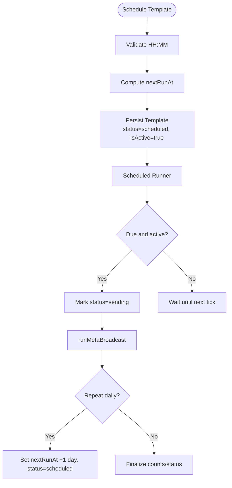

**Diagram sources**
- [template.js:443-486](file://backend/routes/template.js#L443-L486)
- [template.js:1046-1064](file://backend/routes/template.js#L1046-L1064)

**Section sources**
- [template.js:443-486](file://backend/routes/template.js#L443-L486)
- [template.js:1046-1064](file://backend/routes/template.js#L1046-L1064)

### Deletion and Retirement
- Deleting a template attempts to remove it from Meta if present; if Meta reports missing, the local record is still deleted.
- Sync cleanup removes outdated templates whose Meta IDs no longer exist, except those in transitional states or scheduled.

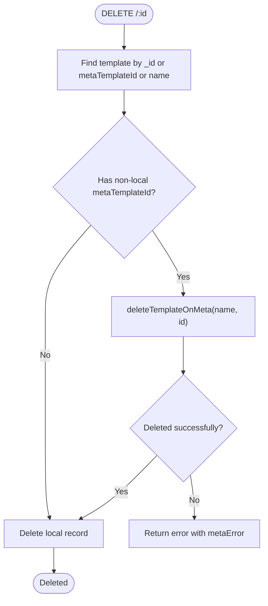

**Diagram sources**
- [template.js:506-541](file://backend/routes/template.js#L506-L541)
- [metaTemplateService.js:144-161](file://backend/utils/metaTemplateService.js#L144-L161)

**Section sources**
- [template.js:506-541](file://backend/routes/template.js#L506-L541)
- [metaTemplateService.js:144-161](file://backend/utils/metaTemplateService.js#L144-L161)

### Status Transitions and Approval Workflow
- Creation sets `metaStatus` to the value returned by Meta (often PENDING or DRAFT), and local `status` to `draft`.
- Sync updates `metaStatus` from Meta’s current state.
- Status check endpoint refreshes `metaStatus` locally based on Meta’s response.
- Sending requires `metaStatus` to be APPROVED; otherwise it rejects the operation.

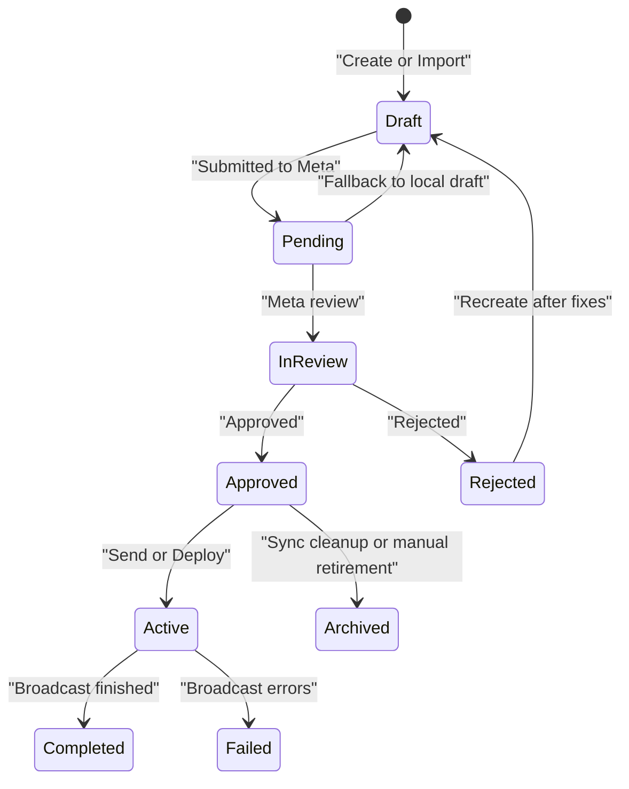

**Diagram sources**
- [Template.js:12-28](file://backend/models/Template.js#L12-L28)
- [template.js:173-199](file://backend/routes/template.js#L173-L199)
- [template.js:832-950](file://backend/routes/template.js#L832-L950)
- [template.js:952-979](file://backend/routes/template.js#L952-L979)
- [template.js:397-441](file://backend/routes/template.js#L397-L441)

**Section sources**
- [Template.js:12-28](file://backend/models/Template.js#L12-L28)
- [template.js:173-199](file://backend/routes/template.js#L173-L199)
- [template.js:832-950](file://backend/routes/template.js#L832-L950)
- [template.js:952-979](file://backend/routes/template.js#L952-L979)
- [template.js:397-441](file://backend/routes/template.js#L397-L441)

### Version Control Mechanisms
- Meta enforces immutability: changing content requires recreating the template under the same name.
- The system tracks the canonical Meta ID (`metaTemplateId`) and mirrors Meta’s status (`metaStatus`).
- Local edits to drafts do not affect Meta versions; explicit recreation triggers a new submission.

Operational implications:
- Always use recreate for content changes once a template is on Meta.
- Use sync to keep local records aligned with Meta’s current state.
- Avoid duplicate records by relying on name/language uniqueness during creation and sync deduplication.

**Section sources**
- [template.js:249-287](file://backend/routes/template.js#L249-L287)
- [template.js:547-692](file://backend/routes/template.js#L547-L692)
- [template.js:747-786](file://backend/routes/template.js#L747-L786)
- [template.js:832-950](file://backend/routes/template.js#L832-L950)

### Template History Tracking and Audit Trails
Current behavior:
- No dedicated template version history table is implemented.
- Message logs capture outbound sends per contact, including template name and button payloads.
- Stats endpoint aggregates message log statuses and counts active templates.

Recommendations for auditability:
- Introduce a `TemplateVersion` model to snapshot `components`, `metaStatus`, and metadata on each create/recreate.
- Record user actions (who created, who recreated, who approved) in an audit log.
- Store diffs between versions for comparison.

**Section sources**
- [template.js:318-391](file://backend/routes/template.js#L318-L391)
- [template.js:981-1044](file://backend/routes/template.js#L981-L1044)

### Rollback Capabilities
- There is no direct rollback endpoint to revert to a previous Meta version.
- Practical rollback strategy:
  - Identify the desired prior version’s components and metadata.
  - Recreate the template with those components.
  - Monitor Meta approval and update local `metaStatus`.

Limitations:
- Without version snapshots, rollback relies on external records or manual reconstruction.

**Section sources**
- [template.js:694-723](file://backend/routes/template.js#L694-L723)

### Version Comparison Features
- The update route computes changed fields and returns them when recreation is required.
- For deeper comparisons, implement a diff utility comparing `components` and key text fields across versions.

**Section sources**
- [template.js:577-616](file://backend/routes/template.js#L577-L616)

### Deprecation Handling
- Deprecation is not explicitly modeled; recommended approach:
  - Stop promoting deprecated templates to active deployment.
  - Use sync cleanup to remove outdated Meta IDs.
  - Mark templates inactive and archive them manually or via automation.

**Section sources**
- [template.js:922-929](file://backend/routes/template.js#L922-L929)

### Managing Template Versions and Promoting Through Approval
Examples:
- Create a new template: submit via `/api/template/meta`; local record created with `metaStatus` from Meta and `status=draft`.
- Approve locally after Meta approves: update `metaStatus` to `APPROVED` via status-only update or rely on sync/status check.
- Promote to active: ensure `metaStatus=APPROVED` and send via `/api/template/send-meta`.

**Section sources**
- [template.js:747-786](file://backend/routes/template.js#L747-L786)
- [template.js:952-979](file://backend/routes/template.js#L952-L979)
- [template.js:397-441](file://backend/routes/template.js#L397-L441)

### Frontend Display of Template Status
The dashboard shows template names and statuses, defaulting to APPROVED when not provided.

**Section sources**
- [WhatsappBlast.jsx:396-414](file://frontend/src/Dashboard/WhatsappBlast.jsx#L396-L414)

## Dependency Analysis
The template subsystem depends on:
- Mongoose model for persistence.
- Express router for HTTP endpoints.
- Meta service for Graph API interactions.
- Cloudinary for media hosting.
- Contact and MessageLog models for broadcasting analytics.

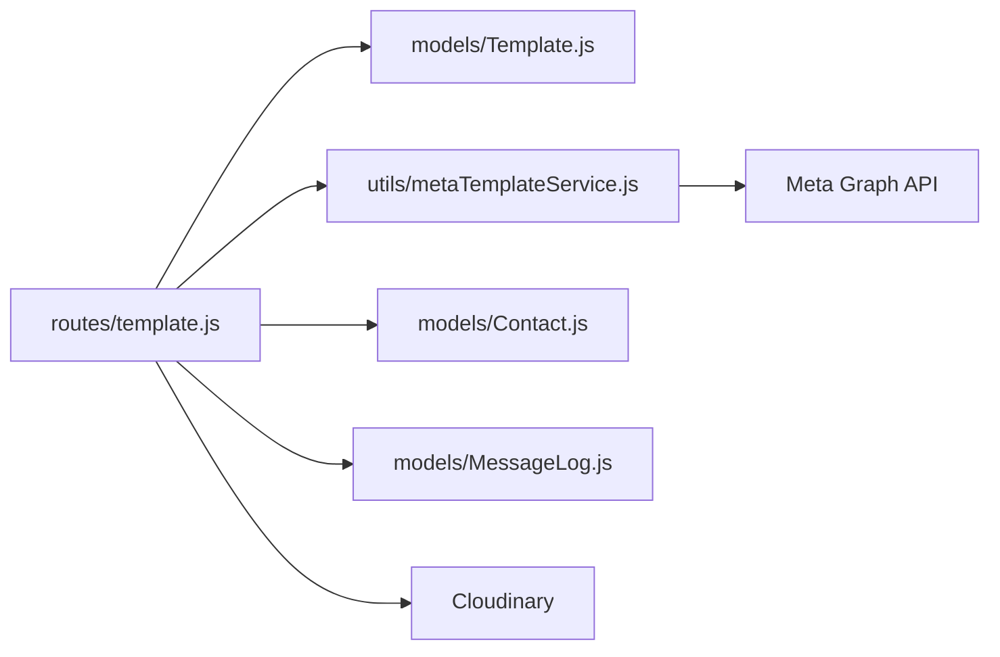

**Diagram sources**
- [template.js:1-30](file://backend/routes/template.js#L1-L30)
- [metaTemplateService.js:1-21](file://backend/utils/metaTemplateService.js#L1-L21)

**Section sources**
- [template.js:1-30](file://backend/routes/template.js#L1-L30)
- [metaTemplateService.js:1-21](file://backend/utils/metaTemplateService.js#L1-L21)

## Performance Considerations
- Media handling:
  - Use resumable upload handles for template headers to satisfy Meta requirements.
  - Cache Cloudinary URLs for previews to avoid repeated uploads.
- Broadcasting:
  - Apply delays between sends to respect rate limits.
  - Batch phone lists efficiently and parse robustly.
- Sync operations:
  - Deduplicate by Meta ID and name to prevent redundant records.
  - Clean up outdated templates during sync to reduce database size.
- Caching strategies:
  - Cache Meta credentials and WABA configuration.
  - Cache recent template status responses briefly to reduce API calls.
  - Cache Cloudinary URLs for header images.

[No sources needed since this section provides general guidance]

## Troubleshooting Guide
Common issues and resolutions:
- Missing Meta credentials: Ensure WABA ID and access token are configured before creating or syncing templates.
- Header media failures:
  - Verify file size and MIME type.
  - Confirm resumable upload session creation succeeds.
  - Fallback to local draft with warnings if media preparation fails.
- Meta API errors:
  - Inspect formatted error responses including code and trace ID.
  - Handle “template not found” gracefully during deletion.
- Sending rejected:
  - Confirm `metaStatus` is APPROVED before sending.
  - Refresh status via status endpoint if uncertain.

**Section sources**
- [metaTemplateService.js:6-21](file://backend/utils/metaTemplateService.js#L6-L21)
- [template.js:55-140](file://backend/routes/template.js#L55-L140)
- [template.js:222-247](file://backend/routes/template.js#L222-L247)
- [template.js:397-441](file://backend/routes/template.js#L397-L441)

## Conclusion
The system implements a robust template lifecycle centered on Meta’s immutable content model:
- Creation and sync maintain alignment with Meta’s canonical definitions.
- Updates require recreation to comply with Meta policies.
- Approval is enforced before deployment, with local status mirrored from Meta.
- Scheduling and broadcasting provide operational control.
- Auditability and version history can be enhanced by introducing explicit version snapshots and audit logs.
- Performance and scalability benefit from careful media handling, rate limiting, and deduplication.

[No sources needed since this section summarizes without analyzing specific files]

## Appendices

### Example Workflows

#### Creating and Approving a Template
- Submit via `/api/template/meta`.
- Monitor `metaStatus` via `/api/template/meta/:id/status` or sync.
- Once APPROVED, send via `/api/template/send-meta`.

**Section sources**
- [template.js:747-786](file://backend/routes/template.js#L747-L786)
- [template.js:952-979](file://backend/routes/template.js#L952-L979)
- [template.js:397-441](file://backend/routes/template.js#L397-L441)

#### Editing and Recreating a Template
- Attempt PUT `/api/template/:id`.
- If `requiresRecreate` is returned, call POST `/api/template/:id/recreate`.
- Monitor new `metaStatus` until APPROVED.

**Section sources**
- [template.js:547-692](file://backend/routes/template.js#L547-L692)
- [template.js:694-723](file://backend/routes/template.js#L694-L723)

#### Bulk Operations at Scale
- Use `/api/template/sync-meta` to synchronize all templates.
- Use `/api/template/send-meta` with large phone lists; consider batching and delays.

**Section sources**
- [template.js:832-950](file://backend/routes/template.js#L832-L950)
- [template.js:397-441](file://backend/routes/template.js#L397-L441)