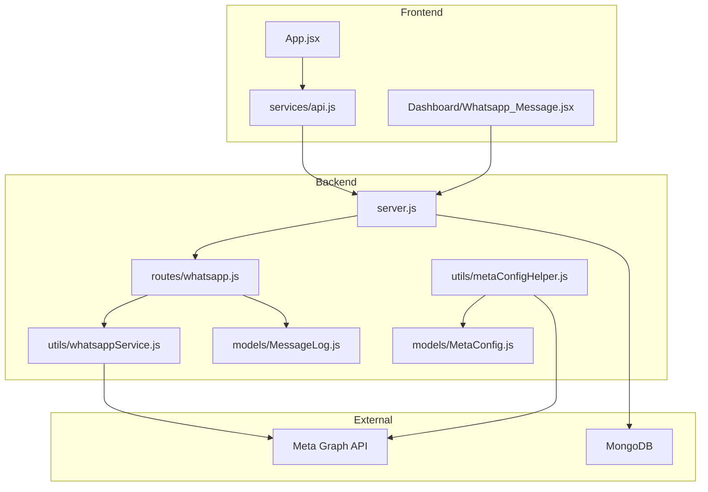
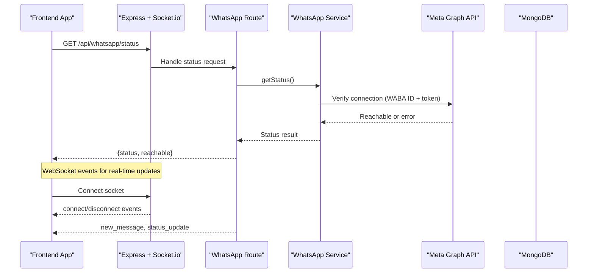
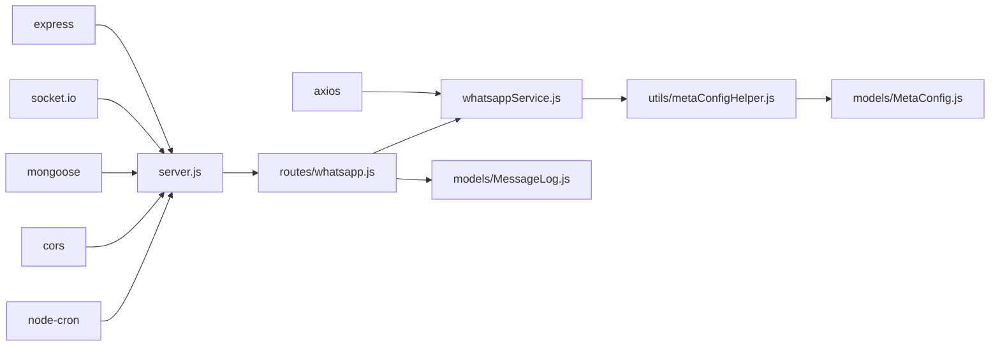

# Troubleshooting & Debugging

<cite>
**Referenced Files in This Document**
- [server.js](file://backend/server.js)
- [whatsapp.js](file://backend/routes/whatsapp.js)
- [whatsappService.js](file://backend/utils/whatsappService.js)
- [metaConfigHelper.js](file://backend/utils/metaConfigHelper.js)
- [MessageLog.js](file://backend/models/MessageLog.js)
- [MetaConfig.js](file://backend/models/MetaConfig.js)
- [api.js](file://frontend/src/services/api.js)
- [Whatsapp_Message.jsx](file://frontend/src/Dashboard/Whatsapp_Message.jsx)
</cite>

## Table of Contents
1. [Introduction](#introduction)
2. [Project Structure](#project-structure)
3. [Core Components](#core-components)
4. [Architecture Overview](#architecture-overview)
5. [Detailed Component Analysis](#detailed-component-analysis)
6. [Dependency Analysis](#dependency-analysis)
7. [Performance Considerations](#performance-considerations)
8. [Troubleshooting Guide](#troubleshooting-guide)
9. [Conclusion](#conclusion)

## Introduction
This document provides a comprehensive troubleshooting and debugging guide for the WhatsApp automation system. It focuses on common integration failures, real-time communication issues, database connectivity problems, performance bottlenecks, memory leaks, logging strategies, error tracking, monitoring setup, environment-specific issues, dependency conflicts, and upgrade or migration problems. The guidance is grounded in the actual backend and frontend implementation to ensure accurate diagnosis and resolution.

## Project Structure
The project consists of:
- Backend Express server with Socket.io for real-time events
- MongoDB via Mongoose for persistent storage
- Meta WhatsApp Business API integration through REST endpoints
- Frontend React application with WebSocket client and polling fallbacks

**Diagram sources**
- [server.js:11-22](file://backend/server.js#L11-L22)
- [whatsapp.js:1-5](file://backend/routes/whatsapp.js#L1-L5)
- [whatsappService.js:1-4](file://backend/utils/whatsappService.js#L1-L4)
- [metaConfigHelper.js:1-2](file://backend/utils/metaConfigHelper.js#L1-L2)
- [MessageLog.js:1-2](file://backend/models/MessageLog.js#L1-L2)
- [MetaConfig.js:1-2](file://backend/models/MetaConfig.js#L1-L2)
- [api.js:1-14](file://frontend/src/services/api.js#L1-L14)
- [Whatsapp_Message.jsx:1-3](file://frontend/src/Dashboard/Whatsapp_Message.jsx#L1-L3)

**Section sources**
- [server.js:11-80](file://backend/server.js#L11-L80)
- [whatsapp.js:1-335](file://backend/routes/whatsapp.js#L1-L335)
- [whatsappService.js:1-228](file://backend/utils/whatsappService.js#L1-L228)
- [metaConfigHelper.js:1-112](file://backend/utils/metaConfigHelper.js#L1-L112)
- [MessageLog.js:1-22](file://backend/models/MessageLog.js#L1-L22)
- [MetaConfig.js:1-13](file://backend/models/MetaConfig.js#L1-L13)
- [api.js:1-73](file://frontend/src/services/api.js#L1-L73)
- [Whatsapp_Message.jsx:1-368](file://frontend/src/Dashboard/Whatsapp_Message.jsx#L1-L368)

## Core Components
- Backend server initialization, CORS, routes, global error handler, MongoDB connection, and Socket.io server are defined in the main server file.
- WhatsApp route handlers manage configuration, webhook verification, incoming message processing, status updates, and message retrieval.
- WhatsApp service functions call Meta Graph API for sending messages and checking connection status.
- Meta configuration helper manages credentials caching, validation against Meta, and environment fallbacks.
- Message log model stores inbound/outbound messages and delivery statuses.
- Frontend API utility defines base URLs, health checks, and WebSocket URL derivation.
- Frontend WhatsApp component implements WebSocket connections, event handling, polling, and optimistic UI updates.

**Section sources**
- [server.js:11-80](file://backend/server.js#L11-L80)
- [whatsapp.js:8-109](file://backend/routes/whatsapp.js#L8-L109)
- [whatsappService.js:25-59](file://backend/utils/whatsappService.js#L25-L59)
- [metaConfigHelper.js:6-35](file://backend/utils/metaConfigHelper.js#L6-L35)
- [MessageLog.js:3-19](file://backend/models/MessageLog.js#L3-L19)
- [api.js:1-14](file://frontend/src/services/api.js#L1-L14)
- [Whatsapp_Message.jsx:301-368](file://frontend/src/Dashboard/Whatsapp_Message.jsx#L301-L368)

## Architecture Overview
The system integrates three major flows:
- REST API for configuration, messaging, and template management
- Webhook ingestion from Meta for incoming messages and delivery statuses
- Real-time WebSocket events for live chat and status updates

**Diagram sources**
- [whatsapp.js:8-22](file://backend/routes/whatsapp.js#L8-L22)
- [whatsappService.js:25-32](file://backend/utils/whatsappService.js#L25-L32)
- [metaConfigHelper.js:73-99](file://backend/utils/metaConfigHelper.js#L73-L99)
- [server.js:14-35](file://backend/server.js#L14-L35)

## Detailed Component Analysis

### WhatsApp Configuration and Credentials
- Credentials can be stored in MongoDB via MetaConfig model or fall back to environment variables.
- A cache layer avoids repeated database reads; clearing the cache forces re-syncing with environment values.
- Validation against Meta Graph API ensures tokens and WABA IDs are correct before saving.

Common issues:
- Missing or invalid access token, WABA ID, or phone number ID
- Stale cached credentials after environment changes
- Incorrect graph version causing API errors

Resolution steps:
- Use the configuration endpoint to update credentials and verify connection.
- Clear the config cache when switching environments or updating .env values.
- Ensure the graph version matches Meta’s supported versions.

**Section sources**
- [metaConfigHelper.js:6-35](file://backend/utils/metaConfigHelper.js#L6-L35)
- [metaConfigHelper.js:37-70](file://backend/utils/metaConfigHelper.js#L37-L70)
- [metaConfigHelper.js:73-99](file://backend/utils/metaConfigHelper.js#L73-L99)
- [MetaConfig.js:3-10](file://backend/models/MetaConfig.js#L3-L10)
- [whatsapp.js:38-109](file://backend/routes/whatsapp.js#L38-L109)

### Webhook Verification and Incoming Messages
- Webhook verification requires matching hub.verify_token with configured verifyToken.
- Incoming messages are parsed, normalized, persisted to MessageLog, and broadcast via WebSocket.
- Contacts are auto-upserted so inbound senders appear in the contacts list.

Common issues:
- Webhook verification fails due to mismatched verify token
- Webhook path not publicly accessible or blocked by firewall/proxy
- Message normalization errors leading to incorrect phone numbers

Resolution steps:
- Confirm verifyToken matches both Meta dashboard and backend configuration.
- Validate public webhook URL and ensure it returns the challenge correctly.
- Check logs for phone normalization and confirm consistent digit formats.

**Section sources**
- [whatsapp.js:114-132](file://backend/routes/whatsapp.js#L114-L132)
- [whatsapp.js:135-233](file://backend/routes/whatsapp.js#L135-L233)
- [MessageLog.js:3-19](file://backend/models/MessageLog.js#L3-L19)

### Message Delivery and Status Updates
- Delivery statuses from Meta are processed and updated in MessageLog.
- WebSocket emits status_update events for real-time UI synchronization.
- Error codes and messages are captured for failed deliveries.

Common issues:
- Status updates not reflected in UI due to WebSocket disconnects
- Duplicate or missing status entries caused by race conditions
- Errors from Meta not surfaced properly

Resolution steps:
- Monitor WebSocket connection state and reconnect if necessary.
- Deduplicate messages using wamid keys.
- Log and surface Meta error codes and messages for diagnostics.

**Section sources**
- [whatsapp.js:236-300](file://backend/routes/whatsapp.js#L236-L300)
- [Whatsapp_Message.jsx:350-360](file://frontend/src/Dashboard/Whatsapp_Message.jsx#L350-L360)

### Outbound Messaging via Meta API
- Text, image, buttons, polls, lists, and templates are sent through WhatsApp service functions.
- Media upload requires separate Meta media endpoint calls for local files.
- Authorization headers must include valid Bearer token.

Common issues:
- Invalid or expired access token
- Incorrect phone number formatting
- Media upload failures due to unsupported formats or size limits

Resolution steps:
- Validate token and WABA connection before sending.
- Normalize phone numbers to required format.
- Upload media first and use returned media ID in message payload.

**Section sources**
- [whatsappService.js:45-59](file://backend/utils/whatsappService.js#L45-L59)
- [whatsappService.js:61-78](file://backend/utils/whatsappService.js#L61-L78)
- [whatsappService.js:80-123](file://backend/utils/whatsappService.js#L80-L123)
- [whatsappService.js:125-192](file://backend/utils/whatsappService.js#L125-L192)
- [whatsappService.js:194-215](file://backend/utils/whatsappService.js#L194-L215)

### WebSocket Connection and Real-Time Events
- Backend initializes Socket.io server and exposes connection, room join, and disconnect events.
- Frontend connects via socket.io-client, listens for new_message, auto_reply, and status_update events.
- Polling fallbacks exist for robustness when WebSocket is unavailable.

Common issues:
- CORS misconfiguration blocking WebSocket handshake
- Frontend WS_URL derived incorrectly from API base URL
- Event handlers not attached due to early component unmount

Resolution steps:
- Ensure CORS allows the frontend origin and methods.
- Verify WS_URL uses ws/wss scheme based on API base URL.
- Attach event listeners within proper lifecycle hooks and clean up on unmount.

**Section sources**
- [server.js:14-35](file://backend/server.js#L14-L35)
- [api.js:12-14](file://frontend/src/services/api.js#L12-L14)
- [Whatsapp_Message.jsx:301-368](file://frontend/src/Dashboard/Whatsapp_Message.jsx#L301-L368)

### Database Connectivity and Models
- MongoDB connection is established at startup with error logging.
- MessageLog schema includes fields for direction, status, text, senderName, templateName, headerImageUrl, buttons, timestamp, errorCode, errorMessage, pricing, phoneId, wabaId.
- MetaConfig schema stores WABA ID, phone ID, access token, verify token, graph version, and update timestamp.

Common issues:
- MongoDB URI misconfigured or unreachable
- Schema mismatches causing write failures
- Unique constraint violations on wamid

Resolution steps:
- Validate MONGODB_URI and network connectivity.
- Align schema definitions with data payloads.
- Handle unique key errors and deduplicate by wamid.

**Section sources**
- [server.js:64-77](file://backend/server.js#L64-L77)
- [MessageLog.js:3-19](file://backend/models/MessageLog.js#L3-L19)
- [MetaConfig.js:3-10](file://backend/models/MetaConfig.js#L3-L10)

## Dependency Analysis
Key dependencies and their roles:
- express: HTTP server and routing
- socket.io: Real-time bidirectional communication
- mongoose: MongoDB ODM
- axios: HTTP client for Meta Graph API
- cors: Cross-origin resource sharing
- node-cron: Scheduled tasks for broadcasts

Potential coupling points:
- Routes depend on utils for credential management and API calls
- Frontend depends on backend routes and WebSocket server
- Models define data contracts used across routes and services

**Diagram sources**
- [server.js:1-10](file://backend/server.js#L1-L10)
- [whatsapp.js:1-5](file://backend/routes/whatsapp.js#L1-L5)
- [whatsappService.js:1-4](file://backend/utils/whatsappService.js#L1-L4)
- [metaConfigHelper.js:1-2](file://backend/utils/metaConfigHelper.js#L1-L2)
- [MessageLog.js:1-2](file://backend/models/MessageLog.js#L1-L2)
- [MetaConfig.js:1-2](file://backend/models/MetaConfig.js#L1-L2)

**Section sources**
- [server.js:1-10](file://backend/server.js#L1-L10)
- [whatsapp.js:1-5](file://backend/routes/whatsapp.js#L1-L5)
- [whatsappService.js:1-4](file://backend/utils/whatsappService.js#L1-L4)
- [metaConfigHelper.js:1-2](file://backend/utils/metaConfigHelper.js#L1-L2)
- [MessageLog.js:1-2](file://backend/models/MessageLog.js#L1-L2)
- [MetaConfig.js:1-2](file://backend/models/MetaConfig.js#L1-L2)

## Performance Considerations
- Large JSON payloads: Request body limit set to 50MB; consider reducing for typical messages.
- Frequent polling: Frontend polls every 3 seconds; adjust interval based on traffic and latency requirements.
- MongoDB queries: Message retrieval uses sorting and limits; ensure indexes on phone and timestamp fields.
- WebSocket scaling: Single-process Socket.io may not scale horizontally without a Redis adapter.
- Memory usage: Avoid retaining large objects in closures; clean up intervals and event listeners.

[No sources needed since this section provides general guidance]

## Troubleshooting Guide

### Webhook Configuration Errors
Symptoms:
- Meta dashboard reports verification failure
- No incoming messages received
- 403 or 400 responses during verification

Diagnostic steps:
- Verify hub.mode equals subscribe and hub.verify_token matches backend verifyToken.
- Ensure the webhook URL is publicly accessible and not blocked by firewalls or proxies.
- Check backend logs for WEBHOOK_VERIFIED and any parsing errors.

Resolution:
- Update verifyToken in Meta dashboard and backend configuration to match.
- Restart the server to clear caches if necessary.
- Test verification again and monitor logs.

**Section sources**
- [whatsapp.js:114-132](file://backend/routes/whatsapp.js#L114-L132)

### Authentication Failures
Symptoms:
- Status endpoint returns DISCONNECTED
- Sending messages fails with authorization errors
- Meta validation fails when saving credentials

Diagnostic steps:
- Call status endpoint to check reachability.
- Validate access token and WABA ID in configuration.
- Inspect Meta validation response for error details.

Resolution:
- Regenerate access token and update configuration.
- Clear config cache and re-save credentials.
- Confirm graph version compatibility.

**Section sources**
- [whatsapp.js:8-22](file://backend/routes/whatsapp.js#L8-L22)
- [metaConfigHelper.js:73-99](file://backend/utils/metaConfigHelper.js#L73-L99)
- [whatsappService.js:25-32](file://backend/utils/whatsappService.js#L25-L32)

### Message Delivery Issues
Symptoms:
- Messages show sent but never delivered or read
- Failed status with error code
- Template messages not rendering correctly

Diagnostic steps:
- Retrieve message logs and inspect status, errorCode, errorMessage.
- Validate phone number formatting.
- Check template approval status and components.

Resolution:
- Correct phone number format and retry.
- Approve templates in Meta dashboard.
- Fix template components and resend.

**Section sources**
- [whatsapp.js:236-300](file://backend/routes/whatsapp.js#L236-L300)
- [whatsappService.js:194-215](file://backend/utils/whatsappService.js#L194-L215)

### WebSocket Connection Problems
Symptoms:
- Frontend shows disconnected state
- Real-time events not received
- CORS errors in browser console

Diagnostic steps:
- Check browser console for CORS and WebSocket errors.
- Verify WS_URL derivation and server CORS settings.
- Confirm server is listening and Socket.io initialized.

Resolution:
- Adjust CORS to allow frontend origin and methods.
- Ensure WS_URL uses ws/wss scheme.
- Reconnect client and monitor connect/disconnect events.

**Section sources**
- [server.js:14-35](file://backend/server.js#L14-L35)
- [api.js:12-14](file://frontend/src/services/api.js#L12-L14)
- [Whatsapp_Message.jsx:301-368](file://frontend/src/Dashboard/Whatsapp_Message.jsx#L301-L368)

### Real-Time Communication Failures
Symptoms:
- new_message or status_update events not appearing
- UI not updating despite backend emitting events
- Intermittent disconnections

Diagnostic steps:
- Inspect backend logs for emitted events.
- Verify frontend event listeners are attached.
- Check for component unmounting and cleanup.

Resolution:
- Ensure event handlers are registered in useEffect with proper dependencies.
- Add reconnection logic and handle disconnect events.
- Debounce or throttle frequent events if necessary.

**Section sources**
- [whatsapp.js:206-211](file://backend/routes/whatsapp.js#L206-L211)
- [whatsapp.js:293-297](file://backend/routes/whatsapp.js#L293-L297)
- [Whatsapp_Message.jsx:321-360](file://frontend/src/Dashboard/Whatsapp_Message.jsx#L321-L360)

### Frontend-Backend Synchronization Issues
Symptoms:
- Optimistic UI updates not reconciled with server state
- Duplicate messages in chat view
- Unread counts not updating

Diagnostic steps:
- Compare optimistic message IDs with server-generated wamid.
- Check polling intervals and fetch endpoints.
- Validate unread count calculation logic.

Resolution:
- Deduplicate messages by wamid.
- Adjust polling frequency and error handling.
- Sync lastSeen timestamps to mark messages as read.

**Section sources**
- [Whatsapp_Message.jsx:321-360](file://frontend/src/Dashboard/Whatsapp_Message.jsx#L321-L360)
- [Whatsapp_Message.jsx:548-583](file://frontend/src/Dashboard/Whatsapp_Message.jsx#L548-L583)

### Database Connectivity Problems
Symptoms:
- Server fails to start due to MongoDB connection error
- Write operations fail intermittently
- Unique constraint errors on wamid

Diagnostic steps:
- Check MongoDB URI and network connectivity.
- Review server startup logs for connection errors.
- Inspect database constraints and indexes.

Resolution:
- Fix MONGODB_URI and ensure database is reachable.
- Add retries and exponential backoff for transient errors.
- Create appropriate indexes on frequently queried fields.

**Section sources**
- [server.js:64-77](file://backend/server.js#L64-L77)
- [MessageLog.js:3-19](file://backend/models/MessageLog.js#L3-L19)

### Performance Bottlenecks
Symptoms:
- Slow API responses
- High CPU or memory usage
- Lag in real-time updates

Diagnostic steps:
- Profile API endpoints and database queries.
- Monitor WebSocket connection counts and event throughput.
- Analyze polling frequency and payload sizes.

Resolution:
- Optimize queries and add indexes.
- Reduce payload sizes and limit results.
- Scale horizontally with load balancer and Redis adapter for Socket.io.

[No sources needed since this section provides general guidance]

### Memory Leaks
Symptoms:
- Gradual memory increase over time
- Frequent garbage collection pauses
- Degraded performance under load

Diagnostic steps:
- Take heap snapshots and analyze retained objects.
- Check for unclosed intervals, event listeners, or large in-memory caches.
- Review WebSocket connection lifecycle and cleanup.

Resolution:
- Clear intervals and remove event listeners on unmount.
- Limit cache sizes and implement eviction policies.
- Monitor process memory and restart periodically if necessary.

[No sources needed since this section provides general guidance]

### Logging Strategies and Error Tracking
Current logging:
- Console logs for WebSocket events, webhook processing, and Meta API errors
- Global error handler logs stack traces and returns generic error responses

Recommended enhancements:
- Implement structured logging with levels (info, warn, error)
- Centralize error tracking with an external service
- Correlate requests with unique IDs for tracing

**Section sources**
- [server.js:58-62](file://backend/server.js#L58-L62)
- [whatsapp.js:161-161](file://backend/routes/whatsapp.js#L161-L161)
- [whatsapp.js:259-260](file://backend/routes/whatsapp.js#L259-L260)
- [whatsappService.js:54-58](file://backend/utils/whatsappService.js#L54-L58)

### Monitoring Tools Configuration
Suggested tools:
- Application metrics (request latency, error rates)
- WebSocket connection metrics (active connections, reconnection rate)
- Database performance metrics (query latency, connection pool)
- External API monitoring (Meta Graph API availability and error rates)

Implementation approach:
- Integrate a metrics library to expose Prometheus-compatible endpoints
- Set up alerting rules for critical thresholds
- Dashboard visualization for operational visibility

[No sources needed since this section provides general guidance]

### Step-by-Step Debugging Procedures

#### Complex Issue: Webhook Not Delivering Messages
1. Verify webhook URL and verifyToken in Meta dashboard and backend.
2. Test verification endpoint and confirm challenge response.
3. Send a test message and check backend logs for incoming message processing.
4. Inspect MessageLog entries for persistence.
5. Validate WebSocket emission and frontend reception.

**Section sources**
- [whatsapp.js:114-132](file://backend/routes/whatsapp.js#L114-L132)
- [whatsapp.js:135-233](file://backend/routes/whatsapp.js#L135-L233)
- [Whatsapp_Message.jsx:321-360](file://frontend/src/Dashboard/Whatsapp_Message.jsx#L321-L360)

#### Complex Issue: Outbound Template Messages Failing
1. Check Meta configuration and connection status.
2. Validate template approval and components.
3. Inspect API error responses and error codes.
4. Retry with corrected parameters and monitor logs.

**Section sources**
- [whatsapp.js:8-22](file://backend/routes/whatsapp.js#L8-L22)
- [whatsappService.js:194-215](file://backend/utils/whatsappService.js#L194-L215)
- [metaConfigHelper.js:73-99](file://backend/utils/metaConfigHelper.js#L73-L99)

#### Complex Issue: Real-Time Chat Not Updating
1. Confirm WebSocket connection state in frontend.
2. Check backend event emissions for new_message and status_update.
3. Validate event handlers and state updates.
4. Inspect polling fallback behavior and intervals.

**Section sources**
- [server.js:14-35](file://backend/server.js#L14-L35)
- [whatsapp.js:206-211](file://backend/routes/whatsapp.js#L206-L211)
- [whatsapp.js:293-297](file://backend/routes/whatsapp.js#L293-L297)
- [Whatsapp_Message.jsx:301-368](file://frontend/src/Dashboard/Whatsapp_Message.jsx#L301-L368)

### Log Analysis Techniques
- Filter logs by keywords such as WEBHOOK, WEBSOCKET, META, ERROR.
- Correlate timestamps between frontend events and backend processing.
- Extract error codes and messages for targeted fixes.
- Use structured logs to aggregate metrics and trends.

[No sources needed since this section provides general guidance]

### Performance Profiling Methods
- Use Node.js profiler and heap snapshots to identify leaks.
- Benchmark API endpoints with load testing tools.
- Monitor WebSocket throughput and latency.
- Analyze database query plans and optimize indexes.

[No sources needed since this section provides general guidance]

### Environment-Specific Issues
- Local development vs production CORS differences
- Port binding and firewall restrictions
- Environment variable precedence (MongoDB URI, Meta tokens)

Resolution:
- Configure CORS explicitly for each environment.
- Open required ports and configure reverse proxy settings.
- Validate environment variables and reload server after changes.

**Section sources**
- [server.js:37-41](file://backend/server.js#L37-L41)
- [server.js:64-77](file://backend/server.js#L64-L77)
- [metaConfigHelper.js:25-34](file://backend/utils/metaConfigHelper.js#L25-L34)

### Dependency Conflicts and Upgrade/Migration Problems
- Node.js version compatibility with dependencies
- Socket.io and axios version mismatches
- Mongoose schema migrations and data integrity

Resolution:
- Lock dependency versions and validate compatibility matrices.
- Test upgrades in staging environments before production rollout.
- Implement migration scripts to update schemas and data safely.

[No sources needed since this section provides general guidance]

## Conclusion
This troubleshooting guide consolidates common issues and systematic debugging approaches for the WhatsApp automation system. By focusing on configuration validation, webhook verification, outbound messaging, real-time communication, database connectivity, performance tuning, and environment considerations, operators can diagnose and resolve problems efficiently. Enhancing logging, error tracking, and monitoring will further improve observability and reliability.