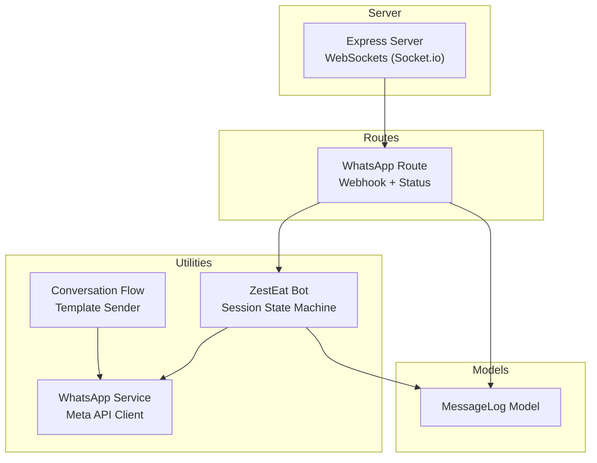
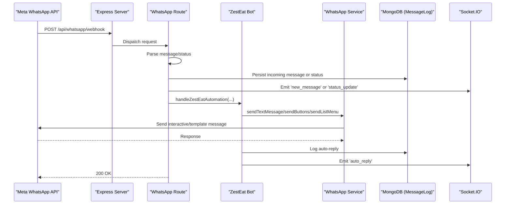
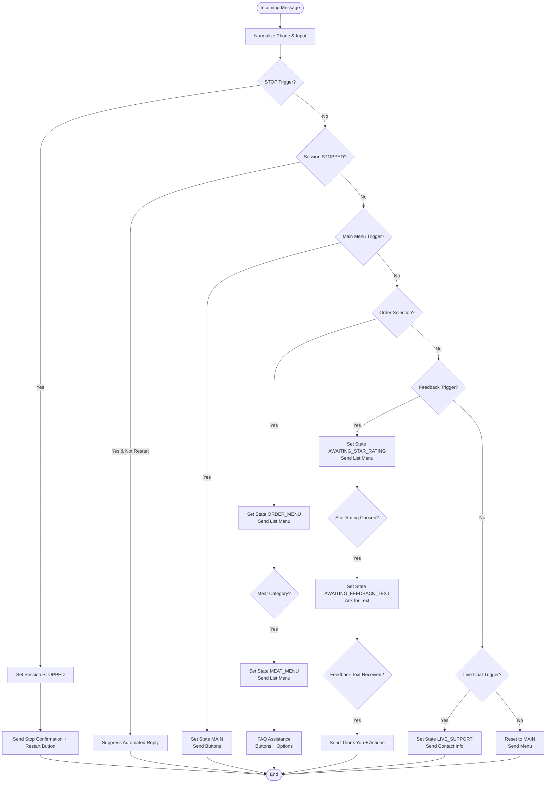
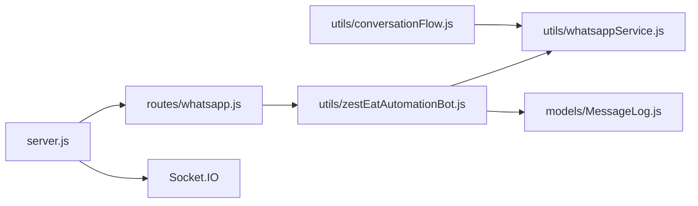

# Conversation Flow Automation Engine

<cite>
**Referenced Files in This Document**
- [server.js](file://backend/server.js)
- [whatsapp.js](file://backend/routes/whatsapp.js)
- [zestEatAutomationBot.js](file://backend/utils/zestEatAutomationBot.js)
- [conversationFlow.js](file://backend/utils/conversationFlow.js)
- [whatsappService.js](file://backend/utils/whatsappService.js)
- [MessageLog.js](file://backend/models/MessageLog.js)
</cite>

## Table of Contents
1. [Introduction](#introduction)
2. [Project Structure](#project-structure)
3. [Core Components](#core-components)
4. [Architecture Overview](#architecture-overview)
5. [Detailed Component Analysis](#detailed-component-analysis)
6. [Dependency Analysis](#dependency-analysis)
7. [Performance Considerations](#performance-considerations)
8. [Troubleshooting Guide](#troubleshooting-guide)
9. [Conclusion](#conclusion)
10. [Appendices](#appendices)

## Introduction
This document explains the conversation flow automation engine and bot functionality for WhatsApp interactions. It covers how incoming messages are processed, how automated responses are generated, how multi-turn conversations are managed, and how the ZestEat automation bot implements predefined flows with buttons and list menus. It also documents state management, session tracking, persistence, error handling, testing strategies, and guidelines for designing effective conversational flows.

## Project Structure
The automation engine is implemented in the backend:
- Express server initializes HTTP, WebSockets, routes, and MongoDB connection.
- The WhatsApp webhook route receives Meta events, persists logs, and invokes the automation bot.
- The ZestEat bot manages in-memory sessions and orchestrates button/list interactions.
- WhatsApp service utilities send text, buttons, lists, images, and templates to Meta.
- A separate conversation flow utility supports sending Meta templates with media headers and body variables.

**Diagram sources**
- [server.js:11-22](file://backend/server.js#L11-L22)
- [whatsapp.js:135-229](file://backend/routes/whatsapp.js#L135-L229)
- [zestEatAutomationBot.js:12-394](file://backend/utils/zestEatAutomationBot.js#L12-L394)
- [whatsappService.js:61-215](file://backend/utils/whatsappService.js#L61-L215)
- [conversationFlow.js:21-118](file://backend/utils/conversationFlow.js#L21-L118)
- [MessageLog.js:1-22](file://backend/models/MessageLog.js#L1-L22)

**Section sources**
- [server.js:11-80](file://backend/server.js#L11-L80)
- [whatsapp.js:111-311](file://backend/routes/whatsapp.js#L111-L311)

## Core Components
- WhatsApp Webhook Router: Validates webhooks, parses incoming messages and statuses, persists logs, emits real-time events, and triggers automation.
- ZestEat Automation Bot: Implements a state machine for multi-turn conversations, including main menu, order categories, meat selection, FAQ assistance, star rating, feedback capture, live support, and stop behavior.
- WhatsApp Service: Low-level client for Meta API, supporting text, buttons, lists, images, and template messages.
- Conversation Flow Utility: Sends Meta templates with optional media headers and body parameters.
- MessageLog Model: Persists message history, directions, statuses, errors, pricing, and metadata.

Key responsibilities:
- Intent recognition: Keyword and payload matching against known states and actions.
- Context management: In-memory session map keyed by phone number.
- Multi-turn handling: State transitions across ordered flows and feedback collection.
- Persistence: Incoming/outgoing messages and statuses stored in MongoDB; auto-reply logs emitted via WebSocket.

**Section sources**
- [whatsapp.js:135-229](file://backend/routes/whatsapp.js#L135-L229)
- [zestEatAutomationBot.js:12-394](file://backend/utils/zestEatAutomationBot.js#L12-L394)
- [whatsappService.js:61-215](file://backend/utils/whatsappService.js#L61-L215)
- [conversationFlow.js:21-118](file://backend/utils/conversationFlow.js#L21-L118)
- [MessageLog.js:1-22](file://backend/models/MessageLog.js#L1-L22)

## Architecture Overview
The system processes WhatsApp events through a webhook endpoint, normalizes inputs, persists logs, and delegates to the automation bot when appropriate. The bot uses an in-memory state machine to drive interactive flows and sends rich messages via the WhatsApp service. Real-time updates are broadcast over Socket.IO.

**Diagram sources**
- [whatsapp.js:135-229](file://backend/routes/whatsapp.js#L135-L229)
- [zestEatAutomationBot.js:12-394](file://backend/utils/zestEatAutomationBot.js#L12-L394)
- [whatsappService.js:61-215](file://backend/utils/whatsappService.js#L61-L215)
- [MessageLog.js:1-22](file://backend/models/MessageLog.js#L1-L22)

## Detailed Component Analysis

### WhatsApp Webhook Pipeline
Responsibilities:
- Verify webhook subscription token.
- Parse incoming messages (text, button, interactive).
- Normalize phone numbers and extract sender name.
- Upsert contact records automatically.
- Persist incoming messages and statuses to MessageLog.
- Emit real-time events via Socket.IO.
- Invoke the ZestEat automation bot with normalized input and context.

Error handling:
- Graceful fallbacks for missing fields.
- Logging and non-fatal errors do not block response.

Integration points:
- Uses metaConfigHelper for credentials.
- Emits events to frontend clients.

**Section sources**
- [whatsapp.js:114-132](file://backend/routes/whatsapp.js#L114-L132)
- [whatsapp.js:135-229](file://backend/routes/whatsapp.js#L135-L229)
- [whatsapp.js:236-311](file://backend/routes/whatsapp.js#L236-L311)

### ZestEat Automation Bot
Responsibilities:
- Maintain per-phone session state in an in-memory Map.
- Recognize intents from text and interactive payloads.
- Drive multi-turn flows:
  - Main menu navigation.
  - Order categories and meat selection.
  - FAQ assistance with quick actions.
  - Star rating and written feedback capture.
  - Live support redirection.
  - Stop conversation suppression.
- Send rich UI elements: buttons and list menus.
- Log auto-replies and emit WebSocket events.

State machine highlights:
- States include MAIN, ORDER_MENU, MEAT_MENU, FAQ_VIEW, AWAITING_STAR_RATING, AWAITING_FEEDBACK_TEXT, LIVE_SUPPORT, STOPPED.
- Transitions are driven by user input and current state.

Fallback behavior:
- If rich components fail, send plain text alternatives.
- Unknown input resets to MAIN menu.

Persistence:
- Auto-reply logs created in MessageLog with direction OUTGOING and isAutoReply flag.

**Diagram sources**
- [zestEatAutomationBot.js:23-366](file://backend/utils/zestEatAutomationBot.js#L23-L366)

**Section sources**
- [zestEatAutomationBot.js:12-394](file://backend/utils/zestEatAutomationBot.js#L12-L394)

### WhatsApp Service Utilities
Capabilities:
- Send text messages with automatic STOP instruction appended unless already present.
- Send interactive buttons (up to three) with titles and IDs.
- Send interactive list menus with sections and rows.
- Upload local media to Meta and send images.
- Send Meta templates with optional header media and body parameters.

Phone normalization:
- Ensures country code presence and strips non-digits.

Error handling:
- Logs Meta API errors and throws descriptive errors for callers.

**Section sources**
- [whatsappService.js:34-78](file://backend/utils/whatsappService.js#L34-L78)
- [whatsappService.js:125-192](file://backend/utils/whatsappService.js#L125-L192)
- [whatsappService.js:194-215](file://backend/utils/whatsappService.js#L194-L215)

### Conversation Flow Utility (Meta Templates)
Purpose:
- Prepare and send Meta templates with optional media headers (image/video/document) and body variables.
- Resolve media either via uploaded Media ID or public URL.
- Handle local file paths and environment-based base URLs.
- Insert customer name into body if variable placeholders exist.

Usage pattern:
- Called by higher-level flows that need templated outbound messages.

**Section sources**
- [conversationFlow.js:21-118](file://backend/utils/conversationFlow.js#L21-L118)

### MessageLog Model
Schema:
- Tracks wamid, phone, direction, status, text, senderName, templateName, headerImageUrl, buttons, timestamp, errorCode, errorMessage, pricing, phoneId, wabaId.

Role in automation:
- Stores incoming messages and outgoing auto-replies.
- Supports real-time UI updates and analytics.

**Section sources**
- [MessageLog.js:1-22](file://backend/models/MessageLog.js#L1-L22)

## Dependency Analysis
High-level dependencies:
- Routes depend on utils for messaging and configuration helpers.
- Bot depends on whatsappService for sending messages and MessageLog for persistence.
- ConversationFlow depends on whatsappService for template sending.
- Server exposes Socket.IO instance used by routes and bot for real-time events.

**Diagram sources**
- [whatsapp.js:1-6](file://backend/routes/whatsapp.js#L1-L6)
- [zestEatAutomationBot.js:1-2](file://backend/utils/zestEatAutomationBot.js#L1-L2)
- [whatsappService.js:1-4](file://backend/utils/whatsappService.js#L1-L4)
- [conversationFlow.js:1-7](file://backend/utils/conversationFlow.js#L1-L7)
- [server.js:11-22](file://backend/server.js#L11-L22)

**Section sources**
- [whatsapp.js:1-6](file://backend/routes/whatsapp.js#L1-L6)
- [zestEatAutomationBot.js:1-2](file://backend/utils/zestEatAutomationBot.js#L1-L2)
- [whatsappService.js:1-4](file://backend/utils/whatsappService.js#L1-L4)
- [conversationFlow.js:1-7](file://backend/utils/conversationFlow.js#L1-L7)
- [server.js:11-22](file://backend/server.js#L11-L22)

## Performance Considerations
- In-memory session storage: Fast access but not persistent across process restarts. For production at scale, consider Redis-backed sessions.
- Interactive messages: Buttons limited to three; lists limited to ten rows per section. Keep options concise to reduce payload size.
- Template usage: Prefer templates for high-volume outbound messages to improve throughput and compliance.
- Media handling: Uploading local files adds latency; prefer hosting media publicly or caching Media IDs.
- WebSocket emissions: Emit only necessary events; avoid flooding clients with redundant updates.

[No sources needed since this section provides general guidance]

## Troubleshooting Guide
Common issues and resolutions:
- Missing Meta credentials: Ensure WABA ID, phone ID, access token, and verify token are configured. The route validates and returns errors when required fields are absent.
- Webhook verification failures: Confirm verifyToken matches between Meta and backend configuration.
- Failed interactive messages: The bot falls back to plain text when buttons/lists fail; check Meta API limits and payload constraints.
- Session not persisting: Since sessions are in-memory, restarting the process clears active sessions. Implement external session store if needed.
- Message logs not updating: Verify MongoDB connection and permissions; check status update processing path.

Operational checks:
- Use the status endpoint to confirm connectivity.
- Inspect logs for Meta API errors and webhook parsing errors.
- Monitor WebSocket events for real-time delivery and read receipts.

**Section sources**
- [whatsapp.js:78-109](file://backend/routes/whatsapp.js#L78-L109)
- [whatsapp.js:114-132](file://backend/routes/whatsapp.js#L114-L132)
- [whatsapp.js:135-229](file://backend/routes/whatsapp.js#L135-L229)
- [whatsapp.js:236-311](file://backend/routes/whatsapp.js#L236-L311)

## Conclusion
The conversation flow automation engine integrates a robust webhook pipeline, a stateful bot for multi-turn interactions, and reliable messaging utilities. It supports rich interactive experiences, template-based communications, and real-time observability. By following the design patterns and guidelines here, you can extend flows, add new responses, and optimize performance while maintaining resilience and clarity.

[No sources needed since this section summarizes without analyzing specific files]

## Appendices

### Creating Custom Conversation Flows
Steps:
- Define new states and transitions in the bot handler.
- Add intent recognition branches for new keywords or payloads.
- Use sendButtons or sendListMenu to guide users.
- Persist any relevant data via MessageLog or other models.
- Emit WebSocket events for real-time UI updates.

Guidelines:
- Keep flows shallow and goal-oriented.
- Provide clear exit points (e.g., STOP, Main Menu).
- Offer fallback text when rich components fail.

**Section sources**
- [zestEatAutomationBot.js:53-78](file://backend/utils/zestEatAutomationBot.js#L53-L78)
- [zestEatAutomationBot.js:80-111](file://backend/utils/zestEatAutomationBot.js#L80-L111)
- [zestEatAutomationBot.js:113-145](file://backend/utils/zestEatAutomationBot.js#L113-L145)
- [zestEatAutomationBot.js:147-196](file://backend/utils/zestEatAutomationBot.js#L147-L196)

### Adding New Bot Responses
Approach:
- Extend the bot’s conditional branches to recognize new inputs.
- Compose response text and attach appropriate buttons or list items.
- Update session state to reflect the next expected action.
- Ensure fallback text is provided for environments where rich components are unsupported.

**Section sources**
- [zestEatAutomationBot.js:198-233](file://backend/utils/zestEatAutomationBot.js#L198-L233)
- [zestEatAutomationBot.js:235-275](file://backend/utils/zestEatAutomationBot.js#L235-L275)
- [zestEatAutomationBot.js:277-310](file://backend/utils/zestEatAutomationBot.js#L277-L310)

### Extending Automation Logic
Options:
- Integrate additional services (CRM, ticketing) within the bot handler after capturing user inputs.
- Use conversationFlow utilities to send templated notifications or confirmations.
- Persist structured conversation data for analytics and reporting.

**Section sources**
- [conversationFlow.js:21-118](file://backend/utils/conversationFlow.js#L21-L118)
- [whatsappService.js:194-215](file://backend/utils/whatsappService.js#L194-L215)

### Conversation Persistence and Error Recovery
- Incoming messages and statuses are persisted in MessageLog.
- Auto-replies are logged with isAutoReply flag and emitted via WebSocket.
- Errors during bot execution are caught and logged without failing the webhook response.
- Consider adding retry logic for failed Meta API calls and exponential backoff.

**Section sources**
- [whatsapp.js:170-204](file://backend/routes/whatsapp.js#L170-L204)
- [whatsapp.js:269-300](file://backend/routes/whatsapp.js#L269-L300)
- [zestEatAutomationBot.js:368-393](file://backend/utils/zestEatAutomationBot.js#L368-L393)

### Testing Strategies for Automated Conversations
- Unit tests for bot state transitions and intent recognition.
- Integration tests simulating webhook payloads (text, button, interactive).
- Mock Meta API responses to validate senders and error paths.
- WebSocket event assertions to ensure real-time updates.
- Load tests to evaluate session memory usage and message throughput.

[No sources needed since this section provides general guidance]

### Guidelines for Effective Conversational Flows
- Clear objectives: Each flow should have a single primary goal.
- Minimal steps: Reduce friction by limiting choices and prompts.
- Consistent navigation: Always provide Back/Main Menu and Stop options.
- Accessibility: Provide plain-text fallbacks for all interactive elements.
- Personalization: Use available context (name, last item) to tailor messages.
- Compliance: Include opt-out instructions and respect STOP requests.

[No sources needed since this section provides general guidance]